[← 返回 Kubernetes 目录]({{ '/subjects/Kubernetes/' | relative_url }})



# 03 Kubeadm 与 Docker 高可用部署

## 3.4 基于 Kubeadm 和 Docker 部署 kubernetes 高可用集群

### 3.4.1 kubeadm 介绍和环境说明

#### 3.4.1.1 kubeadm 介绍


参考文档：
```text
https://kubernetes.io/docs/setup/production-environment/tools/kubeadm/
https://kubernetes.io/docs/setup/production-environment/tools/kubeadm/install-kubeadm/
https://kubernetes.io/zh-cn/docs/setup/production-environment/tools/kubeadm/create-cluster-kubeadm/
https://github.com/kubernetes/kubeadm/blob/master/docs/design/design_v1.10.md
```

kubeadm 是 Kubernetes 社区提供的集群构建工具，负责构建并启动最小化可用集群的基本步骤，也可用于集群的部署、升级、降级和卸载等生命周期管理。其主要职责是初始化并拉起集群，对应下图中背景为蓝色的部分。蓝色区域之外的其他组件仍需自行部署。

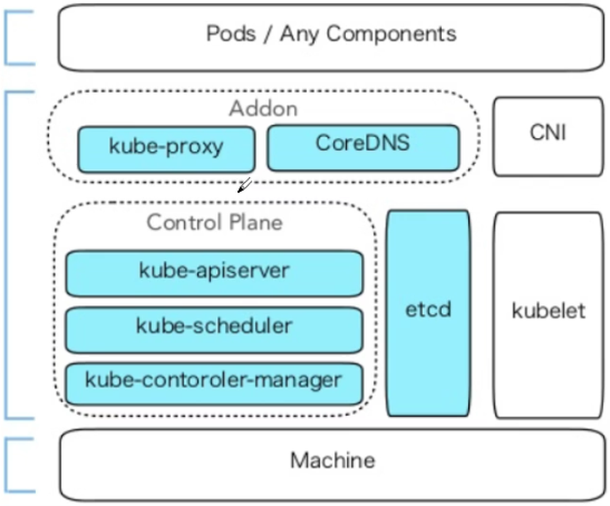

注意：在kubeadm方式安装时，Kubernetes 的所有组件中除kubelet 是以传统服务进程的方式运行，其它都以容器运行。

#### 3.4.1.2 部署环镜说明

本节以 Docker Engine 加 `cri-dockerd` 作为运行时，演示 kubeadm 的高可用部署路径。原始记录混有 Kubernetes 1.22、1.25 与 1.30 的终端输出，它们仅用于说明历史版本行为；实际操作必须先选定一个受支持的目标版本，并让仓库、组件和镜像版本保持一致。Kubernetes 1.24 起不再内置 dockershim，因此本路径必须安装与 Docker 连接的 `cri-dockerd`。若不需要 Docker Engine，可参阅下一章的 containerd 路径。

部署环境：

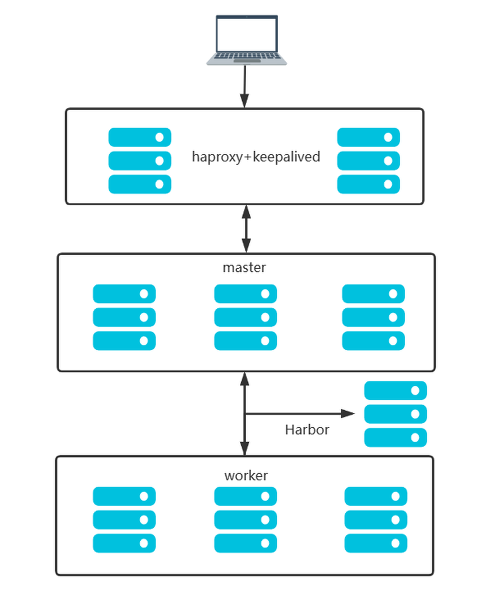

| IP | 主机名 | 角色 |
| --- | --- | --- |
| 10.0.0.101–103 | master1–3.bowen.org | 控制平面，堆叠式 etcd |
| 10.0.0.104–106 | node1–3.bowen.org | 工作节点 |
| 10.0.0.107–108 | ha1–2.bowen.org | API 入口的 HAProxy/Keepalived |
| 10.0.0.100 | kubeapi.bowen.org | 高可用 API 入口 VIP |
| 10.0.0.200 | harbor.bowen.org | 可选的私有镜像仓库 |

注意： Master节点内存至少2G以上，否则在初始化时会出错。
```text
[ERROR Mem]: the system RAM (952 MB) is less than the minimum 1700 MB
```

**网络地址规划**
```text
物理主机网络         10.0.0.0/24
集群pod网络         --pod-network-cidr=10.244.0.0/16
应用service网络     --service-cidr=10.96.0.0/12
```

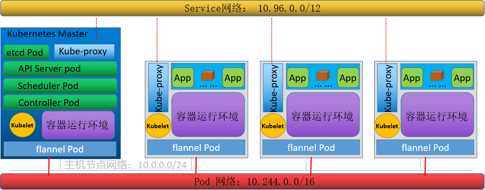

#### 3.4.1.3 基于 kubeadm 和 Docker 实现Kubernetes集群流程说明

本节操作应依序进行：

1. 规划互不重叠的节点、Pod、Service 网段，准备主机名解析、时间同步、内核与网络端口。
2. 在两台入口机配置 HAProxy/Keepalived，验证 VIP 漂移；私有 Harbor 仓库按需部署。
3. 在所有 Kubernetes 节点配置 Docker Engine、`cri-dockerd` 与 kubelet 所需的 systemd cgroup 驱动。
4. 安装同一 minor 版本的 kubeadm、kubelet 和 kubectl；预拉取与目标版本匹配的镜像。
5. 在第一台控制平面节点运行 `kubeadm init`，随后安装与 Pod 网段一致的 CNI 插件。
6. 加入其他控制平面和工作节点，验证节点、系统 Pod、API 入口与测试 Service。

### 3.4.2 初始环境准备
<https://kubernetes.io/zh-cn/docs/setup/production-environment/tools/kubeadm/install-kubeadm/>

每个节点至少需要 2 核 CPU、2 GiB 内存，且拥有唯一的主机名、MAC 地址和 `product_uuid`。节点之间须互通并能解析 API 入口；完成时间同步、swap 处理、必要的内核参数和防火墙端口配置。SSH 密钥仅用于方便批量管理，不是 Kubernetes 必需条件。具体硬件和系统要求仍以所选 Kubernetes 版本的官方文档为准。

```bash
cat /sys/class/dmi/id/product_uuid  # 比较各节点输出，确认唯一
hostnamectl set-hostname master1.bowen.org
```

以下为各节点共同使用的主机名映射；按实际地址保存到 `/etc/hosts`：

```text
10.0.0.100 kubeapi.bowen.org kubeapi
10.0.0.101 master1.bowen.org master1
10.0.0.102 master2.bowen.org master2
10.0.0.103 master3.bowen.org master3
10.0.0.104 node1.bowen.org  node1
10.0.0.105 node2.bowen.org  node2
10.0.0.106 node3.bowen.org  node3
10.0.0.200 harbor.bowen.org harbor
```

下面是 master1 的 Netplan 示例，网卡名与网关按实际网络调整：

```yaml
network:
  version: 2
  renderer: networkd
  ethernets:
    eth0:
      addresses: [10.0.0.101/24]
      routes:
        - to: default
          via: 10.0.0.2
      nameservers:
        addresses: [180.76.76.76, 223.6.6.6]
```

**端口和协议**
<https://kubernetes.io/zh-cn/docs/reference/networking/ports-and-protocols/#control-plane>

当你在一个有严格网络边界的环境里运行 Kubernetes，例如拥有物理网络防火墙或者拥有公有云中虚拟网络的自有数据中心， 了解 Kubernetes 组件使用了哪些端口和协议是非常有用的。

控制平面节点需要的常见入站端口：

| 协议/端口 | 服务 | 主要访问者 |
| --- | --- | --- |
| TCP 6443 | Kubernetes API Server | 所有节点及管理员 |
| TCP 2379–2380 | etcd | API Server、etcd 成员 |
| TCP 10250 | kubelet API | 控制平面 |
| TCP 10259 | kube-scheduler | 本机控制平面组件 |
| TCP 10257 | kube-controller-manager | 本机控制平面组件 |

尽管 etcd 的端口也列举在控制面的部分，但你也可以在外部自己托管 etcd 集群或者自定义端口。

工作节点还需按实际 CNI 和 Service 类型放通相关流量：

| 协议/端口 | 服务 | 主要访问者 |
| --- | --- | --- |
| TCP 10250 | kubelet API | 控制平面 |
| TCP 10256 | kube-proxy 健康检查 | 负载均衡器（若使用） |
| TCP/UDP 30000–32767 | NodePort Service | 需要访问该 Service 的客户端 |

端口开放范围应限制到实际需要的源地址，具体端口以选定 Kubernetes 版本及 CNI 的文档为准。

#### 3.4.2.1 确认操作系统、组件版本和网络

本示例以 Ubuntu 22.04/24.04 和 `10.0.0.0/24` 节点网络说明步骤，Docker 通过 `cri-dockerd` 接入 Kubernetes。旧版终端输出里出现的 Ubuntu 20.04、Docker 20.10 和 Kubernetes 1.22 不应与本示例的新版本仓库混用。为每台机器选择受支持的系统和容器运行时组合，再统一 Kubernetes minor 版本。

Pod 网络为 `10.244.0.0/16`，Service 网络为 `10.96.0.0/12`；两者与节点网段均不得重叠。先验证各节点能互相通信，且所有 Kubernetes 节点可连接 `kubeapi.bowen.org:6443`。控制平面、工作节点和 CNI 所需端口按前表及网络插件文档开放。

#### 3.4.2.2 SSH 管理（可选）

如果要从 `master1` 批量维护其他主机，可单独为运维账号配置 SSH 密钥并测试连接；这只是管理便利措施。不要把私人密钥复制到节点或仓库。

#### 3.4.2.3 主机名与解析

在各节点设置唯一主机名，并通过 DNS 或 `/etc/hosts` 解析下列映射。这里沿用前述拓扑，Harbor 为 `10.0.0.200`，不是旧记录中的 `10.0.0.109`：

```text
10.0.0.100 kubeapi.bowen.org kubeapi
10.0.0.101 master1.bowen.org master1
10.0.0.102 master2.bowen.org master2
10.0.0.103 master3.bowen.org master3
10.0.0.104 node1.bowen.org node1
10.0.0.105 node2.bowen.org node2
10.0.0.106 node3.bowen.org node3
10.0.0.107 ha1.bowen.org ha1
10.0.0.108 ha2.bowen.org ha2
10.0.0.200 harbor.bowen.org harbor
```

可在 `master1` 上运行 `getent hosts kubeapi.bowen.org`、`getent hosts master2.bowen.org` 验证解析。不要让主机名映射与实际接口 IP 不一致。

#### 3.4.2.4 时间同步

所有节点使用相同的时区和可靠的时间源。Ubuntu 示例：

```bash
timedatectl set-timezone Asia/Shanghai
apt update && apt install -y chrony
systemctl enable --now chrony
chronyc tracking
chronyc sources -v
```

若不能访问默认时间源，先在 `/etc/chrony/chrony.conf` 配置网络内可用的 NTP 源，然后重启 chrony。确认所有节点时间偏差足够小，再继续初始化；etcd 和证书均依赖正确时间。

#### 3.4.2.5 SELinux 与防火墙

Ubuntu 通常使用 AppArmor 而非 SELinux，不必照搬 RHEL 的 `setenforce` 命令。保持安全控制开启，按 Kubernetes 官方端口表及所选 CNI 的协议和端口放通必要流量。演示环境若临时关闭 UFW，先确认上层网络隔离，并记录恢复方案；不要把禁用防火墙当成通用前提。

#### 3.4.2.6 处理 swap

`kubeadm` 默认要求关闭 swap；在所有 Kubernetes 节点分别检查当前启用的交换设备，并根据所选版本的 kubelet 配置决定是否允许 swap。若按本示例关闭：

```bash
swapon --show
swapoff -a
# 编辑 /etc/fstab，注释实际存在的 swap 条目
swapon --show
```

持久化配置后重启验证；不要盲目用正则注释所有包含 `swap` 的行，也不要假设系统一定存在 `swap.img.swap` 服务。

#### 3.4.2.7 内核模块与转发

容器网络通常需要桥接流量进入 iptables 以及 IPv4 转发。对所有 Kubernetes 节点执行，并在应用后检查实际值：

```bash
cat >/etc/modules-load.d/k8s.conf <<'EOF'
overlay
br_netfilter
EOF
modprobe overlay
modprobe br_netfilter
cat >/etc/sysctl.d/k8s.conf <<'EOF'
net.bridge.bridge-nf-call-iptables = 1
net.bridge.bridge-nf-call-ip6tables = 1
net.ipv4.ip_forward = 1
EOF
sysctl --system
sysctl net.bridge.bridge-nf-call-iptables net.ipv4.ip_forward
```
### 3.4.3 可选镜像仓库与高可用 API 入口

私有 Harbor 仓库用于缓存或发布自有镜像，不是 kubeadm 集群必需组件。若启用，应采用与主机架构匹配且受支持的 Harbor 版本，按官方安装文档配置 HTTPS、持久存储和备份；不要把旧版 Docker Compose v1 安装脚本或演示密码直接用于当前环境。所有节点应信任仓库证书，Kubernetes 业务镜像的凭据用 `imagePullSecrets` 管理。

本拓扑的 Kubernetes API 入口由 `ha1`、`ha2` 上的 Keepalived 漂移 `10.0.0.100`，HAProxy 监听 VIP 的 TCP 6443，并把连接转发到三个控制平面节点。VRRP 必须得到网络支持；云环境若不支持二层漂移，应改用云负载均衡。下列设置需要在两台入口机上分别执行，`eth0` 替换为实际网卡。

```bash
apt update && apt install -y haproxy keepalived
cat >/etc/sysctl.d/99-haproxy.conf <<'EOF'
net.ipv4.ip_nonlocal_bind = 1
EOF
sysctl --system
```

保留 HAProxy 配置中已有的 `global` 与 `defaults` 段，再添加 API Server 监听段。初始化时只有 `master1` 可用，另外两台后端会被标记为不健康；加入集群后会自动参与转发。

```haproxy
listen kubernetes-api-6443
    bind 10.0.0.100:6443
    mode tcp
    balance roundrobin
    option tcp-check
    server master1 10.0.0.101:6443 check inter 3s fall 3 rise 3
    server master2 10.0.0.102:6443 check inter 3s fall 3 rise 3
    server master3 10.0.0.103:6443 check inter 3s fall 3 rise 3
```

Keepalived 检查 HAProxy 是否正常，不在检查脚本里反复重启服务。`ha2` 将 `router_id` 设为 `ha2`、`state` 设为 `BACKUP`、`priority` 设为 `80`；两台机器的 `virtual_router_id` 和 VIP 一致。

```bash
cat >/etc/keepalived/check_haproxy.sh <<'EOF'
#!/bin/sh
systemctl is-active --quiet haproxy
EOF
chmod 755 /etc/keepalived/check_haproxy.sh
```

```text
global_defs {
    router_id ha1
    enable_script_security
    script_user root
}
vrrp_script check_haproxy {
    script "/etc/keepalived/check_haproxy.sh"
    interval 2
    fall 3
    rise 2
    weight -30
}
vrrp_instance VI_1 {
    state MASTER
    interface eth0
    virtual_router_id 66
    priority 100
    advert_int 1
    virtual_ipaddress {
        10.0.0.100/24 dev eth0
    }
    track_script {
        check_haproxy
    }
}
```

保存为 `/etc/keepalived/keepalived.conf` 后检查并启动服务：

```bash
haproxy -c -f /etc/haproxy/haproxy.cfg
systemctl enable --now haproxy keepalived
ip address show dev eth0
```

确认 VIP 只在一台入口机上，并通过停用当前持有者的 HAProxy 验证漂移。控制平面尚未初始化时 6443 未响应是预期现象；初始化后再验证 `curl -k https://kubeapi.bowen.org:6443/livez`。不要把未加固的 HAProxy 统计页面暴露到公共网络。

### 3.4.4 所有 Kubernetes 节点配置 Docker 与 cri-dockerd

Docker Engine 本身不是 Kubernetes 1.24+ 的 CRI；`cri-dockerd` 才是 kubelet 连接 Docker 的适配器。在所有控制平面和工作节点安装同一套经过验证的 Docker/CRI 版本，并使 Docker 与 kubelet 的 cgroup 驱动一致。Ubuntu 示例：

```bash
apt update && apt install -y docker.io
install -d /etc/docker
cat >/etc/docker/daemon.json <<'EOF'
{
  "exec-opts": ["native.cgroupdriver=systemd"],
  "log-driver": "json-file",
  "log-opts": {"max-size": "100m", "max-file": "3"}
}
EOF
systemctl enable --now docker
docker info --format '{{.CgroupDriver}}'
```

上面的输出应为 `systemd`。若原有 `daemon.json` 已有镜像仓库或其他设置，应合并 JSON，而不是直接覆盖。镜像加速器、私有仓库与 TLS CA 要按实际网络和仓库证书配置；不要通过关闭证书验证来掩盖信任问题。

从 Mirantis `cri-dockerd` 的固定版本发布页获取与 CPU 架构匹配的安装包或发行版包，校验下载文件的哈希，并安装与该版本对应的 systemd service/socket 文件；不要从不断变化的 `master` 分支抓取服务单元。安装完成后验证：

```bash
systemctl daemon-reload
systemctl enable --now cri-docker.socket
systemctl status cri-docker.socket --no-pager
test -S /run/cri-dockerd.sock
crictl --runtime-endpoint unix:///run/cri-dockerd.sock info
```

`crictl` 是可选的 CRI 调试工具；如果没有安装，先按所用 Kubernetes minor 版本选择匹配的 `cri-tools` 包。`cri-dockerd` 不应与 containerd 端点混写。若主机同时安装了多种运行时，后续所有 `kubeadm init/join` 都显式指定 `--cri-socket unix:///run/cri-dockerd.sock`。

### 3.4.5 所有 Kubernetes 节点安装 kubeadm 组件

以下选定官方 `pkgs.k8s.io` 的 v1.32 仓库；若目标为其他 minor 版本，仓库路径必须同步调整。历史 `kubernetes-xenial` 仓库以及 `apt-key` 命令不再作为本节的当前路径。

```bash
apt update && apt install -y ca-certificates curl gpg
install -m 0755 -d /etc/apt/keyrings
curl -fsSL https://pkgs.k8s.io/core:/stable:/v1.32/deb/Release.key \
  | gpg --dearmor -o /etc/apt/keyrings/kubernetes-apt-keyring.gpg
echo 'deb [signed-by=/etc/apt/keyrings/kubernetes-apt-keyring.gpg] https://pkgs.k8s.io/core:/stable:/v1.32/deb/ /' \
  > /etc/apt/sources.list.d/kubernetes.list
apt update
apt-cache madison kubeadm
apt install -y kubelet kubeadm kubectl
apt-mark hold kubelet kubeadm kubectl
kubeadm version -o short
```

生产环境应据 `apt-cache madison` 锁定测试过的补丁版本。三个组件保持兼容，节点加入时也要遵守 Kubernetes 版本偏差策略。kubelet 在 `kubeadm init/join` 前暂未就绪可以预期。

### 3.4.6 提前准备初始化镜像（可选）

先用实际安装的 kubeadm 版本列出所需镜像。如果默认 `registry.k8s.io` 不可达，可选已验证同步了对应镜像和标签的可信仓库；预拉取与初始化须使用完全相同的 `--image-repository`，不能拿 1.22 的镜像列表去初始化 1.32 集群。

```bash
K8S_VERSION=$(kubeadm version -o short)
kubeadm config images list --kubernetes-version "$K8S_VERSION"
kubeadm config images pull \
  --kubernetes-version "$K8S_VERSION" \
  --cri-socket unix:///run/cri-dockerd.sock
```

此路径使用 Docker Engine，可用 `docker image ls` 检查镜像。离线导出时只打包 `kubeadm config images list` 所列的实际版本镜像，并在其他节点导入后核对完整镜像引用。
### 3.4.7 在 master1 初始化控制平面

以下示例假设 `cri-dockerd` 已在所有节点运行，`/run/cri-dockerd.sock` 存在，且 API 入口 `kubeapi.bowen.org:6443` 已经验证可用。初始化前先检查所装 kubeadm 版本、镜像版本、Docker 与 CRI 端点是否一致。`--control-plane-endpoint` 是后续加入控制平面的前提；Pod 网段必须与后续 CNI 清单一致。加入令牌使用默认有效期，不设为永不过期。

```bash
systemctl is-active docker cri-docker.socket
test -S /run/cri-dockerd.sock
K8S_VERSION=$(kubeadm version -o short)
kubeadm config images list --kubernetes-version "$K8S_VERSION"
kubeadm init \
  --kubernetes-version "$K8S_VERSION" \
  --control-plane-endpoint kubeapi.bowen.org:6443 \
  --apiserver-advertise-address 10.0.0.101 \
  --pod-network-cidr 10.244.0.0/16 \
  --service-cidr 10.96.0.0/12 \
  --cri-socket unix:///run/cri-dockerd.sock \
  --upload-certs
```

若使用镜像站，先验证目标版本所需的所有镜像及标签均存在，再让 `kubeadm config images pull` 与 `kubeadm init` 使用相同的 `--image-repository`。不要把历史版本的镜像输出与当前命令混合执行。初始化成功时，保存输出中的控制平面、工作节点加入命令以及证书密钥，实际令牌不要贴进公开文档。

也可使用 kubeadm 配置文件管理长期维护的部署参数，但须按当前 `kubeadm config print init-defaults` 和 `kubeadm config migrate` 的 API 版本准备文件；命令行与配置文件只选一种主路径，不能把旧版配置结构直接用于新版。集群还未建立时，不运行基于旧状态的升级命令。

### 3.4.8 配置 kubectl

`/etc/kubernetes/admin.conf` 具有集群管理员权限，只复制给需要管理集群的账号，并保护文件权限。普通用户应使用按 RBAC 授权的独立 kubeconfig。

```bash
mkdir -p "$HOME/.kube"
cp /etc/kubernetes/admin.conf "$HOME/.kube/config"
chmod 600 "$HOME/.kube/config"
kubectl get nodes
kubectl get pods -n kube-system
```

### 3.4.9 加入其他控制平面

在 `master2` 和 `master3` 上完成与 `master1` 相同的系统、Docker、`cri-dockerd` 和 kubeadm 准备后，分别运行初始化输出中的控制平面加入命令。本路径使用的是 Docker 的 CRI 适配器 socket，不是 Docker 自身的 `docker.sock`，也不是 containerd 的 socket：

```bash
kubeadm join kubeapi.bowen.org:6443 \
  --token BOOTSTRAP_TOKEN \
  --discovery-token-ca-cert-hash sha256:CA_CERT_HASH \
  --control-plane --certificate-key CERTIFICATE_KEY \
  --cri-socket unix:///run/cri-dockerd.sock
```

证书上传有时效。过期后在现有控制平面上执行 `kubeadm init phase upload-certs --upload-certs`，取得新的证书密钥；令牌过期则用 `kubeadm token create --print-join-command` 生成新的加入命令。不要复用已公开或失效的凭据。

### 3.4.10 加入工作节点

工作节点不带 `--control-plane` 和 `--certificate-key`，其余参数以当前有效的加入命令为准：

```bash
kubeadm join kubeapi.bowen.org:6443 \
  --token BOOTSTRAP_TOKEN \
  --discovery-token-ca-cert-hash sha256:CA_CERT_HASH \
  --cri-socket unix:///run/cri-dockerd.sock
```

在控制平面执行 `kubectl get nodes -o wide` 检查六台节点是否出现。此时网络插件尚未安装，节点可能暂时显示 `NotReady`。

### 3.4.11 部署 Pod 网络

选择与 `10.244.0.0/16` 网段和目标 Kubernetes 版本兼容的 Flannel 固定发布版本，审查清单后保存为 `kube-flannel.yml`。不要直接引用随时变化的 `master` 分支；如果选用 Calico，应同时调整初始化时的 Pod 网段与对应网络配置。

```bash
kubectl apply -f ./kube-flannel.yml
kubectl -n kube-flannel get pods -o wide
kubectl get nodes
```

节点未就绪时，结合 `kubectl describe node <节点名>`、`kubectl -n kube-flannel describe pod <Pod名>` 和 `journalctl -u kubelet -u cri-docker` 找出原因，而不是直接删除 CNI 配置。

### 3.4.12 测试应用与 Service

所有节点 `Ready` 且系统 Pod 正常后，再部署测试应用。`kubectl expose deployment` 创建的 Service 带有与 Deployment 匹配的选择器；若直接执行 `kubectl create service nodeport`，还需要自行检查选择器和 EndpointSlice。

```bash
kubectl create deployment pod-test --image=ikubernetes/demoapp:v1.0 --replicas=3
kubectl rollout status deployment/pod-test
kubectl expose deployment pod-test --type=NodePort --port=80 --target-port=80
kubectl get service pod-test
kubectl get endpointslices -l kubernetes.io/service-name=pod-test
```

从集群外可访问的客户端，使用任一允许 NodePort 流量的节点 IP 和实际分配的端口测试，如 `http://10.0.0.104:<NodePort>`。本节的 `10.0.0.100` 只为 Kubernetes API 提供入口，并不自动代理 NodePort。测试后执行 `kubectl delete service pod-test` 和 `kubectl delete deployment pod-test`。

### 3.4.13 检查集群状态与故障定位

```bash
kubectl get nodes -o wide
kubectl get pods -A -o wide
kubectl cluster-info
kubectl get --raw='/readyz?verbose'
```

高可用验证还应包括：停用当前持有 VIP 的入口节点，确认 VIP 漂移；依次停止一台控制平面节点，确认 API 仍可访问且 etcd 保持法定多数。每次测试后恢复节点并等它重新就绪，再进行下一项。`kubeadm reset` 是重建节点的操作，不是通用排错命令，且不会自动清理全部 CNI 和网络规则。

<details class="historical-figures" markdown="1">
<summary>查看原始讲义中的其余配图与历史操作截图（15 张）</summary>

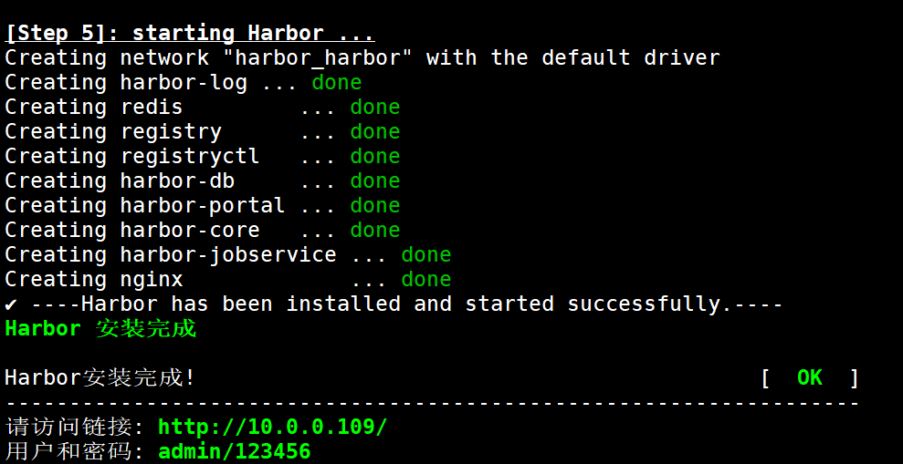

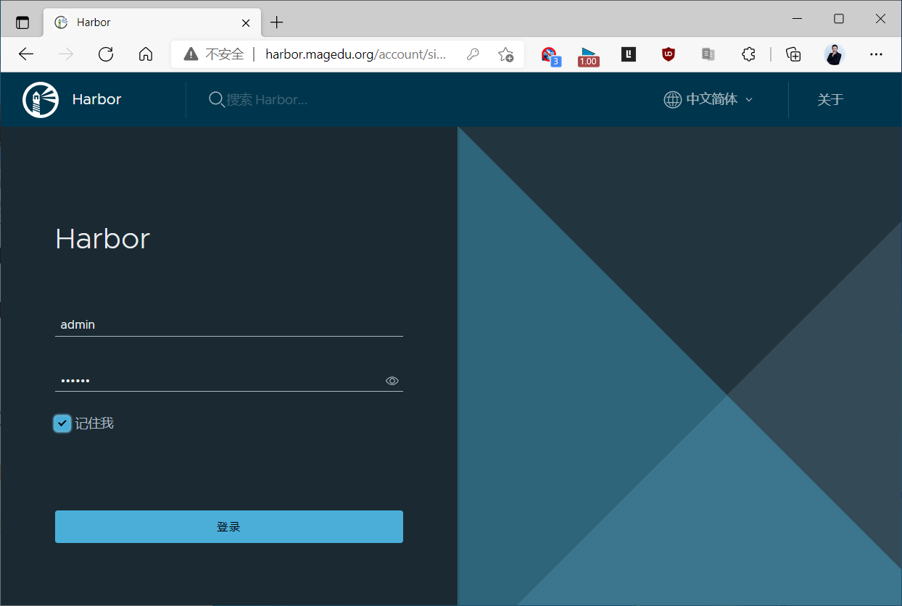

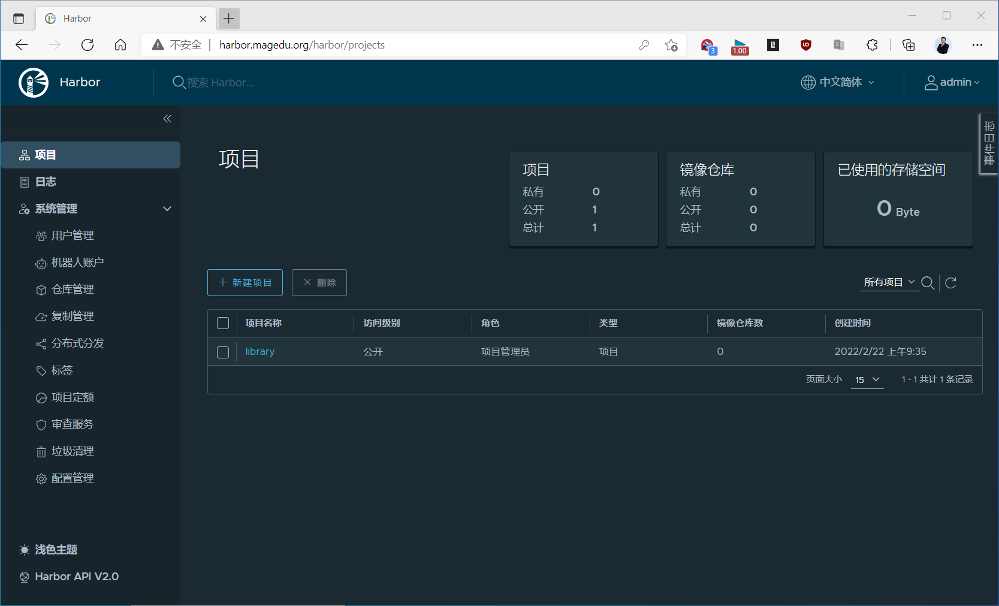

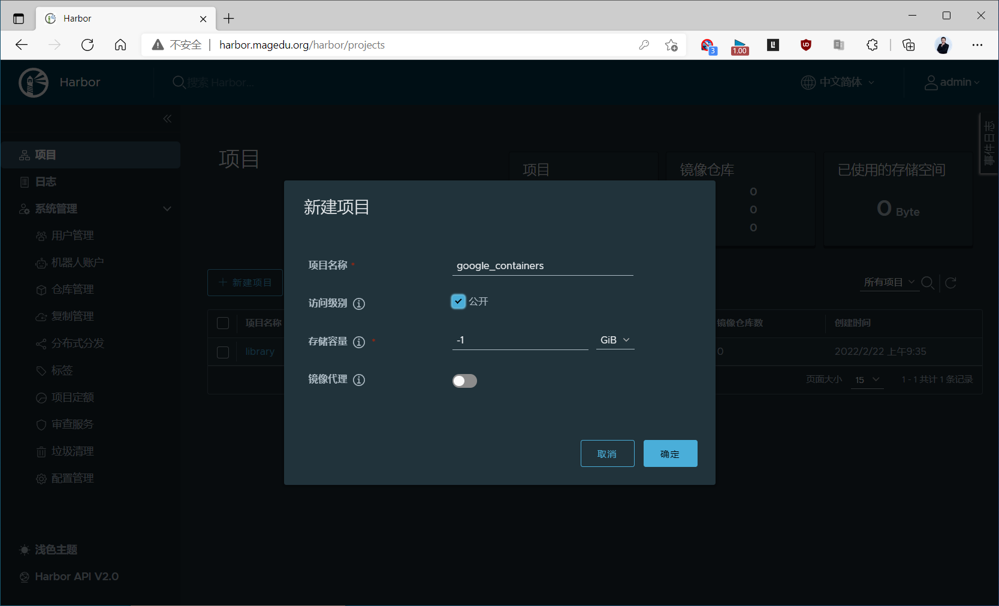

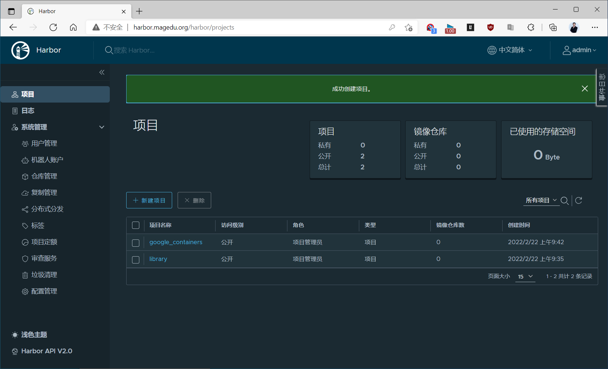

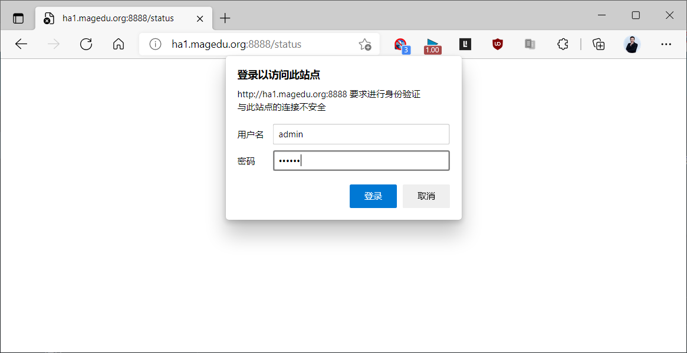

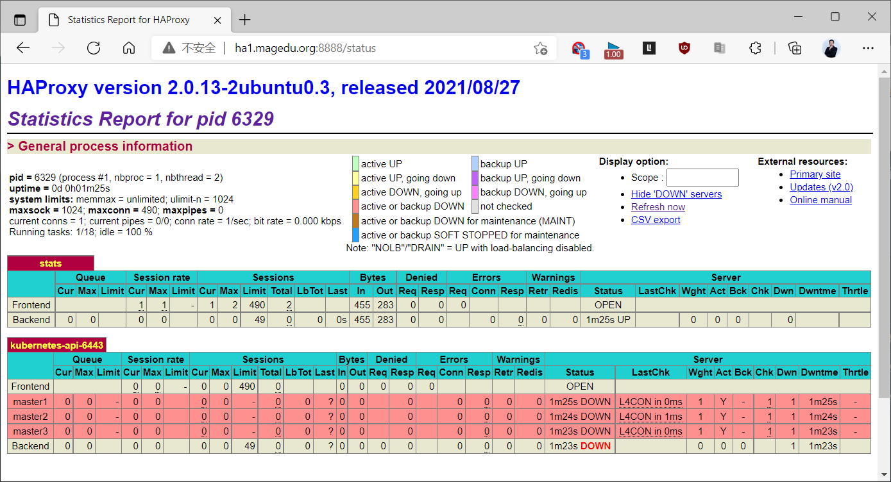

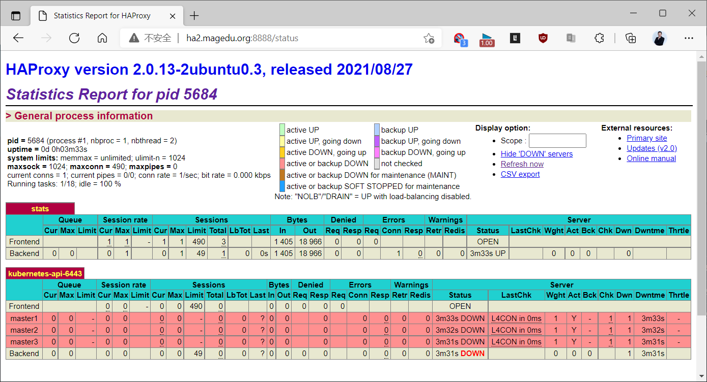


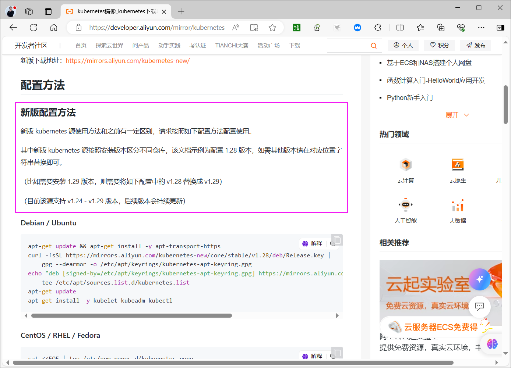

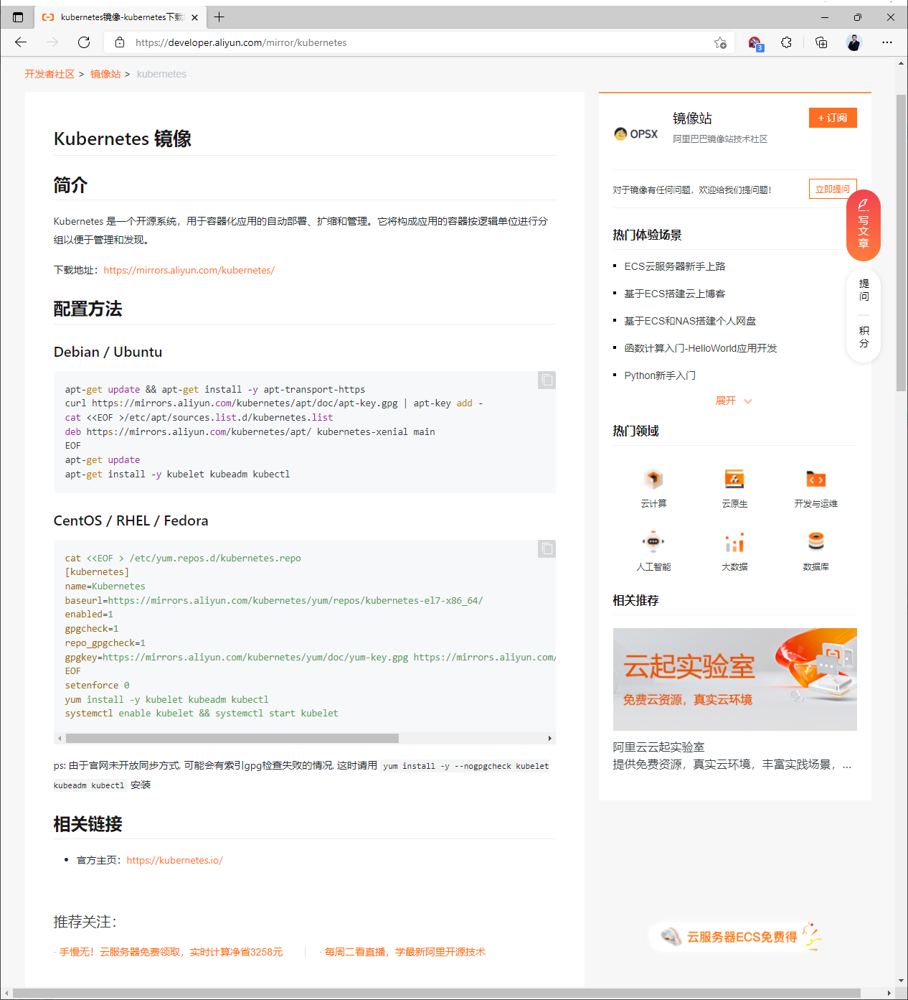

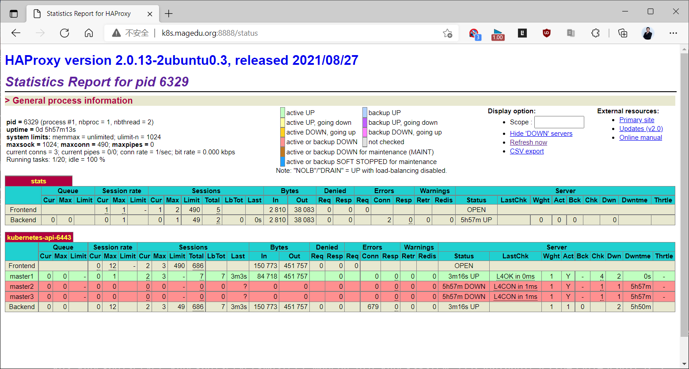

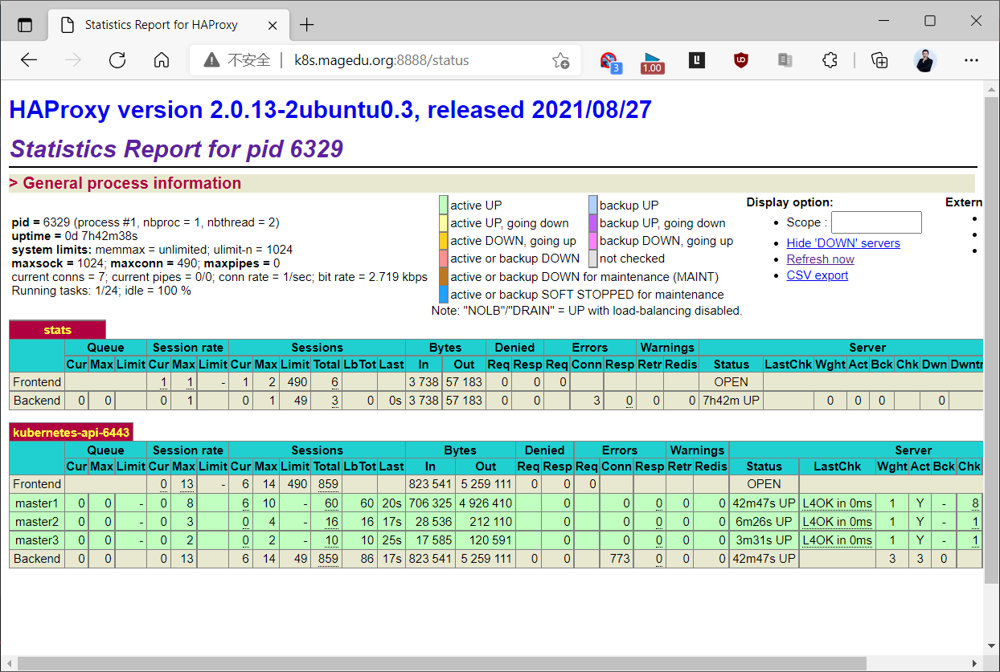

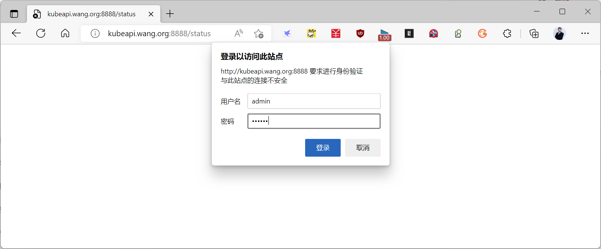

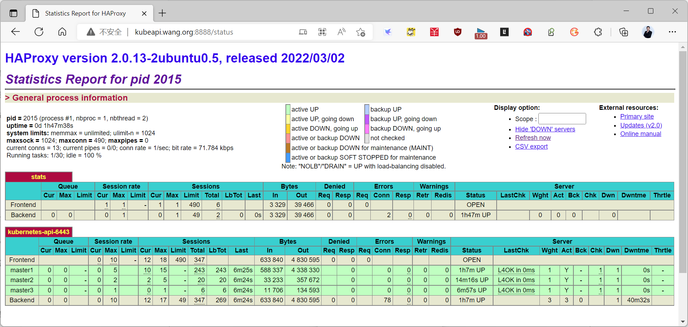

</details>



<nav class="article-end" aria-label="章节导航">
  <a href="{{ '/subjects/Kubernetes/02-deployment-overview.html' | relative_url }}">← 上一章：部署模型与 Minikube</a>
  <a href="{{ '/subjects/Kubernetes/' | relative_url }}">返回 Kubernetes 目录</a>
  <a href="{{ '/subjects/Kubernetes/04-kubeadm-containerd-ha.html' | relative_url }}">下一章：Kubeadm 与 Containerd 高可用部署 →</a>
</nav>
