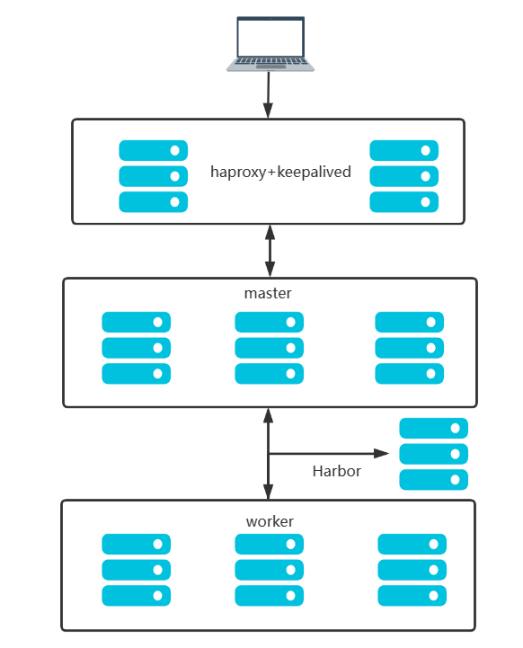
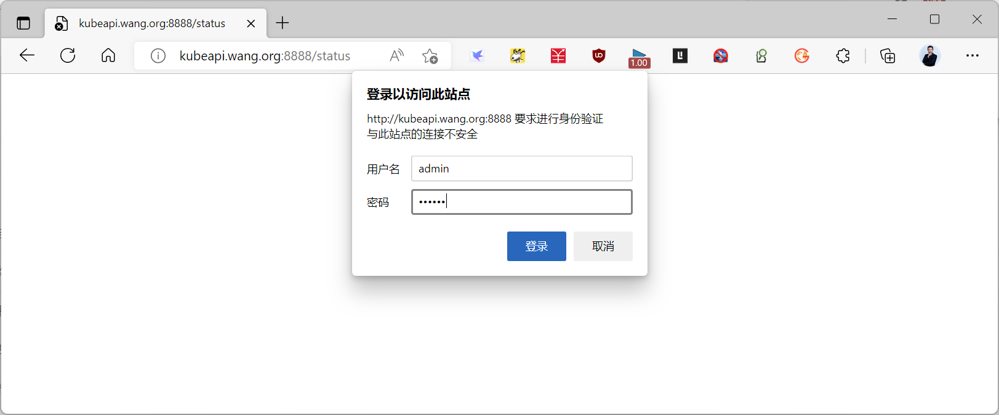
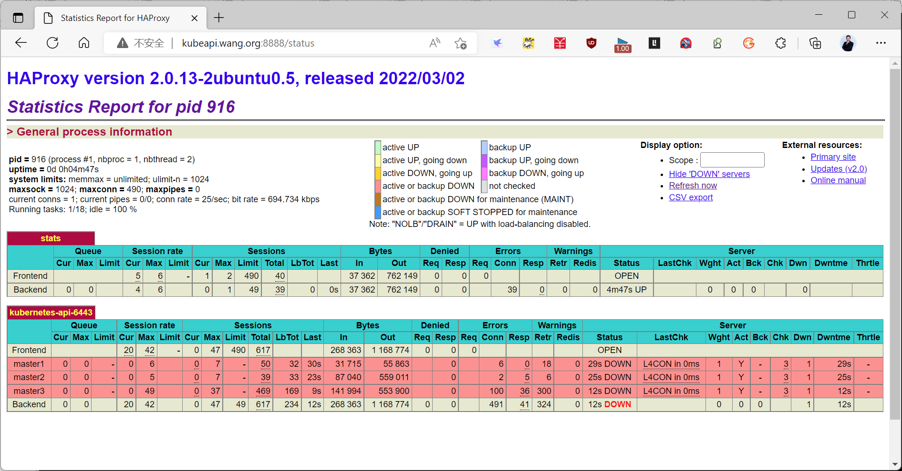
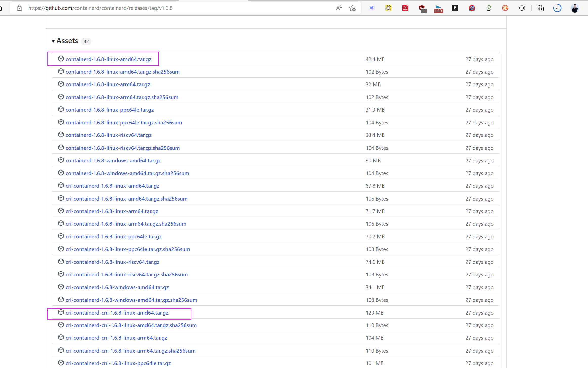
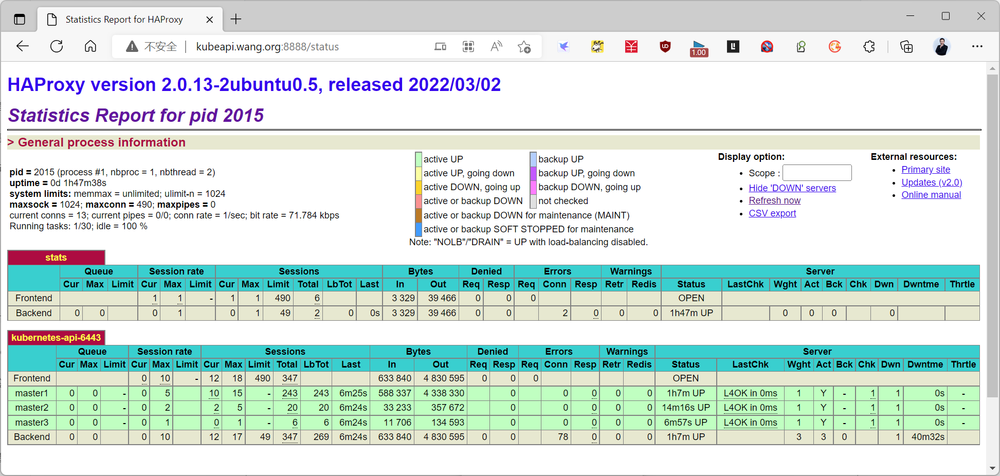
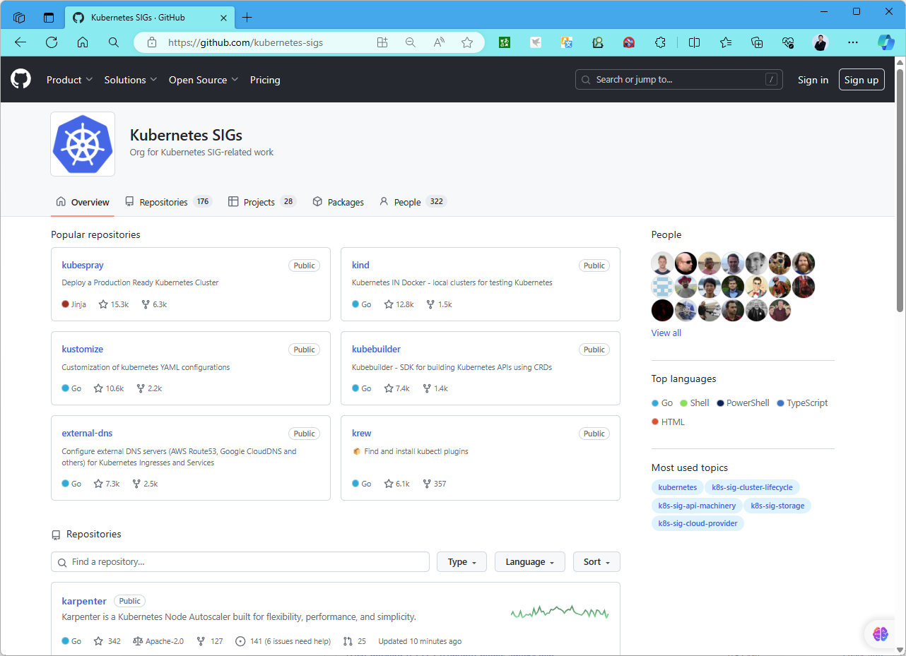
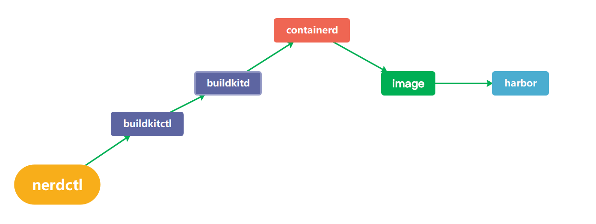

[← 返回 Kubernetes 目录]({{ '/subjects/Kubernetes/' | relative_url }})



# 04 Kubeadm 与 Containerd 高可用部署

## 3.5 基于Kubeadm 和 Containerd 部署 Kubernetes 高可用集群

### 3.5.1 基于Kubeadm 和 Containerd 实现 Kubernetes 集群流程说明

**官方说明**
```text
https://kubernetes.io/docs/setup/production-environment/tools/kubeadm/
https://kubernetes.io/docs/setup/production-environment/tools/kubeadm/install-kubeadm/
https://kubernetes.io/zh-cn/docs/setup/production-environment/tools/kubeadm/create-cluster-kubeadm/
```

部署环境：



IP主机名角色

10.0.0.101 master1.bowen.org K8s 集群主节点 1，Master和etcd

10.0.0.102 master2.bowen.org K8s 集群主节点 2，Master和etcd

10.0.0.103 master3.bowen.org K8s 集群主节点 3，Master和etcd

10.0.0.104 node1.bowen.org K8s 集群工作节点 1

10.0.0.105 node2.bowen.org K8s 集群工作节点 2

10.0.0.106 node3.bowen.org K8s 集群工作节点 3

10.0.0.107 ha1.bowen.org K8s 主节点访问入口 1,提供高可用及负载均衡

10.0.0.108 ha2.bowen.org K8s 主节点访问入口 2,提供高可用及负载均衡

10.0.0.100 kubeapi.bowen.org VIP，在ha1和ha2主机实现

实现流程

集群部署流程：

1. 为 Kubernetes 集群 API 访问入口配置高可用（可选），并准备各节点主机的初始环境。
2. 在所有 Master 和 Node 节点安装、配置容器运行时 Containerd。
3. 在所有 Master 和 Node 节点安装 kubeadm、kubelet、kubectl；Node 节点可不安装集群管理工具 kubectl。
4. 在第一台 Master 节点运行 `kubeadm init` 初始化集群，并验证 Master 节点状态。
5. 在第一台 Master 节点安装并配置网络插件。
6. 在其他 Master 节点运行 `kubeadm join`，加入控制平面以实现高可用（测试环境可选）。
7. 在所有 Node 节点运行 `kubeadm join`，加入集群。
8. 创建 Pod、启动容器，测试访问与网络通信。

### 3.5.2 部署 Kubernetes 集群 API 访问入口的高可用 ( 可选 )

在10.0.0.107和10.0.0.108上实现如下操作

#### 3.5.2.1 安装 HAProxy

利用 HAProxy 实现 Kubeapi 服务的负载均衡。
```bash
#修改内核参数
[root@ha1 ~]#cat >> /etc/sysctl.conf <<EOF
net.ipv4.ip_nonlocal_bind = 1
EOF
[root@ha1 ~]#sysctl -p

#安装配置haproxy
[root@ha1 ~]#apt update
[root@ha1 ~]#apt -y install haproxy

##添加下面行
[root@ha1 ~]#cat >> /etc/haproxy/haproxy.cfg  <<EOF
listen stats
mode http
bind 0.0.0.0:8888
stats enable

log global
stats uri /status
stats auth admin:123456
```


listen  kubernetes-api-6443 bind 10.0.0.100:6443 mode tcp server master1 10.0.0.101:6443 check inter 3s fall 3 rise 3#注意: 在集群安装前,必须只启用用于初始化的第一台master节点,当安装kubernetes集群完成后,再将下面两台主机启动#server master2 10.0.0.102:6443 check inter 3s fall 3 rise 3#server master3 10.0.0.103:6443 check inter 3s fall 3 rise 3 EOF

```bash
[root@ha1 ~]#systemctl restart  haproxy
```

#### 3.5.2.2 安装 Keepalived

安装 keepalived 实现 HAProxy 的高可用。
```bash
[root@ha1 ~]#apt update
[root@ha1 ~]#apt -y install keepalived
[root@ha1 ~]#vim /etc/keepalived/keepalived.conf
! Configuration File for keepalived

global_defs {
router_id ha1.bowen.org  #指定router_id,#在ha2上为ha2.bowen.org
}

vrrp_script check_haproxy {             #定义脚本
script "/etc/keepalived/check_haproxy.sh"
interval 1
weight -30
fall 3
rise 2
timeout 2
}
```


vrrp_instance VI_1 {state MASTER            #在ha2上为BACKUP interface eth0 garp_master_delay 10 smtp_alert virtual_router_id 66   #指定虚拟路由器ID,ha1和ha2此值必须相同 priority 100           #在ha2上为80 advert_int 1 authentication {auth_type PASS auth_pass 123456   #指定验证密码,ha1和ha2此值必须相同}virtual_ipaddress {10.0.0.100/24 dev eth0  label eth0:1  #指定VIP,ha1和ha2此值必须相同}track_script {check_haproxy                       #调用上面定义的脚本}}

```bash
[root@ha1 ~]# cat > /etc/keepalived/check_haproxy.sh <<EOF
#!/bin/bash
/usr/bin/killall -0 haproxy  || systemctl restart haproxy
EOF

[root@ha1 ~]# chmod a+x /etc/keepalived/check_haproxy.sh

[root@ha1 ~]# systemctl restart keepalived
```

#### 3.5.2.3 测试访问

浏览器访问验证,用户名密码: admin:123456。


- <http://kubeapi.bowen.org:8888/status>




可以看如下显示



### 3.5.3 所有主机初始化

#### 3.5.3.1 配置 ssh key 验证(可选)

配置 ssh key 验证,方便后续同步文件
```bash
ssh-keygen
ssh-copy-id -i ~/.ssh/id_rsa.pub root@10.0.0.102
.....
```

#### 3.5.3.2 设置主机名和解析
```bash
hostnamectl set-hostname master1.bowen.org

cat >> /etc/hosts <<EOF
10.0.0.100 kubeapi.bowen.org kubeapi
10.0.0.101 master1.bowen.org master1
10.0.0.102 master2.bowen.org master2
10.0.0.103 master2.bowen.org master3
10.0.0.104 node1.bowen.org node1
10.0.0.105 node2.bowen.org node2
10.0.0.106 node3.bowen.org node3
10.0.0.107 ha1.bowen.org ha1
10.0.0.108 ha2.bowen.org ha2
EOF

for i in {102..108};do scp /etc/hosts 10.0.0.$i:/etc/ ;done
```

#### 3.5.3.3 禁用 swap
```bash
swapoff -a
sed -i '/swap/s/^/#/' /etc/fstab
#或者
systemctl disable --now swap.img.swap;systemctl mask swap.target
```

#### 3.5.3.4 时间同步
```text
#借助于chronyd服务（程序包名称chrony）设定各节点时间精确同步
apt -y install chrony
chronyc sources -v
```

#### 3.5.3.5 禁用防火墙和SELinux
```text
#禁用默认配置的iptables防火墙服务
ufw disable
ufw status
```

#### 3.5.3.6 内核参数调整

如果是安装 Docker 会自动配置以下的内核参数，而无需手动实现。但是如果安装Contanerd，还需手动配置。允许 iptables 检查桥接流量,若要显式加载此模块，需运行 modprobe br_netfilter。为了让 Linux 节点的 iptables 能够正确查看桥接流量，还需要确认net.bridge.bridge-nf-call-iptables设置为 1。
```bash
#方法1: 安装docker,自动修改内核参数,并自动安装containerd
[root@ubuntu2204 ~]#apt update && apt -y install docker.io

#方法2
#加载模块
modprobe overlay
modprobe br_netfilter

lsmod  |grep -E  'overlay|br_netfilter'
br_netfilter           32768  0
bridge                421888  1 br_netfilter
overlay               212992  0

#开机加载
cat <<EOF | tee /etc/modules-load.d/k8s.conf
overlay
br_netfilter
EOF

#设置所需的 sysctl 参数，参数在重新启动后保持不变
cat <<EOF | sudo tee /etc/sysctl.d/k8s.conf
net.bridge.bridge-nf-call-iptables  = 1
net.bridge.bridge-nf-call-ip6tables = 1
net.ipv4.ip_forward                 = 1
EOF

#应用 sysctl 参数生效而不重新启动
sysctl --system
```

### 3.5.4 所有主机安装 Containerd

#### 3.5.4.1 包安装 Containerd

**在所有节点上安装 Containerd**
```bash
#Ubuntu24.04，22.04和Ubuntu20.04可以利用内置仓库安装containerd
[root@node1 ~]#apt update && apt -y install containerd

#确认服务启动
[root@node1 ~]#systemctl status containerd

#ubuntu24.04
[root@master1 ~]#containerd -v
containerd github.com/containerd/containerd 1.7.24
[root@master1 ~]#runc -v
runc version 1.1.12-0ubuntu3.1
spec: 1.0.2-dev
go: go1.22.2
libseccomp: 2.5.5

#ubuntu22.04
[root@node1 ~]#containerd --version

containerd github.com/containerd/containerd 1.7.2

[root@node1 ~]#runc -v
runc version 1.1.7-0ubuntu1~22.04.2
spec: 1.0.2-dev
go: go1.18.1
libseccomp: 2.5.3

[root@node1 ~]#containerd --version
containerd github.com/containerd/containerd 1.5.9-0ubuntu1~20.04.4

#利用containerd的客户端工具ctr验证修改是否成功
[root@ubuntu2204 ~]#ctr version
Client:
Version:  1.7.2
Revision:
Go version: go1.20.3

Server:
Version:  1.7.2
Revision:
UUID: 75495462-55c4-4a88-b898-bf810af4d353

[root@node1 ~]#ctr version
Client:
Version:  1.5.9-0ubuntu1~20.04.4
Revision:
Go version: go1.13.8

Server:
Version:  1.5.9-0ubuntu1~20.04.4
Revision:
UUID: dedffba3-daac-4ad9-b596-14da3b7a1cf3

#修改containerd配置基于toml(Tom's Obvious Minimal Language)格式：toml.io
[root@node1 ~]#mkdir /etc/containerd/
[root@node1 ~]#containerd config default > /etc/containerd/config.toml

#1）将 sandbox_image 镜像源设置为阿里云google_containers镜像源（国内网络需要）
[root@node1 ~]#grep sandbox_image  /etc/containerd/config.toml
#新版k8s-v1.34.1
[root@node1 ~]#sed -i
"s#registry.k8s.io/pause:3.8#registry.aliyuncs.com/google_containers/pause:3.10.
1#g"  /etc/containerd/config.toml

#新版k8s-v1.32.0
[root@node1 ~]#sed -i
"s#registry.k8s.io/pause:3.8#registry.aliyuncs.com/google_containers/pause:3.10#
g"  /etc/containerd/config.toml

#新版k8s-v1.31.1
[root@node1 ~]#sed -i
"s#registry.k8s.io/pause:3.8#registry.aliyuncs.com/google_containers/pause:3.10#
g"  /etc/containerd/config.toml

#k8s-v1.30

[root@node1 ~]#sed -i
"s#registry.k8s.io/pause#registry.aliyuncs.com/google_containers/pause#g"
/etc/containerd/config.toml
[root@node1 ~]#sed -i  "s/pause:3.8/pause:3.9/g" /etc/containerd/config.toml

#旧版
[root@node1 ~]#sed -i
"s#k8s.gcr.io/pause#registry.aliyuncs.com/google_containers/pause#g"
/etc/containerd/config.toml

#2）配置containerd cgroup 驱动程序systemd,ubuntu22.04/24.04较新内核必须修
改,ubuntu20.04更旧的内核版本可不做修改
[root@node1 ~]#sed -i 's#SystemdCgroup = false#SystemdCgroup = true#g'
/etc/containerd/config.toml
[root@node1 ~]#grep SystemdCgroup /etc/containerd/config.toml
SystemdCgroup = true

#镜像加速(建议，可选)
[root@node1 ~]#vim /etc/containerd/config.toml
#在此行下面加行
[plugins."io.containerd.grpc.v1.cri".registry.mirrors]
###########################镜像加速###############################
#新版，国内无法访问docker官方镜像，需要配置代理
[plugins."io.containerd.grpc.v1.cri".registry.mirrors."docker.io"]
endpoint =
["https://docker.m.daocloud.io","https://docker.1panel.live"]
[plugins."io.containerd.grpc.v1.cri".registry.mirrors."harbor.bowen.org"]
endpoint = ["https://harbor.bowen.org"]

[plugins."io.containerd.grpc.v1.cri".registry.configs."harbor.bowen.org".tls]
insecure_skip_verify = true

[plugins."io.containerd.grpc.v1.cri".registry.configs."harbor.bowen.org".auth]
username = "admin"
password = "REPLACE_WITH_STRONG_PASSWORD"

#旧版
[plugins."io.containerd.grpc.v1.cri".registry.mirrors."docker.io"]
endpoint =
["https://si7y70hh.mirror.aliyuncs.com","https://registry.aliyuncs.com"]
###################################################################
[plugins."io.containerd.grpc.v1.cri".registry.mirrors."harbor.bowen.org"]
endpoint = ["https://harbor.bowen.org"]

[plugins."io.containerd.grpc.v1.cri".registry.configs."harbor.bowen.org".tls]
insecure_skip_verify = true

[plugins."io.containerd.grpc.v1.cri".registry.configs."harbor.bowen.org".auth]
username = "admin"
password = "REPLACE_WITH_STRONG_PASSWORD"

[root@node1 ~]#systemctl restart containerd

#同步到所有节点
[root@node1 ~]#for i  in {102..106};do scp -r /etc/containerd/
10.0.0.$i:/etc/;done
```

**关于 SystemdCgroup**


cgroups（Control Groups）是 Linux 内核的一个特性，用于限制、账单和隔离一个或多个进程的资源（如 CPU、内存、磁盘 I/O 等）。systemd 是一个常见的 Linux 启动和系统管理工具，它可以用来启动、停止和管理系统上的服务和进程。在容器化环境中，systemd 也可以被用来管理容器中的进程。


当 SystemdCgroup 设置为 true 时，containerd 将使用 systemd cgroup 驱动来创建和管理容器的 cgroups来实现资源限制和隔离。这意味着容器的资源限制和隔离将由 systemd 控制，而不是其他 cgroup 驱动程序（如 cgroupfs 或 systemd-nspawn）。


当将 SystemdCgroup 设置为 no 时，containerd 将不再使用 systemd cgroup 驱动来管理容器的 cgroups。相反，它将使用其他可用的 cgroup 驱动程序。在大多数情况下，默认情况下，containerd 使用 cgroupfs 作为 cgroup 驱动程序。


这通常用于确保容器的行为与系统上其他服务和进程的行为保持一致，以及利用 systemd 提供的更丰富的功能和工具来管理容器。


Docker 从 1.10 版本开始引入了对 systemd cgroup driver 的支持。这意味着从 Docker 1.10 版本开始，你可以选择使用 systemd 作为 Docker 的 cgroup 驱动程序。在 Docker 1.13 版本之后，systemd 已成为 Docker 默认的 cgroup 驱动程序


#### 3.5.4.2 二进制安装 Containerd

Containerd 有两种二进制安装包:

containerd-xxx ：不包含runC，需要单独安装runC cri-containerd-cni-xxx：包含runc和kubernetes里的所需要的相关文件。

##### 3.5.4.2.1 下载 Containerd

**官方下载链接**


- <https://github.com/containerd/containerd>




范例: 安装包括runc的二进制包
```bash
#查看内容
[root@node2 ~]#tar tf cri-containerd-cni-1.6.8-linux-amd64.tar.gz
etc/
etc/crictl.yaml
etc/systemd/
etc/systemd/system/
etc/systemd/system/containerd.service
etc/cni/
etc/cni/net.d/
etc/cni/net.d/10-containerd-net.conflist
usr/
usr/local/
usr/local/sbin/
usr/local/sbin/runc
usr/local/bin/
usr/local/bin/containerd-stress
usr/local/bin/containerd-shim-runc-v2
usr/local/bin/containerd-shim
usr/local/bin/ctr
usr/local/bin/containerd
usr/local/bin/critest
usr/local/bin/ctd-decoder
usr/local/bin/crictl
usr/local/bin/containerd-shim-runc-v1
opt/
opt/containerd/
opt/containerd/cluster/
opt/containerd/cluster/gce/
opt/containerd/cluster/gce/env
opt/containerd/cluster/gce/cloud-init/
opt/containerd/cluster/gce/cloud-init/master.yaml
opt/containerd/cluster/gce/cloud-init/node.yaml
opt/containerd/cluster/gce/cni.template
opt/containerd/cluster/gce/configure.sh
opt/containerd/cluster/version
opt/cni/
opt/cni/bin/
opt/cni/bin/bandwidth
opt/cni/bin/loopback
opt/cni/bin/ipvlan
opt/cni/bin/host-local
opt/cni/bin/static
opt/cni/bin/vlan
opt/cni/bin/tuning
opt/cni/bin/host-device
opt/cni/bin/firewall
opt/cni/bin/portmap
opt/cni/bin/sbr
opt/cni/bin/macvlan
opt/cni/bin/bridge
opt/cni/bin/dhcp
opt/cni/bin/ptp
opt/cni/bin/vrf

#解压缩至根目录
[root@node2 ~]#tar xf cri-containerd-cni-1.6.8-linux-amd64.tar.gz  -C /
```

范例:  安装不包含runc的二进制包
```bash
#如果是不包含runc的,还需要单独下载runc即可
[root@node2 ~]#tar xf containerd-1.6.8-linux-amd64.tar.gz -C /
#参考包安装的service手动创建service文件
[root@node2 ~]#vim /lib/systemd/system/containerd.service
[root@node2 ~]#wget
https://github.com/opencontainers/runc/releases/download/v1.1.4/runc.amd64
[root@node2 ~]#mv runc.amd64 /usr/bin/runc
[root@node2 ~]#chmod +x /usr/bin/runc
```

##### 3.5.4.2.2 配置 Containerd
```bash
#修改containerd配置,将 sandbox_image 镜像源设置为阿里云google_containers镜像源（所有节
点）
[root@node2 ~]#mkdir /etc/containerd/
[root@node2 ~]#containerd config default > /etc/containerd/config.toml

#修改镜像地址,默认国内可能无法访问
[root@node2 ~]#grep sandbox_image  /etc/containerd/config.toml
#新版
[root@node2 ~]#sed -i
"s#registry.k8s.io/pause#registry.aliyuncs.com/google_containers/pause#g"
/etc/containerd/config.toml
#旧版
[root@node2 ~]#sed -i
"s#k8s.gcr.io/pause#registry.aliyuncs.com/google_containers/pause#g"
/etc/containerd/config.toml

#配置containerd cgroup 驱动程序systemd
[root@node1 ~]#sed -i 's#SystemdCgroup = false#SystemdCgroup = true#g'
/etc/containerd/config.toml
[root@node1 ~]#grep SystemdCgroup /etc/containerd/config.toml
SystemdCgroup = true

#镜像加速(可选)
[root@node1 ~]#vim /etc/containerd/config.toml
#在此行下面加两行
[plugins."io.containerd.grpc.v1.cri".registry.mirrors]
[plugins."io.containerd.grpc.v1.cri".registry.mirrors."docker.io"]
endpoint = ["https://registry.aliyuncs.com"]

[root@node4 ~]#systemctl daemon-reload
[root@node4 ~]#systemctl status  containerd
● containerd.service - containerd container runtime
Loaded: loaded (/etc/systemd/system/containerd.service; disabled; vendor
preset: enabled)
Active: inactive (dead)
Docs: https://containerd.io
[root@node4 ~]#systemctl enable --now   containerd
Created symlink /etc/systemd/system/multi-user.target.wants/containerd.service →
/etc/systemd/system/containerd.service.
[root@node3 ~]#systemctl is-active  containerd
active
```

##### 3.5.4.2.3 安装 CNI 插件工具

虽然 cri-containerd-cni-1.6.8-linux-amd64.tar.gz 包含了cni，但是无法和kubernetes 兼容，在创建Pod时会出错下面错误日志。
```bash
[root@node2 ~]#cat /var/log/syslog
Sep  4 20:04:57 node4 containerd[62104]: time="2022-09-
04T20:04:57.394576089+08:00" level=info msg="RunPodSandbox for
&PodSandboxMetadata{Name:demoapp-55c5f88dcb-kl7mf,Uid:5dfc305b-d641-4d2c-8199-
7655b7a1ba32,Namespace:default,Attempt:0,}"
Sep  4 20:04:57 node4 containerd[62104]: time="2022-09-
04T20:04:57.408282176+08:00" level=error msg="Failed to destroy network for
sandbox \"2d21c280a65d6d40ae1a6aadab70b9e50e8430d6de17b5b41ed8ffecdb7d43f6\""
error="plugin type=\"portmap\" failed (delete): incompatible CNI versions;
config is \"1.0.0\", plugin supports [\"0.1.0\" \"0.2.0\" \"0.3.0\" \"0.3.1\"
\"0.4.0\"]"
Sep  4 20:04:57 node4 systemd[1053]: run-netns-
cni\x2df682c24c\x2db5d6\x2d9ba2\x2d2543\x2d78324d41d347.mount: Succeeded.
Sep  4 20:04:57 node4 systemd[1]: run-netns-
cni\x2df682c24c\x2db5d6\x2d9ba2\x2d2543\x2d78324d41d347.mount: Succeeded.
Sep  4 20:04:57 node4 containerd[62104]: time="2022-09-
04T20:04:57.411439230+08:00" level=error msg="RunPodSandbox for
&PodSandboxMetadata{Name:demoapp-55c5f88dcb-kl7mf,Uid:5dfc305b-d641-4d2c-8199-
7655b7a1ba32,Namespace:default,Attempt:0,} failed, error" error="failed to setup
network for sandbox
\"2d21c280a65d6d40ae1a6aadab70b9e50e8430d6de17b5b41ed8ffecdb7d43f6\": plugin
type=\"bridge\" failed (add): incompatible CNI versions; config is \"1.0.0\",
plugin supports [\"0.1.0\" \"0.2.0\" \"0.3.0\" \"0.3.1\" \"0.4.0\"]"
Sep  4 20:04:57 node4 kubelet[65352]: E0904 20:04:57.411790   65352
remote_runtime.go:222] "RunPodSandbox from runtime service failed" err="rpc
error: code = Unknown desc = failed to setup network for sandbox
\"2d21c280a65d6d40ae1a6aadab70b9e50e8430d6de17b5b41ed8ffecdb7d43f6\": plugin
type=\"bridge\" failed (add): incompatible CNI versions; config is \"1.0.0\",
plugin supports [\"0.1.0\" \"0.2.0\" \"0.3.0\" \"0.3.1\" \"0.4.0\"]"
Sep  4 20:04:57 node4 kubelet[65352]: E0904 20:04:57.411859   65352
kuberuntime_sandbox.go:71] "Failed to create sandbox for pod" err="rpc error:
code = Unknown desc = failed to setup network for sandbox
\"2d21c280a65d6d40ae1a6aadab70b9e50e8430d6de17b5b41ed8ffecdb7d43f6\": plugin
type=\"bridge\" failed (add): incompatible CNI versions; config is \"1.0.0\",
plugin supports [\"0.1.0\" \"0.2.0\" \"0.3.0\" \"0.3.1\" \"0.4.0\"]"
pod="default/demoapp-55c5f88dcb-kl7mf"
Sep  4 20:04:57 node4 kubelet[65352]: E0904 20:04:57.411881   65352
kuberuntime_manager.go:772] "CreatePodSandbox for pod failed" err="rpc error:
code = Unknown desc = failed to setup network for sandbox
\"2d21c280a65d6d40ae1a6aadab70b9e50e8430d6de17b5b41ed8ffecdb7d43f6\": plugin
type=\"bridge\" failed (add): incompatible CNI versions; config is \"1.0.0\",
plugin supports [\"0.1.0\" \"0.2.0\" \"0.3.0\" \"0.3.1\" \"0.4.0\"]"
pod="default/demoapp-55c5f88dcb-kl7mf"
Sep  4 20:04:57 node4 kubelet[65352]: E0904 20:04:57.411920   65352
pod_workers.go:965] "Error syncing pod, skipping" err="failed to
\"CreatePodSandbox\" for \"demoapp-55c5f88dcb-kl7mf_default(5dfc305b-d641-4d2c-
8199-7655b7a1ba32)\" with CreatePodSandboxError: \"Failed to create sandbox for
pod \\\"demoapp-55c5f88dcb-kl7mf_default(5dfc305b-d641-4d2c-8199-
7655b7a1ba32)\\\": rpc error: code = Unknown desc = failed to setup network for
sandbox \\\"2d21c280a65d6d40ae1a6aadab70b9e50e8430d6de17b5b41ed8ffecdb7d43f6\\\":
plugin type=\\\"bridge\\\" failed (add): incompatible CNI versions; config is
\\\"1.0.0\\\", plugin supports [\\\"0.1.0\\\" \\\"0.2.0\\\" \\\"0.3.0\\\"
\\\"0.3.1\\\" \\\"0.4.0\\\"]\"" pod="default/demoapp-55c5f88dcb-kl7mf"
podUID=5dfc305b-d641-4d2c-8199-7655b7a1ba32
```

范例：解决CNI问题
```bash
#下载链接：https://github.com/containernetworking/plugins/releases
[root@node2 ~]#wget
https://github.com/containernetworking/plugins/releases/download/v1.1.1/cni-plugins-linux-amd64-v1.1.1.tgz

#覆盖原有的文件
[root@node2 ~]#tar xf cni-plugins-linux-amd64-v1.1.1.tgz  -C /opt/cni/bin/
```

### 3.5.5 所有主机安装 kubeadm、kubelet 和 kubectl

通过国内镜像站点阿里云安装的参考链接：


- <https://developer.aliyun.com/mirror/kubernetes>


范例：Ubuntu24.04 基于清华源安装


- <https://mirrors.tuna.tsinghua.edu.cn/help/kubernetes/>

```bash
curl -fsSL https://pkgs.k8s.io/core:/stable:/v1.32/deb/Release.key | gpg --
dearmor -o /etc/apt/keyrings/kubernetes-apt-keyring.gpg

echo 'deb [signed-by=/etc/apt/keyrings/kubernetes-apt-keyring.gpg]
https://mirrors.tuna.tsinghua.edu.cn/kubernetes/core:/stable:/v1.32/deb/ /'  >
/etc/apt/sources.list.d/kubernetes.list
apt update
#安装最新版
apt install -y  kubeadm kubelet kubectl

#安装指定版本
K8S_RELEASE_VERSION=1.32.3
apt install -y  kubeadm=${K8S_RELEASE_VERSION}-1.1
kubelet=${K8S_RELEASE_VERSION}-1.1 kubectl=${K8S_RELEASE_VERSION}-1.1
```

范例: Ubuntu 安装
```bash
apt-get update && apt-get install -y apt-transport-https
#新版
K8S_VERSION=1.29
curl -fsSL https://mirrors.aliyun.com/kubernetes-
new/core/stable/v${K8S_VERSION}/deb/Release.key |
gpg --dearmor -o /etc/apt/keyrings/kubernetes-apt-keyring.gpg
echo "deb [signed-by=/etc/apt/keyrings/kubernetes-apt-keyring.gpg]
https://mirrors.aliyun.com/kubernetes-new/core/stable/v${K8S_VERSION}/deb/ /" |
tee /etc/apt/sources.list.d/kubernetes.list

#旧版
curl https://mirrors.aliyun.com/kubernetes/apt/doc/apt-key.gpg | apt-key add -
cat <<EOF >/etc/apt/sources.list.d/kubernetes.list
deb https://mirrors.aliyun.com/kubernetes/apt/ kubernetes-xenial main
EOF

for i in {102..106};do scp /etc/apt/sources.list.d/kubernetes.list
10.0.0.$i:/etc/apt/sources.list.d/;done

apt-get update

#查看版本
apt-cache madison kubeadm|head
kubeadm |  1.25.0-00 | https://mirrors.aliyun.com/kubernetes/apt kubernetes-
xenial/main amd64 Packages
kubeadm |  1.24.2-00 | https://mirrors.aliyun.com/kubernetes/apt kubernetes-
xenial/main amd64 Packages
kubeadm |  1.24.1-00 | https://mirrors.aliyun.com/kubernetes/apt kubernetes-
xenial/main amd64 Packages
kubeadm |  1.24.0-00 | https://mirrors.aliyun.com/kubernetes/apt kubernetes-
xenial/main amd64 Packages

#安装指定版本
#新版
K8S_RELEASE_VERSION=1.29.3
apt install -y  kubeadm=${K8S_RELEASE_VERSION}-1.1
kubelet=${K8S_RELEASE_VERSION}-1.1 kubectl=${K8S_RELEASE_VERSION}-1.1
#旧版
apt install -y  kubeadm=1.25.0-00 kubelet=1.25.0-00 kubectl=1.25.0-00

#安装最新版本
apt-get install -y kubelet kubeadm kubectl
```

### 3.5.6 提前准备 Kubernetes 初始化所需镜像(可选)
```bash
##Kubernetes-v1.24.X查看需要下载的镜像,发现k8s.gcr.io无法从国内直接访问
[root@master1 ~]#kubeadm  config images list
k8s.gcr.io/kube-apiserver:v1.25.0
k8s.gcr.io/kube-controller-manager:v1.25.0
k8s.gcr.io/kube-scheduler:v1.25.0
k8s.gcr.io/kube-proxy:v1.25.0
k8s.gcr.io/pause:3.7
k8s.gcr.io/etcd:3.5.3-0
k8s.gcr.io/coredns/coredns:v1.8.6

#Kubernetes-v1.25.0下载镜像地址调整为 registry.k8s.io,但仍然无法从国内直接访问
[root@master1 ~]#kubeadm  config images list
registry.k8s.io/kube-apiserver:v1.25.0
registry.k8s.io/kube-controller-manager:v1.25.0
registry.k8s.io/kube-scheduler:v1.25.0
registry.k8s.io/kube-proxy:v1.25.0
registry.k8s.io/pause:3.8
registry.k8s.io/etcd:3.5.4-0
registry.k8s.io/coredns/coredns:v1.9.3

#查看国内镜像
[root@master1 ~]#kubeadm  config images list  --image-repository
registry.aliyuncs.com/google_containers
registry.aliyuncs.com/google_containers/kube-apiserver:v1.24.4
registry.aliyuncs.com/google_containers/kube-controller-manager:v1.24.4
registry.aliyuncs.com/google_containers/kube-scheduler:v1.24.4
registry.aliyuncs.com/google_containers/kube-proxy:v1.24.4
registry.aliyuncs.com/google_containers/pause:3.7
registry.aliyuncs.com/google_containers/etcd:3.5.3-0
registry.aliyuncs.com/google_containers/coredns:v1.8.6

#从国内镜像站拉取镜像
[root@master1 ~]#kubeadm  config images pull --kubernetes-version=v1.25.0 --
image-repository registry.aliyuncs.com/google_containers

#查看拉取的镜像
[root@master1 ~]#docker images
REPOSITORY                                                        TAG       IMAGE
ID       CREATED         SIZE
registry.aliyuncs.com/google_containers/kube-apiserver            v1.25.0
d521dd763e2e   4 weeks ago     130MB
registry.aliyuncs.com/google_containers/kube-scheduler            v1.25.0
3a5aa3a515f5   4 weeks ago     51MB
registry.aliyuncs.com/google_containers/kube-proxy                v1.25.0
2ae1ba6417cb   4 weeks ago     110MB
registry.aliyuncs.com/google_containers/kube-controller-manager   v1.25.0
586c112956df   4 weeks ago     119MB
registry.aliyuncs.com/google_containers/etcd                      3.5.3-0
aebe758cef4c   4 months ago    299MB
registry.aliyuncs.com/google_containers/pause                     3.7
221177c6082a   5 months ago    711kB
registry.aliyuncs.com/google_containers/coredns                   v1.8.6
a4ca41631cc7   10 months ago   46.8MB

#导出镜像
[root@master1 ~]#docker image save `docker image ls --format "{{.Repository}}:
{{.Tag}}"` -o k8s-images-v1.25.0.tar
[root@master1 ~]#gzip k8s-images-v1.25.0.tar
```

### 3.5.7 在第一个 master 节点初始化 Kubernetes 集群

**kubeadm init  命令参考说明**


--kubernetes-version：#kubernetes程序组件的版本号，它必须要与安装的kubelet程序包的版本号相同--control-plane-endpoint：#多主节点必选项,用于指定控制平面的固定访问地址，可是IP地址或DNS名称，会被用于集群管理员及集群组件的kubeconfig配置文件的API Server的访问地址,如果是单主节点的控制平面部署时不使用该选项,注意:kubeadm 不支持将没有 --control-plane-endpoint 参数的单个控制平面集群转换为高可用性集群。--pod-network-cidr：#Pod网络的地址范围，其值为CIDR格式的网络地址，通常情况下Flannel网络插件的默认为10.244.0.0/16，Calico网络插件的默认值为192.168.0.0/16--service-cidr：#Service的网络地址范围，其值为CIDR格式的网络地址，默认为10.96.0.0/12；通常，仅Flannel一类的网络插件需要手动指定该地址--service-dns-domain string #指定k8s集群域名，默认为cluster.local，会自动通过相应的DNS 服务实现解析--apiserver-advertise-address：#API 服务器所公布的其正在监听的 IP 地址。如果未设置，则使用默认网络接口。apiserver通告给其他组件的IP地址，一般应该为Master节点的用于集群内部通信的IP地址，0.0.0.0表示此节点上所有可用地址,非必选项--image-repository string #设置镜像仓库地址，默认为 k8s.gcr.io,此地址国内可能无法访问,可以指向国内的镜像地址--token-ttl #共享令牌（token）的过期时长，默认为24小时，0表示永不过期；为防止不安全存储等原因导致的令牌泄露危及集群安全，建议为其设定过期时长。未设定该选项时，在token过期后，若期望再向集群中加入其它节点，可以使用如下命令重新创建token，并生成节点加入命令。kubeadm token create --print-join-command--ignore-preflight-errors=Swap” #若各节点未禁用Swap设备，还需附加选项“从而让kubeadm忽略该错误--upload-certs #将控制平面证书上传到 kubeadm-certs Secret

```text
--cri-socket  #v1.24版之后指定连接cri的socket文件路径,注意;不同的CRI连接文件不同
#如果是cRI是containerd，则使用--cri-socket unix:///run/containerd/containerd.sock
#如果是cRI是docker，则使用--cri-socket unix:///var/run/cri-dockerd.sock
#如果是CRI是CRI-o，则使用--cri-socket unix:///var/run/crio/crio.sock
#注意:CRI-o与containerd的容器管理机制不一样，所以镜像文件不能通用。
```

范例: 初始化集群
```bash
#新版
[root@master1 ~]#K8S_RELEASE_VERSION=1.33.3
[root@master1 ~]#K8S_RELEASE_VERSION=1.33.1
[root@master1 ~]#K8S_RELEASE_VERSION=1.32.3
[root@master1 ~]#K8S_RELEASE_VERSION=1.30.2
[root@master1 ~]#K8S_RELEASE_VERSION=1.30.0
[root@master1 ~]#kubeadm init --kubernetes-version=v${K8S_RELEASE_VERSION} --
control-plane-endpoint="kubeapi.bowen.org"   --pod-network-cidr=10.244.0.0/16 --
service-cidr=10.96.0.0/12 --token-ttl=0  --image-repository
registry.aliyuncs.com/google_containers  --upload-certs
.....
[addons] Applied essential addon: kube-proxy

Your Kubernetes control-plane has initialized successfully!

To start using your cluster, you need to run the following as a regular user:

mkdir -p $HOME/.kube
sudo cp -i /etc/kubernetes/admin.conf $HOME/.kube/config
sudo chown $(id -u):$(id -g) $HOME/.kube/config

Alternatively, if you are the root user, you can run:

export KUBECONFIG=/etc/kubernetes/admin.conf
```


You should now deploy a pod network to the cluster. Run "kubectl apply -f [podnetwork].yaml" with one of the options listed at:

<https://kubernetes.io/docs/concepts/cluster-administration/addons/>

```text
You can now join any number of control-plane nodes running the following command
on each as root:

kubeadm join kubeapi.bowen.org:6443 --token BOOTSTRAP_TOKEN \
--discovery-token-ca-cert-hash
sha256:CA_CERT_HASH \
--control-plane --certificate-key
CERTIFICATE_KEY
```


Please note that the certificate-key gives access to cluster sensitive data, keep it secret! As a safeguard, uploaded-certs will be deleted in two hours; If necessary, you can use"kubeadm init phase upload-certs --upload-certs" to reload certs afterward.

```bash
Then you can join any number of worker nodes by running the following on each as
root:

kubeadm join kubeapi.bowen.org:6443 --token BOOTSTRAP_TOKEN \

--discovery-token-ca-cert-hash
sha256:CA_CERT_HASH

[root@master1 ~]#crictl images
WARN[0000] Config "/etc/crictl.yaml" does not exist, trying next:
"/usr/bin/crictl.yaml"
WARN[0000] Image connect using default endpoints:
[unix:///run/containerd/containerd.sock unix:///run/crio/crio.sock
unix:///var/run/cri-dockerd.sock]. As the default settings are now deprecated,
you should set the endpoint instead.
IMAGE                                                             TAG
IMAGE ID            SIZE
registry.aliyuncs.com/google_containers/coredns                   v1.11.3
c69fa2e9cbf5f       18.6MB
registry.aliyuncs.com/google_containers/etcd                      3.5.16-0
a9e7e6b294baf       57.7MB
registry.aliyuncs.com/google_containers/kube-apiserver            v1.32.3
f8bdc4cfa0651       28.7MB
registry.aliyuncs.com/google_containers/kube-controller-manager   v1.32.3
085818208a521       26.3MB
registry.aliyuncs.com/google_containers/kube-proxy                v1.32.3
a1ae78fd2f9d8       30.9MB
registry.aliyuncs.com/google_containers/kube-scheduler            v1.32.3
b4260bf5078ab       20.7MB
registry.aliyuncs.com/google_containers/pause                     3.10
873ed75102791       320kB

#新版
[root@master1 ~]#K8S_RELEASE_VERSION=1.29.3
[root@master1 ~]#kubeadm init --control-plane-endpoint="kubeapi.bowen.org" --
kubernetes-version=v${K8S_RELEASE_VERSION}  --pod-network-cidr=10.244.0.0/16 --
service-cidr=10.96.0.0/12 --token-ttl=0  --image-repository
registry.aliyuncs.com/google_containers  --upload-certs

#旧版
[root@master1 ~]#K8S_RELEASE_VERSION=1.25.0
[root@master1 ~]#kubeadm init --control-plane-endpoint="kubeapi.bowen.org" --
kubernetes-version=v${K8S_RELEASE_VERSION}  --pod-network-cidr=10.244.0.0/16 --
service-cidr=10.96.0.0/12 --token-ttl=0  --image-repository
registry.aliyuncs.com/google_containers  --upload-certs

[addons] Applied essential addon: CoreDNS
[addons] Applied essential addon: kube-proxy

Your Kubernetes control-plane has initialized successfully!

To start using your cluster, you need to run the following as a regular user:

mkdir -p $HOME/.kube
sudo cp -i /etc/kubernetes/admin.conf $HOME/.kube/config
sudo chown $(id -u):$(id -g) $HOME/.kube/config

Alternatively, if you are the root user, you can run:

export KUBECONFIG=/etc/kubernetes/admin.conf
```


You should now deploy a pod network to the cluster. Run "kubectl apply -f [podnetwork].yaml" with one of the options listed at:

<https://kubernetes.io/docs/concepts/cluster-administration/addons/>

```text
You can now join any number of the control-plane node running the following
command on each as root:

kubeadm join kubeapi.bowen.org:6443 --token BOOTSTRAP_TOKEN \
--discovery-token-ca-cert-hash
sha256:CA_CERT_HASH \
--control-plane --certificate-key
CERTIFICATE_KEY
```


Please note that the certificate-key gives access to cluster sensitive data, keep it secret! As a safeguard, uploaded-certs will be deleted in two hours; If necessary, you can use"kubeadm init phase upload-certs --upload-certs" to reload certs afterward.

```text
Then you can join any number of worker nodes by running the following on each as
root:

kubeadm join kubeapi.bowen.org:6443 --token BOOTSTRAP_TOKEN \
--discovery-token-ca-cert-hash
sha256:CA_CERT_HASH
```

如果想重新初始化,可以执行下面
```text
#如果有工作节点,先在工作节点执行,再在control节点执行下面操作
kubeadm reset -f
rm -rf  /etc/cni/net.d/  $HOME/.kube/config
reboot
```

### 3.5.8 在第一个 master 节点生成 kubectl 命令的授权文件

kubectl是kube-apiserver的命令行客户端程序，实现了除系统部署之外的几乎全部的管理操作，是kubernetes管理员使用最多的命令之一。kubectl需经由API server认证及授权后方能执行相应的管理操作，kubeadm部署的集群为其生成了一个具有管理员权限的认证配置文件/etc/kubernetes/admin.conf，它可由kubectl通过默认的“$HOME/.kube/config”的路径进行加载。当然，用户也可在kubectl命令上使用--kubeconfig选项指定一个别的位置。

下面复制认证为Kubernetes系统管理员的配置文件至目标用户（例如当前用户root）的家目录下：
```bash
#可复制4.8的结果执行下面命令
mkdir -p $HOME/.kube
sudo cp -i /etc/kubernetes/admin.conf $HOME/.kube/config
sudo chown $(id -u):$(id -g) $HOME/.kube/config
```

### 3.5.9 实现 kubectl 命令补全

kubectl 命令功能丰富,默认不支持命令补会,可以用下面方式实现。
```text
kubectl completion bash > /etc/profile.d/kubectl_completion.sh
. /etc/profile.d/kubectl_completion.sh
exit
```

### 3.5.10 在第一个 master 节点配置网络组件

Kubernetes系统上Pod网络的实现依赖于第三方插件进行，这类插件有近数十种之多，较为著名的有flannel、calico、canal和kube-router等，简单易用的实现是为CoreOS提供的flannel项目。下面的命令用于在线部署flannel至Kubernetes系统之上：

首先，下载适配系统及硬件平台环境的flanneld至每个节点，并放置于/opt/bin/目录下。我们这里选用flanneld-amd64，目前最新的版本为v0.19.1，因而，我们需要在集群的每个节点上执行如下命令：

提示：下载flanneld的地址为 https://github.com/flannel-io/flannel/releases

随后，在初始化的第一个master节点k8s-master01上运行如下命令，向Kubernetes部署kube-flannel。
```bash
#默认没有网络插件,所以显示如下状态
[root@master1 ~]#kubectl get nodes
NAME               STATUS     ROLES           AGE   VERSION
master1.bowen.org   NotReady   control-plane   17m   v1.25.0

[root@master1 ~]#kubectl apply -f https://raw.githubusercontent.com/flannel-io/flannel/master/Documentation/kube-flannel.yml

#稍等一会儿,可以看到下面状态
[root@master1 ~]#kubectl get nodes
NAME               STATUS   ROLES           AGE   VERSION
master1.bowen.org   Ready    control-plane   23m   v1.25.0
```

### 3.5.11 将所有 worker 节点加入 Kubernetes 集群

在所有worker节点执行下面操作,加上集群
```bash
#复制上面第4.8步的执行结果,额外添加--cri-socket选项修改为下面执行
[root@node1 ~]#kubeadm join kubeapi.bowen.org:6443 --token
BOOTSTRAP_TOKEN \
--discovery-token-ca-cert-hash
sha256:CA_CERT_HASH  --cri-
socket unix:///run/cri-dockerd.sock
```


[preflight] Running pre-flight checks[preflight] Reading configuration from the cluster...[preflight] FYI: You can look at this config file with 'kubectl -n kube-system get cm kubeadm-config -o yaml'[kubelet-start] Writing kubelet configuration to file"/var/lib/kubelet/config.yaml"[kubelet-start] Writing kubelet environment file with flags to file"/var/lib/kubelet/kubeadm-flags.env"[kubelet-start] Starting the kubelet[kubelet-start] Waiting for the kubelet to perform the TLS Bootstrap...


This node has joined the cluster:* Certificate signing request was sent to apiserver and a response was received.* The Kubelet was informed of the new secure connection details.

```bash
Run 'kubectl get nodes' on the control-plane to see this node join the cluster.

[root@node1 ~]#docker images
REPOSITORY                                           TAG       IMAGE ID
CREATED         SIZE
rancher/mirrored-flannelcni-flannel                  v0.19.1   252b2c3ee6c8   12
days ago     62.3MB
registry.aliyuncs.com/google_containers/kube-proxy   v1.25.0   2ae1ba6417cb   5
weeks ago     110MB
rancher/mirrored-flannelcni-flannel-cni-plugin       v1.1.0    fcecffc7ad4a   2
months ago    8.09MB
registry.aliyuncs.com/google_containers/pause        3.7       221177c6082a   5
months ago    711kB
registry.aliyuncs.com/google_containers/coredns      v1.8.6    a4ca41631cc7   10
months ago   46.8MB

#可以将镜像导出到其它worker节点实现加速
[root@node1 ~]#docker image save `docker image ls --format "{{.Repository}}:
{{.Tag}}"` -o k8s-images-v1.25.0.tar
[root@node1 ~]#gzip  k8s-images-v1.25.0.tar
[root@node1 ~]#scp k8s-images-v1.25.0.tar.gz node2:
[root@node1 ~]#scp k8s-images-v1.25.0.tar.gz node3:
[root@node2 ~]#docker load -i k8s-images-v1.25.0.tar.gz

[root@master1 ~]#kubectl get nodes
NAME               STATUS   ROLES           AGE   VERSION
master1.bowen.org   Ready    control-plane   58m   v1.25.0
node1.bowen.org     Ready    <none>          44m   v1.25.0
node2.bowen.org     Ready    <none>          18m   v1.25.0
node3.bowen.org     Ready    <none>          65s   v1.25.0
```

### 3.5.12 测试应用编排及服务访问

至此一个master附带有三个worker的kubernetes集群基础设施已经部署完成，用户随后即可测试其核心功能。

demoapp是一个web应用,可将demoapp以Pod的形式编排运行于集群之上，并通过在集群外部进行访问：
```bash
[root@master1 ~]#kubectl create deployment demoapp --
image=ikubernetes/demoapp:v1.0 --replicas=3

[root@master1 ~]#kubectl get pod -o wide
NAME                       READY   STATUS    RESTARTS   AGE     IP           NODE
NOMINATED NODE   READINESS GATES
demoapp-78b49597cf-7pdww   1/1     Running   0          2m39s   10.244.2.2
node2.bowen.org   <none>           <none>
demoapp-78b49597cf-wcjkp   1/1     Running   0          2m39s   10.244.2.3
node2.bowen.org   <none>           <none>
demoapp-78b49597cf-zmlmv   1/1     Running   0          2m39s   10.244.1.4
node3.bowen.org   <none>           <none>

[root@master1 ~]#curl 10.244.2.2
iKubernetes demoapp v1.0 !! ClientIP: 10.244.0.0, ServerName: demoapp-
78b49597cf-7pdww, ServerIP: 10.244.2.2!

[root@master1 ~]#curl 10.244.2.3
iKubernetes demoapp v1.0 !! ClientIP: 10.244.0.0, ServerName: demoapp-
78b49597cf-wcjkp, ServerIP: 10.244.2.3!
[root@master1 ~]#curl 10.244.1.4
iKubernetes demoapp v1.0 !! ClientIP: 10.244.0.0, ServerName: demoapp-
78b49597cf-zmlmv, ServerIP: 10.244.1.4!

#使用如下命令了解Service对象demoapp使用的NodePort，格式:<集群端口>:<POd端口>,以便于在集群
外部进行访问
[root@master1 ~]#kubectl create service nodeport demoapp --tcp=80:80

[root@master1 ~]#kubectl get svc
NAME         TYPE        CLUSTER-IP       EXTERNAL-IP   PORT(S)        AGE
demoapp      NodePort    10.110.101.190   <none>        80:30037/TCP   102s
kubernetes   ClusterIP   10.96.0.1        <none>        443/TCP        67m

[root@master1 ~]#curl 10.110.101.190
iKubernetes demoapp v1.0 !! ClientIP: 10.244.0.0, ServerName: demoapp-
78b49597cf-wcjkp, ServerIP: 10.244.2.3!
[root@master1 ~]#curl 10.110.101.190
iKubernetes demoapp v1.0 !! ClientIP: 10.244.0.0, ServerName: demoapp-
78b49597cf-zmlmv, ServerIP: 10.244.1.4!
[root@master1 ~]#curl 10.110.101.190
iKubernetes demoapp v1.0 !! ClientIP: 10.244.0.0, ServerName: demoapp-
78b49597cf-7pdww, ServerIP: 10.244.2.2!

#用户可以于集群外部通过“http://NodeIP:30037”这个URL访问demoapp上的应用，例如于集群外通过浏
览器访问“http://<kubernetes-node>:30037”。
[root@rocky8 ~]#curl 10.0.0.100:30037
iKubernetes demoapp v1.0 !! ClientIP: 10.244.0.0, ServerName: demoapp-
78b49597cf-wcjkp, ServerIP: 10.244.2.3!
[root@rocky8 ~]#curl 10.0.0.101:30037
iKubernetes demoapp v1.0 !! ClientIP: 10.244.1.0, ServerName: demoapp-
78b49597cf-7pdww, ServerIP: 10.244.2.2!
[root@rocky8 ~]#curl 10.0.0.102:30037
iKubernetes demoapp v1.0 !! ClientIP: 10.244.2.0, ServerName: demoapp-
78b49597cf-zmlmv, ServerIP: 10.244.1.4!

#扩容
[root@master1 ~]#kubectl scale deployment demoapp --replicas 5
deployment.apps/demoapp scaled
[root@master1 ~]#kubectl get pod
NAME                       READY   STATUS    RESTARTS   AGE
demoapp-78b49597cf-44hqj   1/1     Running   0          41m
demoapp-78b49597cf-45jd8   1/1     Running   0          9s
demoapp-78b49597cf-49js5   1/1     Running   0          41m
demoapp-78b49597cf-9lw2z   1/1     Running   0          9s
demoapp-78b49597cf-jtwkt   1/1     Running   0          41m

#缩容
[root@master1 ~]#kubectl scale deployment demoapp --replicas 2
deployment.apps/demoapp scaled

#可以看到销毁pod的过程
[root@master1 ~]#kubectl get pod
NAME                       READY   STATUS        RESTARTS   AGE
demoapp-78b49597cf-44hqj   1/1     Terminating   0          41m

demoapp-78b49597cf-45jd8   1/1     Terminating   0          53s
demoapp-78b49597cf-49js5   1/1     Running       0          41m
demoapp-78b49597cf-9lw2z   1/1     Terminating   0          53s
demoapp-78b49597cf-jtwkt   1/1     Running       0          41m

#再次查看,最终缩容成功
[root@master1 ~]#kubectl get pod
NAME                       READY   STATUS    RESTARTS   AGE
demoapp-78b49597cf-49js5   1/1     Running   0          42m
demoapp-78b49597cf-jtwkt   1/1     Running   0          42m
```

问题：如果出现创建的Pod在10.88.0.0/网段，导致无法访问Pod。
```bash
[root@master1 ~]#kubectl get pod -o wide
NAME                       READY   STATUS    RESTARTS   AGE     IP           NODE
NOMINATED NODE   READINESS GATES
demoapp-55c5f88dcb-8jqfv   1/1     Running   0          5m25s   10.88.0.2
node4.bowen.org   <none>           <none>

[root@node4 ~]#rm -f /etc/cni/net.d/10-containerd-net.conflis
[root@node4 ~]#reboot
```

### 3.5.13 扩展 Kubernetes 集群为多主模式
<https://kubernetes.io/zh-cn/docs/setup/production-environment/tools/kubeadm/high-availability/#manual-certs>

在 master2 和 master3 重复上面的 4.2-4.5 步后,再执行下面操作加入集群。
```bash
[root@master2 ~]#kubeadm join kubeapi.bowen.org:6443 --token
BOOTSTRAP_TOKEN \
--discovery-token-ca-cert-hash
sha256:CA_CERT_HASH --
control-plane \
--certificate-key
CERTIFICATE_KEY \
--cri-socket unix:///run/cri-dockerd.sock

This node has joined the cluster and a new control plane instance was created:
```


* Certificate signing request was sent to apiserver and approval was received.* The Kubelet was informed of the new secure connection details.* Control plane label and taint were applied to the new node.* The Kubernetes control plane instances scaled up.* A new etcd member was added to the local/stacked etcd cluster.

```bash
To start administering your cluster from this node, you need to run the
following as a regular user:

mkdir -p $HOME/.kube
sudo cp -i /etc/kubernetes/admin.conf $HOME/.kube/config
sudo chown $(id -u):$(id -g) $HOME/.kube/config

Run 'kubectl get nodes' to see this node join the cluster.

[root@master2 ~]#mkdir -p $HOME/.kube
[root@master2 ~]#sudo cp -i /etc/kubernetes/admin.conf $HOME/.kube/config
[root@master2 ~]#sudo chown $(id -u):$(id -g) $HOME/.kube/config

[root@master1 ~]#kubectl get nodes
NAME               STATUS     ROLES           AGE     VERSION
master1.bowen.org   Ready      control-plane   29m     v1.25.0
master2.bowen.org   Ready      control-plane   26m     v1.25.0
master3.bowen.org   Ready      control-plane   3m48s   v1.25.0
node1.bowen.org     Ready      <none>          19m     v1.25.0
node2.bowen.org     Ready      <none>          18m     v1.25.0
node3.bowen.org     Ready      <none>          18m     v1.25.0
```

浏览器访问验证,用户名密码: admin:123456。


- <http://kubeapi.bowen.org:8888/status>




### 3.5.14  Containerd 客户端工具

containerd 的客户端工具有ctr,crictl和 nerdctl。

#### 3.5.14.1 ctr和crictl

ctr 是由 containerd 提供的一个客户端工具。crictl 是 CRI 兼容的容器运行时命令行接口，和containerd无关，可以使用它来检查和调试 k8s 节点上的容器运行时和应用程序。 由 kubernetes-sigs (Special Interest Groups)提供。


- <https://kubernetes.io/docs/tasks/debug/debug-cluster/crictl/>

```text
cat  /etc/crictl.yaml
runtime-endpoint: unix:///var/run/containerd/containerd.sock
image-endpoint: unix:///var/run/containerd/containerd.sock
timeout: 10
debug: true
```

**SIGs 介绍**


<https://github.com/kubernetes-sigs>

Special Interest Groups (SIGs) 是 Kubernetes 社区内的子组，专注于 Kubernetes 开发的特定领域或领域。它们由对项目的特定方面有共同兴趣的个人和组织组成。SIG 负责推动设计提案、审查和批准新功能、维护和发展现有功能，以及为更广泛的 Kubernetes 社区提供指导和支持。




命令docker ctr（containerd）crictl（kubernetes）

查看镜像docker

images ctr image ls crictl images

拉取镜像docker pull ctr image pull ctictl pull

推送镜像docker push ctr image push无

删除镜像docker rmi ctr image rm crictl rmi

导入镜像docker load ctr image import无

导出镜像docker save ctr image export无

修改镜像标签docker tag ctr image tag无

创建一个新的容器docker create ctr container create crictl create。运行一个新的容器docker run ctr run无（最小单元为Pod）。

删除容器docker rm ctr container rm crictl rm

查看运行的容器docker ps ctr task ls/ctr container

ls crictl ps

启动已有的容器docker start ctr task start crictl start

关闭已有的容器docker stop ctr task kill crictl stop

在容器内部执行命令docker exec无crictl exec。

查看容器数信息docker

inspect ctr container info crictl inspect

查看容器日志docker logs无crictl logs

查看容器资源docker stats无crictl stats

#### 3.5.14.2 nerdctl

##### 3.5.14.2.1 nerdctl 介绍

nerdctl 是 与 Docker 兼容的CLI for Containerd，其支持Compose。nerdctl 和 docker命令行语法很相似，学习比较容易。

containerd 官网推荐使用 nerdctl

项目地址：https://github.com/containerd/nerdctl

nerdctl 官方发布包包含两个安装版本:

**Minimal**：仅包含 nerdctl 二进制文件以及 rootless 模式下的辅助安装脚本Full: 全量包，其包含了 Containerd、CNI、runc、BuildKit 等完整组件。

##### 3.5.14.2.2 nerdctl 安装和使用

###### 3.5.14.2.2.1 在单机使用 nerdctl 和 containerd 代替 Docker 服务器和客户端
```bash
#https://github.com/containerd/nerdctl/releases

#在新主机使用nerdctl/代替docker
[root@ubuntu2004 ~]#wget
https://github.com/containerd/nerdctl/releases/download/v0.22.2/nerdctl-full-0.22.2-linux-amd64.tar.gz

#查看文件内容
[root@ubuntu2004 ~]#tar tf nerdctl-full-0.22.2-linux-amd64.tar.gz
bin/
bin/buildctl
bin/buildg
bin/buildg.sh
bin/buildkitd
bin/bypass4netns
bin/bypass4netnsd
bin/containerd
bin/containerd-fuse-overlayfs-grpc
bin/containerd-rootless-setuptool.sh
bin/containerd-rootless.sh
bin/containerd-shim-runc-v2
bin/containerd-stargz-grpc
bin/ctd-decoder
bin/ctr
bin/ctr-enc
bin/ctr-remote
bin/fuse-overlayfs
bin/ipfs
bin/nerdctl
bin/rootlessctl
bin/rootlesskit
bin/runc
bin/slirp4netns
bin/tini
lib/
lib/systemd/
lib/systemd/system/
lib/systemd/system/buildkit.service
lib/systemd/system/containerd.service
lib/systemd/system/stargz-snapshotter.service
libexec/
libexec/cni/
libexec/cni/bandwidth
libexec/cni/bridge
libexec/cni/dhcp
libexec/cni/firewall
libexec/cni/host-device
libexec/cni/host-local
libexec/cni/ipvlan
libexec/cni/loopback
libexec/cni/macvlan
libexec/cni/portmap
libexec/cni/ptp
libexec/cni/sbr

libexec/cni/static
libexec/cni/tuning
libexec/cni/vlan
libexec/cni/vrf
share/
share/doc/
share/doc/nerdctl/
share/doc/nerdctl/README.md
share/doc/nerdctl/docs/
share/doc/nerdctl/docs/build.md
share/doc/nerdctl/docs/builder-debug.md
share/doc/nerdctl/docs/cni.md
share/doc/nerdctl/docs/compose.md
share/doc/nerdctl/docs/config.md
share/doc/nerdctl/docs/cosign.md
share/doc/nerdctl/docs/dir.md
share/doc/nerdctl/docs/experimental.md
share/doc/nerdctl/docs/faq.md
share/doc/nerdctl/docs/freebsd.md
share/doc/nerdctl/docs/gpu.md
share/doc/nerdctl/docs/ipfs.md
share/doc/nerdctl/docs/multi-platform.md
share/doc/nerdctl/docs/nydus.md
share/doc/nerdctl/docs/ocicrypt.md
share/doc/nerdctl/docs/overlaybd.md
share/doc/nerdctl/docs/registry.md
share/doc/nerdctl/docs/rootless.md
share/doc/nerdctl/docs/stargz.md
share/doc/nerdctl-full/
share/doc/nerdctl-full/README.md
share/doc/nerdctl-full/SHA256SUMS

[root@ubuntu2004 ~]#tar Cxvf /usr/local nerdctl-full-0.22.2-linux-amd64.tar.gz
[
#查看用法
[root@ubuntu2004 ~]#nerdctl --help
nerdctl is a command line interface for containerd

Config file ($NERDCTL_TOML): /etc/nerdctl/nerdctl.toml
```


Usage: nerdctl [flags] nerdctl [command] Management commands: apparmor    Manage AppArmor profiles builder     Manage builds container   Manage containers image       Manage images ipfs        Distributing images on IPFS namespace   Manage containerd namespaces network     Manage networks system      Manage containerd volume      Manage volumes Commands: build       Build an image from a Dockerfile. Needs buildkitd to be running. commit      Create a new image from a container's changes completion  Generate the autocompletion script for the specified shell

```sql
compose     Compose
cp          Copy files/folders between a running container and the local
filesystem.
create      Create a new container. Optionally specify "ipfs://" or "ipns://"
scheme to pull image from IPFS.
events      Get real time events from the server
exec        Run a command in a running container
help        Help about any command
history     Show the history of an image
images      List images
info        Display system-wide information
inspect     Return low-level information on objects.
kill        Kill one or more running containers
load        Load an image from a tar archive or STDIN
login       Log in to a Docker registry
logout      Log out from a Docker registry
logs        Fetch the logs of a container. Currently, only containers created
with `nerdctl run -d` are supported.
pause       Pause all processes within one or more containers
port        List port mappings or a specific mapping for the container
ps          List containers
pull        Pull an image from a registry. Optionally specify "ipfs://" or
"ipns://" scheme to pull image from IPFS.
push        Push an image or a repository to a registry. Optionally specify
"ipfs://" or "ipns://" scheme to push image to IPFS.
rename      rename a container
restart     Restart one or more running containers
rm          Remove one or more containers
rmi         Remove one or more images
run         Run a command in a new container. Optionally specify "ipfs://" or
"ipns://" scheme to pull image from IPFS.
save        Save one or more images to a tar archive (streamed to STDOUT by
default)
start       Start one or more running containers
stats       Display a live stream of container(s) resource usage statistics.
stop        Stop one or more running containers
tag         Create a tag TARGET_IMAGE that refers to SOURCE_IMAGE
top         Display the running processes of a container
unpause     Unpause all processes within one or more containers
update      Update one or more running containers
version     Show the nerdctl version information
wait        Block until one or more containers stop, then print their exit
codes.
Flags:
-H, --H string                 Alias of --address (default
"/run/containerd/containerd.sock")
-a, --a string                 Alias of --address (default
"/run/containerd/containerd.sock")
--address string           containerd address, optionally with "unix://"
prefix [$CONTAINERD_ADDRESS] (default "/run/containerd/containerd.sock")
--cgroup-manager string    Cgroup manager to use ("cgroupfs"|"systemd")
(default "cgroupfs")
--cni-netconfpath string   cni config directory [$NETCONFPATH] (default
"/etc/cni/net.d")
--cni-path string          cni plugins binary directory [$CNI_PATH]
(default "/opt/cni/bin")
--data-root string         Root directory of persistent nerdctl state
(managed by nerdctl, not by containerd) (default "/var/lib/nerdctl")

--debug                    debug mode
--debug-full               debug mode (with full output)
-h, --help                     help for nerdctl
--host string              Alias of --address (default
"/run/containerd/containerd.sock")
--hosts-dir strings        A directory that contains
<HOST:PORT>/hosts.toml (containerd style) or <HOST:PORT>/{ca.cert, cert.pem,
key.pem} (docker style) (default [/etc/containerd/certs.d,/etc/docker/certs.d])
--insecure-registry        skips verifying HTTPS certs, and allows falling
back to plain HTTP
-n, --n string                 Alias of --namespace (default "default")
--namespace string         containerd namespace, such as "moby" for
Docker, "k8s.io" for Kubernetes [$CONTAINERD_NAMESPACE] (default "default")
--snapshotter string       containerd snapshotter
[$CONTAINERD_SNAPSHOTTER] (default "overlayfs")
--storage-driver string    Alias of --snapshotter (default "overlayfs")
-v, --version                  version for nerdctl
Use "nerdctl [command] --help" for more information about a command.

[root@ubuntu2004 ~]#nerdctl run -d --name nginx -p 80:80 nginx:alpine
[root@ubuntu2004 ~]#nerdctl ps
CONTAINER ID    IMAGE                             COMMAND
CREATED          STATUS    PORTS                 NAMES
4dc4a4e4d872    docker.io/library/nginx:alpine    "/docker-entrypoint.…"    5
seconds ago    Up        0.0.0.0:80->80/tcp    nginx
[root@ubuntu2004 ~]#curl 127.0.0.1
```

###### 3.5.14.2.2.2 在 Kubernetes 集群中使用 nerdctl 客户端
```bash
#在已安装并使用containerd服务的kubernetes环境中安装nerdctl

#加速下载
[root@master1 ~]#wget
https://mirror.ghproxy.com/https://github.com/containerd/nerdctl/releases/download/v1.7.6/nerdctl-1.7.6-linux-amd64.tar.gz

#直接下载
[root@node2 ~]#wget
https://github.com/containerd/nerdctl/releases/download/v1.7.6/nerdctl-1.7.6-linux-amd64.tar.gz
[root@node2 ~]#wget
https://github.com/containerd/nerdctl/releases/download/v0.22.2/nerdctl-0.22.2-linux-amd64.tar.gz

#查看文件内容
[root@node2 ~]#tar tf nerdctl-0.22.2-linux-amd64.tar.gz
nerdctl
containerd-rootless-setuptool.sh
containerd-rootless.sh

#安装至指定目录
[root@node2 ~]#tar xf nerdctl-0.22.2-linux-amd64.tar.gz  -C /usr/local/bin/
[root@node2 ~]#ls /usr/local/bin/
containerd-rootless-setuptool.sh  containerd-rootless.sh  nerdctl

#注意：kubernetes所有容器默认在k8s.io名称空间，因此需要指定k8s.io名称空间才能查看到k8s的容器
#加-n k8s.io 选项才能查看到k8s的名称空间的镜像和容器

#方法1：查看k8s名称空间的镜像
[root@node2 ~]#nerdctl -n k8s.io images
#查看k8s名称空间的容器
[root@node2 ~]#nerdctl -n k8s.io ps

#方法2：创建配置文件指定k8s.io为默认名称空间，执行命令就可以省略-n k8s.io
[root@node2 ~]#mkdir /etc/nerdctl/
[root@node2 ~]#vim /etc/nerdctl/nerdctl.toml
namespace = "k8s.io" # 指定默认的名称空间
debug = false
debug_full = false
insecure_registry = true  # 启用非安全的镜像仓库

#查看指定名称空间的镜像
nerdctl -n k8s.io images

#查看默认名称空间的镜像
[root@node2 ~]#nerdctl images

#查看默认名称空间的容器
[root@node2 ~]#nerdctl ps

#导入镜像到默认的名称空间
[root@master1 ~]#nerdctl  load -i flannel-v0.26.7.tar
#导入镜像到指定的名称空间
[root@master1 ~]#nerdctl -n k8s.io load -i flannel-v0.26.7.tar

#如果是使用apt安装的cni插件创建容器时会出下面错误
[root@node2 ~]#nerdctl run -d --name nginx -p 80:80 nginx:alpine

#新版已经无此问题
FATA[0010] failed to create shim: OCI runtime create failed: runc create failed:
unable to start container process: error during container init: error running
hook #0: error running hook: exit status 1, stdout: , stderr: time="2022-09-
10T12:56:43Z" level=fatal msg="failed to call cni.Setup: plugin type=\"bridge\"
failed (add): incompatible CNI versions; config is \"1.0.0\", plugin supports
[\"0.1.0\" \"0.2.0\" \"0.3.0\" \"0.3.1\" \"0.4.0\"]"
Failed to write to log, write
/var/lib/nerdctl/1935db59/containers/default/206d99263af985df7dce896e29451d8ee31
234fd0a55b19eb3bde39d2b1bfdd9/oci-hook.createRuntime.log: file already closed:
unknown

#containerd指定的cni的目录为/opt/cni/bin
[root@node2 ~]#grep cni /etc/containerd/config.toml
[plugins."io.containerd.grpc.v1.cri".cni]
bin_dir = "/opt/cni/bin"
conf_dir = "/etc/cni/net.d"
cni_conf_dir = ""
cni_max_conf_num = 0
cni_conf_dir = ""
cni_max_conf_num = 0
cni_conf_dir = ""
cni_max_conf_num = 0

#移走原有文件
[root@node2 ~]#ls /opt/cni/bin/

bandwidth  dhcp   firewall  host-device  ipvlan    macvlan  ptp  static  tuning
vrf
bridge     dummy  flannel   host-local   loopback  portmap  sbr  tap     vlan
[root@node2 ~]#mv /opt/cni/bin/ /srv

#下载新版的cni插件
[root@node2 ~]#wget
https://github.com/containernetworking/plugins/releases/download/v1.1.1/cni-plugins-linux-amd64-v1.1.1.tgz

[root@node2 ~]#tar xf cni-plugins-linux-amd64-v1.1.1.tgz  -C /opt/cni/bin/

#启动成功
[root@node2 ~]#nerdctl start nginx

#或者删除再启动成功
[root@node2 ~]#nerdctl run -d --name nginx -p 80:80 nginx:alpine
FATA[0000] name "nginx" is already used by ID
"206d99263af985df7dce896e29451d8ee31234fd0a55b19eb3bde39d2b1bfdd9"
[root@node2 ~]#nerdctl rm -f nginx
nginx
[root@node2 ~]#nerdctl run -d --name nginx -p 80:80 nginx:alpine
6b7ea18022d3e1293a5149f316742af093e061f3a968eb80762d5fd976dec595

[root@node2 ~]#nerdctl ps
CONTAINER ID    IMAGE                             COMMAND
CREATED          STATUS    PORTS                 NAMES
94bdff6354c0    docker.io/library/nginx:alpine    "/docker-entrypoint.…"    4
seconds ago    Up        0.0.0.0:80->80/tcp    nginx
```

###### 3.5.14.2.2.3 nerdctl集成 buildkitd 实现构建镜像

buildkit介绍

buildkit 从Docker公司的开源的镜像构建工具包，支持OCI标准的镜像构建。

buildkitd组成部分：

buildkitd（服务端），目前支持runc和containerd作为镜像构建环境，默认是runc，可以更换containerd。buildctl（客户端），负责解析Dockerfile文件、并向服务端buildkitd发出构建请求。

构建镜像并推送至Harbor为例，整个服务调用过程如下：



**安装buildkit**

软件包下载地址：https://github.com/moby/buildkit/releases
```ini
[root@master1 ~]# wget
https://github.com/moby/buildkit/releases/download/v0.13.2/buildkit-v0.13.2.linux-amd64.tar.gz
[root@master ~]# tar -zxvf buildkit-v0.13.2.linux-amd64.tar.gz
bin/
bin/buildctl
bin/buildkit-cni-bridge
bin/buildkit-cni-firewall
bin/buildkit-cni-host-local
bin/buildkit-cni-loopback
bin/buildkit-qemu-aarch64
bin/buildkit-qemu-arm
bin/buildkit-qemu-i386
bin/buildkit-qemu-mips64
bin/buildkit-qemu-mips64el
bin/buildkit-qemu-ppc64le
bin/buildkit-qemu-riscv64
bin/buildkit-qemu-s390x
bin/buildkit-runc
bin/buildkitd
[root@master ~]# cd bin/
[root@master bin]# cp * /usr/local/bin/

#创建service脚本
[root@master ~]# cat /etc/systemd/system/buildkitd.service
[Unit]
Description=BuildKit
Documentation=https://github.com/moby/buildkit

[Service]
ExecStart=/usr/local/bin/buildkitd --oci-worker=false --containerd-worker=true

[Install]
WantedBy=multi-user.target

#新增buildkitd配置文件，添加镜像仓库使用http访问
[root@master bin]# vim /etc/buildkit/buildkitd.toml
[registry."harbor.bowen.org"]
http = false
insecure = true

#启动buildkitd
[root@master bin]# systemctl daemon-reload
[root@master bin]# systemctl start buildkitd
[root@master bin]# systemctl enable buildkitd
```

**构建镜像并测试**
```dockerfile
[root@master ~]# cat Dockerfile
FROM busybox
CMD ["echo","hello","container"]
[root@master ~]# nerdctl build -t harbor.bowen.org/example/busybox:v1
[root@master ~]# nerdctl images
REPOSITORY    TAG    IMAGE ID        CREATED               PLATFORM       SIZE
BLOB SIZE

busybox       v1     fb6a2dfc7899    About a minute ago    linux/amd64    4.1
MiB    2.1 MiB
[root@master ~]# nerdctl run busybox:v1
hello container

#推送至Harbor仓库
[root@master ~]# nerdctl tag busybox:v1 harbor.bowen.org/example/busybox:v1
[root@master ~]# nerdctl push harbor.bowen.org/example/busybox:v1
```



<nav class="article-end" aria-label="章节导航">
  <a href="{{ '/subjects/Kubernetes/03-kubeadm-docker-ha.html' | relative_url }}">← 上一章：Kubeadm 与 Docker 高可用部署</a>
  <a href="{{ '/subjects/Kubernetes/' | relative_url }}">返回 Kubernetes 目录</a>
  <a href="{{ '/subjects/Kubernetes/05-kubeasz-binary-deployment.html' | relative_url }}">下一章：Kubeasz 二进制部署与集群初始化 →</a>
</nav>
