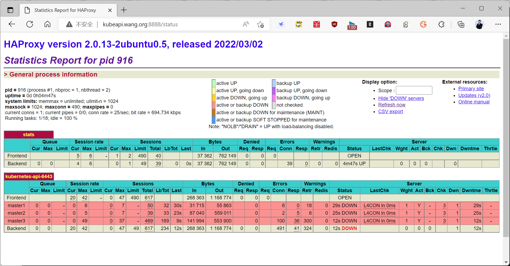
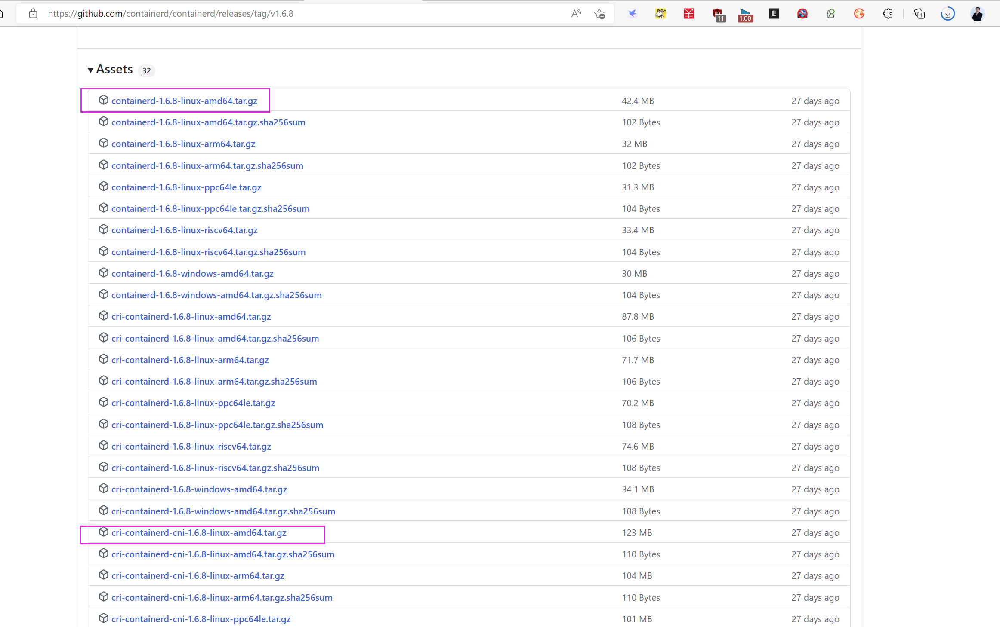
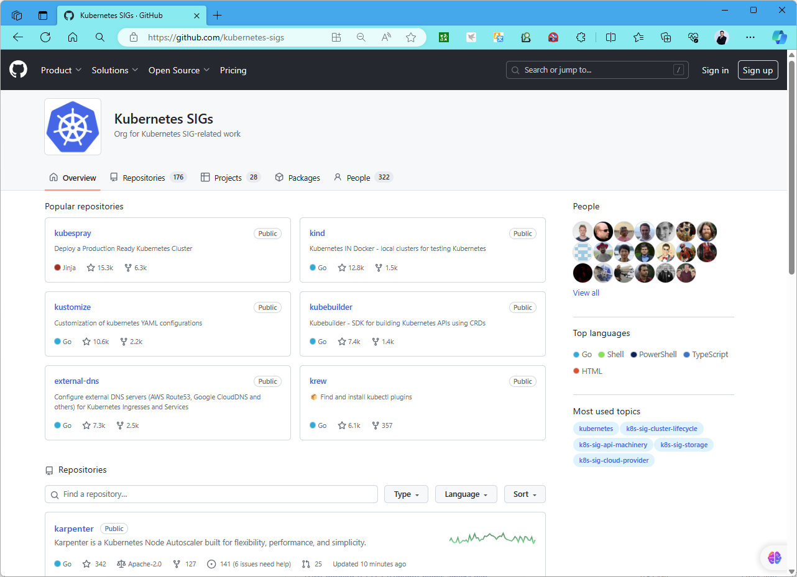
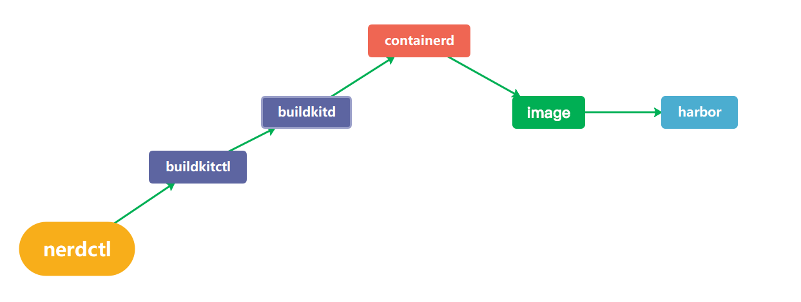

[← 返回 Kubernetes 目录]({{ '/subjects/Kubernetes/' | relative_url }})



# 04 Kubeadm 与 Containerd 高可用部署

## 3.5 基于Kubeadm 和 Containerd 部署 Kubernetes 高可用集群

### 3.5.1 基于Kubeadm 和 Containerd 实现 Kubernetes 集群流程说明

**官方说明**
```text
https://kubernetes.io/docs/setup/production-environment/tools/kubeadm/
https://kubernetes.io/docs/setup/production-environment/tools/kubeadm/install-kubeadm/
https://kubernetes.io/zh-cn/docs/setup/production-environment/tools/kubeadm/create-cluster-kubeadm/
```

部署环境：


| IP | 主机名 | 作用 |
| --- | --- | --- |
| 10.0.0.101–103 | master1–3.bowen.org | 控制平面节点，运行 API Server 和堆叠式 etcd |
| 10.0.0.104–106 | node1–3.bowen.org | 工作节点 |
| 10.0.0.107–108 | ha1–2.bowen.org | HAProxy 与 Keepalived 节点 |
| 10.0.0.100 | kubeapi.bowen.org | 对外提供稳定 API 入口的虚拟 IP（VIP） |

这里的地址仅用于说明拓扑。实际部署时，应先确定 Pod 网段、Service 网段、节点网段互不重叠，并让所有节点都能解析和访问 `kubeapi.bowen.org:6443`。

实现流程

集群部署流程：

1. 为 Kubernetes 集群 API 访问入口配置高可用（可选），并准备各节点主机的初始环境。
2. 在所有 Master 和 Node 节点安装、配置容器运行时 Containerd。
3. 在所有 Master 和 Node 节点安装 kubeadm、kubelet、kubectl；Node 节点可不安装集群管理工具 kubectl。
4. 在第一台 Master 节点运行 `kubeadm init` 初始化集群，并验证 Master 节点状态。
5. 在第一台 Master 节点安装并配置网络插件。
6. 在其他 Master 节点运行 `kubeadm join`，加入控制平面以实现高可用（测试环境可选）。
7. 在所有 Node 节点运行 `kubeadm join`，加入集群。
8. 创建 Pod、启动容器，测试访问与网络通信。

### 3.5.2 部署 Kubernetes 集群 API 访问入口的高可用 ( 可选 )

在 `ha1` 和 `ha2` 上分别部署 HAProxy 与 Keepalived。Keepalived 漂移 VIP；HAProxy 将 TCP 6443 转发到健康的 API Server。先验证两台主机处于同一个可承载 VRRP 的网络，再配置 VIP。

#### 3.5.2.1 安装 HAProxy

```bash
apt update && apt install -y haproxy
cat >/etc/sysctl.d/99-haproxy.conf <<'EOF'
net.ipv4.ip_nonlocal_bind = 1
EOF
sysctl --system
```

保留 `/etc/haproxy/haproxy.cfg` 原有 `global`、`defaults` 配置，再追加 API Server 后端。初始化前只有 `master1` 可用，其他两个后端会被健康检查标为不可用；完成加入后会自动转为可用。

```haproxy
listen kubernetes-api-6443
    bind 10.0.0.100:6443
    mode tcp
    balance roundrobin
    option tcp-check
    server master1 10.0.0.101:6443 check inter 3s fall 3 rise 3
    server master2 10.0.0.102:6443 check inter 3s fall 3 rise 3
    server master3 10.0.0.103:6443 check inter 3s fall 3 rise 3
```

```bash
haproxy -c -f /etc/haproxy/haproxy.cfg
systemctl enable --now haproxy
```

#### 3.5.2.2 安装 Keepalived

```bash
apt install -y keepalived
cat >/etc/keepalived/check_haproxy.sh <<'EOF'
#!/bin/sh
systemctl is-active --quiet haproxy
EOF
chmod 755 /etc/keepalived/check_haproxy.sh
```

两台主机均使用下面的结构；`ha2` 将 `router_id` 设为 `ha2`、`state` 设为 `BACKUP`、`priority` 设为 `80`。请将 `eth0` 换成承载 VIP 的真实网卡。若使用单播 VRRP，还需按所在网络配置 `unicast_src_ip` 与 `unicast_peer`。

```text
global_defs {
    router_id ha1
    enable_script_security
    script_user root
}

vrrp_script check_haproxy {
    script "/etc/keepalived/check_haproxy.sh"
    interval 2
    fall 3
    rise 2
    weight -30
}

vrrp_instance VI_1 {
    state MASTER
    interface eth0
    virtual_router_id 66
    priority 100
    advert_int 1
    virtual_ipaddress {
        10.0.0.100/24 dev eth0
    }
    track_script {
        check_haproxy
    }
}
```

```bash
systemctl enable --now keepalived
ip address show dev eth0
```

#### 3.5.2.3 测试访问

初始化控制平面前，先在 `ha1`、`ha2` 确认 VIP 仅出现在优先级较高的一台上，并测试停掉其 HAProxy 后 VIP 能否漂移。此时 API Server 尚未启动，`6443` 连接失败是预期现象；初始化后再用 `curl -k https://kubeapi.bowen.org:6443/livez` 验证入口。不要在公开网络暴露未加固的 HAProxy 统计页。

### 3.5.3 所有主机初始化

#### 3.5.3.1 配置 ssh key 验证(可选)

配置 ssh key 验证,方便后续同步文件
```bash
ssh-keygen
ssh-copy-id -i ~/.ssh/id_rsa.pub root@10.0.0.102
.....
```

#### 3.5.3.2 设置主机名和解析
```bash
hostnamectl set-hostname master1.bowen.org

cat >> /etc/hosts <<EOF
10.0.0.100 kubeapi.bowen.org kubeapi
10.0.0.101 master1.bowen.org master1
10.0.0.102 master2.bowen.org master2
10.0.0.103 master3.bowen.org master3
10.0.0.104 node1.bowen.org node1
10.0.0.105 node2.bowen.org node2
10.0.0.106 node3.bowen.org node3
10.0.0.107 ha1.bowen.org ha1
10.0.0.108 ha2.bowen.org ha2
EOF

for i in {102..108};do scp /etc/hosts 10.0.0.$i:/etc/ ;done
```

#### 3.5.3.3 禁用 swap
```bash
swapoff -a
sed -i '/swap/s/^/#/' /etc/fstab
#或者
systemctl disable --now swap.img.swap;systemctl mask swap.target
```

#### 3.5.3.4 时间同步
```text
#借助于chronyd服务（程序包名称chrony）设定各节点时间精确同步
apt -y install chrony
chronyc sources -v
```

#### 3.5.3.5 禁用防火墙和SELinux
```text
#禁用默认配置的iptables防火墙服务
ufw disable
ufw status
```

#### 3.5.3.6 内核参数调整

如果是安装 Docker 会自动配置以下的内核参数，而无需手动实现。但是如果安装Contanerd，还需手动配置。允许 iptables 检查桥接流量,若要显式加载此模块，需运行 modprobe br_netfilter。为了让 Linux 节点的 iptables 能够正确查看桥接流量，还需要确认net.bridge.bridge-nf-call-iptables设置为 1。
```bash
#方法1: 安装docker,自动修改内核参数,并自动安装containerd
[root@ubuntu2204 ~]#apt update && apt -y install docker.io

#方法2
#加载模块
modprobe overlay
modprobe br_netfilter

lsmod  |grep -E  'overlay|br_netfilter'
br_netfilter           32768  0
bridge                421888  1 br_netfilter
overlay               212992  0

#开机加载
cat <<EOF | tee /etc/modules-load.d/k8s.conf
overlay
br_netfilter
EOF

#设置所需的 sysctl 参数，参数在重新启动后保持不变
cat <<EOF | sudo tee /etc/sysctl.d/k8s.conf
net.bridge.bridge-nf-call-iptables  = 1
net.bridge.bridge-nf-call-ip6tables = 1
net.ipv4.ip_forward                 = 1
EOF

#应用 sysctl 参数生效而不重新启动
sysctl --system
```

### 3.5.4 所有主机安装 Containerd

#### 3.5.4.1 包安装 Containerd

**在所有节点上安装 Containerd**
```bash
#Ubuntu24.04，22.04和Ubuntu20.04可以利用内置仓库安装containerd
[root@node1 ~]#apt update && apt -y install containerd

#确认服务启动
[root@node1 ~]#systemctl status containerd

#ubuntu24.04
[root@master1 ~]#containerd -v
containerd github.com/containerd/containerd 1.7.24
[root@master1 ~]#runc -v
runc version 1.1.12-0ubuntu3.1
spec: 1.0.2-dev
go: go1.22.2
libseccomp: 2.5.5

#ubuntu22.04
[root@node1 ~]#containerd --version

containerd github.com/containerd/containerd 1.7.2

[root@node1 ~]#runc -v
runc version 1.1.7-0ubuntu1~22.04.2
spec: 1.0.2-dev
go: go1.18.1
libseccomp: 2.5.3

[root@node1 ~]#containerd --version
containerd github.com/containerd/containerd 1.5.9-0ubuntu1~20.04.4

#利用containerd的客户端工具ctr验证修改是否成功
[root@ubuntu2204 ~]#ctr version
Client:
Version:  1.7.2
Revision:
Go version: go1.20.3

Server:
Version:  1.7.2
Revision:
UUID: 75495462-55c4-4a88-b898-bf810af4d353

[root@node1 ~]#ctr version
Client:
Version:  1.5.9-0ubuntu1~20.04.4
Revision:
Go version: go1.13.8

Server:
Version:  1.5.9-0ubuntu1~20.04.4
Revision:
UUID: dedffba3-daac-4ad9-b596-14da3b7a1cf3

#创建默认配置，再让 containerd 与 kubelet 都采用 systemd cgroup 驱动
mkdir -p /etc/containerd
containerd config default > /etc/containerd/config.toml
sed -i 's/SystemdCgroup = false/SystemdCgroup = true/' /etc/containerd/config.toml
systemctl restart containerd
systemctl enable containerd
containerd config dump | grep -E 'SystemdCgroup|sandbox_image'
```

**关于 SystemdCgroup**

`SystemdCgroup = true` 让 runc 通过 systemd 管理容器 cgroup；它必须与 kubelet 的 cgroup 驱动配置一致，避免资源统计与 Pod 启动异常。上面的默认配置适用于本节所用的 containerd 1.x；containerd 2.x 的配置结构不同，须按其生成的配置和所用 Kubernetes 版本重新确认 CRI 插件配置，不能直接复制 1.x 的 TOML 节点。

如需加速拉取，先使用经确认可信且支持所需镜像的镜像站，并按照当前 containerd 版本的 `config_path`/`hosts.toml` 方式逐个配置。不要把仓库密码明文写入公开教程，也不要用 `insecure_skip_verify = true` 绕过证书校验；私有仓库应安装可信 CA 并通过 Kubernetes `imagePullSecrets` 提供凭据。修改后用 `crictl pull` 实测镜像拉取，再同步配置到其他节点。


#### 3.5.4.2 二进制安装 Containerd（可选）

优先使用发行版包管理器；只有发行版版本不满足经验证的 Kubernetes 版本要求时，才考虑二进制安装。上游 `containerd-<版本>-linux-amd64.tar.gz` 通常只提供 containerd 本体，`runc`、CNI 插件、`crictl` 和 systemd 服务单元需要分别安装。`cri-containerd-cni` 全量包是否适用，也要以目标版本的发布内容为准，不能与发行版现有文件混装。

手工安装前确认架构、版本、SHA256 校验值和文件目标路径；先停止旧服务，备份原配置。解包后创建对应版本的服务单元，再执行 `systemctl daemon-reload`、`systemctl enable --now containerd`。用 `containerd --version`、`crictl version` 和 `crictl info` 核实 CRI 可用，最后按前述方法设置 `SystemdCgroup = true`。

若看到 `incompatible CNI versions`，应对照报错中的配置版本和插件支持版本，检查 `/etc/cni/net.d` 中具体是哪份配置被加载、`/opt/cni/bin` 中实际插件的版本及 CNI 插件发布说明。先备份并修正冲突配置或升级插件，再重启 containerd/kubelet 并检查 Pod；不要无条件覆盖整个插件目录或删除网络配置。

### 3.5.5 所有主机安装 kubeadm、kubelet 和 kubectl

六台 Kubernetes 节点应安装同一 minor 版本的组件。以下以官方 `pkgs.k8s.io` 的 v1.32 仓库为例；选择其他版本时，仓库路径、`kubeadm init` 的版本和镜像版本必须一起调整。不要混用旧 `kubernetes-xenial` 仓库。

```bash
apt update && apt install -y ca-certificates curl gpg
install -m 0755 -d /etc/apt/keyrings
curl -fsSL https://pkgs.k8s.io/core:/stable:/v1.32/deb/Release.key \
  | gpg --dearmor -o /etc/apt/keyrings/kubernetes-apt-keyring.gpg
echo 'deb [signed-by=/etc/apt/keyrings/kubernetes-apt-keyring.gpg] https://pkgs.k8s.io/core:/stable:/v1.32/deb/ /' \
  > /etc/apt/sources.list.d/kubernetes.list
apt update
apt-cache madison kubeadm
apt install -y kubelet kubeadm kubectl
apt-mark hold kubelet kubeadm kubectl
kubeadm version -o short
```

生产环境应根据 `apt-cache madison` 结果锁定已测试的补丁版本，并遵守 Kubernetes 组件版本偏差策略。`kubelet` 在节点执行 `kubeadm init/join` 前尚未正常启动属于预期现象。

### 3.5.6 提前准备初始化镜像（可选）

用目标版本生成镜像清单，确认所选仓库有全部镜像，`images pull` 和 `init` 使用同一仓库选项。不要只替换仓库前缀而忽略 CoreDNS 等镜像路径差异。

```bash
K8S_VERSION=$(kubeadm version -o short)
IMAGE_REPO=registry.k8s.io
kubeadm config images list --kubernetes-version "$K8S_VERSION" --image-repository "$IMAGE_REPO"
kubeadm config images pull --kubernetes-version "$K8S_VERSION" \
  --image-repository "$IMAGE_REPO" \
  --cri-socket unix:///run/containerd/containerd.sock
crictl --runtime-endpoint unix:///run/containerd/containerd.sock images
```

本节运行时是 containerd；`docker images` 不会显示其 `k8s.io` 命名空间中的镜像。离线迁移可用 `ctr -n k8s.io images export` 和 `ctr -n k8s.io images import`，导入后再用 `crictl images` 核对。

### 3.5.7 在 master1 初始化控制平面

`--control-plane-endpoint` 指向已经验证可漂移的 API 入口。Pod 网段须与 Flannel 清单一致，并与节点、Service 网段互不重叠。加入令牌默认会过期；不要将 `--token-ttl=0` 当作默认实践。`--upload-certs` 产生的证书密钥须保密。

```bash
K8S_VERSION=$(kubeadm version -o short)
IMAGE_REPO=registry.k8s.io
kubeadm init \
  --kubernetes-version "$K8S_VERSION" \
  --control-plane-endpoint kubeapi.bowen.org:6443 \
  --apiserver-advertise-address 10.0.0.101 \
  --pod-network-cidr 10.244.0.0/16 \
  --service-cidr 10.96.0.0/12 \
  --image-repository "$IMAGE_REPO" \
  --cri-socket unix:///run/containerd/containerd.sock \
  --upload-certs
```

看到初始化成功信息后，把输出中的两类加入命令和证书密钥保存到受控位置。为当前管理员配置客户端：

```bash
mkdir -p "$HOME/.kube"
cp /etc/kubernetes/admin.conf "$HOME/.kube/config"
chmod 600 "$HOME/.kube/config"
kubectl get nodes
```

### 3.5.8 配置 kubectl 客户端

`admin.conf` 具有集群管理员权限，不应分发给普通账号；日常运维应配置最小权限的 RBAC 身份。需要 Bash 补全时可执行 `kubectl completion bash > /etc/bash_completion.d/kubectl`。

### 3.5.9 部署 Pod 网络

未部署 CNI 时节点显示 `NotReady` 是正常现象。选择与本例 `10.244.0.0/16` 网段及 Kubernetes 版本兼容的 Flannel 固定发布版本，审查清单后保存为本地文件；不从随时变化的 `master` 分支直接应用。

```bash
kubectl apply -f ./kube-flannel.yml
kubectl -n kube-flannel rollout status daemonset/kube-flannel-ds --timeout=180s
kubectl get nodes
```

若仍未就绪，先查 `kubectl -n kube-flannel get pods -o wide`、`kubectl describe node <节点名>` 和 `journalctl -u kubelet -u containerd`，区分镜像、内核、路由、CNI 版本及旧配置冲突；不要直接删掉 `/etc/cni/net.d` 并重启。

### 3.5.10 加入其他控制平面和工作节点

先让 `master2`、`master3` 加入，再加入工作节点。用 `kubeadm init` 的真实输出替换占位符，所有节点的 CRI socket 都指向 containerd：

```bash
# 在 master2 和 master3 分别运行
kubeadm join kubeapi.bowen.org:6443 \
  --token BOOTSTRAP_TOKEN \
  --discovery-token-ca-cert-hash sha256:CA_CERT_HASH \
  --control-plane --certificate-key CERTIFICATE_KEY \
  --cri-socket unix:///run/containerd/containerd.sock

# 在 node1、node2、node3 分别运行，不带 --control-plane
kubeadm join kubeapi.bowen.org:6443 \
  --token BOOTSTRAP_TOKEN \
  --discovery-token-ca-cert-hash sha256:CA_CERT_HASH \
  --cri-socket unix:///run/containerd/containerd.sock
```

令牌过期时，在已初始化的控制平面执行 `kubeadm token create --print-join-command`；证书上传过期时，执行 `kubeadm init phase upload-certs --upload-certs` 取得新的证书密钥。

### 3.5.11 验证高可用与服务访问

先确认三个控制平面和三个工作节点均为 `Ready`，且 `kube-system` 与 CNI 命名空间中的 Pod 正常。再分别停用一台 HAProxy 或 Keepalived，验证 VIP 漂移后 `kubectl get nodes` 仍可访问 API，并恢复服务。

```bash
kubectl get nodes -o wide
kubectl get pods -A
kubectl create deployment demoapp --image=ikubernetes/demoapp:v1.0 --replicas=3
kubectl rollout status deployment/demoapp
kubectl expose deployment demoapp --type=NodePort --port=80 --target-port=80
kubectl get service demoapp
kubectl get endpointslices -l kubernetes.io/service-name=demoapp
```

`kubectl expose deployment` 会为 Service 建立与 Deployment 匹配的选择器。记录动态分配的 NodePort，从可访问节点的客户端测试 `http://10.0.0.104:<NodePort>`；`10.0.0.100` 只是 API 入口 VIP，本例并未将它配置成 NodePort 入口。测试结束删除 demoapp Service 和 Deployment。`kubeadm reset` 仅用于有计划地重建节点，不会自动清理所有 CNI、iptables 与用户 kubeconfig 状态。
### 3.5.12 Containerd 客户端工具

`ctr` 是 containerd 的底层调试工具，`crictl` 面向 Kubernetes CRI，`nerdctl` 提供类似 Docker 的操作体验。排查 Kubernetes 节点时优先使用 `kubectl` 和 `crictl`；操作镜像归档时注意 `ctr`/`nerdctl` 必须指定 `k8s.io` 命名空间，否则看到的是不同的镜像集合。

#### 3.5.12.1 crictl 与 ctr

为 `crictl` 指定明确的 CRI 端点，避免它依次尝试多个运行时 socket：

```yaml
runtime-endpoint: unix:///run/containerd/containerd.sock
image-endpoint: unix:///run/containerd/containerd.sock
timeout: 10
debug: false
```

将上面的 YAML 保存为 `/etc/crictl.yaml`。常用的只读排查命令如下：

```bash
crictl info
crictl images
crictl pods
crictl ps -a
crictl logs <容器ID>
ctr -n k8s.io images list
```

`crictl` 的容器操作由 kubelet 管理；不要把它当作 Docker 的完全替代品，也不要在节点上随意删除 kubelet 正在使用的镜像或容器。`ctr -n k8s.io images export images.tar <完整镜像引用>` 和 `ctr -n k8s.io images import images.tar` 可用于离线镜像归档。

#### 3.5.12.2 nerdctl 与 BuildKit

`nerdctl` 更接近 Docker 的交互方式，但普通 `nerdctl images` 默认不在 Kubernetes 的 `k8s.io` 命名空间。安装时选与当前 containerd、主机架构相匹配的官方发行版本，校验发布包哈希；不要在已有 containerd 的节点上直接展开包含另一套 containerd、runc 和 CNI 的全量包。

```bash
nerdctl -n k8s.io images
nerdctl -n k8s.io load -i images.tar
nerdctl -n k8s.io save -o images.tar <完整镜像引用>
```

构建镜像需要另行安装和启动 BuildKit。先在工作目录写入 Dockerfile，再执行构建命令；两者不是同一个代码块中的终端输出：

```dockerfile
FROM busybox:stable
CMD ["echo", "hello", "container"]
```

```bash
systemctl enable --now buildkit
nerdctl build -t example/busybox:v1 .
nerdctl run --rm example/busybox:v1
```

私有仓库应使用可信 CA 和受控凭据，保持 TLS 校验；不要把 `insecure = true` 当作固定配置。构建完成后，按仓库权限和镜像命名策略登录、标记和推送。

<details class="historical-figures" markdown="1">
<summary>查看原始讲义中的其余配图与历史操作截图（7 张）</summary>











</details>



<nav class="article-end" aria-label="章节导航">
  <a href="{{ '/subjects/Kubernetes/03-kubeadm-docker-ha.html' | relative_url }}">← 上一章：Kubeadm 与 Docker 高可用部署</a>
  <a href="{{ '/subjects/Kubernetes/' | relative_url }}">返回 Kubernetes 目录</a>
  <a href="{{ '/subjects/Kubernetes/05-kubeasz-binary-deployment.html' | relative_url }}">下一章：Kubeasz 二进制部署与集群初始化 →</a>
</nav>
