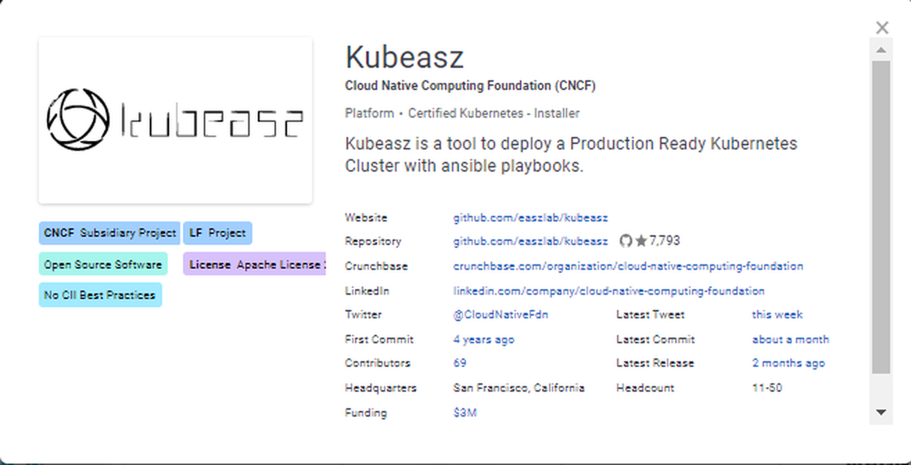
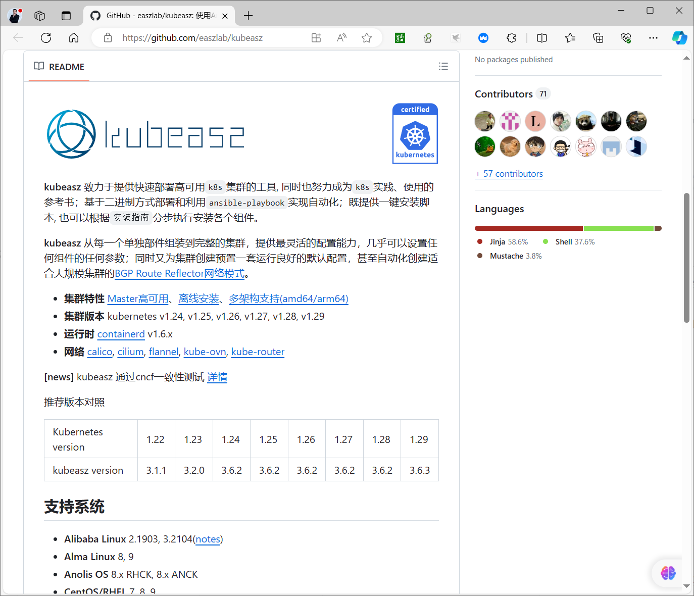
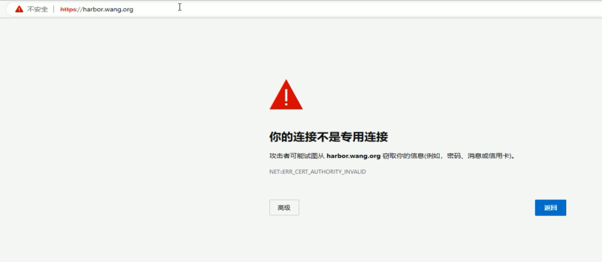
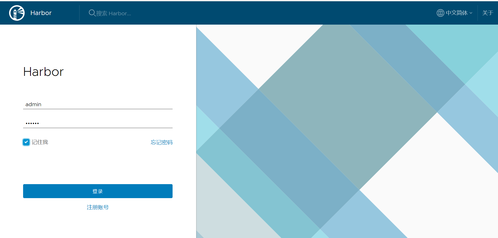
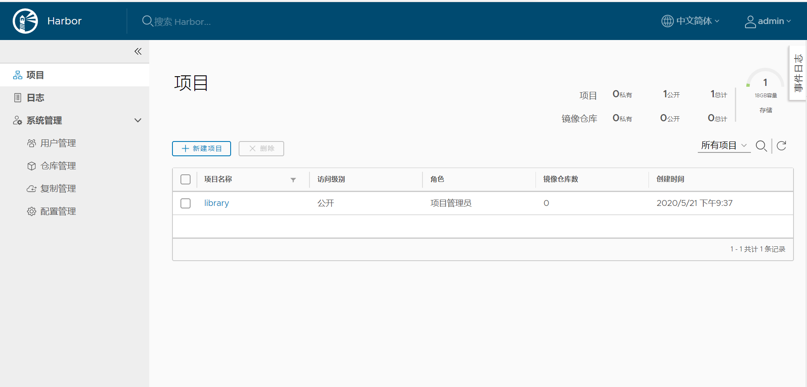
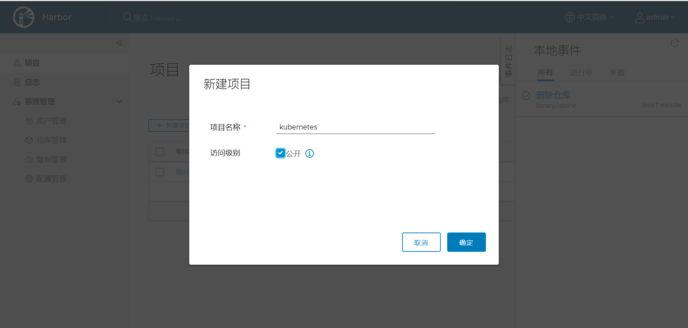
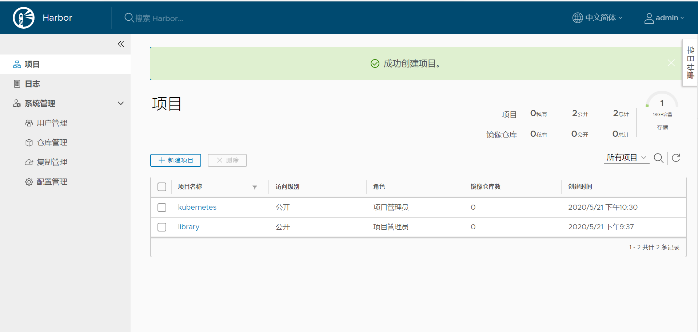
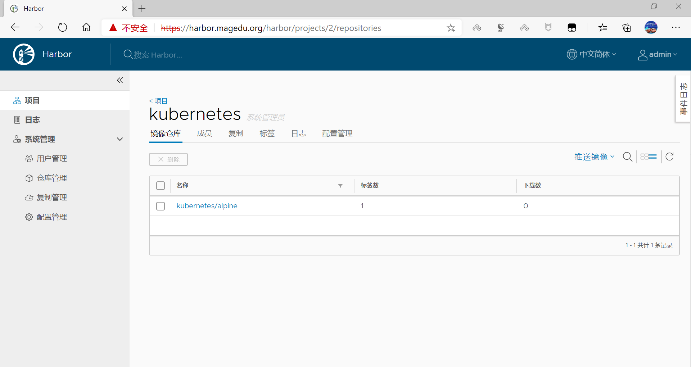
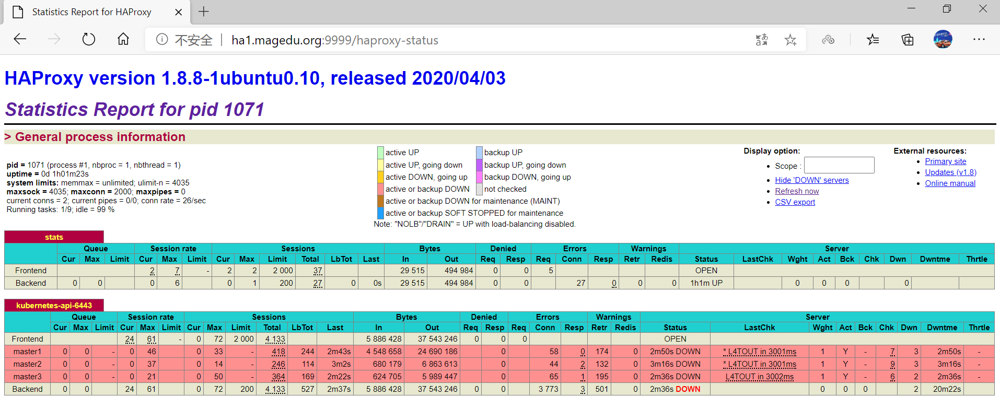
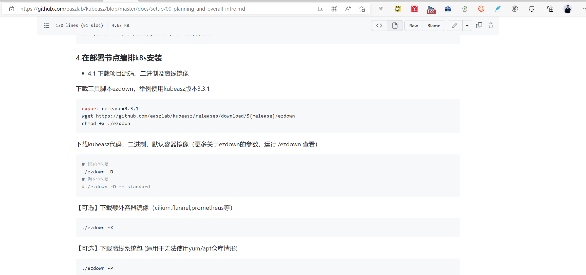

[← 返回 Kubernetes 目录]({{ '/subjects/Kubernetes/' | relative_url }})



# 05 Kubeasz 二进制部署与集群初始化

## 3.6 Kubeasz 利用 Ansible 部署二进制 Kubernetes 高可用集群

### 3.6.1 Kubeasz 说明

Kubeasz是一个已通过CNCF官方认证的使用ansible的安装kubernetes的项目。



kubeasz 致力于提供快速部署高可用k8s集群的工具, 同时也努力成为k8s实践、使用的参考书；基于二进制方式部署和利用ansible-playbook实现自动化；既提供一键安装脚本, 也可以根据安装指南分步执行安装各个组件。kubeasz 从每一个单独部件组装到完整的集群，提供最灵活的配置能力，几乎可以设置任何组件的任何参数；同时又为集群创建预置一套运行良好的默认配置，甚至自动化创建适合大规模集群的BGP Route Reflector网络模式。

kubeasz 通过cncf一致性测试

- **集群特性**：Master 高可用、离线安装、多架构支持（amd64/arm64）。
- **集群版本**：Kubernetes v1.24、v1.25、v1.26、v1.27、v1.28、v1.29。
- **容器运行时**：containerd v1.6.x，不再使用 Docker。
- **网络插件**：Calico、Cilium、Flannel、Kube-OVN、kube-router。

github链接：


- <https://github.com/easzlab/kubeasz>




### 3.6.2 单机 All-in-One 体验

All-in-One 将控制平面、etcd 与工作负载放在同一台机器上，便于体验 Kubeasz 的流程，不具备高可用。准备一台干净的受支持 Linux 主机；若曾装过 kubeadm 或其他发行版，应先在独立虚拟机中重建环境，而不是直接执行清理脚本。为虚拟机预留足够内存、CPU 和磁盘，并确认可以拉取所选版本的安装资源。

从 [Kubeasz 发布页](https://github.com/easzlab/kubeasz/releases) 选定与目标 Kubernetes 版本匹配的固定 release，查看该版本的 `ezdown` 用法并校验下载文件。以下仅展示命令顺序，`KUBEASZ_RELEASE` 需替换为选定发布号：

```bash
curl -fL -o ezdown "https://github.com/easzlab/kubeasz/releases/download/KUBEASZ_RELEASE/ezdown"
chmod +x ./ezdown
./ezdown                  # 先核对该版本支持的参数
./ezdown -D               # 下载代码、二进制和镜像
./ezdown -S               # 启动 kubeasz 管理容器
docker exec -it kubeasz ezctl start-aio
kubectl get nodes -o wide
kubectl get pods -A
```

`ezdown -D` 会消耗明显的磁盘与网络资源；执行前确认镜像站或代理可信、下载结果完整。All-in-One 部署完成后，`kubectl get nodes` 应为 `Ready`，`kube-system` 中的关键组件应运行正常。不要把旧日志里某一个版本的镜像摘要当成新版本验收标准。

扩展此实验集群时先确认集群名（`docker exec kubeasz ezctl list`），并按发布版本的操作文档使用 `add-master` / `add-node`。新增节点必须完成 SSH 可达、时间同步、运行时与网络准备；操作后检查节点、CNI Pod 和实际工作负载。删除节点前先 `kubectl drain <节点名> --ignore-daemonsets --delete-emptydir-data`，确认业务有其他副本，再执行对应的 `del-node` 或 `del-master`；减少 etcd 成员或控制平面时必须维持法定多数，不能照抄单机例子的删除命令。

### 3.6.3 高可用分布式部署规划

| 角色 | 数量 | 说明 |
| --- | --- | --- |
| 部署节点 | 1 | 运行 `ezdown`、`ezctl` 与 Ansible；可复用 master1，但配置和备份应单独保管 |
| etcd 节点 | 3（常见） | 奇数成员提供法定多数，可与控制平面共置 |
| 控制平面节点 | 至少 2，通常 3 | API Server、Controller Manager、Scheduler |
| 工作节点 | 按负载确定 | 运行应用 Pod；容量、故障域与网络需预先规划 |

三个 etcd 成员允许失去一个成员；两台控制平面并不能弥补 etcd 丧失法定多数。Kubeasz 默认可在各节点部署本地 API 反向代理（`kube-lb`），将 kubelet 的访问导向可用的控制平面；它与前两章的独立 VIP 入口是不同方案，先明确客户端和节点各自使用的 API 地址。部署前确认主机、Pod、Service 网段互不重叠，控制平面和 etcd 端口可达，SSH 权限最小化，并规划证书、etcd 数据与 `/etc/kubeasz` 的备份。

### 3.6.4 当前高可用部署示例

本例使用 `10.0.0.101–103` 作为控制平面及 etcd，`10.0.0.104–106` 作为工作节点；部署机复用 master1。与旧记录中并列的 v1.29、v1.30、v1.31、v1.32、v1.33 不同，一次部署只选一组已验证兼容的 Kubeasz release、Kubernetes 二进制和容器运行时，版本对应关系以该 release 的发布说明为准。

#### 3.6.4.1 准备部署机

从部署机逐个测试 SSH 到六台节点，确认主机名解析、时间同步、内核和网络符合目标版本文档。然后下载固定 release 的 `ezdown`，校验文件，再执行下载和启动：

```bash
curl -fL -o ezdown "https://github.com/easzlab/kubeasz/releases/download/KUBEASZ_RELEASE/ezdown"
chmod +x ./ezdown
./ezdown
./ezdown -D
./ezdown -S
docker exec kubeasz ezctl list
```

不要从不断变化的 `master` 分支复制脚本，也不要在 `daemon.json` 中写带注释的“JSON”或随意设置 `insecure-registries`。如下载受网络限制，应使用经验证的镜像源或离线包，核对镜像版本和摘要，再继续。

#### 3.6.4.2 创建并核对清单

`ezctl new` 会生成该发布版本的默认清单与配置。先备份生成文件，再只修改与本拓扑相关的项；不要把不同 release 的变量名混用。

```bash
docker exec -it kubeasz ezctl new k8s-mycluster-01
cp -a /etc/kubeasz/clusters/k8s-mycluster-01 /etc/kubeasz/clusters/k8s-mycluster-01.backup
```

在 `/etc/kubeasz/clusters/k8s-mycluster-01/hosts` 中按实际拓扑填写：

```ini
[etcd]
10.0.0.101
10.0.0.102
10.0.0.103

[kube_master]
10.0.0.101 k8s_nodename='master-01'
10.0.0.102 k8s_nodename='master-02'
10.0.0.103 k8s_nodename='master-03'

[kube_node]
10.0.0.104 k8s_nodename='worker-01'
10.0.0.105 k8s_nodename='worker-02'
10.0.0.106 k8s_nodename='worker-03'

[all:vars]
CONTAINER_RUNTIME="containerd"
CLUSTER_NETWORK="calico"
SERVICE_CIDR="10.96.0.0/12"
CLUSTER_CIDR="10.244.0.0/16"
```

其他分组与默认变量应保留生成文件中的定义，不要把这个节选直接覆盖整个清单。`config.yml` 中的 Kubernetes 版本、证书期限、私有仓库和 Pod 数量等设置，须按该 release 的说明逐项核对。`CONTAINER_RUNTIME` 这里选 containerd；不要把旧版“Docker 支持”说明理解为 Kubernetes 1.24+ 可直接连接 Docker Engine。

#### 3.6.4.3 分步部署与验证

先运行 `docker exec kubeasz ezctl help setup` 检查该版本的步骤编号。新集群建议按 `prepare → etcd → container-runtime → kube-master → kube-node → network → cluster-addon` 分步执行，便于在每一步验证；确认配置正确后也可用 `all` 一次运行，不要同时重复两条路径。

```bash
docker exec -it kubeasz ezctl setup k8s-mycluster-01 01
docker exec -it kubeasz ezctl setup k8s-mycluster-01 02
docker exec -it kubeasz ezctl setup k8s-mycluster-01 03
docker exec -it kubeasz ezctl setup k8s-mycluster-01 04
docker exec -it kubeasz ezctl setup k8s-mycluster-01 05
docker exec -it kubeasz ezctl setup k8s-mycluster-01 06
docker exec -it kubeasz ezctl setup k8s-mycluster-01 07
```

每一步检查 Ansible recap 中的 `unreachable` 和 `failed`，失败时先读对应任务日志，不直接跳过。成功后验证：

```bash
kubectl get nodes -o wide
kubectl get pods -A -o wide
kubectl get --raw='/readyz?verbose'
```

若在独立部署机使用 `kubectl`，须显式指定经 Kubeasz 生成的 kubeconfig；`localhost:8080 connection refused` 往往表示 kubeconfig 未配置，而非 API Server 一定故障。管理员配置文件要按权限传输和保存，不能当普通节点文件批量分发。

本方案中工作节点的本地 `kube-lb` 通常监听 `127.0.0.1:6443` 并转发到多台控制平面。检查生成的 `/etc/kube-lb/conf/kube-lb.conf` 与进程状态，确认 upstream 包含预期 API Server，而不是手写旧版 Nginx 配置覆盖自动生成的文件。

#### 3.6.4.4 扩容、缩容与备份

新增控制平面或工作节点前，先确认 SSH、版本、证书与网络，再用当前版本的 `ezctl add-master` 或 `ezctl add-node` 更新清单和部署组件。缩容工作节点先迁移工作负载并确认 PDB、StatefulSet 数据与 DaemonSet 的影响；缩容 etcd/控制平面前先检查成员健康和法定多数。执行后验证 `kubectl get nodes`、etcd 成员及本地 API 代理的后端列表。

定期备份 etcd 快照与 `/etc/kubeasz/clusters/<集群名>`，并验证恢复过程。升级必须按发布版本的官方升级文档逐个 minor 版本进行，先备份，再做兼容性与回滚计划；不直接对现有集群重复执行 `setup all`。

### 3.6.5 旧版 Kubernetes 1.17 案例的知识点

旧记录采用 Ubuntu 18.04、独立三节点 etcd、三台控制平面、Harbor、HAProxy/Keepalived 以及手工 Ansible playbook；它展示的是与上述“etcd 和控制平面共置、Kubeasz 自动化”不同的拓扑。Kubernetes 1.17、Ubuntu 18.04 和 Docker Compose v1 都已不适合作为当前新集群的直接安装路径，因此不再混入当前命令步骤。

读这套历史方案时仍应理解几个不随版本变化的原则：etcd 成员要保持奇数并维持法定多数；API 入口须独立于任意单台控制平面；Harbor 需可信 TLS 与持久化；Ansible inventory 是节点角色和网段配置的单一事实源；部署顺序是基础环境、证书/etcd、运行时、控制平面、工作节点、网络与验证。迁移旧集群应另行制定版本跨度、存储数据和 API 废弃项的升级方案，不能复制旧 playbook 到新系统直接运行。
## 3.7 Kubernetes 集群初始化与节点注册流程

本节解释 `kubeadm init` 和 `kubeadm join` 的工作原理，帮助定位 Kubeasz 或 kubeadm 部署中出现的故障。两种工具的执行方式不同，但最终都要让控制平面组件、kubelet、etcd 与网络插件协同工作。以下以 kubeadm 的常见流程说明，不把旧版 v1.22 的原始终端日志当作当前命令清单。

### 3.7.1 控制平面初始化

1. **预检与镜像准备。** kubeadm 检查端口、主机名、运行时、swap、系统资源等条件，并准备与所选 Kubernetes 版本匹配的镜像。预检失败先修复原因，不用 `--ignore-preflight-errors` 掩盖运行时或网络问题。
2. **建立信任根与组件凭据。** 在 `/etc/kubernetes/pki` 下产生集群 CA、API Server、前端代理、etcd 等证书；同时生成管理员与各控制平面组件的 kubeconfig。证书私钥和 `admin.conf` 均属于敏感配置，不能贴进公开笔记或随意同步。
3. **启动静态 Pod。** kubeadm 将 etcd、API Server、Controller Manager、Scheduler 的清单写入 `/etc/kubernetes/manifests`，本机 kubelet 监控这些文件并通过容器运行时启动相应 Pod。堆叠式 etcd 高可用还需在其他控制平面节点加入后形成法定多数。
4. **写入集群配置与引导信息。** API Server 可用后，kubeadm 创建集群配置、Bootstrap Token、RBAC 与 TLS bootstrap 所需对象，并部署 CoreDNS 和 kube-proxy 等附加组件。CoreDNS 是否就绪还依赖 CNI 网络插件。
5. **标记控制平面节点。** 节点获得 `control-plane` 角色与相应污点，使普通工作负载默认不落到控制平面；若确需在单节点实验集群调度业务 Pod，应明确调整污点，而不是误判调度器异常。

定位失败时沿这个顺序检查：`journalctl -u kubelet`、`crictl ps -a`、`crictl logs <容器ID>`、`kubectl -n kube-system get pods -o wide`。如果 API 尚未起来，`kubectl` 本身不可用，应优先查看 kubelet 与容器运行时日志。证书问题还要核对主机时间、API 入口的 DNS/VIP 和证书 SAN。

### 3.7.2 工作节点加入与证书引导

`kubeadm join` 首先预检节点和 CRI，随后通过 `--discovery-token-ca-cert-hash` 验证控制平面的 CA，再以短期 Bootstrap Token 获取集群配置。kubelet 发起证书签名请求（CSR）；经过相应自动批准策略或管理员批准后，得到客户端证书，开始以节点身份连接 API Server 并注册 Node 对象。

```bash
# 在已有控制平面上检查引导状态
kubeadm token list
kubectl get csr
kubectl get nodes -o wide

# 在新节点上检查 kubelet 与运行时
systemctl status kubelet --no-pager
journalctl -u kubelet -n 100 --no-pager
crictl info
```

CSR 已批准但节点仍为 `NotReady` 时，应继续检查 CNI、Pod CIDR、节点间路由、镜像拉取和 kubelet 状态；不要反复执行 `join`。如果令牌过期，使用 `kubeadm token create --print-join-command` 创建新的加入命令。仅在实际需要时才查看 `kube-system` 的 kubeadm ConfigMap；它不是凭据备份，不能用从旧版本拷贝的 YAML 覆盖当前集群配置。

<details class="historical-figures" markdown="1">
<summary>查看原始讲义中的其余配图与历史操作截图（8 张）</summary>

















</details>



<nav class="article-end" aria-label="章节导航">
  <a href="{{ '/subjects/Kubernetes/04-kubeadm-containerd-ha.html' | relative_url }}">← 上一章：Kubeadm 与 Containerd 高可用部署</a>
  <a href="{{ '/subjects/Kubernetes/' | relative_url }}">返回 Kubernetes 目录</a>
  <a href="{{ '/subjects/Kubernetes/06-kubectl-management.html' | relative_url }}">下一章：kubectl 集群管理命令 →</a>
</nav>
