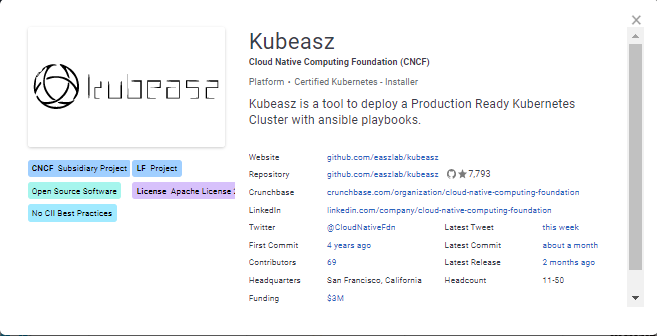
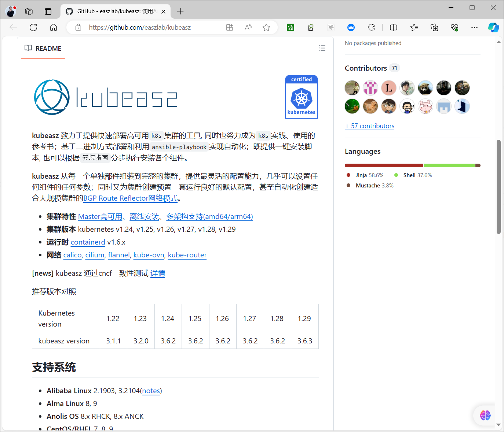
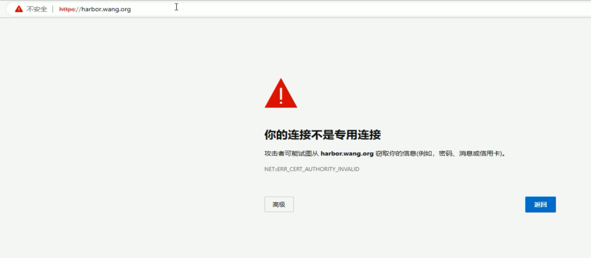
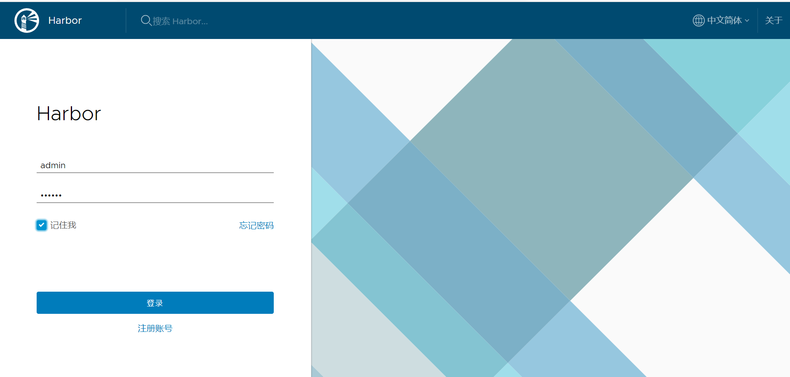
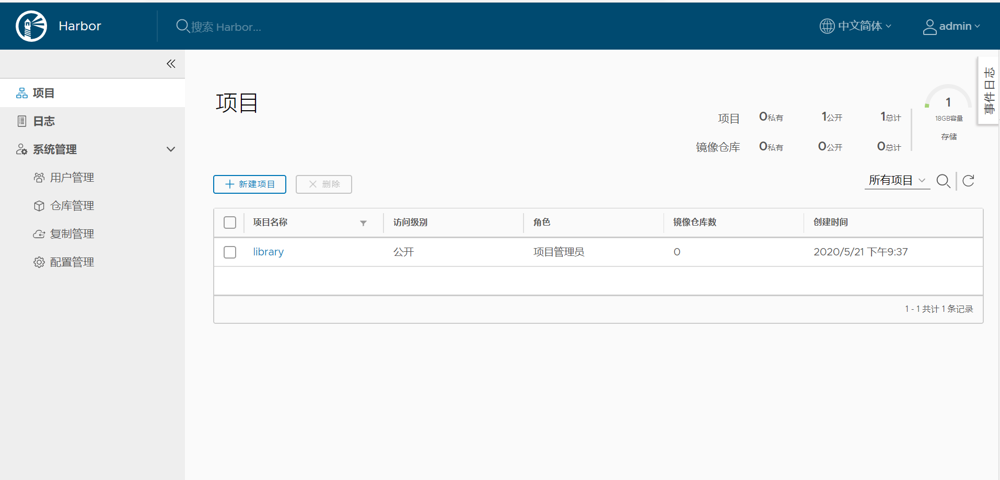
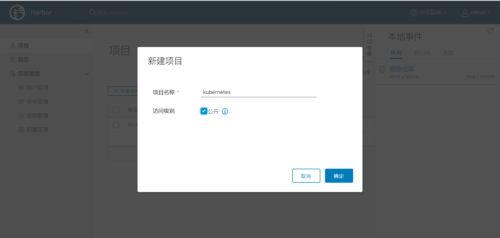
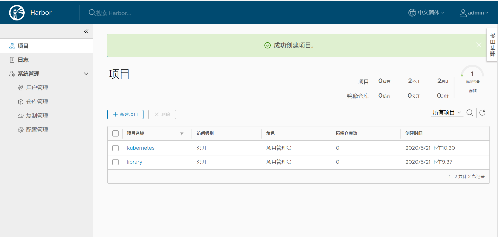
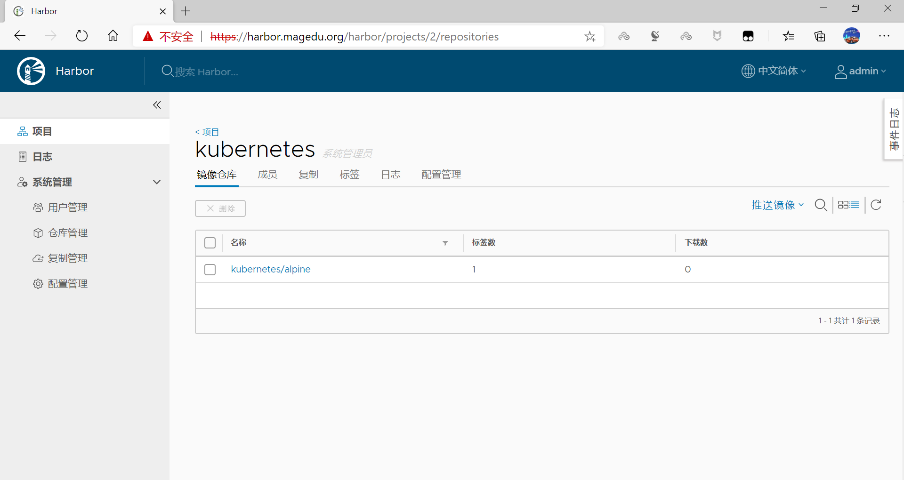
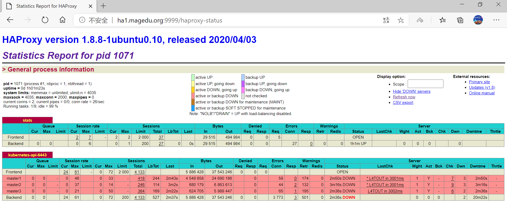
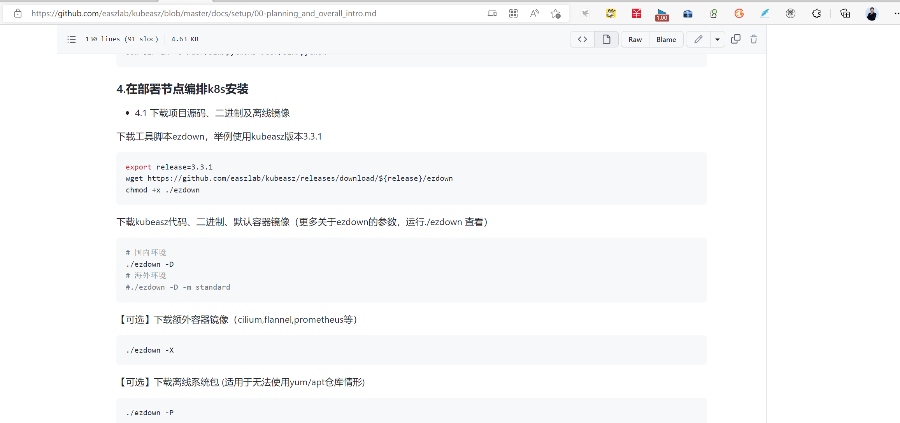

[← 返回 Kubernetes 目录]({{ '/subjects/Kubernetes/' | relative_url }})



# 05 Kubeasz 二进制部署与集群初始化

## 3.6 Kubeasz 利用 Ansible 部署二进制 Kubernetes 高可用集群

### 3.6.1 Kubeasz 说明

Kubeasz是一个已通过CNCF官方认证的使用ansible的安装kubernetes的项目。



kubeasz 致力于提供快速部署高可用k8s集群的工具, 同时也努力成为k8s实践、使用的参考书；基于二进制方式部署和利用ansible-playbook实现自动化；既提供一键安装脚本, 也可以根据安装指南分步执行安装各个组件。kubeasz 从每一个单独部件组装到完整的集群，提供最灵活的配置能力，几乎可以设置任何组件的任何参数；同时又为集群创建预置一套运行良好的默认配置，甚至自动化创建适合大规模集群的BGP Route Reflector网络模式。

kubeasz 通过cncf一致性测试

- **集群特性**：Master 高可用、离线安装、多架构支持（amd64/arm64）。
- **集群版本**：Kubernetes v1.24、v1.25、v1.26、v1.27、v1.28、v1.29。
- **容器运行时**：containerd v1.6.x，不再使用 Docker。
- **网络插件**：Calico、Cilium、Flannel、Kube-OVN、kube-router。

github链接：


- <https://github.com/easzlab/kubeasz>




### 3.6.2 ALL in ONE 部署

#### 3.6.2.1 ALL IN ONE 部署说明

**单机快速体验k8s集群的测试环境--AllinOne部署**


- <https://github.com/easzlab/kubeasz/blob/master/docs/setup/quickStart.md>


**基础系统配置**

准备一台虚机配置内存2G/硬盘30G以上最小化安装 Ubuntu 22.04 server配置基础网络、更新源、SSH登录等。

注意: 确保在干净的系统上开始安装，不能使用曾经装过kubeadm或其他k8s发行版的环境。

#### 3.6.2.2 案例: 部署ALL IN ONE
```bash
#下载工具脚本ezdown
[root@ubuntu2204 ~]#export release=3.6.3
[root@ubuntu2204 ~]#wget
https://github.com/easzlab/kubeasz/releases/download/${release}/ezdown
#下载如果失败，使用代理下载
[root@ubuntu2204 ~]#wget
https://mirror.ghproxy.com/https://github.com/easzlab/kubeasz/releases/download/
${release}/ezdown
[root@ubuntu2204 ~]#chmod +x ./ezdown

[root@ubuntu2204 ~]#wc -l ./ezdown
767 ./ezdown
[root@ubuntu2204 ~]#file ./ezdown
./ezdown: Bourne-Again shell script, ASCII text executable

[root@ubuntu2204 ~]#head -20 ./ezdown
#!/bin/bash
#--------------------------------------------------
# This script is used for:
# 1. to download the scripts/binaries/images needed for installing a k8s cluster
with kubeasz
# 2. to run kubeasz in a container (recommended)
# @author:   gjmzj
# @usage:    ./ezdown
# @repo:     https://github.com/easzlab/kubeasz
#--------------------------------------------------
set -o nounset
set -o errexit
set -o pipefail
#set -o xtrace

# default settings, can be overridden by cmd line options, see usage
DOCKER_VER=24.0.7
KUBEASZ_VER=3.6.3
K8S_BIN_VER=v1.29.0
# https://github.com/easzlab/dockerfile-kubeasz-ext-bin
EXT_BIN_VER=1.9.0

#查看脚本功能
[root@ubuntu2204 ~]#./ezdown
Usage: ezdown [options] [args]
option:
-C         stop&clean all local containers
-D         download default binaries/images into "/etc/kubeasz"
-P <OS>    download system packages of the OS (ubuntu_22,debian_11,...)
-R         download Registry(harbor) offline installer
-S         start kubeasz in a container
-X <opt>   download extra images
-d <ver>   set docker-ce version, default "24.0.7"
-e <ver>   set kubeasz-ext-bin version, default "1.9.0"
-k <ver>   set kubeasz-k8s-bin version, default "v1.29.0"
-m <str>   set docker registry mirrors, default "CN"(used in Mainland,China)
-z <ver>   set kubeasz version, default "3.6.3"

#下载kubeasz代码、二进制、默认容器镜像
[root@ubuntu2204 ~]#./ezdown -D
......
Digest: sha256:d5fee2a95eaaefc3a0b8a914601b685e4170cb870ac319ac5a9bfb7938389852
Status: Image is up to date for easzlab/pause:3.9
docker.io/easzlab/pause:3.9
The push refers to repository [easzlab.io.local:5000/easzlab/pause]
e3e5579ddd43: Pushed
3.9: digest:
sha256:3ec9d4ec5512356b5e77b13fddac2e9016e7aba17dd295ae23c94b2b901813de size:
527
2024-04-10 22:34:27 INFO Action successed: download_all

#查看下载的目录

[root@ubuntu2204 ~]#ls /etc/kubeasz/
ansible.cfg  bin  clusters  docs  down  example  ezctl  ezdown  manifests  pics
playbooks  README.md  roles  tools
[root@ubuntu2204 ~]#du -sh /etc/kubeasz/
2.5G    /etc/kubeasz/

[root@ubuntu2204 ~]#docker ps
CONTAINER ID   IMAGE        COMMAND                   CREATED              STATUS
PORTS     NAMES
31d758c141dd   registry:2   "/entrypoint.sh /etc…"   About a minute ago   Up
About a minute             local_registry

[root@ubuntu2204 ~]#docker images
REPOSITORY                                           TAG       IMAGE ID
CREATED         SIZE
registry                                             2         9363667f8aec   3
weeks ago     25.4MB
easzlab/kubeasz                                      3.6.3     6b81f4bc80dc   3
months ago    157MB
easzlab/kubeasz-ext-bin                              1.9.0     d0c1632444ec   3
months ago    654MB
easzlab/kubeasz-k8s-bin                              v1.29.0   d0059690aa5d   3
months ago    1.23GB
calico/kube-controllers                              v3.26.4   b32f99198153   4
months ago    74.7MB
easzlab.io.local:5000/calico/kube-controllers        v3.26.4   b32f99198153   4
months ago    74.7MB
calico/cni                                           v3.26.4   17d35f5bad38   4
months ago    209MB
easzlab.io.local:5000/calico/cni                     v3.26.4   17d35f5bad38   4
months ago    209MB
calico/node                                          v3.26.4   ded66453eb63   4
months ago    252MB
easzlab.io.local:5000/calico/node                    v3.26.4   ded66453eb63   4
months ago    252MB
coredns/coredns                                      1.11.1    cbb01a7bd410   7
months ago    59.8MB
easzlab.io.local:5000/coredns/coredns                1.11.1    cbb01a7bd410   7
months ago    59.8MB
easzlab/metrics-server                               v0.6.4    c1623971df95   8
months ago    68.9MB
easzlab.io.local:5000/easzlab/metrics-server         v0.6.4    c1623971df95   8
months ago    68.9MB
easzlab/k8s-dns-node-cache                           1.22.23   81d6450452ae   9
months ago    68.4MB
easzlab.io.local:5000/easzlab/k8s-dns-node-cache     1.22.23   81d6450452ae   9
months ago    68.4MB
easzlab/pause                                        3.9       78d53e70b442   18
months ago   744kB
easzlab.io.local:5000/easzlab/pause                  3.9       78d53e70b442   18
months ago   744kB
kubernetesui/dashboard                               v2.7.0    07655ddf2eeb   19
months ago   246MB
easzlab.io.local:5000/kubernetesui/dashboard         v2.7.0    07655ddf2eeb   19
months ago   246MB
kubernetesui/metrics-scraper                         v1.0.8    115053965e86   22
months ago   43.8MB

easzlab.io.local:5000/kubernetesui/metrics-scraper   v1.0.8    115053965e86   22
months ago   43.8MB

#容器化运行 kubeasz
```
```bash
[root@ubuntu2204 ~]#./ezdown -S
2024-04-10 22:36:44 INFO Action begin: start_kubeasz_docker
Loaded image: easzlab/kubeasz:3.6.3
2024-04-10 22:36:45 INFO try to run kubeasz in a container
2024-04-10 22:36:45 DEBUG get host IP: 10.0.0.100
2024-04-10 22:36:45 DEBUG generate ssh key pair
# 10.0.0.100:22 SSH-2.0-OpenSSH_8.9p1 Ubuntu-3ubuntu0.1
7784c92c88c4c05dc94930dfc5ac32ed644861efdcc9a4f5d481ca8f2dc4a6e0
2024-04-10 22:36:45 INFO Action successed: start_kubeasz_docker

#查看到启动的容器kubeasz
[root@ubuntu2204 ~]#docker ps
CONTAINER ID   IMAGE                   COMMAND                   CREATED
STATUS              PORTS     NAMES
7784c92c88c4   easzlab/kubeasz:3.6.3   "tail -f /dev/null"       About a minute
ago   Up About a minute             kubeasz
31d758c141dd   registry:2              "/entrypoint.sh /etc…"   4 minutes ago
Up 4 minutes                  local_registry

#使用默认配置基于Ansible安装 aio 集群
[root@ubuntu2204 ~]#docker exec -it kubeasz ezctl start-aio
2024-04-10 22:38:18 INFO get local host ipadd: 10.0.0.100
2024-04-10 22:38:18 DEBUG generate custom cluster files in
/etc/kubeasz/clusters/default
2024-04-10 22:38:18 DEBUG set versions
2024-04-10 22:38:18 DEBUG cluster default: files successfully created.
2024-04-10 22:38:18 INFO next steps 1: to config
'/etc/kubeasz/clusters/default/hosts'
2024-04-10 22:38:18 INFO next steps 2: to config
'/etc/kubeasz/clusters/default/config.yml'
ansible-playbook -i clusters/default/hosts -e @clusters/default/config.yml
playbooks/90.setup.yml
*** Component Version *********************
*******************************************
*   kubernetes: v1.29.0
*   etcd: v3.5.10
*   calico: v3.26.4
*******************************************
2024-04-10 22:38:19 INFO cluster:default setup step:all begins in 5s, press any
key to abort:
.....
TASK [cluster-addon : 准备 dashboard的部署文件]
********************************************************************************
********************
changed: [localhost] => (item=kubernetes-dashboard.yaml)
changed: [localhost] => (item=admin-user-sa-rbac.yaml)
changed: [localhost] => (item=read-user-sa-rbac.yaml)

TASK [cluster-addon : 创建 dashboard部署]
********************************************************************************
**************************
changed: [localhost]

PLAY RECAP
********************************************************************************
*********************************************************
10.0.0.100                 : ok=117  changed=107  unreachable=0    failed=0
skipped=204  rescued=0    ignored=0
localhost                  : ok=43   changed=40   unreachable=0    failed=0
skipped=50   rescued=0    ignored=0

#验证安装
[root@ubuntu2204 ~]#tail -4 .bashrc
alias dk='docker exec -it kubeasz'  # generated by kubeasz
export PATH=/opt/kube/bin:$PATH  # generated by kubeasz:custom PATH
source <(crictl completion bash) # generated by kubeasz
source <(kubectl completion bash) # generated by kubeasz

[root@ubuntu2204 ~]#source ~/.bashrc

#docker查看容器
[root@ubuntu2204 ~]#docker ps
CONTAINER ID   IMAGE                   COMMAND                   CREATED
STATUS          PORTS     NAMES
7784c92c88c4   easzlab/kubeasz:3.6.3   "tail -f /dev/null"       9 minutes ago
Up 9 minutes              kubeasz
31d758c141dd   registry:2              "/entrypoint.sh /etc…"   12 minutes ago
Up 12 minutes             local_registry

#使用crictl工具查看容器，对比docker不同
[root@ubuntu2204 ~]#crictl ps
CONTAINER           IMAGE               CREATED             STATE
NAME                        ATTEMPT             POD ID              POD
b207a3559d56a       07655ddf2eebe       5 minutes ago       Running
kubernetes-dashboard        0                   5967262122931       kubernetes-
dashboard-74fb9f77fb-8lc4r
174661a447df5       115053965e86b       5 minutes ago       Running
dashboard-metrics-scraper   0                   5e9136251c9c9       dashboard-
metrics-scraper-77b667b99d-8f8hp
5e7398679335f       c1623971df952       5 minutes ago       Running
metrics-server              0                   05970ef74ff1b       metrics-
server-dfb478476-29548
0e64f5e7a0a63       81d6450452ae7       5 minutes ago       Running
node-cache                  0                   387e27c0b9fb9       node-local-
dns-8qpkb
ef8e0c608d334       cbb01a7bd410d       5 minutes ago       Running
coredns                     0                   755255380c6c7       coredns-
6db9bd4cd7-pplnb
a1af6e04de93c       ded66453eb630       5 minutes ago       Running
calico-node                 0                   b5834e53ba2b5       calico-node-
skhwq
b7df5c26de460       b32f991981530       5 minutes ago       Running
calico-kube-controllers     0                   4c616e1208d19       calico-kube-
controllers-5994f46b69-7fjmj
```
```bash
[root@ubuntu2204 ~]#kubectl version
Client Version: v1.29.0
Kustomize Version: v5.0.4-0.20230601165947-6ce0bf390ce3
Server Version: v1.29.0

[root@ubuntu2204 ~]#kubectl get nodes
NAME         STATUS   ROLES    AGE   VERSION
10.0.0.100   Ready    master   18m   v1.29.0

[root@ubuntu2204 ~]#kubectl top nodes
NAME         CPU(cores)   CPU%   MEMORY(bytes)   MEMORY%
10.0.0.100   62m          3%     1006Mi          61%

[root@ubuntu2204 ~]#kubectl get pod -A
NAMESPACE     NAME                                         READY   STATUS
RESTARTS   AGE
kube-system   calico-kube-controllers-5994f46b69-d6s8w     1/1     Running   0
19m
kube-system   calico-node-wf4tq                            1/1     Running   0
19m
kube-system   coredns-6db9bd4cd7-wxn98                     1/1     Running   0
18m
kube-system   dashboard-metrics-scraper-77b667b99d-k6pgt   1/1     Running   0
18m
kube-system   kubernetes-dashboard-74fb9f77fb-p2bbv        1/1     Running   0
18m
kube-system   metrics-server-dfb478476-qzn8x               1/1     Running   0
18m
kube-system   node-local-dns-sb266                         1/1     Running   0
18m

#查看容器
[root@ubuntu2204 ~]#crictl ps
CONTAINER           IMAGE               CREATED             STATE
NAME                        ATTEMPT             POD ID              POD
e64ba702da22e       115053965e86b       43 seconds ago      Running
dashboard-metrics-scraper   30                  3de77e39509cd       dashboard-
metrics-scraper-77b667b99d-8f8hp
508b78090f277       ded66453eb630       2 hours ago         Running
calico-node                 0                   56631ae4b4cf7       calico-node-
dp9rw
4ac1ae824ddfe       81d6450452ae7       2 hours ago         Running
node-cache                  2                   59104c47192b9       node-local-
dns-8qpkb
93f07f9af3470       b32f991981530       2 hours ago         Running
calico-kube-controllers     2                   3abea9af2f1db       calico-kube-
controllers-5994f46b69-7fjmj

[root@ubuntu2204 ~]#ctr c  list
CONTAINER    IMAGE    RUNTIME
[root@ubuntu2204 ~]#ctr -n k8s.io c  list
CONTAINER                                                           IMAGE
RUNTIME
1981d900bde01ffdeb5ec96910a5f22938b755bea63c561aaa8b2e8e2fe507eb
easzlab.io.local:5000/easzlab/pause:3.9
io.containerd.runc.v2
294aa335c22e5acf16ce48893612764475a8092c82d957fa8fc1c7a32b1c83e5
easzlab.io.local:5000/coredns/coredns:1.11.1
io.containerd.runc.v2
3abea9af2f1db4fedf49d1694da94eada4cc2b19378aaf04ad626a0a6f70faff
easzlab.io.local:5000/easzlab/pause:3.9
io.containerd.runc.v2

3de77e39509cd9cd6b3f4601218dd36e2a5fbc8006038316ce46cdd7353fb423
easzlab.io.local:5000/easzlab/pause:3.9
io.containerd.runc.v2
4ac1ae824ddfe254aa34cea0a63704da1d9ed8dc744f08c81a14980fa870633a
easzlab.io.local:5000/easzlab/k8s-dns-node-cache:1.22.23
io.containerd.runc.v2
508b78090f27712367b9742d440b8d0729433ad88fa5a3d25f7932c6879b0511
easzlab.io.local:5000/calico/node:v3.26.4
io.containerd.runc.v2
54b7bab3df920f0c9b6a4ec75369c7c841a9bdc05ca23ccce5a32fa14d8dd0f7
easzlab.io.local:5000/calico/kube-controllers:v3.26.4
io.containerd.runc.v2
56631ae4b4cf7eeb2beb88d80da56b4368f7efb6998dabb2a159333863b1989d
easzlab.io.local:5000/easzlab/pause:3.9
io.containerd.runc.v2
5676c42f75f276f6da62cdad5a091b6e3d07c867f07154dfbc644885fb9a0025
easzlab.io.local:5000/kubernetesui/metrics-scraper:v1.0.8
io.containerd.runc.v2
59104c47192b9aead6fc7cfb62bcb72b236752e43b5082affd445cdc68e5f078
easzlab.io.local:5000/easzlab/pause:3.9
io.containerd.runc.v2
5a155a387c772d30c2e942855bb8ea6f8849afc1baa74ca9e479f0535da08974
easzlab.io.local:5000/easzlab/k8s-dns-node-cache:1.22.23
io.containerd.runc.v2
608d37976a372431a9f1fa0a8585cdc9259fa0390963254aedcb8f2102bff9fd
easzlab.io.local:5000/kubernetesui/dashboard:v2.7.0
io.containerd.runc.v2
673e4f61a796e5b049436c7b639005adfeff47ae61512431de9bd0c8a103d8de
easzlab.io.local:5000/easzlab/pause:3.9
io.containerd.runc.v2
76c8db3f97902be9b2fe6f88ce4cbe89d3271684c33c8c301c262740a0a5d62f
easzlab.io.local:5000/easzlab/pause:3.9
io.containerd.runc.v2
8ffcbb40e1e366cee9f247ef9bdc5d8d5a18a3eef9d76a0ed59c2cb54a0d56aa
easzlab.io.local:5000/calico/node:v3.26.4
io.containerd.runc.v2
90319cd4d1daa55492831fd6e9f48eb282a74e1c859a8aa36007eee088ab433b
easzlab.io.local:5000/kubernetesui/metrics-scraper:v1.0.8
io.containerd.runc.v2
93f07f9af347016f970ec2fb8c1b481186906a0237aab98d368a5dc6f513dedd
easzlab.io.local:5000/calico/kube-controllers:v3.26.4
io.containerd.runc.v2
9d81ad7a3f0d1514568782d0c27af671965c0da03a9454cf2b034d314b367456
easzlab.io.local:5000/easzlab/pause:3.9
io.containerd.runc.v2
9dc1f7d1e34445470b683873fadfda9a51f1cb7c536a1e091132971f6bf1be29
easzlab.io.local:5000/easzlab/metrics-server:v0.6.4
io.containerd.runc.v2
baa4dafa08b9df90d11584c24057bc460b23496b1a94cf6bb3222c033baf41c0
easzlab.io.local:5000/coredns/coredns:1.11.1
io.containerd.runc.v2
bca49bde32c957b418c430fb50f8c999a5f9fd87bfffead28541193daa45cf47
easzlab.io.local:5000/calico/cni:v3.26.4
io.containerd.runc.v2
ca1e0f37167ddab419db76428b93e1fefaa4555a836f902eeca7303cf3c37821
easzlab.io.local:5000/easzlab/pause:3.9
io.containerd.runc.v2

#验证创建资源
```
```bash
[root@ubuntu2204 ~]#kubectl create deployment myapp --image bowen/pod-
test:v0.1 --replicas 2

[root@ubuntu2204 ~]#kubectl get pod
NAME                     READY   STATUS    RESTARTS   AGE
myapp-6f9c7b4668-nkz89   1/1     Running   0          4m43s
myapp-6f9c7b4668-qpt2d   1/1     Running   0          4m43s

#如果有故障，可以清理集群后重新创建。
#在宿主机上，按照如下步骤清理
#清理集群
[root@ubuntu2204 ~]#docker exec -it kubeasz ezctl destroy default
#清理文件
[root@ubuntu2204 ~]#ls /etc/kubeasz/clusters/default/
10.0.0.100-kubectl.kubeconfig    config.yml    kubectl.kubeconfig     ssl/
10.0.0.100-kubelet.kubeconfig   hosts   kube-proxy.kubeconfig  yml/  backup/
kube-controller-manager.kubeconfig  kube-scheduler.kubeconfig
[root@ubuntu2204 ~]#rm -rf /etc/kubeasz/clusters/default

#重启节点，以确保清理残留的虚拟网卡、路由等信息
[root@ubuntu2204 ~]#reboot
#重建集群
[root@ubuntu2204 ~]#docker exec -it kubeasz ezctl start-aio
```

#### 3.6.2.3 管理 Master 节点

##### 3.6.2.3.1 管理 Master 节点说明


- <https://github.com/easzlab/kubeasz/blob/master/docs/op/op-master.md>


**1.增加 kube_master 节点**

新增kube_master 节点大致流程为：(参考ezctl 中add-master函数和playbooks/23.addmaster.yml)。

新增 kube_master 节点的操作流程：

1. （可选）在新节点安装 chrony 进行时间同步。
2. 执行新节点预处理 `prepare`。
3. 在新节点安装 container runtime。
4. 安装 kube_master 服务和 kube_node 服务。
5. 安装并配置网络插件相关组件。
6. 禁止业务 Pod 调度到新 Master 节点。
7. 更新 Node 节点的 HAProxy 负载均衡配置并重启。

操作步骤

执行如下 (假设待增加节点为 192.168.1.11, 集群名称test-k8s)：
```bash
# ssh 免密码登录
$ ssh-copy-id 192.168.1.11

# 新增节点
$ ezctl add-master test-k8s 192.168.1.11

# 同理，重复上面步骤再新增节点并自定义nodename
$ ezctl add-master test-k8s 192.168.1.12 k8s_nodename=master-03
```

验证
```bash
# 在新节点master 服务状态
$ systemctl status kube-apiserver
$ systemctl status kube-controller-manager
$ systemctl status kube-scheduler

# 查看新master的服务日志
$ journalctl -u kube-apiserver -f

# 查看集群节点，可以看到新 master节点 Ready, 并且禁止了POD 调度功能
$ kubectl get node
NAME           STATUS                     ROLES     AGE       VERSION
192.168.1.1    Ready,SchedulingDisabled   <none>    3h        v1.9.3
192.168.1.2    Ready,SchedulingDisabled   <none>    3h        v1.9.3
192.168.1.3    Ready                      <none>    3h        v1.9.3
192.168.1.4    Ready                      <none>    3h        v1.9.3
192.168.1.11   Ready,SchedulingDisabled   <none>    2h        v1.9.3    # 新增
master节点
```

**2.删除 kube_master 节点**

删除kube_master 节点大致流程为：(参考ezctl 中del-master函数和playbooks/33.delmaster.yml)。

检测是否可以删除迁移节点 pod删除 master 相关服务及文件删除 node 相关服务及文件从集群删除 node 节点从 ansible hosts 移除节点在 ansible 控制端更新 kubeconfig更新 node 节点 haproxy 配置。

**操作步骤**
```bash
$ ezctl del-master test-k8s 192.168.1.11  # 假设待删除节点 192.168.1.11
```

##### 3.6.2.3.2 案例：添加和删除Master节点
```bash
root@ubuntu2204 ~]#kubectl get nodes
NAME         STATUS   ROLES    AGE   VERSION
10.0.0.100   Ready    master   22h   v1.29.0

[root@ubuntu2204 ~]#ssh-copy 10.0.0.101

#查看cluster名称

[root@ubuntu2204 ~]#docker exec -it kubeasz ezctl list
2024-04-11 20:41:21 INFO list of managed clusters:
==> cluster 1:  default (current)

#加入新的集群节点并定义节点名称
[root@ubuntu2204 ~]#dk  ezctl  add-master default 10.0.0.101
k8s_nodename=master-01
[root@ubuntu2204 ~]#docker exec -it kubeasz ezctl  add-master default 10.0.0.101
k8s_nodename=master-01
2024-04-11 20:44:25 INFO add 10.0.0.101 into 'kube_master' group
2024-04-11 20:44:25 INFO start to add a master node:10.0.0.101 into
cluster:default

PLAY [10.0.0.101]
********************************************************************************
**************************************************

TASK [Gathering Facts]
********************************************************************************
*********************************************
ok: [10.0.0.101]
......
2024-04-11 20:46:44 INFO reconfigure and restart 'ex-lb' service

PLAY [ex_lb]
********************************************************************************
*******************************************************
skipping: no hosts matched

PLAY RECAP
********************************************************************************
*********************************************************
#验证节点加入成功
[root@ubuntu2204 ~]#kubectl get nodes
NAME         STATUS                     ROLES    AGE   VERSION
10.0.0.100   Ready                      master   22h   v1.29.0
master-01    Ready,SchedulingDisabled   master   36s   v1.29.0

#自动修改hosts文件
[root@ubuntu2204 ~]#cat /etc/hosts
......
10.0.0.100    easzlab.io.local
### BEGIN KUBEASZ MANAGED BLOCK
10.0.0.101    master-01 # generated by kubeasz
### END KUBEASZ MANAGED BLOCK

#删除master节点
[root@ubuntu2204 ~]#docker exec -it kubeasz ezctl  del-master default 10.0.0.101
10.0.0.101 k8s_nodename=master-01
2024-04-11 21:09:14 WARN start to delete the master:10.0.0.101 from
cluster:default

PLAY [localhost]
********************************************************************************
***************************************************

TASK [Gathering Facts]
********************************************************************************
*********************************************
ok: [localhost]
....
PLAY RECAP
********************************************************************************
*********************************************************
10.0.0.100                 : ok=5    changed=3    unreachable=0    failed=0
skipped=6    rescued=0    ignored=0
localhost                  : ok=1    changed=0    unreachable=0    failed=0
skipped=0    rescued=0    ignored=0

2024-04-11 21:10:40 INFO reconfigure and restart 'ex-lb' service

PLAY [ex_lb]
********************************************************************************
*******************************************************
skipping: no hosts matched

PLAY RECAP *

#验证
[root@ubuntu2204 ~]#kubectl get nodes
NAME         STATUS   ROLES    AGE   VERSION
10.0.0.100   Ready    master   22h   v1.29.0
```

#### 3.6.2.4 管理 worker 节点

##### 3.6.2.4.1 管理 Worker节点说明


- <https://github.com/easzlab/kubeasz/blob/master/docs/op/op-node.md>


**1.增加 kube_node 节点**

新增kube_node 节点大致流程为：(参考ezctl 里面add-node函数 和 playbooks/22.addnode.yml)。

新增 kube_node 节点的操作流程：

1. （可选）在新节点安装 chrony 进行时间同步。
2. 执行新节点预处理 `prepare`。
3. 在新节点安装 container runtime。
4. 安装 kube_node 服务。
5. 安装并配置网络插件相关组件。

执行如下 (假设待增加节点为 192.168.1.11，k8s集群名为 test-k8s)：
```bash
# ssh 免密码登录
$ ssh-copy-id 192.168.1.11

# 新增节点
$ ezctl add-node test-k8s 192.168.1.11

# 同理，重复上面步骤再新增节点并自定义nodename
$ ezctl add-node test-k8s 192.168.1.12 k8s_nodename=worker-03

# 验证新节点状态
$ kubectl get node

# 验证新节点的网络插件calico 或flannel 的Pod 状态
$ kubectl get pod -n kube-system

# 验证新建pod能否调度到新节点，略
```

2.增加非标准ssh端口节点

假设待添加节点192.168.2.1，ssh 端口 10022；然后执行。
```bash
$ ssh-copy-id -p 10022 192.168.2.1
$ ezctl add-node test-k8s 192.168.2.1 ansible_ssh_port=10022
```

注意：如果在添加节点时需要设置其他个性化变量，可以同理在后面不断添加。

**3.删除 kube_node 节点**

删除 node 节点流程：(参考ezctl 里面del-node函数 和 playbooks/32.delnode.yml)。

检测是否可以删除迁移节点上的 pod删除 node 相关服务及文件从集群删除 node。

**操作步骤**
```bash
$ ezctl del-node test-k8s 192.168.1.11 # 假设待删除节点为 192.168.1.11
```

##### 3.6.2.4.2 案例：添加和删除 Worker 节点

范例：
```bash
#查看集群名称
[root@ubuntu2204 ~]#docker exec  kubeasz ezctl  list
2024-04-11 21:12:21 INFO list of managed clusters:
==> cluster 1:  default (current)

#查看当前节点
[root@ubuntu2204 ~]#kubectl get nodes
NAME         STATUS                     ROLES    AGE   VERSION
10.0.0.100   Ready                      master   22h   v1.29.0

#实现到新加节点的ssh-key验证
[root@ubuntu2204 ~]#ssh-copy-id  10.0.0.102

#新增节点并自定义nodename
[root@ubuntu2204 ~]#dk ezctl  add-node default 10.0.0.102 k8s_nodename=node-01
[root@ubuntu2204 ~]#docker exec -it kubeasz ezctl  add-node default 10.0.0.102
k8s_nodename=node-01
2024-04-11 20:57:51 INFO add 10.0.0.102 into 'kube_node' group
2024-04-11 20:57:51 INFO start to add a work node:10.0.0.102 into
cluster:default

PLAY [10.0.0.102]
********************************************************************************
**************************************************

TASK [Gathering Facts]
********************************************************************************
*********************************************
ok: [10.0.0.102]
......
TASK [calico : 准备 calicoctl配置文件]
********************************************************************************
*****************************
changed: [10.0.0.102]

TASK [calico : 轮询等待calico-node 运行]
********************************************************************************
***************************
changed: [10.0.0.102]

PLAY RECAP
********************************************************************************
*********************************************************
10.0.0.102                 : ok=88   changed=81   unreachable=0    failed=0
skipped=166  rescued=0    ignored=0

#验证
[root@ubuntu2204 ~]#kubectl get nodes
NAME         STATUS                     ROLES    AGE   VERSION
10.0.0.100   Ready                      master   22h   v1.29.0
node-01      Ready                      node     45s   v1.29.0

#自动修改hosts文件
[root@ubuntu2204 ~]#cat /etc/hosts
......
10.0.0.100    easzlab.io.local
### BEGIN KUBEASZ MANAGED BLOCK
10.0.0.102    node-01 # generated by kubeasz
### END KUBEASZ MANAGED BLOCK

[root@ubuntu2204 ~]#kubectl create deployment myapp --image bowen/pod-
test:v0.1 --replicas 2

[root@ubuntu2204 ~]#kubectl get pod -o wide
NAME                     READY   STATUS    RESTARTS   AGE     IP
NODE         NOMINATED NODE   READINESS GATES
myapp-6f9c7b4668-6wd6t   1/1     Running   0          2m38s   172.20.137.78
10.0.0.100   <none>           <none>
myapp-6f9c7b4668-shpq8   1/1     Running   0          2m38s   172.20.137.77
node-01      <none>           <none>

#删除节点
[root@ubuntu2204 ~]#docker exec -it kubeasz ezctl  del-node default 10.0.0.102
10.0.0.102 k8s_nodename=node-01
2024-04-11 21:06:30 WARN start to delete the node:10.0.0.102 from
cluster:default

PLAY [localhost]
********************************************************************************
***************************************************

TASK [Gathering Facts]
********************************************************************************
*********************************************
ok: [localhost]
.....
TASK [run kubectl delete node node-01]
********************************************************************************
*****************************
changed: [localhost]

TASK [remove the node's entry in hosts]
********************************************************************************
****************************
changed: [localhost]

TASK [remove the node's entry in hosts]
********************************************************************************
****************************
changed: [localhost]

PLAY RECAP
********************************************************************************
*********************************************************
localhost                  : ok=12   changed=7    unreachable=0    failed=0
skipped=2    rescued=0    ignored=0

#确认删除
[root@ubuntu2204 ~]#kubectl get nodes
NAME         STATUS                     ROLES    AGE   VERSION
10.0.0.100   Ready                      master   22h   v1.29.0
```

### 3.6.3 高可用分布式集群部署说明
```text
https://github.com/easzlab/kubeasz/blob/master/docs/setup/00-planning_and_overall_intro.md
```

高可用集群所需节点配置如下：

角色数量描述

部署节点1运行ansible/ezctl命令，一般复用第一个master节点。etcd节点3注意etcd集群需要1,3,5,...奇数个节点，可以复用master节点。

master节点2高可用集群至少2个master节点

node节点n运行应用负载的节点，可根据需要提升机器配置/增加节点数。

HA 架构

control-plane-01

control-plane-02

controller scheduler

controller scheduler

apiserver

apiserver

external-lb

etcd-cluster l4lb keepalived

kube-lb

kube-lb

kube-lb

kubelet

kubelet

kubelet

kube-proxy

kube-proxy

kube-proxy

node-01

node-02

node-03

注意1：确保各节点时区设置一致、时间同步。 如果你的环境没有提供NTP 时间同步，推荐集成安装chrony注意2：确保在干净的系统上开始安装，不要使用曾经装过kubeadm或其他k8s发行版的环境注意3：建议操作系统升级到新的稳定内核，请结合阅读内核升级文档注意4：在公有云上创建多主集群，请结合阅读在公有云上部署 kubeasz。

范例：安装完成后，每个worker节点都有LB的配置如下
```nginx
[root@ubuntu2404 ~]#ps aux|grep kube-lb
root        4727  0.0  0.0   3180  1152 ?        Ss   11:58   0:00 nginx: master
process /etc/kube-lb/sbin/kube-lb -c /etc/kube-lb/conf/kube-lb.conf -p
/etc/kube-lb
root       53603  0.0  0.1   9640  2304 pts/0    S+   14:43   0:00 grep --
color=auto kube-lb

[root@ubuntu2404 ~]#cat /etc/kube-lb/conf/kube-lb.conf
user root;
worker_processes 1;

error_log  /etc/kube-lb/logs/error.log warn;

events {
worker_connections  3000;
}

stream {
upstream backend {
server 10.0.0.201:6443    max_fails=2 fail_timeout=3s;
server 10.0.0.202:6443    max_fails=2 fail_timeout=3s;
server 10.0.0.203:6443    max_fails=2 fail_timeout=3s;
}

server {
listen 127.0.0.1:6443;
proxy_connect_timeout 1s;
proxy_pass backend;
}
}
```

在 kubeasz 2x 版本，多节点高可用集群安装可以使用2种方式。

1.按照本文步骤先规划准备，预先配置节点信息后，直接安装多节点高可用集群2.先部署单节点集群 AllinOne部署，然后通过 节点添加 扩容成高可用集群

部署步骤

以下示例创建一个4节点的多主高可用集群，文档中命令默认都需要root权限运行。

**1.基础系统配置**

2c/4g内存/40g硬盘（该配置仅测试用）最小化安装Ubuntu 16.04 server 或者CentOS 7 Minimal配置基础网络、更新源、SSH登录等

2.在每个节点安装依赖工具

推荐使用ansible in docker 容器化方式运行，无需安装额外依赖。

3.准备ssh免密登陆

配置从部署节点能够ssh免密登陆所有节点，并且设置python软连接。
```text
#$IP为所有节点地址包括自身，按照提示输入yes 和root密码
ssh-copy-id $IP
```

4.在部署节点编排k8s安装

4.1 下载项目源码、二进制及离线镜像

下载工具脚本ezdown，举例使用kubeasz版本3.5.0。
```bash
export release=3.5.0
wget https://github.com/easzlab/kubeasz/releases/download/${release}/ezdown
chmod +x ./ezdown
```

下载kubeasz代码、二进制、默认容器镜像（更多关于ezdown的参数，运行./ezdown 查看）。
```text
# 国内环境
./ezdown -D
# 海外环境
#./ezdown -D -m standard
```

【可选】下载额外容器镜像（cilium,flannel,prometheus等）。
```text
# 按需下载
./ezdown -X flannel
./ezdown -X prometheus
...
```

【可选】下载离线系统包 (适用于无法使用yum/apt仓库情形)。
```text
./ezdown -P
```

上述脚本运行成功后，所有文件（kubeasz代码、二进制、离线镜像）均已整理好放入目录/etc/kubeasz。

**4.2 创建集群配置实例**
```text
# 容器化运行kubeasz
./ezdown -S

# 创建新集群 k8s-01
docker exec -it kubeasz ezctl new k8s-01
2021-01-19 10:48:23 DEBUG generate custom cluster files in
/etc/kubeasz/clusters/k8s-01
2021-01-19 10:48:23 DEBUG set version of common plugins
2021-01-19 10:48:23 DEBUG cluster k8s-01: files successfully created.
2021-01-19 10:48:23 INFO next steps 1: to config '/etc/kubeasz/clusters/k8s-
01/hosts'
2021-01-19 10:48:23 INFO next steps 2: to config '/etc/kubeasz/clusters/k8s-
01/config.yml'
```

然后根据提示配置'/etc/kubeasz/clusters/k8s-01/hosts' 和 '/etc/kubeasz/clusters/k8s-01/config.yml'：根据前面节点规划修改hosts 文件和其他集群层面的主要配置选项；其他集群组件等配置项可以在config.yml 文件中修改。

4.3 开始安装 如果你对集群安装流程不熟悉，请阅读项目首页 安装步骤 讲解后分步安装，并对 每步都进行验证
```text
#建议使用alias命令，查看~/.bashrc 文件应该包含：alias dk='docker exec -it kubeasz'
source ~/.bashrc

# 一键安装，等价于执行docker exec -it kubeasz ezctl setup k8s-01 all
dk ezctl setup k8s-01 all

# 或者分步安装，具体使用 dk ezctl help setup 查看分步安装帮助信息
# dk ezctl setup k8s-01 01
# dk ezctl setup k8s-01 02
# dk ezctl setup k8s-01 03
# dk ezctl setup k8s-01 04
...
```

### 3.6.4 高可用分布式集群部署案例 kubernetes-v1.33.1/1.32.3/v1.31.2/v1.30.1/v1.29.0

#### 3.6.4.1 部署构架说明

本次所有主机均采用 ubuntu24.04 / ubuntu22.04 系统，主机角色以下：

IP主机名角色

10.0.0.101 master1.bowen.org K8s 集群主节点 1，K8s 集群 etcd 节点 1，建议内存 2G 以上，用于部署服务器

10.0.0.102 master2.bowen.org K8s 集群主节点 2，K8s 集群etcd节点 2，建议内存2G以上

10.0.0.103 master3.bowen.org K8s 集群主节点 3，K8s 集群etcd节点 3，建议内存2G以上

10.0.0.104 node1.bowen.org K8s 集群工作节点 1

10.0.0.105 node2.bowen.org K8s 集群工作节点 2

10.0.0.106 node3.bowen.org K8s 集群工作节点 3

#### 3.6.4.2 案例:

##### 3.6.4.2.1 实现从部署主机到其它主机的基于ssh-key验证
```bash
#准备主机,并实现从部署主机到其它主机的基于ssh-key验证
[root@ubuntu2204 ~]#hostname -I
10.0.0.101
[root@ubuntu2204 ~]#ssh-keygen
[root@ubuntu2204 ~]#ssh-copy-id 10.0.0.101
[root@ubuntu2204 ~]#ssh-copy-id 10.0.0.102
[root@ubuntu2204 ~]#ssh-copy-id 10.0.0.103
[root@ubuntu2204 ~]#ssh-copy-id 10.0.0.104
[root@ubuntu2204 ~]#ssh-copy-id 10.0.0.105
[root@ubuntu2204 ~]#ssh-copy-id 10.0.0.106
```

##### 3.6.4.2.2 下载工具脚本ezdown

注意：Kubeasz-3.6.3部署kubernetes-v1.29.0有bug，无法实现跨主机的Pod通信，Kubeasz-3.6.2无此问题。
```bash
#下载工具脚本ezdown
[root@ubuntu2404 ~]#export release=3.6.7 #kubernetes-v1.33.1  2025-08-01 成功
[root@ubuntu2404 ~]#export release=3.6.6 #kubernetes-v1.32.3  2025-05-26 成功
[root@ubuntu2404 ~]#export release=3.6.5 #kubernetes-v1.31.2  2025-03-21 成功
[root@ubuntu2204 ~]#export release=3.6.5 #kubernetes-v1.31.2  2024-12-25 成功
[root@ubuntu2204 ~]#export release=3.6.4 #kubernetes-v1.30.1  2024-09-23 成功
[root@ubuntu2204 ~]#export release=3.6.3 #kubernetes-v1.29.0  有bug 不成功
[root@ubuntu2204 ~]#export release=3.6.2 #kubernetes-v1.29.0  成功
[root@ubuntu2204 ~]#wget
https://github.com/easzlab/kubeasz/releases/download/${release}/ezdown

#下载如果失败，使用代理下载
[root@ubuntu2204 ~]#wget
https://githubfast.com/easzlab/kubeasz/releases/download/${release}/ezdown
[root@ubuntu2204 ~]#wget
https://mirror.ghproxy.com/https://github.com/easzlab/kubeasz/releases/download/
${release}/ezdown

#添加权限
[root@ubuntu2204 ~]#chmod +x ./ezdown

#查看用法

[root@ubuntu2204 ~]#./ezdown
Usage: ezdown [options] [args]
option:
-C         stop&clean all local containers
-D         download default binaries/images into "/etc/kubeasz"
-P <OS>    download system packages of the OS (ubuntu_22,debian_11,...)
-R         download Registry(harbor) offline installer
-S         start kubeasz in a container
-X <opt>   download extra images
-d <ver>   set docker-ce version, default "24.0.7"
-e <ver>   set kubeasz-ext-bin version, default "1.9.0"
-k <ver>   set kubeasz-k8s-bin version, default "v1.29.0"
-m <str>   set docker registry mirrors, default "CN"(used in Mainland,China)
-z <ver>   set kubeasz version, default "3.6.3"
```

##### 3.6.4.2.3 下载kubeasz代码、二进制、默认容器镜像
```bash
#下载kubeasz代码、二进制、默认下载容器镜像到/etc/kubeasz目录并同时安装Docker，（更多关于
ezdown的参数，运行./ezdown 查看）
[root@ubuntu2204 ~]#./ezdown -D

#3.6.7版本下面问题已经解决
#上面脚本执行，第一次失败，因为官方镜像从国内无法访问，需要修改docker配置
[root@ubuntu2204 ~]#vim /etc/docker/daemon.json
{
"exec-opts": ["native.cgroupdriver=systemd"],
"registry-mirrors": [
"https://docker.m.daocloud.io",  #修改两行
"https://docker.1panel.live"     #修改两行
],
"insecure-registries": ["http://easzlab.io.local:5000"],
"max-concurrent-downloads": 10,
"log-driver": "json-file",
"log-level": "warn",
"log-opts": {
"max-size": "10m",
"max-file": "3"
},
"data-root": "/var/lib/docker"
}

[root@ubuntu2204 ~]#systemctl restart docker.service

#再次执行上面脚本
[root@ubuntu2204 ~]#./ezdown -D

#查看下载的文件
[root@ubuntu2204 ~]#du -sh /etc/kubeasz/
2.5G    /etc/kubeasz/
[root@ubuntu2204 ~]#ls /etc/kubeasz/
ansible.cfg  bin  docs  down  example  ezctl  ezdown  manifests  pics  playbooks
README.md  roles  tools

#查看下载启动的镜像和容器
[root@ubuntu2204 ~]#docker ps

CONTAINER ID   IMAGE        COMMAND                  CREATED         STATUS
PORTS     NAMES
9c0e0421aebb   registry:2   "/entrypoint.sh /etc…"   4 minutes ago   Up 4
minutes             local_registry

[root@ubuntu2204 ~]#docker images
REPOSITORY                                           TAG       IMAGE ID
CREATED         SIZE
registry                                             2         9363667f8aec   3
weeks ago     25.4MB
easzlab/kubeasz                                      3.6.3     6b81f4bc80dc   3
months ago    157MB
easzlab/kubeasz-ext-bin                              1.9.0     d0c1632444ec   3
months ago    654MB
easzlab/kubeasz-k8s-bin                              v1.29.0   d0059690aa5d   3
months ago    1.23GB
calico/kube-controllers                              v3.26.4   b32f99198153   4
months ago    74.7MB
easzlab.io.local:5000/calico/kube-controllers        v3.26.4   b32f99198153   4
months ago    74.7MB
calico/cni                                           v3.26.4   17d35f5bad38   4
months ago    209MB
easzlab.io.local:5000/calico/cni                     v3.26.4   17d35f5bad38   4
months ago    209MB
calico/node                                          v3.26.4   ded66453eb63   4
months ago    252MB
easzlab.io.local:5000/calico/node                    v3.26.4   ded66453eb63   4
months ago    252MB
coredns/coredns                                      1.11.1    cbb01a7bd410   7
months ago    59.8MB
easzlab.io.local:5000/coredns/coredns                1.11.1    cbb01a7bd410   7
months ago    59.8MB
easzlab.io.local:5000/easzlab/metrics-server         v0.6.4    c1623971df95   8
months ago    68.9MB
easzlab/metrics-server                               v0.6.4    c1623971df95   8
months ago    68.9MB
easzlab.io.local:5000/easzlab/k8s-dns-node-cache     1.22.23   81d6450452ae   9
months ago    68.4MB
easzlab/k8s-dns-node-cache                           1.22.23   81d6450452ae   9
months ago    68.4MB
easzlab/pause                                        3.9       78d53e70b442   18
months ago   744kB
easzlab.io.local:5000/easzlab/pause                  3.9       78d53e70b442   18
months ago   744kB
kubernetesui/dashboard                               v2.7.0    07655ddf2eeb   19
months ago   246MB
easzlab.io.local:5000/kubernetesui/dashboard         v2.7.0    07655ddf2eeb   19
months ago   246MB
kubernetesui/metrics-scraper                         v1.0.8    115053965e86   22
months ago   43.8MB
easzlab.io.local:5000/kubernetesui/metrics-scraper   v1.0.8    115053965e86   22
months ago   43.8MB
```

##### 3.6.4.2.4 准备集群所需的配置环境信息
```bash
#容器化运行kubeasz，用于安装k8s集群工具
[root@ubuntu2204 ~]#./ezdown -S

[root@ubuntu2204 ~]#docker ps
CONTAINER ID   IMAGE                   COMMAND                  CREATED
STATUS          PORTS     NAMES
d6630358ee76   easzlab/kubeasz:3.6.3   "tail -f /dev/null"      15 seconds ago
Up 15 seconds             kubeasz
9c0e0421aebb   registry:2              "/entrypoint.sh /etc…"   7 minutes ago
Up 7 minutes              local_registry

#自动生成别名
[root@ubuntu2204 ~]#tail -n1 .bashrc
alias dk='docker exec -it kubeasz'  # generated by kubeasz
[root@ubuntu2204 ~]#. .bashrc

[root@ubuntu2404 ~]#docker exec -it kubeasz  ezctl
Usage: ezctl COMMAND [args]
---------------------------------------------------------------------------------
----
Cluster setups:
list                     to list all of the managed clusters
checkout    <cluster>            to switch default kubeconfig of the cluster
new         <cluster>            to start a new k8s deploy with name
'cluster'
setup       <cluster>  <step>    to setup a cluster, also supporting a step-
by-step way
start       <cluster>            to start all of the k8s services stopped by
'ezctl stop'
stop        <cluster>            to stop all of the k8s services temporarily
upgrade     <cluster>            to upgrade the k8s cluster
destroy     <cluster>            to destroy the k8s cluster
backup      <cluster>            to backup the cluster state (etcd snapshot)
restore     <cluster>            to restore the cluster state from backups
start-aio                    to quickly setup an all-in-one cluster with
default settings

Cluster ops:
add-etcd    <cluster>  <ip>      to add a etcd-node to the etcd cluster
add-master  <cluster>  <ip>      to add a master node to the k8s cluster
add-node    <cluster>  <ip>      to add a work node to the k8s cluster
del-etcd    <cluster>  <ip>      to delete a etcd-node from the etcd cluster
del-master  <cluster>  <ip>      to delete a master node from the k8s
cluster
del-node    <cluster>  <ip>      to delete a work node from the k8s cluster

Extra operation:
kca-renew   <cluster>            to force renew CA certs and all the other
certs (with caution)
kcfg-adm    <cluster>  <args>    to manage client kubeconfig of the k8s
cluster

Use "ezctl help <command>" for more information about a given command.

#创建集群的初始的配置信息,指定集群名称k8s-mycluster-01
[root@ubuntu2204 ~]#dk ezctl new k8s-mycluster-01
[root@ubuntu2204 ~]#docker exec -it kubeasz ezctl new k8s-mycluster-01
2024-04-11 09:50:35 DEBUG generate custom cluster files in
/etc/kubeasz/clusters/k8s-mycluster-01
2024-04-11 09:50:35 DEBUG set versions
2024-04-11 09:50:35 DEBUG cluster k8s-mycluster-01: files successfully created.
2024-04-11 09:50:35 INFO next steps 1: to config '/etc/kubeasz/clusters/k8s-
mycluster-01/hosts'
2024-04-11 09:50:35 INFO next steps 2: to config '/etc/kubeasz/clusters/k8s-
mycluster-01/config.yml'

#生成集群相关配置文件
[root@ubuntu2204 ~]#tree /etc/kubeasz/clusters/
/etc/kubeasz/clusters/
└── k8s-mycluster-01
├── config.yml
└── hosts

1 directory, 2 files

#按规划修改配置
[root@ubuntu2204 ~]#vim /etc/kubeasz/clusters/k8s-mycluster-01/hosts
[etcd]
10.0.0.101
10.0.0.102
10.0.0.103

# master node(s), set unique 'k8s_nodename' for each node
# CAUTION: 'k8s_nodename' must consist of lower case alphanumeric characters, '-'
or '.',
# and must start and end with an alphanumeric character
[kube_master]
10.0.0.101 k8s_nodename='master-01'         #修改此处三行
10.0.0.102 k8s_nodename='master-02'
10.0.0.103 k8s_nodename='master-03'

# work node(s), set unique 'k8s_nodename' for each node
# CAUTION: 'k8s_nodename' must consist of lower case alphanumeric characters, '-'
or '.',
# and must start and end with an alphanumeric character
[kube_node]
10.0.0.104 k8s_nodename='worker-01'        #修改此处三行
10.0.0.105 k8s_nodename='worker-02'
10.0.0.106 k8s_nodename='worker-03'
.......
# --------- Main Variables ---------------
# Secure port for apiservers
SECURE_PORT="6443"

# Cluster container-runtime supported: docker, containerd
# if k8s version >= 1.24, docker is not supported
CONTAINER_RUNTIME="containerd"    #k8s version >= 1.24不支持docker,默认使用
containerd

# Network plugins supported: calico, flannel, kube-router, cilium, kube-ovn
CLUSTER_NETWORK="calico"        #默认使用calico

# Service proxy mode of kube-proxy: 'iptables' or 'ipvs'
PROXY_MODE="ipvs"

# K8S Service CIDR, not overlap with node(host) networking
SERVICE_CIDR="10.96.0.0/12"   #根据需要修改Service网络配置，默认为10.68.0.0/16，修改此
处,不要和节点网络冲突

# Cluster CIDR (Pod CIDR), not overlap with node(host) networking
CLUSTER_CIDR="10.244.0.0/16"  #根据需要修改Pod网络配置,默认为172.20.0.0/16 ，修改此处,
不要和节点网络冲突
......

#修改K8S_VER等,比如:k8s版本,证书有效期,内部Harbor,需要签发证书的IP,节点最大Pod数等(可选)
```
```bash
[root@ubuntu2204 ~]#vim /etc/kubeasz/clusters/k8s-mycluster-01/config.yml

#默认不做修改
[root@ubuntu2204 ~]#head -n 20 /etc/kubeasz/clusters/k8s-mycluster-01/config.yml
############################
# prepare
############################
# 可选离线安装系统软件包 (offline|online)
INSTALL_SOURCE: "online"

# 可选进行系统安全加固 github.com/dev-sec/ansible-collection-hardening
# (deprecated) 未更新上游项目，未验证最新k8s集群安装，不建议启用
OS_HARDEN: false

############################
# role:deploy
############################
# default: ca will expire in 100 years
# default: certs issued by the ca will expire in 50 years
CA_EXPIRY: "876000h"
CERT_EXPIRY: "438000h"

# force to recreate CA and other certs, not suggested to set 'true'
.......

#查看ansible的playbook
[root@ubuntu2204 ~]#ls /etc/kubeasz/playbooks/
01.prepare.yml      05.kube-node.yml      11.harbor.yml     31.deletcd.yml
91.start.yml    95.restore.yml
02.etcd.yml         06.network.yml        21.addetcd.yml    32.delnode.yml
92.stop.yml     96.update-certs.yml
03.runtime.yml      07.cluster-addon.yml  22.addnode.yml    33.delmaster.yml
93.upgrade.yml  99.clean.yml
04.kube-master.yml  10.ex-lb.yml          23.addmaster.yml  90.setup.yml
94.backup.yml
```

##### 3.6.4.2.5 创建集群
```bash
#建议使用alias命令，查看~/.bashrc 文件
[root@ubuntu2204 ~]#tail -n1  ~/.bashrc
alias dk='docker exec -it kubeasz'  # generated by kubeasz

[root@ubuntu2204 ~]#source ~/.bashrc

#查看帮助
[root@ubuntu2204 ~]#dk ezctl help setup
Usage: ezctl setup <cluster> <step>
available steps:
01  prepare            to prepare CA/certs & kubeconfig & other system
settings
02  etcd               to setup the etcd cluster
03  container-runtime  to setup the container runtime(docker or containerd)
04  kube-master        to setup the master nodes
05  kube-node          to setup the worker nodes
06  network            to setup the network plugin
07  cluster-addon      to setup other useful plugins
90  all                to run 01~07 all at once
10  ex-lb              to install external loadbalance for accessing k8s
from outside
11  harbor             to install a new harbor server or to integrate with
an existed one

examples: ./ezctl setup test-k8s 01  (or ./ezctl setup test-k8s prepare)
./ezctl setup test-k8s 02  (or ./ezctl setup test-k8s etcd)
./ezctl setup test-k8s all
./ezctl setup test-k8s 04 -t restart_master

#创建集群

#方法1:一键安装，等价于执行docker exec -it kubeasz ezctl setup k8s-mycluster-01 all
#all 相当于01 02 ...... 07
[root@ubuntu2204 ~]#dk ezctl setup k8s-mycluster-01  all
......
TASK [cluster-addon : 准备 dashboard的部署文件]
**********************************************************************
changed: [localhost] => (item=kubernetes-dashboard.yaml)
changed: [localhost] => (item=admin-user-sa-rbac.yaml)
changed: [localhost] => (item=read-user-sa-rbac.yaml)

TASK [cluster-addon : 创建 dashboard部署]
****************************************************************************
changed: [localhost]

PLAY RECAP
********************************************************************************
***************************
10.0.0.101                 : ok=119  changed=93   unreachable=0    failed=0
skipped=163  rescued=0    ignored=0
10.0.0.102                 : ok=105  changed=98   unreachable=0    failed=0
skipped=134  rescued=0    ignored=0
10.0.0.103                 : ok=105  changed=97   unreachable=0    failed=0
skipped=134  rescued=0    ignored=0

10.0.0.104                 : ok=79   changed=73   unreachable=0    failed=0
skipped=136  rescued=0    ignored=0
10.0.0.105                 : ok=79   changed=74   unreachable=0    failed=0
skipped=136  rescued=0    ignored=0
10.0.0.106                 : ok=79   changed=74   unreachable=0    failed=0
skipped=136  rescued=0    ignored=0
localhost                  : ok=41   changed=31   unreachable=0    failed=0
skipped=52   rescued=0    ignored=0

#方法2:分步安装，具体使用 dk ezctl help setup 查看分步安装帮助信息
[root@ubuntu2204 ~]#dk ezctl setup k8s-mycluster-01 01
[root@ubuntu2204 ~]#dk ezctl setup k8s-mycluster-01 02
[root@ubuntu2204 ~]#dk ezctl setup k8s-mycluster-01 03
[root@ubuntu2204 ~]#dk ezctl setup k8s-mycluster-01 04
......
[root@ubuntu2204 ~]#dk ezctl setup k8s-mycluster-01 07

#自动修改hosts文件
[root@ubuntu2204 ~]#cat /etc/hosts
127.0.0.1 localhost
127.0.1.1 ubuntu2204

# The following lines are desirable for IPv6 capable hosts
::1     ip6-localhost ip6-loopback
fe00::0 ip6-localnet
ff00::0 ip6-mcastprefix
ff02::1 ip6-allnodes
ff02::2 ip6-allrouters
10.0.0.101    easzlab.io.local
### BEGIN KUBEASZ MANAGED BLOCK
10.0.0.101    master-01 # generated by kubeasz
10.0.0.102    master-02 # generated by kubeasz
10.0.0.103    master-03 # generated by kubeasz
10.0.0.104    worker-01 # generated by kubeasz
10.0.0.105    worker-02 # generated by kubeasz
10.0.0.106    worker-03 # generated by kubeasz
### END KUBEASZ MANAGED BLOCK

#生效配置
[root@ubuntu2204 ~]#tail -n 4 .bashrc
alias dk='docker exec -it kubeasz'  # generated by kubeasz
export PATH=/opt/kube/bin:$PATH  # generated by kubeasz:custom PATH
source <(crictl completion bash) # generated by kubeasz
source <(kubectl completion bash) # generated by kubeasz
[root@ubuntu2204 ~]#source  .bashrc
#或者
[root@ubuntu2204 ~]#exit
```

##### 3.6.4.2.6 验证集群
```bash
#如果是独立的部署节点，还需要执行下面
[root@ubuntu2404 ~]#scp -r  .kube/config  master节点IP:/root/.kube/
#否则Master节点无法管理集群，提示下面错误
[root@master-01 ~]#kubectl get pod

E0526 12:08:47.866364    8839 memcache.go:265] "Unhandled Error" err="couldn't
get current server API group list: Get \"http://localhost:8080/api?timeout=32s\":
dial tcp 127.0.0.1:8080: connect: connection refused"
E0526 12:08:47.868094    8839 memcache.go:265] "Unhandled Error" err="couldn't
get current server API group list: Get \"http://localhost:8080/api?timeout=32s\":
dial tcp 127.0.0.1:8080: connect: connection refused"
E0526 12:08:47.870071    8839 memcache.go:265] "Unhandled Error" err="couldn't
get current server API group list: Get \"http://localhost:8080/api?timeout=32s\":
dial tcp 127.0.0.1:8080: connect: connection refused"
E0526 12:08:47.871463    8839 memcache.go:265] "Unhandled Error" err="couldn't
get current server API group list: Get \"http://localhost:8080/api?timeout=32s\":
dial tcp 127.0.0.1:8080: connect: connection refused"
E0526 12:08:47.873055    8839 memcache.go:265] "Unhandled Error" err="couldn't
get current server API group list: Get \"http://localhost:8080/api?timeout=32s\":
dial tcp 127.0.0.1:8080: connect: connection refused"
The connection to the server localhost:8080 was refused - did you specify the
right host or port?

#在Master节点上执行验证集群
[root@ubuntu2204 ~]#kubectl get nodes
NAME        STATUS                     ROLES    AGE     VERSION
master-01   Ready,SchedulingDisabled   master   3m8s    v1.29.0
master-02   Ready,SchedulingDisabled   master   3m9s    v1.29.0
master-03   Ready,SchedulingDisabled   master   3m9s    v1.29.0
worker-01   Ready                      node     2m17s   v1.29.0
worker-02   Ready                      node     2m17s   v1.29.0
worker-03   Ready                      node     2m17s   v1.29.0

#验证
[root@ubuntu2204 ~]#kubectl create deployment myapp --image registry.cn-
beijing.aliyuncs.com/bowen/pod-test:v0.1 --replicas 3
[root@ubuntu2204 ~]#kubectl create deployment myapp --image registry.cn-
beijing.aliyuncs.com/bowen/nginx:1.26.0 --replicas 3

#注意: 当前calico插件基于eBPF实现service网络,所以没有安装kube-proxy相关附件
[root@ubuntu2204 ~]#kubectl get pod -A
NAMESPACE     NAME                                         READY   STATUS
RESTARTS      AGE
default       myapp-6f9c7b4668-6vjv6                       1/1     Running   0
19m
default       myapp-6f9c7b4668-725r9                       1/1     Running   0
19m
default       myapp-6f9c7b4668-tcczj                       1/1     Running   0
19m
kube-system   calico-kube-controllers-5994f46b69-dq9pc     1/1     Running   0
25m
kube-system   calico-node-bvmcw                            1/1     Running   0
25m
kube-system   calico-node-f46v4                            1/1     Running   2
(24m ago)   25m
kube-system   calico-node-fkdvk                            1/1     Running   0
25m
kube-system   calico-node-g78b5                            1/1     Running   1
(24m ago)   25m
kube-system   calico-node-twx6t                            1/1     Running   2
(24m ago)   25m

kube-system   calico-node-xbt4b                            1/1     Running   1
(24m ago)   25m
kube-system   coredns-6db9bd4cd7-t5b4v                     1/1     Running   0
24m
kube-system   dashboard-metrics-scraper-77b667b99d-dw4d9   1/1     Running   0
24m
kube-system   kubernetes-dashboard-74fb9f77fb-bhz2v        1/1     Running   0
24m
kube-system   metrics-server-dfb478476-lsdqx               1/1     Running   0
24m
kube-system   node-local-dns-5lqq2                         1/1     Running   0
24m
kube-system   node-local-dns-6bjp4                         1/1     Running   0
24m
kube-system   node-local-dns-hts5v                         1/1     Running   0
24m
kube-system   node-local-dns-jxrhh                         1/1     Running   0
24m
kube-system   node-local-dns-nmvwh                         1/1     Running   0
24m
kube-system   node-local-dns-wv8mx                         1/1     Running   0
24m
```

###### 3.6.4.2.7 每个Node节点基于Nginx实现反向代理至Master节点
```nginx
[root@ubuntu2404 ~]#ls  /etc/kube-lb/
conf  logs  sbin
[root@ubuntu2404 ~]#/etc/kube-lb/sbin/kube-lb -v
nginx version: nginx/1.24.0

[root@ubuntu2404 ~]#cat /etc/kube-lb/conf/kube-lb.conf
user root;
worker_processes 1;

error_log  /etc/kube-lb/logs/error.log warn;

events {
worker_connections  3000;
}

stream {
upstream backend {
server 10.0.0.201:6443    max_fails=2 fail_timeout=3s;
server 10.0.0.202:6443    max_fails=2 fail_timeout=3s;
server 10.0.0.203:6443    max_fails=2 fail_timeout=3s;
}

server {
listen 127.0.0.1:6443;
proxy_connect_timeout 1s;
proxy_pass backend;
}
}

[root@ubuntu2404 ~]#ss -ntlp|grep kube-lb
LISTEN 0      511        127.0.0.1:6443       0.0.0.0:*    users:(("kube-
lb",pid=3526,fd=5),("kube-lb",pid=3524,fd=5))
```

### 3.6.5 高可用分布式集群部署案例 kubernetes-v1.17.2

#### 3.6.5.1 部署构架说明

本次所有主机均采用 ubuntu18.04 系统，主机角色以下：

IP主机名角色

10.0.0.101 master1.bowen.org K8s 集群主节点 1，建议内存2G以上

10.0.0.102 master2.bowen.org K8s 集群主节点 2，建议内存2G以上

10.0.0.103 master3.bowen.org K8s 集群主节点 3，建议内存2G以上

10.0.0.104 kube-etcd1.bowen.org K8s 集群etcd节点 1

10.0.0.105 kube-etcd2.bowen.org K8s 集群etcd节点 2

10.0.0.106 kube-etcd3.bowen.org K8s 集群etcd节点 3

10.0.0.107 node1.bowen.org K8s 集群工作节点 1

10.0.0.108 node2.bowen.org K8s 集群工作节点 2

10.0.0.109 node3.bowen.org K8s 集群工作节点 3

10.0.0.110 harbor.bowen.org容器镜像仓库

10.0.0.111 ha1.bowen.org K8s 主节点访问入口 1(高可用及负载均衡)

10.0.0.112 ha2.bowen.org K8s 主节点访问入口2(高可用及负载均衡)

10.0.0.100无VIP，在ha1和ha2主机实现

#### 3.6.5.2 初始环境准备

##### 3.6.5.2.1 操作系统及 Kubernetes 组件版本

部署该集群使用的操作系统、容器引擎、etcd 及 Kubernetes 版本信息：

**OS**：Ubuntu 18.04 LTS CRI: Docker 19.03.8 Kubernetes: 1.17.4 kubeadm: v1.17.4

实验虚拟机环境：

VMware workstation: Version 15 Pro VMnet 8 网段: 10.0.0.0/24 VMnet 8 网关: 10.0.0.2

##### 3.6.5.2.2 主机名解析

在每个主机设置集群的 IP 和主机名解析：
```text
~# vim /etc/hosts
10.0.0.101 master1 master1.bowen.org
10.0.0.102 master2 master2.bowen.org

10.0.0.103 master3 master3.bowen.org

10.0.0.104 kube-etcd1 kube-etcd1.bowen.org
10.0.0.105 kube-etcd2 kube-etcd2.bowen.org
10.0.0.106 kube-etcd3 kube-etcd3.bowen.org

10.0.0.107 node1 node1.bowen.org
10.0.0.108 node2 node2.bowen.org
10.0.0.109 node3 node3.bowen.org

10.0.0.110 harbor harbor.bowen.org
10.0.0.111 ha1 ha1.bowen.org
10.0.0.112 ha2 ha2.bowen.org
```

在 VMware 的宿主机，也就是自己的物理主机 windows 上添加 hosts 解析：
```text
#c:\windows\system32\drivers\etc\hosts
10.0.0.101 master1 master1.bowen.org
10.0.0.102 master2 master2.bowen.org
10.0.0.103 master3 master3.bowen.org

10.0.0.104 kube-etcd1 kube-etcd1.bowen.org
10.0.0.105 kube-etcd2 kube-etcd2.bowen.org
10.0.0.106 kube-etcd3 kube-etcd3.bowen.org

10.0.0.107 node1 node1.bowen.org
10.0.0.108 node2 node2.bowen.org
10.0.0.109 node3 node3.bowen.org

10.0.0.110 harbor harbor.bowen.org
10.0.0.111 ha1 ha1.bowen.org
10.0.0.112 ha2 ha2.bowen.org
```

##### 3.6.5.2.3 主机时间同步

在集群的所有节点实现同步时间
```bash
[root@master1 ~]#timedatectl set-timezone Asia/Shanghai
[root@master1 ~]#apt install  chrony -y
[root@master1 ~]#vim /etc/chrony/chrony.conf
#加下面一行
pool ntp.aliyun.com        iburst maxsources 2

pool ntp.ubuntu.com        iburst maxsources 4
pool 0.ubuntu.pool.ntp.org iburst maxsources 1
pool 1.ubuntu.pool.ntp.org iburst maxsources 1
pool 2.ubuntu.pool.ntp.org iburst maxsources 2

[root@master1 ~]#systemctl enable chrony
[root@master1 ~]#systemctl restart chrony

[root@master1 ~]#chronyc    sources
210 Number of sources = 9
MS Name/IP address         Stratum Poll Reach LastRx Last sample
===============================================================================
^* 203.107.6.88                  2   6    37    27   -734us[ -353us] +/-   15ms
^- chilipepper.canonical.com     2   6    37    22  +4195us[+4195us] +/-  241ms

^? pugot.canonical.com           2   6   103    83    +35ms[  +36ms] +/-  236ms
^? chilipepper.canonical.com     0   6     0     -     +0ns[   +0ns] +/-    0ns
^- alphyn.canonical.com          2   6   130    89    +31ms[  +32ms] +/-  207ms
^- time.cloudflare.com           3   6    37    27    +33ms[  +33ms] +/-  140ms
^- 139.199.215.251               2   6    37    27  -1208us[ -827us] +/-   63ms
^- 119.28.183.184                2   6    37    26  -1463us[-1463us] +/-   54ms
^- ntp.xtom.nl                   2   6    37    26  -1647us[-1647us] +/-   94ms
```

##### 3.6.5.2.4 SELinux（可选项）

如果是CentOS 系列，还需要关闭 SELinux：
```text
~# setenforce 0
~# sed -i 's#^\(SELINUX=\).*#\1disabled#' /etc/sysconfig/selinux
```

##### 3.6.5.2.5 关闭防火墙

**CentOS系列**
```text
~# systemctl stop firewalld
```

Ubuntu：
```text
~# systemctl stop firewalld
~# ufw disable
```

##### 3.6.5.2.6 禁用 Swap 设备

**在集群的 Master 和各 node 执行**
```text
~# swapoff -a
~# sed -i  '/swap/s/^/#/' /etc/fstab
```

##### 3.6.5.2.7 内核优化

略

#### 3.6.5.3  部署 harbor 仓库和高可用反向代理

##### 3.6.5.3.1 部署基于https 的harbor

###### 3.6.5.3.1.1 安装docker-compose
```bash
[root@harbor ~]#ls -l
total 598520
-rw-r--r-- 1 root root  17586312 Apr 21 10:42 docker-compose-Linux-x86_64
-rw-r--r-- 1 root root 595286214 Apr 21 11:08 harbor-offline-installer-
v1.7.6.tgz.0
-rw-r--r-- 1 root root 2265 May  5 14:00
install_offline_docker_compose_for_ubuntu1804.sh

[root@harbor ~]#cat install_offline_docker_compose_for_ubuntu1804.sh
#!/bin/bash
#

#FileName:          install_offline_docker_compose_for_ubuntu1804.sh
#Description:       The test script

COLOR="echo -e \\033[1;31m"
END="\033[m"
DOCKER_VERSION="5:19.03.5~3-0~ubuntu-bionic"
COMPOSE_VERSION=1.25.5
COMPOSE_FILE=docker-compose-Linux-x86_64

check () {
[ -f "$COMPOSE_FILE" ] || { ${COLOR}"Docker安装失败,$COMPOSE_FILE 不存
在"${END};exit; }
}

install_docker(){
${COLOR}"开始安装 Docker....."${END}
sleep 1

apt update
apt  -y install apt-transport-https ca-certificates curl software-properties-
common
curl -fsSL https://mirrors.aliyun.com/docker-ce/linux/ubuntu/gpg | sudo apt-key
add -
add-apt-repository "deb [arch=amd64] https://mirrors.aliyun.com/docker-ce/linux/ubuntu $(lsb_release -cs) stable"
apt update

${COLOR}"Docker有以下版本:"${END}
sleep 2
apt-cache madison docker-ce
${COLOR}"5秒后即将安装: docker-"${DOCKER_VERSION}" 版本....."${END}
${COLOR}"如果想安装其它Docker版本，请按ctrl+c键退出，修改版本再执行"${END}
sleep 5

apt -y  install docker-ce=${DOCKER_VERSION} docker-ce-cli=${DOCKER_VERSION}

mkdir -p /etc/docker
tee /etc/docker/daemon.json <<-'EOF'
{
"registry-mirrors": ["https://si7y70hh.mirror.aliyuncs.com"]
}
EOF
systemctl daemon-reload
systemctl restart docker
docker version && ${COLOR}"Docker 安装完成"${END} ||  ${COLOR}"Docker 安装失
败"${END}
}

install_docker_compose(){
${COLOR}"开始安装 Docker compose....."${END}
sleep 1

#curl -L https://github.com/docker/compose/releases/download/1.25.3/docker-
compose-`uname -s`-`uname -m` -o /usr/local/bin/docker-compose
cp $COMPOSE_FILE /usr/bin/docker-compose
chmod +x /usr/bin/docker-compose

docker-compose --version &&  ${COLOR}"Docker Compose 安装完成"${END} ||
${COLOR}"Docker compose 安装失败"${END}
}

check

dpkg -s docker-ce &> /dev/null && ${COLOR}"Docker已安装"${END} || install_docker

docker-compose --version &> /dev/null && ${COLOR}"Docker Compose已安装"${END} ||
install_docker_compose

[root@harbor ~]#bash install_offline_docker_compose_for_ubuntu1804.sh

[root@harbor ~]#docker version
Client: Docker Engine - Community
Version:           19.03.5
API version:       1.40
Go version:        go1.12.12
Git commit:        633a0ea838
Built:             Wed Nov 13 07:29:52 2019
OS/Arch:           linux/amd64
Experimental:      false

Server: Docker Engine - Community
Engine:
Version:          19.03.5
API version:      1.40 (minimum version 1.12)
Go version:       go1.12.12
Git commit:       633a0ea838
Built:            Wed Nov 13 07:28:22 2019
OS/Arch:          linux/amd64
Experimental:     false
containerd:
Version:          1.2.13
GitCommit:        7ad184331fa3e55e52b890ea95e65ba581ae3429
runc:
Version:          1.0.0-rc10
GitCommit:        dc9208a3303feef5b3839f4323d9beb36df0a9dd
docker-init:
Version:          0.18.0
GitCommit:        fec3683
[root@harbor ~]#docker-compose version
docker-compose version 1.25.5, build 8a1c60f6
docker-py version: 4.1.0
CPython version: 3.7.5
OpenSSL version: OpenSSL 1.1.0l  10 Sep 2019
```

###### 3.6.5.3.1.2 修改harbor的配置文件和生成证书文件
```bash
[root@harbor ~]#tar xvf harbor-offline-installer-v1.7.6.tgz -C /usr/local/src

root@k8s-harbor1:/usr/local/src/harbor# pwd
/usr/local/src/harbor
root@k8s-harbor1:/usr/local/src/harbor# mkdir certs/
# openssl genrsa -out /usr/local/src/harbor/certs/harbor.key #生成私有key
# openssl req -x509 -new -nodes -key /usr/local/src/harbor/certs/harbor.key -
subj
"/CN=harbor.bowen.org" -days 7120 -out /usr/local/src/harbor/certs/harbor.crt #签
证

[root@harbor ~]#openssl genrsa -out /usr/local/src/harbor/certs/harbor.key
[root@harbor ~]#openssl req -x509 -new -nodes -key
/usr/local/src/harbor/certs/harbor.key -subj "/CN=harbor.bowen.org" -days 7120 -
out /usr/local/src/harbor/certs/harbor.crt

[root@harbor ~]#ll /usr/local/src/harbor/certs/harbor.*
-rw-r--r-- 1 root root 1135 May 21 21:17 /usr/local/src/harbor/certs/harbor.crt
-rw------- 1 root root 1679 May 21 21:16 /usr/local/src/harbor/certs/harbor.key

[root@harbor ~]#openssl x509 -in /usr/local/src/harbor/certs/harbor.crt -noout -
subject -issuer -dates
subject=CN = harbor.bowen.org
issuer=CN = harbor.bowen.org
notBefore=May 21 13:17:51 2020 GMT
notAfter=Nov 18 13:17:51 2039 GMT

[root@harbor ~]#vim /usr/local/src/harbor/harbor.cfg
hostname = harbor.bowen.org
ui_url_protocol = https
ssl_cert = /usr/local/src/harbor/certs/harbor.crt
ssl_cert_key = /usr/local/src/harbor/certs/harbor.key
harbor_admin_password = REPLACE_WITH_STRONG_PASSWORD
```

###### 3.6.5.3.1.3 安装harbor,并配置harbor服务
```ini
[root@harbor ~]#apt install python -y
[root@harbor ~]#/usr/local/src/harbor/install.sh

[root@harbor ~]#cat > /lib/systemd/system/harbor.service <<EOF
[Unit]
Description=Harbor
After=docker.service systemd-networkd.service systemd-resolved.service
Requires=docker.service
Documentation=http://github.com/vmware/harbor

[Service]
Type=simple
Restart=on-failure
RestartSec=5
ExecStart=/usr/bin/docker-compose -f  /usr/local/src/harbor/docker-compose.yml
up

ExecStop=/usr/bin/docker-compose -f /usr/local/src/harbor/docker-compose.yml
down

[Install]
WantedBy=multi-user.target
EOF

[root@harbor ~]#systemctl daemon-reload
[root@harbor ~]#systemctl enable  harbor
```

###### 3.6.5.3.1.4 测试访问harbor

可以用浏览器访问：https://harbor.bowen.org











###### 3.6.5.3.1.5 测试利用harbor上传和下载镜像

**配置证书和docker**
```bash
#方法1
[root@harbor ~]#vim /lib/systemd/system/docker.service
#修改下面行
ExecStart=/usr/bin/dockerd -H fd:// --containerd=/run/containerd/containerd.sock
--insecure-registry harbor.bowen.org

[root@harbor ~]#systemctl daemon-reload
[root@harbor ~]#systemctl restart docker

#方法2
[root@harbor ~]#mkdir /etc/docker/certs.d/harbor.bowen.org -p
[root@harbor ~]#scp harbor.bowen.org:/usr/local/src/harbor/certs/harbor.crt
/etc/docker/certs.d/harbor.bowen.org
```

**登录harbor并测试push镜像到harbor**
```bash
[root@harbor ~]#docker login harbor.bowen.org
Username: admin
Password:
WARNING! Your password will be stored unencrypted in /root/.docker/config.json.
Configure a credential helper to remove this warning. See
https://docs.docker.com/engine/reference/commandline/login/#credentials-store

Login Succeeded
[root@harbor ~]#docker pull alpine
[root@harbor ~]#docker tag alpine  harbor.bowen.org/kubernetes/alpine
[root@harbor ~]#docker push harbor.bowen.org/kubernetes/alpine
The push refers to repository [harbor.bowen.org/kubernetes/alpine]
3e207b409db3: Pushed
latest: digest:
sha256:39eda93d15866957feaee28f8fc5adb545276a64147445c64992ef69804dbf01 size:
528
```

访问harbor网站，验证是否成功。



##### 3.6.5.3.2 实现高可用的反向代理(haproxy+keepalived)

###### 3.6.5.3.2.1 实现 keepalived
```bash
[root@ha1 ~]#apt -y install keepalived

#keepalived配置
[root@ha1 ~]#cp  /usr/share/doc/keepalived/samples/keepalived.conf.vrrp
/etc/keepalived/keepalived.conf

[root@ha1 ~]#vim /etc/keepalived/keepalived.conf

[root@ha1 ~]#cat /etc/keepalived/keepalived.conf
! Configuration File for keepalived

global_defs {
notification_email {
acassen
}
notification_email_from Alexandre.Cassen@firewall.loc
smtp_server 192.168.200.1
smtp_connect_timeout 30
router_id ha1.bowen.org  #指定router_id,#在ha2上为ha2.bowen.org
}

vrrp_instance VI_1 {
state MASTER            #在ha2上为BACKUP
interface eth0
garp_master_delay 10
smtp_alert
virtual_router_id 66   #指定虚拟路由器ID
priority 100           #在ha2上为80
advert_int 1
authentication {
auth_type PASS
auth_pass 123456   #指定密码
}
virtual_ipaddress {
10.0.0.100/24 dev eth0  label eth0:1  #指定VIP
}
}

[root@ha1 ~]#hostname -I
10.0.0.111
[root@ha1 ~]#systemctl enable --now keepalived.service

#验证keepalived服务是否正常
[root@ha1 ~]#hostname -I
10.0.0.111 10.0.0.100
[root@ha1 ~]#ip a
1: lo: <LOOPBACK,UP,LOWER_UP> mtu 65536 qdisc noqueue state UNKNOWN group
default qlen 1000
link/loopback 00:00:00:00:00:00 brd 00:00:00:00:00:00
inet 127.0.0.1/8 scope host lo
valid_lft forever preferred_lft forever
inet6 ::1/128 scope host

valid_lft forever preferred_lft forever
2: eth0: <BROADCAST,MULTICAST,UP,LOWER_UP> mtu 1500 qdisc fq_codel state UP
group default qlen 1000
link/ether 00:0c:29:40:27:06 brd ff:ff:ff:ff:ff:ff
inet 10.0.0.111/24 brd 10.0.0.255 scope global eth0
valid_lft forever preferred_lft forever
inet 10.0.0.100/24 scope global secondary eth0:1
valid_lft forever preferred_lft forever
inet6 fe80::20c:29ff:fe40:2706/64 scope link
valid_lft forever preferred_lft forever
[root@ha1 ~]#systemctl status keepalived.service
● keepalived.service - Keepalive Daemon (LVS and VRRP)
Loaded: loaded (/lib/systemd/system/keepalived.service; enabled; vendor
preset: enabled)
Active: active (running) since Tue 2020-04-21 11:04:56 CST; 28s ago
Process: 27859 ExecStart=/usr/sbin/keepalived $DAEMON_ARGS (code=exited,
status=0/SUCCESS)
Main PID: 27860 (keepalived)
Tasks: 3 (limit: 2290)
CGroup: /system.slice/keepalived.service
├─27860 /usr/sbin/keepalived
├─27861 /usr/sbin/keepalived
└─27862 /usr/sbin/keepalived
```


Apr 21 11:04:56 ha1.bowen.org Keepalived[27860]: Starting VRRP child process, pid=27862 Apr 21 11:04:56 ha1.bowen.org Keepalived_vrrp[27862]: Registering Kernel netlink reflector Apr 21 11:04:56 ha1.bowen.org Keepalived_vrrp[27862]: Registering Kernel netlink command channel Apr 21 11:04:56 ha1.bowen.org Keepalived_vrrp[27862]: Registering gratuitous ARP shared channel Apr 21 11:04:56 ha1.bowen.org Keepalived_vrrp[27862]: Opening file'/etc/keepalived/keepalived.conf'. Apr 21 11:04:57 ha1.bowen.org Keepalived_vrrp[27862]: Using LinkWatch kernel netlink reflector... Apr 21 11:04:58 ha1.bowen.org Keepalived_vrrp[27862]: VRRP_Instance(VI_1) Transition to MASTER STATE Apr 21 11:04:59 ha1.bowen.org Keepalived_vrrp[27862]: VRRP_Instance(VI_1) Entering MASTER STATE Apr 21 11:04:59 ha1.bowen.org Keepalived_vrrp[27862]: Remote SMTP server[192.168.200.1]:25 connected. Apr 21 11:05:20 ha1.bowen.org Keepalived_vrrp[27862]: Error reading data from remote SMTP server [192.168.200.1]:25.


###### 3.6.5.3.2.2 实现 haproxy
```bash
#在两台主机ha1和ha2都执行下面操作
[root@ha1 ~]#vim /etc/sysctl.conf
net.ipv4.ip_nonlocal_bind = 1
[root@ha1 ~]#sysctl -p

#安装配置haproxy
[root@ha1 ~]#apt -y install haproxy
[root@ha1 ~]#vim /etc/haproxy/haproxy.cfg
[root@ha1 ~]#cat /etc/haproxy/haproxy.cfg

global
log /dev/log    local0
log /dev/log    local1 notice
chroot /var/lib/haproxy
stats socket /run/haproxy/admin.sock mode 660 level admin expose-fd
listeners
stats timeout 30s
user haproxy
group haproxy
daemon

# Default SSL material locations
ca-base /etc/ssl/certs
crt-base /etc/ssl/private

# Default ciphers to use on SSL-enabled listening sockets.
# For more information, see ciphers(1SSL). This list is from:
#  https://hynek.me/articles/hardening-your-web-servers-ssl-ciphers/
# An alternative list with additional directives can be obtained from
#  https://mozilla.github.io/server-side-tls/ssl-config-generator/?server=haproxy
ssl-default-bind-ciphers
ECDH+AESGCM:DH+AESGCM:ECDH+AES256:DH+AES256:ECDH+AES128:DH+AES:RSA+AESGCM:RSA+AE
S:!aNULL:!MD5:!DSS
ssl-default-bind-options no-sslv3

defaults
log global
mode    http
option  httplog
option  dontlognull
timeout connect 5000
timeout client  50000
timeout server  50000
errorfile 400 /etc/haproxy/errors/400.http
errorfile 403 /etc/haproxy/errors/403.http
errorfile 408 /etc/haproxy/errors/408.http
errorfile 500 /etc/haproxy/errors/500.http
errorfile 502 /etc/haproxy/errors/502.http
errorfile 503 /etc/haproxy/errors/503.http
errorfile 504 /etc/haproxy/errors/504.http

##########添加以下内容######################
listen stats
mode http
bind 0.0.0.0:9999
stats enable
log global
stats uri /status
stats auth admin:123456

listen  kubernetes-api-6443
bind 10.0.0.100:6443
mode tcp
server master1 10.0.0.101:6443 check inter 3s fall 3 rise 3
server master2 10.0.0.102:6443 check inter 3s fall 3 rise 3
server master3 10.0.0.103:6443 check inter 3s fall 3 rise 3

[root@ha1 ~]#
[root@ha1 ~]#systemctl enable --now haproxy
Synchronizing state of haproxy.service with SysV service script with
/lib/systemd/systemd-sysv-install.
Executing: /lib/systemd/systemd-sysv-install enable haproxy
[root@ha1 ~]#systemctl status  haproxy
● haproxy.service - HAProxy Load Balancer
Loaded: loaded (/lib/systemd/system/haproxy.service; enabled; vendor preset:
enabled)
Active: active (running) since Tue 2020-04-21 20:23:22 CST; 58min ago
Docs: man:haproxy(1)
file:/usr/share/doc/haproxy/configuration.txt.gz
Main PID: 2224 (haproxy)
Tasks: 2 (limit: 1084)
CGroup: /system.slice/haproxy.service
├─2224 /usr/sbin/haproxy -Ws -f /etc/haproxy/haproxy.cfg -p
/run/haproxy.pid
└─2225 /usr/sbin/haproxy -Ws -f /etc/haproxy/haproxy.cfg -p
/run/haproxy.pid

Apr 21 20:23:21 ha1.bowen.org systemd[1]: Starting HAProxy Load Balancer...
Apr 21 20:23:22 ha1.bowen.org systemd[1]: Started HAProxy Load Balancer.

[root@ha1 ~]#ss -ntl |grep 10.0.0.100
LISTEN   0         128              10.0.0.100:6443             0.0.0.0:*
```

浏览器访问：http://ha1.bowen.org:9999/status ，使用admin/123456 登录后可以看到下面界面



#### 3.6.5.4 安装ansible环境

##### 3.6.5.4.1 准备基础ssh的key验证和软链接
```bash
#在所有主机上安装python2.7并配置
[root@master1 ~]#apt  -y install python2.7
[root@master1 ~]#ln -s /usr/bin/python2.7 /usr/bin/python

#在master1上实安装ansible并实现基于key验证
[root@master1 ~]#apt install sshpass -y

#生成密钥对
[root@master1 ~]#ssh-keygen

#分发公钥脚本

[root@master1 ~]#cat push_ssh_key.sh
#!/bin/bash
#目标主机列表
IP="
10.0.0.101
10.0.0.102
10.0.0.103
10.0.0.104
10.0.0.105
10.0.0.106
10.0.0.107
10.0.0.108
10.0.0.109
10.0.0.110
10.0.0.111
10.0.0.112
"
for node in ${IP};do
sshpass -p 123456 ssh-copy-id ${node} -o StrictHostKeyChecking=no
if [ $? -eq 0 ];then
echo "${node} 秘钥copy完成"
else
echo "${node} 秘钥copy失败"
fi
done

[root@master1 ~]#bash push_ssh_key.sh
```

##### 3.6.5.4.2 安装ansible并配置
```bash
#在master1上实安装ansible并实现基于key验证
[root@master1 ~]#apt install ansible  -y
[root@master1 ~]#vim /etc/ansible/hosts
[k8s]
10.0.0.101
10.0.0.102
10.0.0.103
10.0.0.104
10.0.0.105
10.0.0.106
10.0.0.107
10.0.0.108
10.0.0.109

#测试ansible
[root@master1 ~]#ansible all -m ping
10.0.0.101 | SUCCESS => {
"changed": false,
"ping": "pong"
}
10.0.0.105 | SUCCESS => {
"changed": false,
"ping": "pong"
}
10.0.0.104 | SUCCESS => {
"changed": false,

"ping": "pong"
}
10.0.0.102 | SUCCESS => {
"changed": false,
"ping": "pong"
}
10.0.0.103 | SUCCESS => {
"changed": false,
"ping": "pong"
}
10.0.0.106 | SUCCESS => {
"changed": false,
"ping": "pong"
}
10.0.0.107 | SUCCESS => {
"changed": false,
"ping": "pong"
}
10.0.0.108 | SUCCESS => {
"changed": false,
"ping": "pong"
}
10.0.0.109 | SUCCESS => {
"changed": false,
"ping": "pong"
}
```

#### 3.6.5.5  clone项目

**项目链接**
```text
https://github.com/easzlab/kubeasz/blob/master/docs/setup/00-planning_and_overall_intro.md
```



在master1上下载项目文件，注意：master1上事先不要安装docker。
```bash
[root@master1 ~]#export release=3.6.4
[root@master1 ~]#export release=2.2.0

[root@master1 ~]#curl -C- -fLO --retry 3
https://github.com/easzlab/kubeasz/releases/download/${release}/easzup
[root@master1 ~]#ll easzup
-rw-r--r-- 1 root root 12965 May 26 16:48 easzup
[root@master1 ~]#file easzup
easzup: Bourne-Again shell script, ASCII text executable
[root@master1 ~]#chmod +x ./easzup
[root@master1 ~]#./easzup -D

#查看下载的文件
[root@master1 ~]#ls /etc/ansible/
01.prepare.yml     04.kube-master.yml    11.harbor.yml   90.setup.yml
ansible.cfg  down       README.md
02.etcd.yml        05.kube-node.yml      22.upgrade.yml  91.start.yml  bin
example    roles
03.containerd.yml  06.network.yml        23.backup.yml   92.stop.yml
dockerfiles  manifests  tools
03.docker.yml      07.cluster-addon.yml  24.restore.yml  99.clean.yml  docs
pics

[root@master1 ~]#tree /etc/ansible/down/
/etc/ansible/down/
├── calico_v3.4.4.tar
├── coredns_1.6.6.tar
├── dashboard_v2.0.0-rc3.tar
├── docker-19.03.5.tgz
├── download.sh
├── flannel_v0.11.0-amd64.tar
├── kubeasz_2.2.0.tar
├── metrics-scraper_v1.0.3.tar
├── metrics-server_v0.3.6.tar
├── packages
│?? ├── basic_bionic.tar.gz
│?? ├── basic_buster.tar.gz
│?? ├── basic_centos7.tar.gz
│?? ├── basic_stretch.tar.gz
│?? ├── basic_xenial.tar.gz
│?? ├── chrony_bionic.tar.gz
│?? ├── chrony_buster.tar.gz
│?? ├── chrony_centos7.tar.gz
│?? ├── chrony_stretch.tar.gz
│?? ├── chrony_xenial.tar.gz
│?? ├── haproxy_bionic.tar.gz
│?? ├── haproxy_buster.tar.gz
│?? ├── haproxy_centos7.tar.gz
│?? ├── haproxy_stretch.tar.gz
│?? ├── haproxy_xenial.tar.gz
│?? ├── keepalived_bionic.tar.gz
│?? ├── keepalived_buster.tar.gz
│?? ├── keepalived_centos7.tar.gz
│?? ├── keepalived_stretch.tar.gz
│?? └── keepalived_xenial.tar.gz
├── pause_3.1.tar
└── traefik_v1.7.20.tar

1 directory, 31 files
```

#### 3.6.5.6 准备主机清单hosts文件
```bash
#复制hosts模板文件
[root@master1 ~]#cd /etc/ansible/

#集群部署模式：allinone, multi-master
[root@master1 ansible]#ls example/
hosts.allinone  hosts.multi-node
[root@master1 ansible]#cp example/hosts.multi-node hosts
[root@master1 ansible]# cat hosts

[root@master1 ansible]#cat hosts
# 'etcd' cluster should have odd member(s) (1,3,5,...)
# variable 'NODE_NAME' is the distinct name of a member in 'etcd' cluster
[etcd]
10.0.0.104 NODE_NAME=etcd1
10.0.0.105 NODE_NAME=etcd2
10.0.0.106 NODE_NAME=etcd3

# master node(s),先加两个，后期再增加第三个节点
[kube-master]
10.0.0.101
10.0.0.102

# work node(s),先加两个，后期再增加第三个节点
[kube-node]
10.0.0.107
10.0.0.108

# [optional] harbor server, a private docker registry
# 'NEW_INSTALL': 'yes' to install a harbor server; 'no' to integrate with existed
one
# 'SELF_SIGNED_CERT': 'no' you need put files of certificates named harbor.pem
and harbor-key.pem in directory 'down'
[harbor]
#无需配置，自已实现
#10.0.0.8 HARBOR_DOMAIN="harbor.yourdomain.com" NEW_INSTALL=no
SELF_SIGNED_CERT=yes

# [optional] loadbalance for accessing k8s from outside
[ex-lb]
10.0.0.111 LB_ROLE=master EX_APISERVER_VIP=10.0.0.100 EX_APISERVER_PORT=6443
10.0.0.112 LB_ROLE=backup EX_APISERVER_VIP=10.0.0.100 EX_APISERVER_PORT=6443

# [optional] ntp server for the cluster
[chrony]
#10.0.0.1

[all:vars]
# --------- Main Variables ---------------
# Cluster container-runtime supported: docker, containerd
CONTAINER_RUNTIME="docker"

# Network plugins supported: calico, flannel, kube-router, cilium, kube-ovn
CLUSTER_NETWORK="flannel"

# Service proxy mode of kube-proxy: 'iptables' or 'ipvs'

PROXY_MODE="ipvs"

# K8S Service CIDR, not overlap with node(host) networking
SERVICE_CIDR="192.168.0.0/16"

# Cluster CIDR (Pod CIDR), not overlap with node(host) networking
CLUSTER_CIDR="172.16.0.0/16"

# NodePort Range
NODE_PORT_RANGE="20000-60000"

# Cluster DNS Domain
CLUSTER_DNS_DOMAIN="cluster.local."

# -------- Additional Variables (don't change the default value right now) ---
# Binaries Directory
bin_dir="/usr/bin"

# CA and other components cert/key Directory
ca_dir="/etc/kubernetes/ssl"

# Deploy Directory (kubeasz workspace)
base_dir="/etc/ansible"

#测试hosts文件
[root@master1 ansible]#ansible all -m ping
10.0.0.112 | SUCCESS => {
"changed": false,
"ping": "pong"
}
10.0.0.102 | SUCCESS => {
"changed": false,
"ping": "pong"
}
10.0.0.101 | SUCCESS => {
"changed": false,
"ping": "pong"
}
10.0.0.107 | SUCCESS => {
"changed": false,
"ping": "pong"
}
10.0.0.111 | SUCCESS => {
"changed": false,
"ping": "pong"
}
10.0.0.104 | SUCCESS => {
"changed": false,
"ping": "pong"
}
10.0.0.105 | SUCCESS => {
"changed": false,
"ping": "pong"
}
10.0.0.108 | SUCCESS => {
"changed": false,
"ping": "pong"

}
10.0.0.106 | SUCCESS => {
"changed": false,
"ping": "pong"
}
```

#### 3.6.5.7 部署过程
```bash
[root@master1 ~]#apt install python-pip -y
[root@master1 ~]#cd /etc/ansible
[root@master1 ansible]#ls
01.prepare.yml     04.kube-master.yml    11.harbor.yml   90.setup.yml
ansible.cfg  down       pics
02.etcd.yml        05.kube-node.yml      22.upgrade.yml  91.start.yml  bin
example    README.md
03.containerd.yml  06.network.yml        23.backup.yml   92.stop.yml
dockerfiles  hosts      roles
03.docker.yml      07.cluster-addon.yml  24.restore.yml  99.clean.yml  docs
manifests  tools

[root@master1 ansible]#vim 01.prepare.yml
#注释下面两行
#  - ex-lb
#  - chrony

#环境初始化
[root@master1 ansible]#ansible-playbook  01.prepare.yml
# ansible-playbook 01.prepare.yml

#部署etcd
[root@master1 ansible]#ansible-playbook 02.etcd.yml

#在master和node节点上部署docker
[root@master1 ansible]#ansible-playbook 03.docker.yml

#部署k8s master
[root@master1 ansible]#ansible-playbook 04.kube-master.yml

#部署node
[root@master1 ansible]#ansible-playbook 05.kube-node.yml

#部署网络
[root@master1 ansible]#ansible-playbook 06.network.yml

#部署插件，如DNS
[root@master1 ansible]#ansible-playbook 07.cluster-addon.yml
```

#### 3.6.5.8 验证上面部署是否成功

##### 3.6.5.8.1 验证etcd是否正常
```bash
[root@kube-etcd1 ~]#etcdctl member list
5ff79fd73b006fb8, started, etcd2, https://10.0.0.105:2380,
https://10.0.0.105:2379, false
c2c2f0c1e34e347f, started, etcd3, https://10.0.0.106:2380,
https://10.0.0.106:2379, false
e3cda42988593cf7, started, etcd1, https://10.0.0.104:2380,
https://10.0.0.104:2379, false

[root@kube-etcd1 ~]#export NODE_IPS="10.0.0.104 10.0.0.105 10.0.0.106"
[root@kube-etcd1 ~]#for ip in ${NODE_IPS}; do etcdctl --
endpoints=https://${ip}:2379 --cacert=/etc/kubernetes/ssl/ca.pem --
cert=/etc/etcd/ssl/etcd.pem --key=/etc/etcd/ssl/etcd-key.pem endpoint health;
done

https://10.0.0.104:2379 is healthy: successfully committed proposal: took =
15.494401ms
https://10.0.0.105:2379 is healthy: successfully committed proposal: took =
13.928174ms
https://10.0.0.106:2379 is healthy: successfully committed proposal: took =
13.869784ms
```

##### 3.6.5.8.2 验证node节点
```bash
[root@master1 ~]#kubectl get node
NAME         STATUS                     ROLES    AGE     VERSION
10.0.0.101   Ready,SchedulingDisabled   master   7m22s   v1.17.2
10.0.0.102   Ready,SchedulingDisabled   master   7m24s   v1.17.2
10.0.0.107   Ready                      node     49s     v1.17.2
10.0.0.108   Ready                      node     49s     v1.17.2
```

##### 3.6.5.8.3 验证k8s是否能创建pod
```bash
[root@master1 ~]#kubectl  run test1 --image=alpine --replicas=4 sleep 360000
[root@master1 ~]#kubectl  get pod -o wide
NAME                     READY   STATUS    RESTARTS   AGE   IP           NODE
NOMINATED NODE   READINESS GATES
test1-67bc775467-jxjch   1/1     Running   0          67s   172.16.3.2
10.0.0.108   <none>           <none>
test1-67bc775467-pckxm   1/1     Running   0          67s   172.16.2.2
10.0.0.107   <none>           <none>
test1-67bc775467-r76z5   1/1     Running   0          67s   172.16.3.3
10.0.0.108   <none>           <none>
test1-67bc775467-sw5kg   1/1     Running   0          67s   172.16.2.3
10.0.0.107   <none>           <none>

#进入Pod测试pod间网络
[root@master1 ~]#kubectl exec -it test1-67bc775467-jxjch sh
/ # hostname -i
172.16.3.2
/ # ping 172.16.2.2  -c1        #内网成功
PING 172.16.2.2 (172.16.2.2): 56 data bytes
64 bytes from 172.16.2.2: seq=0 ttl=62 time=0.658 ms

--- 172.16.2.2 ping statistics ---
1 packets transmitted, 1 packets received, 0% packet loss
round-trip min/avg/max = 0.658/0.658/0.658 ms
/ # ping 114.114.114.114 -c1        #外网成功
PING 114.114.114.114 (114.114.114.114): 56 data bytes
64 bytes from 114.114.114.114: seq=0 ttl=127 time=11.139 ms

--- 114.114.114.114 ping statistics ---
1 packets transmitted, 1 packets received, 0% packet loss
round-trip min/avg/max = 11.139/11.139/11.139 ms

/ # ping -c1 www.baidu.com
PING www.baidu.com (61.135.169.121): 56 data bytes
64 bytes from 61.135.169.121: seq=0 ttl=127 time=5.634 ms

--- www.baidu.com ping statistics ---
1 packets transmitted, 1 packets received, 0% packet loss
round-trip min/avg/max = 5.634/5.634/5.634 ms

/ # cat /etc/resolv.conf
nameserver 192.168.0.2
search default.svc.cluster.local. svc.cluster.local. cluster.local. bowen.org
options ndots:5
```

#### 3.6.5.9 将登录harbor的证书同步到node节点
```bash
[root@master1 ~]#mkdir /etc/docker/certs.d/harbor.bowen.org/ -pv
[root@master1 ~]#scp harbor.bowen.org:/usr/local/src/harbor/certs/harbor.crt
/etc/docker/certs.d/harbor.bowen.org/

[root@master1 ~]#ansible kube-node -m copy -a 'src=/etc/docker/certs.d
dest=/etc/docker/'

#在node节点测试登录harbor
[root@node1 ~]#docker login harbor.bowen.org
Username: admin
Password:
WARNING! Your password will be stored unencrypted in /root/.docker/config.json.
Configure a credential helper to remove this warning. See
https://docs.docker.com/engine/reference/commandline/login/#credentials-store

Login Succeeded

[root@node1 ~]#docker pull harbor.bowen.org/kubernetes/alpine:latest
latest: Pulling from kubernetes/alpine
cbdbe7a5bc2a: Pull complete
Digest: sha256:39eda93d15866957feaee28f8fc5adb545276a64147445c64992ef69804dbf01
Status: Downloaded newer image for harbor.bowen.org/kubernetes/alpine:latest
harbor.bowen.org/kubernetes/alpine:latest
```

#### 3.6.5.10 添加master和node

前面的操作中master和node各有两个主机，还可以再添加新的主机。

提供了一个工具easzctl 可以实现后续的管理
```bash
[root@master1 ~]#which easzctl
/usr/bin/easzctl
[root@master1 ~]#easzctl --help
Usage: easzctl COMMAND [args]

Cluster-wide operation:
checkout        To switch to context <clustername>, or create it if not
existed
destroy     To destroy the current cluster, '--purge' to also delete the
context
list        To list all of clusters managed
setup       To setup a cluster using the current context
start-aio       To quickly setup an all-in-one cluster for testing (like
minikube)

In-cluster operation:
add-etcd        To add a etcd-node to the etcd cluster
add-master      To add a kube-master(master node) to the k8s cluster
add-node        To add a kube-node(work node) to the k8s cluster
del-etcd        To delete a etcd-node from the etcd cluster
del-master      To delete a kube-master from the k8s cluster
del-node        To delete a kube-node from the k8s cluster
upgrade     To upgrade the k8s cluster

Extra operation:
basic-auth      To enable/disable basic-auth for apiserver

Use "easzctl help <command>" for more information about a given command.
```

##### 3.6.5.10.1 添加新的master节点
```bash
[root@master1 ~]#easzctl add-master 10.0.0.103

[root@master1 ~]#kubectl get nodes
NAME         STATUS                     ROLES    AGE   VERSION
10.0.0.101   Ready,SchedulingDisabled   master   77m   v1.17.2
10.0.0.102   Ready,SchedulingDisabled   master   77m   v1.17.2
10.0.0.103   Ready,SchedulingDisabled   master   40s   v1.17.2
10.0.0.107   Ready                      node     71m   v1.17.2
10.0.0.108   Ready                      node     71m   v1.17.2

#自动更新的hosts文件
[root@master1 ~]#grep -A 3 kube-master /etc/ansible/hosts
[kube-master]
10.0.0.103 NEW_MASTER=yes
10.0.0.101
10.0.0.102
```

##### 3.6.5.10.2 添加node节点
```bash
[root@master1 ~]#easzctl add-node 10.0.0.109
[root@master1 ~]#kubectl get nodes
NAME         STATUS                     ROLES    AGE    VERSION
10.0.0.101   Ready,SchedulingDisabled   master   82m    v1.17.2
10.0.0.102   Ready,SchedulingDisabled   master   82m    v1.17.2
10.0.0.103   Ready,SchedulingDisabled   master   6m2s   v1.17.2
10.0.0.107   Ready                      node     76m    v1.17.2
10.0.0.108   Ready                      node     76m    v1.17.2
10.0.0.109   Ready                      node     64s    v1.17.2
[root@master1 ~]#grep -A 3 kube-node /etc/ansible/hosts
[kube-node]
10.0.0.109 NEW_NODE=yes
10.0.0.107
10.0.0.108

#同步证书到新node节点
[root@master1 ~]#ansible kube-node -m copy -a 'src=/etc/docker/certs.d
dest=/etc/docker/'
```

#### 3.6.5.11 升级kubernetes

参考文档：https://github.com/easzlab/kubeasz/blob/master/docs/op/upgrade.md

集群升级存在一定风险，请谨慎操作。项目分支master 安装的集群可以在当前支持k8s大版本基础上升级任意小版本，比如当前安装集群为1.16.0，可以方便的升级到任何1.16.x版本。只需要将对应的二进制文件替换即可升级，如下面说明。

各节点对应主要的二进制文件以下：
```bash
#master节点:共个文件
kube-apiserver
kube-controller-manager
kubectl
kubelet
kube-proxy
kube-scheduler
#node节点:共3个文件
kubectl
kubelet
kube-proxy
```

下面案例将从 1.17.2升级到1.17.6。
```bash
#查看当前版本
[root@master1 ~]#kubectl version
Client Version: version.Info{Major:"1", Minor:"17", GitVersion:"v1.17.2",
GitCommit:"59603c6e503c87169aea6106f57b9f242f64df89", GitTreeState:"clean",
BuildDate:"2020-01-18T23:30:10Z", GoVersion:"go1.13.5", Compiler:"gc",
Platform:"linux/amd64"}
Server Version: version.Info{Major:"1", Minor:"17", GitVersion:"v1.17.2",
GitCommit:"59603c6e503c87169aea6106f57b9f242f64df89", GitTreeState:"clean",
BuildDate:"2020-01-18T23:22:30Z", GoVersion:"go1.13.5", Compiler:"gc",
Platform:"linux/amd64"}

#备份旧版本
[root@master1 ~]#mkdir kubernetes1.17.2
[root@master1 ~]#cd /etc/ansible/bin/
[root@master1 bin]#cp kube-apiserver  kube-controller-manager  kubectl   kubelet
kube-proxy kube-scheduler /root/kubernetes1.17.2/

#下载升级的版本文件
[root@master1 ~]#mkdir kubernetes1.17.6
[root@master1 ~]#cd kubernetes1.17.6
[root@master1 kubernetes1.17.6]#wget https://dl.k8s.io/v1.17.6/kubernetes-server-linux-amd64.tar.gz

[root@master1 kubernetes1.17.6]#tar xvf kubernetes-server-linux-amd64.tar.gz
[root@master1 kubernetes1.17.6]#cd kubernetes/server/bin
[root@master1 bin]#pwd
/root/kubernetes1.17.6/kubernetes/server/bin
[root@master1 bin]#cp kube-apiserver    kube-controller-manager  kubectl
kubelet   kube-proxy       kube-scheduler /etc/ansible/bin/

#升级方法1
[root@master1 ~]#easzctl upgrade
#升级方法2，此方式也可以完成降级
[root@master1 ~]#cd /etc/ansible/
[root@master1 ansible]#ansible-playbook -t upgrade_k8s 22.upgrade.yml

#验证升级是否成功
[root@master1 ~]#kubectl get nodes
NAME         STATUS                     ROLES    AGE    VERSION
10.0.0.101   Ready,SchedulingDisabled   master   149m   v1.17.6
10.0.0.102   Ready,SchedulingDisabled   master   149m   v1.17.6
10.0.0.103   Ready,SchedulingDisabled   master   72m    v1.17.6
10.0.0.107   Ready                      node     142m   v1.17.6
10.0.0.108   Ready                      node     142m   v1.17.6
10.0.0.109   Ready                      node     67m    v1.17.6

node: kubectl     kubelet     kube-proxy
master: kube-apiserver    kube-controller-manager  kubectl     kubelet
kube-proxy       kube-scheduler

#cp kube-apiserver    kube-controller-manager  kubectl     kubelet
kube-proxy       kube-scheduler /opt/k8s-1.17.2/
#cp kube-apiserver   kube-controller-manager  kubectl  kubelet  kube-proxy
kube-scheduler /opt/k8s-1.17.4/

#systemctl  stop kube-apiserver kube-controller-manager kubelet kube-proxy
kube-scheduler
#systemctl  stop  kubelet kube-proxy
```

#### 3.6.5.12 删除 kubernetes 的playbook
```bash
[root@master1 ~]#cat /etc/ansible/99.clean.yml
# WARNING: This playbook will erase the entire k8s-cluster, include PODs, ETCD
data etc.
# Make sure you know what you are doing.

- hosts:
- kube-master
- kube-node
- ex-lb
- etcd
vars:
DEL_MASTER: "yes"
DEL_NODE: "yes"
DEL_ETCD: "yes"
DEL_LB: "yes"
DEL_CHRONY: "yes"
DEL_ENV: "yes"
roles:
- clean
```

## 3.7 kubernetes 集群初始化流程

### 3.7.1 基本流程

参考资料:
```text
https://kubernetes.io/docs/reference/setup-tools/kubeadm/kubeadm-init/#init-workflow
```

基本流程

**master节点启动**

当前环境检查，确保当前主机可以部署kubernetes生成kubernetes对外提供服务所需要的各种私钥以及数字证书生成kubernetes控制组件的kubeconfig文件生成kubernetes控制组件的pod对象需要的manifest文件为集群控制节点添加相关的标识，不让主节点参与node角色工作生成集群的统一认证的token信息，方便其他节点加入到当前的集群进行基于TLS的安全引导相关的配置、角色策略、签名请求、自动配置策略为集群安装DNS和kube-proxy插件。

**node节点加入**

当前环境检查，读取相关集群配置信息获取集群相关数据后启动kubelet服务获取认证信息后，基于证书方式进行通信。

### 3.7.2 流程解析

#### 3.7.2.1 master 节点解析

1 当前环境检查，确保当前主机可以部署kubernetes
```text
[init] Using Kubernetes version: v1.22.1
[preflight] Running pre-flight checks
[preflight] Pulling images required for setting up a Kubernetes cluster
[preflight] This might take a minute or two, depending on the speed of your
internet connection
[preflight] You can also perform this action in beforehand using 'kubeadm config
images pull'

#对于交换分区的检查，可以通过 --ignore-preflight-errors=Swap 省略检查
```

2 生成kubernetes对外提供服务所需要的各种私钥以及数字证书
```bash
[certs] Using certificateDir folder "/etc/kubernetes/pki"
[certs] Generating "ca" certificate and key
[certs] Generating "apiserver" certificate and key
[certs] apiserver serving cert is signed for DNS names [kubeapi.bowen.org
kubernetes kubernetes.default kubernetes.default.svc
kubernetes.default.svc.bowen.org master1.bowen.org] and IPs [192.168.0.1
10.0.0.101]
[certs] Generating "apiserver-kubelet-client" certificate and key
[certs] Generating "front-proxy-ca" certificate and key
[certs] Generating "front-proxy-client" certificate and key
[certs] Generating "etcd/ca" certificate and key
[certs] Generating "etcd/server" certificate and key
[certs] etcd/server serving cert is signed for DNS names [localhost
master1.bowen.org] and IPs [10.0.0.101 127.0.0.1 ::1]
[certs] Generating "etcd/peer" certificate and key
[certs] etcd/peer serving cert is signed for DNS names [localhost
master1.bowen.org] and IPs [10.0.0.101 127.0.0.1 ::1]
[certs] Generating "etcd/healthcheck-client" certificate and key
[certs] Generating "apiserver-etcd-client" certificate and key
[certs] Generating "sa" key and public key

#查看证书相关文件
[root@master1 ~]#ls /etc/kubernetes/pki/
apiserver.crt              apiserver.key                 ca.crt  front-proxy-
ca.crt      front-proxy-client.key
apiserver-etcd-client.crt  apiserver-kubelet-client.crt  ca.key  front-proxy-
ca.key      sa.key
apiserver-etcd-client.key  apiserver-kubelet-client.key  etcd    front-proxy-
client.crt  sa.pub
```

3 生成kubernetes控制组件的kubeconfig文件及相关的启动配置文件
```yaml
[kubeconfig] Using kubeconfig folder "/etc/kubernetes"
[kubeconfig] Writing "admin.conf" kubeconfig file
[kubeconfig] Writing "kubelet.conf" kubeconfig file
[kubeconfig] Writing "controller-manager.conf" kubeconfig file
[kubeconfig] Writing "scheduler.conf" kubeconfig file
[kubelet-start] Writing kubelet environment file with flags to file
"/var/lib/kubelet/kubeadm-flags.env"
[kubelet-start] Writing kubelet configuration to file
"/var/lib/kubelet/config.yaml"
[kubelet-start] Starting the kubelet

#查看配置文件
[root@master1 ~]#ls /etc/kubernetes/
admin.conf  controller-manager.conf  kubelet.conf  manifests  pki
scheduler.conf

#kubectl的管理授权信息
[root@master1 ~]#cat /etc/kubernetes/admin.conf
apiVersion: v1
clusters:
- cluster:
certificate-authority-data:
LS0tLS1CRUdJTiBDRVJUSUZJQ0FURS0tLS0tCk1JSUMvakNDQWVhZ0F3SUJBZ0lCQURBTkJna3Foa2lH
OXcwQkFRc0ZBREFWTVJNd0VRWURWUVFERXdwcmRXSmwKY201bGRHVnpNQjRYRFRJeU1ESXlNakV5TWpZ
eE5sb1hEVE15TURJeU1ERXlNall4Tmxvd0ZURVRNQkVHQTFVRQpBeE1LYTNWaVpYSnVaWFJsY3pDQ0FT
SXdEUVlKS29aSWh2Y05BUUVCQlFBRGdnRVBBRENDQVFvQ2dnRUJBSy9TCmFWVHZaVmtTS2FJSDd4SzlS
QXE1K2RCU2lOc2kyM2h4cU5uTkllN1NrYXFjSlZxYm94aHhvZUdXYW5KWjZ2cmMKTmZRbzgvYWVNSFc3
T3l1dVNORGxaemRrNEJBUzRXRjgrUklxbU0xK3ZkNzJuUy9SWTFjVTB3OGR6Y2JLRVlkVQpONEQrcFJQ
di9vZGd3eTdhYXhEMFlBci9ERkd2Q0MwMzBvWkdnT25KZWFpRUJnQzBjdWdNTk0yclcvZ2lyUHVZCnBJ
MVEyMXA4WDZUdkpzSDdyTzUvU0l2eXRjalU2NlM1dUVVbURrU3B0ZnRrdWlIaVR2Sk1BUS9YUFQzRGZS
OTUKK0RlSzdERzlFTTVGT2RMN0NDSE50bXIvNERGT1AwWTIvcCsyTWp5OEFWd1BLSjIvdjNLV2daYmRv
ZzZSN0t1cwpQN2dyRHJVY1VHYkNSNXFUS3YwQ0F3RUFBYU5aTUZjd0RnWURWUjBQQVFIL0JBUURBZ0tr
TUE4R0ExVWRFd0VCCi93UUZNQU1CQWY4d0hRWURWUjBPQkJZRUZORjYzYUxJenIzTHRpU0c4eEdidjFs
Mk02RWFNQlVHQTFVZEVRUU8KTUF5Q0NtdDFZbVZ5Ym1WMFpYTXdEUVlKS29aSWh2Y05BUUVMQlFBRGdn
RUJBQWp1OVZhS3FmbWFnZ2dkSXQ1cwpRWHdmaXFWb29NaU5kUDdvdDJFOEM0dFFRa0xmWmtvZHc4MUhr
YkcvV3hCL1BTbFNyUEhOWHVJWGVxLzZmL1J0CnYrNGZ4TUpaZE1XbUVvVHQ4cDFuaGpTSjdKdENuM1l5
Y1NoMTUvc2dEZmVmNzVVcVdzTjZhN0ViMVZEc1VzbFAKVWtGVzFPKzZpQUQrQ3ZKanpHb3JicTU2bzJh
YVVTbThBczJtMjJJeFc3R1ZHZVNNaWhqbkVPSXJMVXdPaEdSRQoreVBYOEw4ZGIxQVY5RFhRWGVHZWlk
RU84Yjg4Uy9OcXNiRm1ldjVHRTZNemlkYitZTytNbkhzeXE5NXdISi9MClk5RUp3M2FJSldZeTE0V05R
MTRySE84eGpldno1d3pjRW9mRlVma0JVQkg2V28yM1N3SUh4T3lYcnM3bGUvbGUKMHJ3PQotLS0tLUVO
RCBDRVJUSUZJQ0FURS0tLS0tCg==
server: https://kubeapi.bowen.org:6443  #指定API的总入口地址
name: kubernetes
contexts:
- context:
cluster: kubernetes
user: kubernetes-admin
name: kubernetes-admin@kubernetes
current-context: kubernetes-admin@kubernetes
kind: Config
preferences: {}
users:
- name: kubernetes-admin
user:

client-certificate-data:
LS0tLS1CRUdJTiBDRVJUSUZJQ0FURS0tLS0tCk1JSURJVENDQWdtZ0F3SUJBZ0lJYS9SMnRrSUNOQVF3
RFFZSktvWklodmNOQVFFTEJRQXdGVEVUTUJFR0ExVUUKQXhNS2EzVmlaWEp1WlhSbGN6QWVGdzB5TWpB
eU1qSXhNakkyTVRaYUZ3MHlNekF5TWpJeE1qSTJNVGRhTURReApGekFWQmdOVkJBb1REbk41YzNSbGJU
cHRZWE4wWlhKek1Sa3dGd1lEVlFRREV4QnJkV0psY201bGRHVnpMV0ZrCmJXbHVNSUlCSWpBTkJna3Fo
a2lHOXcwQkFRRUZBQU9DQVE4QU1JSUJDZ0tDQVFFQXlMVE4vbWkxYW5ia1FiVjkKc3k2elduaFpVeFRU
WXdlS1gyR01GMk1VSWd1SXZnTDhtOENKcnc1ZWtvL21SN3VvQmdwZGNtdWJ6M0IyU295VApTMXFXT21G
MUpyN0dFSm9FUVM4enpCWkZ4NFAxaXlNOVNWN1JqVCtsKzZod21hQUd6bGZWaS94cUhZWCtKTU95Ckdp
UjR3dHZkUEhiMHdGN0tENDFOQ01HaEpHQUdOUkdlTFE3VU1Ra24yUDloaitKempLQXhoSUNqOVM2eURM
NHcKU3EvYWt6SlNDeEVMRTVPTjcwMTFOZmJ1a3Z5T0dNTkZZTW1mUGVCS2RETHBIZEdNVGc0Q2NOSHFv
RWlKVDZ4bAp2VmV2bUlCME1UMDlUMlRPODFtVXp5VUdNa3pDdlVoQ3A1TXZGVmRuaGVsRmxtNTF5Mjls
cE5VeFZpT3lyZnRnCnJnZEVLd0lEQVFBQm8xWXdWREFPQmdOVkhROEJBZjhFQkFNQ0JhQXdFd1lEVlIw
bEJBd3dDZ1lJS3dZQkJRVUgKQXdJd0RBWURWUjBUQVFIL0JBSXdBREFmQmdOVkhTTUVHREFXZ0JUUmV0
Mml5TTY5eTdZa2h2TVJtNzlaZGpPaApHakFOQmdrcWhraUc5dzBCQVFzRkFBT0NBUUVBRlV4d1NJT0FL
YjJuci9Ea3NTa0hrUm5GMHQvZnc3MnhRTGlzCmVWWjVJR0VRTytYRW9GbkQyRk1TVUdHdTM5c21QQld6
OGZiZEU5SDZWV2VzdDIzVTlleVlPenlYaVNGN0srSEUKQUJsUmgrcWt6bFdVaVcvN1BibDNOVDZuTFVU
NG9tcmwrOXFpNGJWY2oxYTluL09McUlTME1RbG9VWFFzL2Z0UwpXb3dFUEtvQm9VbGM5RnAwanNZbFRW
T2plRW1CSEZqNGhaN0hoREY4cUVzV1RrQTBZbWI1TWpmeDBxRWFqank0CmFrS1JMbFdIa1dZQVpLWHVG
SFBvaVJjM0t0RlF3SHpmVCtRVGt0eFZPR0VsMC9oVVVNLzdTOHovdG10Qnp2NysKeDRwL0RqMXg4N1Zk
OHMwQko3QnBVNGZVT09ZU3dIVUYyclNKdmxxS1pNbzRmbURSZ3c9PQotLS0tLUVORCBDRVJUSUZJQ0FU
RS0tLS0tCg==
client-key-data:
LS0tLS1CRUdJTiBSU0EgUFJJVkFURSBLRVktLS0tLQpNSUlFcEFJQkFBS0NBUUVBeUxUTi9taTFhbmJr
UWJWOXN5NnpXbmhaVXhUVFl3ZUtYMkdNRjJNVUlndUl2Z0w4Cm04Q0pydzVla28vbVI3dW9CZ3BkY211
YnozQjJTb3lUUzFxV09tRjFKcjdHRUpvRVFTOHp6QlpGeDRQMWl5TTkKU1Y3UmpUK2wrNmh3bWFBR3ps
ZlZpL3hxSFlYK0pNT3lHaVI0d3R2ZFBIYjB3RjdLRDQxTkNNR2hKR0FHTlJHZQpMUTdVTVFrbjJQOWhq
K0p6aktBeGhJQ2o5UzZ5REw0d1NxL2FrekpTQ3hFTEU1T043MDExTmZidWt2eU9HTU5GCllNbWZQZUJL
ZERMcEhkR01UZzRDY05IcW9FaUpUNnhsdlZldm1JQjBNVDA5VDJUTzgxbVV6eVVHTWt6Q3ZVaEMKcDVN
dkZWZG5oZWxGbG01MXkyOWxwTlV4VmlPeXJmdGdyZ2RFS3dJREFRQUJBb0lCQUcySk40OHNLQzVWZXBk
ZAo3Sjg0MG91Q2VRVjlyU3d6dGxIOTA4NER0YjRxMjFNUUlEc0VwbC9Ta015ZUdraDE0dXFCQjZUbGs2
QnZ1UzlRCmJ5YkY1bzB3R1Jhdk1UdG9Rd0FzT2JHZFNqSHNFN3IrM1hqSWRjY0h3SmVLd3dFa3MvSXpQ
NGxwbGFSTk4zbHIKRUMxeVVESFFlbnFBVlcwVGptVlVjWUZnNDRnTXBJVGNNUlZFRm9HNVV2cXF0VWxY
WDYxYjBIMk52TXNOMkt2SAoxTDhVSDluMCtQci9KQmdPTzNxNkpBNUtOK0l5bXVXdVdTZDlSZ3J1Y0hw
ZTRHNFMwR3ZIbEt6U1FYaHRzZ3oyCjRhYkJoeVROT2Z0SHpsc0JLTUNMSktmZUtUVGlBQkZZejBwSjJt
WFpDY1p4YWU3YkwvejdIRzh0SGpZdURMLzAKZmlSWk9aRUNnWUVBNWZEaVY0bUdSaFJCb0hhc2dlQWpz
b2FjM1RZdEdCVjRJdDMzRG9oVGNEeExsQkRrM2V6dgo2OExEUGxxUFNYQXdHOVlwR0RDcGFrMGxkczNa
TXdrQjRJSG52YzBua00zZ0pXaUhwSGR3VENTcFVFYjhVeGRRCnducjM4NFphT3FpbFQ4em93SUlhNnFG
RjgwRHp2M2hqQ21rMVE4QVhwd3dhOEkrd2hTVTEvSGtDZ1lFQTMzUEIKUzVFbTR1cEJtN0pxN0UvV2dt
ZXVDdHFObm95VExwd3dvc2VoT2p2WElBRjFQU09sSWZvNTBQMUZtbUhxb3I0YQpINzliZXhwczhacmpp
eDJWb0wzOEl0NGU1b1NUbmlOallNenk5bmlWUjNTTFBZYWJJOUFSWDB6RUR6UXIzbm9ZCjZzMDdYZlVk
Rm5RVE8xSDZaSjVrU3p1WlhSM1NJL0JnTDU4Q2xNTUNnWUEvcXB6aEpBRDdzbXdoWS9xTDAyWE8KN3By
TVhVM0xGMWEyUU1OQlVOblpmN2hsZlBBQnlyTDdrbWZCQWc0ZWhXT3NzWFdiYnczWmt4YkdlR1NsVHQ4
bwpMSS9mNjhnQ3ZoNUwvVTloYUhpOWZJRXM2eHErWHZ4TGZRVGVkdHJRMXhVK3JUdmM0YWxXUWVVK1gw
T2VSbFVWCjh0OStyTmRmdDJoV0oxTDI2c0N4OFFLQmdRRGErYlVUT012QzA0NDM1a0NpRkJ0QzhCZSt5
eTY5a1VVckNDVWgKWUVDL3NLVEEyS3pybldMV1NVRWZiUlFvbG93NXI5SXFDbnk3eHNtOGV1MUNCMXY2
aWpQc2Q0QVFweHVDZld1RwpFVktIOXVOVGd3Snc2TmhmNENjbUhUU0ZNYnRMNnB0QWZwOFBGSVhNMnpO
OWpuaXk0Z1duTkdDMnYrS1BGYUV0CkNjYWR3UUtCZ1FEZ1RTQlM0UTBuY1dtSkpYcnltUTErU0JuUytT
ZFJLSldGUjlLUXdjRHN3eHJyS0dOR0w3TDcKb3piTzhXcHo0U2V0eTQwbFN0SU8zejJNekJpdndqbWJt
anozNjhlN2o5ZGpzbHFveTZMYkRRbzdZUXpwbG51VApUQ1Q1NTZkNXV0VTlERUVoTGZhSTJFblpUbUcy
UEhBY3QyU3ZQOEM4eGFJV1AybHgrY1NDK0E9PQotLS0tLUVORCBSU0EgUFJJVkFURSBLRVktLS0tLQo=

#kubelet采集的属性信息
```
```yaml
[root@master1 ~]#cat /var/lib/kubelet/config.yaml
apiVersion: kubelet.config.k8s.io/v1beta1
authentication:
anonymous:
enabled: false
webhook:

cacheTTL: 0s
enabled: true
x509:
clientCAFile: /etc/kubernetes/pki/ca.crt
authorization:
mode: Webhook
webhook:
cacheAuthorizedTTL: 0s
cacheUnauthorizedTTL: 0s
cgroupDriver: systemd
clusterDNS:
- 192.168.0.10
clusterDomain: bowen.org
cpuManagerReconcilePeriod: 0s
evictionPressureTransitionPeriod: 0s
fileCheckFrequency: 0s
healthzBindAddress: 127.0.0.1
healthzPort: 10248
httpCheckFrequency: 0s
imageMinimumGCAge: 0s
kind: KubeletConfiguration
logging: {}
memorySwap: {}
nodeStatusReportFrequency: 0s
nodeStatusUpdateFrequency: 0s
resolvConf: /run/systemd/resolve/resolv.conf
rotateCertificates: true
runtimeRequestTimeout: 0s
shutdownGracePeriod: 0s
shutdownGracePeriodCriticalPods: 0s
staticPodPath: /etc/kubernetes/manifests
streamingConnectionIdleTimeout: 0s
syncFrequency: 0s
volumeStatsAggPeriod: 0s

#kubeadm的启动参数
[root@master1 ~]#cat /var/lib/kubelet/kubeadm-flags.env
KUBELET_KUBEADM_ARGS="--network-plugin=cni --pod-infra-container-
image=registry.cn-hangzhou.aliyuncs.com/google_containers/pause:3.5"
```

4 生成kubernetes控制组件的pod对象需要的manifest文件


[control-plane] Using manifest folder "/etc/kubernetes/manifests"[control-plane] Creating static Pod manifest for "kube-apiserver"[control-plane] Creating static Pod manifest for "kube-controller-manager"[control-plane] Creating static Pod manifest for "kube-scheduler"[etcd] Creating static Pod manifest for local etcd in"/etc/kubernetes/manifests"[wait-control-plane] Waiting for the kubelet to boot up the control plane as static Pods from directory "/etc/kubernetes/manifests". This can take up to 4m0s[apiclient] All control plane components are healthy after 10.528963 seconds[upload-config] Storing the configuration used in ConfigMap "kubeadm-config" in the "kube-system" Namespace[kubelet] Creating a ConfigMap "kubelet-config-1.22" in namespace kube-system with the configuration for the kubelets in the cluster[upload-certs] Skipping phase. Please see --upload-certs

```bash
#查看默认启动的容器
[root@master1 ~]#ls /etc/kubernetes/manifests
etcd.yaml  kube-apiserver.yaml  kube-controller-manager.yaml  kube-scheduler.yaml

#查看配置信息
[root@master1 ~]#kubectl get configmaps -n kube-system  | grep kubelet
kubelet-config-1.22                  1      21d
[root@master1 ~]#kubectl describe  configmaps kubelet-config-1.22 -n kube-system
| grep static
staticPodPath: /etc/kubernetes/manifests

#查看etcd相关数据
[root@master1 ~]#kubectl -n kube-system get pods | grep etcd
etcd-master1.bowen.org                      1/1     Running   5 (6m15s ago)
21d
etcd-master2.bowen.org                      1/1     Running   75 (6m12s ago)
21d
etcd-master3.bowen.org                      1/1     Running   6 (6m9s ago)
21d

#进入容器
# kubectl -n kube-system exec -it etcd-master1 /bin/
#定制命令
sh-5.0#alias etcdctl='etcdctl \
--key=/etc/kubernetes/pki/etcd/server.key \
--cert=/etc/kubernetes/pki/etcd/server.crt  \
--cacert=/etc/kubernetes/pki/etcd/ca.crt \
--endpoints 10.0.0.101:2379,10.0.0.102:2379,10.0.0.103:2379'

#查看etcd节点
sh-5.0#  ETCDCTL_API=3 etcdctl -w table member list
+------------------+---------+--------------------+-------------------------+---
----------------------+------------+
|        ID        | STATUS  |        NAME        |       PEER ADDRS        |
CLIENT ADDRS       | IS LEARNER |
+------------------+---------+--------------------+-------------------------+---
----------------------+------------+
| 419f5fe22e157b23 | started | master3.bowen.org | https://10.0.0.103:2380 |
https://10.0.0.103:2379 |      false |
| 5d894fc423b0d45d | started | master2.bowen.org | https://10.0.0.102:2380 |
https://10.0.0.102:2379 |      false |
| f2fd0c12369e0d75 | started | master1.bowen.org | https://10.0.0.101:2380 |
https://10.0.0.101:2379 |      false |
+------------------+---------+--------------------+-------------------------+---
----------------------+------------+

sh-5.0# ETCDCTL_API=3 etcdctl get /registry/configmaps/kube-system/ --
prefix=true  --keys-only
/registry/configmaps/kube-system/coredns

/registry/configmaps/kube-system/extension-apiserver-authentication

/registry/configmaps/kube-system/kube-flannel-cfg

/registry/configmaps/kube-system/kube-proxy

/registry/configmaps/kube-system/kube-root-ca.crt

/registry/configmaps/kube-system/kubeadm-config

/registry/configmaps/kube-system/kubelet-config-1.22

sh-5.0# ETCDCTL_API=3 etcdctl get /registry/configmaps/kube-system/kubelet-
config-1.22 --prefix=true
/registry/configmaps/kube-system/kubelet-config-1.22
k8s

v1  ConfigMap½

kubelet-config-1.22
kube-system"*$d997f89b-a378-487c-8384-1391902b36622bv
+kubeadm.kubernetes.io/component-
config.hashGsha256:73940ee32aa45e95242092cc709cb2fb1d8267fe293249002155f99411bf6
c65z¬
kubeadmUpdatevFieldsV1:
}{"f:data":{".":{},"f:kubelet":{}},"f:metadata":{"f:annotations":{".":
{},"f:kubeadm.kubernetes.io/component-config.hash":{}}}}B³
kubelet§apiVersion: kubelet.config.k8s.io/v1beta1
authentication:
anonymous:
enabled: false
......
```

5 为集群控制节点添加相关的标识，不让master节点参与node角色工作
```bash
[mark-control-plane] Marking the node master1.bowen.org as control-plane by adding
the labels: [node-role.kubernetes.io/master(deprecated) node-
role.kubernetes.io/control-plane node.kubernetes.io/exclude-from-external-load-
balancers]
[mark-control-plane] Marking the node master1.bowen.org as control-plane by adding
the taints [node-role.kubernetes.io/master:NoSchedule]

#查看主机的角色
[root@master1 ~]#kubectl get nodes
NAME                 STATUS   ROLES                  AGE   VERSION
master1.bowen.org   Ready    control-plane,master   21d   v1.22.1
master2.bowen.org   Ready    control-plane,master   21d   v1.22.1
master3.bowen.org   Ready    control-plane,master   21d   v1.22.1
node1.bowen.org     Ready    <none>                 21d   v1.22.1
node2.bowen.org     Ready    <none>                 21d   v1.22.1
node3.bowen.org     Ready    <none>                 21d   v1.22.1

[root@master1 ~]# kubectl describe nodes | grep -i taint
Taints:             node-role.kubernetes.io/master:NoSchedule
Taints:             node-role.kubernetes.io/master:NoSchedule
Taints:             node-role.kubernetes.io/master:NoSchedule
Taints:             <none>

Taints:             <none>
Taints:             <none>
```

6 生成集群的统一认证的token信息，方便其他节点加入到当前的集群
```bash
[bootstrap-token] Using token: BOOTSTRAP_TOKEN
[bootstrap-token] Configuring bootstrap tokens, cluster-info ConfigMap, RBAC
Roles
[bootstrap-token] configured RBAC rules to allow Node Bootstrap tokens to get
nodes
[bootstrap-token] configured RBAC rules to allow Node Bootstrap tokens to post
CSRs in order for nodes to get long term certificate credentials
[bootstrap-token] configured RBAC rules to allow the csrapprover controller
automatically approve CSRs from a Node Bootstrap Token
[bootstrap-token] configured RBAC rules to allow certificate rotation for all
node client certificates in the cluster
[bootstrap-token] Creating the "cluster-info" ConfigMap in the "kube-public"
namespace

#查看token的信息
[root@master1 ~]#kubeadm token list
TOKEN         TTL         EXPIRES   USAGES        DESCRIPTION
EXTRA GROUPS
BOOTSTRAP_TOKEN   <forever>   <never>   authentication,signing   The
default bootstrap token generated by 'kubeadm init'.
system:bootstrappers:kubeadm:default-node-token
```

**7 进行基于TLS的安全引导相关的配置、角色策略、签名请求、自动配置策略**
```yaml
[kubelet-finalize] Updating "/etc/kubernetes/kubelet.conf" to point to a
rotatable kubelet client certificate and key

#查看证书相关信息
[root@master1 ~]#kubectl get csr
NAME        AGE   SIGNERNAME                                    REQUESTOR
REQUESTEDDURATION   CONDITION
csr-4cxvc   35m   kubernetes.io/kube-apiserver-client-kubelet
system:node:master1.bowen.org   <none>              Approved,Issued
csr-crg6s   15m   kubernetes.io/kube-apiserver-client-kubelet
system:bootstrap:xtqj5u          <none>              Approved,Issued
csr-dk626   12m   kubernetes.io/kube-apiserver-client-kubelet
system:bootstrap:xtqj5u          <none>              Approved,Issued
csr-jlc27   12m   kubernetes.io/kube-apiserver-client-kubelet
system:bootstrap:xtqj5u          <none>              Approved,Issued
csr-q54zl   12m   kubernetes.io/kube-apiserver-client-kubelet
system:bootstrap:xtqj5u          <none>              Approved,Issued
csr-vhgkr   16m   kubernetes.io/kube-apiserver-client-kubelet
system:bootstrap:xtqj5u          <none>              Approved,Issued

#查看角色相关信息

[root@master1 ~]#kubectl get role -n kube-system
NAME                                             CREATED AT
extension-apiserver-authentication-reader        2021-09-13T08:36:10Z
kube-proxy                                       2021-09-13T08:36:24Z
kubeadm:kubeadm-certs                            2021-09-13T08:42:42Z
kubeadm:kubelet-config-1.22                      2021-09-13T08:36:15Z
kubeadm:nodes-kubeadm-config                     2021-09-13T08:36:15Z
system::leader-locking-kube-controller-manager   2021-09-13T08:36:10Z
system::leader-locking-kube-scheduler            2021-09-13T08:36:10Z
system:controller:bootstrap-signer               2021-09-13T08:36:10Z
system:controller:cloud-provider                 2021-09-13T08:36:10Z
system:controller:token-cleaner                  2021-09-13T08:36:10Z

[root@master1 ~]#cat /etc/kubernetes/kubelet.conf
apiVersion: v1
clusters:
- cluster:
certificate-authority-data:
LS0tLS1CRUdJTiBDRVJUSUZJQ0FURS0tLS0tCk1JSUMvakNDQWVhZ0F3SUJBZ0lCQURBTkJna3Foa2lH
OXcwQkFRc0ZBREFWTVJNd0VRWURWUVFERXdwcmRXSmwKY201bGRHVnpNQjRYRFRJeU1ESXlNakV5TWpZ
eE5sb1hEVE15TURJeU1ERXlNall4Tmxvd0ZURVRNQkVHQTFVRQpBeE1LYTNWaVpYSnVaWFJsY3pDQ0FT
SXdEUVlKS29aSWh2Y05BUUVCQlFBRGdnRVBBRENDQVFvQ2dnRUJBSy9TCmFWVHZaVmtTS2FJSDd4SzlS
QXE1K2RCU2lOc2kyM2h4cU5uTkllN1NrYXFjSlZxYm94aHhvZUdXYW5KWjZ2cmMKTmZRbzgvYWVNSFc3
T3l1dVNORGxaemRrNEJBUzRXRjgrUklxbU0xK3ZkNzJuUy9SWTFjVTB3OGR6Y2JLRVlkVQpONEQrcFJQ
di9vZGd3eTdhYXhEMFlBci9ERkd2Q0MwMzBvWkdnT25KZWFpRUJnQzBjdWdNTk0yclcvZ2lyUHVZCnBJ
MVEyMXA4WDZUdkpzSDdyTzUvU0l2eXRjalU2NlM1dUVVbURrU3B0ZnRrdWlIaVR2Sk1BUS9YUFQzRGZS
OTUKK0RlSzdERzlFTTVGT2RMN0NDSE50bXIvNERGT1AwWTIvcCsyTWp5OEFWd1BLSjIvdjNLV2daYmRv
ZzZSN0t1cwpQN2dyRHJVY1VHYkNSNXFUS3YwQ0F3RUFBYU5aTUZjd0RnWURWUjBQQVFIL0JBUURBZ0tr
TUE4R0ExVWRFd0VCCi93UUZNQU1CQWY4d0hRWURWUjBPQkJZRUZORjYzYUxJenIzTHRpU0c4eEdidjFs
Mk02RWFNQlVHQTFVZEVRUU8KTUF5Q0NtdDFZbVZ5Ym1WMFpYTXdEUVlKS29aSWh2Y05BUUVMQlFBRGdn
RUJBQWp1OVZhS3FmbWFnZ2dkSXQ1cwpRWHdmaXFWb29NaU5kUDdvdDJFOEM0dFFRa0xmWmtvZHc4MUhr
YkcvV3hCL1BTbFNyUEhOWHVJWGVxLzZmL1J0CnYrNGZ4TUpaZE1XbUVvVHQ4cDFuaGpTSjdKdENuM1l5
Y1NoMTUvc2dEZmVmNzVVcVdzTjZhN0ViMVZEc1VzbFAKVWtGVzFPKzZpQUQrQ3ZKanpHb3JicTU2bzJh
YVVTbThBczJtMjJJeFc3R1ZHZVNNaWhqbkVPSXJMVXdPaEdSRQoreVBYOEw4ZGIxQVY5RFhRWGVHZWlk
RU84Yjg4Uy9OcXNiRm1ldjVHRTZNemlkYitZTytNbkhzeXE5NXdISi9MClk5RUp3M2FJSldZeTE0V05R
MTRySE84eGpldno1d3pjRW9mRlVma0JVQkg2V28yM1N3SUh4T3lYcnM3bGUvbGUKMHJ3PQotLS0tLUVO
RCBDRVJUSUZJQ0FURS0tLS0tCg==
server: https://kubeapi.bowen.org:6443
name: kubernetes
contexts:
- context:
cluster: kubernetes
user: system:node:master1.bowen.org
name: system:node:master1.bowen.org@kubernetes
current-context: system:node:master1.bowen.org@kubernetes
kind: Config
preferences: {}
users:
- name: system:node:master1.bowen.org
user:
client-certificate: /var/lib/kubelet/pki/kubelet-client-current.pem
client-key: /var/lib/kubelet/pki/kubelet-client-current.pem
```

**8 为集群安装DNS和kube-porxy插件**
```bash
[addons] Applied essential addon: CoreDNS
[addons] Applied essential addon: kube-proxy

#查看效果
[root@master1 ~]# kubectl get pod -n kube-system | egrep 'proxy|core'
coredns-7f6cbbb7b8-4b88c          1/1     Running            0
86m
coredns-7f6cbbb7b8-4zghd          1/1     Running            0
86m
kube-proxy-chgkt                  1/1     Running            0
70m
kube-proxy-crz4f                  1/1     Running            0
86m
kube-proxy-h7r9k                  1/1     Running            0
78m
kube-proxy-js2rh                  1/1     Running            0
76m
kube-proxy-ztn8r                  1/1     Running            0
60m
```

#### 3.7.2.2  node 注册解析

1 当前环境检查，读取相关集群配置信息
```bash
[root@node1 ~]#kubeadm join kubeapi.bowen.org:6443 --token
BOOTSTRAP_TOKEN \
> --discovery-token-ca-cert-hash
sha256:CA_CERT_HASH
```


[preflight] Running pre-flight checks[preflight] Reading configuration from the cluster...[preflight] FYI: You can look at this config file with 'kubectl -n kube-system get cm kubeadm-config -o yaml'


**在master节点上看属性细节**
```yaml
[root@master1 ~]#kubectl  -n kube-system get cm kubeadm-config -o yaml
apiVersion: v1
data:
ClusterConfiguration: |
apiServer:
extraArgs:
authorization-mode: Node,RBAC
timeoutForControlPlane: 4m0s
apiVersion: kubeadm.k8s.io/v1beta3
certificatesDir: /etc/kubernetes/pki
clusterName: kubernetes
controlPlaneEndpoint: kubeapi.bowen.org:6443
controllerManager: {}
dns: {}
etcd:
local:
dataDir: /var/lib/etcd
imageRepository: registry.cn-hangzhou.aliyuncs.com/google_containers
kind: ClusterConfiguration

kubernetesVersion: v1.22.1
networking:
dnsDomain: bowen.org
podSubnet: 172.16.0.0/16
serviceSubnet: 192.168.0.0/16
scheduler: {}
kind: ConfigMap
metadata:
creationTimestamp: "2022-02-22T12:26:29Z"
name: kubeadm-config
namespace: kube-system
resourceVersion: "279"
uid: efd19a8a-15c2-4398-afde-1f40e83faa61
```

2 获取集群相关数据后启动kubelet服务
```bash
[kubelet-start] Writing kubelet configuration to file
"/var/lib/kubelet/config.yaml"
[kubelet-start] Writing kubelet environment file with flags to file
"/var/lib/kubelet/kubeadm-flags.env"
[kubelet-start] Starting the kubelet

#查看获取文件
[root@node1 ~]#ls /var/lib/kubelet
config.yaml  cpu_manager_state  device-plugins  kubeadm-flags.env
memory_manager_state  pki  plugins  plugins_registry  pod-resources  pods
```

3 获取认证信息后，基于证书方式进行通信
```text
[kubelet-start] Waiting for the kubelet to perform the TLS Bootstrap...
```


This node has joined the cluster:* Certificate signing request was sent to apiserver and a response was received.* The Kubelet was informed of the new secure connection details.

```bash
Run 'kubectl get nodes' on the control-plane to see this node join the cluster.

#文件查看
[root@node1 ~]#ls /var/lib/kubelet/pki
kubelet-client-2022-02-22-20-39-59.pem  kubelet-client-current.pem  kubelet.crt
kubelet.key
```



<nav class="article-end" aria-label="章节导航">
  <a href="{{ '/subjects/Kubernetes/04-kubeadm-containerd-ha.html' | relative_url }}">← 上一章：Kubeadm 与 Containerd 高可用部署</a>
  <a href="{{ '/subjects/Kubernetes/' | relative_url }}">返回 Kubernetes 目录</a>
  <a href="{{ '/subjects/Kubernetes/06-kubectl-management.html' | relative_url }}">下一章：kubectl 集群管理命令 →</a>
</nav>
