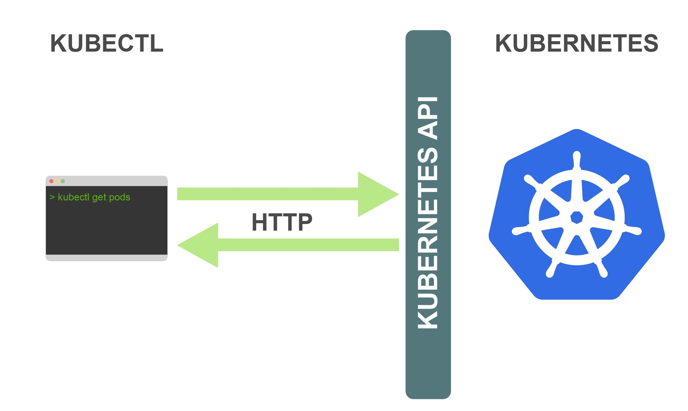

[← 返回 Kubernetes 目录]({{ '/subjects/Kubernetes/' | relative_url }})



# 06 kubectl 集群管理命令

# 4 Kubernetes 集群管理工具 kubectl 命令

Kubernetes 集群工具有命令行和图形。

kubectl 命令行工具图形工具： openlens 等

## 4.1 命令简介



kubectl作为Kubernetes集群的客户端CLI工具，可以让用户通过命令行的方式对Kubernetes集群的各种资源对象进行操作。

## 4.2 kubectl  命令用法说明

```text
https://kubernetes.io/docs/reference/kubectl/
http://docs.kubernetes.org.cn/683.html
```

对于kubectl主要有8组命令，分别是：基本命令、部署命令、集群管理命令排障调试命令、高级命令、设置命令、其他命令等。

**命令格式**

```text
kubectl [command] [TYPE] [NAME] [flags]
```

```text
#参数说明
command：操作Kubernetes资源对象的子命令，常见的有create、delete、describe、get等
create  创建资源对象
delete  删除资源对象
describe 查找资源的详细信息
get 获取资源基本信息
```

```text
TYPE：Kubernetes资源类型，举例：节点的资源类型是nodes，缩写no
NAME: Kubernetes资源对象的名称，可以省略。
flags: 可选参数
```

**常见资源缩写**

**最基础资源对象**

资源对象全称缩写资源对象全称缩写

pod/pods po node/nodes no

**最常见资源对象**

资源对象全称缩写资源对象全称缩写

replication controllers rc horizontal pod autoscalers hpa

replica sets rs persistent volume pv

deployment deploy persistent volume claims pvc

services svc

**其他资源对象**

namespaces ns storage classes sc

config maps cm clusters

daemon sets ds stateful sets

endpoints ep secrets

events ev jobs

ingresses ing

```text
#命令来查看,默认有56种资源
root@master1 ~]#kubectl api-resources| head
NAME                     SHORTNAMES   APIVERSION     NAMESPACED   KIND
bindings                              v1             true         Binding
componentstatuses        cs           v1             false
ComponentStatus
configmaps               cm           v1             true         ConfigMap
endpoints                ep           v1             true         Endpoints
events                   ev           v1             true         Event
limitranges              limits       v1             true         LimitRange
namespaces               ns           v1             false        Namespace
nodes                    no           v1             false        Node
persistentvolumeclaims   pvc          v1             true
PersistentVolumeClaim
```

```text
[root@master1 ~]#kubectl api-resources| sed -n '1!p' |wc -l
56
```

**查看帮助**

```text
#kubectl命令帮助
kubectl --help
```

```text
#查看子命令的格式
kubectl <command> --help
```

```text
#查看命令的通用选项
kubectl options
```

范例： 命令用法说明

```text
#查看帮助
[root@master1 ~]#kubectl --help
kubectl controls the Kubernetes cluster manager.
```

```text
Find more information at:
https://kubernetes.io/docs/reference/kubectl/overview/
```

```text
Basic Commands (Beginner):
create         通过file 或者 stdin方法创建资源
expose         使用 RC, service, deployment 或者 pod 并暴露它作为一个 新的
Kubernetes Service
run            在集群中运行一个指定的镜像
set            为 objects 设置一个指定的特征
```

```text
Basic Commands (Intermediate):
explain        查看资源的文档
get            显示一个或更多 resources
edit           在服务器上编辑一个资源
delete         通过 filenames, stdin, resources and names, label selector多种方式
删除资源
```

```text
Deploy Commands:
rollout        Manage the rollout of a resource
scale          为 Deployment, ReplicaSet, Replication Controller 或者 Job 设置一
个新的副本数量
autoscale      自动调整一个 Deployment, ReplicaSet, 或者 ReplicationController 的
副本数量
```

```text
Cluster Management Commands:
certificate    修改 certificate 资源.
cluster-info   显示集群信息
top            Display Resource (CPU/Memory/Storage) usage.
cordon         标记 node 为 unschedulable
uncordon       标记 node 为 schedulable
drain          Drain node in preparation for maintenance
taint          更新一个或者多个 node 上的 taints
```

```text
Troubleshooting and Debugging Commands:
describe       显示一个指定 resource 或者 group 的 resources 详情
logs           输出容器在 pod 中的日志
attach         Attach 到一个运行中的 container
exec           在一个 container 中执行一个命令
port-forward   Forward one or more local ports to a pod
proxy          运行一个 proxy 到 Kubernetes API server
cp             复制 files 和 directories 到 containers
```

```text
和从容器中复制 files 和 directories.
auth           Inspect authorization
debug         Create debugging sessions for troubleshooting workloads and
nodes
-- 这个命令是后来增加的调试命令
Advanced Commands:
diff           Diff live version against would-be applied version
apply          通过文件名或标准输入流(stdin)对资源进行配置
patch          使用 strategic merge patch 更新一个资源的 field(s)
replace        通过 filename 或者 stdin替换一个资源
wait           Experimental: Wait for a specific condition on one or many
resources.
convert        在不同的 API versions 转换配置文件 --- 新版本已经被弃用
kustomize      Build a kustomization target from a directory or a remote url.
```

```text
Settings Commands:
label          更新在这个资源上的 labels
annotate       更新一个资源的注解
completion     Output shell completion code for the specified shell (bash or
zsh)
```

```text
Other Commands:
api-resources  Print the supported API resources on the server
api-versions   Print the supported API versions on the server, in the form of
"group/version"
config         修改 kubeconfig 文件
plugin         Provides utilities for interacting with plugins.
version        输出 client 和 server 的版本信息
```

```text
Usage:
kubectl [flags] [options]
```

```text
Use "kubectl <command> --help" for more information about a given command.
Use "kubectl options" for a list of global command-line options (applies to all
commands).
```

```text
#查看命令的通用选项
[root@master1 ~]#kubectl options
The following options can be passed to any command:
```

```text
--as='':
Username to impersonate for the operation. User could be a regular user or a
service account in a namespace.
```

```text
--as-group=[]:
Group to impersonate for the operation, this flag can be repeated to specify
multiple groups.
```

```text
--as-uid='':
UID to impersonate for the operation.
```

```text
--cache-dir='/root/.kube/cache':
Default cache directory
```

```text
--certificate-authority='':
Path to a cert file for the certificate authority
```

```text
--client-certificate='':
```

```text
Path to a client certificate file for TLS
```

```text
--client-key='':
Path to a client key file for TLS
```

```text
--cluster='':
The name of the kubeconfig cluster to use
```

```text
--context='':
The name of the kubeconfig context to use
```

```text
--disable-compression=false:
If true, opt-out of response compression for all requests to the server
```

```text
--insecure-skip-tls-verify=false:
If true, the server's certificate will not be checked for validity. This
will make your HTTPS connections
insecure
```

```text
--kubeconfig='':
Path to the kubeconfig file to use for CLI requests.
```

```text
--log-flush-frequency=5s:
Maximum number of seconds between log flushes
```

```text
--match-server-version=false:
Require server version to match client version
```

```text
-n, --namespace='':
If present, the namespace scope for this CLI request
```

```text
--password='':
Password for basic authentication to the API server
```

```text
--profile='none':
Name of profile to capture. One of
(none|cpu|heap|goroutine|threadcreate|block|mutex)
```

```text
--profile-output='profile.pprof':
Name of the file to write the profile to
```

```text
--request-timeout='0':
The length of time to wait before giving up on a single server request. Non-
zero values should contain a
corresponding time unit (e.g. 1s, 2m, 3h). A value of zero means don't
timeout requests.
```

```text
-s, --server='':
The address and port of the Kubernetes API server
```

```text
--tls-server-name='':
Server name to use for server certificate validation. If it is not provided,
the hostname used to contact the
server is used
```

```text
--token='':
Bearer token for authentication to the API server
```

```text
--user='':
The name of the kubeconfig user to use
```

```text
--username='':
Username for basic authentication to the API server
```

```text
-v, --v=0:
number for the log level verbosity
```

```text
--vmodule=:
comma-separated list of pattern=N settings for file-filtered logging (only
works for the default text log
format)
```

```text
--warnings-as-errors=false:
Treat warnings received from the server as errors and exit with a non-zero
exit code
```

## 4.3 常见用法

### 4.3.1 实现 kubectl 命令补全

范例: 实现kubectl 命令补全

```text
#方法1
[root@master1 ~]#kubectl completion bash > /etc/profile.d/kubectl_completion.sh
[root@master1 ~]#. /etc/profile.d/kubectl_completion.sh
```

```text
#方法2
[root@master1 ~]#echo "source <(kubectl completion bash)" >> ~/.bashrc
[root@master1 ~]#source ~/.bashrc
```

```text
#测试
[root@master1 ~]#kubectl <TAB>两次
annotate       autoscale      cp             drain          help
plugin         scale          wait
api-resources  certificate    create         edit           kustomize      port-
forward   set
api-versions   cluster-info   debug          exec           label          proxy
taint
apply          completion     delete         explain        logs
replace        top
attach         config         describe       expose         options
rollout        uncordon
auth           cordon         diff           get            patch          run
version
```

### 4.3.2 查看资源对象

**查看资源对象**

```text
kubectl get TYPE/NAME ... [-o yaml/json/wide | -w]
kubectl get TYPE NAME ... [-o yaml/json/wide | -w]
#参数解析：
-w 是实时查看资源的状态。
-o 是以多种格式查看资源的属性信息
--raw 从api地址中获取相关资源信息
```

**描述资源对象**

```text
kubectl describe TYPE NAME
kubectl describe TYPE/NAME
#注意：这个命令非常重要，一般我们排错时常会用到
```

范例: 查看当前主机的工作节点

```text
[root@master1 ~]#kubectl get no
NAME                 STATUS   ROLES                  AGE    VERSION
master1.wang.org   Ready    control-plane,master   4d1h   v1.22.1
master2.wang.org   Ready    control-plane,master   4d     v1.22.1
master3.wang.org   Ready    control-plane,master   4d     v1.22.1
node1.wang.org     Ready    <none>                 4d1h   v1.22.1
node2.wang.org     Ready    <none>                 4d1h   v1.22.1
node3.wang.org     Ready    <none>                 4d1h   v1.22.1
```

```text
#通过-v 选项指定日志的级别  -v, --v=0 number for the log level verbosity
[root@master1 ~]#kubectl get node -v 7
I0520 17:20:08.570813  304347 loader.go:402] Config loaded from file:
/root/.kube/config
I0520 17:20:08.572143  304347 envvar.go:172] "Feature gate default state"
feature="ClientsAllowCBOR" enabled=false
I0520 17:20:08.572678  304347 envvar.go:172] "Feature gate default state"
feature="ClientsPreferCBOR" enabled=false
I0520 17:20:08.573324  304347 envvar.go:172] "Feature gate default state"
feature="InformerResourceVersion" enabled=false
I0520 17:20:08.573613  304347 envvar.go:172] "Feature gate default state"
feature="WatchListClient" enabled=false
I0520 17:20:08.580560  304347 round_trippers.go:470] GET
https://kubeapi.wang.org:6443/api/v1/nodes?limit=500
I0520 17:20:08.581121  304347 round_trippers.go:476] Request Headers:
I0520 17:20:08.581404  304347 round_trippers.go:480]     User-Agent:
kubectl/v1.32.0 (linux/amd64) kubernetes/70d3cc9
I0520 17:20:08.581733  304347 round_trippers.go:480]     Accept:
application/json;as=Table;v=v1;g=meta.k8s.io,application/json;as=Table;v=v1beta1
;g=meta.k8s.io,application/json
I0520 17:20:08.593755  304347 round_trippers.go:581] Response Status: 200 OK in
11 milliseconds
NAME               STATUS   ROLES           AGE    VERSION
master1.wang.org   Ready    control-plane   152d   v1.32.0
node1.wang.org     Ready    <none>          152d   v1.32.0
node2.wang.org     Ready    <none>          152d   v1.32.0
node3.wang.org     Ready    <none>          152d   v1.32.0
```

```text
#获取节点的基本信息
[root@master1 ~]#kubectl describe node master1
Name:               master1.wang.org
```

```text
Roles:              control-plane,master
Labels:             beta.kubernetes.io/arch=amd64
beta.kubernetes.io/os=linux
kubernetes.io/arch=amd64
kubernetes.io/hostname=master1.wang.org
kubernetes.io/os=linux
node-role.kubernetes.io/control-plane=
node-role.kubernetes.io/master=
node.kubernetes.io/exclude-from-external-load-balancers=
Annotations:        flannel.alpha.coreos.com/backend-data:
{"VNI":1,"VtepMAC":"4e:0c:98:28:17:6a"}
flannel.alpha.coreos.com/backend-type: vxlan
flannel.alpha.coreos.com/kube-subnet-manager: true
flannel.alpha.coreos.com/public-ip: 10.0.0.101
kubeadm.alpha.kubernetes.io/cri-socket:
/var/run/dockershim.sock
node.alpha.kubernetes.io/ttl: 0
volumes.kubernetes.io/controller-managed-attach-detach: true
CreationTimestamp:  Tue, 22 Feb 2022 20:26:32 +0800
Taints:             node-role.kubernetes.io/master:NoSchedule
Unschedulable:      false
Lease:
HolderIdentity:  master1.wang.org
AcquireTime:     <unset>
RenewTime:       Sat, 26 Feb 2022 21:40:32 +0800
Conditions:
Type                 Status  LastHeartbeatTime
LastTransitionTime                Reason                       Message
----                 ------  -----------------                 ---------------
---                ------                       -------
NetworkUnavailable   False   Sat, 26 Feb 2022 08:15:08 +0800   Sat, 26 Feb
2022 08:15:08 +0800   FlannelIsUp                  Flannel is running on this
node
MemoryPressure       False   Sat, 26 Feb 2022 21:37:41 +0800   Tue, 22 Feb
2022 20:26:32 +0800   KubeletHasSufficientMemory   kubelet has sufficient memory
available
DiskPressure         False   Sat, 26 Feb 2022 21:37:41 +0800   Tue, 22 Feb
2022 20:26:32 +0800   KubeletHasNoDiskPressure     kubelet has no disk pressure
PIDPressure          False   Sat, 26 Feb 2022 21:37:41 +0800   Tue, 22 Feb
2022 20:26:32 +0800   KubeletHasSufficientPID      kubelet has sufficient PID
available
Ready                True    Sat, 26 Feb 2022 21:37:41 +0800   Tue, 22 Feb
2022 21:11:12 +0800   KubeletReady                 kubelet is posting ready
status. AppArmor enabled
Addresses:
InternalIP:  10.0.0.101
Hostname:    master1.wang.org
Capacity:
cpu:                2
ephemeral-storage:  102171608Ki
hugepages-1Gi:      0
hugepages-2Mi:      0
memory:             1999336Ki
pods:               110
Allocatable:
cpu:                2
ephemeral-storage:  94161353777
hugepages-1Gi:      0
```

```text
hugepages-2Mi:      0
memory:             1896936Ki
pods:               110
System Info:
Machine ID:                 3074412efca64ca986433f07f39ff32c
System UUID:                f2e84d56-9240-3767-4dfe-6b24be5615a2
Boot ID:                    9e812469-5338-4957-8092-d774a68946de
Kernel Version:             5.4.0-100-generic
OS Image:                   Ubuntu 20.04.3 LTS
Operating System:           linux
Architecture:               amd64
Container Runtime Version:  docker://20.10.10
Kubelet Version:            v1.22.1
Kube-Proxy Version:         v1.22.1
PodCIDR:                      172.16.0.0/24
PodCIDRs:                     172.16.0.0/24
Non-terminated Pods:          (8 in total)
Namespace                   Name                                          CPU
Requests  CPU Limits  Memory Requests  Memory Limits  Age
---------                   ----                                          ----
--------  ----------  ---------------  -------------  ---
kube-system                 coredns-7d89d9b6b8-ps6mn                      100m
(5%)     0 (0%)      70Mi (3%)        170Mi (9%)     4d1h
kube-system                 coredns-7d89d9b6b8-zl2b6                      100m
(5%)     0 (0%)      70Mi (3%)        170Mi (9%)     4d1h
kube-system                 etcd-master1.wang.org                       100m
(5%)     0 (0%)      100Mi (5%)       0 (0%)         4d1h
kube-system                 kube-apiserver-master1.wang.org             250m
(12%)    0 (0%)      0 (0%)           0 (0%)         4d1h
kube-system                 kube-controller-manager-master1.wang.org    200m
(10%)    0 (0%)      0 (0%)           0 (0%)         4d1h
kube-system                 kube-flannel-ds-5x6sj                         100m
(5%)     100m (5%)   50Mi (2%)        50Mi (2%)      4d
kube-system                 kube-proxy-h2fv4                              0
(0%)        0 (0%)      0 (0%)           0 (0%)         4d1h
kube-system                 kube-scheduler-master1.wang.org             100m
(5%)     0 (0%)      0 (0%)           0 (0%)         4d
Allocated resources:
(Total limits may be over 100 percent, i.e., overcommitted.)
Resource           Requests     Limits
--------           --------     ------
cpu                950m (47%)   100m (5%)
memory             290Mi (15%)  390Mi (21%)
ephemeral-storage  0 (0%)       0 (0%)
hugepages-1Gi      0 (0%)       0 (0%)
hugepages-2Mi      0 (0%)       0 (0%)
Events:              <none>
```

```text
#查看指定的多个不同类型的资源
root@ubuntu2204 ~]#kubectl get svc/myapp deployments/myapp
NAME            TYPE       CLUSTER-IP    EXTERNAL-IP   PORT(S)        AGE
service/myapp   NodePort   10.68.78.97   <none>        80:31890/TCP   5h16m
```

```text
NAME                    READY   UP-TO-DATE   AVAILABLE   AGE
deployment.apps/myapp   3/3     3            3           7h32m
```

范例:  获取特定的信息

```text
[root@master1 ~]#kubectl -n kube-system get pods etcd-master1.wang.org -o go-
template={{.status.podIP}}
10.0.0.101
```

### 4.3.3 创建应用

```text
#创建一个应用
[root@master1 ~]#kubectl create deployment nginx --image=registry.cn-
beijing.aliyuncs.com/wangxiaochun/nginx:1.20.0
deployment.apps/nginx created
```

```text
[root@master1 ~]#kubectl expose deployment nginx --port=80 --type=NodePort
service/nginx exposed
```

```text
#查看效果
[root@master1 ~]#kubectl get deployments.apps
NAME    READY   UP-TO-DATE   AVAILABLE   AGE
nginx   1/1     1            1           9s
```

```text
[root@master1 ~]#kubectl get pod,svc
NAME                         READY   STATUS    RESTARTS   AGE
pod/nginx-6799fc88d8-fcndt   1/1     Running   0          59s
```

```text
NAME                 TYPE        CLUSTER-IP      EXTERNAL-IP   PORT(S)
AGE
service/kubernetes   ClusterIP   192.168.0.1     <none>        443/TCP
4d14h
service/nginx        NodePort    192.168.20.64   <none>        80:32676/TCP
41s
```

```text
#查看详情信息
[root@master1 ~]#kubectl get pod,svc -o wide
NAME                         READY   STATUS    RESTARTS   AGE    IP
NODE               NOMINATED NODE   READINESS GATES
pod/nginx-6799fc88d8-fcndt   1/1     Running   0          2m1s   172.16.3.4
node1.wang.org   <none>           <none>
```

```text
NAME                 TYPE        CLUSTER-IP      EXTERNAL-IP   PORT(S)        AGE
SELECTOR
service/kubernetes   ClusterIP   192.168.0.1     <none>        443/TCP
4d14h   <none>
service/nginx        NodePort    192.168.20.64   <none>        80:32676/TCP
103s    app=nginx
```

```text
#注意：这里的 NodePort 代表在所有的节点主机上都开启一个能够被外网访问的随机端口32676/TCP
```

```text
#访问任意一下worker节点的端口32676都可以访问到相关的容器
[root@master1 ~]#curl -I <任意worker节点IP>:32676
HTTP/1.1 200 OK
Server: nginx/1.21.5
Date: Sun, 27 Feb 2022 03:10:20 GMT
Content-Type: text/html
Content-Length: 615
```

```text
Last-Modified: Tue, 28 Dec 2021 15:28:38 GMT
Connection: keep-alive
ETag: "61cb2d26-267"
Accept-Ranges: bytes
```

```text
#查看资源的访问日志
[root@master1 ~]#kubectl logs nginx-6799fc88d8-fcndt
```

```text
#查看资源的详情信息
[root@master1 ~]#kubectl describe pod nginx-6799fc88d8-fcndt
```

```text
#进入容器查看信息,注意：如果一个pod内部存在多个pod的话，需要通过 -c 指定一个具体的容器
[root@master1 ~]#kubectl exec -it nginx-6799fc88d8-fcndt -- /bin/bash
root@nginx-6799fc88d8-fcndt:/# nginx -v
nginx version: nginx/1.21.5
```

### 4.3.4 删除资源

**删除资源有两种方式**

```text
#方法1：
kubectl delete 资源类型 资源1 资源2 ... 资源n
#此方法因为限制了资源类型，所以这种方法只能删除一种资源
```

```text
#方法2：
kubectl delete 资源类型/资源
#因为删除对象的时候，指定了资源类型，可以通过这种资源类型限制的方式同时删除多种类型资源
```

范例:

```text
[root@master1 ~]#kubectl get deployments.apps
NAME    READY   UP-TO-DATE   AVAILABLE   AGE
nginx   1/1     1            1           6h28m
```

```text
#删除deployment资源
[root@master1 ~]#kubectl delete deployments nginx
deployment.apps "nginx" deleted
```

```text
[root@master1 ~]#kubectl get deployments.apps
No resources found in default namespace.
```

```text
[root@master1 ~]#kubectl get svc
NAME         TYPE        CLUSTER-IP      EXTERNAL-IP   PORT(S)        AGE
kubernetes   ClusterIP   192.168.0.1     <none>        443/TCP        4d21h
nginx        NodePort    192.168.20.64   <none>        80:32676/TCP   6h27m
```

```text
#删除svc资源
[root@master1 ~]#kubectl delete svc/nginx
service "nginx" deleted
[root@master1 ~]#kubectl get svc
NAME         TYPE        CLUSTER-IP    EXTERNAL-IP   PORT(S)   AGE
kubernetes   ClusterIP   192.168.0.1   <none>        443/TCP   4d21h
```

范例：创建和删除多个不同资源

```text
[root@master1 ~]#kubectl create deployment myapp --image registry.cn-
beijing.aliyuncs.com/wangxiaochun/pod-test:v0.1 --replicas 3
```

```text
[root@master1 ~]#kubectl create svc clusterip myapp --tcp 80
```

```text
[root@master1 ~]#kubectl get svc,deployment
NAME                 TYPE        CLUSTER-IP      EXTERNAL-IP   PORT(S)   AGE
service/kubernetes   ClusterIP   10.96.0.1       <none>        443/TCP   34d
service/myapp        ClusterIP   10.106.80.174   <none>        80/TCP    5s
```

```text
NAME                    READY   UP-TO-DATE   AVAILABLE   AGE
deployment.apps/myapp   3/3     3            3           19s
```

```text
[root@master1 ~]#kubectl get pod
NAME                     READY   STATUS    RESTARTS   AGE
myapp-7dbd45d496-c9rqv   1/1     Running   0          38s
myapp-7dbd45d496-t6c5f   1/1     Running   0          38s
myapp-7dbd45d496-xtn7t   1/1     Running   0          38s
```

```text
[root@master1 ~]#curl 10.106.80.174
kubernetes pod-test v0.1!! ClientIP: 10.244.0.0, ServerName: myapp-7dbd45d496-
xtn7t, ServerIP: 10.244.1.131!
[root@master1 ~]#curl 10.106.80.174
kubernetes pod-test v0.1!! ClientIP: 10.244.0.0, ServerName: myapp-7dbd45d496-
c9rqv, ServerIP: 10.244.3.55!
[root@master1 ~]#curl 10.106.80.174
kubernetes pod-test v0.1!! ClientIP: 10.244.0.0, ServerName: myapp-7dbd45d496-
xtn7t, ServerIP: 10.244.1.131!
[root@master1 ~]#curl 10.106.80.174
kubernetes pod-test v0.1!! ClientIP: 10.244.0.0, ServerName: myapp-7dbd45d496-
c9rqv, ServerIP: 10.244.3.55!
```

```text
[root@master1 ~]#kubectl delete deployment/myapp svc/myapp
deployment.apps "myapp" deleted
service "myapp" deleted
```

```text
[root@master1 ~]#kubectl get svc,deployment
NAME                 TYPE        CLUSTER-IP   EXTERNAL-IP   PORT(S)   AGE
service/kubernetes   ClusterIP   10.96.0.1    <none>        443/TCP   34d
```



<nav class="article-end" aria-label="章节导航">
  <a href="{{ '/subjects/Kubernetes/05-kubeasz-binary-deployment.html' | relative_url }}">← 上一章：Kubeasz 二进制部署与集群初始化</a>
  <a href="{{ '/subjects/Kubernetes/' | relative_url }}">返回 Kubernetes 目录</a>
  <a href="{{ '/subjects/Kubernetes/07-api-objects-namespaces.html' | relative_url }}">下一章：API 资源对象、清单与命名空间 →</a>
</nav>
