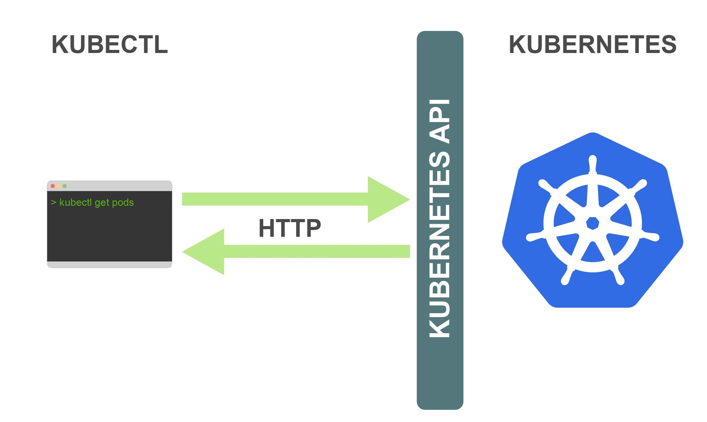

[← 返回 Kubernetes 目录]({{ '/subjects/Kubernetes/' | relative_url }})



# 06 kubectl 集群管理命令

# 4 Kubernetes 集群管理工具 kubectl 命令

管理 Kubernetes 集群既可以使用 `kubectl` 命令行，也可以使用 OpenLens 等图形客户端。本文以 `kubectl` 为主：它读取 kubeconfig 中的集群与用户信息，向 API Server 发送请求。

## 4.1 命令简介



kubectl作为Kubernetes集群的客户端CLI工具，可以让用户通过命令行的方式对Kubernetes集群的各种资源对象进行操作。

## 4.2 kubectl  命令用法说明


- <https://kubernetes.io/docs/reference/kubectl/>
- <http://docs.kubernetes.org.cn/683.html>


`kubectl --help` 会按用途列出资源操作、部署、集群管理、排障调试、配置等命令组。不同客户端版本的分组与命令可能变化，使用时以当前版本的帮助输出为准。

**命令格式**
```text
kubectl [command] [TYPE] [NAME] [flags]
```


其中 `command` 是操作，如 `get`、`describe`、`create`、`delete`；`TYPE` 是资源类型，如 `nodes`（缩写 `no`）；`NAME` 是对象名称，可按命令需要省略；`flags` 是可选参数。一个命令可能接受 `TYPE NAME`，也可能接受 `TYPE/NAME`，具体以子命令帮助为准。


**常见资源缩写**

| 资源类型 | 常见缩写 | 作用 |
| --- | --- | --- |
| `pods` | `po` | 最小可调度工作单元 |
| `nodes` | `no` | 集群节点 |
| `deployments` | `deploy` | 无状态应用的声明式发布 |
| `replicasets` | `rs` | 维持 Pod 副本数 |
| `daemonsets` | `ds` | 在符合条件的节点上运行 Pod |
| `services` | `svc` | 提供稳定的访问入口 |
| `namespaces` | `ns` | 资源名称空间 |
| `configmaps` | `cm` | 非机密配置 |
| `persistentvolumes` | `pv` | 持久卷 |
| `persistentvolumeclaims` | `pvc` | 持久卷申请 |
| `storageclasses` | `sc` | 动态存储供给类别 |
| `horizontalpodautoscalers` | `hpa` | 按指标扩缩副本 |
| `ingresses` | `ing` | HTTP/HTTPS 入站路由 |

并非每种资源都有缩写，且集群安装的 CRD 也会增加资源类型；可用 `kubectl api-resources` 查询当前集群。
```bash
#列出当前集群提供的资源类型和缩写
kubectl api-resources

#仅查看带命名空间的资源
kubectl api-resources --namespaced=true
```

资源数量取决于 Kubernetes 版本、启用的 API 和已安装的扩展，不能把旧示例中的“56 种”当成固定值。

**查看帮助**
```bash
#kubectl命令帮助
kubectl --help

#查看子命令的格式
kubectl <command> --help

#查看命令的通用选项
kubectl options
```

范例： 命令用法说明
```bash
#查看帮助
[root@master1 ~]#kubectl --help
kubectl controls the Kubernetes cluster manager.

Find more information at:
https://kubernetes.io/docs/reference/kubectl/overview/
```


原 PDF 把多列帮助输出压成了几条无法阅读的长行。按实际用途，可先记住以下命令：

| 场景 | 命令 | 用途 |
| --- | --- | --- |
| 查看对象 | `get`、`describe`、`explain` | 列表、详情和字段说明 |
| 声明式管理 | `apply`、`diff`、`delete` | 应用清单、预览差异和删除资源 |
| 部署维护 | `rollout`、`scale`、`autoscale` | 查看发布、调整或自动管理副本 |
| 集群维护 | `cluster-info`、`cordon`、`drain`、`uncordon`、`taint` | 查看集群、维护节点与调度约束 |
| 故障排查 | `logs`、`exec`、`debug`、`port-forward`、`top` | 日志、容器交互、调试、转发和指标 |
| 上下文设置 | `config`、`label`、`annotate` | 切换集群上下文、管理元数据 |

输入 `kubectl <command> --help` 查看某个命令的准确参数。`kubectl top` 还依赖集群提供 Metrics API。

以下是日常最常用的全局选项，完整列表以 `kubectl options` 为准：

| 选项 | 作用 |
| --- | --- |
| `--kubeconfig=PATH` | 指定 kubeconfig 文件。 |
| `--context=NAME` | 在配置文件中选择集群、用户和命名空间组合。 |
| `--cluster=NAME`、`--user=NAME` | 覆盖所选上下文中的集群或用户。 |
| `-n, --namespace=NAME` | 指定命名空间；对节点等集群级资源无效。 |
| `--request-timeout=30s` | 限制单次服务器请求等待时间。 |
| `-v=7` | 输出更详细的客户端请求日志，排查连接问题时使用。 |

不要为图省事而常态化使用 `--insecure-skip-tls-verify`；它会跳过服务端证书校验。切换上下文前先用 `kubectl config current-context` 确认当前目标集群。

## 4.3 常见用法

### 4.3.1 实现 kubectl 命令补全

范例: 实现kubectl 命令补全
```bash
#方法1
[root@master1 ~]#kubectl completion bash > /etc/profile.d/kubectl_completion.sh
[root@master1 ~]#. /etc/profile.d/kubectl_completion.sh

#方法2
[root@master1 ~]#echo "source <(kubectl completion bash)" >> ~/.bashrc
[root@master1 ~]#source ~/.bashrc

#测试
#在交互式 Bash 中输入 kubectl 后按 Tab 两次，查看可补全的子命令。
#实际列表随 kubectl 版本变化，不再抄录终端的多列输出。
```

### 4.3.2 查看资源对象

**查看资源对象**
```bash
kubectl get pods -n kube-system
kubectl get deployment/nginx -o yaml
kubectl get pods -o wide --watch
```

`-o yaml|json|wide` 决定输出格式，`-w`/`--watch` 持续观察变化。`--raw=PATH` 直接请求 API 路径，只在明确知道目标 API 时使用。

**描述资源对象**
```bash
kubectl describe pod nginx-示例名称
kubectl describe node master1.bowen.org
```

`describe` 汇总对象状态与相关事件，适合排查调度失败、镜像拉取失败和探针异常；如果需要完整资源定义，再使用 `get -o yaml`。

范例: 查看当前主机的工作节点
```bash
[root@master1 ~]#kubectl get no
NAME                 STATUS   ROLES                  AGE    VERSION
master1.bowen.org   Ready    control-plane,master   4d1h   v1.22.1
master2.bowen.org   Ready    control-plane,master   4d     v1.22.1
master3.bowen.org   Ready    control-plane,master   4d     v1.22.1
node1.bowen.org     Ready    <none>                 4d1h   v1.22.1
node2.bowen.org     Ready    <none>                 4d1h   v1.22.1
node3.bowen.org     Ready    <none>                 4d1h   v1.22.1

#需要排查客户端与 API Server 通信时，提高 kubectl 客户端日志级别
kubectl get nodes -v=7
#日志可显示请求 URL、响应状态及耗时；其中可能含环境信息，不宜直接公开完整输出。
#查看节点的状态、资源与近期事件
kubectl describe node master1.bowen.org
#输出较长时，重点查看 Conditions（Ready、压力状态）、Capacity/Allocatable（资源容量）、
#Allocated resources（已分配请求量）和 Events（近期事件）。
#查看指定的多个不同类型的资源
root@ubuntu2204 ~]#kubectl get svc/myapp deployments/myapp
NAME            TYPE       CLUSTER-IP    EXTERNAL-IP   PORT(S)        AGE
service/myapp   NodePort   10.68.78.97   <none>        80:31890/TCP   5h16m

NAME                    READY   UP-TO-DATE   AVAILABLE   AGE
deployment.apps/myapp   3/3     3            3           7h32m
```

范例：提取 Pod 的 IP 地址。
```bash
kubectl -n kube-system get pod etcd-master1.bowen.org -o jsonpath='{.status.podIP}'
10.0.0.101
```

### 4.3.3 创建应用
```bash
#创建一个应用
[root@master1 ~]#kubectl create deployment nginx --image=registry.cn-beijing.aliyuncs.com/bowen/nginx:1.20.0
deployment.apps/nginx created

[root@master1 ~]#kubectl expose deployment nginx --port=80 --type=NodePort
service/nginx exposed

#确认 Deployment、Pod 和 Service 已创建
kubectl get deployment nginx
kubectl get pods -l app=nginx -o wide
kubectl get service nginx
#示例中 Service 类型为 NodePort；假设 PORT(S) 为 80:32676/TCP，
#则集群内服务端口是 80，节点端口是 32676。
#此示例分配的 NodePort 是 32676/TCP。能否从集群外访问，还取决于节点网络、防火墙和负载均衡设置。

#在网络允许的节点地址上测试该端口
[root@master1 ~]#curl -I http://<节点IP>:32676
HTTP/1.1 200 OK
Server: nginx/1.21.5
Date: Sun, 27 Feb 2022 03:10:20 GMT
Content-Type: text/html
Content-Length: 615

Last-Modified: Tue, 28 Dec 2021 15:28:38 GMT
Connection: keep-alive
ETag: "61cb2d26-267"
Accept-Ranges: bytes

#查看资源的访问日志
[root@master1 ~]#kubectl logs nginx-6799fc88d8-fcndt

#查看资源的详情信息
[root@master1 ~]#kubectl describe pod nginx-6799fc88d8-fcndt

#进入容器排查；若 Pod 包含多个容器，用 -c 指定容器名
[root@master1 ~]#kubectl exec -it nginx-6799fc88d8-fcndt -- /bin/bash
root@nginx-6799fc88d8-fcndt:/# nginx -v
nginx version: nginx/1.21.5
```

### 4.3.4 删除资源

**删除资源有两种方式**
```bash
#方法1：
kubectl delete 资源类型 资源1 资源2 ... 资源n
#此方法因为限制了资源类型，所以这种方法只能删除一种资源

#方法2：
kubectl delete 资源类型/资源
#因为删除对象的时候，指定了资源类型，可以通过这种资源类型限制的方式同时删除多种类型资源
```

范例:
```bash
[root@master1 ~]#kubectl get deployments.apps
NAME    READY   UP-TO-DATE   AVAILABLE   AGE
nginx   1/1     1            1           6h28m

#删除deployment资源
[root@master1 ~]#kubectl delete deployments nginx
deployment.apps "nginx" deleted

[root@master1 ~]#kubectl get deployments.apps
No resources found in default namespace.

[root@master1 ~]#kubectl get svc
NAME         TYPE        CLUSTER-IP      EXTERNAL-IP   PORT(S)        AGE
kubernetes   ClusterIP   192.168.0.1     <none>        443/TCP        4d21h
nginx        NodePort    192.168.20.64   <none>        80:32676/TCP   6h27m

#删除svc资源
[root@master1 ~]#kubectl delete svc/nginx
service "nginx" deleted
[root@master1 ~]#kubectl get svc
NAME         TYPE        CLUSTER-IP    EXTERNAL-IP   PORT(S)   AGE
kubernetes   ClusterIP   192.168.0.1   <none>        443/TCP   4d21h
```

范例：创建和删除多个不同资源
```bash
[root@master1 ~]#kubectl create deployment myapp --image=registry.cn-beijing.aliyuncs.com/bowen/pod-test:v0.1 --replicas=3

[root@master1 ~]#kubectl expose deployment myapp --port=80 --target-port=80 --type=ClusterIP

[root@master1 ~]#kubectl get svc,deployment
NAME                 TYPE        CLUSTER-IP      EXTERNAL-IP   PORT(S)   AGE
service/kubernetes   ClusterIP   10.96.0.1       <none>        443/TCP   34d
service/myapp        ClusterIP   10.106.80.174   <none>        80/TCP    5s

NAME                    READY   UP-TO-DATE   AVAILABLE   AGE
deployment.apps/myapp   3/3     3            3           19s

[root@master1 ~]#kubectl get pod
NAME                     READY   STATUS    RESTARTS   AGE
myapp-7dbd45d496-c9rqv   1/1     Running   0          38s
myapp-7dbd45d496-t6c5f   1/1     Running   0          38s
myapp-7dbd45d496-xtn7t   1/1     Running   0          38s

[root@master1 ~]#curl 10.106.80.174
kubernetes pod-test v0.1!! ClientIP: 10.244.0.0, ServerName: myapp-7dbd45d496-xtn7t, ServerIP: 10.244.1.131!
[root@master1 ~]#curl 10.106.80.174
kubernetes pod-test v0.1!! ClientIP: 10.244.0.0, ServerName: myapp-7dbd45d496-c9rqv, ServerIP: 10.244.3.55!
[root@master1 ~]#curl 10.106.80.174
kubernetes pod-test v0.1!! ClientIP: 10.244.0.0, ServerName: myapp-7dbd45d496-xtn7t, ServerIP: 10.244.1.131!
[root@master1 ~]#curl 10.106.80.174
kubernetes pod-test v0.1!! ClientIP: 10.244.0.0, ServerName: myapp-7dbd45d496-c9rqv, ServerIP: 10.244.3.55!

[root@master1 ~]#kubectl delete deployment/myapp svc/myapp
deployment.apps "myapp" deleted
service "myapp" deleted

[root@master1 ~]#kubectl get svc,deployment
NAME                 TYPE        CLUSTER-IP   EXTERNAL-IP   PORT(S)   AGE
service/kubernetes   ClusterIP   10.96.0.1    <none>        443/TCP   34d
```



<nav class="article-end" aria-label="章节导航">
  <a href="{{ '/subjects/Kubernetes/05-kubeasz-binary-deployment.html' | relative_url }}">← 上一章：Kubeasz 二进制部署与集群初始化</a>
  <a href="{{ '/subjects/Kubernetes/' | relative_url }}">返回 Kubernetes 目录</a>
  <a href="{{ '/subjects/Kubernetes/07-api-objects-namespaces.html' | relative_url }}">下一章：API 资源对象、清单与命名空间 →</a>
</nav>
