[← 返回 Kubernetes 目录]({{ '/subjects/Kubernetes/' | relative_url }})



# 07 API 资源对象、清单与命名空间

## 1 资源对象与 Kubernetes API

Kubernetes 将可管理的实体表示为 API 对象。`Deployment` 表达期望的副本与 Pod 模板，`Service` 提供稳定访问入口，`ConfigMap` 保存非敏感配置；对象的“期望状态”由用户提交，控制器持续调谐，“当前状态”由系统观察与更新。标签、卷等通常是对象字段，而不是都能独立创建的顶层资源。

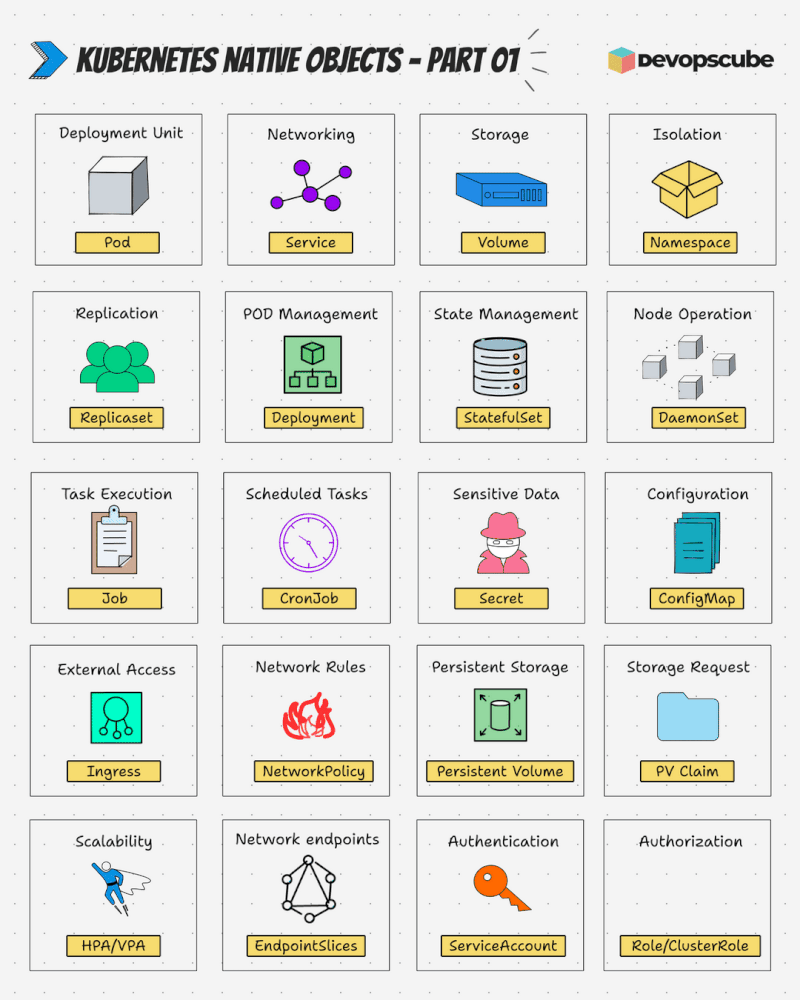

### 1.1 资源类型、作用域与 API 路径

按作用域区分资源，比把所有对象统称为“元数据型”更有助于决定命令是否需要 `-n`：

| 作用域 | 典型类型 | 如何查看 |
| --- | --- | --- |
| 命名空间级 | Pod、Deployment、Service、ConfigMap、Secret、PVC、HPA、Role | `kubectl get pods -n <命名空间>` |
| 集群级 | Namespace、Node、PersistentVolume、ClusterRole、CustomResourceDefinition | `kubectl get nodes` |

`Role` 是命名空间级对象，`ClusterRole` 才是集群级。`HPA` 也是命名空间级对象，并非独立的“元数据级资源”。`metadata` 是对象字段，承载名称、标签等信息，不构成第三种作用域。用当前集群的发现接口核实某种类型的范围：

```bash
kubectl api-resources
kubectl api-resources --namespaced=true
kubectl api-resources --namespaced=false
kubectl api-versions
```

核心组资源的 `apiVersion` 写作 `v1`，路径如 `/api/v1/namespaces/default/pods`；命名 API 组使用 `组名/版本`，例如 Deployment 的 `apps/v1`，路径为 `/apis/apps/v1/namespaces/default/deployments`。API 路径中用资源的复数名（`deployments`），清单中用单数 `kind: Deployment`。可用 `kubectl api-resources -o wide` 查看当前集群支持的名称、组版本、kind 与作用域。CRD 可以扩展新的 API 资源，但扩展出来的资源同样有明确的组、版本和范围。

### 1.2 访问与操作 API

`kubectl` 通常借助 kubeconfig 与 API Server 建立 TLS 连接，并按身份认证、授权和准入策略处理请求。GET 用于读取，POST 通常创建，PATCH/PUT 用于修改，DELETE 用于删除；并非每个子资源都支持全部方法。通过 `kubectl get --raw` 可观察已经授权的 API 路径：

```bash
kubectl get --raw /api/v1
kubectl get --raw /apis/apps/v1
kubectl get --raw /api/v1/namespaces/default/pods
```

临时调试也可运行 `kubectl proxy --port=8001`，再从**本机**访问 `http://127.0.0.1:8001/api/v1`。该代理使用当前 kubeconfig 的权限，不应绑定到公开地址，也不需要为了演示 API 而创建长期有效的 cluster-admin ServiceAccount Token。

Kubernetes API 的核心思路是“声明期望状态 + 控制器调谐”：创建 Deployment 后，控制器通过 ReplicaSet 维持副本数；节点或 Pod 发生变化，控制器继续把实际状态推向期望状态。`resourceVersion` 用于并发控制和 watch，`generation` 随 spec 等期望状态变化而递增；它们不应手工当作业务编号。

## 2 资源清单的结构

YAML 是编写清单的常见格式，`kubectl` 会把它转换为 API 可接收的对象。一个基本 Deployment 示例：

```yaml
apiVersion: apps/v1
kind: Deployment
metadata:
  name: demoapp
  namespace: default
  labels:
    app: demoapp
spec:
  replicas: 2
  selector:
    matchLabels:
      app: demoapp
  template:
    metadata:
      labels:
        app: demoapp
    spec:
      containers:
        - name: web
          image: nginx:stable
          ports:
            - containerPort: 80
```

这里的 `selector.matchLabels` 必须匹配 Pod 模板上的标签，否则 Deployment 不能正确管理其 Pod。缩进表示 YAML 的层级，`containers` 是列表；不要将命令行提示符或终端输出复制进 YAML 代码块。

| 字段 | 作用 | 谁负责 |
| --- | --- | --- |
| `apiVersion`、`kind` | 确定对象类型和版本 | 编写者 |
| `metadata.name`、`metadata.namespace` | 对象身份及作用域 | 编写者；集群级对象不写 namespace |
| `metadata.labels` | 供选择器和组织查询使用 | 编写者或控制器 |
| `metadata.annotations` | 非选择器用途的附加信息 | 编写者或控制器 |
| `spec` | 类型定义的期望状态 | 编写者或控制器 |
| `status` | 控制器/系统观察到的状态 | 系统维护 |

不是每种资源都要求 `spec`：ConfigMap 主要使用 `data`，Namespace 可以只含元数据；`status` 也不是用户创建清单时必须写的字段。`metadata.uid`、`resourceVersion`、`creationTimestamp` 等是系统分配或管理的值，从现有对象导出新清单时应去掉。Secret 的 `data` 是 Base64 编码而不是加密，不能把它视为安全存储本身。

```bash
kubectl explain deployment
kubectl explain deployment.spec
kubectl explain deployment.spec.template.spec.containers
kubectl apply --dry-run=server -f deployment.yaml
kubectl diff -f deployment.yaml
kubectl apply -f deployment.yaml
kubectl rollout status deployment/demoapp
```

`kubectl explain` 按当前集群 API 版本给出字段说明，`--dry-run=server` 还会执行服务端验证和准入检查，优于只在外部网站做 YAML 语法检查。应用前可通过 `kubectl diff` 查看对已有对象的影响。

### 2.1 生成与维护清单

`kubectl create deployment demoapp --image=nginx:stable --dry-run=client -o yaml > deployment.yaml` 可生成初稿，但仍要人工检查 selector、标签、资源请求、探针、安全设置等。`kubectl get deployment demoapp -o yaml` 导出的是运行中对象，包含 `status` 和系统元数据，不宜未经清理就当作新的声明式清单。Docker Compose 与 Kubernetes 的对象模型不同，自动转换结果还要重审网络、存储、健康检查和配置来源。

日常协作更适合把清单纳入版本控制，使用 `kubectl apply` 管理期望状态。`kubectl create` / `kubectl delete` 是指令式操作；`kubectl apply -f` 是声明式配置。不要对同一对象同时由多个无协调的工具管理字段，避免互相覆盖。

## 3 命名空间

Namespace 是**资源名称范围与管理边界**，可以帮助按团队、环境或用途组织对象，并配合 RBAC、ResourceQuota、LimitRange 和 NetworkPolicy 制定边界。它本身不等于强安全隔离，也不是 Linux 或 Docker 的内核 namespace。Pod、Service 等可以位于不同 Namespace；Node 与 PV 等集群级对象不隶属于任何 Namespace。

`kubectl` 未指定 `-n` 时使用当前上下文的默认命名空间，通常是 `default`；`kube-system` 保存系统组件。先查看上下文，再决定操作范围：

```bash
kubectl config view --minify -o jsonpath='{..namespace}'
kubectl get namespaces
kubectl get pods -n kube-system
kubectl get pods -A
kubectl api-resources --namespaced=true
```

### 3.1 创建与切换

```bash
kubectl create namespace stage
kubectl get namespace stage
kubectl config set-context --current --namespace=stage
kubectl config view --minify
```

也可用可审查的清单：

```yaml
apiVersion: v1
kind: Namespace
metadata:
  name: stage
  labels:
    environment: stage
```

将清单保存为 `namespace.yaml` 后运行 `kubectl apply -f namespace.yaml`。`Namespace` 是集群级资源，清单中不写 `metadata.namespace`。

### 3.2 删除与清理

删除 Namespace 会触发其下命名空间级资源的级联删除，包括 Pod、Service、PVC、Secret 等；持久卷与外部存储是否删除取决于回收策略和存储系统。执行前先列出范围、确认备份与保留策略，尤其检查 PVC、StatefulSet 与自定义资源：

```bash
kubectl get all -n stage
kubectl get pvc,secret,configmap -n stage
kubectl api-resources --namespaced=true --verbs=list -o name
kubectl delete namespace stage
kubectl get namespace stage -w
```

`kubectl get all` 或 `kubectl delete all` 并不涵盖命名空间内的所有资源类型，不能据此断言空间已清空。若删除长期停留在 `Terminating`，先检查 APIService、CRD 控制器和资源 finalizer 的真实状态；不要直接强行移除 finalizer，否则可能留下外部资源。只删除某一类型时用 `kubectl delete <类型> <名称> -n <空间>` 明确限定对象。

<details class="historical-figures">
<summary>查看原始讲义中的其余配图与历史操作截图（13 张）</summary>

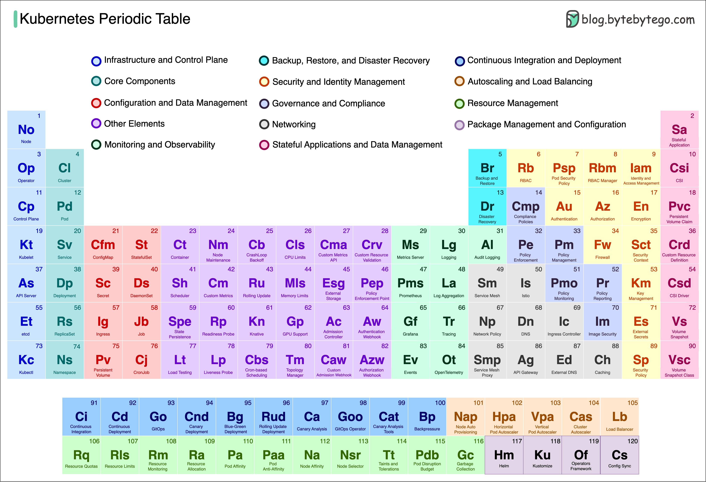

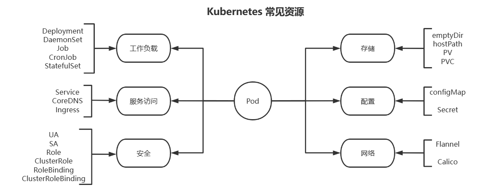

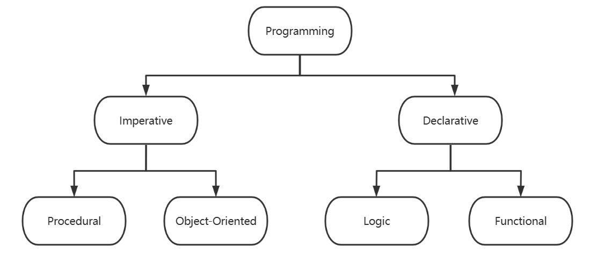

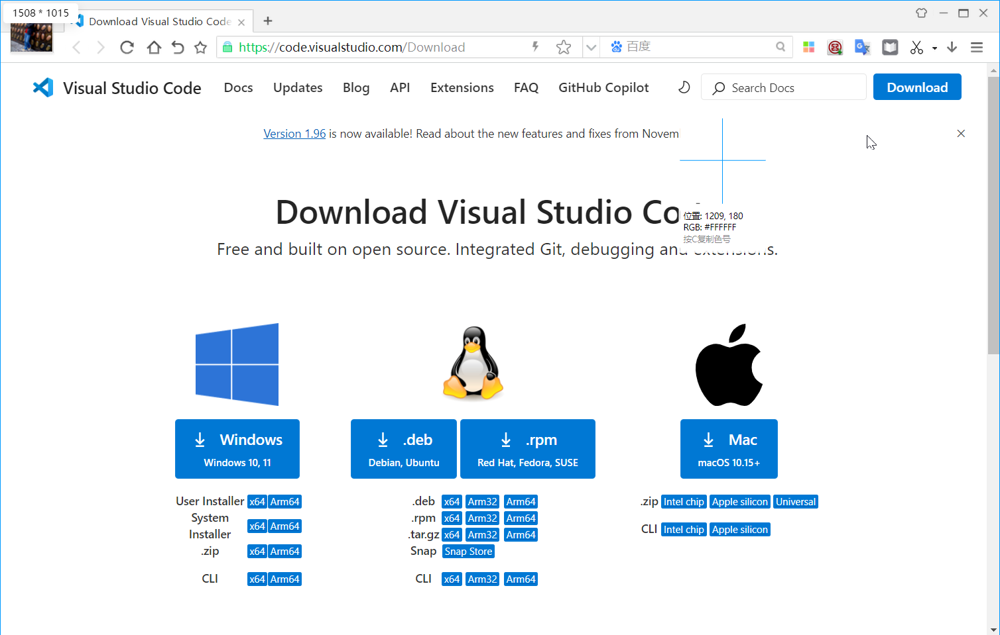

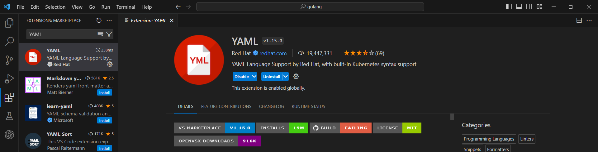

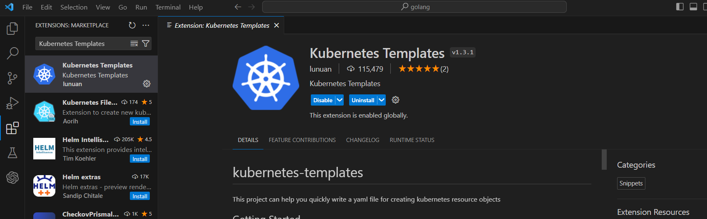

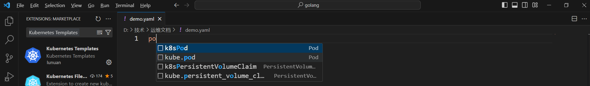

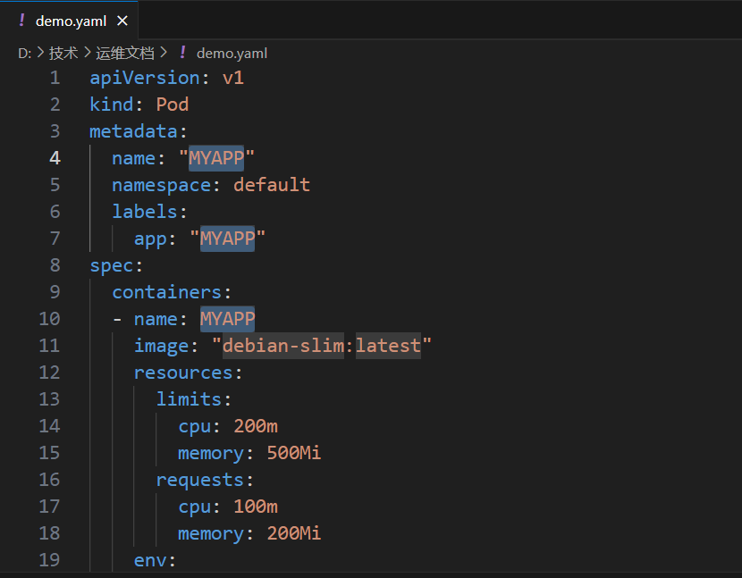

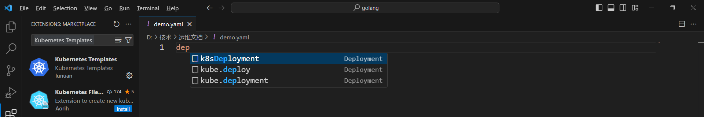

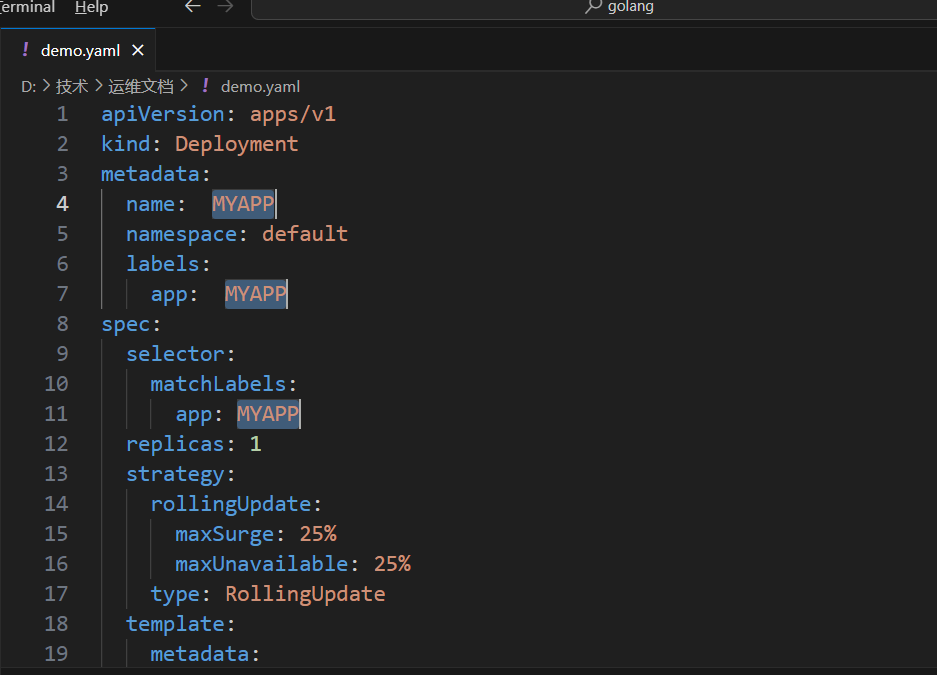

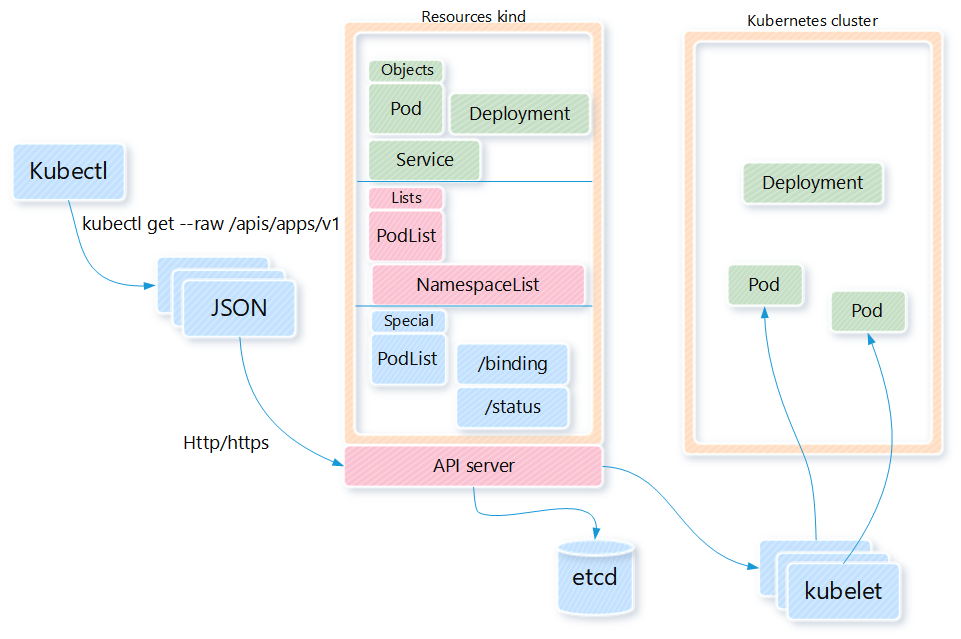

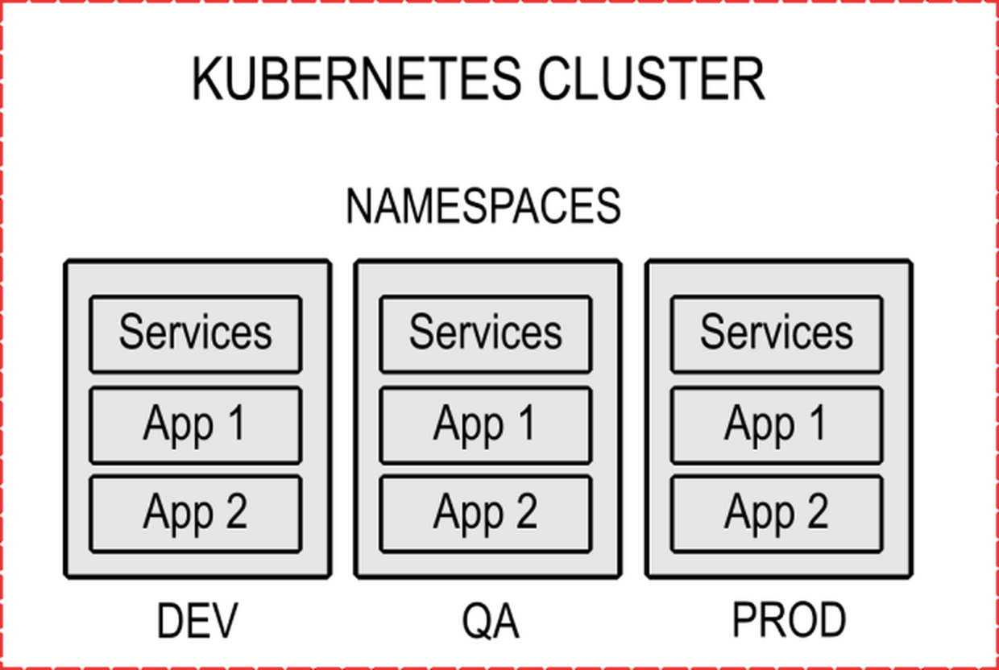

</details>



<nav class="article-end" aria-label="章节导航">
  <a href="{{ '/subjects/Kubernetes/06-kubectl-management.html' | relative_url }}">← 上一章：kubectl 集群管理命令</a>
  <a href="{{ '/subjects/Kubernetes/' | relative_url }}">返回 Kubernetes 目录</a>
  <a href="{{ '/subjects/Kubernetes/08-pod-basics-lifecycle.html' | relative_url }}">下一章：Pod 基础与工作机制 →</a>
</nav>
