[← 返回 Kubernetes 目录]({{ '/subjects/Kubernetes/' | relative_url }})



# 07 API 资源对象、清单与命名空间

# 1 资源对象

## 1.1 资源对象及 API 群组

### 1.1.1 Kubernetes 的资源对象

**Kubernetes 元素周期表**

Kubernetes 是一个分布式系统平台,功能强大,所以涉及到的内容很多,下图为 Kubernetes 相关的组件和技术称为Kubernetes 元素周期表。

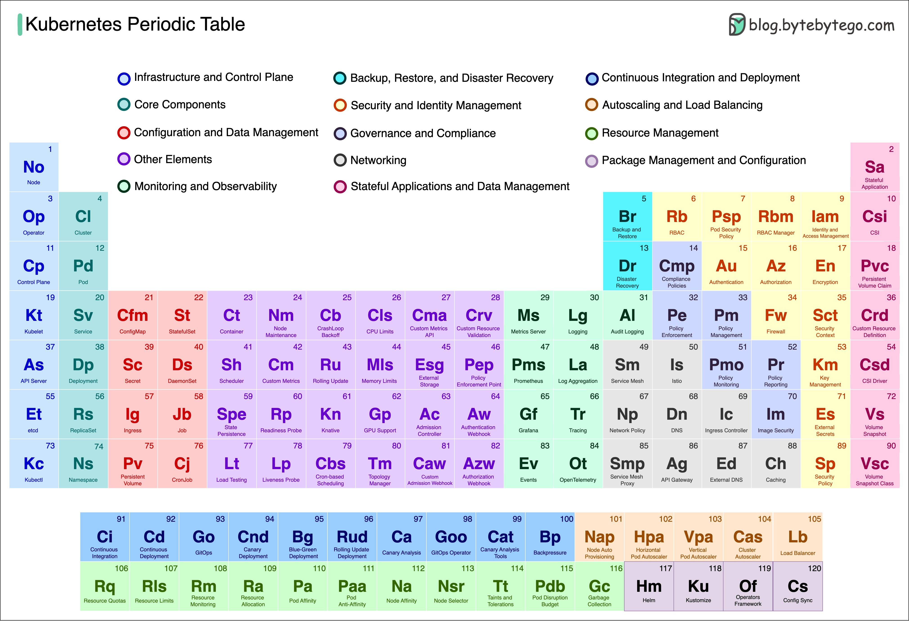

Kubernetes 系统将一切事物都称为资源对象, 相当于面向对象的思想。

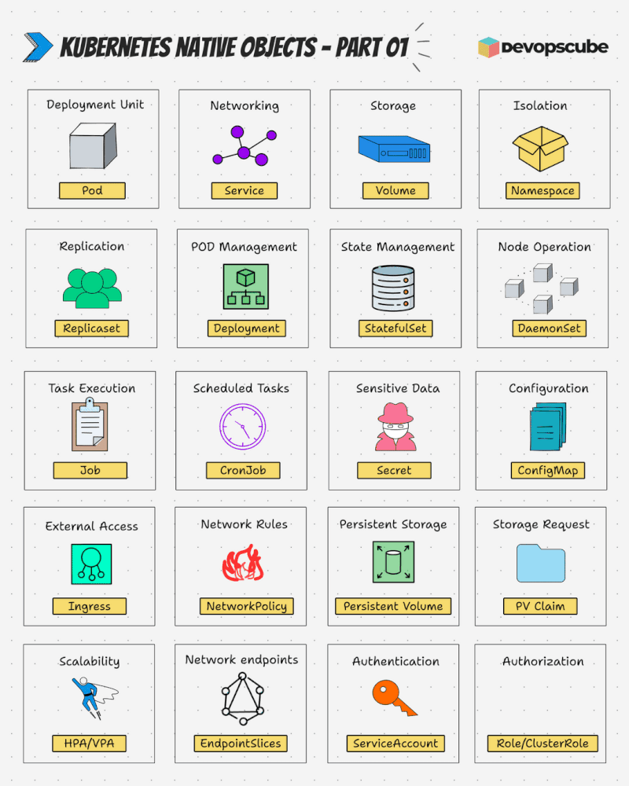

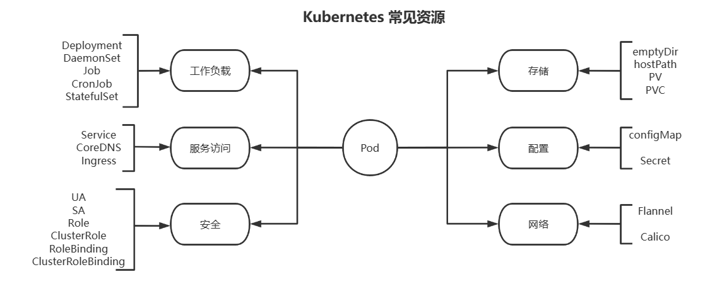

有一些独立存在,即不依赖于其它对象存在的资源类型, Kubernetes 提供了单独的 API 资源，其遵循REST 风格组织并管理这些资源对象。对这些API 资源类型支持使用标准的 HTTP 方法(POST,PUT,PATCH,DELETE 和 GET)对资源进行增、删、改和查。也有一些资源Kubernetes  中并没有提供对应独立的API资源类型,不能独立创建,需要依附其它资源的存在, 比如: Label,emptyDir等。在 Kubernetes 系统中，资源代表了对象的集合，例如：Pod 资源可用于描述所有 Pod类型的对象。对象实质是资源类型生成的实例。

Kubernetes 的 API  资源分为两种:

内置API 资源: Kubernetes 安装后自身具有的自定义的API 资源: 用户自定义的API,称为CRD(Custom Resource Definition),可以通过安装一些组件生成。

Kubernetes 的 API 资源有些可以人为创建,有些不支持人为创建,需由Kubernetes自动创建。Kubernetes 集群系统的 API Server 基于 HTTP/HTTPS 接收并相应客户端的操作请求，其提供了基于资源(resourced-based)的 RESTful 风格的编程接口，将集群的各种组件都抽象为标准的 REST资源，并支持通过标准的 HTTP 方法以 json 格式为数据序列化方法进行资源管理操作。

设计这些资源的核心目的就是：如何更好的运行和管理 Pod 资源，为容器化应用提供更灵活、更完善的操作与管理组件。

从资源的主要功能上Kubernetes 的资源对象分为：

Kubernetes 元素周期表按用途展示以下类别：

- Workloads（工作负载）。
- Service、LoadBalancing and Networking（服务发现和负载均衡）。
- Storage & Configuration（存储和配置）。
- Cluster Admin（集群管理）。
- Policies & Scheduling（策略和调度）。
- Metadata（元数据）。

K8S资源还可以按适用范围分为:名称空间级别、集群级别、元数据类型。

名称空间级别：仅在此名称中生效。举个例子，我们之前通过 kubeadm 去安装我们K8S 集群的时候，他会默认把所有组件放到 kube-system 这个名称空间下去运行，然后我们可以通过命令kubectl get pod 的时候会看到它获取不到，对应的我们系统一些 pod 的信息，原因是默认情况下该命令什么都不加的话相当于是kubectl get pod -n default ，但是我们的  K8S 本身组件他是放在我们的 kube-system 名称空间下的，所有这种情况我们会发现，在 kube-system 名称空间下的资源我们在其他名称空间中是看不见的。这就是典型的名称空间级别资源。集群级别：比如、role 等等，这都是集群级别的资源，不管在什么名称空间下去定义，在其他的名称空间下都能够看得到，其实他在定义的时候都没有去指定所谓的名称空间，也就意味着一旦经过定义以后在全集群中都能够被可见以及调用，这种级别呢我们就把它集群级别下的名称空间，并且把这种东西叫做集群级别的资源元数据型：负责提供一种指标，源数据类型它不像我们的名称空间级别和集群级别，其实它也可以归属在这两者之间，但是它又有自己的特点所以我们将他拿出来进行单独的分类。比如前面讲过的HPA 他就是可以通过我们的 CPU 进行平滑扩展，他就是典型的源数据型。通过我们的指标进行操作。

范例: 查看资源类型
```bash
[root@master1 ~]#kubectl api-resources
NAME                              SHORTNAMES   APIVERSION
NAMESPACED   KIND
bindings                                       v1
true         Binding

componentstatuses                 cs           v1
false        ComponentStatus
configmaps                        cm           v1
true         ConfigMap
endpoints                         ep           v1
true         Endpoints
events                            ev           v1
true         Event
limitranges                       limits       v1
true         LimitRange
namespaces                        ns           v1
false        Namespace
nodes                             no           v1
false        Node
persistentvolumeclaims            pvc          v1
true         PersistentVolumeClaim
persistentvolumes                 pv           v1
false        PersistentVolume
pods                              po           v1
true         Pod
podtemplates                                   v1
true         PodTemplate
replicationcontrollers            rc           v1
true         ReplicationController
resourcequotas                    quota        v1
true         ResourceQuota
secrets                                        v1
true         Secret
serviceaccounts                   sa           v1
true         ServiceAccount
services                          svc          v1
true         Service
mutatingwebhookconfigurations                  admissionregistration.k8s.io/v1
false        MutatingWebhookConfiguration
validatingwebhookconfigurations                admissionregistration.k8s.io/v1
false        ValidatingWebhookConfiguration
customresourcedefinitions         crd,crds     apiextensions.k8s.io/v1
false        CustomResourceDefinition
apiservices                                    apiregistration.k8s.io/v1
false        APIService
controllerrevisions                            apps/v1
true         ControllerRevision
daemonsets                        ds           apps/v1
true         DaemonSet
deployments                       deploy       apps/v1
true         Deployment
replicasets                       rs           apps/v1
true         ReplicaSet
statefulsets                      sts          apps/v1
true         StatefulSet
tokenreviews                                   authentication.k8s.io/v1
false        TokenReview
localsubjectaccessreviews                      authorization.k8s.io/v1
true         LocalSubjectAccessReview
selfsubjectaccessreviews                       authorization.k8s.io/v1
false        SelfSubjectAccessReview
selfsubjectrulesreviews                        authorization.k8s.io/v1
false        SelfSubjectRulesReview

subjectaccessreviews                           authorization.k8s.io/v1
false        SubjectAccessReview
horizontalpodautoscalers          hpa          autoscaling/v2
true         HorizontalPodAutoscaler
cronjobs                          cj           batch/v1
true         CronJob
jobs                                           batch/v1
true         Job
certificatesigningrequests        csr          certificates.k8s.io/v1
false        CertificateSigningRequest
leases                                         coordination.k8s.io/v1
true         Lease
endpointslices                                 discovery.k8s.io/v1
true         EndpointSlice
events                            ev           events.k8s.io/v1
true         Event
flowschemas
flowcontrol.apiserver.k8s.io/v1beta3   false        FlowSchema
prioritylevelconfigurations
flowcontrol.apiserver.k8s.io/v1beta3   false        PriorityLevelConfiguration
ingressclasses                                 networking.k8s.io/v1
false        IngressClass
ingresses                         ing          networking.k8s.io/v1
true         Ingress
networkpolicies                   netpol       networking.k8s.io/v1
true         NetworkPolicy
runtimeclasses                                 node.k8s.io/v1
false        RuntimeClass
poddisruptionbudgets              pdb          policy/v1
true         PodDisruptionBudget
clusterrolebindings                            rbac.authorization.k8s.io/v1
false        ClusterRoleBinding
clusterroles                                   rbac.authorization.k8s.io/v1
false        ClusterRole
rolebindings                                   rbac.authorization.k8s.io/v1
true         RoleBinding
roles                                          rbac.authorization.k8s.io/v1
true         Role
priorityclasses                   pc           scheduling.k8s.io/v1
false        PriorityClass
csidrivers                                     storage.k8s.io/v1
false        CSIDriver
csinodes                                       storage.k8s.io/v1
false        CSINode
csistoragecapacities                           storage.k8s.io/v1
true         CSIStorageCapacity
storageclasses                    sc           storage.k8s.io/v1
false        StorageClass
volumeattachments                              storage.k8s.io/v1
false        VolumeAttachment
```
```bash
[root@master1 ~]#kubectl api-versions
admissionregistration.k8s.io/v1
apiextensions.k8s.io/v1
apiregistration.k8s.io/v1
apps/v1
authentication.k8s.io/v1

authorization.k8s.io/v1
autoscaling/v1
autoscaling/v2
batch/v1
certificates.k8s.io/v1
coordination.k8s.io/v1
discovery.k8s.io/v1
events.k8s.io/v1
flowcontrol.apiserver.k8s.io/v1
flowcontrol.apiserver.k8s.io/v1beta3
networking.k8s.io/v1
node.k8s.io/v1
policy/v1
rbac.authorization.k8s.io/v1
scheduling.k8s.io/v1
storage.k8s.io/v1
v1

[root@master1 ~]#kubectl api-resources --api-group=apps
NAME                  SHORTNAMES   APIVERSION   NAMESPACED   KIND
controllerrevisions                apps/v1      true         ControllerRevision
daemonsets            ds           apps/v1      true         DaemonSet
deployments           deploy       apps/v1      true         Deployment
replicasets           rs           apps/v1      true         ReplicaSet
statefulsets          sts          apps/v1      true         StatefulSet

[root@master1 ~]#kubectl api-resources | awk '{print $1}'
NAME
bindings
componentstatuses
configmaps
endpoints
events
limitranges
namespaces
nodes
persistentvolumeclaims
persistentvolumes
pods
podtemplates
replicationcontrollers
resourcequotas
secrets
serviceaccounts
services
mutatingwebhookconfigurations
validatingwebhookconfigurations
customresourcedefinitions
apiservices
controllerrevisions
daemonsets
deployments
replicasets
statefulsets
tokenreviews
localsubjectaccessreviews
selfsubjectaccessreviews

selfsubjectrulesreviews
subjectaccessreviews
horizontalpodautoscalers
cronjobs
jobs
certificatesigningrequests
leases
endpointslices
events
flowschemas
prioritylevelconfigurations
ingressclasses
ingresses
networkpolicies
runtimeclasses
poddisruptionbudgets
clusterrolebindings
clusterroles
rolebindings
roles
priorityclasses
csidrivers
csinodes
csistoragecapacities
storageclasses
volumeattachments

[root@master1 ~]#kubectl api-resources | awk '{print $1}'|wc -l
56

#查看所有资源
[root@ubuntu2204 ~]#kubectl get all  -A
NAMESPACE     NAME                                             READY   STATUS
RESTARTS        AGE
default       pod/myapp-6f9c7b4668-6vjv6                       1/1     Running
1 (5h9m ago)    7h32m
default       pod/myapp-6f9c7b4668-725r9                       1/1     Running
1 (5h9m ago)    7h32m
default       pod/myapp-6f9c7b4668-tcczj                       1/1     Running
1 (5h9m ago)    7h32m
kube-system   pod/calico-kube-controllers-5994f46b69-dq9pc     1/1     Running
1 (5h9m ago)    7h38m
kube-system   pod/calico-node-bvmcw                            1/1     Running
1 (5h9m ago)    7h38m
kube-system   pod/calico-node-f46v4                            1/1     Running
4 (5h8m ago)    7h38m
kube-system   pod/calico-node-fkdvk                            1/1     Running
2 (5h8m ago)    7h38m
kube-system   pod/calico-node-g78b5                            1/1     Running
2 (5h10m ago)   7h38m
kube-system   pod/calico-node-twx6t                            1/1     Running
3 (5h10m ago)   7h38m
kube-system   pod/calico-node-xbt4b                            1/1     Running
2 (5h10m ago)   7h38m
kube-system   pod/coredns-6db9bd4cd7-t5b4v                     1/1     Running
1 (5h9m ago)    7h38m

kube-system   pod/dashboard-metrics-scraper-77b667b99d-dw4d9   1/1     Running
1 (5h9m ago)    7h37m
kube-system   pod/kubernetes-dashboard-74fb9f77fb-bhz2v        1/1     Running
2 (5h8m ago)    7h37m
kube-system   pod/metrics-server-dfb478476-lsdqx               1/1     Running
2 (5h8m ago)    7h38m
kube-system   pod/node-local-dns-5lqq2                         1/1     Running
1 (5h9m ago)    7h38m
kube-system   pod/node-local-dns-6bjp4                         1/1     Running
1 (5h9m ago)    7h38m
kube-system   pod/node-local-dns-hts5v                         1/1     Running
1 (5h10m ago)   7h38m
kube-system   pod/node-local-dns-jxrhh                         1/1     Running
1 (5h10m ago)   7h38m
kube-system   pod/node-local-dns-nmvwh                         1/1     Running
1 (5h9m ago)    7h38m
kube-system   pod/node-local-dns-wv8mx                         1/1     Running
1 (5h10m ago)   7h38m

NAMESPACE     NAME                                TYPE        CLUSTER-IP
EXTERNAL-IP   PORT(S)                  AGE
default       service/kubernetes                  ClusterIP   10.68.0.1
<none>        443/TCP                  7h40m
default       service/myapp                       NodePort    10.68.78.97
<none>        80:31890/TCP             5h16m
kube-system   service/dashboard-metrics-scraper   ClusterIP   10.68.54.201
<none>        8000/TCP                 7h37m
kube-system   service/kube-dns                    ClusterIP   10.68.0.2
<none>        53/UDP,53/TCP,9153/TCP   7h38m
kube-system   service/kube-dns-upstream           ClusterIP   10.68.143.215
<none>        53/UDP,53/TCP            7h38m
kube-system   service/kubernetes-dashboard        NodePort    10.68.50.181
<none>        443:30313/TCP            7h37m
kube-system   service/metrics-server              ClusterIP   10.68.196.91
<none>        443/TCP                  7h38m
kube-system   service/node-local-dns              ClusterIP   None
<none>        9253/TCP                 7h38m

NAMESPACE     NAME                            DESIRED   CURRENT   READY   UP-TO-
DATE   AVAILABLE   NODE SELECTOR            AGE
kube-system   daemonset.apps/calico-node      6         6         6       6
6           kubernetes.io/os=linux   7h38m
kube-system   daemonset.apps/node-local-dns   6         6         6       6
6           <none>                   7h38m

NAMESPACE     NAME                                        READY   UP-TO-DATE
AVAILABLE   AGE
default       deployment.apps/myapp                       3/3     3            3
7h32m
kube-system   deployment.apps/calico-kube-controllers     1/1     1            1
7h38m
kube-system   deployment.apps/coredns                     1/1     1            1
7h38m
kube-system   deployment.apps/dashboard-metrics-scraper   1/1     1            1
7h37m
kube-system   deployment.apps/kubernetes-dashboard        1/1     1            1
7h37m

kube-system   deployment.apps/metrics-server              1/1     1            1
7h38m

NAMESPACE     NAME                                                   DESIRED
CURRENT   READY   AGE
default       replicaset.apps/myapp-6f9c7b4668                       3         3
3       7h32m
kube-system   replicaset.apps/calico-kube-controllers-5994f46b69     1         1
1       7h38m
kube-system   replicaset.apps/coredns-6db9bd4cd7                     1         1
1       7h38m
kube-system   replicaset.apps/dashboard-metrics-scraper-77b667b99d   1         1
1       7h37m
kube-system   replicaset.apps/kubernetes-dashboard-74fb9f77fb        1         1
1       7h37m
kube-system   replicaset.apps/metrics-server-dfb478476               1         1
1       7h38m
```
```bash
[root@ubuntu2204 ~]#
```

范例：查看CRD
```bash
[root@master1 ~]#kubectl get crd
NAME                                                  CREATED AT
bgpconfigurations.crd.projectcalico.org               2023-07-22T12:10:37Z
bgpfilters.crd.projectcalico.org                      2023-07-22T12:10:37Z
bgppeers.crd.projectcalico.org                        2023-07-22T12:10:37Z
blockaffinities.crd.projectcalico.org                 2023-07-22T12:10:37Z
caliconodestatuses.crd.projectcalico.org              2023-07-22T12:10:37Z
clusterinformations.crd.projectcalico.org             2023-07-22T12:10:37Z
felixconfigurations.crd.projectcalico.org             2023-07-22T12:10:37Z
globalnetworkpolicies.crd.projectcalico.org           2023-07-22T12:10:37Z
globalnetworksets.crd.projectcalico.org               2023-07-22T12:10:37Z
hostendpoints.crd.projectcalico.org                   2023-07-22T12:10:37Z
ipamblocks.crd.projectcalico.org                      2023-07-22T12:10:37Z
ipamconfigs.crd.projectcalico.org                     2023-07-22T12:10:37Z
ipamhandles.crd.projectcalico.org                     2023-07-22T12:10:37Z
ippools.crd.projectcalico.org                         2023-07-22T12:10:37Z
ipreservations.crd.projectcalico.org                  2023-07-22T12:10:37Z
kubecontrollersconfigurations.crd.projectcalico.org   2023-07-22T12:10:37Z
networkpolicies.crd.projectcalico.org                 2023-07-22T12:10:37Z
networksets.crd.projectcalico.org                     2023-07-22T12:10:37Z
redisfailovers.databases.spotahome.com                2024-04-29T14:26:08Z
```

#### 1.1.1.1 名称空间级别资源

工作负载型资源( workload )：

**Pod**：这是我们K8S 中最小的组成部分，特点就是和我们的 pause 共享我们的网络栈、共享存储卷。replicaset：也就是 RS ，这是我们的调度器控制器，负责管理 pod 的创建，通过我们标签的选择去控制pod 的副本数Deployment：控制器，通过控制 RS 的创建去创建 pod statefulset：主要是为了我们的有状态服务去建立的这么一个管理器。Daemonset：可以在我们每个节点都运行一个 pod 的组件。job：我们的工作，为了批处理任务。cronjob：我们的轮询工作，为了批处理任务。

服务发现及负载均衡型资源( ServiceDiscovery LoadBalance ):

Service（简称为svc）：为了把我们的服务暴露出去Ingress：为了把我们的服务暴露出去,由此接受外部的访问。

配置与存储型资源：

**Volume**：存储卷，为了给 pod 提供一个持久化的能力CSI（容器存储接口）：,可以扩展各种各样的第三方存储卷，在K8S中很多资源需要灵活的提供给我们的容器去运行，但是在K8S中定义了 CSI 接口只要存储资源符合这个接口的规范，那我这个 K8S 集群中 pod 就能够去调用这个存储，这种接口就叫做CSI ，基本上现在市面上能够见到的存储都是支持 CSI 的。

**特殊类型的存储卷**：ConfigMap（当配置中心来使用的资源来型）：一般来说用来存储配置文件，达到热更新的状态。Secret：加密的方案去存储数据的，所以可以通过它来保存一些密码文件、密钥等等DownwardAPI：把外部环境中的信息输出给容器、这个和CSI也比较像，也就意味着可以通过一个下载文件的接口，通过这个接口可以去调用里面的数据，存储和上传等等。

#### 1.1.1.2 集群级资源

**集群级资源**：Namespace（名称空间）Node（工作节点）、Role（角色）ClusterRole（集群角色）RoleBinding（重新链接）ClusterRoleBinding（集群重新链接）。

#### 1.1.1.3 元数据型资源

元数据型资源（根据一些指标去进行对应的操作）：

HPA PodTemplate（pod模板）LimitRange（资源限制）

### 1.1.2 资源及其在 API 中的组织形式

Kubernetes 利用标准的 RESTful 术语来描述其 API 概念。

**资源类型**：是指在 URL 中使用的名称，如 Pod、Namespace 和 Service 等，其 URL 格式为"/GROUP/VERSION/RESOURCE"，示例：/apps/v1/deployment所有资源类型都有一个对应的 JSON 表示格式：kind(种类)，在 K8s 中用户创建对象必须以 JSON格式提交对象的配置信息。隶属于同一资源类型的对象组成的列表称为 collection(集合)，如 PodList某种类型的单个实例称为"resource"(资源)或"object"(对象)，如运行的名为 pod-test 的 Pod 对象。

kind 代表了资源对象所属的类型，如 Namespace、Deployment、Service 等类型，这些类型又可以分为三个类别：

Object 类：对象表示 K8s 系统上的持久化实体，Namespace、Deployment、Service 和 Pod 都属于该类别List 列表类：列表是指同一类型资源的集合，如 PodList、NodeList 等。Simple 简单类：常用于子对象上执行某种特殊操作，或者管理非持久的实体，如/binding或/status 等。

在 Kubernetes 系统中，所有的对象型资源都有一个独有的名称表示以实现其幂等的创建及获取操作。有的资源隶属于集群范畴，如 Namespace 和 PersistentVolume，而多数资源类型则受限于名称空间，如 Pod、Deployment 和 Service 等。名称空间级别的资源的 URL 路径中含有其所属空间的名称，这些资源对象在名称空间被删除时会被一并删除，这些资源的访问也受控于其所属的名称空间级别的授权。

Kubernetes 将 API 分割为多个逻辑组合，称为API 群组，不同的群组支持单独启用或禁用，并可以再次分解。群组化管理的 API 使得其可以更轻松的进行扩展。当前 K8s 集群系统上的 API server 上的相关信息可以使用kubectl api-versions 获取。配置资源清单时会使用 API 群组：
```bash
#显示API群组,结果格式为: GROUP_NAME/VERSOIN,同一个组可以有多版本并存
#GROUP_NAME：API群组名，如果省略表示属于core核心组
#VERSION:v1,经过验证的稳定版本，可以生产环境使用,如:apps/v1
#alpha:内测,可能包含错误，生产不建议使用
#beta: 公测，存在变动的可能或者潜在的问题，生产不建议使用,如:autoscaling/v2beta2

[root@master1 ~]#kubectl api-versions
admissionregistration.k8s.io/v1
apiextensions.k8s.io/v1
apiregistration.k8s.io/v1
apps/v1
auth.democrd.io/v1alpha1
authentication.k8s.io/v1
authorization.k8s.io/v1
autoscaling/v1
autoscaling/v2
batch/v1
certificates.k8s.io/v1
coordination.k8s.io/v1
discovery.k8s.io/v1
events.k8s.io/v1
flowcontrol.apiserver.k8s.io/v1beta2
flowcontrol.apiserver.k8s.io/v1beta3
networking.k8s.io/v1
node.k8s.io/v1
policy/v1
rbac.authorization.k8s.io/v1
scheduling.k8s.io/v1
storage.k8s.io/v1
storage.k8s.io/v1beta1
v1

[root@master1 ~]#kubectl api-versions
admissionregistration.k8s.io/v1
apiextensions.k8s.io/v1
apiregistration.k8s.io/v1
apps/v1
authentication.k8s.io/v1
authorization.k8s.io/v1
autoscaling/v1
autoscaling/v2beta1
autoscaling/v2beta2
batch/v1
batch/v1beta1
certificates.k8s.io/v1
coordination.k8s.io/v1
discovery.k8s.io/v1
discovery.k8s.io/v1beta1

events.k8s.io/v1
events.k8s.io/v1beta1
flowcontrol.apiserver.k8s.io/v1beta1
networking.k8s.io/v1
node.k8s.io/v1
node.k8s.io/v1beta1
policy/v1
policy/v1beta1
rbac.authorization.k8s.io/v1
scheduling.k8s.io/v1
storage.k8s.io/v1
storage.k8s.io/v1beta1
v1

#每个资源都有自已的APIVERSION和是否属于名称空间
[root@master1 ~]#kubectl api-resources
NAME                              SHORTNAMES   APIVERSION
NAMESPACED   KIND
bindings                                       v1
true         Binding
componentstatuses                 cs           v1
false        ComponentStatus
configmaps                        cm           v1
true         ConfigMap
endpoints                         ep           v1
true         Endpoints
events                            ev           v1
true         Event
limitranges                       limits       v1
true         LimitRange
namespaces                        ns           v1
false        Namespace
nodes                             no           v1
false        Node
persistentvolumeclaims            pvc          v1
true         PersistentVolumeClaim
persistentvolumes                 pv           v1
false        PersistentVolume
pods                              po           v1
true         Pod
podtemplates                                   v1
true         PodTemplate
replicationcontrollers            rc           v1
true         ReplicationController
resourcequotas                    quota        v1
true         ResourceQuota
secrets                                        v1
true         Secret
serviceaccounts                   sa           v1
true         ServiceAccount
services                          svc          v1
true         Service
mutatingwebhookconfigurations                  admissionregistration.k8s.io/v1
false        MutatingWebhookConfiguration
validatingwebhookconfigurations                admissionregistration.k8s.io/v1
false        ValidatingWebhookConfiguration
customresourcedefinitions         crd,crds     apiextensions.k8s.io/v1
false        CustomResourceDefinition

apiservices                                    apiregistration.k8s.io/v1
false        APIService
controllerrevisions                            apps/v1
true         ControllerRevision
daemonsets                        ds           apps/v1
true         DaemonSet
deployments                       deploy       apps/v1
true         Deployment
replicasets                       rs           apps/v1
true         ReplicaSet
statefulsets                      sts          apps/v1
true         StatefulSet
tokenreviews                                   authentication.k8s.io/v1
false        TokenReview
localsubjectaccessreviews                      authorization.k8s.io/v1
true         LocalSubjectAccessReview
selfsubjectaccessreviews                       authorization.k8s.io/v1
false        SelfSubjectAccessReview
selfsubjectrulesreviews                        authorization.k8s.io/v1
false        SelfSubjectRulesReview
subjectaccessreviews                           authorization.k8s.io/v1
false        SubjectAccessReview
horizontalpodautoscalers          hpa          autoscaling/v2
true         HorizontalPodAutoscaler
cronjobs                          cj           batch/v1
true         CronJob
jobs                                           batch/v1
true         Job
certificatesigningrequests        csr          certificates.k8s.io/v1
false        CertificateSigningRequest
leases                                         coordination.k8s.io/v1
true         Lease
endpointslices                                 discovery.k8s.io/v1
true         EndpointSlice
events                            ev           events.k8s.io/v1
true         Event
flowschemas
flowcontrol.apiserver.k8s.io/v1beta2   false        FlowSchema
prioritylevelconfigurations
flowcontrol.apiserver.k8s.io/v1beta2   false        PriorityLevelConfiguration
ingressclasses                                 networking.k8s.io/v1
false        IngressClass
ingresses                         ing          networking.k8s.io/v1
true         Ingress
networkpolicies                   netpol       networking.k8s.io/v1
true         NetworkPolicy
runtimeclasses                                 node.k8s.io/v1
false        RuntimeClass
poddisruptionbudgets              pdb          policy/v1
true         PodDisruptionBudget
podsecuritypolicies               psp          policy/v1beta1
false        PodSecurityPolicy
clusterrolebindings                            rbac.authorization.k8s.io/v1
false        ClusterRoleBinding
clusterroles                                   rbac.authorization.k8s.io/v1
false        ClusterRole
rolebindings                                   rbac.authorization.k8s.io/v1
true         RoleBinding

roles                                          rbac.authorization.k8s.io/v1
true         Role
priorityclasses                   pc           scheduling.k8s.io/v1
false        PriorityClass
csidrivers                                     storage.k8s.io/v1
false        CSIDriver
csinodes                                       storage.k8s.io/v1
false        CSINode
csistoragecapacities                           storage.k8s.io/v1beta1
true         CSIStorageCapacity
storageclasses                    sc           storage.k8s.io/v1
false        StorageClass
volumeattachments

#Kubernetes-v1.24.3有57种资源
```
```bash
[root@master1 ~]# kubectl api-resources  |wc -l
57

#显示指定API群组的资源
[root@master1 ~]#kubectl api-resources --api-group=apps
NAME                  SHORTNAMES   APIVERSION   NAMESPACED   KIND
controllerrevisions                apps/v1      true         ControllerRevision
daemonsets            ds           apps/v1      true         DaemonSet
deployments           deploy       apps/v1      true         Deployment
replicasets           rs           apps/v1      true         ReplicaSet
statefulsets          sts          apps/v1      true         StatefulSet
```

Kubernetes 的 API 以层级结构组织在一起

**Object**：资源型对象，表现为 http url中path。

非Object：非资源型对象，kubernetes特有，例如: /healthz。

API Server上的每个资源对象，都在RESTful API中有一个端点。Kubernetes的基本特性就是它的所有资源对象都是模型化的 API 对象，可以基于api-server对各种资源进行增、删、改、查等操作，但是这些操作涉及到的不仅仅是资源本身和动作，而且还涉及到资源和动作之间的内容，比如api的分组版本和资源和api的关联即权限授权等。

Object资源型对象对应的 API 群组可以归为以下两类：

核心群组(core group)：

在资源的配置信息apiVersion 字段中引用时可以不用指定路径,如:"apiVersion: v1"。

REST 路径为/api/v1
```bash
https://API_SERVER:PORT/api/v1/namespaces/<NS_NAME>/<RESOURCE_NANE>/<OBJECT_
NAME>

#default名称空间下的mypod的Pod资源，URL路径直接访问:
curl https://API_SERVER:PORT/api/vl/namespaces/default/pods/mypod

/api/v1/namespaces/<NAMESPACE>/pods/
/api/v1/namespaces/<NAMESPACE>/pods/<POD_NAME>

#示例：
kubectl get --raw="/api/v1/namespaces/default/pods/demoapp-78b49597cf-qkj4h"
| jq
```

命名群组(named group)：

即有名称的群组

其在 apiVersion 字段中引用的格式为:"apiVersion: $GROUP_NAME/$VERSION",如："apiVersion:apps/v1"。

REST 路径为/apis/$GROUP_NAME/$VERSION , 如/apis/apps/v1
```text
https://API_SERVER:HOST/apis/GROUP_NANE/VERSION/namespaces/<NS_MTNE>/<RESOUR
CE_NAME>/<0B3ECT_NNE

/apis/<GROUP_NAME>/<VERSION>/<NAMESPACE>/default/deployments/
/apis/<GROUP_NAME>/<VERSION>/<NAMESPACE>/default/deployments/<PODNAME>

#示例：
kubectl get --raw="/apis/apps/v1/namespaces/kube-system/deployments/coredns"
| jq
```

范例:
```bash
[root@master1 ~]#kubectl get --raw="/api/v1/namespaces/default" | jq
{
"kind": "Namespace",
"apiVersion": "v1",
"metadata": {
"name": "default",
"uid": "c9cb9aa8-ca5c-4293-9892-c7de230943b4",
"resourceVersion": "195",
"creationTimestamp": "2021-08-21T01:07:21Z",
"labels": {
"kubernetes.io/metadata.name": "default"
},
"managedFields": [
{
"manager": "kube-apiserver",
"operation": "Update",
"apiVersion": "v1",
"time": "2021-08-21T01:07:21Z",
"fieldsType": "FieldsV1",
"fieldsV1": {
"f:metadata": {
"f:labels": {
".": {},
"f:kubernetes.io/metadata.name": {}
}
}
}
}
]
},
"spec": {
"finalizers": [
"kubernetes"
]
},

"status": {
"phase": "Active"
}
}
```

范例: 获取名为 apps 的 API 群组信息：
```bash
[root@master1 ~]#kubectl get --raw /apis/apps | jq
{
"kind": "APIGroup",
"apiVersion": "v1",
"name": "apps",
"versions": [
{
"groupVersion": "apps/v1",
"version": "v1"
}
],
"preferredVersion": {
"groupVersion": "apps/v1",
"version": "v1"
}
}
```

范例: 获取所有的 Deployment 对象的列表
```bash
[root@master1 ~]#kubectl get --raw /apis/apps/v1/deployments | jq
{
"kind": "DeploymentList",
"apiVersion": "apps/v1",
"metadata": {
"resourceVersion": "192070"
},
"items": [
{
......
```

### 1.1.3 访问 Kubernetes REST API

可以使用 curl 作为 http 客户端直接通过 API server 在集群上操作资源对象模拟请求和响应过程，只不过 kubeadm 部署的 k8s 集群默认只支持 HTTPS 协议访问接口，但是用户可以使用kubectl proxy 命令来在本地主机上为 API server 启动一个代理网关，由其支持使用 HTTP 进行通信。
```yaml
#需要提前获取TOKEN才能访问
#清单文件
[root@master1 ~]#cat securiy-sa-token-cluster-admin.yaml
apiVersion: v1
kind: ServiceAccount
metadata:
name: bowen
namespace: kube-system

---
apiVersion: v1

kind: Secret
type: kubernetes.io/service-account-token
metadata:
name: bowen-secret
namespace: kube-system
annotations:
kubernetes.io/service-account.name: "bowen"

---
apiVersion: rbac.authorization.k8s.io/v1
kind: ClusterRoleBinding
metadata:
name: testsa-clusterrolebinding
roleRef:
apiGroup: rbac.authorization.k8s.io
kind: ClusterRole
name: cluster-admin
subjects:
- kind: ServiceAccount
name: bowen
namespace: kube-system

#生成资源
[root@master1 ~]#kubectl apply -f securiy-sa-token-cluster-admin.yaml

#查看SA对应的TOKEN
[root@master1 ~]#kubectl get secrets -n kube-system bowen-secret -o yaml

#对上面的TOKEN进行base64解码后生成TOKEN变量
[root@master1 ~]#TOKEN=$(echo ZXlKaGJHY2lw==|base64 -d)

#利用上面生成的TOEKN才能访问
curl -s  --cacert /etc/kubernetes/pki/ca.crt -H "Authorization: Bearer ${TOKEN}"
https://kubeapi.bowen.org:6443

#返回所有的API列表
curl https://kubeapi.bowen.org:6443

#分组API
curl https://kubeapi.bowen.org:6443/apis

#API详细信息
curl https://kubeapi.bowen.org:6443/apis/autoscaling/v1

#API版本信息
curl https://kubeapi.bowen.org:6443/version

#指定具体版本号的API
curl https://kubeapi.bowen.org:6443/api/v1

#对etcd的健康性检查,正常返回OK
curl https://kubeapi.bowen.org:6443/healthz/etcd

#获取指标数据
curl https://kubeapi.bowen.org:6443/metrics
```

范例：kubernetes API 直接访问
```yaml
#需要提前获取TOKEN才能访问，此方式比较繁琐
[root@master1 ~]#curl -sk  https://kubeapi.bowen.org:6443
{
"kind": "Status",
"apiVersion": "v1",
"metadata": {},
"status": "Failure",
"message": "forbidden: User \"system:anonymous\" cannot get path \"/\"",
"reason": "Forbidden",
"details": {},
"code": 403
}

#清单文件
[root@master1 ~]#cat securiy-sa-token-cluster-admin.yaml
apiVersion: v1
kind: ServiceAccount
metadata:
name: bowen
namespace: kube-system

---
apiVersion: v1
kind: Secret
type: kubernetes.io/service-account-token
metadata:
name: bowen-secret
namespace: kube-system
annotations:
kubernetes.io/service-account.name: "bowen"

---
apiVersion: rbac.authorization.k8s.io/v1
kind: ClusterRoleBinding
metadata:
name: testsa-clusterrolebinding
roleRef:
apiGroup: rbac.authorization.k8s.io
kind: ClusterRole
name: cluster-admin
subjects:
- kind: ServiceAccount
name: bowen
namespace: kube-system

#生成资源
[root@master1 ~]#kubectl apply -f securiy-sa-token-cluster-admin.yaml

#查看SA对应的TOKEN
[root@master1 ~]#kubectl get secrets -n kube-system bowen-secret -o yaml

#对上面的TOKEN进行base64解码后生成TOKEN变量
[root@master1 ~]#TOKEN=$(echo ZXlKaGJHY2lw==|base64 -d)

[root@master1 ~]#curl -s  --cacert /etc/kubernetes/pki/ca.crt -H "Authorization:
Bearer ${TOKEN}" https://kubeapi.bowen.org:6443
{

"paths": [
"/.well-known/openid-configuration",
"/api",
"/api/v1",
"/apis",
"/apis/",
"/apis/admissionregistration.k8s.io",
"/apis/admissionregistration.k8s.io/v1",
"/apis/apiextensions.k8s.io",
.......
```

范例：用代理访问
```bash
#上面方式比较繁琐，启用代理可以更加方便访问API Server
#前台启动一个代理
[root@master1 ~]#kubectl proxy --port=8081
Starting to serve on 127.0.0.1:8081

#在另一个终端执行下面
#查看所有API列表
[root@master1 ~]#curl -s  127.0.0.1:8081|less
{
"paths": [
"/.well-known/openid-configuration",
"/api",
"/api/v1",
"/apis",
"/apis/",
"/apis/admissionregistration.k8s.io",
"/apis/admissionregistration.k8s.io/v1",
"/apis/apiextensions.k8s.io",
"/apis/apiextensions.k8s.io/v1",
"/apis/apiregistration.k8s.io",
"/apis/apiregistration.k8s.io/v1",
"/apis/apps",
"/apis/apps/v1",
"/apis/auth.democrd.io",
"/apis/auth.democrd.io/v1alpha1",
......

{
"kind": "APIGroupList",
"apiVersion": "v1",
"groups": [
{
"name": "apiregistration.k8s.io",
"versions": [
{
"groupVersion": "apiregistration.k8s.io/v1",
"version": "v1"
}
],
"preferredVersion": {
"groupVersion": "apiregistration.k8s.io/v1",
"version": "v1"
}

},
{
"name": "apps",
"versions": [
{
"groupVersion": "apps/v1",
"version": "v1"
}
],
"preferredVersion": {
"groupVersion": "apps/v1",
"version": "v1"
......
#分组API
[root@master1 ~]#curl 127.0.0.1:8081/api/
{
"kind": "APIVersions",
"versions": [
"v1"
],
"serverAddressByClientCIDRs": [
{
"clientCIDR": "0.0.0.0/0",
"serverAddress": "10.0.0.101:6443"
}
]
}

#使用 jq 命令(json 数据处理的命令行工具)处理结果：
[root@master1 ~]#curl -s 127.0.0.1:8081/api/  | jq .kind
"APIVersions"

[root@master1 ~]#curl -s 127.0.0.1:8081/api/  | jq .serverAddressByClientCIDRs
[
{
"clientCIDR": "0.0.0.0/0",
"serverAddress": "10.0.0.103:6443"
}
]

#查看某个 Namespace 资源情况
[root@master1 ~]#curl -s  127.0.0.1:8081/api/v1/namespaces/default  | jq
{
"kind": "Namespace",
"apiVersion": "v1",
"metadata": {
"name": "default",
"uid": "7a644f94-8b3c-400d-bc9c-e202f8560e04",
"resourceVersion": "200",
"creationTimestamp": "2022-02-22T12:26:26Z",
"labels": {
"kubernetes.io/metadata.name": "default"
},
"managedFields": [
{
"manager": "kube-apiserver",
"operation": "Update",
"apiVersion": "v1",

"time": "2022-02-22T12:26:26Z",
"fieldsType": "FieldsV1",
"fieldsV1": {
"f:metadata": {
"f:labels": {
".": {},
"f:kubernetes.io/metadata.name": {}
}
}
}
}
]
},
"spec": {
"finalizers": [
"kubernetes"
]
},
"status": {
"phase": "Active"
}
}

# kind字段
```
```bash
[root@master1 ~]#curl -s  127.0.0.1:8081/api/v1/namespaces/default  | jq .kind
"Namespace"

# apiVersion字段
[root@master1 ~]#curl -s  127.0.0.1:8081/api/v1/namespaces/default  | jq
.apiVersion
"v1"
# metadata字段
[root@master1 ~]#curl -s  127.0.0.1:8081/api/v1/namespaces/default  | jq
.metadata
{
"name": "default",
"uid": "7a644f94-8b3c-400d-bc9c-e202f8560e04",
"resourceVersion": "200",
"creationTimestamp": "2022-02-22T12:26:26Z",
"labels": {
"kubernetes.io/metadata.name": "default"
},
"managedFields": [
{
"manager": "kube-apiserver",
"operation": "Update",
"apiVersion": "v1",
"time": "2022-02-22T12:26:26Z",
"fieldsType": "FieldsV1",
"fieldsV1": {
"f:metadata": {
"f:labels": {
".": {},
"f:kubernetes.io/metadata.name": {}
}
}
}
}

]
}

# spec字段
[root@master1 ~]#curl -s  127.0.0.1:8081/api/v1/namespaces/default  | jq .spec
{
"finalizers": [
"kubernetes"
]
}

# status字段
[root@master1 ~]#curl -s  127.0.0.1:8081/api/v1/namespaces/default  | jq .status
{
"phase": "Active"
}
```


#如上面的属于 Namespace 类型的名为 default 的资源信息，其表现为一个 JSON 序列化的数据，Kubernetes 大多数资源对象的配置格式都为 JSON 格式，具有 apiVersion、kind、metadata、spec 和status 五个一级字段。


### 1.1.4 Kubernetes API 设计理念


- <https://www.kubernetes.org.cn/kubernetes设计理念>


**Kubernetes设计理念与分布式系统**

分析和理解Kubernetes的设计理念可以使我们更深入地了解Kubernetes系统，更好地利用它管理分布式部署的云原生应用，另一方面也可以让我们借鉴其在分布式系统设计方面的经验。

#### 1.1.4.1 API 设计方法

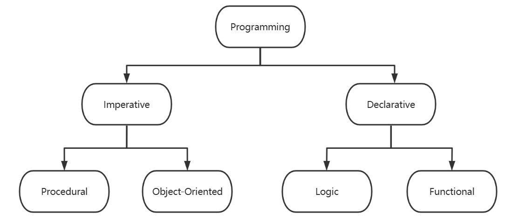

**命令式API**

也称为指令式API，用户需要一步步地告诉机器该如何做(How) ，机器自身不具有任何“智能”，只被动接受指令。高度依赖用户自身理解和达成目标的能力和处理各类异常问题的经验，实现的是“命令式编程Imperative Programming。

**声明式API**

也称为申明式API，用户只需要告诉机器想要的结果(What)，机器自身需要确定如何达成该目标。机器需要一定的“智能”，但通常只能支持事先预设和可被其理解的特定任务。实现的是“声明式编程 Declarative Programming。相较于命令式编程，声明式编程是一个更高的层次上的编程。

声明式API允许用户以给出最终期望目标的方式编写代码，但具体的执行过程（即机器智能的那部分代码），最终仍然需要以命令式编程实现，只不过，它们可由不同的人群完成。类比来说，声明式编程的用户类似于企业的高管，只用关心和交待最终目标;而命令式编程的用户类似于企业部门经理，他需要理解目标的达成路径，并组织人力完成目标。

声明式 API vs. 命令式 API对比

维度声明式 API命令式 API

关注点结果（目标状态）过程（操作步骤）

用户输入状态描述（如 JSON/YAML 配置）操作指令（如函数调用、API 端点）。灵活性低（系统决定实现方式）高（用户完全控制步骤）。复杂度系统处理底层逻辑，用户代码简单用户需处理细节，代码复杂。典型场景配置管理、UI 渲染、基础设施编排算法实现、实时控制、精细操作。

#### 1.1.4.2 Kubernetes API 设计原则

对于云计算系统，系统API实际上处于系统设计的统领地位，K8s集群系统每支持一项新功能，引入一项新技术，一定会新引入对应的API对象，支持对该功能的管理操作，K8s系统API的设计有以下几条原则：

1. 所有API应该是声明式的。正如前文所说，声明式的操作，相对于命令式操作，对于重复操作的效果是稳定的，这对于容易出现数据丢失或重复的分布式环境来说是很重要的。另外，声明式操作更容易被用户使用，可以使系统向用户隐藏实现的细节，隐藏实现的细节的同时，也就保留了系统未来持续优化的可能性。此外，声明式的API，同时隐含了所有的API对象都是名词性质的，例如Service、Volume这些API都是名词，这些名词描述了用户所期望得到的一个目标分布式对象。

2. API对象是彼此互补而且可组合的。这里面实际是鼓励API对象尽量实现面向对象设计时的要求，即“高内聚，松耦合”，对业务相关的概念有一个合适的分解，提高分解出来的对象的可重用性。事实上，K8s这种分布式系统管理平台，也是一种业务系统，只不过它的业务就是调度和管理容器服务。

3. 高层API以操作意图为基础设计。如何能够设计好API，跟如何能用面向对象的方法设计好应用系统有相通的地方，高层设计一定是从业务出发，而不是过早的从技术实现出发。因此，针对K8s的高层API设计，一定是以K8s的业务为基础出发，也就是以系统调度管理容器的操作意图为基础设计。

4. 低层API根据高层API的控制需要设计。设计实现低层API的目的，是为了被高层API使用，考虑减少冗余、提高重用性的目的，低层API的设计也要以需求为基础，要尽量抵抗受技术实现影响的诱惑。

5. 尽量避免简单封装，不要有在外部API无法显式知道的内部隐藏的机制。简单的封装，实际没有提供新的功能，反而增加了对所封装API的依赖性。内部隐藏的机制也是非常不利于系统维护的设计方式，例如PetSet和ReplicaSet，本来就是两种Pod集合，那么K8s就用不同API对象来定义它们，而不会说只用同一个ReplicaSet，内部通过特殊的算法再来区分这个ReplicaSet是有状态的还是无状态。

6. API操作复杂度与对象数量成正比。这一条主要是从系统性能角度考虑，要保证整个系统随着系统规模的扩大，性能不会迅速变慢到无法使用，那么最低的限定就是API的操作复杂度不能超过O(N)，N是对象的数量，否则系统就不具备水平伸缩性了。

7. API对象状态不能依赖于网络连接状态。由于众所周知，在分布式环境下，网络连接断开是经常发生的事情，因此要保证API对象状态能应对网络的不稳定，API对象的状态就不能依赖于网络连接状

态。

8. 尽量避免让操作机制依赖于全局状态，因为在分布式系统中要保证全局状态的同步是非常困难的。

## 1.2 资源清单格式

Kubernetes API 只接受及响应 JSON 格式的数据对象。同时，为了使用方便，它允许用户提供 YAML 格式的POST 对象，由 API server 事先自行将其转换为JSON 格式后提交。API server 接受和返回的所有 JSON对象都遵循同一个模式，它们都具有 kind 和 apiVersion 字段，表示了对象所属的资源类型和 API 群组及版本。

大部分的对象或类别类型的资源还需要有三个嵌套的字段：metadata、spec 和 status 字段。metadata为资源提供元数据，如名称、隶属的名称空间和标签等；spec 字段则用于定义用户期望的状态，不同的资源类型，其状态的意义也各有不同，如 Pod 资源最为核心的功能在于运行容器；status 字段则记录着活动对象的当前状态信息，它由 Kubernetes 系统自行维护，对用户来说为只读字段。

在Kubernetes集群中，资源对象产生流程。根据业务应用架构的分析，确定我们要使用的资源对象(Kubernetes中的)使用描述性语言，编写资源对象的定义文件基于资源对象定义文件进行对象初始化，形成资源对象。

**资源定义文件**：用来初始化kubernetes资源对象的定义文件的格式根据其编写语言的种类，一般分为两种：YAML和json，工作中我们常用的就是YAML.

### 1.2.1 YAML格式说明

**YAML样式格式特点**：大小写敏感使用缩进表示层级关系缩进时不允许使用Tab键，只允许使用空格。缩进的空格数目不重要，只要相同层级的元素左侧对齐即可以#开始的内容表示注释，从这个字符一直到行尾，都会被解析器忽略。

数据格式

YAML是一种对象描述性语言，它有两种基本样式：Maps和Lists。

基本样式一：YAML Maps
```yaml
#就是一个键值对，键和值中间使用"冒号+空格"隔开。
#格式1:
key: value

#示例：
app: mysql

#这种基本样式，还有一种变种形式，就是值的本身就是一个键值对，两层之间使用两个空格表示层级关系
#格式2：
key:

key：value

#示例：
metadata:
name: mysql
```

基本样式二：YAML Lists


其实这也是一种键值对，只不过它的值是一个列表形式。特点：1、键和冒号为一行，值为下一行 2、键和值有层级关系，使用两个空格表示层级关系 3、列表多元素之间是同级关系，使用 - 表示格式：key:- value1- value2- value3

```text
#示例：
args:
- sleep
- "1000"
- message
```

Kubernetes的资源定义文件就是在这两个基本样式的基础上组合起来的。基本上无论你想要什么样的文件结构，你都可以通过Maps和Lists去组合实现。

如果不确定yaml文件的语法是否正确，可以到http://www.yamllint.com/或其它网站上检测一下。

### 1.2.2 资源配置清单介绍

资源配置清单的格式采用 Yaml 格式

第一级字段名一般包括: apiVersion、kind、metadata、spec、status 五个字段。

字段名采有小驼峰命名法,而值一般采用大驼峰命令法。

每一个字段的值一般为如下类型

string integer boolean Object: 对象[]Object: 对象数组

K8s 系统上的绝大多数资源都是由其使用者所创建的。创建时先要使用 yaml 或者 json格式定义资源相关的配置数据，即用户期望的目标状态，而后在有 K8s 的底层组件确保活动对象的运行时状态与用户提供的配置清单中定义的状态无限接近。

在配置资源清单时一般使用 yaml 格式

几乎所有的资源，apiVersion、kind 和 metadata 字段的功能基本相同。但是 spec字段则可能有很大的不同。spec 用于规定资源的期望状态，而资源的嵌套属性是有很大差别的。status字段则记录活动对象的当前状态，其要与 spec 中定义的状态相同，或者处于正转换为与其相同的过程中。用户可以使用kubectl get TYPE/NAME -o yaml/json 命令来获取任何一个对象的yaml 或者 json 格式的配置清单。

如获取名称空间类型 kube-system 的配置清单：
```yaml
[root@master1 ~]#kubectl get namespace kube-system -o yaml
apiVersion: v1
kind: Namespace
metadata:
creationTimestamp: "2020-02-22T07:56:11Z"
labels:
kubernetes.io/metadata.name: kube-system
name: kube-system
resourceVersion: "7"
uid: a176ab46-ab7b-4737-ab52-2e53ca1d1d46
spec:
finalizers:
- kubernetes
status:
phase: Active

[root@master1 ~]#kubectl get namespace kube-system -o json
{
"apiVersion": "v1",
"kind": "Namespace",
"metadata": {
"creationTimestamp": "2020-02-22T07:56:11Z",
"labels": {
"kubernetes.io/metadata.name": "kube-system"
},
"name": "kube-system",
"resourceVersion": "7",
"uid": "a176ab46-ab7b-4737-ab52-2e53ca1d1d46"
},
"spec": {
"finalizers": [
"kubernetes"
]
},
"status": {
"phase": "Active"
}
}
```

### 1.2.3 apiVersion和kind

**apiVersion和kind 描述类型的元数据**

apiVersion：API版本,用于对同一资源对象的不同版本进行并行管理，主要有 alpha、betal、stable。

格式：组名/版本

查看命令：kubectl api-versions，可以看到当前共有27+个分组和版本。

kind：资源类型,kubernetes的专用资源对象。

查看命令： kubectl api-resources  [--api-group=]，可以看到当前共有50+种资源对象和对应的APIVERSION 版本信息

范例: 查看API版本
```bash
[root@master1 ~]#kubectl api-versions
admissionregistration.k8s.io/v1
apiextensions.k8s.io/v1
apiregistration.k8s.io/v1
apps/v1
authentication.k8s.io/v1
authorization.k8s.io/v1
autoscaling/v1
autoscaling/v2
batch/v1
certificates.k8s.io/v1
coordination.k8s.io/v1
discovery.k8s.io/v1
events.k8s.io/v1
flowcontrol.apiserver.k8s.io/v1beta2
flowcontrol.apiserver.k8s.io/v1beta3
networking.k8s.io/v1
node.k8s.io/v1
policy/v1
rbac.authorization.k8s.io/v1
scheduling.k8s.io/v1
storage.k8s.io/v1
storage.k8s.io/v1beta1
v1
```

范例: 查看资源类型
```bash
[root@master1 ~]#kubectl api-resources
NAME                              SHORTNAMES   APIVERSION
NAMESPACED   KIND
bindings                                       v1
true         Binding
componentstatuses                 cs           v1
false        ComponentStatus
configmaps                        cm           v1
true         ConfigMap
endpoints                         ep           v1
true         Endpoints
events                            ev           v1
true         Event
limitranges                       limits       v1
true         LimitRange
namespaces                        ns           v1
false        Namespace
nodes                             no           v1
false        Node
persistentvolumeclaims            pvc          v1
true         PersistentVolumeClaim
persistentvolumes                 pv           v1
false        PersistentVolume
pods                              po           v1
true         Pod

podtemplates                                   v1
true         PodTemplate
replicationcontrollers            rc           v1
true         ReplicationController
resourcequotas                    quota        v1
true         ResourceQuota
secrets                                        v1
true         Secret
serviceaccounts                   sa           v1
true         ServiceAccount
services                          svc          v1
true         Service
mutatingwebhookconfigurations                  admissionregistration.k8s.io/v1
false        MutatingWebhookConfiguration
validatingwebhookconfigurations                admissionregistration.k8s.io/v1
false        ValidatingWebhookConfiguration
customresourcedefinitions         crd,crds     apiextensions.k8s.io/v1
false        CustomResourceDefinition
apiservices                                    apiregistration.k8s.io/v1
false        APIService
controllerrevisions                            apps/v1
true         ControllerRevision
daemonsets                        ds           apps/v1
true         DaemonSet
deployments                       deploy       apps/v1
true         Deployment
replicasets                       rs           apps/v1
true         ReplicaSet
statefulsets                      sts          apps/v1
true         StatefulSet
tokenreviews                                   authentication.k8s.io/v1
false        TokenReview
localsubjectaccessreviews                      authorization.k8s.io/v1
true         LocalSubjectAccessReview
selfsubjectaccessreviews                       authorization.k8s.io/v1
false        SelfSubjectAccessReview
selfsubjectrulesreviews                        authorization.k8s.io/v1
false        SelfSubjectRulesReview
subjectaccessreviews                           authorization.k8s.io/v1
false        SubjectAccessReview
horizontalpodautoscalers          hpa          autoscaling/v2
true         HorizontalPodAutoscaler
cronjobs                          cj           batch/v1
true         CronJob
jobs                                           batch/v1
true         Job
certificatesigningrequests        csr          certificates.k8s.io/v1
false        CertificateSigningRequest
leases                                         coordination.k8s.io/v1
true         Lease
endpointslices                                 discovery.k8s.io/v1
true         EndpointSlice
events                            ev           events.k8s.io/v1
true         Event
flowschemas
flowcontrol.apiserver.k8s.io/v1beta3   false        FlowSchema
prioritylevelconfigurations
flowcontrol.apiserver.k8s.io/v1beta3   false        PriorityLevelConfiguration

ingressclasses                                 networking.k8s.io/v1
false        IngressClass
ingresses                         ing          networking.k8s.io/v1
true         Ingress
networkpolicies                   netpol       networking.k8s.io/v1
true         NetworkPolicy
runtimeclasses                                 node.k8s.io/v1
false        RuntimeClass
poddisruptionbudgets              pdb          policy/v1
true         PodDisruptionBudget
clusterrolebindings                            rbac.authorization.k8s.io/v1
false        ClusterRoleBinding
clusterroles                                   rbac.authorization.k8s.io/v1
false        ClusterRole
rolebindings                                   rbac.authorization.k8s.io/v1
true         RoleBinding
roles                                          rbac.authorization.k8s.io/v1
true         Role
priorityclasses                   pc           scheduling.k8s.io/v1
false        PriorityClass
csidrivers                                     storage.k8s.io/v1
false        CSIDriver
csinodes                                       storage.k8s.io/v1
false        CSINode
csistoragecapacities                           storage.k8s.io/v1
true         CSIStorageCapacity
storageclasses                    sc           storage.k8s.io/v1
false        StorageClass
volumeattachments                              storage.k8s.io/v1
false        VolumeAttachment

#查看指定API Group的资源
[root@ubuntu2204 ~]#kubectl api-resources --api-group apps
NAME                  SHORTNAMES   APIVERSION   NAMESPACED   KIND
controllerrevisions                apps/v1      true         ControllerRevision
daemonsets            ds           apps/v1      true         DaemonSet
deployments           deploy       apps/v1      true         Deployment
replicasets           rs           apps/v1      true         ReplicaSet
statefulsets          sts          apps/v1      true         StatefulSet

[root@master1 ~]#kubectl api-resources --api-group=storage.k8s.io
NAME                   SHORTNAMES   APIVERSION          NAMESPACED   KIND
csidrivers                          storage.k8s.io/v1   false        CSIDriver
csinodes                            storage.k8s.io/v1   false        CSINode
csistoragecapacities                storage.k8s.io/v1   true
CSIStorageCapacity
storageclasses         sc           storage.k8s.io/v1   false
StorageClass
volumeattachments                   storage.k8s.io/v1   false
VolumeAttachment
```

### 1.2.4 metadata 嵌套字段

metadata 字段用于描述对象的元数据,即属性信息，其内嵌多个用于定义资源的元数据，如 name 和labels 等。这些字段可以分为必选字段和可选字段。

必选字段：

name: 设定当前对象的名称，名称空间间级的资源在其所属的名称空间的同一类型中必须唯一namespace: 指定当前对象隶属的名称空间，默认值为 default，实现资源隔离uid: 当前对象的唯一标识符，用于区别"已删除"和"重新创建"的同一个名称的对象,系统可以自动生成。

可选字段通常是指有 Kubernetes 系统自行维护和设置，或者存在默认，或允许使用空值的字段。

有以下可选字段：

labels: 设定用于标识当前对象的标签，键值数据，格式：key1: value1 ,常用作标签选择器的挑选条件annotation: 非标识型键值数据，格式：key1: value1,用来作为挑选条件，用于 labels 的补充，不支持标签选择器的选择resourceVersion:当前对象的内部版本标识，用来让客户端确定对象的变动与否generation: 标识当前对象目标状态的代别creationTimestamp: 当前对象创建日期的时间戳deletionTimestamp: 当前对象删除日期的时间戳。

### 1.2.5 spec 和 status 字段

定义资源配置清单时，spec 是必须的字段。用于描述对象的目标状态，也就是用户期望对象所表现出来的特征。

spec 字段

**Specification 规格字段**

此字段对于不同的对象类型来说各不相同，具体字段含义及所接受的数据类型需要参照 Kubernets API 手册中的说明进行获取。可通过命令  kubectl explain KIND.spec 获取具体帮助。

**status 字段**

此字段记录对象的当前实际运行的状态，由 Kubernetes 系统负责更新，用户不能手动定义。

Master 节点的 controller manager 通过相应的控制器组件动态管理并确保对象的实际转态匹配用户所期望的状态。比如:Deployment 是一种描述集群中运行应用的资源对象，因此，创建Deployment 类型对象时，需要为目标 Deployment 对象设定 spec，指定期望需要运行的 Pod 副本数量、使用的标签选择器以及 Pod 模板等。在创建时，Kubernetes 相关组件读取待创建的Deployment 对象的 spec以及系统上相应的活动对象的当前状态，必要时对活动的对象更新以确保 status 字段吻合 spec 字段中期望的状态。

注意：数据类的资源对象无spec, Status 字段，比如：configmaps，secrets ， endpoints 等。

注意：字段名一般为小驼峰命名法，字段值为大驼峰命名法。
```bash
[root@master1 ~]#kubectl explain pod.spec.containers.imagePullPolicy
KIND:     Pod
VERSION:  v1

FIELD:    imagePullPolicy <string>
```


DESCRIPTION: Image pull policy. One of Always, Never, IfNotPresent. Defaults to Always if :latest tag is specified, or IfNotPresent otherwise. Cannot be updated. More info:

<https://kubernetes.io/docs/concepts/containers/images#updating-images>


### 1.2.6 资源配置清单格式文档帮助

**官方帮助**


- <https://kubernetes.io/docs/reference/generated/kubernetes-api/v1.22/>


通过 kubectl explain 查看帮助生成新的清单文件

定义资源配置清单时，apiVersion、kind 和 metadata 都大同小异，但是 spec 字段对不同的资源来说却是差别迥异。因此，用户在编写资源清单时要参考 Kubernetes API 的参考文档来了解各种可用属性字段。在 K8s 系统中内建了清单各个属性字段含义及所接受的数据类型等相关文档，用户可以使用kubectl explain 命令来随时获取使用帮助。

可以使用kubectl api-resources 查看哪些资源可以使用 explain 来获取文档帮助。

格式
```text
kubectl explain TYPE_NAME [--api-verion=GROUP_NAME/VERSION]
```

范例：
```bash
[root@master1 ~]# kubectl api-resources | awk '{print $1}'
NAME
bindings
componentstatuses
configmaps
endpoints
events
limitranges
namespaces
nodes
persistentvolumeclaims
persistentvolumes
pods
podtemplates
replicationcontrollers
resourcequotas
secrets
serviceaccounts
services
mutatingwebhookconfigurations
validatingwebhookconfigurations
customresourcedefinitions

apiservices
controllerrevisions
daemonsets
deployments
replicasets
statefulsets
tokenreviews
localsubjectaccessreviews
selfsubjectaccessreviews
selfsubjectrulesreviews
subjectaccessreviews
horizontalpodautoscalers
cronjobs
jobs
certificatesigningrequests
leases
endpointslices
events
flowschemas
prioritylevelconfigurations
ingressclasses
ingresses
networkpolicies
runtimeclasses
poddisruptionbudgets
podsecuritypolicies
clusterrolebindings
clusterroles
rolebindings
roles
priorityclasses
csidrivers
csinodes
csistoragecapacities
storageclasses
volumeattachments
```

kubectl explain 可以根据给出的对象类型或者相应的嵌套字段来显示该字段所接受的下一级字段相关文档。
```bash
#查看 Pod 资源的一级字段文档帮助,下面两种方式功能相同
[root@master1 ~]#kubectl explain pods
[root@master1 ~]#kubectl explain pods.
KIND:     Pod
VERSION:  v1

DESCRIPTION:
Pod is a collection of containers that can run on a host. This resource is
created by clients and scheduled onto hosts.

FIELDS:  # pods可以接受的二级字段
apiVersion   <string>
...
kind <string>
...
metadata     <Object>
...

spec <Object>
...
status       <Object>
...
```

需要了解某一级字段表示的对象之下级对象字段，则只需要使用一个英文的句点指定其下级字段的对象名称即可。
```bash
#查看pods的指定的字段的说明
[root@master1 ~]#kubectl explain pod.apiVersion
KIND:     Pod
VERSION:  v1

FIELD:    apiVersion <string>
```


DESCRIPTION: APIVersion defines the versioned schema of this representation of an object. Servers should convert recognized schemas to the latest internal value, and may reject unrecognized values. More info:

<https://git.k8s.io/community/contributors/devel/sig-architecture/api->

conventions.md#resources

```bash
# pods.spec字段下可接受下面的字段
[root@master1 ~]#kubectl explain pods.spec | grep -E "^ {,3}[a-z]"
activeDeadlineSeconds    <integer>
affinity <Object>
automountServiceAccountToken <boolean>
containers   <[]Object> -required-
dnsConfig    <Object>
dnsPolicy    <string>
enableServiceLinks   <boolean>
ephemeralContainers  <[]Object>
.....

#依次查看编写资源清单所需的字段及其所需的数据类型
[root@master1 ~]# kubectl explain pods.spec.containers.ports.containerPort
KIND:     Pod
VERSION:  v1

FIELD:    containerPort <integer>

DESCRIPTION:
Number of port to expose on the pod's IP address. This must be a valid port
number, 0 < x < 65536.
```

范例：查看不同版本的资源
```bash
[root@ubuntu2204 ~]#kubectl api-versions
admissionregistration.k8s.io/v1
apiextensions.k8s.io/v1
apiregistration.k8s.io/v1
apps/v1
authentication.k8s.io/v1
authorization.k8s.io/v1
autoscaling/v1

autoscaling/v2
batch/v1
certificates.k8s.io/v1
coordination.k8s.io/v1
discovery.k8s.io/v1
events.k8s.io/v1
flowcontrol.apiserver.k8s.io/v1
flowcontrol.apiserver.k8s.io/v1beta3
networking.k8s.io/v1
node.k8s.io/v1
policy/v1
rbac.authorization.k8s.io/v1
scheduling.k8s.io/v1
storage.k8s.io/v1
v1

[root@ubuntu2204 ~]#kubectl api-resources  |grep hpa
horizontalpodautoscalers          hpa          autoscaling/v2
true         HorizontalPodAutoscaler

[root@ubuntu2204 ~]#kubectl explain hpa --api-version=autoscaling/v1
GROUP:      autoscaling
KIND:       HorizontalPodAutoscaler
VERSION:    v1

DESCRIPTION:
configuration of a horizontal pod autoscaler.
```


FIELDS: apiVersion    <string>APIVersion defines the versioned schema of this representation of an object. Servers should convert recognized schemas to the latest internal value, and may reject unrecognized values. More info:

<https://git.k8s.io/community/contributors/devel/sig-architecture/api->

conventions.md#resources


kind  <string>Kind is a string value representing the REST resource this object represents. Servers may infer this from the endpoint the client submits requests to. Cannot be updated. In CamelCase. More info:

<https://git.k8s.io/community/contributors/devel/sig-architecture/api->

conventions.md#types-kinds

```bash
metadata  <ObjectMeta>
Standard object metadata. More info:
https://git.k8s.io/community/contributors/devel/sig-architecture/api-
conventions.md#metadata

spec  <HorizontalPodAutoscalerSpec>
spec defines the behaviour of autoscaler. More info:
https://git.k8s.io/community/contributors/devel/sig-architecture/api-
conventions.md#spec-and-status.

status    <HorizontalPodAutoscalerStatus>
status is the current information about the autoscaler.

[root@ubuntu2204 ~]#kubectl explain hpa --api-version=autoscaling/v2

GROUP:      autoscaling
KIND:       HorizontalPodAutoscaler
VERSION:    v2
```


DESCRIPTION: HorizontalPodAutoscaler is the configuration for a horizontal pod autoscaler, which automatically manages the replica count of any resource implementing the scale subresource based on the metrics specified.


FIELDS: apiVersion    <string>APIVersion defines the versioned schema of this representation of an object. Servers should convert recognized schemas to the latest internal value, and may reject unrecognized values. More info:

<https://git.k8s.io/community/contributors/devel/sig-architecture/api->

conventions.md#resources


kind  <string>Kind is a string value representing the REST resource this object represents. Servers may infer this from the endpoint the client submits requests to. Cannot be updated. In CamelCase. More info:

<https://git.k8s.io/community/contributors/devel/sig-architecture/api->

conventions.md#types-kinds

```text
metadata  <ObjectMeta>
metadata is the standard object metadata. More info:
https://git.k8s.io/community/contributors/devel/sig-architecture/api-
conventions.md#metadata
```


spec  <HorizontalPodAutoscalerSpec>spec is the specification for the behaviour of the autoscaler. More info:

<https://git.k8s.io/community/contributors/devel/sig-architecture/api->

conventions.md#spec-and-status.

```text
status    <HorizontalPodAutoscalerStatus>
status is the current information about the autoscaler.
```

## 1.3 创建资源清单文件

### 1.3.1 利用dry-run模拟运行指令式命令生成清单文件
```yaml
[root@master1 ~]#kubectl create namespace namespace-test --dry-run=client -o
yaml
apiVersion: v1
kind: Namespace
metadata:
creationTimestamp: null
name: namespace-test
spec: {}
status: {}

#生成文件
[root@master1 ~]#kubectl create namespace namespace-test --dry-run=client -o yaml
> namespace-test.yaml
[root@master1 ~]#vim namespace-test.yaml
```

### 1.3.2 利用现有资源生成清单文件再修改为新的清单文件

每次kubectl explain查看帮助过于繁琐,可以根据当前系统已有的活动资源来导出资源清单模板，基于此模版再做修改可以更快速的使用资源。

格式
```bash
kubectl get TYPE NAME -o yaml  > /path/export-resourcelist.yaml
kubectl get TYPE/NAME -o yaml  > /path/export-resourcelist.yaml
```

范例: 导出指定资源的模版文件
```bash
[root@master1 ~]#kubectl get pods pod-test1 -o yaml   > pod-test1.yaml
```

### 1.3.3 将 Docker Compose 文件转换为 Kubernetes 资源
```text
https://kubernetes.io/zh-cn/docs/tasks/configure-pod-container/translate-compose-
kubernetes/
```

Kompose 是一个转换工具，可将 compose （即 Docker Compose）所组装的所有内容转换成容器编排器（Kubernetes 或 OpenShift）可识别的形式。

Kompose 官网 http://kompose.io。

### 1.3.4 通过 Visual Studio Code 自动生成 YAML文件

#### 1.3.4.1 安装 Visual Studio Code


- <https://code.visualstudio.com/download>
- <https://visualstudio.microsoft.com/zh-hans/>


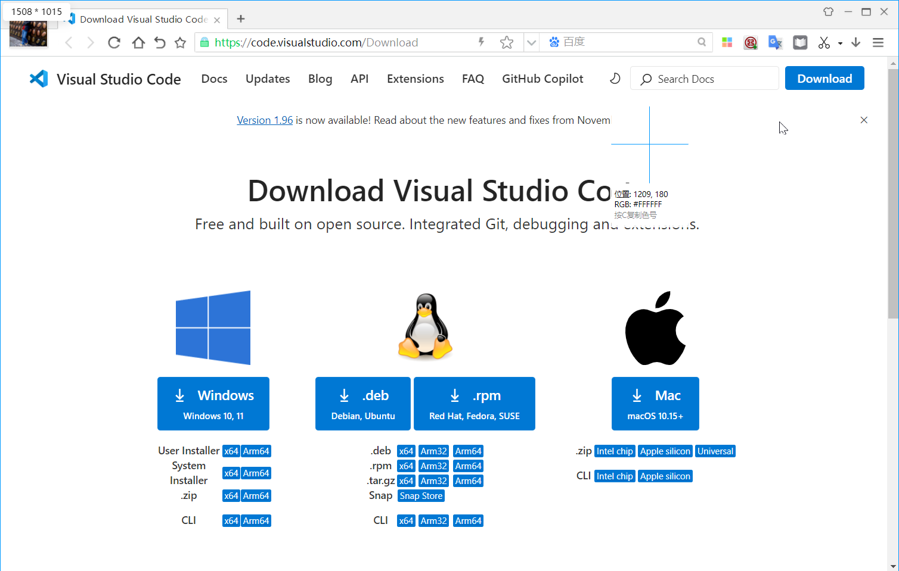

#### 1.3.4.2 安装扩展  YAML (redhat)
```text
YAML
#版本: v1.15.0
```

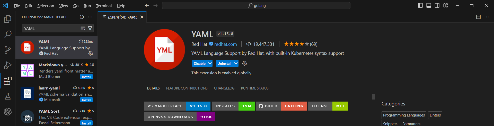

#### 1.3.4.3 安装扩展 Kubernetes Templates
```text
Kubernetes Templates
#版本: v1.3.1
```

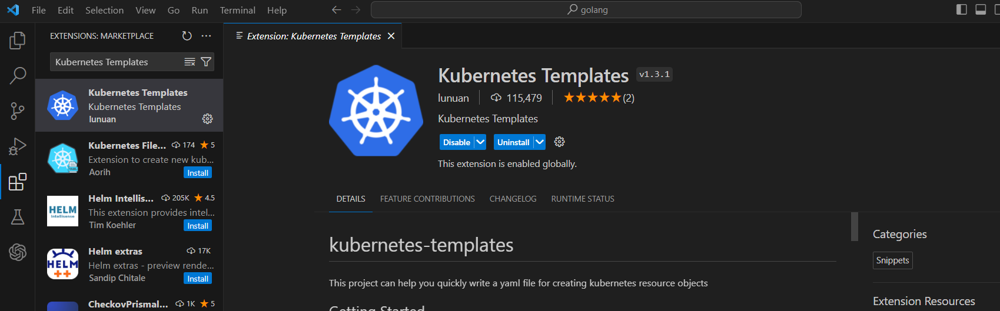

#### 1.3.4.4 创建 YAML后缀的文件

创建文件后,在内容器输入相创建的资源类型,选中后自动生成YAML模板。

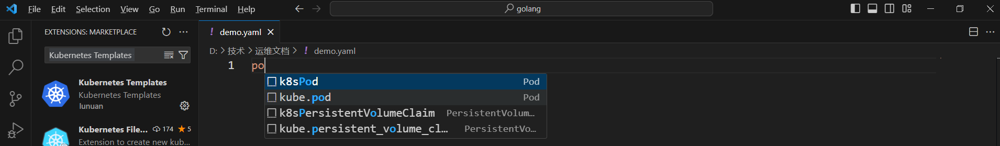

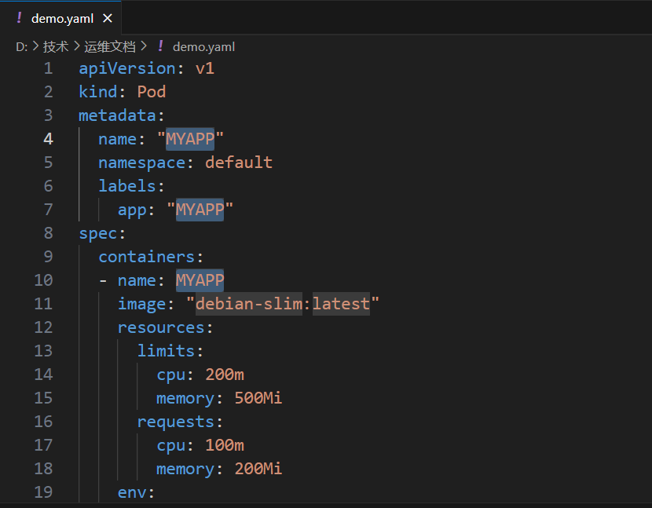

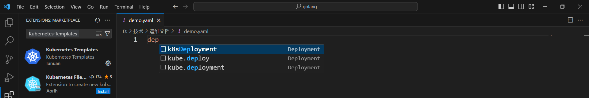

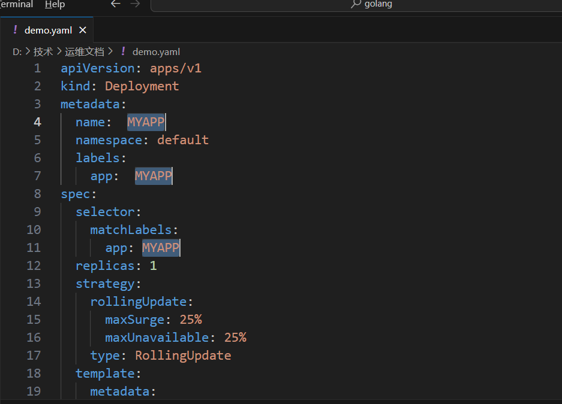

## 1.4 资源对象的管理方式

Kubernetes 的 API server 遵循声明式编程范式(declarative programming)而设计，侧重于构建程序逻辑而无需用户描述实现其的步骤和流程，用户只需要设定期望的状态，系统就会自行确定需要执行的操作以确保达到用户期望的状态。例如，期望 Deployment 控制器管理三个 Pod资源对象时，而系统观察到的当前数量却是两个，于是系统就会自行创建一个新的 Pod 来满足此预期。Kubernetes 的自愈、自治等功能都依赖于其声明式机制。

另外，Kubernetes 的 API server 也支持指令式范式(imperative programming)，直接通过命令及其选项完成对象的管理操作，如kubectl run/expose/delete/get 等命令都属于此类命令。例如，使用kubectl run 创建一个有着 3 个 pod 副本的 Deployment 对象，或者通过kubectl delete 命令删除一个名为 nginx-service 的 Service 对象。

Kubernetes 系统通过控制器监控着系统对象，由其负责让系统当前的状态无限接近用户所期望的状态。

kubectl 命令可分为三类命令：

指令式命令(imperative command):

指令式命令包括kubectl run/expose/delete/get等命令。

适合完成一次性的操作任务

指令式对象配置(imperative object configuration):

指令式对象配置管理包括kubectl create/delete/get/replace/edit等。基于资源配置文件执行对象管理操作，但只能独立引用每个配置清单文件。指令式管理配置与指令式命令的区别是，其需要用户提供资源清单文件，通过资源清单来读取需要管理的目标资源对象。指令式对象配置管理的管理操作直接作用于活动对象，会导致用户丢失活动对象的当前状态。此方式没有幂等性,重复执行可能会出错,生产不推荐使用。

声明式对象配置(declarative object configration):

基于资源配置文件执行对象管理操作

可直接引用目录下的所有配置清单文件，也可直接作用于单个配置文件。

声明式对象配置并不直接指明要进行的对象管理操作，而是提供配置清单文件给 Kubernetes 系统，并委托系统跟踪活动对象的状态变动。资源对象的创建、删除及修改操作全部通过命令kubectl apply/patch等来完成，并且每次操作时，提供给命令的配置信息都将保存于对象的注释信息(kubectl.kubernetes.io/last-applied-configuration)中，并且通过对比检查活动对象的当前状态、注解中的配置信息和资源清单中的配置三方的变更来实现仅修改变动字段的高级补丁机制。
```bash
kubectl apply -f /path/file -f ..... #加载指定文件
kubectl apply -f /path  #加载指定目录下的所有以.yaml,.yml,.json后缀的文件
kubectl apply -f URL    #加载URL的文件
```

此方式有幂等性,生产推荐使用此方式。

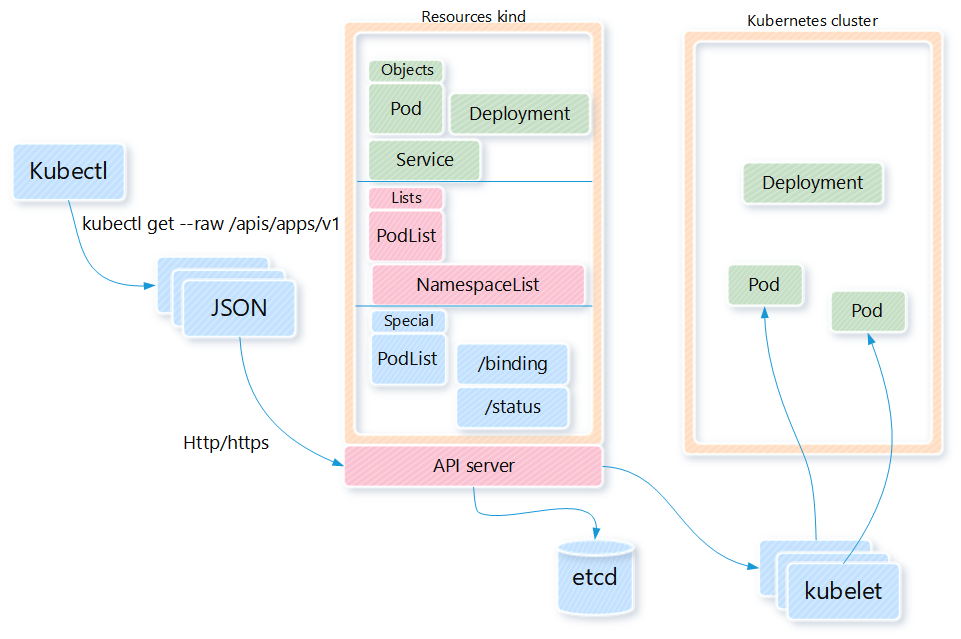

# 2 名称空间

## 2.1 名称空间说明


- <https://kubernetes.io/docs/tasks/administer-cluster/namespaces/>


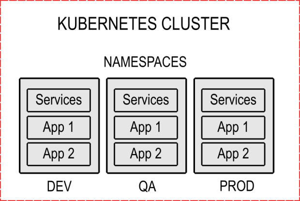

Kubernetes 的资源工作的有效范围分成两种级别:

**集群级别**：针对整个Kubernetes集群内都有效名称空间级别: 只针对指定名称空间内有效,而不属于任务名称空间。

名称空间 Namespace 用于将集群分隔为多个隔离的逻辑分区以配置给不同的用户、租户、环境或者项目使用。名称空间限定了资源对象工作在指定的名称范围内的作用域。例如，可以为 development、Quality Assurance和 production 应用环境分别创建各自的名称空间。

注意: 名称空间本身是 Kubernetes 集群级别的资源。

Kubernetes 的大多数资源都属于名称空间级别,除此还有全局性的集群级别的资源。也因此这些集群级别的资源对象的名称必须在集群中全局唯一。

比如: Node、Namespace、clusterrole 和 PersistentVolume 等资源不属于任何名称空间。

需要使用名称空间的场景

环境管理:

需要在同一Kubernetes集群上隔离研发、预发和生产等一类的环境时，可以通过名称空间进行。

隔离:

多个项目团队的不同产品线需要部署于同一Kubernetes集群时，可以使用名称空间进行隔离。

**资源控制**：名称空间可用作资源配额的承载单位，从而限制其内部所有应用可以使用的CPU/Memory/PV各自的资源总和。

需要在产品线或团队等隔离目标上分配各自总体可用的系统资源时，可通过名称空间实现。

权限控制:

基于RBAC鉴权体系，能够在名称空间级别进行权限配置。

**提高集群性能**：进行资源搜索时，名称空间有利于Kubernetes API缩小查找范围，从而对减少搜索延迟和提升性能有一定的帮助。

Kubernetes的名称空间可以划分为两种类型

系统级名称空间:

由Kubernetes集群默认创建，主要用来隔离系统级的资源对象。所有的系统级名称空间均不能进行删除操作（即使删除也会自动重建）。除default外，其它三个系统级名称空间不应该用作业务应用的部署目标。

自定义名称空间

由用户按需创建

比如: 根据项目和场景, 分别创建对应不同的名称空间。

系统级名称空间

default：为任何名称空间级别的资源提供的默认的名称空间。

kuhe-system：Kubernetes集群自身组件及其它系统级组件使用的名称空间，Kubernetes自身的关键组件均部署在该名称空间中。

kube-public：公众开放的名称空间，所有用户（包括Anonymous）都可以读取内部的资源,通常为空。

kube-node-lease：节点租约资源所用的名称空间。

分布式系统通常使用“租约(Leqse)”机制来锁定共享资源并协调集群成员之间的活动。Kubernetes上的租约概念由API群组coordination.k8s.io群组下的Lease资源所承载，以支撑系统级别的功能需求，例如节点心跳( node heartbeats)和组件级的领导选举等。Kubernetes集群的每个管理组件在该名称空间下都有一个与同名的Iease资源对象。

~# kubectl -n kube-node-lease get lease

**kubernetes 和Docker的名称空间的区别**

kubernetes的名称空间, 用户根据需要可以自行创建删除,属于用户级别Docker的名称空间是内核内置,用户不能创建删除,属于内核级别。

## 2.2 查看名称空间及其资源对象

使用命令kubectl get namespaces 可以查看当前系统的 Namespace 类型资源。

查看特定的名称空间详细信息kubectl describe namespace <namespace>

查看某资源时要指明其所属的名称空间，使用-n 或--namespace 选项指定名称空间,如果不指定默认查看default名称空间中资源。

范例:
```yaml
[root@master1 ~]#kubectl get namespaces
NAME                   STATUS   AGE
default                Active   6d18h
kube-node-lease        Active   6d18h
kube-public            Active   6d18h
kube-system            Active   6d18h
kubernetes-dashboard   Active   5d1h

[root@master1 ~]#kubectl get ns -o name
namespace/default
namespace/kube-node-lease
namespace/kube-public
namespace/kube-system

[root@master1 ~]#kubectl get ns default  -o yaml
apiVersion: v1
kind: Namespace
metadata:
creationTimestamp: "2024-04-11T02:15:56Z"
labels:
kubernetes.io/metadata.name: default
name: default
resourceVersion: "37"
uid: f93ff442-9482-4938-a4fb-2853e51ff4a0
spec:
finalizers:
- kubernetes
status:
phase: Active

[root@master1 ~]#kubectl get ns default  -o json
{
"apiVersion": "v1",
"kind": "Namespace",
"metadata": {
"creationTimestamp": "2024-04-11T02:15:56Z",

"labels": {
"kubernetes.io/metadata.name": "default"
},
"name": "default",
"resourceVersion": "37",
"uid": "f93ff442-9482-4938-a4fb-2853e51ff4a0"
},
"spec": {
"finalizers": [
"kubernetes"
]
},
"status": {
"phase": "Active"
}
}

#查看指定信息
[root@master1 ~]#kubectl get ns default  -o jsonpath={.metadata.name}
default

[root@master1 ~]#kubectl get ns default  -o jsonpath={.apiVersion}
v1

#查看当前名称空间的资源
[root@ubuntu2204 ~]#kubectl get all
NAME                         READY   STATUS    RESTARTS        AGE
pod/myapp-6f9c7b4668-6vjv6   1/1     Running   1 (5h10m ago)   7h34m
pod/myapp-6f9c7b4668-725r9   1/1     Running   1 (5h10m ago)   7h34m
pod/myapp-6f9c7b4668-tcczj   1/1     Running   1 (5h10m ago)   7h34m

NAME                 TYPE        CLUSTER-IP    EXTERNAL-IP   PORT(S)        AGE
service/kubernetes   ClusterIP   10.68.0.1     <none>        443/TCP
7h42m
service/myapp        NodePort    10.68.78.97   <none>        80:31890/TCP
5h18m

NAME                    READY   UP-TO-DATE   AVAILABLE   AGE
deployment.apps/myapp   3/3     3            3           7h34m

NAME                               DESIRED   CURRENT   READY   AGE
replicaset.apps/myapp-6f9c7b4668   3         3         3       7h34m

#查看指定名称空间的资源
[root@ubuntu2204 ~]#kubectl get all -n kube-system
NAME                                             READY   STATUS    RESTARTS
AGE
pod/calico-kube-controllers-5994f46b69-dq9pc     1/1     Running   1 (5h11m ago)
7h41m
pod/calico-node-bvmcw                            1/1     Running   1 (5h11m ago)
7h41m
pod/calico-node-f46v4                            1/1     Running   4 (5h11m ago)
7h41m
pod/calico-node-fkdvk                            1/1     Running   2 (5h11m ago)
7h41m
pod/calico-node-g78b5                            1/1     Running   2 (5h13m ago)
7h41m

pod/calico-node-twx6t                            1/1     Running   3 (5h13m ago)
7h41m
pod/calico-node-xbt4b                            1/1     Running   2 (5h12m ago)
7h41m
pod/coredns-6db9bd4cd7-t5b4v                     1/1     Running   1 (5h11m ago)
7h40m
pod/dashboard-metrics-scraper-77b667b99d-dw4d9   1/1     Running   1 (5h11m ago)
7h40m
pod/kubernetes-dashboard-74fb9f77fb-bhz2v        1/1     Running   2 (5h11m ago)
7h40m
pod/metrics-server-dfb478476-lsdqx               1/1     Running   2 (5h11m ago)
7h40m
pod/node-local-dns-5lqq2                         1/1     Running   1 (5h11m ago)
7h40m
pod/node-local-dns-6bjp4                         1/1     Running   1 (5h11m ago)
7h40m
pod/node-local-dns-hts5v                         1/1     Running   1 (5h12m ago)
7h40m
pod/node-local-dns-jxrhh                         1/1     Running   1 (5h13m ago)
7h40m
pod/node-local-dns-nmvwh                         1/1     Running   1 (5h11m ago)
7h40m
pod/node-local-dns-wv8mx                         1/1     Running   1 (5h13m ago)
7h40m

NAME                                TYPE        CLUSTER-IP      EXTERNAL-IP
PORT(S)                  AGE
service/dashboard-metrics-scraper   ClusterIP   10.68.54.201    <none>
8000/TCP                 7h40m
service/kube-dns                    ClusterIP   10.68.0.2       <none>
53/UDP,53/TCP,9153/TCP   7h40m
service/kube-dns-upstream           ClusterIP   10.68.143.215   <none>
53/UDP,53/TCP            7h40m
service/kubernetes-dashboard        NodePort    10.68.50.181    <none>
443:30313/TCP            7h40m
service/metrics-server              ClusterIP   10.68.196.91    <none>
443/TCP                  7h40m
service/node-local-dns              ClusterIP   None            <none>
9253/TCP                 7h40m

NAME                            DESIRED   CURRENT   READY   UP-TO-DATE
AVAILABLE   NODE SELECTOR            AGE
daemonset.apps/calico-node      6         6         6       6            6
kubernetes.io/os=linux   7h41m
daemonset.apps/node-local-dns   6         6         6       6            6
<none>                   7h40m

NAME                                        READY   UP-TO-DATE   AVAILABLE   AGE
deployment.apps/calico-kube-controllers     1/1     1            1
7h41m
deployment.apps/coredns                     1/1     1            1
7h40m
deployment.apps/dashboard-metrics-scraper   1/1     1            1
7h40m
deployment.apps/kubernetes-dashboard        1/1     1            1
7h40m
deployment.apps/metrics-server              1/1     1            1
7h40m

NAME                                                   DESIRED   CURRENT   READY
AGE
replicaset.apps/calico-kube-controllers-5994f46b69     1         1         1
7h41m
replicaset.apps/coredns-6db9bd4cd7                     1         1         1
7h40m
replicaset.apps/dashboard-metrics-scraper-77b667b99d   1         1         1
7h40m
replicaset.apps/kubernetes-dashboard-74fb9f77fb        1         1         1
7h40m
replicaset.apps/metrics-server-dfb478476               1         1         1
7h40m
```

范例:
```bash
[root@master1 ~]#kubectl get lease  -n kube-node-lease
NAME               HOLDER             AGE
master1.bowen.org   master1.bowen.org   69d
master2.bowen.org   master2.bowen.org   69d
master3.bowen.org   master3.bowen.org   69d
node1.bowen.org     node1.bowen.org     69d
node2.bowen.org     node2.bowen.org     69d
node3.bowen.org     node3.bowen.org     69d

#查看所有名称空间
[root@master1 ~]#kubectl get lease  -A
NAMESPACE         NAME                                        HOLDER
AGE
ingress-nginx     ingress-nginx-leader                        ingress-nginx-
controller-56f8b4f667-kvrff                                        41d
kube-node-lease   master1.bowen.org                            master1.bowen.org
69d
kube-node-lease   node1.bowen.org                              node1.bowen.org
69d
kube-node-lease   node2.bowen.org                              node2.bowen.org
69d
kube-node-lease   node3.bowen.org                              node3.bowen.org
69d
kube-system       kube-apiserver-wcrnq4ikkdbtpjm6szoyymu3lm   kube-apiserver-
wcrnq4ikkdbtpjm6szoyymu3lm_1bead4d0-d911-44ae-ac5d-7d3180325ae9   14d
kube-system       kube-controller-manager
master1.bowen.org_9d4ec997-cc1d-415f-a60e-ea8c7a16f86b
69d
kube-system       kube-scheduler
master1.bowen.org_be63fc1b-ce8c-462f-b9f9-a59f5eeccaa7
69d
```

范例:
```bash
[root@master1 ~]#kubectl describe namespace default
Name:         default
Labels:       kubernetes.io/metadata.name=default
Annotations:  <none>
Status:       Active

No resource quota.

No LimitRange resource.
```

范例:
```bash
#只查看指定kube-system名称空间的pod
[root@master1 ~]#kubectl get pod -n kube-system

#查看所有名称空间的pod
[root@master1 ~]#kubectl get pod -A
[root@master1 ~]#kubectl get pod --all-namespaces
```

## 2.3 创建 Namespace 资源

### 2.3.1 指令式命令创建

使用指令式命令kubectl create 可以直接创建名称空间，只需指定名称空间名称。
```bash
[root@master1 ~]#kubectl create namespace namespace-test1
namespace/namespace-test1 created

[root@master1 ~]#kubectl get namespace namespace-test1
NAME              STATUS   AGE
namespace-test1   Active   4s
```

注意：实际生产中不建议使用指令式命令和配置，直接使用声明式就可以。

### 2.3.2 指令式配置创建

kubectl create  -f </path/to/namespace-obj.yaml 实现创建

此方式生产不建议使用,执行此命令需要指定的namespace不存在。
```yaml
[root@master1 ~]#cat namespace-test2.yaml
apiVersion: v1
kind: Namespace
metadata:
name: namespace-test2

[root@master1 ~]#kubectl create  -f namespace-test2.yaml
namespace/namespace-test1 created
```

### 2.3.1 声明式配置创建

Namespace 是 Kubernetes API 的标准资源类型之一，其配置主要有 kind、apiVolume、metadata 和spec 等一级字段组成。使用kubectl create/apply -f /path/to/namespace-obj.yaml 命令就可以创建名称空间资源。

范例: 方法1
```yaml
[root@master1 ~]#cat namespace-test2.yaml
apiVersion: v1
kind: Namespace
metadata:
name: namespace-test2

[root@master1 ~]#kubectl apply  -f  namespace-test2.yaml
namespace/namespace-test1 created

[root@master1 ~]#kubectl get namespace namespace-test2
NAME              STATUS   AGE
namespace-test2   Active   4m12s
```

范例: 方法2
```yaml
[root@ubuntu2204 ~]#kubectl get ns default -o yaml > default-ns.yaml
[root@ubuntu2204 ~]#vim default-ns.yaml
[root@ubuntu2204 ~]#cat default-ns.yaml
apiVersion: v1
kind: Namespace
metadata:
name: demo

[root@ubuntu2204 ~]#kubectl apply -f default-ns.yaml
namespace/demo created
[root@ubuntu2204 ~]#kubectl get ns demo
NAME   STATUS   AGE
demo   Active   7s
```

范例: 方法3
```yaml
[root@ubuntu2204 ~]#kubectl create ns stage --dry-run=client  -o yaml > stage-
ns.yaml

[root@ubuntu2204 ~]#cat stage-ns.yaml
apiVersion: v1
kind: Namespace
metadata:
creationTimestamp: null
name: stage
spec: {}
status: {}
[root@ubuntu2204 ~]#kubectl apply -f stage-ns.yaml
namespace/stage created

[root@ubuntu2204 ~]#kubectl get ns stage
NAME    STATUS   AGE

stage   Active   6s
```

## 2.4 删除 Namespace 资源

注意: 删除 Namespace 会级联删除此名称空间的所有资源,非常危险。
```bash
#方法1
[root@master1 ~]#kubectl delete namespaces namespace-test1
namespace "namespace-test1" deleted

#方法2
[root@master1 ~]#kubectl  delete -f  namespace-test2.yaml
namespace "namespace-test2" deleted
```

范例：
```bash
#无法删除内置名称空间
[root@master1 ~]#kubectl delete ns default  kube-public kube-system
Error from server (Forbidden): namespaces "default" is forbidden: this namespace
may not be deleted
Error from server (Forbidden): namespaces "kube-public" is forbidden: this
namespace may not be deleted
Error from server (Forbidden): namespaces "kube-system" is forbidden: this
namespace may not be deleted
```

范例: 删除名称空间会级联删除此名称空间下面的所有资源
```bash
[root@master1 ~]#kubectl create ns test

[root@master1 ~]#kubectl create -n test deployment myapp --image registry.cn-
beijing.aliyuncs.com/bowen/pod-test:v0.1 --replicas 3

[root@master1 ~]#kubectl get -n test all
NAME                         READY   STATUS    RESTARTS   AGE
pod/myapp-7dbd45d496-7hk7b   1/1     Running   0          11s
pod/myapp-7dbd45d496-c92hq   1/1     Running   0          11s
pod/myapp-7dbd45d496-vrcm6   1/1     Running   0          11s

NAME                    READY   UP-TO-DATE   AVAILABLE   AGE
deployment.apps/myapp   3/3     3            3           11s

NAME                               DESIRED   CURRENT   READY   AGE
replicaset.apps/myapp-7dbd45d496   3         3         3       11s

#删除名称空间
[root@master1 ~]#kubectl delete  ns test

#所有此名称空间下的资源都被删除
[root@master1 ~]#kubectl get -n test all
No resources found in test namespace.
```

## 2.5 删除指定名称空间的资源

使用 kubectl 管理资源时，如果提供了名称空间选项，就表示此管理操作仅针对指定名称空间进行，而删除 Namespace 资源则会级联删除其包含的所有其他资源对象。

命令格式功能

kubectl delete TYPE RESOURCE -n删除指定名称空间内的指定资源。kubectl delete TYPE --all -n删除指定名称空间内的指定类型的所有资源。kubectl delete all -n删除指定名称空间内的所有资源。kubectl delete all --all删除所有名称空间中的所有资源。

范例:
```bash
[root@master1 ~]#kubectl delete svc,deployment --all -n demo
```



<nav class="article-end" aria-label="章节导航">
  <a href="{{ '/subjects/Kubernetes/06-kubectl-management.html' | relative_url }}">← 上一章：kubectl 集群管理命令</a>
  <a href="{{ '/subjects/Kubernetes/' | relative_url }}">返回 Kubernetes 目录</a>
  <a href="{{ '/subjects/Kubernetes/08-pod-basics-lifecycle.html' | relative_url }}">下一章：Pod 基础与工作机制 →</a>
</nav>
