[← 返回 Kubernetes 目录]({{ '/subjects/Kubernetes/' | relative_url }})



# 08 Pod 基础与工作机制

## 3.1 Pod 是什么

Pod 是 Kubernetes 可调度的最小工作单元，可以包含一个或多个紧密协作的容器。同一 Pod 的容器总在同一节点，通常共享网络命名空间和 IP，因此可通过 `localhost` 互访；容器的文件系统并不自动共享，只有显式挂载同一 Volume 才共享数据。Pod 的生命周期短暂，节点故障后通常由 Deployment、StatefulSet 等控制器创建替代 Pod，而不是把原 Pod“搬迁”到另一节点。

### 3.1.1 自主式 Pod 与控制器管理的 Pod

直接创建单个 Pod 适合学习和临时排错，但删除后没有控制器保证重建。持续运行的无状态应用通常使用 Deployment；有状态应用可用 StatefulSet；节点级守护进程用 DaemonSet；一次性与定期任务分别用 Job、CronJob。

```bash
kubectl run demo-pod --image=nginx:stable --restart=Never
kubectl get pod demo-pod -o wide
kubectl describe pod demo-pod
kubectl delete pod demo-pod
```

上述 `kubectl run` 创建的是单个 Pod，并非 Deployment。清单更适合重复部署与审查：

```yaml
apiVersion: v1
kind: Pod
metadata:
  name: demo-pod
  labels:
    app: demo
spec:
  containers:
    - name: web
      image: nginx:stable
      ports:
        - containerPort: 80
      resources:
        requests:
          cpu: 100m
          memory: 64Mi
        limits:
          memory: 256Mi
```

保存为 `pod.yaml` 后，先运行 `kubectl apply --dry-run=server -f pod.yaml` 检查 API 校验，再执行 `kubectl apply -f pod.yaml`。`containerPort` 是容器端口的描述，不会自动创建 Service 或在宿主机开放端口；要稳定访问应用，应另建 Service。`metadata.name` 在同一命名空间内的同类对象中必须唯一，`spec.containers` 至少含一个容器。

直接修改运行中 Pod 的多数 `spec` 字段会被拒绝或不能达到预期。需要更换镜像、模板或副本时，应修改其所属 Deployment/StatefulSet；不要从 `kubectl get pod -o yaml` 的输出直接复制 `status`、`resourceVersion`、`uid` 等系统字段重新应用。

### 3.1.2 观察 Pod、日志与容器

```bash
kubectl get pods -o wide
kubectl describe pod demo-pod
kubectl logs demo-pod -c web --tail=100
kubectl logs demo-pod -c web -f
kubectl logs demo-pod -c web --previous
kubectl exec -it demo-pod -c web -- /bin/sh
```

`describe` 的 Events 有助于区分调度、拉取镜像与容器启动问题。`--previous` 查看上一次已退出容器的日志，只在运行时保留了前一实例时有效。`exec --` 后面的命令在容器内执行，镜像未包含 `bash` 时可用 `/bin/sh`；无 Shell 的镜像要用临时调试容器。

删除受 Deployment 管理的 Pod 会立即触发新副本创建；要停止应用，应修改 Deployment 副本数或删除控制器。强制删除 Pod 会绕过正常终止等待，可能留下仍在节点上运行的进程或破坏有状态应用，不能当作常规清理方式。

### 3.1.3 启动参数、环境变量与网络

`env` 可以设置普通环境变量，敏感值则从 Secret 引用；Secret 仍需配合 RBAC、加密配置与外部密钥管理保护。`command` 覆盖镜像 ENTRYPOINT，`args` 覆盖镜像 CMD；两者都是字符串列表，不经 Shell 解释，若需要管道或变量展开，应显式调用 Shell。

```yaml
apiVersion: v1
kind: Pod
metadata:
  name: echo-demo
spec:
  containers:
    - name: app
      image: busybox:stable
      command: ["/bin/sh", "-c"]
      args: ["echo \"$MESSAGE\"; sleep 3600"]
      env:
        - name: MESSAGE
          value: "hello"
```

宿主机网络 `hostNetwork: true` 让 Pod 使用节点网络，容易发生端口冲突并削弱隔离；它不是“暴露服务”的默认方法。对一般应用，使用 Service、Ingress 或 Gateway API。`hostPort` 会占用节点端口，也要考虑同一节点的调度冲突。

### 3.1.4 临时容器排错

当业务镜像很精简或故障难复现时，可用 `kubectl debug` 向现有 Pod 添加临时容器。临时容器用于诊断，不能像普通容器那样配置探针或端口，也不会成为长期工作负载。选择可信调试镜像，并根据集群策略控制权限：

```bash
kubectl debug -it demo-pod --image=busybox:stable --target=web -- /bin/sh
```

`--target` 的进程可见性取决于容器运行时支持和 Pod 的进程命名空间配置；看不到目标进程不一定说明业务容器已退出。调试完成后删除临时测试 Pod 或等待原 Pod 被控制器替换，不依赖临时容器做常驻运维。

## 3.2 Pod 的工作机制

### 3.2.1 沙箱容器、静态 Pod 与普通 Pod

kubelet 通过 CRI 创建 Pod sandbox，容器运行时通常用轻量基础容器持有网络等命名空间，再在沙箱中启动业务容器。这解释了同一 Pod 的容器共享 IP 和端口空间。Volume 是否共享由清单中的 `volumes` 和每个容器的 `volumeMounts` 决定，而不是由沙箱自动完成。

普通 Pod 由 API Server 存储，控制器可根据模板创建或替换；**静态 Pod** 则由某个节点的 kubelet 直接监听本地清单目录管理。kubeadm 的 API Server、Controller Manager、Scheduler 和本地 etcd 通常是静态 Pod，其清单位于 `/etc/kubernetes/manifests`。API Server 中可看到镜像 Pod，但不能仅靠 `kubectl delete pod` 永久删除静态 Pod；须修改节点上的清单。

### 3.2.2 创建、调度与启动顺序

1. 客户端把 Pod 或控制器对象提交给 API Server，经认证、授权与准入后存入 etcd。
2. 调度器为尚未绑定节点的 Pod 选择合适节点，并写入绑定结果。受控制器管理的 Pod 先由控制器创建；静态 Pod 不经过这个普通调度流程。
3. 目标节点 kubelet 观察到 Pod，准备 Volume 与网络、拉取镜像、运行 init containers，然后启动普通容器。
4. kubelet 将状态汇报给 API Server。就绪探针通过后，匹配 Service 的 EndpointSlice 才会把 Pod 标记为可接流量。

init containers 按声明顺序逐个完成；普通容器通常并行启动。启动探针可保护慢启动应用，存活探针失败会触发重启，就绪探针失败只影响流量接入；详见下一章。

### 3.2.3 终止、钩子与宽限期

删除 Pod 时，API Server 先标记删除时间，端点逐步退出可服务集合；kubelet 在 `terminationGracePeriodSeconds` 内执行 `preStop` 钩子并向主进程发送 SIGTERM，等待退出，超时后才 SIGKILL。默认宽限期通常为 30 秒，但应按应用关停与连接排空需要设置。

`postStart` 在容器创建后执行，不保证先于镜像入口进程；它不适合承担必须在业务启动前完成的初始化，那应交给 init container。`preStop` 应尽快、幂等地完成收尾，且执行时间计入终止宽限期。节点突然失联或进程被强杀时，钩子不一定运行，业务仍需能承受异常终止。

```yaml
spec:
  terminationGracePeriodSeconds: 60
  containers:
    - name: web
      image: nginx:stable
      lifecycle:
        preStop:
          exec:
            command: ["/bin/sh", "-c", "sleep 5"]
```

这只是展示字段位置的节选，不是独立 Pod 清单；真实应用更应在进程中处理 SIGTERM 与连接排空，不能只靠 `sleep` 保证请求完成。

### 3.2.4 阶段、容器状态和重启策略

Pod 的 `status.phase` 只有 `Pending`、`Running`、`Succeeded`、`Failed`、`Unknown` 等粗粒度阶段；`kubectl get pods` 的 STATUS 列还会显示 `CrashLoopBackOff`、`ImagePullBackOff`、`Terminating` 等面向排错的显示值，它们**不是**额外的 phase。`Running` 也不代表每个容器都就绪，应同时看 READY、条件和 Events。

| Pod 重启策略 | 行为 | 常见用途 |
| --- | --- | --- |
| `Always` | 容器退出后重启 | 长期服务；Deployment 默认 |
| `OnFailure` | 非零退出时重启 | Job 中的失败重试 |
| `Never` | 容器退出后不重启 | 一次性调试任务 |

重启发生在同一个 Pod 的节点上；节点永久故障后，控制器通常创建**新 Pod**，而不是将原 Pod 迁移。Job 的完整重试还受 `backoffLimit` 等控制器配置影响。

镜像拉取策略 `Always` 每次启动都向仓库解析镜像引用，但层数据可复用缓存；`IfNotPresent` 在本地没有镜像时才拉取；`Never` 只使用本地镜像。省略策略时，`:latest` 或未写标签通常默认为 `Always`，其他标签通常为 `IfNotPresent`。生产环境推荐固定不可变摘要或明确版本标签，避免同一标签在不同节点解析到不同内容。

<details class="historical-figures" markdown="1">
<summary>查看原始讲义中的其余配图与历史操作截图（25 张）</summary>

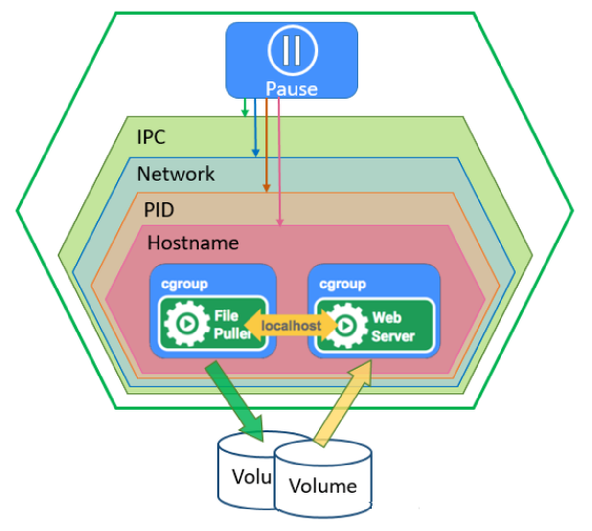

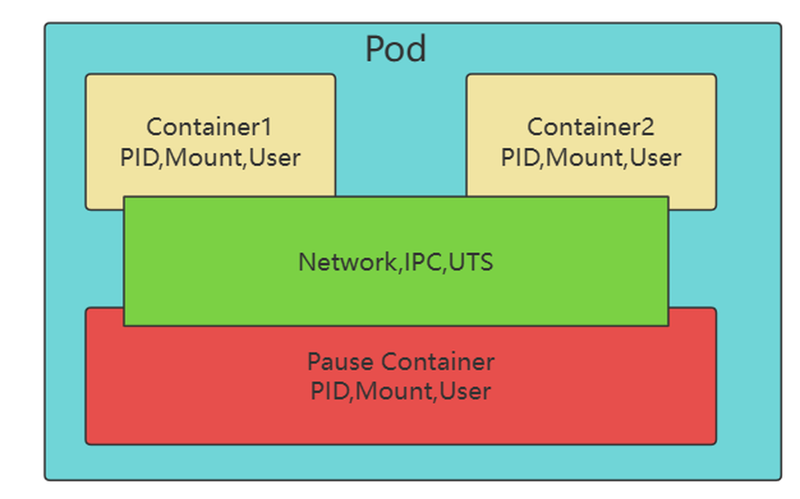

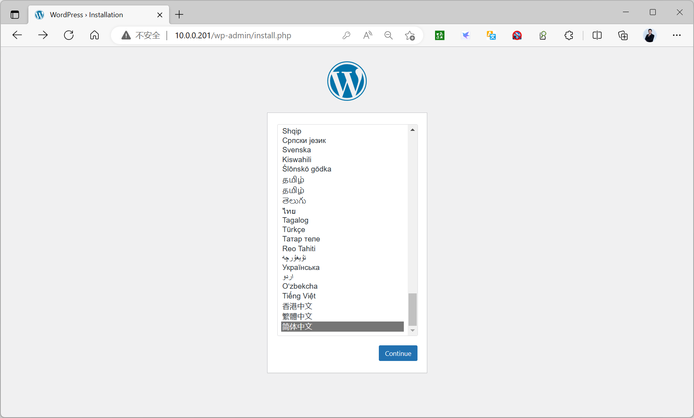

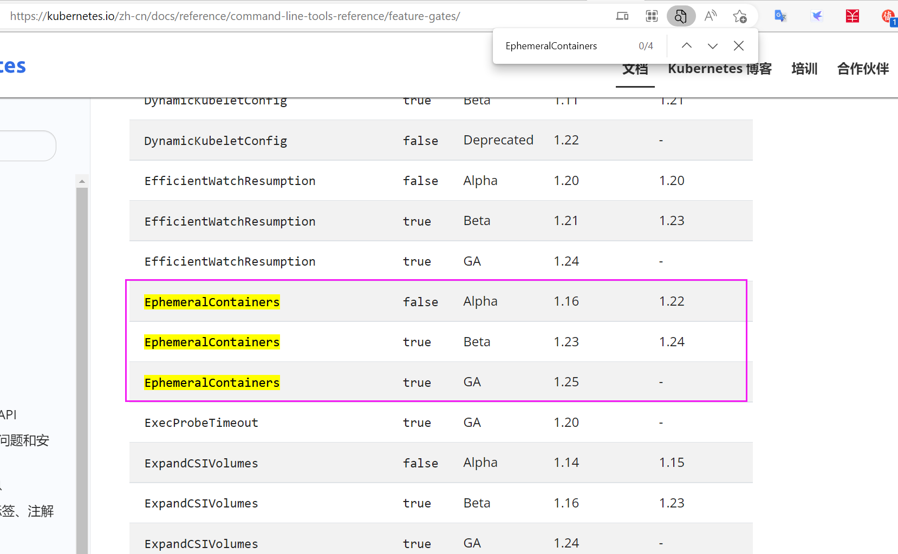

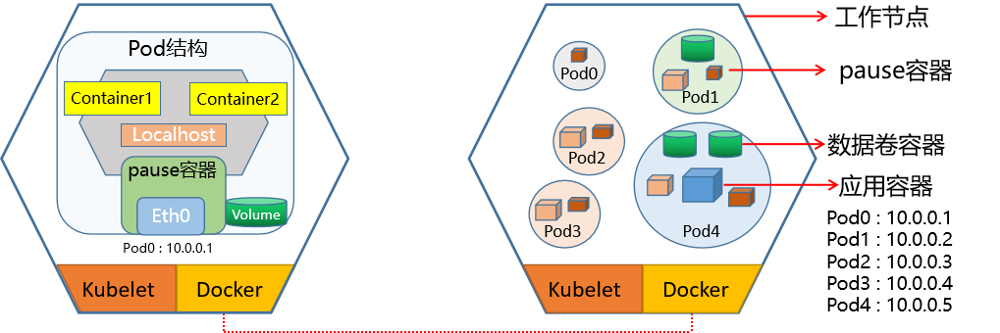

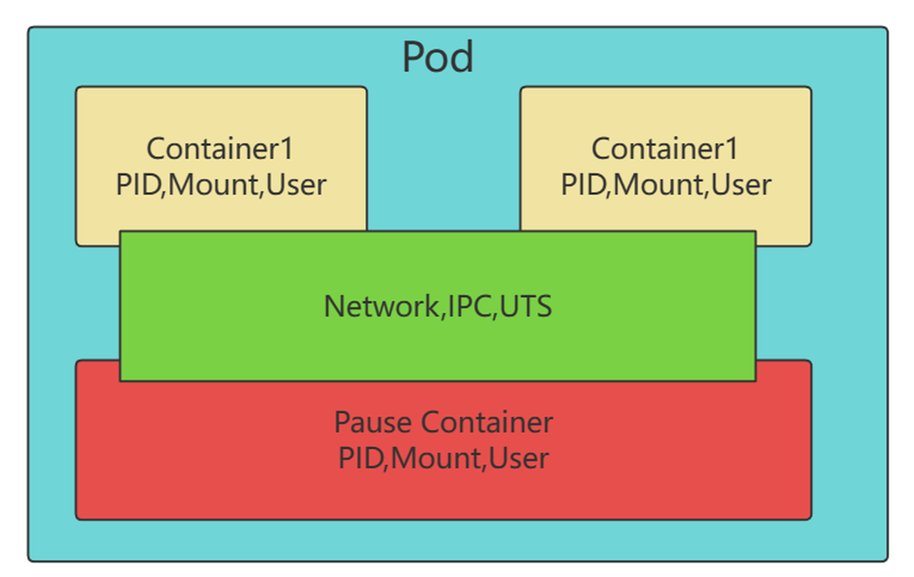

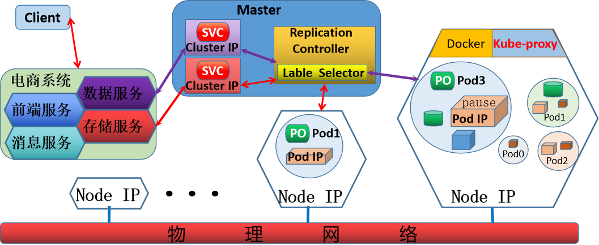

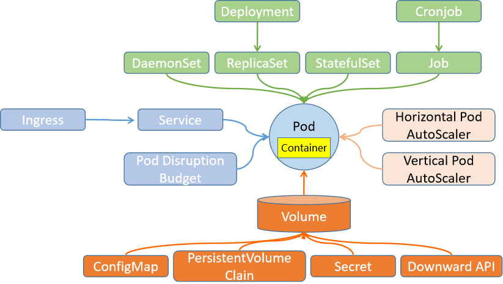

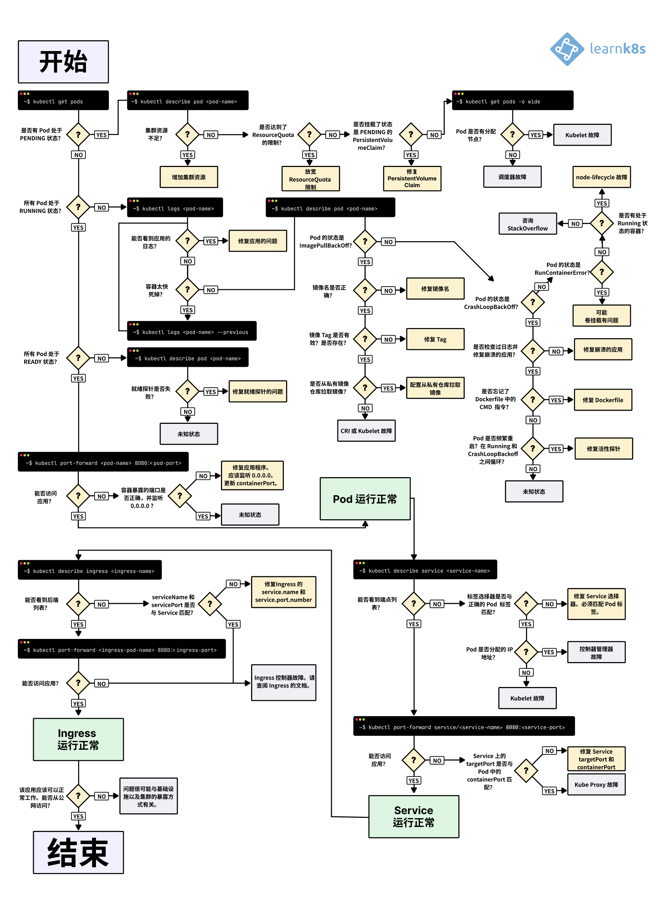

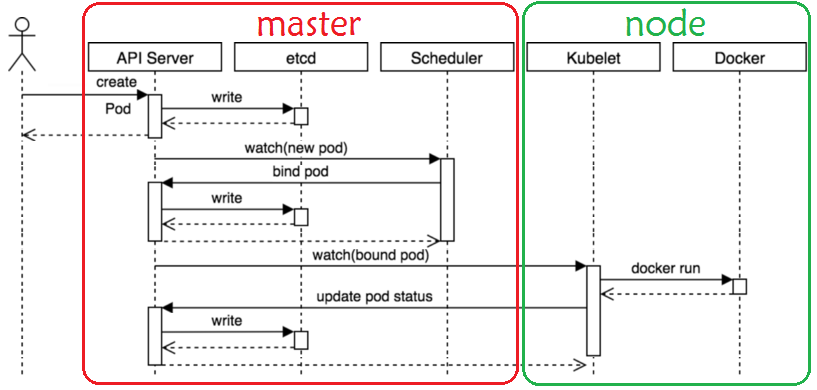

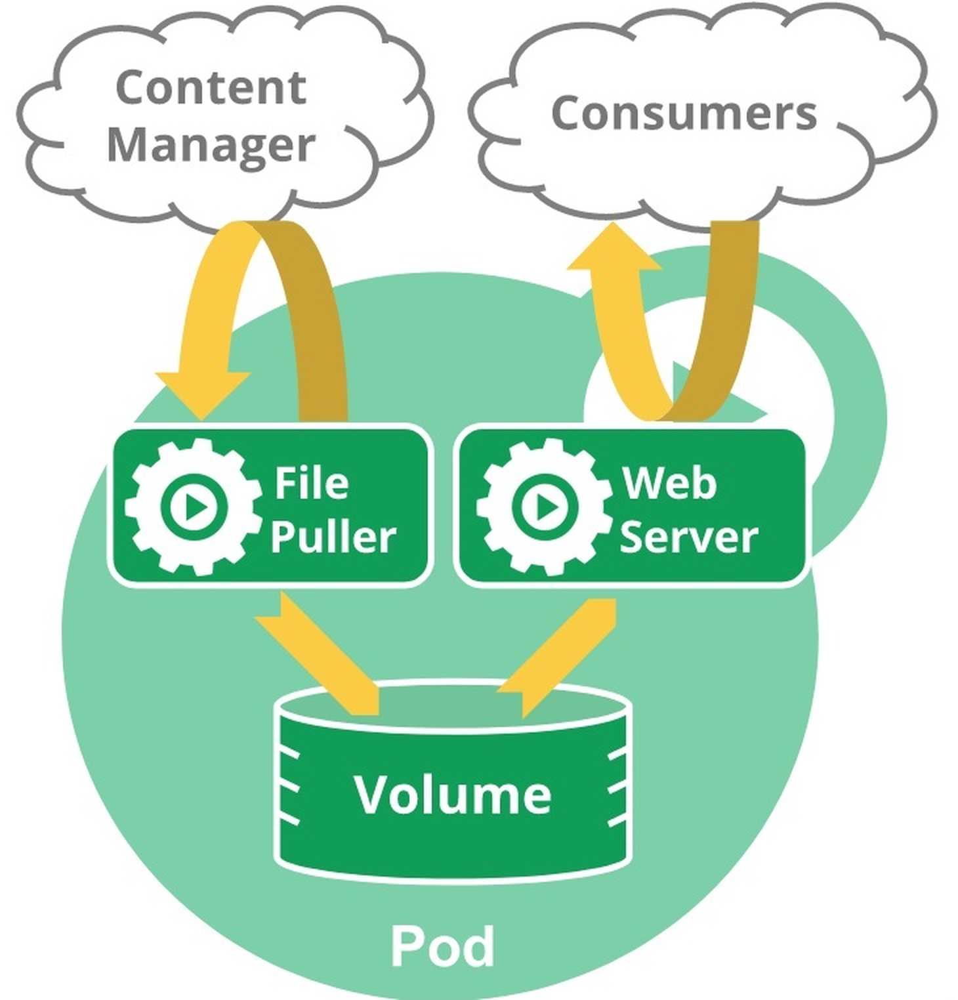


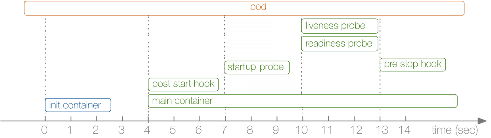

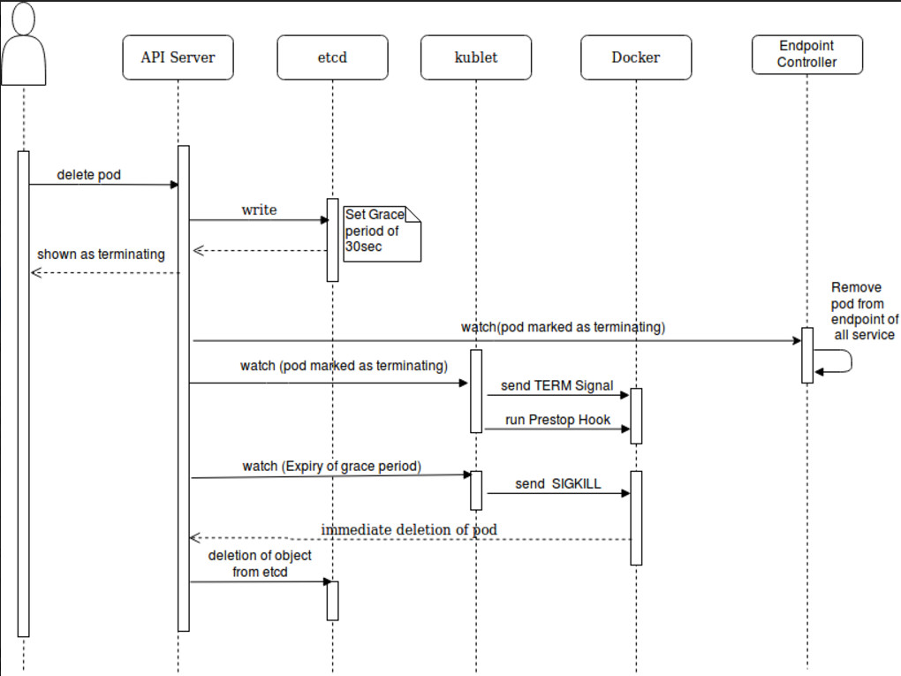

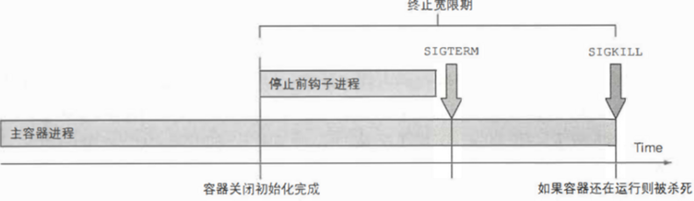

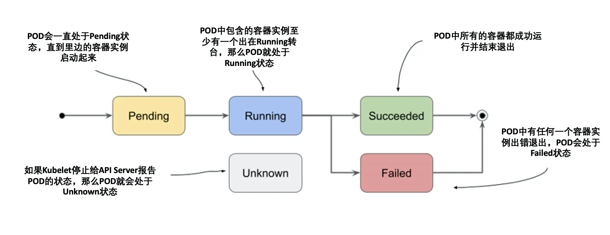

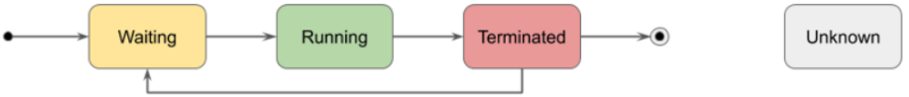

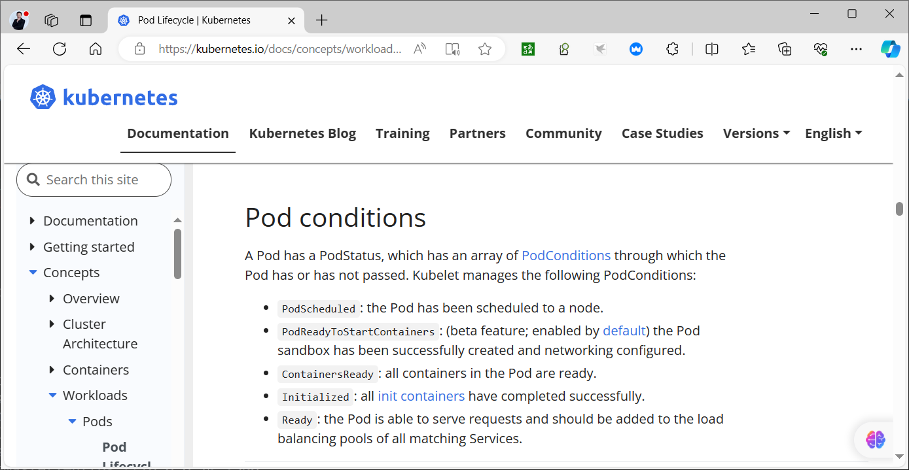

</details>



<nav class="article-end" aria-label="章节导航">
  <a href="{{ '/subjects/Kubernetes/07-api-objects-namespaces.html' | relative_url }}">← 上一章：API 资源对象、清单与命名空间</a>
  <a href="{{ '/subjects/Kubernetes/' | relative_url }}">返回 Kubernetes 目录</a>
  <a href="{{ '/subjects/Kubernetes/09-pod-health-resources.html' | relative_url }}">下一章：Pod 健康、资源、安全与设计模式 →</a>
</nav>
