[← 返回 Kubernetes 目录]({{ '/subjects/Kubernetes/' | relative_url }})



# 08 Pod 基础与工作机制

# 3 Pod 资源


- <https://kubernetes.io/zh-cn/docs/concepts/workloads/pods/>
- <https://kubernetes.io/zh-cn/docs/tasks/configure-pod-container/>


## 3.1  Pod 资源基础

### 3.1.1 什么是 Pod

Pod 是 Kubernetes API 中最常见最核心资源类型。Pod 是一个或多个容器的集合，因而也可称为容器集，但却是Kubernetes调度、部署和运行应用的原子单元。Pod 的容器运行时只要符合CRI标准即可,而非必须为Docker。


- <https://kubernetes.io/docs/setup/production-environment/container-runtimes/>


同一Pod内的所有容器都将运行于由Scheduler选定的同一个worker节点上。在同一个pod内的容器共享的存储资源、网络协议栈及容器的运行控制策略等。每个Pod中的容器依赖于一个特殊名为pause容器事先创建出可被各应用容器共享的基础环境，包括Network、IPC和UTS名称空间共享给Pod中各个容器，PID名称空间也可以共享，但需要用户显式定义,Mount和User是不共享的,每个容器有独立的Mount,User的名称空间。Docker 容器主要有六个名称空间实现容器间的资源隔离: User,Mount,Pid,IPC,Network,UTS。

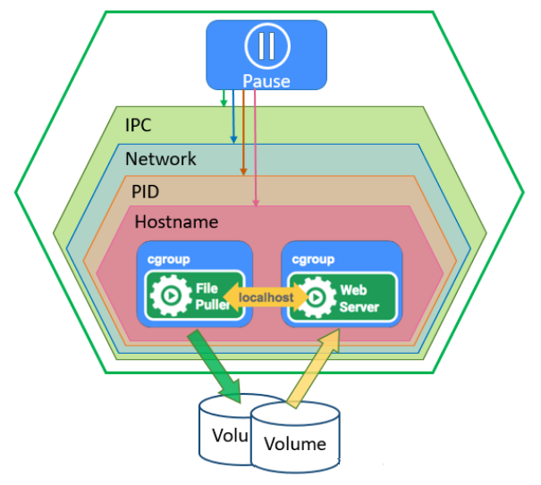

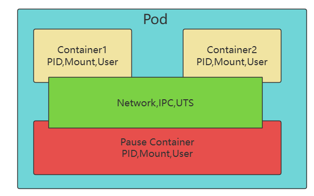

**Pod的组成形式有两种**

单容器Pod：除Pause容器外,仅含有一个容器多容器Pod：除Pause容器外，含有多个具有“超亲密”关系的容器，一般由主容器和辅助容器（比如：sidecar容器）构成。

Pod 资源分类：

**自主式 Pod**

由用户直接定义并提交给API Server创建的Pods。节点故障后不具有自动调度至其它节点的故障自愈能力。

**由Workload Controller 管控的 Pod**

比如: 由Deployment控制器管理的Pod。

节点故障后具有自动调度至其它节点的故障自愈能力。

**静态 Pod**

由kubelet加载配置信息后，自动在对应的节点上创建的Pod。用于实现Master节点上的系统组件API Server 、Controller-Manager 、Scheduler 和Etcd功能的Pod。相关配置存放在控制节点的 /etc/kubernetes/manifests 目录下。

### 3.1.2 自主式 Pod

自主式Pod是由Pod本身去控制本身，不受其它资源如控制器控制的 Pod。这种Pod本身不具有自我修复功能，当自主式Pod被创建后，都会被Kubernetes调度到集群的Node上。不论是否故障,都会在此Node节点上存在,直到Pod的进程终止和被删掉。中间如果Pod即使出了故障, Pod也不会被调度至其它节点实现自愈。

可以支持三种方法创建自主式pod

指令式命令指令式对象配置文件声明式对象配置文件

#### 3.1.2.1 指令式命令创建 Pod

通过kubectl 命令行工具指定选项创建 Pod，适合临时性工作。

**基本语法**
```bash
kubectl run NAME --image=image [--port=port] [--replicas=replicas]
kubectl run NAME --image=image [--env="key=value"] [--port=port] [--dry-
run=server|client] [--overrides=inline-json] [--command] -- [COMMAND] [args...]
[options]

#参数详解
--image=''      #指定容器要运行的镜像
--port=''       #设定容器暴露的端口
--dry-run=true  #以模拟的方式来进行执行命令
--env=[]        #执行的时候，向对象中传入一些变量
--labels=''     #设定pod对象的标签
--limits='cpu=200m,memory=512Mi'    #设定容器启动后的资源配置
--replicas=n        #设定pod的副本数量,新版不再支持
--command=false     #设为true，将 -- 后面的字符串做为命令代替容器默认的启动命令，而非做为默
认启动命令的参数
-it            #打开交互终端
--rm           #即出即删除容器
--restart=Never #不会重启
```

范例:
```bash
#初始化一个Pod对象，包含一个nginx容器
[root@master1 ~]#kubectl run nginx01 --image=registry.cn-
beijing.aliyuncs.com/bowen/nginx:1.20.0
pod/nginx01 created

#查看pod状态
[root@master1 ~]#kubectl get pod nginx01
NAME      READY   STATUS              RESTARTS   AGE
nginx01   0/1     ContainerCreating   0          19s

#创建Busybox的Pod,默认busybox没有前台进程,需要指定前台程序才能持继运行
[root@master1 ~]#kubectl run busybox --image registry.cn-
beijing.aliyuncs.com/bowen/busybox:1.32.0 -- sleep 3600
[root@master1 ~]#kubectl get pod busybox
NAME      READY   STATUS    RESTARTS   AGE
busybox   1/1     Running   0          9m37s
```

范例：在命令行创建pod 引用环境变量，之后可以通过$(VAR_NAME)在容器中获取变量
```bash
#运行pod时定义一个变量
[root@master1 ~]#kubectl run pod-conf --image=registry.cn-
beijing.aliyuncs.com/bowen/nginx:1.20.0 --env="NAME=bowen"

#验证变量
[root@master1 ~]#kubectl exec -it pod-conf -- sh
# echo $NAME
bowen

[root@master1 ~]#kubectl delete pod pod-conf
```

范例: 启动一个Pod，并交互
```bash
[root@master1 ~]#kubectl run pod-$RANDOM --image=registry.cn-
beijing.aliyuncs.com/bowen/admin-box:v0.1 -it --rm --command -- /bin/bash
If you don't see a command prompt, try pressing enter.
root@pod-4372 /#
```

#### 3.1.2.2 Pod 资源清单说明

使用以上的命令行方式不利于重复执行。

一般会将pod的信息定义在 JSON 或者 YAML 格式的资源清单文件中，由资源管理命令kubectl 进行指令式或者声明式管理。创建时用户通过kubectl apply/create 命令将创建请求提交到 API server 并将其保存至集群状态存储系统 etcd 中，而后由调度器将创建请求调度到最佳的目标 node，并被运行于该 node 的 kubelet 借助于容器引擎创建并启动 pod。这种由用户直接通过 API 创建的 Pod 对象也称为自主式 Pod。

##### 3.1.2.2.1 Pod 资源清单必须存在的属性

必须存在的属性，也就是必须包含在创建pod 书写 yaml 文件中，如果没有这些属性的存在它是不允许被执行的。只要指定下面这些属性，就可以实现一个 pod 了。

参数名字段类型说明

这里指的是K8S API 的版本，目前是基于 V1 的，可以

apiVersion string(键

值对)

通过 kubectl api-versions 命令查询

这里指的是 yaml 文件定义的资源类型和角色，比如我。

kind string(键

们创建的是一个 pod ，它就是 Pod 类型，如果创建的

值对)

是一个 deployment 就是deployment 类型

元数据对象，固定值就写 metadata，也就意味着metadata 这个字段对象里面写的是他的一些元数据类。

metadata object(对

型 ，这个对象类型主要有两个字段，第一个。

象类型)

metadata.name、第二个metadata.namespace

元数据对象的名字，指定元数据对象的名称，比如命

metadata.name string(键

值对)

名 pod 的名字

spec object(对

象类型)详细定义的对象，固定值写 spec

这里写的是 spec 对象的容器列表定义，是一个列表，

spec.containers[]list(列表

类型)

第一个主要元素就是 name、第二主要元素是 image。

spec.containers[].name string(键

值对)定义容器的名称,在当前pod中唯一

spec.containers[].image string(键

值对)这里定义的是镜像名称

##### 3.1.2.2.2 主要对象类型

主要对象类型的含义是这里的值是比较重要的，但是在 yaml 文件中不写也可以，会自动补充一些默认值。

参数名字段类型说明

指定命名空间，由自已定义，因为 pod 的级别是一个名称空间级别的对象资源，如果没有定义metadata.namespace ，默认使用的是 default 名称空。

metadata.namespace string(键

值对)

间。如果想把它放到一些特殊的名称空间下，就可以加一个metadata下的namespace 进编写。

镜像的下载策略，Always、Never、ifnotpresent有三个值可选，（1）Always：意思在使用镜像的时候，都会尝试从远程的仓库去进行下载而不是用本地已经存在的镜像（2）Never：就是永远都是用本地的

spec.containers[].imagePullPolicy string(键

镜像，没有该镜像就不用了，

值对)

也不去远程仓库拉取（3）ifnotpresent：如果本地有就使用本地镜像，如果本地没有就从远程仓库去下载。如果这个值没有设置的话默认用Always，建议ifnotpresent。指定我们容器启动的命令，也就是一个 pod 里面会有很多的容器，每一个容器再去封装镜像的时候都会写一个 CMD 容器运行时指令，那如果用该参数。

spec.containers[].command[]list(列表)

对它做了替换以后就相当于是，容器原来的指令不运行了，而运行的是我们这个参数指定的命令。spec.containers[].args[]list(列表)指定容器启动运行的时候一些。

参数

指定容器的工作目录，工作目录的含义就是一旦我们进入到。

spec.containers[].workingDir string(键

这个容器的内部时，他就会处

值对)

于这么一个目录下

spec.containers[].volumeMounts[]list(列

表）指定容器内部的存储卷配置

指定可以被容器挂载的存储卷

spec.containers[].volumeMounts[].name string(键

名称

值对)

指定可以被容器挂载的存储卷

spec.containers[].volumeMounts[].mountPath string(键

路径

值对)

参数名字段类型说明

设置存储卷路径的读写模式，

spec.containers[].volumeMounts[].readOnly string(键

ture 或者 false，默认为读写模。

值对)

式

spec.containers[].ports[]list(列表)指定容器需要用到的端口列表。

spec.containers[].ports[].name string(键

值对)指定端口名称

spec.containers[].ports[].containerPort string(键

值对)指定容器需要监听的端口号

指定容器所在主机需要监听的端口号，默认跟上面的containerPort 相同，注意设置了hostPort 同一个台主机无法。

spec.containers[].ports[].hostPort string(键

值对)

启动该容器的相同副本（因为主机的端口不能相同，这样会冲突）。

指定端口协议，支持 TCP 或者

spec.containers[].ports[].protocol string(键

值对)

UDP，默认值为 TCP

指定容器运行前需要设置的环境变量列表，可以赋予一些新。

spec.containers[].env[]list(列表)

的环境变量

指定给这个环境变量起一个名

spec.containers[].env[].name string(键

称

值对)

spec.containers[].env[].value string(键

值对)指定给这个环境变量起一个值

指定资源限制类型，和资源请求的值（这里开始就是这是容。

spec.containers[].resources object(对

象类型)

器的资源上限）

指定设置容器运行时资源的运

spec.containers[].resources.limits object(对

行上限

象类型)

指定 CPU 的限制，单位为 core（核心）数，将用于 docker。

spec.containers[].resources.limits.cpu string(键

值对)

run --cpu-shares 参数

指定 MEM 内存的限制，单位

spec.containers[].resources.limits.memory string(键

值对)

为 MIB,GIB

指定容器启动和调度时的限制

spec.containers[].resources.requests object(对

设置

象类型)

CPU 请求，单位为 core 核心数，容器启动时初始化可用数。

spec.containers[].resources.requests.cpu string(键

值对)

量

内存请求，单位为 MIB、GIB，

spec.containers[].resources.requests.memory string(键

容器启动的初始化可用数量

值对)

##### 3.1.2.2.3 额外的参数选项

还有一些额外的参数选项

参数名字段类型说明

定义 Pod 的重启策略，默认值always 可选值为Always、OnFailure、Never， 1、Always：Pod 只要退出了，因为在 pod 中运行的是容器，那如果容器退出了，pod 就会出现一个退出状态，但是我们的 kubelet去负责整个容器的生命周期，所以这时候就会将它重启。但是重启多次还是不行就会表示意外退出不在重。

spec.restartPolicy string(键

启。 2、OnFailure：如果你的 pod 里面的容器退出码。

值对)

是非 0 的话就会将该容器重启，因为他没有正常退出。如果是 0 的话表示这个容器是正常退出，就不会再次重启它 。 3、Never：Pod终止后，kubelet将退出码报告给Master，都不会不会重启该Pod。不管你是意外退出还是正常退出，都不会重启。

定义 Node 节点的 Label 过滤标签，以 key:value 格式

spec.nodeselector object(对

象类型)

指定，可以去选择我们的 node 节点去运行。定义 pull 镜像时使用secret名称，以name:secretkey格式指定，代表我们在下载这个镜像的时候，要使用什么。

spec.imagePullSecrets object(对

象类型)

样的密钥

定义是否使用主机网络模式，默认值为 false 不使用主机网络。设置 true 表示使用宿主机网络，不使用docker。

spec.hostNetwork Boolean

网桥,同时设置了true将无法在同一台宿主机上启动第二个副本。

##### 3.1.2.2.4 yaml格式的pod清单文件示例的完整说明
```yaml
# yaml格式的pod定义文件完整内容：
apiVersion: v1          #必选，版本号，例如v1
kind: Pod               #必选，Pod
metadata:               #必选，元数据
name: string      #必选，Pod名称要求符合RFC1035规范:
http://mirrors.nju.edu.cn/rfc/beta/errata/rfc1035.html
namespace: string         #Pod所属的命名空间,生产一般不在此处指定死,而通过kubectl -n
选项指定比较灵活
labels:                   #自定义标签
- name: string          #自定义标签名字
annotations:              #自定义注释列表,可以自由定义,格式比较灵活
- name: string
spec:                       #必选，Pod中容器的详细定义
initContainers:           #可选,初始化容器,在容器启动前执行一些初始化操作
- name: string            #必选，容器名称
image: string               #必选，容器的镜像名称
imagePullPolicy: [Always | Never | IfNotPresent] #获取镜像的策略 Alawys表示下载镜
像 IfnotPresent表示优先使用本地镜像，否则下载镜像，Nerver表示仅使用本地镜像
command: [string]           #可选,容器的启动命令列表，如不指定，使用打包时使用的启动命
令
args: [string]              #可选,容器的启动命令参数列表
containers:               #必选，Pod中容器列表
- name: string                #必选，容器名称

image: string               #必选，容器的镜像名称
imagePullPolicy: [Always | Never | IfNotPresent] #获取镜像的策略 Alawys表示下载镜
像 IfnotPresent表示优先使用本地镜像，否则下载镜像，Nerver表示仅使用本地镜像
command: [string]           #可选,容器的启动命令列表，如不指定，使用打包时使用的启动命
令
args: [string]              #可选,容器的启动命令参数列表
workingDir: string          #可选,容器的工作目录
volumeMounts:               #可选,挂载到容器内部的存储卷配置
- name: string                  #引用pod定义的共享存储卷的名称，需用volumes[]部分定
义的的卷名
mountPath: string             #存储卷在容器内mount的绝对路径，应少于512字符
readOnly: boolean             #是否为只读模式
ports:                      #需要暴露的端口库号列表
- name: string                  #端口号名称
containerPort: int            #容器需要监听的端口号
hostPort: int                 #容器所在主机需要监听的端口号，默认与Container相同
protocol: string              #端口协议，支持TCP和UDP，默认TCP
env:                        #可选,容器运行前需设置的环境变量列表
- name: string                  #环境变量名称
value: string                 #环境变量的值
resources:                  #可选,资源限制和请求的设置
limits:                       #资源限制的设置
cpu: string             #Cpu的限制，单位为core数，将用于docker run --cpu-
shares参数
memory: string          #内存限制，单位可以为Mib/Gib，将用于docker run --
memory参数
requests:                     #资源请求的设置
cpu: string                     #Cpu请求，容器启动的初始可用数量
memory: string                  #内存清楚，容器启动的初始可用数量
StartupProbe:                   #可选,检测容器内进程是否完成启动。注意三种检查方式同
时只能使用一种。
httpGet:                      #对Pod内个容器健康检查方法设置为HttpGet，需要制定
Path、port
path: string
port: number
readinessProbe:                 #可选,健康检测
httpGet:                      #对Pod内个容器健康检查方法设置为HttpGet，需要制定
Path、port
path: string
port: number
livenessProbe:  #对Pod内个容器健康检查的设置，当探测无响应几次后将自动重启该容器，检查方
法有exec、httpGet和tcpSocket，对一个容器只需设置其中一种方法即可
exec:                         #对Pod容器内检查方式设置为exec方式
command: [string]               #exec方式需要制定的命令或脚本
httpGet:                      #对Pod内个容器健康检查方法设置为HttpGet，需要制定
Path、port
path: string
port: number
host: string
scheme: string
HttpHeaders:
- name: string
value: string
tcpSocket:                    #对Pod内个容器健康检查方式设置为tcpSocket方式
port: number
initialDelaySeconds: 0           #容器启动完成后首次探测的时间，单位为秒
timeoutSeconds: 0                #对容器健康检查探测等待响应的超时时间，单位秒，默
认1秒

periodSeconds: 0                 #对容器监控检查的定期探测时间设置，单位秒，默认
10秒一次
successThreshold: 0
failureThreshold: 0
securityContext:
privileged:false
restartPolicy: [Always | Never | OnFailure]#Pod的重启策略，Always表示一旦不管以何
种方式终止运行，kubelet都将重启，OnFailure表示只有Pod以非0退出码退出才重启，Nerver表示不再重
启该Pod
nodeSelector: obeject     #设置NodeSelector表示将该Pod调度到包含这个label的node
上，以key：value的格式指定
nodeName: node节点           #指定Pod 运行的节点,默认随机调度至合适的节点
imagePullSecrets:           #Pull镜像时使用的secret名称，以key：secretkey格式指定
- name: string
hostNetwork:false           #是否使用主机网络模式，默认false，如果设置true，表示使用
宿主机网络
volumes:                        #在该pod上定义共享存储卷列表
- name: string                  #共享存储卷名称 （volumes类型有很多种）
emptyDir: {}                  #类型为emtyDir的存储卷，与Pod同生命周期的一个临时目
录。为空值
hostPath: string                  #类型为hostPath的存储卷，表示挂载Pod所在宿主机
的目录
path: string                        #Pod所在宿主机的目录，将被用于同期中mount
的目录
secret:                       #类型为secret的存储卷，挂载集群与定义的secre对象到
容器内部
scretname: string
items:
- key: string
path: string
configMap:                #类型为configMap的存储卷，挂载预定义的configMap对象到容
器内部
name: string
items:
- key: string
path: string
```

##### 3.1.2.2.5 创建pod资源清单文件

###### 3.1.2.2.5.1 手动创建pod资源清单文件
```yaml
[root@master1 ~]#vim  pod-test1.yaml
[root@master1 ~]#cat  pod-test1.yaml
apiVersion: v1   #指定API版本,此为固定值
kind: Pod        #指定资源类型 pod
metadata:        #元数据类型
name: pod-test1       # 指定pod名称
namespace: default    #指定名称空间,如果不指定为default
spec:            #表述信息
containers:    #容器信息
- name: nginx-web01    #容器名称为APP
image: registry.cn-beijing.aliyuncs.com/bowen/nginx:1.20.0   #运行的是
nginx 镜像,可以同时运行多个容器
```

###### 3.1.2.2.5.2 利用已有pod生成资源清单文件

自己编写资源定义文件有些繁琐，可以利用现有的pod生成yaml清单文件,再修改即可。
```yaml
[root@master1 ~]#kubectl get pod pod-test1 -o yaml --export > pod-test1-
export.yaml
#命令解析
-o yaml    #以yaml的格式显示当前资源的所有属性信息。
--export   #在导出信息的时候，会忽略掉有系统生成的信息,这个功能在1.19版本之后被移除了

#修改生成的文件,只保留需要的内容
[root@master1 ~]#vim pod-test1-export.yaml
[root@master1 ~]#cat pod-test1-export.yaml
apiVersion: v1
kind: Pod
metadata:
name: pod-test2
spec:
containers:
- image: registry.cn-beijing.aliyuncs.com/bowen/nginx:1.20.0
name: nginx-web02
```

#### 3.1.2.3 指令式对象配置管理方式

##### 3.1.2.3.1 创建 Pod 资源
```yaml
[root@master1 ~]#cat pod-test1.yaml
apiVersion: v1   #指定API版本,此为固定值
kind: Pod        #指定资源类型 pod
metadata:        #元数据类型
name: pod-test1       # 指定pod名称
namespace: default    #指定名称空间,如果不指定为default
annotations:          #指定注解信息
bowen.org/author: "bowen"
spec:            #表述信息
containers:    #容器信息
- name: nginx-web01    #容器名称为APP
image: registry.cn-beijing.aliyuncs.com/bowen/nginx:1.20.0 #运行的是
nginx 镜像,可以同时运行多个容器
#command: ["/bin/sh","c","sleep 100"] #可以指定运行的命令,而非镜像内的命令
#command: ["/bin/sh"]                 #也可以用下面格式
#args: ["-c","sleep 100"]
#注意：一个资源清单文件中可以同时写多个Pod对象，彼此间使用"---"隔开就可以

[root@master1 ~]#kubectl create -f /data/kubernetes/yaml/pod-test1.yaml
pod/pod-test1 created
```

##### 3.1.2.3.2 更新 Pod 资源
```bash
#方法1
#导出配置
[root@master1 ~]#kubectl get pods pod-test1 -o yaml pod-test1-update.yaml

# 编辑导出的配置清单
[root@master1 ~]#vim pod-test1-update.yaml
image: registry.cn-beijing.aliyuncs.com/bowen/nginx:1.18.0 #修改版本

#更新
#幂等性
[root@master1 ~]#kubectl apply -f pod-test1-update.yaml
#没有幂等性
[root@master1 ~]#kubectl replace -f pod-test1-update.yaml
pod/pod-test1 replaced

#验证是否修改
[root@master1 ~]#kubectl describe -f pod-test1.yaml

#方法2
#此方法在线直接编辑,生产不建议使用
[root@master1  ~]#kubectl edit pod pod-test1
[root@master1  ~]#kubectl edit pod/pod-test1
spec:
containers:
- image: registry.cn-beijing.aliyuncs.com/bowen/nginx::1.22.0 #修改镜像版
本

#验证立即生效
[root@master1 ~]#kubectl get pod pod-test1 -o wide
NAME        READY   STATUS    RESTARTS        AGE     IP            NODE
NOMINATED NODE   READINESS GATES
pod-test1   1/1     Running   1 (2m34s ago)   3m50s   172.16.3.15
node1.bowen.org   <none>           <none>
[root@master1 ~]#curl -I 172.16.3.15
HTTP/1.1 200 OK
Server: nginx/1.16.0
Date: Tue, 01 Mar 2022 09:28:32 GMT
Content-Type: text/html
Content-Length: 612
Last-Modified: Tue, 23 Apr 2019 10:18:21 GMT
Connection: keep-alive
ETag: "5cbee66d-264"
Accept-Ranges: bytes
```

#### 3.1.2.4 声明式对象管理方式

在指令式对象配置管理方式中，同时指定的资源必须进行同一种操作，而且kubectl replace 命令是通过完全替换现有的活动对象来进行资源的更新，对于生产环境并非理想的做法。而声明式对象配置操作在管理资源对象时将配置信息保存于目标对象的注解中，并通过比较活动对象的当前配置、前一次管理操作时保存于注解中的配置及当前命令提供的配置生成更新补丁，从而完成活动对象的补丁式更新操作。常用的命令有kubectl apply 和kubectl patch 等。

范例: 创建 Pod 资源对象
```bash
[root@master1 ~]#kubectl apply  -f  pod-test1.yaml
pod/pod-test1 created

[root@master1 ~]#kubectl get -f pod-test1.yaml -o wide
NAME        READY   STATUS    RESTARTS   AGE    IP            NODE
NOMINATED NODE   READINESS GATES
pod-test1   1/1     Running   0          5m8s   172.16.3.13   node1.bowen.org
<none>           <none>

[root@master1 ~]#curl 172.16.3.13 -I
HTTP/1.1 200 OK
Server: nginx/1.21.5
Date: Tue, 01 Mar 2022 04:32:32 GMT
Content-Type: text/html
Content-Length: 615
Last-Modified: Tue, 28 Dec 2021 15:28:38 GMT
Connection: keep-alive
ETag: "61cb2d26-267"
Accept-Ranges: bytes
```

范例: 更新应用版本
```yaml
#更新对象的操作，可以直接在原有的资源清单文件上修改后再执行kubectl apply
[root@master1 ~]#vim pod-test1.yaml
[root@master1 ~]#cat pod-test1.yaml
apiVersion: v1
kind: Pod
metadata:
name: pod-test1
labels:
app: test1
version: v1.0
spec:
containers:
- name: nginx-web01
image: registry.cn-beijing.aliyuncs.com/bowen/nginx:1.20.0 #修改此行

#应用更新
[root@master1 ~]#kubectl apply  -f  pod-test1.yaml
pod/pod-test1 configured

#验证
[root@master1 ~]#kubectl get -f pod-test1.yaml -o wide
NAME        READY   STATUS    RESTARTS   AGE     IP            NODE
NOMINATED NODE   READINESS GATES
pod-test1   1/1     Running   0          5m33s   172.16.3.13   node1.bowen.org
<none>           <none>
[root@master1 ~]#curl 172.16.3.13 -I
HTTP/1.1 200 OK
Server: nginx/1.20.0
Date: Tue, 01 Mar 2022 04:33:03 GMT
Content-Type: text/html
Content-Length: 612
Last-Modified: Tue, 20 Apr 2021 13:35:47 GMT
Connection: keep-alive
ETag: "607ed8b3-264"
Accept-Ranges: bytes
```

### 3.1.3 查看 Pod 信息

可以通过以下命令查看Pod 状态
```bash
kubectl get pod <pod_name> [(-o|--output=)json|yaml|jsonpath] [-n namespace]
kubectl describe pod  <pod_name> [-n namespace]
```

范例
```yaml
#查看当前名称空间的所有pod
[root@master1 ~]#kubectl get pod

#查看所有空间的所有pod
[root@master1 ~]#kubectl get pod -A

#查看指定空间的所有pod
[root@master1 ~]#kubectl get pod -n kube-system

#查看指定pod当前状态信息
[root@master1 ~]#kubectl get -f pod-test1.yaml
[root@master1 ~]#kubectl get pod  pod-test1
[root@master1 ~]#kubectl get po  pod-test1 #支持缩写po
NAME        READY   STATUS    RESTARTS   AGE
pod-test1   1/1     Running   0          67s

#持续查看pod状态
[root@master1 ~]#kubectl  get pods pod-test1 -w

#查看扩展信息
[root@master1 ~]#kubectl get pod pod-test1 -o wide
NAME        READY   STATUS    RESTARTS   AGE   IP            NODE
NOMINATED NODE   READINESS GATES
pod-test1   1/1     Running   0          88s   172.16.3.12   node1.bowen.org
<none>           <none>

#通过 -o yaml 的方式来进行查看yaml格式的详细信息
[root@master1 ~]#kubectl get pod pod-test -o yaml
apiVersion: v1
kind: Pod
metadata:
annotations:
kubectl.kubernetes.io/last-applied-configuration: |
......

#查看pod上面的label
[root@master1 ~]#kubectl get pod pod-test1  --show-labels
NAME        READY   STATUS    RESTARTS       AGE   LABELS
pod-test1   1/1     Running   7 (7h4m ago)   14d   app=test1,version=v2.0

#定制化显示
#定制格式的语法：自定义字段名:属性获取命令
#多个自定义字段显示时，可以使用逗号","隔开
[root@master1 ~]#kubectl get pod pod-test1 -o custom-
columns=NAME:metadata.name,STATUS:status.phase
NAME        STATUS
pod-test1   Running

#查看指定pod的详细信息
[root@master1 ~]#kubectl describe pod pod-test1
Name:         pod-test1
Namespace:    default
Priority:     0
Node:         node1.bowen.org/10.0.0.104

......
```

范例: 按Json格式查看Pod 信息
```bash
[root@master1 ~]#kubectl get pod pod-test-5558f75445-9mhrt -o jsonpath=
{.metadata.name}
pod-test-5558f75445-9mhrt

[root@master1 ~]#kubectl get pod pod-test-5558f75445-9mhrt -o jsonpath=
{.spec.containers[0].name}
pod-test

[root@master1 ~]#kubectl get pod mynginx -o yaml  -o jsonpath=
{.spec.containers[0].image}
registry.cn-beijing.aliyuncs.com/bowen/nginx:1.26.0

[root@master1 ~]#kubectl get pod myapp -o jsonpath={.status.podIP}
10.244.4.6
```

### 3.1.4 查看 Pod 中指定容器应用的日志

查看 Pod 日志格式如下：
```text
kubectl logs [-f] (POD | TYPE/NAME) [-c CONTAINER] [options]
```


# 选项-f, --follow=true    #跟踪日志-p , --previous=true #默认只能查看到当前容器此次重启后生成的日志，此选项可以查看前一个已退出的容器的日志--all-containers=true #所有容器--tail=N #最后N个日志


范例：容器无法启动错误查看
```bash
[root@master1 ~]#kubectl  run mysql --image registry.cn-
beijing.aliyuncs.com/bowen/mysql:8.0.29-oracle

[root@master1 ~]#kubectl logs mysql
2024-12-27 03:32:06+00:00 [Note] [Entrypoint]: Entrypoint script for MySQL
Server 8.0.29-1.el8 started.
2024-12-27 03:32:07+00:00 [Note] [Entrypoint]: Switching to dedicated user
'mysql'
2024-12-27 03:32:07+00:00 [Note] [Entrypoint]: Entrypoint script for MySQL
Server 8.0.29-1.el8 started.
2024-12-27 03:32:07+00:00 [ERROR] [Entrypoint]: Database is uninitialized and
password option is not specified
You need to specify one of the following:
- MYSQL_ROOT_PASSWORD
- MYSQL_ALLOW_EMPTY_PASSWORD
- MYSQL_RANDOM_ROOT_PASSWORD

[root@master1 ~]#kubectl logs --tail=3  mysql
- MYSQL_ROOT_PASSWORD
- MYSQL_ALLOW_EMPTY_PASSWORD
- MYSQL_RANDOM_ROOT_PASSWORD

[root@master1 ~]#kubectl  run mysql --env="MYSQL_ALLOW_EMPTY_PASSWORD=yes" --
image registry.cn-beijing.aliyuncs.com/bowen/mysql:8.0.29-oracle
pod/mysql created

[root@master1 ~]#kubectl get pod mysql  -o wide
NAME    READY   STATUS    RESTARTS   AGE     IP           NODE
NOMINATED NODE   READINESS GATES
mysql   1/1     Running   0          2m16s   10.244.4.9   node3.bowen.org
<none>           <none>

#
[root@master1 ~]#apt update && apt -y install mysql-client

[root@master1 ~]#mysql -uroot -h10.244.4.9 -e status
--------------
mysql  Ver 8.0.40-0ubuntu0.22.04.1 for Linux on x86_64 ((Ubuntu))
```


Connection id:      9 Current database: Current user:       root@10.244.0.0 SSL:            Cipher in use is TLS_AES_256_GCM_SHA384 Current pager:      stdout Using outfile:      ''Using delimiter:    ; Server version:     8.0.29 MySQL Community Server - GPL Protocol version:   10 Connection:     10.244.4.9 via TCP/IP Server characterset:    utf8mb4 Db     characterset:    utf8mb4 Client characterset:    utf8mb4 Conn.  characterset:    utf8mb4 TCP port:       3306 Binary data as:     Hexadecimal Uptime:         1 min 47 sec

```text
Threads: 2  Questions: 8  Slow queries: 0  Opens: 118  Flush tables: 3  Open
tables: 37  Queries per second avg: 0.074
--------------
```

范例:
```bash
#查看名为pod-test1的pod中nginx-web01的容器的日志
[root@master1 ~]#kubectl logs  pod-test1 -c nginx-web01
172.16.0.0 - - [03/Mar/2021:02:01:52 +0000] "GET / HTTP/1.1" 200 612 "-"
"curl/7.68.0" "-"

#进入容器内执行操作
[root@master1 ~]#kubectl exec  pod-test  -- ps aux
PID   USER     TIME  COMMAND
1 root      0:03 python3 /usr/local/bin/demo.py
50 root      0:00 ps aux
```

### 3.1.5 进入Pod 执行命令
```text
kubectl exec (POD | TYPE/NAME) [-c CONTAINER] [flags] -- COMMAND [args...]
[options]
```

范例
```bash
[root@ubuntu2204 ~]#kubectl exec -h
Execute a command in a container.

Examples:
# Get output from running the 'date' command from pod mypod, using the first
container by default
kubectl exec mypod -- date

# Get output from running the 'date' command in ruby-container from pod mypod
kubectl exec mypod -c ruby-container -- date

# Switch to raw terminal mode; sends stdin to 'bash' in ruby-container from
pod mypod
# and sends stdout/stderr from 'bash' back to the client
kubectl exec mypod -c ruby-container -i -t -- bash -il

# List contents of /usr from the first container of pod mypod and sort by
modification time
# If the command you want to execute in the pod has any flags in common (e.g.
-i),
# you must use two dashes (--) to separate your command's flags/arguments
# Also note, do not surround your command and its flags/arguments with quotes
# unless that is how you would execute it normally (i.e., do ls -t /usr, not
"ls -t /usr")
kubectl exec mypod -i -t -- ls -t /usr

# Get output from running 'date' command from the first pod of the deployment
mydeployment, using the first container
by default
kubectl exec deploy/mydeployment -- date

# Get output from running 'date' command from the first pod of the service
myservice, using the first container by
default
kubectl exec svc/myservice -- date
```


Options:-c, --container='': Container name. If omitted, use the kubectl.kubernetes.io/default-container annotation for selecting the container to be attached or the first container in the pod will be chosen

```text
-f, --filename=[]:
to use to exec into the resource

--pod-running-timeout=1m0s:
The length of time (like 5s, 2m, or 3h, higher than zero) to wait until at
least one pod is running

-q, --quiet=false:
Only print output from the remote session

-i, --stdin=false:
Pass stdin to the container

-t, --tty=false:
Stdin is a TTY

Usage:
kubectl exec (POD | TYPE/NAME) [-c CONTAINER] [flags] -- COMMAND [args...]
[options]
```

范例：
```bash
[root@master1 ~]#kubectl  run mysql  --env="MYSQL_ALLOW_EMPTY_PASSWORD=yes" --
image registry.cn-beijing.aliyuncs.com/bowen/mysql:8.0.29-oracle
pod/mysql created
[root@master1 ~]#kubectl exec mysql -- date
Mon Mar 24 01:08:13 UTC 2025

[root@master1 ~]#kubectl  run mysql --env="TZ=Asia/Shanghai" --
env="MYSQL_ALLOW_EMPTY_PASSWORD=yes" --image registry.cn-
beijing.aliyuncs.com/bowen/mysql:8.0.29-oracle
pod/mysql created

[root@master1 ~]#kubectl exec mysql -- date
Fri Dec 27 11:47:13 CST 2024

[root@master1 ~]#kubectl exec -it mysql -- sh
sh-4.4# mysql -uroot -e status
--------------
mysql  Ver 8.0.29 for Linux on x86_64 (MySQL Community Server - GPL)
```


Connection id:      8 Current database: Current user:       root@localhost SSL:            Not in use Current pager:      stdout Using outfile:      ''Using delimiter:    ; Server version:     8.0.29 MySQL Community Server - GPL Protocol version:   10 Connection:     Localhost via UNIX socket Server characterset:    utf8mb4 Db     characterset:    utf8mb4 Client characterset:    latin1 Conn.  characterset:    latin1 UNIX socket:        /var/run/mysqld/mysqld.sock Binary data as:     Hexadecimal Uptime:         48 sec

```text
Threads: 2  Questions: 5  Slow queries: 0  Opens: 117  Flush tables: 3  Open
tables: 36  Queries per second avg: 0.104
--------------
```

### 3.1.6 删除 Pod

删除资源对象推荐使用指令式管理命令kubectl delete。

格式:
```text
kubectl delete pod <pod_name>  ... [--force --grace-period=0]
```

范例
```bash
#优雅删除
[root@master1 ~]#kubectl delete pod pod-test1

#立即删除
[root@master1 ~]#kubectl delete pod pod-test1 --force --grace-period=0
warning: Immediate deletion does not wait for confirmation that the running
resource has been terminated. The resource may continue to run on the cluster
indefinitely.
pod "pod-test1" force deleted

#删除多个资源
[root@master1 ~]#kubectl  delete -f  pod-test1.yaml -f pod-test2.yaml

#删除指定目录下的资源
[root@master1 ~]#kubectl delete  -f /data/kubernetes/yaml/

#删除demo名称空间的所有Pod
[root@master1 ~]#kubectl delete pod --all -n demo

#删除所有pod
[root@master1 ~]#kubectl get po|cut -d" " -f1 | tail -n +2 |xargs kubectl delete
pod

#快速删除所有pod
[root@master1 ~]#kubectl get pod|awk 'NR!=1{print $1}'|xargs -i kubectl delete
pod {} --force --grace-period=0

[root@master1 ~]#vim .bashrc
alias rmpod="kubectl get pod|awk 'NR!=1{print \$1}'|xargs -i kubectl delete pod
{} --force --grace-period=0"
[root@master1 ~]#. .bashrc
```

注意:

不要使用 apply 命令结合--prune 选项进行删除，即kubectl apply -f /path/to/yaml-file/ --prune -l labels该命令会删除文件夹下不存在相应定义(不属于基于标签过滤出的符合条件的对象)的资源对象。

### 3.1.7 创建定制的 Pod

kubernets 支持多种定制 Pod 的实现方法

对于不同应用的Pod,重新定制对应的镜像启动容器时指定env环境变量启动容器的指定command和args将配置信息基于卷资源对象，再将其加载到容器，比如：configMap和secret等。

#### 3.1.7.1 利用环境变量实现容器传参

在容器上嵌套使用env字段

每个环境变量需要通过pod.spec.containers.env.name给出指定的名称传递的值则定义在pod.spec.containers.env.value字段上。

范例: 启动容器时指定env环境变量
```bash
[root@master1 ~]#kubectl  run mysql --env="TZ=Asia/Shanghai" --
env="MYSQL_ALLOW_EMPTY_PASSWORD=yes" --image registry.cn-
beijing.aliyuncs.com/bowen/mysql:8.0.29-oracle
```

范例: 实现 LAMP的应用wordpress
```yaml
#mysql
[root@master1 ~]#cat pod-mysql.yaml
apiVersion: v1
kind: Pod
metadata:
name: mydb
namespace: default
spec:
containers:
- name: mysql
image: registry.cn-beijing.aliyuncs.com/bowen/mysql:8.0.29-oracle
env:
- name: MYSQL_ROOT_PASSWORD
value: "654321"             #注意如果是数字必须加""引起来
- name: MYSQL_DATABASE
value: wordpress
- name: MYSQL_USER
value: wpuser
- name: MYSQL_PASSWORD
value: "123456"            #注意如果是数字必须加""引起来

[root@master1 ~]#kubectl apply -f  pod-mysql.yaml

#查看MySQL对应Pod的IP
[root@master1 ~]#kubectl get pod mydb  -o wide
NAME   READY   STATUS    RESTARTS   AGE     IP            NODE
NOMINATED NODE   READINESS GATES
mydb   1/1     Running   0          5m46s   10.244.1.6   node3.bowen.org   <none>
<none>

#wordpress
[root@master1 ~]#cat pod-wordpress.yaml
apiVersion: v1
kind: Pod
metadata:
name: wordpress
namespace: default
spec:
hostNetwork: true            #使用容器所在宿主机网络的IP和Port
containers:
- name: wordpress
image: registry.cn-beijing.aliyuncs.com/bowen/wordpress:php8.2-apache

#ports:                   #或者使用宿主机的指定端口
#- name: http             #不支持大写字母
#  containerPort: 80
#  hostPort: 8888
env:
- name: TZ
value: Asia/Shanghai
- name: WORDPRESS_DB_HOST
value: 10.244.1.6          #指向前面的pod的mysql当前的IP地址
- name: WORDPRESS_DB_NAME
value: wordpress
- name: WORDPRESS_DB_USER
value: wpuser
- name: WORDPRESS_DB_PASSWORD
value: "123456"

[root@master1 ~]#kubectl apply -f pod-wordpress.yaml

[root@master1 ~]#kubectl get pod wordpress -o wide
NAME        READY   STATUS    RESTARTS   AGE     IP            NODE
NOMINATED NODE   READINESS GATES
wordpress   1/1     Running   0          5m12s   10.0.0.201   node1.bowen.org
<none>           <none>

#打开浏览器访问
http://10.0.0.201
```

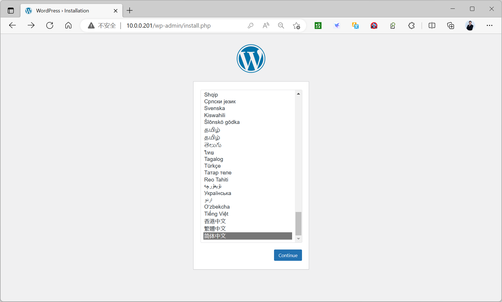

范例
```yaml
[root@master1 ~]#kubectl run mypod --image registry.cn-
beijing.aliyuncs.com/bowen/pod-test:v0.1
pod/mypod created
[root@master1 ~]#kubectl get pod
NAME                                      READY   STATUS    RESTARTS       AGE
mypod                                     1/1     Running   0              4s
nfs-client-provisioner-695dc47789-h4hfl   1/1     Running   16 (29m ago)   259d

[root@master1 ~]#kubectl exec mypod -- env
PATH=/usr/local/sbin:/usr/local/bin:/usr/sbin:/usr/bin:/sbin:/bin
HOSTNAME=mypod
KUBERNETES_SERVICE_PORT_HTTPS=443
KUBERNETES_PORT=tcp://10.96.0.1:443
KUBERNETES_PORT_443_TCP=tcp://10.96.0.1:443
KUBERNETES_PORT_443_TCP_PROTO=tcp
KUBERNETES_PORT_443_TCP_PORT=443
KUBERNETES_PORT_443_TCP_ADDR=10.96.0.1
KUBERNETES_SERVICE_HOST=10.96.0.1
KUBERNETES_SERVICE_PORT=443
DEPLOYENV=Production
RELEASE=Stable
PS1=[\u@\h \w]\$
HOME=/root

[root@master1 ~]#kubectl exec mypod -- ss -ntl
State    Recv-Q   Send-Q     Local Address:Port     Peer Address:Port  Process
LISTEN   0        128              0.0.0.0:80            0.0.0.0:*

#准备清单文件
[root@master1 ~]#cat pod-with-env.yaml
apiVersion: v1
kind: Pod
metadata:
name: pod-env-demo
spec:
containers:
- name: demo-env
image: registry.cn-beijing.aliyuncs.com/bowen/pod-test:v0.1
env:
- name: HOST
value: "127.0.0.1"
- name: PORT
value: "9999"

[root@master1 ~]#kubectl apply -f pod-env.yaml

[root@master1 ~]#kubectl get pod
NAME                                      READY   STATUS    RESTARTS       AGE
mypod                                     1/1     Running   0              75s
nfs-client-provisioner-695dc47789-h4hfl   1/1     Running   16 (31m ago)   259d
pod-env-demo                              1/1     Running   0              2s

[root@master1 ~]#kubectl exec pod-env-demo -- ss -ntl
State    Recv-Q   Send-Q     Local Address:Port     Peer Address:Port  Process
LISTEN   0        128            127.0.0.1:9999          0.0.0.0:*

[root@master1 ~]#kubectl exec pod-env-demo -- env
PATH=/usr/local/sbin:/usr/local/bin:/usr/sbin:/usr/bin:/sbin:/bin
HOSTNAME=pod-env-demo
HOST=127.0.0.1
PORT=9999
KUBERNETES_SERVICE_HOST=10.96.0.1
KUBERNETES_SERVICE_PORT=443
KUBERNETES_SERVICE_PORT_HTTPS=443
KUBERNETES_PORT=tcp://10.96.0.1:443

KUBERNETES_PORT_443_TCP=tcp://10.96.0.1:443
KUBERNETES_PORT_443_TCP_PROTO=tcp
KUBERNETES_PORT_443_TCP_PORT=443
KUBERNETES_PORT_443_TCP_ADDR=10.96.0.1
DEPLOYENV=Production
RELEASE=Stable
PS1=[\u@\h \w]\$
HOME=/root
```

#### 3.1.7.2 利用command和args字段传递容器的启动命令和参数

Pod配置中，spec.containers[].command字段能够在容器上指定替代镜像默认运行的应用程序，且可同时使用spec.containers[].args字段进行参数传递，它们将覆盖镜像中的默认定义的参数。若仅定义了command字段时，其值将覆盖镜像中定义的程序及参数。若仅是定义了args字段，该字段值将作为参数传递给镜像中默认指定运行的应用程序。

command ：对应覆盖 Docker 中的 `ENTRYPOINT``

`args ：对应覆盖 Docker 中的 CMD

示倒:
```yaml
containers:
- name: redis
image: redis
command: ["redis-server"]  # 覆盖 ENTRYPOINT
args: ["--port", "6380"]   # 覆盖 CMD
```

这相当于在 Docker 中执行：
```text
docker run --entrypoint "redis-server" redis --port 6380
```

如果只设置 args 而不设置 command ，则会使用 Dockerfile 中的 ENTRYPOINT 并配合新的 args ；如果只设置 command ，则会完全替换 ENTRYPOINT ，此时如果需要传递参数，需要将参数包含在command 数组中或通过 args 指定。

注意: args中使用环境变量,需要使用格式: $(环境变量名)。

范例: 修改默认进程
```yaml
#默认busybox无法启动
[root@master1 ~]#docker history  registry.cn-
beijing.aliyuncs.com/bowen/busybox:1.32.0
IMAGE          CREATED       CREATED BY                                      SIZE
COMMENT
219ee5171f80   4 years ago   /bin/sh -c #(nop)  CMD ["sh"]                   0B

<missing>      4 years ago   /bin/sh -c #(nop) ADD file:85e5bcb27fcc24f6a…
1.23MB

[root@master1 ~]#kubectl run mybusybox --image registry.cn-
beijing.aliyuncs.com/bowen/busybox:1.32.0
#k8s自动重启
[root@master1 ~]#kubectl get pod
NAME        READY   STATUS             RESTARTS      AGE

mybusybox   0/1     CrashLoopBackOff   5 (50s ago)   3m53s

#用自定义的命令替换sh
[root@master1 ~]#cat pod-with-cmd-admin-box.yaml
apiVersion: v1
kind: Pod
metadata:
name: admin-box
spec:
containers:
- image: registry.cn-beijing.aliyuncs.com/bowen/busybox:1.32.0
#image: registry.cn-beijing.aliyuncs.com/bowen/admin-box:v0.1
name: admin-box
command: ['sleep','inf']
#command: ['sleep']
#args: ['inf']

[root@master1 ~]#kubectl apply -f pod-with-cmd-admin-box.yaml

#查看
[root@master1 ~]#kubectl get pod admin-box
NAME        READY   STATUS    RESTARTS   AGE
admin-box   1/1     Running   0          20s

[root@master1 ~]#kubectl exec admin-box -- pstree -p
sleep(1)
[root@master1 ~]#kubectl exec admin-box -- ps aux
PID   USER     TIME  COMMAND
1 root      0:00 sleep 36000
20 root      0:00 ps aux
```

范例:  添加运行参数
```yaml
#原镜像的启动命令
[root@node1 ~]#docker pull registry.cn-beijing.aliyuncs.com/bowen/pod-
test:v0.1
[root@node1 ~]#docker history --no-trunc registry.cn-
beijing.aliyuncs.com/bowen/pod-test:v0.1 |grep ENTRYPOINT
<missing>                                                                 5
years ago   /bin/sh -c #(nop)  ENTRYPOINT ["/bin/sh" "-c" "python3
/usr/local/bin/demo.py"]                                           0B

[root@master1 ~]#cat pod-with-cmd-and-args.yaml
apiVersion: v1
kind: Pod
metadata:
name: pod-with-cmd-and-args
spec:
containers:
- name: pod-test
image: registry.cn-beijing.aliyuncs.com/bowen/pod-test:v0.1
imagePullPolicy: IfNotPresent
command: ['/bin/sh','-c']
args: ['python3 /usr/local/bin/demo.py -p 8080']

[root@master1 ~]#kubectl get pod  pod-with-cmd-and-args  -o wide

NAME                    READY   STATUS    RESTARTS   AGE   IP            NODE
NOMINATED NODE   READINESS GATES
pod-with-cmd-and-args   1/1     Running   0          70s   172.16.4.39
node2.bowen.org   <none>           <none>

[root@master1 ~]#kubectl exec  pod-with-cmd-and-args  -- ps aux
PID   USER     TIME  COMMAND
1 root      0:00 python3 /usr/local/bin/demo.py -p 8080
9 root      0:00 ps aux

[root@master1 ~]#kubectl exec  pod-with-cmd-and-args  -- hostname -i
172.16.4.39

[root@master1 ~]#curl 172.16.4.39:8080
kubernetes pod-test v0.1!! ClientIP: 172.16.0.0, ServerName: pod-with-cmd-and-
args, ServerIP: 172.16.4.39!
```

范例：添加运行命令，参数和环境变量
```yaml
[root@master1 ~]#cat pod-with-cmd-and-args.yaml
apiVersion: v1
kind: Pod
metadata:
name: pod-with-cmd-and-args
spec:
containers:
- name: pod-test
image: registry.cn-beijing.aliyuncs.com/bowen/pod-test:v0.1
imagePullPolicy: IfNotPresent
command: ['/bin/sh','-c']
#args: ['python3 /usr/local/bin/demo.py -p $PORT']
args: ['python3 /usr/local/bin/demo.py -p $(PORT)']
env: #和上面args同时启用，args优先生效，PORT优先级低
- name: PORT
value: "8888"
```

### 3.1.8 使用宿主机网络实现容器的外部访问

默认容器使用私有的独立网段，无法从集群外直接访问，可以通过下面两种方式实现外部访问。让容器直接使用宿主机的网络地址，即容器使用host的网络模型让容器通过窬主机的端口映射实现，即DNAT。

注意: 都要避免端口冲突

范例：直接使用容器所在宿主机网络
```yaml
#清单文件
[root@master1 ~]#cat pod-hostnetwork.yaml
apiVersion: v1
kind: Pod
metadata:
name: pod-hostnetwork-demo
spec:
#nodeName: node2.bowen.org
hostNetwork: true  #直接使用容器所在宿主机网络
containers:

- name: demo-env
image: registry.cn-beijing.aliyuncs.com/bowen/pod-test:v0.1
env:
- name: PORT
value: "9999"  #要确保此端口在宿主机不能被占用

[root@master1 ~]#kubectl apply -f pod-hostnetwork.yaml

[root@master1 ~]#kubectl get pod -o wide
NAME  READY   STATUS    RESTARTS       AGE    IP        NODE       NOMINATED NODE
READINESS GATES
pod-hostnetwork-demo    1/1     Running   0    9s     10.0.0.203
node3.bowen.org   <none>   <none>

[root@master1 ~]#curl 10.0.0.203:9999
kubernetes pod-test v0.1!! ClientIP: 10.0.0.200, ServerName: node3.bowen.org,
ServerIP: 10.0.0.203!
```

范例：使用容器所在宿主机指定的端口
```yaml
[root@master1 ~]#cat pod-hostport.yaml
apiVersion: v1
kind: Pod
metadata:
name: pod-hostport-demo
spec:
containers:
- name: demo-env
image: registry.cn-beijing.aliyuncs.com/bowen/pod-test:v0.1
env:
- name: PORT             #镜像的环境变量可以指定容器运行时使用的端口
value: "9999"
ports:
- name: http             #不支持大写字母
containerPort: 9999    #使用上面变量相同的端口
hostPort: 8888         #使用宿主机的指定端口

[root@master1 ~]#kubectl apply -f pod-hostport.yaml
pod/pod-hostport-demo created

[root@master1 ~]#kubectl get pod -o wide
NAME    READY   STATUS    RESTARTS        AGE    IP         NODE     NOMINATED
NODE   READINESS GATES
pod-hostport-demo    1/1     Running   0   5s     10.244.168.202
node3.bowen.org   <none>        <none>

#访问容器所在宿主机IP和指定的端口
[root@master1 ~]#curl 10.0.0.203:8888
kubernetes pod-test v0.1!! ClientIP: 10.0.0.200, ServerName: pod-hostport-demo,
ServerIP: 10.244.168.202!

#本质上就是通过宿主机的DNAT策略实现
[root@node3 ~]#iptables -vnL -t nat|grep DNAT|grep 8888
1    60 DNAT       tcp  --  *      *       0.0.0.0/0            0.0.0.0/0
tcp dpt:8888 to:10.244.168.202:9999
```

### 3.1.9 临时容器 Ephemeral Containers（了解）


- <https://kubernetes.io/zh-cn/docs/concepts/workloads/pods/ephemeral-containers/>


#### 3.1.9.1 了解临时容器

Pod 是 Kubernetes 应用程序的基本构建块。 由于 Pod 是一次性且可替换的，因此一旦 Pod 创建，就无法将容器加入到 Pod 中。 取而代之的是，通常使用 Deployment 以受控的方式来删除并替换 Pod。有时有必要检查现有 Pod 的状态。例如，对于难以复现的故障进行排查。 在这些场景中，可以在现有Pod 中运行临时容器来检查其状态并运行任意命令。

Kubernetes v1.16推出临时容器, Kubernetes v1.25稳定可用, 就是在原有的Pod 上，添加一个临时的Container，这个Container可以包含我们排查问题所有的工具, 比如: ip、ss、ps、pstree、top、kill、top、jstat、jmap等。

什么是临时容器？

临时容器与其他容器的不同之处在于，它们缺少对资源或执行的保证，并且永远不会自动重启， 因此不适用于构建应用程序。 临时容器使用与常规容器相同的 ContainerSpec 节来描述，但许多字段是不兼容和不允许的。临时容器没有端口配置，因此像 ports，livenessProbe，readinessProbe 这样的字段是不允许的。Pod 资源分配是不可变的，因此 resources 配置是不允许的。有关允许字段的完整列表，请参见 EphemeralContainer 参考文档。

临时容器是使用 API 中的一种特殊的 ephemeralcontainers 处理器进行创建的， 而不是直接添加到pod.spec 段，因此无法使用 kubectl edit 来添加一个临时容器。与常规容器一样，将临时容器添加到 Pod 后，将不能更改或删除临时容器。

**临时容器的用途**

当由于容器崩溃或容器镜像不包含调试工具而导致 kubectl exec 无用时， 临时容器对于交互式故障排查很有用。尤其是，Distroless 镜像允许用户部署最小的容器镜像，从而减少攻击面并减少故障和漏洞的暴露。 由于 distroless 镜像不包含 Shell 或任何的调试工具，因此很难单独使用 kubectl exec 命令进行故障排查。使用临时容器时，启用 进程名字空间共享 很有帮助，可以查看其他容器中的进程。

**开启EphemeralContainers特性**
<https://kubernetes.io/zh-cn/docs/reference/command-line-tools-reference/feature-gates/>

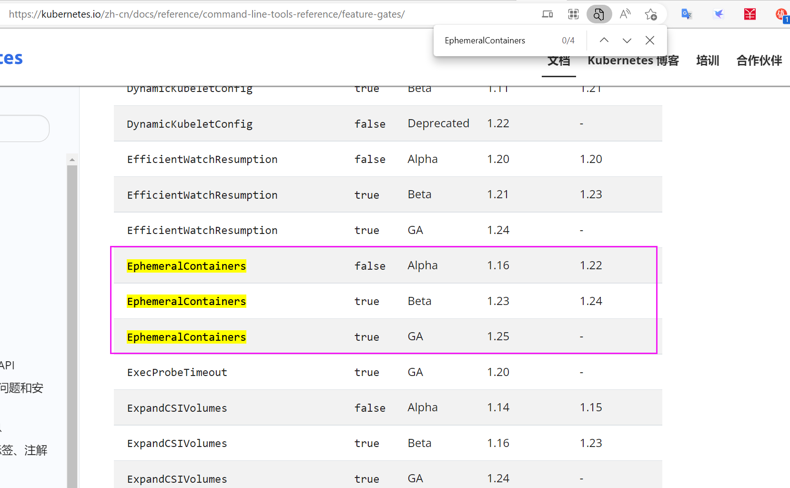

范例: 如果是v1.22版前需要手动开启EphemeralContainers
```ini
#在所有节点修改相关的sevice文件,包括,api-server,controller-manger,scheduler等
[root@master1 ~]#vim /lib/systemd/system/kubelet.service
[Service]
ExecStart=/usr/bin/kubelet --featrue-gates="EphemeralContainers=true"  #修改此行
[root@master1 ~]#vim /lib/systemd/system/kubelet.service
[root@master1 ~]#systemctl daemon-reload
[root@master1 ~]#systemctl restart kubelet.service
```

范例: 查看Pod配置
```bash
[root@master1 ~]#kubectl explain pod.spec
shareProcessNamespace    <boolean>
Share a single process namespace between all of the containers in a pod.
When this is set containers will be able to view and signal processes from
other containers in the same pod, and the first process in each container
will not be assigned PID 1. HostPID and ShareProcessNamespace cannot both
be set. Optional: Default to false.
```

#### 3.1.9.2 使用临时容器
<https://kubernetes.io/zh-cn/docs/tasks/debug/debug-application/debug-running-pod/#ephemeral-container>

**kubectl debug 命令用法**
```bash
[root@master1 ~]#kubectl debug --help
Debug cluster resources using interactive debugging containers.

'debug' provides automation for common debugging tasks for cluster objects
identified by resource and name. Pods will
be used by default if no resource is specified.

The action taken by 'debug' varies depending on what resource is specified.
Supported actions include:
```


*  Workload: Create a copy of an existing pod with certain attributes changed, for example changing the image tag to a new version.*  Workload: Add an ephemeral container to an already running pod, for example to add debugging utilities without restarting the pod.*  Node: Create a new pod that runs in the node's host namespaces and can access the node's filesystem.

```bash
Examples:
# Create an interactive debugging session in pod mypod and immediately attach
to it.
# (requires the EphemeralContainers feature to be enabled in the cluster)
kubectl debug mypod -it --image=busybox

# Create a debug container named debugger using a custom automated debugging
image.
# (requires the EphemeralContainers feature to be enabled in the cluster)
kubectl debug --image=myproj/debug-tools -c debugger mypod

# Create a copy of mypod adding a debug container and attach to it
kubectl debug mypod -it --image=busybox --copy-to=my-debugger

# Create a copy of mypod changing the command of mycontainer
kubectl debug mypod -it --copy-to=my-debugger --container=mycontainer -- sh

# Create a copy of mypod changing all container images to busybox
kubectl debug mypod --copy-to=my-debugger --set-image=*=busybox

# Create a copy of mypod adding a debug container and changing container
images
kubectl debug mypod -it --copy-to=my-debugger --image=debian --set-
image=app=app:debug,sidecar=sidecar:debug

# Create an interactive debugging session on a node and immediately attach to
it.
# The container will run in the host namespaces and the host's filesystem will
be mounted at /host
kubectl debug node/mynode -it --image=busybox

Options:
--arguments-only=false:
If specified, everything after -- will be passed to the new container as
Args instead of Command.
```


--attach=false: If true, wait for the container to start running, and then attach as if'kubectl attach ...' were called. Default false, unless '-i/--stdin' is set, in which case the default is true.

```text
-c, --container='':
Container name to use for debug container.

--copy-to='':

Create a copy of the target Pod with this name.

--env=[]:
Environment variables to set in the container.

--image='':
Container image to use for debug container.
```


--image-pull-policy='': The image pull policy for the container. If left empty, this value will not be specified by the client and defaulted by the server.

```bash
-q, --quiet=false:
If true, suppress informational messages.

--replace=false:
When used with '--copy-to', delete the original Pod.

--same-node=false:
When used with '--copy-to', schedule the copy of target Pod on the same
node.

--set-image=[]:
When used with '--copy-to', a list of name=image pairs for changing
container images, similar to how 'kubectl
set image' works.

--share-processes=true:
When used with '--copy-to', enable process namespace sharing in the copy.

-i, --stdin=false:
Keep stdin open on the container(s) in the pod, even if nothing is attached.

--target='':
When using an ephemeral container, target processes in this container name.

-t, --tty=false:
Allocate a TTY for the debugging container.

Usage:
kubectl debug (POD | TYPE[[.VERSION].GROUP]/NAME) [ -- COMMAND [args...] ]
[options]

Use "kubectl options" for a list of global command-line options (applies to all
commands).
```

范例:
```bash
[root@master1 ~]#kubectl run ephemeral-demo --image=bowen/pause:3.1 --
restart=Never
[root@master1 ~]#kubectl run ephemeral-demo --
image=registry.aliyuncs.com/google_containers/pause:3.9 --restart=Never
[root@master1 ~]#kubectl get pod ephemeral-demo
NAME             READY   STATUS    RESTARTS   AGE
ephemeral-demo   1/1     Running   0          57s

#如果你尝试使用 kubectl exec 来创建一个 shell，你将会看到一个错误，因为这个容器镜像中没有
shell。
[root@master1 ~]#kubectl exec -it ephemeral-demo -- sh
OCI runtime exec failed: exec failed: unable to start container process: exec:
"sh": executable file not found in $PATH: unknown
command terminated with exit code 126

#通过kubectl debug 添加调试容器。 如果你指定 -i 或者 --interactive 参数，kubectl 将自动
挂接到临时容器的控制台。
[root@master1 ~]#kubectl debug -it ephemeral-demo --image=busybox:1.32.0 --
target=ephemeral-demo
Targeting container "ephemeral-demo". If you don't see processes from this
container it may be because the container runtime doesn't support this feature.
Defaulting debug container name to debugger-84tq7.
If you don't see a command prompt, try pressing enter.
/ # ps
PID   USER     TIME  COMMAND
1 root      0:00 /pause
12 root      0:00 sh
24 root      0:00 ps
/ # ip a
1: lo: <LOOPBACK,UP,LOWER_UP> mtu 65536 qdisc noqueue qlen 1000
link/loopback 00:00:00:00:00:00 brd 00:00:00:00:00:00
inet 127.0.0.1/8 scope host lo
valid_lft forever preferred_lft forever
3: eth0@if21: <BROADCAST,MULTICAST,UP,LOWER_UP,M-DOWN> mtu 1450 qdisc noqueue
link/ether 4e:06:00:4c:8f:79 brd ff:ff:ff:ff:ff:ff
inet 10.244.3.51/24 brd 10.244.3.255 scope global eth0
valid_lft forever preferred_lft forever

#只显示一个容器
[root@master1 ~]#kubectl get pod ephemeral-demo  -o wide
NAME             READY   STATUS    RESTARTS   AGE     IP            NODE
NOMINATED NODE   READINESS GATES
ephemeral-demo   1/1     Running   0          8m35s   10.244.3.51
node3.bowen.org   <none>           <none>

#查看到临时容器信息
[root@master1 ~]#kubectl describe pod ephemeral-demo
Name:             ephemeral-demo
Namespace:        default
Priority:         0
Service Account:  default
Node:             node3.bowen.org/10.0.0.203
Start Time:       Sun, 27 Nov 2022 22:28:24 +0800
Labels:           run=ephemeral-demo
Annotations:      <none>
Status:           Running
IP:               10.244.3.51
IPs:
IP:  10.244.3.51
Containers:
ephemeral-demo:
Container ID:
docker://28b533485ead026d26536fc6319a25f35a782d7d0cb9995eec946da9f0f3bd5c
Image:          bowen/pause:3.1

Image ID:       docker-
pullable://bowen/pause@sha256:fcaff905397ba63fd376d0c3019f1f1cb6e75061313
89edbcb3d22719f1ae54d
Port:           <none>
Host Port:      <none>
State:          Running
Started:      Sun, 27 Nov 2022 22:28:51 +0800
Ready:          True
Restart Count:  0
Environment:    <none>
Mounts:
/var/run/secrets/kubernetes.io/serviceaccount from kube-api-access-vb8l4
(ro)
Ephemeral Containers:
debugger-84tq7:
Container ID:
docker://47db8156367277277c4fad3915002edbf56f3e4a19fca6fa5cabe60c439e7d5f
Image:          busybox:1.32.0
Image ID:       docker-
pullable://busybox@sha256:141c253bc4c3fd0a201d32dc1f493bcf3fff003b6df416dea4f410
46e0f37d47
Port:           <none>
Host Port:      <none>
State:          Running
Started:      Sun, 27 Nov 2022 22:31:06 +0800
Ready:          False
Restart Count:  0
Environment:    <none>
Mounts:         <none>
Conditions:
Type              Status
Initialized       True
Ready             True
ContainersReady   True
PodScheduled      True
Volumes:
kube-api-access-vb8l4:
Type:                    Projected (a volume that contains injected data from
multiple sources)
TokenExpirationSeconds:  3607
ConfigMapName:           kube-root-ca.crt
ConfigMapOptional:       <nil>
DownwardAPI:             true
QoS Class:                   BestEffort
Node-Selectors:              <none>
Tolerations:                 node.kubernetes.io/not-ready:NoExecute op=Exists
for 300s
node.kubernetes.io/unreachable:NoExecute op=Exists
for 300s
Events:
Type    Reason     Age    From               Message
----    ------     ----   ----               -------
Normal  Scheduled  4m30s  default-scheduler  Successfully assigned
default/ephemeral-demo to node3.bowen.org
Normal  Pulling    4m30s  kubelet            Pulling image
"bowen/pause:3.1"
Normal  Pulled     4m3s   kubelet            Successfully pulled image
"bowen/pause:3.1" in 26.563175958s

Normal  Created    4m3s   kubelet            Created container ephemeral-demo
Normal  Started    4m3s   kubelet            Started container ephemeral-demo
Normal  Pulling    109s   kubelet            Pulling image "busybox:1.32.0"
Normal  Pulled     108s   kubelet            Successfully pulled image
"busybox:1.32.0" in 1.721851652s
Normal  Created    108s   kubelet            Created container debugger-84tq7
Normal  Started    108s   kubelet            Started container debugger-84tq7

#在运行Pod的宿主机可以看到两个容器
[root@node3 ~]#docker ps
CONTAINER ID   IMAGE                                               COMMAND
CREATED          STATUS          PORTS     NAMES
47db81563672   busybox                                             "sh"
4 minutes ago    Up 4 minutes              k8s_debugger-
84tq7_ephemeral-demo_default_d870ecf8-707f-437d-ae91-1af9c21413a9_0
28b533485ead   bowen/pause                                  "/pause"
6 minutes ago    Up 6 minutes              k8s_ephemeral-
demo_ephemeral-demo_default_d870ecf8-707f-437d-ae91-1af9c21413a9_0
```

范例：调试nginx服务
```bash
[root@master1 ~]#kubectl run mynginx --image=registry.cn-
beijing.aliyuncs.com/bowen/nginx:1.22.0
[root@master1 ~]#kubectl exec -it mynginx -- sh
# ip a
sh: 2: ip: not found
# ps
sh: 3: ps: not found
# exit
command terminated with exit code 127

[root@master1 ~]#kubectl debug -it mynginx --image=registry.cn-
beijing.aliyuncs.com/bowen/busybox:1.32.0 --target=mynginx
Targeting container "mynginx". If you don't see processes from this container it
may be because the container runtime doesn't support this feature.
Defaulting debug container name to debugger-4x574.
If you don't see a command prompt, try pressing enter.
/ # ip a
1: lo: <LOOPBACK,UP,LOWER_UP> mtu 65536 qdisc noqueue qlen 1000
link/loopback 00:00:00:00:00:00 brd 00:00:00:00:00:00
inet 127.0.0.1/8 scope host lo
valid_lft forever preferred_lft forever
2: eth0@if7: <BROADCAST,MULTICAST,UP,LOWER_UP,M-DOWN> mtu 1450 qdisc noqueue
link/ether 3a:c5:98:0c:a7:0d brd ff:ff:ff:ff:ff:ff
inet 10.244.3.14/24 brd 10.244.3.255 scope global eth0
valid_lft forever preferred_lft forever
/ # ps aux
PID   USER     TIME  COMMAND
1 root      0:00 nginx: master process nginx -g daemon off;
29 101       0:00 nginx: worker process
30 101       0:00 nginx: worker process
37 root      0:00 sh
44 root      0:00 ps aux
/ # exit
Session ended, the ephemeral container will not be restarted but may be
reattached using 'kubectl attach mynginx -c debugger-lvspb -i -t' if it is still
running

[root@master1 ~]#kubectl get pod mynginx -o yaml |grep -A10 ephemeralContainers
ephemeralContainers:
- image: registry.cn-beijing.aliyuncs.com/bowen/busybox:1.32.0
imagePullPolicy: IfNotPresent
name: debugger-4x574
resources: {}
stdin: true
targetContainerName: mynginx
terminationMessagePath: /dev/termination-log
terminationMessagePolicy: File
tty: true
nodeName: node3.bowen.org
```

## 3.2 Pod 工作机制

### 3.2.1 Pod 基本原理

#### 3.2.1.1 Pod 结构和特点

Kubernetes本质上是“以应用为中心”的现代应用基础设施，Pod是其运行应用及应用调度的最小逻辑单元。Kubernetes是通过组合容器将应用放置到一个个的逻辑单元Pod中，达到快速管理业务应用的效果。Pod是Kubernetes中最重要也最基本的概念。

交付单元

传统主机阶段 - 单台主机容器环境阶段 - 单个容器任务编排阶段 - Pod(容器集合)

**完整结构**


**关于Pause容器**

Pause容器 全称 infrastucture container（又叫infra）基础容器

每个Pod包含了一个Pause容器,作为init pod存在，其他pod都会从pause 容器中fork出来,即Pause容器是Pod的父容器,主要负责僵尸进程的回收管理,通过Pause容器可以使同一个Pod里面的多个容器共享存储、网络、UTS、IPC 等。

每个Pod里运行着一个Pause的容器，其他容器则为业务容器，这些业务容器共享Pause容器的网络栈和Volume挂载卷每个Pod内的容器之间通信和数据交换更为高效，在设计时可以充分利用这一特性将一组密切相关的服务进程放入同一个Pod中。同一个Pod里的容器之间仅需通过localhost就能互相通信。Pod的IP是pause容器的地址Pod内部所有的应用容器，继承Pause容器的信息。

pause容器主要为每个业务容器提供以下功能

**网络命名空间**：Pod中的多个容器能够访问同一个IP和端口范围IPC命名空间：Pod中的多个容器能够使用SystemV IPC或POSIX消息队列进行通信UTS命名空间：Pod中的多个容器共享一个主机名和域名Volumes（共享存储卷）:Pod中的各个容器可以访问在Pod级别定义的Volumes PID命名空间：默认PID是每个容器是隔离的，但是 Pod中的不同应用程序可以看到其他应用程序的进程ID。

注意: 存储卷隶属于 Pod，而非容器。

pause 容器的主要作用：

1. 持有 Pod 的网络命名空间

**网络命名空间的创建与保持**：pause 容器是 Kubernetes 中每个 Pod 启动的第一个容器。它负责创建并持有 Pod 的网络命名空间。这意味着它为 Pod 内的其他所有容器提供了一个共享的网络环境。无论 Pod 中其他容器如何变化（如重启或停止），网络命名空间依然保持稳定，因为 pause容器一直在运行。IP 地址的持久性：通过 pause 容器持有网络命名空间，Pod 的 IP 地址在整个 Pod 的生命周期内保持不变，即使其中的应用容器被销毁或重新启动。

2. 持有 Pod 的其他命名空间

共享命名空间的持有者：除了网络命名空间外，pause 容器还持有 Pod 的其他命名空间，如 PID命名空间、IPC 命名空间、用户命名空间等。这使得 Pod 内的所有容器可以共享这些命名空间，实现进程间通信、共享内存等操作。进程命名空间：pause 容器持有 Pod 的进程命名空间，使得所有 Pod 中的容器可以看到彼此的进程 ID，允许某些容器管理或监控其他容器的进程。

3. 管理 Pod 生命周期

**生命周期的基础容器**：pause 容器的生命周期与整个 Pod 的生命周期绑定。只要 Pod 存在，pause 容器就会持续运行，确保 Pod 的命名空间和网络环境持续存在。这使得 Pod 内的容器可以在 pause 容器的基础上启动、停止或重启，而不会影响到 Pod 本身的网络和命名空间。Pod 的退出信号：当 pause 容器终止时，整个 Pod 也会终止。这意味着 pause 容器充当了 Pod生命周期的一个基准点，其存在与否直接决定了 Pod 的状态。

4. 轻量级资源占用

**低资源消耗**：pause 容器运行一个几乎空闲的进程（通常是一个简单的 sleep 或等待循环），因此它的资源占用非常低。尽管它始终运行，但几乎不消耗 CPU 和内存资源，这使得它能够高效地承担起命名空间的持有任务。

5. 支持多种 CNI 插件

兼容性和扩展性：Docker的容器默认不直接支持CNI, pause 容器能够与 Kubernetes 支持的各种CNI（Container Network Interface）插件配合工作，不论是 Calico、Flannel、Weave，还是其他网络插件。它为这些网络插件提供了一个稳定的网络命名空间，使得 Pod 内容器的网络配置更为一致和可靠。

pod 资源关系特点解析

关系解析

一个Pod可以有多个容器，彼此间共享网络和存储资源。

Pod vs

每一个Pod中有一个Pause容器保存所有容器的状态，通过管理 Pause 容器，达到管。

容器

理pod中所有容器的效果。只有紧密关系的容器才可以放到一个pod中，不同业务的容器分别放在不同的pod中。

Pod vs

同一Pod中的容器总会被调度到相同Node节点

节点

不同节点间Pod的通信是基于虚拟二层或三层网络技术实现的。

Pod vs Pod普通的Pod和静态Pod(一般不用)。

每个Pod都是应用的一个(子应用)实例，有专用的ip，与容器暴露的端口组合为一个。

Pod vs

service的endpoint地址

应用

每个service由kube-proxy转换为本地的ipvs或iptables规则。

应用 vs

每个service的endpoint地址由coredns组件解析为对应的服务名称。

应用

其他service的pod通过访问该名称达到应用间通信的效果。

外部 vs

外部流量通过节点网卡进入到k8s集群，基于ipvs或iptables规则找到对应的service，

pod

进而找到对应pod地址

**Pod 通信机制**：Pod内多容器通信  - 容器间通信(容器模型)借助于pause容器实现单节点内多Pod通信 - 主机间容器通信(host模型),利用kube-proxy实现。

多节点内多Pod通信 - 跨主机网络解决方案(overlay模型),利用网络插件flannel,calico等实现。

范例: 查看pause容器
```bash
[root@master1 ~]#kubectl get pod -o wide |grep node1
pod-test1   1/1     Running   7 (7h41m ago)   14d   172.16.3.39   node1.bowen.org
<none>           <none>

#有几个pod就有几个对应的pause容器
[root@node1 ~]#docker ps |grep pod-test1
701b0cb33630   ae893c58d83f
"nginx -g 'daemon of…"   8 hours ago          Up 8 hours
k8s_nginx-web01_pod-test1_default_4595942c-adb4-47a1-9782-0619bf43920a_7
2e1aa91c323d   registry.cn-hangzhou.aliyuncs.com/google_containers/pause:3.5
"/pause"                 8 hours ago          Up 8 hours
k8s_POD_pod-test1_default_4595942c-adb4-47a1-9782-0619bf43920a_15
```

#### 3.2.1.2 静态和动态 Pod

基于控制的特性Pod 主要有两类：静态pod和动态pod。

动态Pod

自主式和控制器创建的pod都是动态pod，也是应用最广泛的pod。动态Pod 直接被集群中的API Server 进行管理。

静态pod

由特定节点上的kubelet进程来管理,对于API Server 只能查看，而不能管理。在本质上与动态pod没有区别，只是在于静态pod只能在特定的节点上运行。常用于某些节点上的一些隐私操作或者核心操作，而且这些操作往往受到特定节点的场景约束，比如某些定向监控、特定操作。kubeadm部署的集群中控制平面中组件对应的都是动态Pod,包括:etcd,kube-apiserver,kube-scheduler,kube-controller-manager。kubelet 默认会加载/etc/kubernetes/manifests/*.yaml 从而生成的静态Pod。

静态pod实现方式主要有两种：配置文件或者http方式。

配置文件：

所谓的配置文件的方式，其实就是在特定的目录下存放我们定制好的资源对象文件，然后节点上的kubelet服务周期性的检查该目录下的所有内容，对静态pod进行增删改查。其配置方式主要有两步。

1 定制kubelet服务定期检查配置目录

2 增删定制资源文件

http方式：

1 准备http方式提供资源文件的web站点

2 工作节点的kubelet配置–manifest-url=<资源文件的url下载地址>

这两种方式实现的原理基本上是一致的，只不过一个是在本地设置资源对象文件，一个是在网络设置，我们通过http的方式来获取。

参考资料：


- <https://kubernetes.io/zh/docs/tasks/administer-cluster/static-pod/>
- <https://kubernetes.io/zh-cn/docs/tasks/configure-pod-container/static-pod/>


范例: 信息查看
```ini
#软件组成
[root@master1 ~]#dpkg -L kubelet
...
/lib/systemd/system/kubelet.service
...
/usr/bin/kubelet

#服务状态
[root@master1 ~]#systemctl status kubelet
● kubelet.service - kubelet: The Kubernetes Node Agent
Loaded: loaded (/lib/systemd/system/kubelet.service; enabled; vendor preset:
enabled)
Drop-In: /etc/systemd/system/kubelet.service.d
└─10-kubeadm.conf
Active: active (running)
...
#结果显示：kubelet服务，系统服务文件是kubelet.service，但是在启动服务时候，还加载了
kubelet.service.d目录下的10-kubeadm.conf文件的内容

#查看加载文件内容
[root@master1 ~]#ls /lib/systemd/system/kubelet.service.d
10-kubeadm.conf

[root@master1 ~]# cat /lib/systemd/system/kubelet.service.d/10-kubeadm.conf
# Note: This dropin only works with kubeadm and kubelet v1.11+
[Service]
...
Environment="KUBELET_CONFIG_ARGS=--config=/var/lib/kubelet/config.yaml"
...
EnvironmentFile=-/var/lib/kubelet/kubeadm-flags.env
...
#结果显示：kubelet的配置参数主要是在/var/lib/kubelet/config.yaml文件中定义

#查看kubelet配置参数
[root@master1 ~]#grep static /var/lib/kubelet/config.yaml
staticPodPath: /etc/kubernetes/manifests
```


#结果显示：该文件是一个yaml格式的，里面设置了大量的配置参数，其中有一项关键的就是 staticPodPath。其实我们还可以直接  在/etc/kubernetes/kubelet.conf文件中使用 --pod-manifest-path=<the directory>的方式指定静态pod的路径。


#以上观察可以看出对于kubeadm的环境，默认情况下已经配置好了静态pod的专用目录/etc/kubernetes/manifests，而我们没有看到静态pod的效果，主要是该目录中并没有任何资源对象文件。

```bash
#node节点查看效果,没有静态pod
[root@node1 ~]# ls /etc/kubernetes/manifests/
[root@node1 ~]#

#master节点查看效果

[root@master ~]# ls /etc/kubernetes/manifests/
etcd.yaml  kube-apiserver.yaml  kube-controller-manager.yaml  kube-
scheduler.yaml
#结果显示：只有master节点上才有默认启动的核心操作。
```

范例: 创建和删除静态pod
```yaml
#master查看集群当前效果
[root@master1 ~]# kubectl get pod
No resources found.

#直接在node3节点的/etc/kubernetes/manifests 目录下创建资源对象文件即可
[root@node3 ~]#cat >/etc/kubernetes/manifests/pod-static.yaml <<EOF
apiVersion: v1
kind: Pod
metadata:
name: pod-static
spec:
containers:
- name: nginx01
image: registry.cn-beijing.aliyuncs.com/bowen/nginx:1.22.0
EOF

#保存文件后，不apply该文件，直接回到master节点上检查效果
[root@master1 ~]#kubectl get pod pod-static-master1.bowen.org
NAME                            READY   STATUS    RESTARTS   AGE
pod-static-master1.bowen.org    1/1     Running   0          58s
#结果显示：静态pod目录，只要配置文件发生变化，立刻都会显示出来。

#删除静态pod该文件
[root@master1 ~]#kubectl get pod pod-static-master1.bowen.org  -o wide
NAME                          READY   STATUS    RESTARTS   AGE   IP
NODE               NOMINATED NODE   READINESS GATES
pod-static-master1.bowen.org    1/1     Running   0          56s   172.16.7.36
node3.bowen.org   <none>           <none>

#无法用下面方式删除静态pod
[root@master1 ~]# kubectl delete pod pod-static-master1.bowen.org

#删除后会自动重新创建
[root@master1 ~]#kubectl get pod pod-static-master1.bowen.org  -o wide
NAME                          READY   STATUS    RESTARTS   AGE   IP
NODE               NOMINATED NODE   READINESS GATES
pod-static-master1.bowen.org    1/1     Running   0          56s   172.16.7.36
node3.bowen.org   <none>           <none>
#结果显示:由于删除pod的增删主要是基于节点上的kubelet来实现的，重新创建的pod的ip什么的属性都没
发生变化。

#编辑该对象
[root@master ~]# kubectl edit pod pod-static-master1.bowen.org

#检查效果
[root@master ~]# kubectl get pod -o wide
#结果显示：静态pod没有办法被kubectl进行编辑

#回到node3节点上移除资源定义文件
[root@node3 ~]# mv /etc/kubernetes/manifests/pod-static.yaml /tmp/

#回到master节点上，查看效果
[root@master ~]# kubectl get pod
No resources found.
#结果显示:只要静态pod的文件一旦有变动，在集群中立刻都能看到变化
```

#### 3.2.1.3 Pod 核心思想

Kubernetes资源对象Pod在它实现的内部有一套独有的设计理念和核心思想，主要有应用交付、资源调度、实现细节三个方面。

**应用交付**


Kubernetes是一个自动化的容器管理平台，存在的目的就是快速管理各种业务应用。所以它所面对的本质上就是业务应用。随着应用的进一步拆分和微服务架构的设计，一个应用被拆分成了多个独立的子模块应用。虽然Kubernetes将这些应用的各个子模块单独部署在容器上，但是Kubernetes不再是对一个个子应用容器进行管理，它是将这些子应用容器放在一个逻辑单元pod中，而这个逻辑单元针对的是应用或服务，通过对逻辑单元的操作，达到对应用快速管理，从而实现业务的快速交付。所以说Pod面向的是应用或服务，而不是具体的应用容器或者子应用容器。


**资源管理**


kubernetes是一个分布式的资源管理平台，分布的特点就是资源分散，所以Kubernetes的应用，肯定会出现业务应用的不同模块被分配到多个Node工作节点，那么随之而来，就会出现两种问题：1)需要设计一个复杂的资源调度算法，根据业务需求，从不同Node上获取所有特定的数据 2)强耦合的业务应用，被分配到了不同节点，可能造成不可预测的功能缺失或潜在问题


所以，与其花费大力气解决上述两个问题，还不如把这些功能直接打包到一个逻辑单元pod中：对内：所有的子应用容器可以在Pod内部进行单独管理，即使pod在调度到其他Node节点，Pod内部的所有子应用容器仍可以正常运行。对外：对于整个业务系统来说，面向的是一个个的应用或业务功能(即Pod)，可以轻松实现管理。


实现细节


应用业务下放权力到Pod内部了，那么Pod如何管理子应用呢？通信机制：Pod内有个Pause容器，它有独立的ip地址，其他子应用容器基于container网络模式实现统一的对外服务，大大简化了关联业务容器之间的通信问题。存储机制：Pod内有专用的数据存储资源对象，其他子应用容器共享该数据卷，实现多容器数据信息的统一存储。管理机制：所有子应用容器的信息都保存在pause容器中，通过对pause容器的管理，达到管理所有容器效果。


#### 3.2.2.3 Pod 管理机制

Kubernetes 集群通过pod实现了大量业务应用容器的统一管理。

而Kubernetes 也提供了大量的资源对象来对pod进行管理：

通过控制器比如deployment来确保 pod的运行和数量符合用户的期望状态通过网络资源比如service来确保pod的应用服务可以被外部的服务来进行访问。

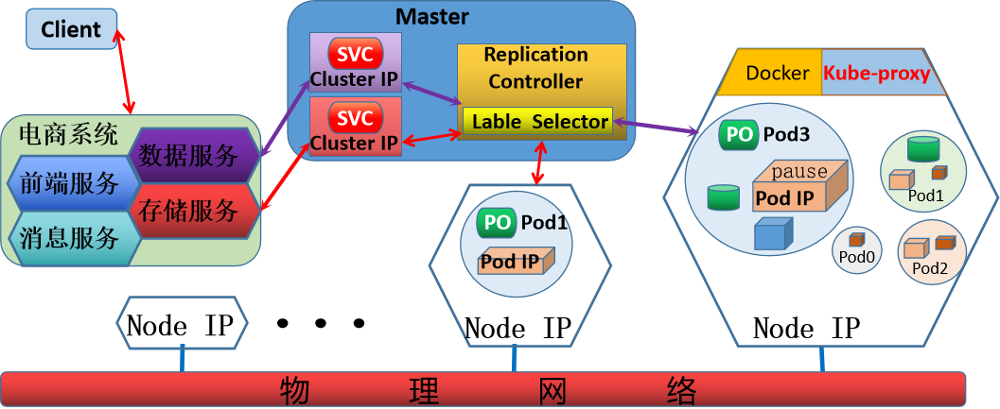

**Pod 相关的资源对象**

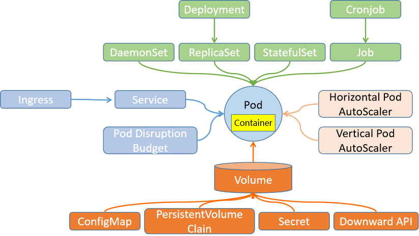

**工作负载型资源**：Pod、Deployment、DaemonSet、Replica、StatefulSet、Job、Cronjob、Operator服务发现和负载均衡资源: Service、Ingress配置和存储: configMap、Secret、PersistentVolume、PersistentVolumeChain、DownwardAPI资源隔离权限控制资源: namespace、nodes、clusterroles、Roles动态调整资源: HPA、VPA。

### 3.2.2 Pod 工作流程

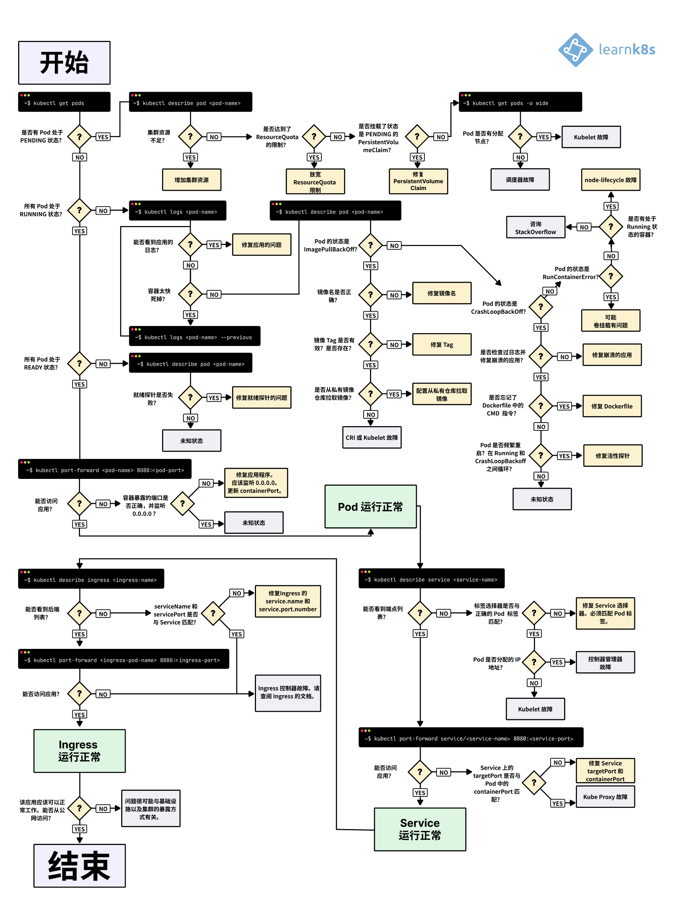

#### 3.2.2.1 Pod 创建流程

**Pod 创建流程示意图**

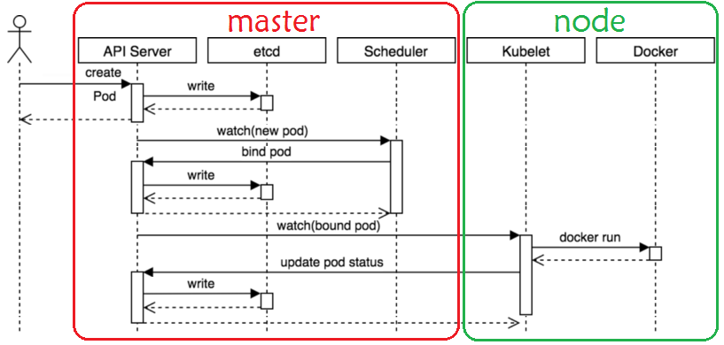

**Pod 创建流程**

用户可以通过多种方式向 Master节点上的 API Server 发起创建一个 Pod 的请求,检查权限通过后才允许继续API Server 将该信息写入 etcd 后,并同步到其它etcd数据库etcd 通过Watch机制发现数据变化则主动通知给所有API Server，API Server再返回成功结果给用户Scheduler 通过Watch检测到 API Server上有建立Pod请求更新，开始通知 API Server 调度该Pod请求到合适的Node,这期间存在选择哪个合适节点的复杂过程，Scheduler 通知API Server 更新信息到所有 etcd，etcd 返回结果给API Server API Server 通知 kubelet 有新的 Pod 调度，kubelet 通过容器引擎运行该 Pod 对象kubelet 通过 container runtime 取到 Pod 状态，并同步信息到 API Server，最终由 API Server更新信息到 etcd。

#### 3.2.2.2 Pod 生命周期
```text
https://kubernetes.io/zh-cn/docs/concepts/workloads/pods/pod-lifecycle/#container-probes
https://kubernetes.io/zh-cn/docs/tasks/configure-pod-container/configure-pod-initialization/
https://kubernetes.io/zh-cn/docs/tasks/configure-pod-container/attach-handler-lifecycle-event/
https://kubernetes.io/zh-cn/docs/concepts/workloads/pods/pod-lifecycle/
```


和一个个独立的应用容器一样，Pod 也被认为是相对临时性（而不是长期存在）的实体。Pod 会被创建、赋予一个唯一的 ID（UID）， 并被调度到节点，并在终止（根据重启策略）或删除之前一直运行在该节点。如果一个节点死掉了，调度到该节点的 Pod 也被计划在给定超时期限结束后删除。Pod 自身不具有自愈能力。如果 Pod 被调度到某节点而该节点之后失效， Pod 会被删除。

类似地，Pod 无法在因节点资源耗尽或者节点维护而被驱逐期间继续存活。Kubernetes 使用一种高级抽象来管理这些相对而言可随时丢弃的 Pod 实例， 称作控制器。任何给定的 Pod （由 UID 定义）从不会被“重新调度（rescheduled）”到不同的节点；相反，这一 Pod 可以被一个新的、几乎完全相同的 Pod 替换掉。如果需要，新 Pod 的名字可以不变，但是其 UID 会不同。如果某资源对象声称其生命期与某 Pod 相同，例如存储卷， 这就意味着该对象在此 Pod （UID 亦相同）存在期间也一直存在。

如果 Pod 因为任何原因被删除，甚至相同的替代 Pod 被创建时， 这个相关的对象（例如这里的卷）也会被删除并重建。

##### 3.2.2.2.1 Pod 生命令周期流程

公司的项目中业务应用都工是有生命周期的

Kubernetes是基于业务应用或服务进行统一管理的平台，每一个应用服务对应一个Pod，所以伴随着业务应用Pod也有相应的生命周期。

Pod 生命令周期流程

Pod生命周期

主容器生命周期初始化容器


初始化Container A

初始化Container B


postStart Hook


运行主容器


容器存活性探测（Liveness Probe）


容器就绪性检测（Readiness Probe）


preStop Hook


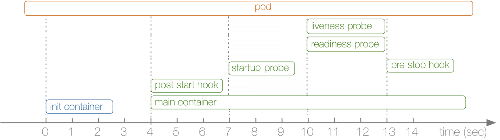

##### 3.2.2.2.2 启动 Pod 流程

1. 创建指令到送到 api server

2. 通知 scheduler 调度此请求到合适的节点

3. init 容器

初始化容器，独立于主容器之外，即和主容器是隔离的

Pod可以拥有任意数量的init容器，init顺序执行。最后一个执行完成后，才启动主容器。

init 容器不支持探针检测功能

它主要是为了主容器准备运行环境的功能，比如: 给主容器准备配置文件,向主容器的存储卷写入数据，然后将存储卷挂载到主容器上,下载相关资源,监测主容器依赖服务等。

4. 启动后钩子PostStart: 与主容器同时启动

5. 状态监测

Startup probe :  启动探针Liveiness probe: 判断当前pod是否处于存活状态,是Readiness存活的前提,对应READY状态的m/n的n值Readiness probe: 判断当前pod的主应用容器是否可以正常的对外提供服务,只有Liveniss 为存活,Readiness才有可能存活,对应READY状态的m/n的m值。

6. Service 关联 Pod

7. 接收用户请求

##### 3.2.2.2.3  关闭 Pod 流程
<https://kubernetes.io/zh-cn/docs/concepts/workloads/pods/pod-lifecycle/#pod-termination>

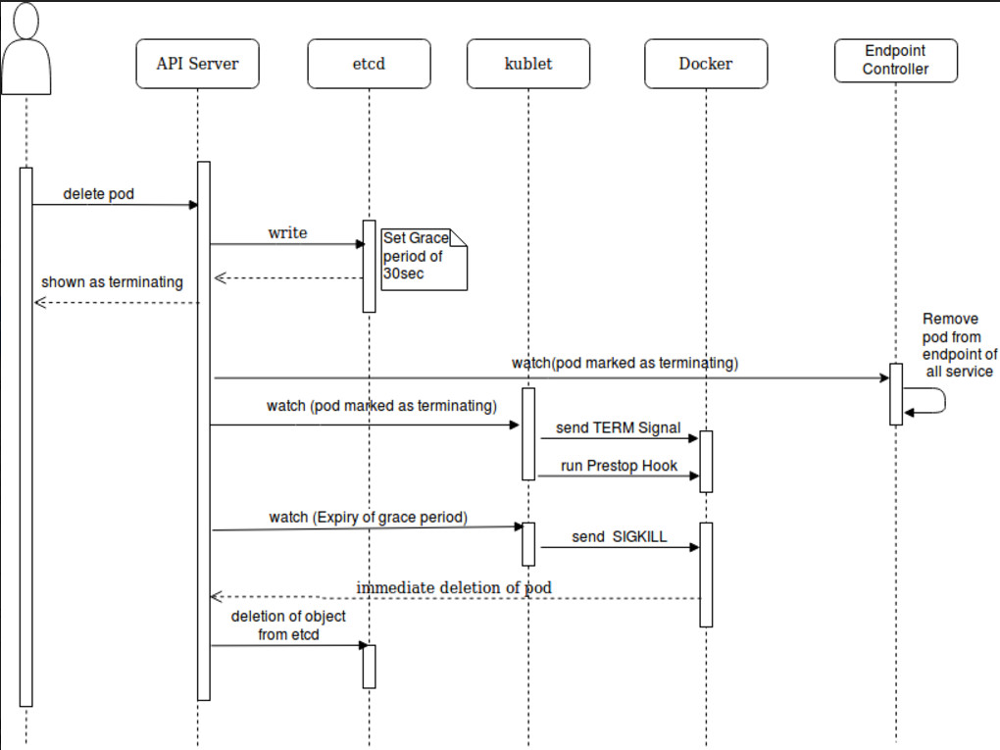

1. 你使用 kubectl 工具手动删除某个特定的 Pod，而该 Pod 的体面终止限期是默认值（30 秒）。

2. API 服务器中的 Pod 对象被更新，记录涵盖体面终止限期在内 Pod 的最终死期，超出所计算时间点则认为 Pod 已死（dead）。 如果你使用 kubectl describe 来查验你正在删除的 Pod，该Pod 会显示为 "Terminating" （正在终止）。 在 Pod 运行所在的节点上：kubelet 一旦看到 Pod被标记为正在终止（已经设置了体面终止限期），kubelet 即开始本地的 Pod 关闭过程。

如果 Pod 中的容器之一定义了 preStop 回调， kubelet 开始在容器内运行该回调逻辑。如果超出体面终止限期时，preStop 回调逻辑 仍在运行，kubelet 会请求给予该 Pod 的宽限期一次性增加 2 秒钟。

说明： 如果 preStop 回调所需要的时间长于默认的体面终止限期，你必须修改terminationGracePeriodSeconds 属性值来使其正常工作。kubelet 接下来触发容器运行时发送 TERM 信号给每个容器中的进程 1。

说明： Pod 中的容器会在不同时刻收到 TERM 信号，接收顺序也是不确定的。 如果关闭的顺序很重要，可以考虑使用 preStop 回调逻辑来协调。

3. 与此同时，kubelet 启动体面关闭逻辑，控制面会将 Pod 从对应的端点列表（以及端点切片列表， 如果启用了的话）中移除，过滤条件是 Pod 被对应的服务和其他工作负载资源 不再将关闭进程中的 Pod 视为合法的、能够提供服务的副本。关闭动作很慢的 Pod 也无法继续处理请求数据，因为负载均衡器（例如服务代理）已经在终止宽限期开始的时候将其从端点列表中移除。

4. 超出终止宽限期限时，kubelet 会触发强制关闭过程。容器运行时会向 Pod 中所有容器内仍在运行的进程发送 SIGKILL 信号。 kubelet 也会清理隐藏的 pause 容器，如果容器运行时使用了这种容器的话。

5. kubelet 触发强制从 API 服务器上删除 Pod 对象的逻辑，并将体面终止限期设置为 0 （这意味着马上删除）

6. API 服务器删除 Pod 的 API 对象，从任何客户端都无法再看到该对象

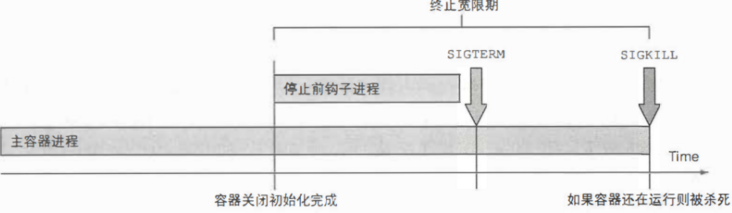

**设置终止宽限期**
```text
spec.terminationGracePeriodSecond
#spec.terminationGracePeriod
#默认为30s,此值为优雅终止宽限期
#如果程序的关闭时间和在Pod配置的preStop Hook之和超过30秒，应将
terminationGracePeriodSeconds重新设置，调整为大于30秒，确保容器优雅退出。

#删除命令：kubectl delete pod mypod --grace-period=5
#强制删除：kubectl delete pod mypod --grace-period=0 --force
```

**Pod终止流程和网络规则更新流程**：在删除Pod时K8s会同时进行Pod终止和网络规则更新两个主要的流程。Pod终止流程和网络更新流程如下。

**Pod终止流程**

1. kube-apiserver收到Pod删除请求，将Pod标记为Terminating 状态。

2. 如果Pod定义了preStop Hook，将执行preStop Hook。

3. K8s集群向容器发送SIGTERM信号。

4. 等待容器停止，或等待Pod删除宽限期超时。

说明

Pod中容器删除宽限期terminationGracePeriodSeconds 默认为30秒。

5. 超时Pod删除宽限期后容器仍未终止，K8s发送SIGKILL信号给容器。

6. Pod被完全删除。

**网络规则更新流程**

1. kube-apiserver收到Pod删除请求，将Pod标记为Terminating 状态。

2. Endpoint Controller从Endpoint对象中删除Pod的IP。

范例：
```bash
[root@master1 ~]#kubectl explain pod.spec.terminationGracePeriodSeconds
KIND:     Pod
VERSION:  v1

FIELD:    terminationGracePeriodSeconds <integer>
```


DESCRIPTION: Optional duration in seconds the pod needs to terminate gracefully. May be decreased in delete request. Value must be non-negative integer. The value zero indicates stop immediately via the kill signal (no opportunity to shut down). If this value is nil, the default grace period will be used instead. The grace period is the duration in seconds after the processes running in the pod are sent a termination signal and the time when the processes are forcibly halted with a kill signal. Set this value longer than the expected cleanup time for your process. Defaults to 30 seconds.

```bash
[root@master1 ~]#kubectl explain
pod.spec.containers.livenessProbe.terminationGracePeriodSeconds
KIND:       Pod
VERSION:    v1

FIELD: terminationGracePeriodSeconds <integer>
```


DESCRIPTION: Optional duration in seconds the pod needs to terminate gracefully upon probe failure. The grace period is the duration in seconds after the processes running in the pod are sent a termination signal and the time when the processes are forcibly halted with a kill signal. Set this value longer than the expected cleanup time for your process. If this value is nil, the pod's terminationGracePeriodSeconds will be used. Otherwise, this value overrides the value provided by the pod spec. Value must be non-negative integer. The value zero indicates stop immediately via the kill signal (no opportunity to shut down). This is a beta field and requires enabling ProbeTerminationGracePeriod feature gate. Minimum value is 1. spec.terminationGracePeriodSeconds is used if unset.


示例：
```yaml
https://kubernetes.io/zh-cn/docs/tasks/configure-pod-container/configure-liveness-readiness-startup-probes/#%E6%8E%A2%E9%92%88%E5%B1%82%E9%9D%A2%E7%9A%84-terminationgraceperiodseconds

spec:
terminationGracePeriodSeconds: 3600  # Pod 级别设置
containers:
- name: test
image: ...

ports:

- name: liveness-port
containerPort: 8080
hostPort: 8080

livenessProbe:
httpGet:
path: /healthz
port: liveness-port
failureThreshold: 1
periodSeconds: 60
# 重载 Pod 级别的 terminationGracePeriodSeconds
terminationGracePeriodSeconds: 60
```

##### 3.2.2.2.4 两种钩子PostStart和PreStop
<https://kubernetes.io/zh-cn/docs/tasks/configure-pod-container/attach-handler-lifecycle-event/>

根据上面Pod的启动流程，当容器中的进程启动前或者容器中的进程终止之前都会有一些额外的动作执行，这是由kubelet所设置的，在这里，我们称之为 pod hook。

对于Pod的流程启动，主要有两种钩子：

postStart，容器创建完成后立即运行，不保证一定会于容器中ENTRYPOINT之前运行,而Init Container可以实现preStop，容器终止操作之前立即运行，在其完成前会阻塞删除容器的操作调用。

关于钩子函数的执行主要有两种方式：

Exec，在钩子事件触发时，直接在当前容器中运行由用户定义的命令,用于执行一段特定的命令，不过要注意的是该命令消耗的资源会被计入容器。HTTP，在当前容器中向某URL发起HTTP请求。

###### 3.2.2.2.4.1 Poststart 钩子

实现方式：

exec httpGet tcpSocket

属性信息：kubectl explain pods.spec.containers.lifecycle
```bash
[root@master1 ~]#kubectl explain pods.spec.containers.lifecycle
KIND:       Pod
VERSION:    v1

FIELD: lifecycle <Lifecycle>
```


DESCRIPTION: Actions that the management system should take in response to container lifecycle events. Cannot be updated. Lifecycle describes actions that the management system should take in response to container lifecycle events. For the PostStart and PreStop lifecycle handlers, management of the container blocks until the action is complete, unless the container process fails, in which case the handler is aborted.


FIELDS: postStart <LifecycleHandler>PostStart is called immediately after a container is created. If the handler fails, the container is terminated and restarted according to its restart policy. Other management of the container blocks until the hook completes. More info:

<https://kubernetes.io/docs/concepts/containers/container-lifecycle->

hooks/#container-hooks


preStop   <LifecycleHandler>PreStop is called immediately before a container is terminated due to an API request or management event such as liveness/startup probe failure, preemption, resource contention, etc. The handler is not called if the container crashes or exits. The Pod's termination grace period countdown begins before the PreStop hook is executed. Regardless of the outcome of the handler, the container will eventually terminate within the Pod's termination grace period (unless delayed by finalizers). Other management of the container blocks until the hook completes or until the termination grace period is reached. More info:

<https://kubernetes.io/docs/concepts/containers/container-lifecycle->

hooks/#container-hooks

```bash
[root@master1 ~]#kubectl explain pods.spec.containers.lifecycle.postStart
KIND:     Pod
VERSION:  v1

RESOURCE: postStart <Object>
```


DESCRIPTION: PostStart is called immediately after a container is created. If the handler fails, the container is terminated and restarted according to its restart policy. Other management of the container blocks until the hook completes. More info:

<https://kubernetes.io/docs/concepts/containers/container-lifecycle->

hooks/#container-hooks

```text
LifecycleHandler defines a specific action that should be taken in a
lifecycle hook. One and only one of the fields, except TCPSocket must be
specified.

FIELDS:
exec <Object>
Exec specifies the action to take.

httpGet  <Object>
HTTPGet specifies the http request to perform.
```


tcpSocket    <Object>Deprecated. TCPSocket is NOT supported as a LifecycleHandler and kept for the backward compatibility. There are no validation of this field and lifecycle hooks will fail in runtime when tcp handler is specified.

```text
#新版
exec  <ExecAction>
Exec specifies a command to execute in the container.

httpGet   <HTTPGetAction>

HTTPGet specifies an HTTP GET request to perform.

sleep <SleepAction> #新功能
Sleep represents a duration that the container should sleep.
```


tcpSocket <TCPSocketAction>Deprecated. TCPSocket is NOT supported as a LifecycleHandler and kept for backward compatibility. There is no validation of this field and lifecycle hooks will fail at runtime when it is specified.

```bash
[root@master1 ~]#kubectl explain pods.spec.initContainers.lifecycle
KIND:     Pod
VERSION:  v1

RESOURCE: lifecycle <Object>

DESCRIPTION:
Actions that the management system should take in response to container
lifecycle events. Cannot be updated.
```


Lifecycle describes actions that the management system should take in response to container lifecycle events. For the PostStart and PreStop lifecycle handlers, management of the container blocks until the action is complete, unless the container process fails, in which case the handler is aborted.


FIELDS: postStart    <Object>PostStart is called immediately after a container is created. If the handler fails, the container is terminated and restarted according to its restart policy. Other management of the container blocks until the hook completes. More info:

<https://kubernetes.io/docs/concepts/containers/container-lifecycle->

hooks/#container-hooks


preStop  <Object>PreStop is called immediately before a container is terminated due to an API request or management event such as liveness/startup probe failure, preemption, resource contention, etc. The handler is not called if the container crashes or exits. The Pod's termination grace period countdown begins before the PreStop hook is executed. Regardless of the outcome of the handler, the container will eventually terminate within the Pod's termination grace period (unless delayed by finalizers). Other management of the container blocks until the hook completes or until the termination grace period is reached. More info:

<https://kubernetes.io/docs/concepts/containers/container-lifecycle->

hooks/#container-hooks


范例:
```yaml
[root@master1 ~]#cat pod-poststart.yaml
apiVersion: v1
kind: Pod
metadata:

name: pod-poststart
spec:
containers:
- name: busybox
#image: busybox:1.32.0
image: registry.cn-beijing.aliyuncs.com/bowen/busybox:1.32.0
lifecycle:
postStart:
exec:
command: ["/bin/sh","-c","echo lifecycle poststart at $(date) >
/tmp/poststart.log"]
command: ['sh', '-c', 'echo The app is running at $(date) && sleep 3600']

#启动文件
[root@master1 ~]#kubectl apply  -f  pod-poststart.yaml
pod/pod-poststart created

[root@master1 ~]#kubectl get pod
NAME            READY   STATUS    RESTARTS   AGE
pod-poststart   1/1     Running   0          3s

#查看效果
[root@master1 ~]#kubectl exec pod-poststart -- ls /tmp/
poststart.log

#观察Pod启动时运行的命令和poststart定义的指令是同时执行的
[root@master1 ~]#kubectl  logs pod-poststart
lifecycle poststart at Mon Jul 15 09:37:05 UTC 2024

[root@master1 ~]#kubectl exec pod-poststart -- cat  /tmp/poststart.log
lifecycle poststart at Mon Jul 15 09:37:05 UTC 2024

#清理环境
[root@master1 ~]#kubectl  delete -f  pod-poststart.yaml
pod "pod-poststart" deleted
```

###### 3.2.2.2.4.2 Prestop 钩子

功能：实现pod对象移除之前，需要做一些清理工作，比如:释放资源，解锁等。

实现方式：

exec httpGet tcpSocket

钩子处理程序的日志不会在 Pod 事件中公开。 如果处理程序由于某种原因失败，它将播放一个事件。对于 PostStart，这是 FailedPostStartHook 事件，对于 PreStop，这是 FailedPreStopHook 事件。可以通过运行 kubectl describe pod <pod_name> 命令来查看这些事件。
```bash
[root@master1 ~]#kubectl explain pods.spec.containers.lifecycle.preStop
KIND:     Pod
VERSION:  v1

RESOURCE: preStop <Object>

DESCRIPTION:
```


PreStop is called immediately before a container is terminated due to an API request or management event such as liveness/startup probe failure, preemption, resource contention, etc. The handler is not called if the container crashes or exits. The Pod's termination grace period countdown begins before the PreStop hook is executed. Regardless of the outcome of the handler, the container will eventually terminate within the Pod's termination grace period (unless delayed by finalizers). Other management of the container blocks until the hook completes or until the termination grace period is reached. More info:

<https://kubernetes.io/docs/concepts/containers/container-lifecycle->

hooks/#container-hooks

```text
LifecycleHandler defines a specific action that should be taken in a
lifecycle hook. One and only one of the fields, except TCPSocket must be
specified.

FIELDS:
exec <Object>
Exec specifies the action to take.

httpGet  <Object>
HTTPGet specifies the http request to perform.
```


tcpSocket    <Object>Deprecated. TCPSocket is NOT supported as a LifecycleHandler and kept for the backward compatibility. There are no validation of this field and lifecycle hooks will fail in runtime when tcp handler is specified.

```bash
[root@master1 ~]#kubectl explain pods.spec.initContainers.lifecycle.preStop
KIND:     Pod
VERSION:  v1

RESOURCE: preStop <Object>
```


DESCRIPTION: PreStop is called immediately before a container is terminated due to an API request or management event such as liveness/startup probe failure, preemption, resource contention, etc. The handler is not called if the container crashes or exits. The Pod's termination grace period countdown begins before the PreStop hook is executed. Regardless of the outcome of the handler, the container will eventually terminate within the Pod's termination grace period (unless delayed by finalizers). Other management of the container blocks until the hook completes or until the termination grace period is reached. More info:

<https://kubernetes.io/docs/concepts/containers/container-lifecycle->

hooks/#container-hooks

```text
LifecycleHandler defines a specific action that should be taken in a
lifecycle hook. One and only one of the fields, except TCPSocket must be
specified.

FIELDS:
exec <Object>
Exec specifies the action to take.

httpGet  <Object>
HTTPGet specifies the http request to perform.
```


tcpSocket    <Object>Deprecated. TCPSocket is NOT supported as a LifecycleHandler and kept for the backward compatibility. There are no validation of this field and lifecycle hooks will fail in runtime when tcp handler is specified.


范例:
```yaml
#由于默认情况下，删除的动作和日志我们都没有办法看到，那么我们这里采用一种间接的方法，在删除动作之
前，给本地目录创建第一个文件，输入一些内容
[root@master1 ~]#cat pod-prestop.yaml
apiVersion: v1
kind: Pod
metadata:
name: pod-prestop
spec:
volumes:
- name: vol-prestop
hostPath:
path: /tmp
containers:
- name: prestop-pod-container
image: registry.cn-beijing.aliyuncs.com/bowen/busybox:1.32.0
volumeMounts:
- name: vol-prestop
mountPath: /tmp
command: ['sh', '-c', 'echo The app is running at $(date)  && sleep 3600']
lifecycle:
postStart:
exec:
command: ['/bin/sh', '-c','echo lifecycle poststart at $(date) >
/tmp/poststart.log']
preStop:
exec:
command: ['/bin/sh', '-c', 'echo lifecycle prestop at $(date)  >
/tmp/prestop.log']

#运行前确定所有节点目录文件列表
[root@node1 ~]#ls /tmp

#启动Pod
[root@master1 ~]#kubectl apply -f pod-prestop.yaml

#查看到此pod运行在node1节点上
[root@master1 ~]#kubectl get pod -o wide
NAME          READY   STATUS    RESTARTS   AGE   IP            NODE
NOMINATED NODE   READINESS GATES
pod-prestop   1/1     Running   0          25s   172.16.3.22   node1.bowen.org
<none>           <none>

#查看到node1的目录下生成文件
[root@node1 ~]#ls /tmp
poststart.log

[root@node1 ~]#cat /tmp/poststart.log
lifecycle poststart at Mon Jul 15 09:40:05 UTC 2024

#删除pod
[root@master1 ~]#kubectl delete  -f pod-prestop.yaml

#再查看文件
[root@node1 ~]#ls /tmp
poststart.log prestop.log
[root@node1 ~]#cat /tmp/prestop.log
lifecycle prestop at Mon Jul 15 09:42:15 UTC 2024
```

范例: 后端Pod滚动升级时平滑下线Pod
```yaml
#清单文件
cat pod-prestop-demo.yaml
apiVersion: apps/v1
kind: Deployment
metadata:
name: prestop-demo
spec:
replicas: 3
selector:
matchLabels:
app: prestop-demo
template:
metadata:
labels:
app: prestop-demo
spec:
containers:
- name: prestop-demo
image: registry.cn-beijing.aliyuncs.com/bowen/pod-test:v0.1
ports:
- containerPort: 80
lifecycle:  # 设置preStop Hook函数，使kube-apiserver等待10秒后再向Pod发送
SIGTERM信号。
preStop:  # preStop钩子设置。
exec:  # 通过执行命令的方式来实现preStop操作。
command:  # 定义要执行的命令。
- /bin/sh
- -c
- "sleep 10"  # 执行sleep操作，暂停10秒。
terminationGracePeriodSeconds: 45  # 设置Pod删除宽限期，一定要大于preStop的执行
时间，否则会导致preStop执行没有完成，就立即删除Pod
---
apiVersion: v1
kind: Service
metadata:
name: prestop-demo-svc
spec:
ports:
- port: 80
targetPort: 80
protocol: TCP
selector:
app: prestop-demo
type: NodePort

#test.sh
#!/bin/bash
HOST="SVC_IP"
#HOST="demo.bowen.org"
printf "Response Code|| TIME \n" >> log.txt

while true; do
#RESPONSE=$(curl -H Host:$HOST  -s -o /dev/null -w "%{http_code}" -m 1
http://$HOST/)
RESPONSE=$(curl -H Host:$HOST  -s -o /dev/null -w "%{http_code}" -m 1
http://$HOST/)
TIMESTAMP=$(date +%Y-%m-%d_%H:%M:%S)
echo "$TIMESTAMP - $RESPONSE" >> log.txt
sleep 1
done

#运行test.sh
bash test.sh

#重新部署应用，触发Pod滚动升级
kubectl rollout restart deploy prestop-demo

#查看log.txt
cat log.txt
```

#### 3.2.2.3 Pod 状态


- <https://kubernetes.io/docs/concepts/workloads/pods/pod-lifecycle/>


##### 3.2.2.3.1 Pod 状态说明

正常情况：

在Kubernetes集群中，真正工作的是Node节点，所以业务的子应用也就是Pod，肯定会被分配到相应的Node节点上。Pod一旦绑定到Node节点，正常情况下不会移动，即便Node节点发生重启。Pod作为一种资源对象，在整个业务生命周期中，会随着操作而出现五种状态：pending，running，succeeded，failed，Unknown。业务应用作为系统的一部分，会有相应的资源对象对它们进行统一管理，所以不建议手工单独创建一个Pod。

异常情况：

业务运行过程中不可避免会出现意外，这个时候有三种策略对Pod进行管理：   OnFailure，Never和Always（默认）。

##### 3.2.2.3.2 Pod  phase 阶段 （相位）
<https://kubernetes.io/zh-cn/docs/concepts/workloads/pods/pod-lifecycle/#pod-phase>

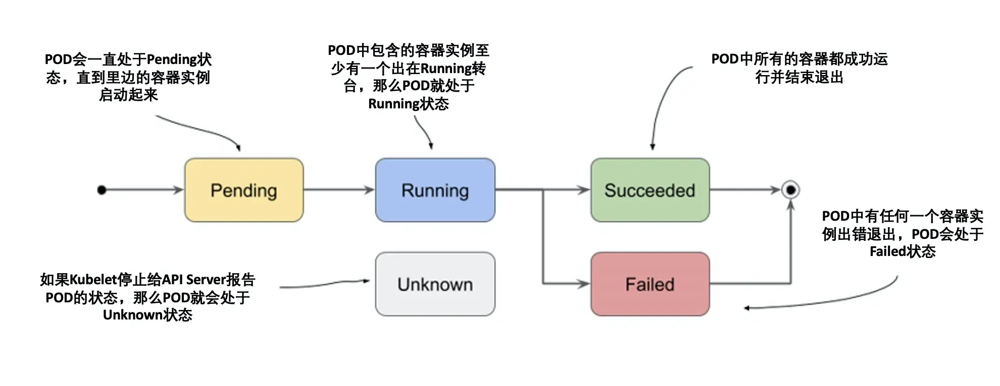

**Pod 阶段（phase）取值说明**

**Pending**：Pod 已被 Kubernetes 集群接受，但一个或多个容器尚未准备好运行，包括等待调度和通过网络下载容器镜像的时间。

**Running**：Pod 已绑定到节点，且所有容器均已创建。至少一个容器正在运行，或正在启动、重新启动。

**Succeeded**：Pod 中的所有容器均已成功终止，且不会重新启动。

**Failed**：Pod 中的所有容器均已终止，其中至少一个因故障终止，即以非零状态退出或被系统终止。

**Unknown**：因与 Pod 所在节点通信发生错误等原因，暂时无法获取 Pod 状态。
```bash
#查看状态说明
[root@master1 ~]#kubectl explain pods.status.phase
KIND:     Pod
VERSION:  v1

FIELD:    phase <string>
```


DESCRIPTION: The phase of a Pod is a simple, high-level summary of where the Pod is in its lifecycle. The conditions array, the reason and message fields, and the individual container status arrays contain more detail about the pod's status. There are five possible phase values:


Pending: The pod has been accepted by the Kubernetes system, but one or more of the container images has not been created. This includes time before being scheduled as well as time spent downloading images over the network, which could take a while. Running: The pod has been bound to a node, and all of the containers have been created. At least one container is still running, or is in the process of starting or restarting. Succeeded: All containers in the pod have terminated in success, and will not be restarted. Failed: All containers in the pod have terminated, and at least one container has terminated in failure. The container either exited with non-zero status or was terminated by the system. Unknown: For some reason the state of the pod could not be obtained, typically due to an error in communicating with the host of the pod.

```text
More info:
```


- <https://kubernetes.io/docs/concepts/workloads/pods/pod-lifecycle#pod-phase>

```bash
#查看
[root@master1 ~]#kubectl get pod pod-test -o yaml |grep -A 2 phase
phase: Running
podIP: 172.16.4.38
podIPs:
```

##### 3.2.2.3.3 Pod 内容器状态

容器的主要状态如下:

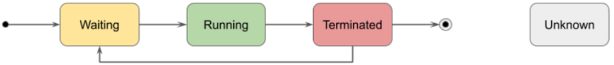

容器状态描述

Waiting容器处于 Running 和Terminated 状态之前的状态

Running容器能够正常的运行状态

Terminated容器已经被成功的关闭了
```bash
[root@master1 ~]#kubectl explain pods.status.containerStatuses.state
KIND:     Pod
VERSION:  v1

RESOURCE: state <Object>

DESCRIPTION:
Details about the container's current condition.

ContainerState holds a possible state of container. Only one of its members
may be specified. If none of them is specified, the default one is
ContainerStateWaiting.

FIELDS:
running  <Object>
Details about a running container

terminated   <Object>
Details about a terminated container

waiting  <Object>
Details about a waiting container

#查看
[root@master1 ~]#kubectl get pod pod-test -o yaml |grep -A 2 state
state:
running:
startedAt: "2020-03-17T06:32:12Z"
```

##### 3.2.2.3.4 Pod 的启动流程状态


- <https://kubernetes.io/docs/concepts/workloads/pods/pod-lifecycle/#pod-conditions>


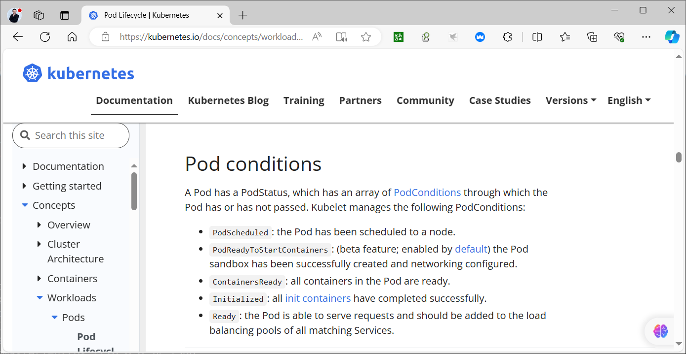

**Pod 条件状态说明**

**PodScheduled**：Pod 已调度到某个节点。

**Ready**：Pod 已准备好处理请求。

**Initialized**：Pod 中所有 Init 容器均已完成初始化。

**Unschedulable**：因资源等限制，Pod 暂时无法被调度。

**ContainersReady**：Pod 中所有容器均已准备就绪。
```bash
[root@master1 ~]#kubectl explain pods.status.conditions.type
KIND:     Pod
VERSION:  v1

FIELD:    type <string>

DESCRIPTION:
Type is the type of the condition. More info:
https://kubernetes.io/docs/concepts/workloads/pods/pod-lifecycle#pod-conditions

[root@master1 ~]#kubectl get pod pod-test -o yaml |grep -A 15 conditions
conditions:
- lastProbeTime: null
lastTransitionTime: "2022-03-17T06:32:12Z"
status: "True"
type: Initialized
- lastProbeTime: null
lastTransitionTime: "2022-03-17T06:32:13Z"
status: "True"
type: Ready
- lastProbeTime: null

lastTransitionTime: "2022-03-17T06:32:13Z"
status: "True"
type: ContainersReady
- lastProbeTime: null
lastTransitionTime: "2022-03-17T06:32:12Z"
status: "True"
```

##### 3.2.2.3.5  Pod 重启策略
<https://kubernetes.io/zh-cn/docs/concepts/workloads/pods/pod-lifecycle/#restart-policy>

注意：同一个 Pod 内所有容器只能使用统一的重启策略。

说明

**重启策略描述**

Always无论退出码exit code是否为0，都要重启，即只要退出就重启，并且重启次数并没。

有限制，此为默认值

OnFailure容器终止运行退出码exit code不为0时才重启,重启次数并没有限制。

Never无论何种退出码exit code,Pod都不重启。主要针对Job和CronJob。
```bash
[root@master1 ~]#kubectl explain pods.spec.restartPolicy
KIND:     Pod
VERSION:  v1

FIELD:    restartPolicy <string>
```


DESCRIPTION: Restart policy for all containers within the pod. One of Always, OnFailure, Never. Default to Always. More info:

<https://kubernetes.io/docs/concepts/workloads/pods/pod-lifecycle/#restart->

policy

```bash
#查看
[root@master1 ~]#kubectl get pod pod-test -o yaml |grep restartPolicy
restartPolicy: Always
```

范例：
```yaml
[root@master1 ~]#cat pod-restart-policy.yaml
apiVersion: v1
kind: Pod
metadata:
labels:
run: myapp
name: myapp
namespace: default
spec:
containers:
- image: registry.cn-beijing.aliyuncs.com/bowen/busybox:1.32.0
name: myapp
restartPolicy: OnFailure #默认Always策略，会不断重启

#默认Always策略会不断重启，状态 CrashLoopBackOff
[root@master1 ~]#kubectl get pod
NAME    READY   STATUS             RESTARTS      AGE
myapp   0/1     CrashLoopBackOff   6 (62s ago)   6m46s

#指定OnFailure策略，退出码为0，不会重启
[root@master1 ~]#kubectl apply -f  pod-test.yaml

[root@master1 ~]#kubectl get pod
NAME    READY   STATUS      RESTARTS   AGE
myapp   0/1     Completed   0          85s
```

##### 3.2.2.3.6 Pod 镜像拉取策略

**拉取策略描述**

Always总是拉取新镜像，注意：如果镜像的Tag为latest，拉取策略为always或

ifNotPresent 都会重新拉取镜像。

IfNotPresent此为默认值，如果本地不存在的话，再拉取新镜像，例外情况:如果镜像的Tag为

latest，仍会重新拉取镜像

Never只使用本地的镜像，从不获取新镜像。
```bash
[root@master1 ~]#kubectl explain pod.spec.containers.imagePullPolicy
KIND:     Pod
VERSION:  v1

FIELD:    imagePullPolicy <string>
```


DESCRIPTION: Image pull policy. One of Always, Never, IfNotPresent. Defaults to Always if :latest tag is specified, or IfNotPresent otherwise. Cannot be updated. More info:

<https://kubernetes.io/docs/concepts/containers/images#updating-images>

```bash
#查看发现IfNotPresent是默认值
[root@master1 ~]#kubectl get pod pod-test -o yaml |grep imagePullPolicy
imagePullPolicy: IfNotPresent
```

范例：
```yaml
[root@master1 pod]#cat pod-imagePullPolicy.yaml
apiVersion: v1
kind: Pod
metadata:
labels:
run: myapp
name: myapp
namespace: default
spec:
containers:
- image: registry.cn-beijing.aliyuncs.com/bowen/busybox:1.32.0
imagePullPolicy: Never
name: myapp

restartPolicy: OnFailure

[root@master1 pod]#kubectl apply -f  pod-imagePullPolicy.yaml

#如果没有镜像，会出现下面错误
[root@master1 pod]#kubectl  get pod
NAME    READY   STATUS              RESTARTS   AGE
myapp   0/1     ErrImageNeverPull   0          3s
```

##### 3.2.2.3.7 Pod 状态汇总

**常见 Pod 状态及原因**

- **Pending**：API Server 已创建 Pod，但尚未调度到合适节点，或容器尚未准备好。
- **Running**：Pod 的容器已创建，至少一个容器正在运行、启动或重新启动。
- **Waiting**：Pod 等待启动。
- **Terminating**：Pod 正在删除。若超过终止宽限期仍未删除，可执行 `kubectl delete pod <pod_name> -n <namespace> --grace-period=0 --force` 强制删除。
- **Succeeded**：所有容器均成功退出，且不会重新启动。
- **Ready**：Pod 已准备好提供服务。
- **Failed**：所有容器均已退出，其中至少一个容器失败。
- **Unknown**：因网络不通等原因，kubelet 暂时无法获取 Pod 状态。
- **CrashLoopBackOff**：Pod 曾成功启动，但容器反复异常退出，进入重启退避。原材料举例的等待时间依次为 0 秒、10 秒、20 秒，至第 6 次 160 秒、第 7 次 300 秒；持续失败时显示此状态。
- **Error**：集群配置、安全限制或资源等问题导致 Pod 启动出错。
- **Evicted**：节点内存或磁盘资源不足，Pod 被驱逐。
- **Completed**：Pod 已执行完成，常见于一次性 Job 或周期性 CronJob。
- **Unschedulable**：因没有合适的节点等原因，Pod 暂时无法调度。
- **PodScheduled**：Pod 正在调度到节点，通常持续时间很短。
- **Initialized**：Pod 中所有 Init 容器均已完成初始化。
- **ImagePullBackOff**：Pod 镜像拉取失败后进入退避等待。
- **InvalidImageName**：镜像名称无效，导致无法下载镜像。
- **ImageInspectError**：镜像检查失败，可能是镜像不完整。
- **ErrImageNeverPull**：镜像拉取策略禁止拉取，或私有镜像及仓库权限配置不当。
- **RegistryUnavailable**：镜像仓库不可用，例如网络故障或仓库服务宕机。
- **ErrImagePull**：镜像拉取失败，可能是镜像地址错误、超时或拉取中断。
- **NetworkPluginNotReady**：网络插件异常，新建容器可能失败，已有容器通常不受影响。
- **NodeLost**：无法联系 Pod 所在节点。
- **CreateContainerConfigError**：创建容器的配置出错。
- **CreateContainerError**：创建容器时发生错误。
- **RunContainerError**：运行容器时出错，例如缺少 PID 为 1 的前台进程。
- **ContainersNotInitialized**：容器尚未完成初始化。
- **ContainersNotReady**：容器尚未准备就绪。
- **ContainerCreating**：容器正在创建。
- **PodInitializing**：Pod 正在初始化。
- **DockerDaemonNotReady**：节点上的 Docker 服务异常。

范例：Pending状态
```bash
#如果所有worker无法工作，会导致pod无法调度，出现pending
[root@master1 pod]#kubectl  describe pod myapp
Events:
Type     Reason            Age   From               Message
----     ------            ----  ----               -------
Warning  FailedScheduling  10s   default-scheduler  0/4 nodes are available: 1
node(s) had untolerated taint {node-role.kubernetes.io/control-plane: }, 3
node(s) had untolerated taint {node.kubernetes.io/unreachable: }. preemption:
0/4 nodes are available: 4 Preemption is not helpful for scheduling.
```



<nav class="article-end" aria-label="章节导航">
  <a href="{{ '/subjects/Kubernetes/07-api-objects-namespaces.html' | relative_url }}">← 上一章：API 资源对象、清单与命名空间</a>
  <a href="{{ '/subjects/Kubernetes/' | relative_url }}">返回 Kubernetes 目录</a>
  <a href="{{ '/subjects/Kubernetes/09-pod-health-resources.html' | relative_url }}">下一章：Pod 健康、资源、安全与设计模式 →</a>
</nav>
