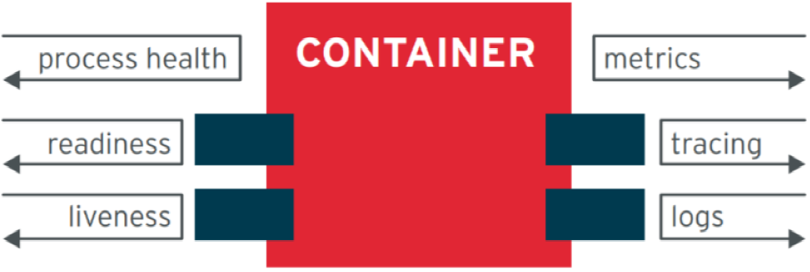
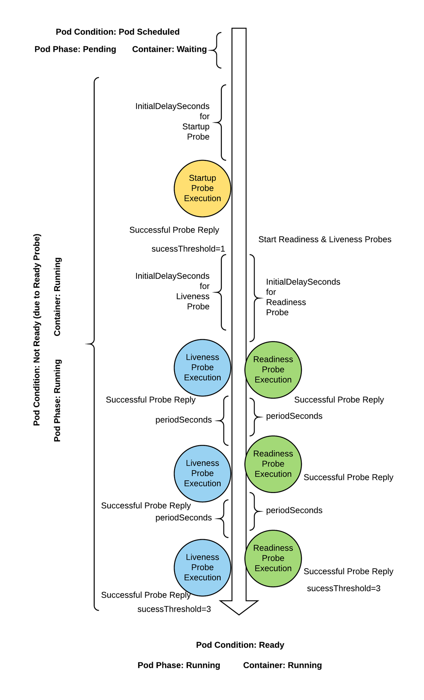
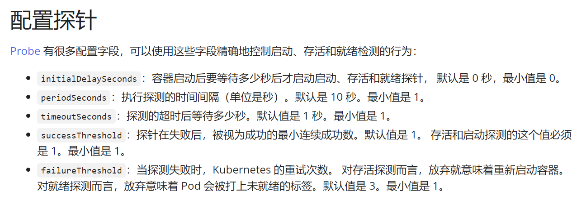
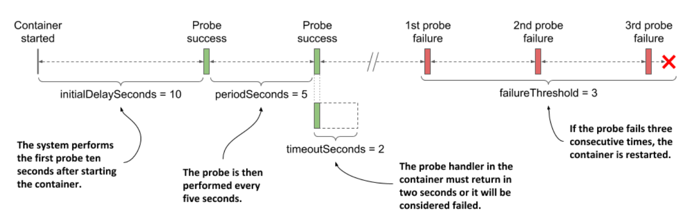
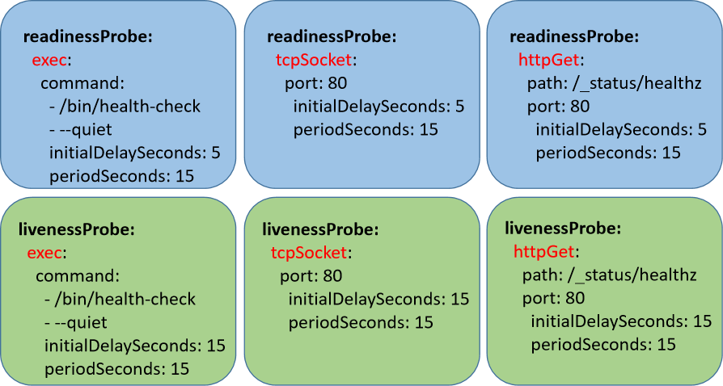
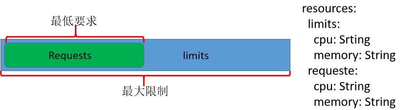
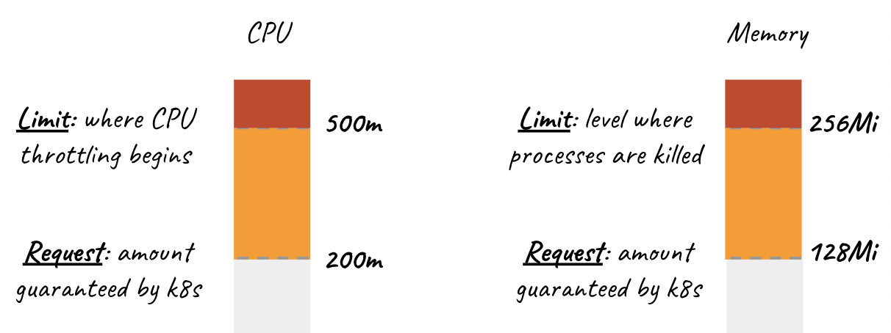
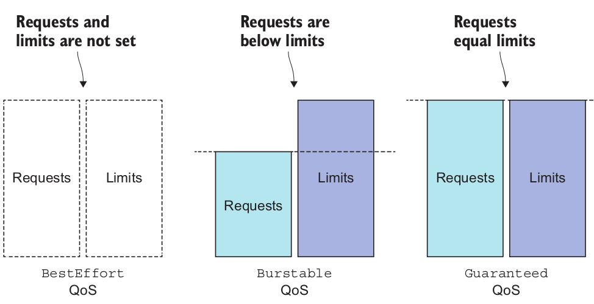
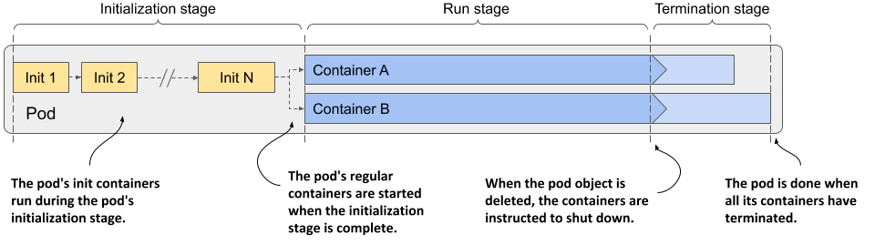
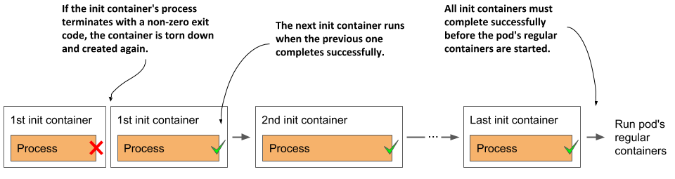

[← 返回 Kubernetes 目录]({{ '/subjects/Kubernetes/' | relative_url }})



# 09 Pod 健康、资源、安全与设计模式

## 3.3 Pod 的健康状态监测

```text
https://kubernetes.io/zh-cn/docs/tasks/configure-pod-container/configure-
liveness-readiness-startup-probes/
```

### 3.3.1 健康状态检测三种探针

#### 3.3.1.1 Pod 的状态监控

在以镜像打包技术为基础的环境中，容器运行起来的效果就类似于一个"黑盒"。

默认情况下我们不知道里面是一种什么样的运行环境，为了实时的监控容器应用环境的运行状态，docker 容器提供了inspect的方法，让我们主动来采集相关的状态数据，但是这种方式太繁琐了。实际上，我们需要一种可以及时的获取容器的各种运行状态数据，所以对于容器任务编排的环境下，他们都应该考虑到一种场景：主动的将容器运行的相关数据暴露出来 -- 数据暴露接口。比如：包含大量metric指标数据的API接口。

对于kubernetes内部的pod环境来说，常见的这些API接口有：



```text
process health  #状态健康检测接口
readiness       #容器可读状态的接口
liveness        #容器存活状态的接口
metrics         #监控指标接口
tracing         #全链路监控的埋点(探针)接口
logs            #容器日志接口
```

#### 3.3.1.2 Pod 的健康性监控

Pod 通过探针要制实现Pod 的健康性监控,当一旦检测出Pod故障时，会重置Pod或将Pod从service后端endpoint删除，从而实现服务的高可用。

##### 3.3.1.2.1 探针类型

针对运行中的容器，kubelet 可以选择是否执行以下三种探针，以及如何针对探测结果作出反应。

```text
https://kubernetes.io/zh-cn/docs/concepts/workloads/pods/pod-lifecycle/#types-of-
probe
https://kubernetes.io/zh-cn/docs/tasks/configure-pod-container/configure-
liveness-readiness-startup-probes/
```

Pod 支持的监测探针类型如下：



**StartupProbe**：kuberenetes1.16引用, 启动探针,Pod 在启动时只进行一次,主要用于一些启动较慢的应用。

指示容器中的应用是否已经启动。如果提供了启动探针，则所有其他探针都会被禁用，直到此探针成功为止。如果启动探测失败，kubelet 将杀死容器， 而容器依其重启策略进行重启。检测失败后，默认先删除Pod中容器，并且重新创建容器，但Pod的ID名称不变，如果继续失败，重复此过程。如果容器没有提供启动探测，则默认状态为 Success。只有此探针成功,才能启动容器后续的LivenessProbe和ReadinessProbe探针,否则kubelet会关闭容器,并按restartPolicy处理。

如果没有定义此探针,默认成功

实现用户自定义的一些启动探测机制，效果等同于livenessProbe，区别在于应用不同的参数或阈值。

参照资料：kubectl explain pod.spec.containers.startupProbe

**LivenessProbe**：指示容器是否正在运行。如果存活态探测失败，则 kubelet 会杀死容器， 并且容器将根据其重启策略决定未来。如果容器不提供存活探针， 则默认状态为 Success。

存活探针,周期性检测,用于持继跟踪探测容器是否运行,即只探测容器是否活着,但活着不一定能正常工作。检测未通过时，kubelet会关闭容器,并根据restartPolicy的定义来决定是否会重启该容器，默认会重置Pod（重新还原镜像）并重启，但Pod名称，UID，IP及内核配置保持不变。

检测失败后,会在kubectl get pod 显示的STATUS状态为CrashLoopBackOff,

检测失败后，默认先删除Pod中容器，并且重新创建容器，但Pod的ID名称不变，如果继续失败，重复此过程。检测失败后，重启此Pod时，如果配置对应的Service，其后端endpoint也会删除此Pod的地址，但Pod重启后会再添加进endpoint。未定义时，Kubelet认为只要容器未终止，即为健康。

参考资料：kubectl explain pod.spec.containers.livenessProbe

**ReadinessProbe**：就绪探针,周期性检测,一般用于持继跟踪探测容器内应用是否健康,即探测容器不仅活着,而且可以正常工作。

指示容器是否准备好为请求提供服务。如果就绪态探测失败， 端点控制器将从与 Pod 匹配的所有服务的端点列表中删除该 Pod 的 IP 地址。 初始延迟之前的就绪态的状态值默认为 Failure 。 如果容器不提供就绪态探针，则默认状态为 Success 。检测检测失败，与该Pod关联的Service，会将该Pod从Service的后端可用端点列表中删除；直至再次就绪，重新添加回来。

如果检测失败，kubectl get pod 显示STATUS状态仍为Running，但是READY状态为0/1，此外重启Pod与否需要看情况。初始延迟前的就绪状态默认为Failure。未定义时，只要容器未终止，即为就绪。

参考资料：kubectl explain pod.spec.containers.ReadnessProbe

范例： 查看kube-apiserver 的Pod内置的探针

```text
[root@master1 ~]#kubectl get pod -n kube-system kube-apiserver-master1.wang.org -
o yaml |grep -A10  Probe
```

```text
livenessProbe:
failureThreshold: 8
httpGet:
host: 10.0.0.100
path: /livez
port: 6443
scheme: HTTPS
initialDelaySeconds: 10
periodSeconds: 10
successThreshold: 1
timeoutSeconds: 15
--
readinessProbe:
failureThreshold: 3
httpGet:
host: 10.0.0.100
path: /readyz
port: 6443
scheme: HTTPS
periodSeconds: 1
successThreshold: 1
timeoutSeconds: 15
resources:
--
startupProbe:
failureThreshold: 24
httpGet:
host: 10.0.0.100
path: /livez
port: 6443
scheme: HTTPS
initialDelaySeconds: 10
periodSeconds: 10
successThreshold: 1
timeoutSeconds: 15
...
```

##### 3.3.1.2.2 配置探针

```text
https://kubernetes.io/zh-cn/docs/tasks/configure-pod-container/configure-
liveness-readiness-startup-probes/#configure-probes
```





```text
##注意：下面以livenessProbe为例，StartupProbe和readnessProbe 的属性与livenessProbe是相
同的
spec:
containers:
- name: string
image: string
livenessProbe:
exec <Object>                     # 命令式探针
httpGet <Object>                  # http GET类型的探针
tcpSocket <Object>                # tcp Socket类型的探针
initialDelaySeconds <integer>     # 发起初次探测请求前的延迟时长，默认为0，生产根
据服务启动时长来设置，防止反复重启
periodSeconds <integer>           # 每次探测请求间隔,即探测的周期,默认10s，如果
Pod众多，可适当设长，比如60s
timeoutSeconds <integer>          # 探测的超时时长，默认是1s
successThreshold <integer>        # 连续成功几次才表示状态正常，默认值是1次，注
意：liveness和startup只能是1
failureThreshold <integer>        # 连续失败几次才表示状态异常，默认值是3次，即从
成功变为失败的检查次数
```

### 3.3.2 实现探针的三种方式

监测的实现方式

对于Pod中多容器的场景，只有所有容器就绪，才认为Pod就绪。

```text
https://kubernetes.io/zh-cn/docs/concepts/workloads/pods/pod-lifecycle/#container-probes
```

kubelet 定期执行LivenessProbe和ReadinessProbe探针来诊断Pod的健康状况，Pod 探针有多种实现方式，常见的方式如下：

**探针实现方式**

**Exec**：在容器中执行指定命令，根据命令退出状态码（如 $?）判断是否探测成功。

**TCPSocket**：尝试建立 TCP 连接。目标端口能够正常打开即表示成功。

**HTTPGet**：请求指定的 HTTP 或 HTTPS URL，返回 2xx 或 3xx 状态码即表示成功。

**gRPC**：调用目标应用实现的 gRPC 健康检查服务，响应状态为 SERVING 时表示成功。原材料注明，该方式曾是 Alpha 特性，需要启用 GRPCContainerProbe 特性门控。



注意：不同探针可采用上述检测方式，具体支持情况以使用的 Kubernetes 版本为准。

范例：

```text
[root@master1 ~]#kubectl get pod -n kube-system    -l k8s-app=kube-dns -o yaml
|grep -m2 -EA9 'livenessProbe|readinessProbe'
livenessProbe:
failureThreshold: 5
httpGet:
path: /health
port: 8080
scheme: HTTP
initialDelaySeconds: 60
periodSeconds: 10
successThreshold: 1
timeoutSeconds: 5
--
readinessProbe:
failureThreshold: 3
httpGet:
path: /ready
port: 8181
scheme: HTTP
```

```text
periodSeconds: 10
successThreshold: 1
timeoutSeconds: 1
resources:
```

### 3.3.3 探针案例

#### 3.3.3.1 Exec 方式案例

```text
https://kubernetes.io/zh-cn/docs/tasks/configure-pod-container/configure-
liveness-readiness-startup-probes/#define-a-liveness-command
```

exec 其实就是尝试通过在容器内部来执行一个命令，看看能不能执行成功，如果成功，那么说明该对象是正常的，否则就是失败的。

exec的执行动作与我们之前用到的command作用一样。

范例：startupprobe的exec探针

```text
#准备yaml文件
[root@master1 ~]#cat  pod-startup-exec.yaml
apiVersion: v1
kind: Pod
metadata:
name: pod-startup-exec
namespace: default
labels:
app: pod-startup-exec
spec:
containers:
- name: pod-startup-exec-container
image: registry.cn-beijing.aliyuncs.com/wangxiaochun/pod-test:v0.1
imagePullPolicy: IfNotPresent
startupProbe:
exec:
command: ['/bin/sh', '-c', '[ "$(curl -s 127.0.0.1/livez)" == "OK" ]']
initialDelaySeconds: 60
timeoutSeconds: 1                #此容器返回结果需要花几秒时间，所以此处1s会导致检
查失败，可以设为5s以上可以成功
periodSeconds: 5
successThreshold: 1
failureThreshold: 1
```

```text
#创建Pod
[root@master1 ~]#kubectl apply -f pod-startup-exec.yaml
```

```text
#查看Pod，发现READY为0/1表示没有
[root@master1 pod]#kubectl get pod pod-startup-exec  -o wide
NAME                             READY   STATUS        RESTARTS      AGE     IP
NODE             pod-startup-exec            0/1     Running       0
12s     10.244.2.116   node2.wang.org   <none>           <none
```

```text
#此应用刚启动首次访问默认需要等5s后才能访问
[root@master1 ~]#curl 10.244.2.116/livez
^C
```

```text
#模拟故障
[root@master1 ~]#curl -XPOST -d 'livez=FAIL'  10.244.2.116/livez
```

```text
#访问故障
[root@master1 ~]#curl 10.244.2.116/livez
FAIL
```

```text
#查看状态
[root@master1 ~]#kubectl describe pod pod-startup-exec
.......
Events:
Type     Reason     Age   From               Message
----     ------     ----  ----               -------
Normal   Scheduled  49s   default-scheduler  Successfully assigned default/pod-
startup-exec to node2.wang.org
Normal   Pulled     49s   kubelet            Container image
"wangxiaochun/pod-test:v0.1" already present on machine
Normal   Created    49s   kubelet            Created container pod-startup-
exec-container
Normal   Started    49s   kubelet            Started container pod-startup-
exec-container
Warning  Unhealthy  16s   kubelet            Startup probe errored: rpc error:
code = Unknown desc = deadline exceeded ("DeadlineExceeded"): context deadline
exceeded
Warning  Unhealthy  14s   kubelet            Startup probe failed:
Normal   Killing    14s   kubelet            Container pod-startup-exec-
container failed startup probe, will be restarted
```

```text
#跟踪状态，发现重启，并修复故障
[root@master1 ~]#kubectl get pod pod-startup-exec -w
NAME               READY   STATUS    RESTARTS     AGE
pod-startup-exec   0/1     Running   0            5s
pod-startup-exec   0/1     Running   1 (0s ago)   91s
pod-startup-exec   0/1     Running   1 (65s ago)  2m36s
pod-startup-exec   1/1     Running   1 (65s ago)  2m36s
```

```text
#清理环境
[root@master1 ~]#kubectl delete -f pod-startup-exec.yaml
```

范例:

```text
[root@master1 ~]#cat pod-liveness-exec-cmd.yaml
apiVersion: v1
kind: Pod
metadata:
name: pod-liveness-exec-cmd
namespace: default
spec:
containers:
- name: pod-liveness-exec-cmd-container
image: registry.cn-beijing.aliyuncs.com/wangxiaochun/busybox:1.32.0
imagePullPolicy: IfNotPresent
command: ["/bin/sh","-c","touch /tmp/healthy; sleep 3; rm -f
/tmp/healthy;sleep 3600"]
livenessProbe:
exec:
command: ["test", "-e","/tmp/healthy"]
```

```text
initialDelaySeconds: 1
periodSeconds: 3
```

```text
#创建容器
[root@master1 ~]#kubectl apply -f pod-liveness-exec-cmd.yaml
```

```text
#实时监控,发现不断重启
[root@master1 ~]#kubectl get pod  pod-liveness-exec-cmd  -w
NAME             READY   STATUS    RESTARTS   AGE
pod-liveness-exec-cmd   1/1     Running   0          19s
pod-liveness-exec-cmd   1/1     Running   1 (1s ago)   44s
pod-liveness-exec-cmd   1/1     Running   2 (0s ago)   85s
pod-liveness-exec-cmd   1/1     Running   3 (0s ago)   2m7s
pod-liveness-exec-cmd   1/1     Running   4 (1s ago)   2m50s
pod-liveness-exec-cmd   1/1     Running   5 (0s ago)   3m31s
pod-liveness-exec-cmd   0/1     CrashLoopBackOff   5 (0s ago)   4m13s
pod-liveness-exec-cmd   1/1     Running            6 (89s ago)   5m42s
pod-liveness-exec-cmd   0/1     CrashLoopBackOff   6 (0s ago)    6m22s
pod-liveness-exec-cmd   1/1     Running            7 (2m47s ago)   9m9s
pod-liveness-exec-cmd   0/1     CrashLoopBackOff   7 (0s ago)      9m49s
...
```

```text
[root@master1 ~]#kubectl get pod pod-liveness-exec-cmd -o yaml
.....
spec:
containers:
- command:
- /bin/sh
- -c
- touch /tmp/healthy; sleep 3; rm -f /tmp/healthy;sleep 3600
image: registry.cn-beijing.aliyuncs.com/wangxiaochun/busybox:1.32.0
imagePullPolicy: IfNotPresent
livenessProbe:
exec:
command:
- test
- -e
- /tmp/healthy
failureThreshold: 3
initialDelaySeconds: 1
periodSeconds: 3
successThreshold: 1
timeoutSeconds: 1
name: pod-liveness-exec-cmd-container
```

```text
.....
```

```text
#状态描述
[root@master1 ~]#kubectl describe pod  pod-liveness-exec-cmd
.....
Containers:
pod-liveness-exec-cmd-container:
Container ID:
docker://27587b1ea13d19fe768b2c2d95703971239e065069c8a519ad877acea486b2e7
Image:         busybox
Image ID:      docker-
pullable://busybox@sha256:5acba83a746c7608ed544dc1533b87c737a0b0fb730301639a0179
f9344b1678
```

```text
Port:          <none>
Host Port:     <none>
Command:
/bin/sh
-c
touch /tmp/healthy; sleep 3; rm -f /tmp/healthy;sleep 3600
State:          CrashLoopBackOff
Started:      Thu, 17 Mar 2020 21:51:35 +0800
Ready:          True
Restart Count:  0
Liveness:       exec [test -e /tmp/healthy] delay=1s timeout=1s period=3s
#success=1 #failure=3
.....
Events:
Type     Reason     Age                   From               Message
----     ------     ----                  ----               -------
Normal   Scheduled  10m                   default-scheduler  Successfully
assigned default/pod-liveness-exec-cmd to node2.wang.org
Normal   Killing    8m47s (x3 over 10m)   kubelet            Container pod-
liveness-exec-cmd-container failed liveness probe, will be restarted
Normal   Pulled     8m17s (x4 over 10m)   kubelet            Container image
"busybox" already present on machine
Normal   Created    8m17s (x4 over 10m)   kubelet            Created container
pod-liveness-exec-cmd-container
Normal   Started    8m17s (x4 over 10m)   kubelet            Started container
pod-liveness-exec-cmd-container
Warning  Unhealthy  8m11s (x10 over 10m)  kubelet            Liveness probe
failed:
Warning  BackOff    10s (x26 over 6m11s)  kubelet            Back-off
restarting failed container
```

范例:

```text
[root@master1 ~]#cat pod-liveness-exec-http.yaml
apiVersion: v1
kind: Pod
metadata:
name: pod-liveness-exec-http
namespace: default
spec:
containers:
- name: pod-test
image: registry.cn-beijing.aliyuncs.com/wangxiaochun/pod-test:v0.1
imagePullPolicy: IfNotPresent
livenessProbe:
exec:
command: ['/bin/sh', '-c', '[ "$(curl -s 127.0.0.1/livez)" == "OK" ]']
initialDelaySeconds: 5
timeoutSeconds: 1
periodSeconds: 5
#注意:此处的/livez 接口是此容器自定义的接口地址，并非所有容器都支持的
```

```text
[root@master1 ~]#kubectl apply  -f  pod-liveness-exec-http.yaml
```

```text
[root@master1 ~]#kubectl get pod pod-liveness-exec -o wide
NAME                    READY   STATUS    RESTARTS   AGE   IP            NODE
NOMINATED NODE   READINESS GATES
```

```text
pod-liveness-exec-http   1/1     Running   0          14m   172.16.3.11
node1.wang.org   <none>           <none>
```

```text
[root@master1 ~]#curl -I 172.16.3.11/livez
HTTP/1.0 200 OK
Content-Type: text/html; charset=utf-8
Content-Length: 2
Server: Werkzeug/1.0.0 Python/3.8.2
```

```text
#修改容器状态,当前的/livez支持post方法，用于更改接口的状态，从而来模拟容器的检测效果
[root@master1 ~]#curl -XPOST -d 'livez=FAIL' 172.16.3.11/livez
```

```text
#访问容器访问失败
[root@master1 ~]#curl -I 172.16.3.11/livez
FAIL
[root@master1 ~]#curl -I 172.16.3.11/livez
HTTP/1.0 506 VARIANT ALSO NEGOTIATES
Content-Type: text/html; charset=utf-8
Content-Length: 4
Server: Werkzeug/1.0.0 Python/3.8.2
Date: Thu, 17 Mar 2020 14:06:49 GMT
```

```text
[root@master1 ~]#kubectl describe pod pod-liveness-exec-http
....
State:          Running
Started:      Thu, 17 Mar 2022 22:07:31 +0800
Last State:     Terminated
Reason:       Error
Exit Code:    137
Started:      Thu, 17 Mar 2020 21:50:32 +0800
Finished:     Thu, 17 Mar 2020 22:07:31 +0800
Ready:          True
Restart Count:  1
.....
Warning  Unhealthy  14s (x8 over 23m)    kubelet            Liveness probe
failed:
Normal   Killing    14s (x2 over 6m44s)  kubelet            Container pod-test
failed liveness probe, will be restarted
```

```text
Events:
Type     Reason     Age                  From               Message
----     ------     ----                 ----               -------
Normal   Scheduled  5m54s                default-scheduler  Successfully
assigned default/pod-liveness-exec-http to node2.wang.org
Warning  Unhealthy  54s (x3 over 64s)    kubelet            Liveness probe
failed:
Normal   Killing    54s                  kubelet            Container pod-test
failed liveness probe, will be restarted
Normal   Pulled     24s (x2 over 5m54s)  kubelet            Container image
"wangxiaochun/pod-test:v0.1" already present on machine
Normal   Created    24s (x2 over 5m54s)  kubelet            Created container
pod-test
Normal   Started    24s (x2 over 5m53s)  kubelet            Started container
pod-test
Warning  Unhealthy  16s (x2 over 5m41s)  kubelet            Liveness probe
errored: rpc error: code = Unknown desc = deadline exceeded
("DeadlineExceeded"): context deadline exceeded
```

```text
#结果显示：探针探测失败
.....
```

```text
#过一会儿发现Pod重启，自动修复故障
[root@master1 pod]#kubectl get pod pod-liveness-exec-http
NAME                    READY   STATUS    RESTARTS      AGE
pod-liveness-exec-http   1/1     Running   1 (14s ago)   8m54s
```

```text
#再次访问正常
[root@master1 ~]#curl -I 172.16.3.11/livez
HTTP/1.0 200 OK
Content-Type: text/html; charset=utf-8
Content-Length: 2
Server: Werkzeug/1.0.0 Python/3.8.2
```

```text
#如果执行了两次POST方法，会显示重启了两次
[root@master1 ~]#kubectl get pod
NAME                READY   STATUS    RESTARTS       AGE
pod-liveness-exec   1/1     Running   2 (117s ago)   26m
```

范例： 监测 Redis 服务

```text
[root@master1 ~]#cat pod-liveness-exec-redis.yaml
apiVersion: apps/v1
kind: Deployment
metadata:
name: redis-deployment
spec:
replicas: 1
selector:
matchLabels:
app: redis-6379
template:
metadata:
labels:
app: redis-6379
spec:
containers:
- name: redis
image: registry.cn-beijing.aliyuncs.com/wangxiaochun/redis:6.2.5
ports:
- containerPort: 6379
livenessProbe:
#readinessProbe:
exec:
command: ['/bin/sh', '-c', 'redis-cli info']
initialDelaySeconds: 10
periodSeconds: 3
timeoutSeconds: 3
successThreshold: 1
failureThreshold: 3
```

```text
---
apiVersion: v1
kind: Service
metadata:
name: redis-svc
```

```text
spec:
ports:
- name: redis
port: 6379
targetPort: 6379
protocol: TCP
selector:
app: redis-6379
```

```text
#执行
[root@master1 ~]#kubectl apply -f pod-liveness-exec-redis.yaml
```

```text
#查看状态
[root@master1 ~]#kubectl get pod -o wide
NAME                                READY   STATUS    RESTARTS   AGE   IP
NODE             NOMINATED NODE   READINESS GATES
redis-deployment-566d77d68d-gtw6m   1/1     Running   0          5s
10.244.3.89   node3.wang.org   <none>           <none>
```

```text
#查看SVC和endpoint
[root@master1 ~]#kubectl get svc,ep redis-svc
NAME                 TYPE        CLUSTER-IP      EXTERNAL-IP   PORT(S)    AGE
service/redis-svc    ClusterIP   10.102.54.249   <none>        6379/TCP   12s
```

```text
NAME                   ENDPOINTS          AGE
endpoints/redis-svc    10.244.3.89:6379   12s
```

```text
#直接访问Pod
[root@master1 ~]#kubectl exec -it redis-deployment-566d77d68d-gtw6m -- redis-cli
info server
# Server
redis_version:5.0.0
redis_git_sha1:00000000
redis_git_dirty:0
redis_build_id:9a5fa86bdce33ad2
redis_mode:standalone
os:Linux 5.15.0-56-generic x86_64
arch_bits:64
multiplexing_api:epoll
atomicvar_api:atomic-builtin
gcc_version:6.3.0
process_id:1
run_id:cb598ce89bfb91116eac06c10a357fcd06f0e586
tcp_port:6379
uptime_in_seconds:180
uptime_in_days:0
hz:10
configured_hz:10
lru_clock:9526851
executable:/data/redis-server
config_file:
```

```text
#测试通过SVC来访问Pod
[root@master1 ~]#echo -e  "info server\nquit\nexit"  | nc 10.102.54.249 6379
$461
# Server
redis_version:5.0.0
redis_git_sha1:00000000
```

```text
redis_git_dirty:0
redis_build_id:9a5fa86bdce33ad2
redis_mode:standalone
os:Linux 5.15.0-56-generic x86_64
arch_bits:64
multiplexing_api:epoll
atomicvar_api:atomic-builtin
gcc_version:6.3.0
process_id:1
run_id:cb598ce89bfb91116eac06c10a357fcd06f0e586
tcp_port:6379
uptime_in_seconds:311
uptime_in_days:0
hz:10
configured_hz:10
lru_clock:9526982
executable:/data/redis-server
config_file:
```

```text
+OK
```

```text
#模拟故障
[root@master1 ~]#echo  "config set port 1234"  | nc 10.102.54.249 6379
[root@master1 ~]#echo  "SHUTDOWN"  | nc 10.102.54.249 6379
```

```text
#马上查看，可以看到Pod重启，并且将pod从endpoint删除
[root@master1 ~]#kubectl get pod,svc,ep -o wide
NAME                                    READY   STATUS             RESTARTS
AGE    IP            NODE             NOMINATED NODE   READINESS GATES
pod/redis-deployment-566d77d68d-gtw6m   0/1     CrashLoopBackOff   1 (11s ago)
9m6s   10.244.3.89   node3.wang.org   <none>           <none>
```

```text
NAME                 TYPE        CLUSTER-IP      EXTERNAL-IP   PORT(S)    AGE
SELECTOR
service/kubernetes   ClusterIP   10.96.0.1       <none>        443/TCP    29d
<none>
service/redis-svc    ClusterIP   10.102.54.249   <none>        6379/TCP   9m6s
app=redis-6379
```

```text
NAME                   ENDPOINTS         AGE
endpoints/kubernetes   10.0.0.200:6443   29d
endpoints/redis-svc                      9m6s
```

```text
#过一会儿再查看，恢复正常
[root@master1 ~]#kubectl get pod,svc,ep -o wide
NAME                                    READY   STATUS    RESTARTS        AGE
IP            NODE             NOMINATED NODE   READINESS GATES
pod/redis-deployment-566d77d68d-gtw6m   1/1     Running   2 (2m28s ago)   11m
10.244.3.89   node3.wang.org   <none>           <none>
```

```text
NAME                 TYPE        CLUSTER-IP      EXTERNAL-IP   PORT(S)    AGE
SELECTOR
service/kubernetes   ClusterIP   10.96.0.1       <none>        443/TCP    29d
<none>
service/redis-svc    ClusterIP   10.102.54.249   <none>        6379/TCP   11m
app=redis-6379
```

```text
NAME                   ENDPOINTS          AGE
```

```text
endpoints/kubernetes   10.0.0.200:6443    29d
endpoints/redis-svc    10.244.3.89:6379   11m
```

```text
#删除
[root@master1 ~]#kubectl delete -f pod-liveness-exec-redis.yaml
```

```text
#修改配置
[root@master1 ~]#vim pod-liveness-exec-redis.yaml
apiVersion: apps/v1
kind: Deployment
metadata:
name: redis-deployment
spec:
replicas: 1
selector:
matchLabels:
app: redis-6379
template:
metadata:
labels:
app: redis-6379
spec:
containers:
- name: redis
image: redis:5.0.0
ports:
- containerPort: 6379
#livenessProbe:
readinessProbe:       #只修改此行
exec:
command: ['/bin/sh', '-c', 'redis-cli info']
.....
```

```text
#应用
[root@master1 ~]#kubectl apply -f pod-liveness-exec-redis.yaml
```

```text
#查看Pod
[root@master1 ~]#kubectl get pod -o wide
NAME                                READY   STATUS    RESTARTS   AGE   IP
NODE             NOMINATED NODE   READINESS GATES
redis-deployment-865fd789d5-pc26n   1/1     Running   0          7s
10.244.3.102   node3.wang.org   <none>           <none>
```

```text
#关闭Redis服务
[root@master1 ~]# echo -e  "SHUTDOWN"  | nc 10.244.3.102  6379
```

```text
#查看重启，为什么？
[root@master1 ~]#kubectl get pod
NAME                                READY   STATUS    RESTARTS     AGE
redis-deployment-865fd789d5-pc26n   1/1     Running   1 (9s ago)   105s
```

```text
#查看endpoint下线
[root@master1 ~]#kubectl get svc,ep redis-svc
NAME                 TYPE        CLUSTER-IP       EXTERNAL-IP   PORT(S)    AGE
service/redis-svc    ClusterIP   10.109.113.230   <none>        6379/TCP   45s
```

```text
NAME                   ENDPOINTS         AGE
endpoints/redis-svc                      45s
```

```text
#稍过一会儿endpoint上线
[root@master1 ~]#kubectl get svc,ep redis-svc
NAME                TYPE        CLUSTER-IP       EXTERNAL-IP   PORT(S)    AGE
service/redis-svc   ClusterIP   10.109.113.230   <none>        6379/TCP   69s
```

```text
NAME                  ENDPOINTS           AGE
endpoints/redis-svc   10.244.3.102:6379   69s
```

#### 3.3.3.2 Tcpsocket 方式案例

```text
https://kubernetes.io/zh-cn/docs/tasks/configure-pod-container/configure-
liveness-readiness-startup-probes/#tcp-probes
```

使用此配置， kubelet 将尝试在指定端口上打开容器的套接字。如果可以建立连接，容器被认为是健康的，如果不能就认为是失败的，实际上就是检查端口。对于 TCP 探测而言，kubelet 在节点上（不是在 Pod 里面）发起探测连接， 这意味着你不能在 host参数上配置服务名称，因为 kubelet 不能解析服务名称。

##### 3.3.3.2.1 Liveness  的 Tcpsocket 探针

范例：

```text
[root@master1 ~]#cat pod-liveness-tcpsocket.yaml
apiVersion: v1
kind: Pod
metadata:
name: pod-liveness-tcpsocket
namespace: default
spec:
containers:
- name: pod-liveness-tcpsocket-container
image: registry.cn-beijing.aliyuncs.com/wangxiaochun/pod-test:v0.1
imagePullPolicy: IfNotPresent
ports:
- name: http           #给指定端口定义别名
containerPort: 80
securityContext:  #添加特权，否则添加iptables规则会提示：getsockopt failed
strangely: Operation not permitted
capabilities:
add:
- NET_ADMIN
livenessProbe:
tcpSocket:
port: http        #引用上面端口的定义
periodSeconds: 5
initialDelaySeconds: 5
#注意：由于此镜像应用对外暴露的端口是80端口，所以要探测80端口
```

```text
[root@master1 ~]#kubectl apply -f pod-liveness-tcpsocket.yaml
```

```text
#查看状态正常
[root@master1 ~]#kubectl get pod  pod-liveness-tcpsocket
NAME                     READY   STATUS    RESTARTS   AGE
pod-liveness-tcpsocket   1/1     Running   0          2s
```

```text
#模拟探测失败，添加防火墙规则，禁止探测
[root@master1 ~]#kubectl exec pod-liveness-tcpsocket -- iptables -A INPUT -p tcp
--dport 80 -j REJECT
```

```text
#查看状态异常
[root@master1 ~]#kubectl describe pod pod-liveness-tcpsocket
.....
Events:
Type     Reason     Age                From               Message
----     ------     ----               ----               -------
Normal   Scheduled  54s                default-scheduler  Successfully assigned
default/pod-liveness-tcpsocket to node1.wang.org
Normal   Pulled     53s                kubelet            Container image
"wangxiaochun/pod-test:v0.1" already present on machine
Normal   Created    53s                kubelet            Created container
pod-liveness-tcpsocket-container
Normal   Started    53s                kubelet            Started container
pod-liveness-tcpsocket-container
Warning  Unhealthy  13s (x3 over 23s)  kubelet            Liveness probe
failed: dial tcp 172.16.3.43:80: i/o timeout
Normal   Killing    13s                kubelet            Container pod-
liveness-tcpsocket-container failed liveness probe, will be restarted
```

```text
#会自动重启,但无法清除iptables规则,所以会循环重启
[root@master1 ~]#kubectl get pod -w
NAME                     READY   STATUS    RESTARTS   AGE
pod-liveness-tcpsocket   1/1     Running   0          70s
pod-liveness-tcpsocket   1/1     Running   1 (0s ago)   96s
pod-liveness-tcpsocket   1/1     Running   2 (0s ago)   2m26s
```

```text
#手动清除防火墙规则后，不再重启
[root@master1 ~]#kubectl exec pod-liveness-tcpsocket -- iptables -F
```

##### 3.3.3.2.2 Readiness  的 Tcpsocket 探针

范例：

```text
[root@master1 ~]#cat pod-readiness-tcpsocket.yaml
apiVersion: v1
kind: Pod
metadata:
name: pod-readiness-tcpsocket
labels:
app: pod-readiness-tcpsocket
spec:
containers:
- name: pod-readiness-tcpsocket-container
image: registry.cn-beijing.aliyuncs.com/wangxiaochun/nginx:1.20.0
readinessProbe:
tcpSocket:
port: 80
initialDelaySeconds: 5
periodSeconds: 10
livenessProbe:
tcpSocket:
port: 80
```

```text
initialDelaySeconds: 15
periodSeconds: 20
---
apiVersion: v1
kind: Service
metadata:
name: pod-readiness-tcpsocket-svc
spec:
ports:
- name: http
port: 80
protocol: TCP
targetPort: 80
selector:
app: pod-readiness-tcpsocket  #指定上面Pod相同的标签
```

```text
[root@master1 ~]#kubectl apply -f  pod-readiness-tcpsocket.yaml
```

```text
[root@master1 ~]#kubectl get pod -o wide
NAME                      READY   STATUS    RESTARTS   AGE   IP            NODE
NOMINATED NODE   READINESS GATES
pod-readiness-tcpsocket   1/1     Running   0          17s   172.16.3.41
node1.wang.org   <none>           <none>
[root@master1 ~]#curl 172.16.3.41
<!DOCTYPE html>
<html>
<head>
<title>Welcome to nginx!</title>
```

```text
#删除Pod
[root@master1 ~]#kubectl delete pod  pod-readiness-tcpsocket
```

```text
#修改端口为8080
[root@master1 ~]#vim pod-readiness-tcpsocket.yaml
apiVersion: v1
kind: Pod
metadata:
name: pod-readiness-tcpsocket
spec:
containers:
- name: pod-readiness-tcpsocket-container
image: registry.cn-beijing.aliyuncs.com/wangxiaochun/nginx:1.20.0
readinessProbe:
tcpSocket:
port: 8080    #只修改此行，不会导致重启Pod
initialDelaySeconds: 5
periodSeconds: 10
livenessProbe:
tcpSocket:
port: 80     #如果修改此行为8080，才会导致Pod重启
initialDelaySeconds: 15
periodSeconds: 20
```

```text
#查看状态,不会重启Pod
[root@master1 ~]#kubectl get pod -w
NAME                      READY   STATUS    RESTARTS   AGE
pod-readiness-tcpsocket   0/1     Running   0          22s
```

```text
#显示readinessProbe失败，但不会重启Pod
[root@master1 ~]#kubectl describe pod pod-readiness-tcpsocket
.....
Ready:          False
Restart Count:  2
Liveness:       tcp-socket :80 delay=15s timeout=1s period=20s #success=1
#failure=3
Readiness:      tcp-socket :8080 delay=5s timeout=1s period=10s #success=1
#failure=3
.....
Events:
Type     Reason     Age                 From               Message
----     ------     ----                ----               -------
Normal   Scheduled  2m3s                default-scheduler  Successfully
assigned default/pod-readiness-tcpsocket to node2.wang.org
Normal   Pulled     2m2s                kubelet            Container image
"wangxiaochun/nginx:1.20.0" already present on machine
Normal   Created    2m2s                kubelet            Created container
pod-readiness-tcpsocket-container
Normal   Started    2m2s                kubelet            Started container
pod-readiness-tcpsocket-container
Warning  Unhealthy  3s (x13 over 113s)  kubelet            Readiness probe
failed: dial tcp 10.244.2.115:8080: connect: connection refused
```

```text
#可以看到：由于容器内部没有该端口，所以探测的时候是失败的，所以pod一直无法正常启动。
```

#### 3.3.3.3 HttpGet 方式案例

HTTP 探测通过对容器内容开放的web服务，进行http方法的请求探测，如果探测成功(状态码为2XX和3XX)，那么表示http服务是正常的，否则就是失败的。

HTTP Probes 允许针对 httpGet 配置额外的字段：

```text
https://kubernetes.io/zh-cn/docs/tasks/configure-pod-container/configure-
liveness-readiness-startup-probes/#http-probes
```

```text
host：连接使用的主机名，默认是 Pod 的 IP。也可以在 HTTP 头中设置 “Host” 来代替。一般不配置此
项
scheme ：用于设置连接主机的方式（HTTP 还是 HTTPS）。默认是 "HTTP"。一般不配置此项
path：访问 HTTP 服务的路径。默认值为 "/"。一般会配置此项
port：访问容器的端口号或者端口名。如果数字必须在 1～65535 之间。一般会配置此项
httpHeaders：请求中自定义的 HTTP 头。HTTP 头字段允许重复。一般不配置此项
```

```text
#示例:
httpHeaders:
- name: user_agent
value: curl
```

##### 3.3.3.3.1 Liveness  的 httpGet 探针

范例:

```text
[root@master1 ~]#cat pod-liveness-http.yaml
apiVersion: v1
kind: Pod
metadata:
name: pod-liveness-http
```

```text
spec:
containers:
- name: pod-liveness-http-container
image: registry.cn-beijing.aliyuncs.com/wangxiaochun/nginx:1.26.0
#image: registry.cn-beijing.aliyuncs.com/wangxiaochun/busybox:1.32.0  #系统镜
像无法持续前台运行，所以无法启动，k8s会自动重启
ports:
- name: http
containerPort: 80
livenessProbe:      #无livenessProbe，k8s也会自动重启
httpGet:
port: http    #或者指定80，如果非标准端口可以指定端口号
path: /index.html
initialDelaySeconds: 1
periodSeconds: 3
```

```text
[root@master1 ~]#kubectl apply -f  pod-liveness-http.yaml
pod/pod-liveness-http created
```

```text
#状态检查
[root@master1 ~]# kubectl describe pod pod-liveness-http
.....
Port:           80/TCP
Host Port:      0/TCP
State:          Waiting
Reason:       CrashLoopBackOff
Last State:     Terminated
Reason:       Completed
Exit Code:    0
Started:      Thu, 17 Mar 2020 22:30:54 +0800
Finished:     Thu, 17 Mar 2020 22:30:54 +0800
Ready:          False
Restart Count:  2
Liveness:       http-get http://:http/index.html delay=1s timeout=1s
period=3s #success=1 #failure=3
.....
Events:
Type     Reason     Age                From               Message
----     ------     ----               ----               -------
Normal   Scheduled  42s                default-scheduler  Successfully assigned
default/pod-liveness-http to node2.wang.org
Normal   Pulled     41s                kubelet            Successfully pulled
image "busybox:latest" in 404.22751ms
Normal   Created    25s (x2 over 41s)  kubelet            Created container
pod-liveness-http-container
Normal   Started    25s (x2 over 41s)  kubelet            Started container
pod-liveness-http-container
Normal   Pulled     25s                kubelet            Successfully pulled
image "busybox:latest" in 15.428359037s
Warning  BackOff    22s (x3 over 24s)  kubelet            Back-off restarting
failed container
Normal   Pulling    8s (x3 over 42s)   kubelet            Pulling image
"busybox:latest"
.......
```

```text
[root@master1 ~]#kubectl get pod -w
NAME                READY   STATUS             RESTARTS      AGE
pod-liveness-http   0/1     CrashLoopBackOff   1 (21s ago)   39s
```

```text
pod-liveness-http   0/1     Completed          2 (30s ago)   48s
pod-liveness-http   0/1     CrashLoopBackOff   2 (2s ago)    49s
pod-liveness-http   0/1     Completed          3 (44s ago)   91s
pod-liveness-http   0/1     CrashLoopBackOff   3 (2s ago)    93s
pod-liveness-http   0/1     Completed          4 (58s ago)   2m29s
pod-liveness-http   0/1     CrashLoopBackOff   4 (1s ago)    2m30s.
```

范例:

```text
[root@master1 ~]#cat pod-liveness-httpget.yaml
apiVersion: v1
kind: Pod
metadata:
name: pod-liveness-httpget
namespace: default
spec:
containers:
- name: pod-liveness-httpget-container
image: registry.cn-beijing.aliyuncs.com/wangxiaochun/pod-test:v0.1
imagePullPolicy: IfNotPresent
livenessProbe:
httpGet:
path: '/livez'
port: 80
scheme: HTTP
initialDelaySeconds: 5
[root@master1 ~]#kubectl apply -f  pod-liveness-httpget.yaml
```

```text
[root@master1 ~]#kubectl get pod  -o wide
NAME                   READY   STATUS    RESTARTS   AGE   IP            NODE
NOMINATED NODE   READINESS GATES
pod-liveness-httpget   1/1     Running   0          59s   172.16.3.13
node1.wang.org   <none>           <none>
```

```text
[root@master1 ~]#curl -I 172.16.3.13/livez
HTTP/1.0 200 OK
Content-Type: text/html; charset=utf-8
Content-Length: 2
Server: Werkzeug/1.0.0 Python/3.8.2
```

```text
#模拟失败
[root@master1 ~]#curl -XPOST -d 'livez=FAIL' 172.16.3.13/livez
[root@master1 ~]#curl -I 172.16.3.13//livez
HTTP/1.0 506 VARIANT ALSO NEGOTIATES
Content-Type: text/html; charset=utf-8
Content-Length: 4
Server: Werkzeug/1.0.0 Python/3.8.2
```

```text
#实时监控
[root@master1 ~]#kubectl get pod pod-liveness-httpget -w
NAME                   READY   STATUS    RESTARTS   AGE
pod-liveness-httpget   1/1     Running   0          2m34s
pod-liveness-httpget   1/1     Running   1 (1s ago)   3m21s
```

```text
#查看状态
[root@master1 ~]#kubectl describe pod pod-liveness-httpget
```

```text
Warning  Unhealthy  4m1s (x3 over 4m21s)   kubelet            Liveness probe
failed: HTTP probe failed with statuscode: 506
Normal   Killing    4m1s                   kubelet            Container pod-
liveness-httpget-container failed liveness probe, will be restarted
#结果提示：(x2 over 6m20s) 表示连续提示3次提示失败就表示失败，然后重启pod
```

##### 3.3.3.3.2 Readiness 的 httpGet 探针

通过readiness的属性，尝试判断资源对象是否准备好了相关服务，来接受用户请求。如果readiness检测失败,相关的service会将此pod从Endpoints中移除,但不会重启pod。

范例:

```text
[root@master1 ~]#cat pod-readiness-http.yaml
apiVersion: v1
kind: Pod
metadata:
name: pod-readiness-http
spec:
containers:
- name: pod-readiness-http-container
image: registry.cn-beijing.aliyuncs.com/wangxiaochun/busybox:1.32.0
ports:
- name: http
containerPort: 80
readinessProbe:
httpGet:
port: http
path: /index.html
initialDelaySeconds: 1
periodSeconds: 3
```

```text
#创建容器
[root@master1 ~]#kubectl apply  -f  pod-readiness-http.yaml
```

```text
#实时监控
[root@master1 ~]#kubectl get pod -w
NAME                 READY   STATUS             RESTARTS      AGE
pod-readiness-http   0/1     CrashLoopBackOff   1 (26s ago)   43s
pod-readiness-http   0/1     Completed          2 (32s ago)   49s
```

```text
#状态检测
[root@master1 ~]#kubectl describe pod pod-readiness-http
....
State:          Waiting
Reason:       CrashLoopBackOff
Last State:     Terminated
Reason:       Completed
Exit Code:    0
Started:      Fri, 28 Jun 2021 18:11:44 +0800
Finished:     Fri, 28 Jun 2021 18:11:44 +0800
Ready:          False
Restart Count:  3
Readiness:      http-get http://:http/index.html delay=1s timeout=1s
period=3s #success=1 #failure=3
.....
```

```text
#删除资源
[root@master1 ~]#kubectl  delete -f  pod-readiness-http.yaml
```

范例:

```text
[root@master1 ~]#cat pod-readiness-httpget.yaml
apiVersion: v1
kind: Pod
metadata:
name: pod-readiness-httpget
namespace: default
labels:
app: pod-readiness-httpget
spec:
containers:
- name: pod-readiness-httpget-container
image: registry.cn-beijing.aliyuncs.com/wangxiaochun/pod-test:v0.1
imagePullPolicy: IfNotPresent
readinessProbe:
httpGet:
path: '/readyz'
port: 80
scheme: HTTP
initialDelaySeconds: 15  #首次监测需要等15s
timeoutSeconds: 2
periodSeconds: 5
failureThreshold: 3
restartPolicy: Always
```

```text
---
#创建service文件
apiVersion: v1
kind: Service
metadata:
name: pod-readiness-httpget-svc
spec:
ports:
- name: http
port: 80
protocol: TCP
targetPort: 80
selector:
app: pod-readiness-httpget  #指定上面Pod相同的标签
```

```text
#创建容器和service
[root@master1 ~]#kubectl apply -f  pod-readiness-httpget.yaml
```

```text
#刚开始不会马上READY
[root@master1 ~]#kubectl get pod
NAME                    READY   STATUS    RESTARTS   AGE
pod-readiness-httpget   0/1     Running   0          7s
```

```text
#刚开始service中Endpoints没有对应的pod
[root@master1 ~]#kubectl  describe svc pod-readiness-httpget-svc|grep Endpoints
Endpoints:
```

```text
#过一会儿变为READY
```

```text
[root@master1 ~]#kubectl get pod -o wide
NAME                    READY   STATUS    RESTARTS   AGE   IP            NODE
NOMINATED NODE   READINESS GATES
pod-readiness-httpget   1/1     Running   0          35s   172.16.3.15
node1.wang.org   <none>           <none>
```

```text
#过一会儿service中Endpoints出现对应的pod
[root@master1 ~]#kubectl get ep  pod-readiness-httpget-svc
NAME                        ENDPOINTS         AGE
pod-readiness-httpget-svc   172.16.3.15:80   117s
```

```text
[root@master1 ~]#kubectl describe svc pod-readiness-httpget-svc
Name:              pod-readiness-httpget-svc
Namespace:         default
Labels:            <none>
Annotations:       <none>
Selector:          app=pod-readiness-httpget
Type:              ClusterIP
IP Family Policy:  SingleStack
IP Families:       IPv4
IP:                192.168.105.57
IPs:               192.168.105.57
Port:              http  80/TCP
TargetPort:        80/TCP
Endpoints:         172.16.3.15:80
Session Affinity:  None
Events:            <none>
```

```text
#默认访问正常
[root@master1 ~]#curl -I 172.16.3.15/readyz
HTTP/1.0 200 OK
Content-Type: text/html; charset=utf-8
Content-Length: 2
Server: Werkzeug/1.0.0 Python/3.8.2
Date: Thu, 17 Mar 2022 15:01:38 GMT
```

```text
#通过service和Pod的IP都可以访问
[root@master1 ~]#curl 192.168.105.57/readyz
OK
[root@master1 ~]#curl 172.16.3.15/readyz
OK
```

```text
#持续访问Service观察结果，可以访问
[root@master1 ~]#while true;do curl 192.168.105.57;sleep 1;done
kubernetes pod-test v0.1!! ClientIP: 10.244.0.0, ServerName: pod-liveness-
httpget , ServerIP: 192.168.105.57!
```

```text
#模拟访问故障
[root@master1 ~]#curl -XPOST -d 'readyz=FAIL' 172.16.3.15/readyz
```

```text
#持续访问Service观察结果，访问失败
[root@master1 ~]#while true;do curl 192.168.105.57;sleep 1;done
curl: (7) Failed to connect to 192.168.105.57 port 80: Connection refused
```

```text
#访问失败
[root@master1 ~]#curl -I 172.16.3.15/readyz
HTTP/1.0 507 INSUFFICIENT STORAGE
Content-Type: text/html; charset=utf-8
```

```text
Content-Length: 4
Server: Werkzeug/1.0.0 Python/3.8.2
Date: Thu, 17 Mar 2022 15:02:20 GMT
```

```text
#结果显示：虽然容器是running状态，但是就绪状态不正常，所以READY为 0/1
[root@master1 ~]#kubectl get pod -o wide
NAME                    READY   STATUS    RESTARTS   AGE     IP            NODE
NOMINATED NODE   READINESS GATES
pod-readiness-httpget   0/1     Running   0          2m38s   172.16.3.15
node1.wang.org   <none>           <none>
```

```text
#查看状态，不会自动重启Pod
[root@master1 ~]#kubectl describe  pod pod-readiness-httpget
Ready:          False
Restart Count:  0
Readiness:      http-get http://:80/readyz delay=15s timeout=2s period=5s
#success=1 #failure=3
```

```text
.......
Warning  Unhealthy  4m29s (x3 over 4m39s)  kubelet            Readiness probe
failed: Get "http://172.16.3.15:80/readyz": context deadline exceeded
(Client.Timeout exceeded while awaiting headers)
Warning  Unhealthy  96s (x19 over 3m1s)    kubelet            Readiness probe
failed: HTTP probe failed with statuscode: 507
```

```text
#发现service将pod从Endpoints中移除
[root@master1 ~]#kubectl get ep pod-readiness-httpget-svc
NAME                        ENDPOINTS   AGE
pod-readiness-httpget-svc               3m58s
```

```text
[root@master1 ~]#kubectl describe svc pod-readiness-httpget-svc
Name:              pod-readiness-httpget-svc
Namespace:         default
Labels:            <none>
Annotations:       <none>
Selector:          app=pod-readiness-httpget
Type:              ClusterIP
IP Family Policy:  SingleStack
IP Families:       IPv4
IP:                192.168.105.57
IPs:               192.168.105.57
Port:              http  80/TCP
TargetPort:        80/TCP
Endpoints:
Session Affinity:  None
Events:            <none>
```

```text
#手动恢复正常
[root@master1 ~]#curl -XPOST -d 'readyz=OK' 172.16.3.15/readyz
[root@master1 ~]#curl 172.16.3.15/readyz -I
HTTP/1.0 200 OK
Content-Type: text/html; charset=utf-8
Content-Length: 2
Server: Werkzeug/1.0.0 Python/3.8.2
Date: Thu, 17 Mar 2022 15:36:49 GMT
```

```text
#验证还原
```

```text
[root@master1 ~]#kubectl get pod
NAME                    READY   STATUS    RESTARTS   AGE
pod-readiness-httpget   1/1     Running   0          6m19s
#结果显示：一旦就绪状态ok，则READY变为 1/1
```

```text
#查看状态
[root@master1 ~]#kubectl describe  pod pod-readiness-httpget
.....
Ready:          True
Restart Count:  0
Readiness:      http-get http://:80/readyz delay=15s timeout=2s period=5s
#success=1 #failure=3
```

```text
#service再次将pod加入
kubectl get ep pod-readiness-httpget-svc
NAME                        ENDPOINTS         AGE
pod-readiness-httpget-svc   172.16.3.15:80   7m21s
```

```text
[root@master1 ~]#kubectl describe svc pod-readiness-httpget-svc
Name:              pod-readiness-httpget-svc
Namespace:         default
Labels:            <none>
Annotations:       <none>
Selector:          app=pod-readiness-httpget
Type:              ClusterIP
IP Family Policy:  SingleStack
IP Families:       IPv4
IP:                192.168.105.57
IPs:               192.168.105.57
Port:              http  80/TCP
TargetPort:        80/TCP
Endpoints:         172.16.3.15:80
Session Affinity:  None
Events:            <none>
```

```text
#持续访问Service观察结果，可以看到恢复访问
[root@master1 ~]#while true;do curl 192.168.105.57;sleep 1;done
kubernetes pod-test v0.1!! ClientIP: 10.244.0.0, ServerName: pod-liveness-
httpget , ServerIP: 192.168.105.57!
```

## 3.4 Pod 资源限制

### 3.4.1 资源限制说明

Kubernetes是分布式的容器管理平台，所有资源都有Node节点提供，而Node节点上运行着很多Pod业务有很多，在一个项目中，有的业务占用的资源比重大，有的小，想要高效的利用Node资源，必须进行资源限制，那么Pod的资源限制应该如何处理？kubernetes 可以支持在容器级及namespace级分别实现资源限制。Kubernetes 已经对Pod做了相应的资源配额设置，这些资源主要体现在：CPU和内存、存储，因为存储在k8s中有专门的资源对象来进行管控，所以当前的pod资源限制，主要指的计算资源，即CPU和内存。为了方便与k8s的其他单独的资源对象区分开来，一般将CPU和内存其称为计算资源。

```text
https://kubernetes.io/zh-cn/docs/tasks/configure-pod-container/assign-cpu-
resource/
https://kubernetes.io/zh-cn/docs/tasks/configure-pod-container/assign-memory-
resource/
```

如果运行的Pod使用的资源超过宿主机的最大可用资源,会导致OOM和Pod驱逐到其它宿主机。

#### 3.4.1.1 可限制的资源单位

常见在容器级别的CPU和内存的限制

CPU

特点：是一种可压缩资源，cpu资源是支持抢占的并共享的

单位：CPU的资源单位是CPU(Core)的数量,是一个绝对值。

大小：在Kubernetes中通常以千分之一的CPU(Core)为最小单位，用毫 m 表示,即一个CPU核心表示为1000m。

经验：一个资源占用不多的容器占用的CPU通常在100~300m，即0.1-0.3个CPU。

注意：mi 代表是1024进制的

内存

特点：是不可压缩资源，当pod资源扩展的时候，如果node上资源不够，那么就会发生资源抢占，或者OOM问题。

单位：内存的资源以字节数为单位，是一个绝对值。

大小：内存配额对于绝大多数容器来说很重要，在Kubernetes中通常以Mi,Gi为单位来分配。通常分配置1G,2G,最多16G或32G。

注意：如果内存分配不足,可能会出现OOM现象。

注意：

CPU属于可压缩（compressible）型资源，即资源额度可按需收缩内存（当前）则是不可压缩型资源，对其执行收缩操作可能会导致某种程度的问题，例如进程崩溃等。

**Extended Resources 扩展资源限制**

所有不属于kubernetes.io域的资源,为扩展资源,如:"nvidia.com/gpu"kubernetes 也支持针到扩展资源限制。

#### 3.4.1.2 配额限制参数

Kubernetes中，对于每种资源的配额限定都需要两个参数：Requests和Limits。





**资源需求Requests**

业务运行时资源预留的最小使用量，即所需资源的最低下限，该参数的值必须满足，若不满足，业务无法运行。容器运行时可能用不到这些额度的资源，但用到时必须确保有相应数量的资源可用。这意味着即使此部分资源当前不使用，也不能分配给它人。资源需求的定义会影响调度器的决策,只会将Pod调度至满足所有容器总的资源需求的节点。

当资源不足时，实际使用的资源超出 Requests 的部分，可能会被回收。

不能超过对应的limits值

不能超过物理节点可用分配的资源值

相当于最低工资标准

**资源限制 Limits**

运行时资源允许使用最大可用量，即所需资源的最高上限，该参数的值不能被突破，超出该额度的资源使用请求通常会被拒绝。如果因为特殊原因突破此限制，该业务的资源对象会被重启或删除等意外操作。该限制需要大于等于requests的值，但系统在其某项资源紧张时，会从容器那里回收其使用的超出其requests值的那部分。针对内存而言,为防止上面回收情况的发生,一般建议将内存的 Requests 和 Limits 设为相同。

资源限制的定义不影响调度器的决策

不能低于对应的limits值

可以超过物理节点可用分配的资源值

相当于公路上的限高杆，或者NBA球队的工资帽

提示:为保证性能,生产推荐Requests和Limits设置为相同的值。

要实现资源限制,需要先安装metrics-server。

**官方链接**

```text
https://github.com/kubernetes-sigs/metrics-server
```

范例: 安装 metrics-server

```text
#没有部署metrics-server时,会提示下面错误
[root@master1 ~]#kubectl top node
error: Metrics API not available
```

```text
#建议安装metrics-server,可以通过dashboard查看更多的信息,此步可选
#官方链接:https://github.com/kubernetes-sigs/metrics-server
[root@master1 ~]#curl -LO https://github.com/kubernetes-sigs/metrics-
server/releases/latest/download/components.yaml
```

```text
#默认文件需要修改才能工作,因为默认需要内部证书验证和镜像地址k8s.gcr.io所以修改
[root@master1 ~]#vim components.yaml
---
apiVersion: apps/v1
kind: Deployment
metadata:
labels:
k8s-app: metrics-server
name: metrics-server
namespace: kube-system
spec:
selector:
matchLabels:
k8s-app: metrics-server
strategy:
rollingUpdate:
maxUnavailable: 0
template:
metadata:
labels:
k8s-app: metrics-server
spec:
containers:
- args:
- --cert-dir=/tmp
- --secure-port=4443
- --kubelet-preferred-address-types=InternalIP,ExternalIP,Hostname
- --kubelet-use-node-status-port
- --metric-resolution=15s
- --kubelet-insecure-tls   #添加本行和下面两行
image: registry.cn-hangzhou.aliyuncs.com/google_containers/metrics-
server:v0.7.2
#image: registry.cn-hangzhou.aliyuncs.com/google_containers/metrics-
server:v0.7.1
#image: registry.cn-hangzhou.aliyuncs.com/google_containers/metrics-
server:v0.6.1
#image: k8s.gcr.io/metrics-server/metrics-server:v0.6.1
imagePullPolicy: IfNotPresent
livenessProbe:
……
```

```text
#应用此文件
[root@master1 ~]#kubectl apply -f components.yaml
```

```text
#查看性能信息
[root@master1 ~]#kubectl top nodes
NAME               CPU(cores)   CPU%   MEMORY(bytes)   MEMORY%
master1.wang.org   121m         6%     1010Mi          54%
master2.wang.org   130m         6%     1091Mi          58%
master3.wang.org   116m         5%     1020Mi          55%
node1.wang.org     57m          2%     830Mi           44%
node2.wang.org     52m          2%     453Mi           24%
node3.wang.org     565m         28%    510Mi           27%
```

```text
[root@master1 ~]#kubectl top pod
NAME                                                      CPU(cores)
MEMORY(bytes)
pod-test-5b8795b9bc-99p8d                                 1m           17Mi
```

```text
pod-test-5b8795b9bc-bg765                                 1m           18Mi
```

```text
pod-test-5b8795b9bc-pg4rm                                 1m           27Mi
```

### 3.4.2 资源限制实现

范例: limits和requests值大小

```text
[root@master1 ~]#cat pod-limit-request.yaml
apiVersion: v1
kind: Pod
metadata:
name: pod-limit-request
spec:
containers:
- name: pod-limit-request-container
image: registry.cn-beijing.aliyuncs.com/wangxiaochun/nginx:1.20.0
imagePullPolicy: IfNotPresent
resources:
requests:
memory: "500Mi"
cpu: "250m"
limits:
memory: "200Mi"
cpu: "500m"
```

```text
#提示错误
[root@master1 ~]#kubectl apply  -f  pod-limit-request.yaml
The Pod "pod-limit-request" is invalid: spec.containers[0].resources.requests:
Invalid value: "500Mi": must be less than or equal to memory limit
```

```text
#修改requests和limits值
[root@master1 ~]#vim pod-limit-request.yaml
apiVersion: v1
kind: Pod
metadata:
name: pod-limit-request
spec:
containers:
- name: pod-limit-request-container
image: registry.cn-beijing.aliyuncs.com/wangxiaochun/nginx:1.20.0
imagePullPolicy: IfNotPresent
resources:
requests:
memory: "200Mi" #修改此行
cpu: "250m"
limits:
memory: "500Mi" #修改此行
cpu: "500m"
```

```text
#再次创建
```

```text
[root@master1 ~]#kubectl apply  -f  pod-limit-request.yaml
```

```text
[root@master1 ~]#kubectl get pod
NAME                READY   STATUS    RESTARTS   AGE
pod-limit-request   1/1     Running   0          11s
```

```text
#验证结果
[root@master1 ~]#kubectl describe pod pod-limit-request
.....
Ready:          True
Restart Count:  0
Limits:
cpu:     500m
memory:  500Mi
Requests:
cpu:        250m
memory:     200Mi
Environment:  <none>
```

```text
#说明limits必须大于等于requests值
```

```text
#再次修改
[root@master1 ~]#vim pod-limit-request.yaml
apiVersion: v1
kind: Pod
metadata:
name: pod-limit-request
spec:
containers:
- name: pod-limit-request-container
image: registry.cn-beijing.aliyuncs.com/wangxiaochun/nginx:1.20.0
imagePullPolicy: IfNotPresent
resources:
requests:
memory: "40000Mi"    #超出物理节点内存
cpu: "250m"
limits:
memory: "50000Mi"    #超出物理节点内存
cpu: "500m"
```

```text
[root@master1 ~]#kubectl apply  -f  pod-limit-request.yaml
```

```text
#显示为pending状态
[root@master1 ~]#kubectl get pod
NAME                READY   STATUS    RESTARTS   AGE
pod-limit-request   0/1     Pending   0          7s
```

```text
#显示不可容忍的didn't tolerate
[root@master1 ~]#kubectl describe pod pod-limit-request
Events:
Type     Reason            Age   From               Message
----     ------            ----  ----               -------
Warning  FailedScheduling  109s  default-scheduler  0/6 nodes are available: 3
Insufficient memory, 3 node(s) had taint {node-role.kubernetes.io/master: },
that the pod didn't tolerate.
Warning  FailedScheduling  39s   default-scheduler  0/6 nodes are available: 3
Insufficient memory, 3 node(s) had taint {node-role.kubernetes.io/master: },
that the pod didn't tolerate.
```

```text
#说明requests不可以超过物理节点可用的资源,而limits可以超过
```

```text
#删除限制
[root@master1 ~]#kubectl delete limitranges  limit-mem-cpu-per-container
#查看资源限制仍然存在
[root@master1 ~]#kubectl describe pod pod-nginx
```

```text
#重新创建后限制取消
[root@master1 ~]#kubectl delete pod pod-nginx
[root@master1 ~]#kubectl apply -f  pod-nginx.yaml
[root@master1 ~]#kubectl describe pod pod-nginx
```

范例: 压力测试

```text
[root@master1 ~]#cat pod-stress.yaml
apiVersion: v1
kind: Pod
metadata:
name: pod-stress
spec:
containers:
- name: pod-stress
image: registry.cn-beijing.aliyuncs.com/wangxiaochun/stress-ng:v0.03.11
imagePullPolicy: IfNotPresent
# -m 3 表示内存性能压力测试3个进程,每个进程默认占256M内存, -c 2 表示cpu压力测试2个进程
#command: ["/usr/bin/stress-ng","-m 3","-c 2","--metrics-brief"]
command: ["/usr/bin/stress-ng","-c 2","--metrics-brief"]
resources:
requests:
memory: 128Mi
cpu: 200m
limits:
memory: 256Mi
cpu: 500m
```

```text
[root@master1 ~]#kubectl apply  -f  pod-stress.yaml
```

```text
[root@master1 ~]#kubectl get pod
NAME         READY   STATUS    RESTARTS   AGE
pod-stress   1/1     Running   0          3m33s
```

```text
[root@master1 ~]#kubectl describe pod pod-stress
.....
Limits:
cpu:     500m
memory:  256Mi
Requests:
cpu:        200m
memory:     128Mi
```

```text
#查看效果
[root@master1 ~]#kubectl exec pod-stress -- top
Mem: 2064504K used, 1930156K free, 4280K shrd, 191364K buff, 1201540K cached
CPU:  26% usr   0% sys   0% nic  72% idle   0% io   0% irq   0% sirq
Load average: 1.13 1.33 0.75 3/374 16
PID  PPID USER     STAT   VSZ %VSZ CPU %CPU COMMAND
7     1 root     R     6900   0%   1  12% {stress-ng-cpu} /usr/bin/stress-ng
```

```text
8     1 root     R     6900   0%   0  12% {stress-ng-cpu} /usr/bin/stress-ng
1     0 root     S     6256   0%   0   0% /usr/bin/stress-ng -c 2 --metrics-
9     0 root     R     1512   0%   1   0% top
...
#当前worker节点主机是2核，CPU资源限制是500m即0.5核，相当于cpu全部资源的1/4，也就是25%左右，
而这里一共是两个线程，所以每个占据12%左右。
```

```text
#在运行Pod的节点查看可以看到下面状态
[root@node2 ~]#docker stats --no-stream 19770849562a
CONTAINER ID   NAME
CPU %     MEM USAGE / LIMIT   MEM %     NET I/O   BLOCK I/O   PIDS
19770849562a   k8s_pod-stress_pod-stress_default_a7822b5c-149d-40b1-84e2-
af0de23a23a6_0   50.63%    7.086MiB / 256MiB   2.77%     0B / 0B   0B / 0B     3
```

```text
#如果安装了metrics-server,多次执行kubectl top pod可以看到性能状态,刚开始会显示如下
[root@master1 ~]#kubectl top pod pod-stress
Error from server (NotFound): podmetrics.metrics.k8s.io "default/pod-stress" not
found
#过一会儿会显示下面性能信息
[root@master1 ~]#kubectl top pod pod-stress
NAME         CPU(cores)   MEMORY(bytes)
pod-stress   500m         7Mi
```

范例: 内存OOM

```text
[root@master1 ~]#cat pod-memleak.yaml
apiVersion: v1
kind: Pod
metadata:
name: pod-memleak
spec:
containers:
- name: simmemleak
image: registry.cn-beijing.aliyuncs.com/wangxiaochun/simmemleak:v0.1
resources:
requests:
memory: "64Mi"
cpu: "1"
limits:
memory: "64Mi"
#memory: "6400Mi" #simmemleak:v0.1有bug，最多的内存，也会出现OOMKilled
cpu: "1"
```

```text
[root@master1 ~]#kubectl apply -f  pod-memleak.yaml
```

```text
[root@master1 ~]#kubectl describe pods pod-memleak
.....
State:          Waiting
Reason:       CrashLoopBackOff
Last State:     Terminated
Reason:       OOMKilled
.....
```

```text
[root@master1 ~]#kubectl get pod -w
NAME          READY   STATUS             RESTARTS      AGE
pod-memleak   0/1     CrashLoopBackOff   3 (55s ago)   2m42s
pod-memleak   0/1     OOMKilled          4 (70s ago)   2m57s
```

```text
pod-memleak   0/1     CrashLoopBackOff   4 (13s ago)   3m10s
pod-memleak   0/1     OOMKilled          5 (98s ago)   4m35s
pod-memleak   0/1     CrashLoopBackOff   5 (13s ago)   4m48s
```

范例: 通过kubectl top 查看性能

```text
[root@master1 ~]#cat deployment-pod-stress.yaml
apiVersion: apps/v1
kind: Deployment
metadata:
name: deployment-pod-stress
spec:
replicas: 1
selector:
matchLabels:
app: pod-stress
template:
metadata:
labels:
app: pod-stress
spec:
containers:
- name: pod-stress
image: registry.cn-beijing.aliyuncs.com/wangxiaochun/stress-ng:v0.03.11
imagePullPolicy: IfNotPresent
# -m 3 表示内存性能压力测试3个进程  -c 2 表示cpu压力测试2个进程
#command: ["/usr/bin/stress-ng","-m 4","-c 2","--metrics-brief"]
command: ["/usr/bin/stress-ng","-c 2","--metrics-brief"]
resources:
requests:
memory: 128Mi
cpu: 200m
limits:
memory: 256Mi
cpu: 500m
```

```text
[root@master1 ~]#kubectl top pod
```

### 3.4.3 LimitRange 实现使用资源限制

默认情况下， Kubernetes 集群上的容器运行使用的计算资源没有限制。使用资源配额，集群管理员可以以名字空间为单位，限制其资源的使用与创建。在命名空间中，一个 Pod 或 Container 最多能够使用命名空间的资源配额所定义的 CPU 和内存用量。有人担心，一个 Pod 或 Container 会垄断所有可用的资源。LimitRange 是在命名空间内限制资源分配（给多个 Pod 或 Container）的策略对象。

一个 LimitRange（限制范围） 对象提供的限制能够做到：

在一个命名空间中实施对每个 Pod 或 Container 最小和最大的资源使用量的限制。在一个命名空间中实施对每个 PersistentVolumeClaim 能申请的最小和最大的存储空间大小的限制。在一个命名空间中实施对一种资源的申请值和限制值的比值的控制。设置一个命名空间中对计算资源的默认申请/限制值，并且自动的在运行时注入到多个 Container中。

```text
https://kubernetes.io/zh-cn/docs/concepts/policy/limit-range/
https://kubernetes.io/zh-cn/docs/tasks/administer-cluster/manage-resources/
https://kubernetes.io/zh-cn/docs/tasks/administer-cluster/manage-resources/cpu-
default-namespace/
https://kubernetes.io/zh-cn/docs/tasks/administer-cluster/manage-resources/cpu-
constraint-namespace/
https://kubernetes.io/zh-cn/docs/tasks/administer-cluster/manage-
resources/memory-default-namespace/
https://kubernetes.io/zh-cn/docs/tasks/administer-cluster/manage-
resources/memory-constraint-namespace/
```

范例：

```text
apiVersion: v1
kind: LimitRange
metadata:
name: cpu-resource-constraint
spec:
limits:
- default: # 此处定义默认限制值
cpu: 500m
defaultRequest: # 此处定义默认请求值
cpu: 500m
max: # max 和 min 定义限制范围
cpu: "1"
min:
cpu: 100m
type: Container
```

能够使用限制范围创建的策略示例有：

在一个有两个节点，8 GiB 内存与16个核的集群中，限制一个命名空间的 Pod 申请 100m 单位，最大 500m 单位的 CPU，以及申请 200Mi，最大 600Mi 的内存。为 spec 中没有 cpu 和内存需求值的 Container 定义默认 CPU 限制值与需求值 150m，内存默认需求值 300Mi。

## 3.5 Pod 安全

### 3.5.1 资源安全属性

**容器安全上下文context**

pod在其生命周期中，涉及到多种场景(多容器的关联关系)，将这种相关的作用关系称为容器上下文，其中有一些涉及到权限、限制等安全相关的内容，称其为安全上下文。安全上下文是一组用于决定容器是如何创建和运行的约束条件，它们代表着创建和运行容器时使用的运行时参数。

它根据约束的作用范围主要包括三个级别：

Pod级别：针对pod范围内的所有容器容器级别：仅针对pod范围内的指定容器PSP级别：PodSecurityPolicy，全局级别的Pod安全策略，涉及到准入控制相关知识。

Pod和容器的安全上下文设置主要包括以下几个方面。

**容器进程运行身份及资源访问权限**

Linux Capabilities自主访问控制DAC seccomp：securecomputing mode，实现限制程序使用某些系统调用AppArmor：Application Armor 与SELinux类似，可以限制程序的功能，比如程序可以读、写或运行哪些文件，是否可以打开端口等SELinux Privilege Mode Privilege Escalation 特权提升。

**安全上下文相关属性**

```text
#Pod级安全上下文
~]#kubectl explain pod.spec.securityContext
#容器级安全上下文
~]#kubectl explain pod.spec.containers.securityContext
apiVersion: v1
kind: Pod
metadata: {…}
spec:
securityContext:                          # Pod级别的安全上下文，对内部所有容器均有效
runAsUser <integer>                     # 以指定的用户身份运行容器进程，默认由镜像中
的USER指定
runAsGroup <integer>                    # 以指定的用户组运行容器进程，默认使用的组随
容器运行时
supplementalGroups  <[]integer>         # 为容器中1号进程的用户添加的附加组
fsGroup <integer>                       # 为容器中的1号进程附加的一个专用组，其功能
类似于sgid
runAsNonRoot <boolean>                  # 是否以非root身份运行
seLinuxOptions <Object>                 # SELinux的相关配置
sysctls  <[]Object>                     # 应用到当前Pod上的名称或网络空间级别的
sysctl参数设置列表
windowsOptions <Object>                 # Windows容器专用的设置
containers:
- name: …
image: …
securityContext:                        # 容器级别的安全上下文，仅生效于当前容器
runAsUser <integer>                   # 以指定的用户身份运行容器进程
runAsGroup <integer>                  # 以指定的用户组运行容器进程
runAsNonRoot <boolean>                # 是否以非root身份运行
allowPrivilegeEscalation <boolean>    # 是否允许特权升级
readOnlyRootFilesystem <boolean>      # 是否设置rootfs只读
capabilities <Object>                 # 于当前容器上添加（add）或删除（drop）的
操作内核某些资源的能力
add  <[]string>                     # 添加由列表格式定义的各内核能力
drop  <[]string>                    # 移除由列表格式定义的各内核能力
privileged <boolean>                  # 是否运行为特权容器
procMount <string>                    # 设置容器的procMount类型，默认为
DefaultProcMount；
readOnlyRootFilesystem <boolean>      # 是否将根文件系统设置为只读模式
seLinuxOptions <Object>               # SELinux的相关配置
windowsOptions <Object>               # windows容器专用的设置
```

```text
#注意：上面的属性仅是最常用的属性，而不是所有的属性
```

### 3.5.2 资源策略

```text
https://kubernetes.io/zh-cn/docs/tasks/configure-pod-container/security-context/
```

#### 3.5.2.1 用户身份

默认Pod的容器进程是以root身份运行，可以通过下面属性指定其它用户。但此root用户只具有对容器内的相关资源比如文件系统等有管理权限，对于宿主机的内核不具有管理权限，即是个“伪"root用户。

相关的属性:

runAsUser runAsGroup

范例: 默认为root身份运行pod内的进程

```text
#定制资源配置文件
[root@master1 ~]#cat pod-test.yaml
apiVersion: v1
kind: Pod
metadata:
name: pod-test
spec:
containers:
- name: pod-test
image: registry.cn-beijing.aliyuncs.com/wangxiaochun/pod-test:v0.1
```

```text
[root@master1 ~]#kubectl apply  -f  pod-test.yaml
```

```text
#查看用户
[root@master1 ~]#kubectl exec pod-test -- id
uid=0(root) gid=0(root)
groups=0(root),1(bin),2(daemon),3(sys),4(adm),6(disk),10(wheel),11(floppy),20(di
alout),26(tape),27(video)
```

```text
#删除资源
[root@master1 ~]#kubectl  delete -f  pod-test.yaml
```

```text
#注意：默认情况下一旦pod创建好后，是不允许对用户归属权限进行任意修改的，所以需要修改的话，必须先
关闭，再开启
```

范例: 添加安全上下属性实现指定用户身份运行Pod内的进程

```text
[root@master1 ~]#cat pod-securitycontext-runasuser.yaml
apiVersion: v1
kind: Pod
metadata:
name: pod-securitycontext-runasuser
namespace: default
spec:
containers:
- name: pod-test
image: registry.cn-beijing.aliyuncs.com/wangxiaochun/pod-test:v0.1
imagePullPolicy: IfNotPresent
#env:
```

```text
#- name: PORT
#   value: "8080"
securityContext:
runAsUser: 1001     #指定运行身份
runAsGroup: 1001
```

```text
[root@master1 ~]#kubectl get pod pod-securitycontext-runasuser -o wide
NAME                            READY   STATUS    RESTARTS   AGE   IP
NODE               NOMINATED NODE   READINESS GATES
pod-securitycontext-runasuser   1/1     Running   0          25s   172.16.3.48
node1.wang.org   <none>           <none>
```

```text
[root@master1 ~]#curl 172.16.3.48:8080
kubernetes pod-test v0.1!! ClientIP: 172.16.0.0, ServerName: pod-
securitycontext-runasuser, ServerIP: 172.16.3.48!
[root@master1 ~]#kubectl exec  pod-securitycontext-runasuser -- ps aux
PID   USER     TIME  COMMAND
1 1001      0:00 python3 /usr/local/bin/demo.py
9 1001      0:00 ps aux
```

```text
[root@master1 ~]#kubectl exec  pod-securitycontext-runasuser -- id
uid=1001 gid=1001
```

```text
[root@master1 ~]#kubectl exec -it pod-securitycontext-runasuser -- sh
[@pod-securitycontext-runasuser /]$ ss -nlt
State               Recv-Q              Send-Q                            Local
Address:Port                             Peer Address:Port              Process
```

```text
LISTEN              0                   128
0.0.0.0:88                                    0.0.0.0:*
```

```text
#默认Pod内所有端口都是非特权端口
[@pod-securitycontext-runasuser /]$ sysctl -a |grep
net.ipv4.ip_unprivileged_port_start
net.ipv4.ip_unprivileged_port_start = 0
```

```text
#Pod和宿主机的内核配置不同
[root@node3 ~]#sysctl -a|grep net.ipv4.ip_unprivileged_port_start
net.ipv4.ip_unprivileged_port_start = 1024
```

#### 3.5.2.2 资源能力

**参考资料**

```text
https://man7.org/linux/man-pages/man7/capabilities.7.html
~]#man 7 capabilities
```

**Linux 中相关的资源能力**

```text
CAP_CHOWN       #改变文件的所有者和所属组
CAP_MKNOD       #mknod()，创建设备文件
CAP_NET_ADMIN   #网络管理权限
CAP_SYS_TIME    #更改系统的时钟
CAP_SYS_MODULE  #装载卸载内核模块
CAP_NET_BIND_SERVER：#允许普通用户绑定1024以内的特权端口
CAP_SYS_ADMIN   #大部分的管理权限,基本相当于root权限
```

范例：flannel的Pod中添加了Linux 中相关的资源能力

```text
[root@master1 ~]#kubectl get pod -n kube-flannel   kube-flannel-ds-jqvct -o yaml
|grep -A10     securityContext:
securityContext:
capabilities:
add:
- NET_ADMIN
- NET_RAW
privileged: false
terminationMessagePath: /dev/termination-log
terminationMessagePolicy: File
volumeMounts:
- mountPath: /run/flannel
name: run
```

范例: 默认能力无法直接创建iptables规则

```text
#定制资源配置文件
[root@master1 ~]#cat pod-securitycontext-capabilities.yaml
apiVersion: v1
kind: Pod
metadata:
name: pod-securitycontext-capabilities
namespace: default
spec:
containers:
- name: pod-test
image: registry.cn-beijing.aliyuncs.com/wangxiaochun/pod-test:v0.1
imagePullPolicy: IfNotPresent
command: ["/bin/sh","-c"]
args: ["/sbin/iptables -t nat -A PREROUTING -p tcp --dport 8080 -j REDIRECT -
-to-port 80 && /usr/bin/python3 /usr/local/bin/demo.py"]
```

```text
#注意：可以在容器内部通过 command + args 运行一个自定义的容器启动命令
```

```text
#创建资源
[root@master1 ~]#kubectl apply -f  pod-securitycontext-capabilities.yaml
```

```text
#检查效果
[root@master1 ~]#kubectl get pod pod-securitycontext-capabilities
NAME                               READY   STATUS   RESTARTS      AGE
pod-securitycontext-capabilities   0/1     Error    2 (30s ago)   67s
```

```text
[root@master1 ~]#kubectl logs  pod-securitycontext-capabilities
getsockopt failed strangely: Operation not permitted
```

```text
#结果提示：当容器在启动的时候，默认是以linux系统普通用户启动的，所以普通用户是没有权限更改系统级
别的内容的，所以导致我们更改命令权限失败
```

```text
#删除
[root@master1 ~]#kubectl delete -f pod-securitycontext-capabilities.yaml
```

范例: 通过 add 指令添加特权

```text
[root@master1 ~]#cat pod-securitycontext-capabilities.yaml
apiVersion: v1
kind: Pod
metadata:
name: pod-securitycontext-capabilities
namespace: default
spec:
containers:
- name: pod-test
image: registry.cn-beijing.aliyuncs.com/wangxiaochun/pod-test:v0.1
imagePullPolicy: IfNotPresent
command: ["/bin/sh","-c"]
args: ["/sbin/iptables -t nat -A PREROUTING -p tcp --dport 8080 -j REDIRECT -
-to-port 80 && /usr/bin/python3 /usr/local/bin/demo.py"]
#添加下面三行
securityContext:
capabilities:
add: ['NET_ADMIN']
```

```text
#注意：add后面的权限能力使用单引号(''),也可以使用双引号("")
```

```text
#创建资源
[root@master1 ~]#kubectl apply  -f  pod-securitycontext-capabilities.yaml
```

```text
#验证结果
[root@master1 ~]#kubectl get pod pod-securitycontext-capabilities  -o wide
NAME                               READY   STATUS    RESTARTS   AGE   IP
NODE               NOMINATED NODE   READINESS GATES
pod-securitycontext-capabilities   1/1     Running   0          67s
172.16.7.45   node3.wang.org   <none>           <none>
```

```text
#结果显示：将容器里面的防火墙规则更改成功
[root@master1 ~]#kubectl exec  pod-securitycontext-capabilities  -- iptables -nvL
PREROUTING -t nat
Chain PREROUTING (policy ACCEPT 0 packets, 0 bytes)
pkts bytes target     prot opt in     out     source               destination
```

```text
0     0 REDIRECT   tcp  --  *      *       0.0.0.0/0            0.0.0.0/0
tcp dpt:8080 redir ports 80
```

```text
[root@master1 ~]#kubectl exec  pod-securitycontext-capabilities  -- hostname -i
172.16.7.45
```

```text
[root@master1 ~]#curl 172.16.7.45
kubernetes pod-test v0.1!! ClientIP: 172.16.0.0, ServerName: pod-
securitycontext-capabilities, ServerIP: 172.16.7.45!
[root@master1 ~]#curl 172.16.7.45:8080
kubernetes pod-test v0.1!! ClientIP: 172.16.0.0, ServerName: pod-
securitycontext-capabilities, ServerIP: 172.16.7.45!
```

```text
#结果显示：默认情况下可以对容器里面的资源进行相应的修改权限操作
[root@master1 ~]#kubectl exec  pod-securitycontext-capabilities  -- ls -l
/etc/hosts
-rw-r--r--    1 root     root           228 Mar 17 07:12 /etc/hosts
[root@master1 ~]#kubectl exec  pod-securitycontext-capabilities  -- chown
1000:1000 /etc/hosts
[root@master1 ~]#kubectl exec  pod-securitycontext-capabilities  -- ls -l
/etc/hosts
-rw-r--r--    1 1000     1000           228 Mar 17 07:12 /etc/hosts
```

```text
#删除
[root@master1 ~]#kubectl  delete -f pod-securitycontext-capabilities.yaml
```

范例: 使用 drop 指令删除特权

```text
#修改资源配置文件
[root@master1 ~]#cat pod-securitycontext-capabilities.yaml
apiVersion: v1
kind: Pod
metadata:
name: pod-securitycontext-capabilities
namespace: default
spec:
containers:
- name: pod-test
image: registry.cn-beijing.aliyuncs.com/wangxiaochun/pod-test:v0.1
imagePullPolicy: IfNotPresent
command: ["/bin/sh","-c"]
args: ["/sbin/iptables -t nat -A PREROUTING -p tcp --dport 8080 -j REDIRECT -
-to-port 80 && /usr/bin/python3 /usr/local/bin/demo.py"]
securityContext:
capabilities:
add: ['NET_ADMIN']
drop: ['CHOWN'] #添加此行
```

```text
#应用配置
[root@master1 ~]#kubectl apply -f  pod-securitycontext-capabilities.yaml
```

```text
#验证结果
[root@master1 ~]#kubectl exec pod-securitycontext-capabilities   -- ls -l
/etc/hosts
-rw-r--r--    1 root     root           228 Mar 17 07:22 /etc/hosts
```

```text
[root@master1 ~]#kubectl exec pod-securitycontext-capabilities   -- chown
1001:1001 /etc/hosts
chown: /etc/hosts: Operation not permitted
command terminated with exit code 1
```

```text
[root@master1 ~]#kubectl exec pod-securitycontext-capabilities   -- ls -l
/etc/hosts
-rw-r--r--    1 root     root           228 Mar 17 07:22 /etc/hosts
#结果显示：文件权限不能随意的更改了
```

#### 3.5.2.3 内核参数

默认情况下，Pod中的容器在启动的时候是具备了一定的特权用户权限的。比如 kube-proxy 会将pod启动时候的一些规则转换成对应的iptable或者ipvs规则,这就涉及到宿主机内核级别的操作。Pod 安全上下文级别默认只支持为数不多的内核安全参数,比如下面。

```text
net.ipv4.ip_local_port_range
net.ipv4.ip_unprivileged_port_start
net.ipv4.tcp_syncookies
kernel.shm_rmid_forced
```

上面几个内核参数可以在pod内部的容器自已独立的名称空间的内核级别进行调整，视为安全参数。但其它的绝大部分内核参数则不支持直接修改,被视为不安全参数。如果想对其它不安全内核参数的修改，必须要所有的node节点上修改kubelet 的配置才能支持。

注意：以上只能Pod级别修改，不支持在container级别设置。

格式如下:

```text
KUBELET_EXTRA_ARGS='--allowed-unsafe-
sysctls=net.core.somaxconn,net.ipv4.ip_nonlocal_bind'
```

范例: Pod可以有自已独立的内核配置

```text
[root@master1 ~]#sysctl net.ipv4.ip_unprivileged_port_start
net.ipv4.ip_unprivileged_port_start = 1024
```

```text
[root@master1 ~]#kubectl run myapp --image registry.cn-
beijing.aliyuncs.com/wangxiaochun/pod-test:v0.1
pod/myapp created
```

```text
#默认Pod内核中net.ipv4.ip_unprivileged_port_start = 0
[root@master1 ~]#kubectl exec -it myapp -- sh
[root@myapp /]# sysctl net.ipv4.ip_unprivileged_port_start
net.ipv4.ip_unprivileged_port_start = 0
```

范例:

```text
[root@master1 ~]#cat pod-sysctl.yaml
apiVersion: v1
kind: Pod
metadata:
name: pod-sysctl
spec:
securityContext:
sysctls:
- name: kernel.shm_rmid_forced
value: "1"
- name: net.ipv4.ip_unprivileged_port_start
value: "60"
#  - name: net.core.somaxconn
#    value: "6666"
```

```text
containers:
- name: pod-sysctl
image: registry.cn-beijing.aliyuncs.com/wangxiaochun/pod-test:v0.1
securityContext:
runAsUser: 1001
runAsGroup: 1001
```

```text
#参数说明:kernel.shm_rmid_forced 强制SHM空间和一个进程联系在一起，所以可以通过杀死进程来释
放内存
```

```text
[root@master1 ~]#kubectl get pod -o wide
NAME         READY   STATUS    RESTARTS   AGE     IP            NODE
NOMINATED NODE   READINESS GATES
pod-sysctl   1/1     Running   0          4m13s   172.16.3.29   node1.wang.org
<none>           <none>
```

```text
[root@master1 ~]#curl 172.16.3.29
kubernetes pod-test v0.1!! ClientIP: 172.16.0.0, ServerName: pod-sysctl,
ServerIP: 172.16.3.29!
```

```text
[root@master1 ~]#kubectl exec pod-sysctl -- cat /proc/sys/kernel/shm_rmid_forced
1
[root@master1 ~]#kubectl exec  pod-sysctl -- cat
/proc/sys/net/ipv4/ip_unprivileged_port_start
60
```

范例:

```text
#修改文件
[root@master1 ~]#cat pod-sysctl.yml
apiVersion: v1
kind: Pod
metadata:
name: pod-sysctl
spec:
securityContext:
sysctls:
- name: kernel.shm_rmid_forced
value: "1"
- name: net.ipv4.ip_unprivileged_port_start
value: "100"  #修改此行
#  - name: net.core.somaxconn
#    value: "6666"
containers:
- name: pod-sysctl
image: registry.cn-beijing.aliyuncs.com/wangxiaochun/pod-test:v0.1 #此容器使用
80端口
securityContext:
runAsUser: 1001
runAsGroup: 1001
```

```text
[root@master1 ~]#kubectl apply -f  pod-sysctl.yml
```

```text
[root@master1 ~]#kubectl get pod
NAME         READY   STATUS             RESTARTS     AGE
pod-sysctl   0/1     CrashLoopBackOff   1 (5s ago)   7s
```

```text
#查看日志,提示1001不是特权用户,不能使用100以下的端口运行pod-test容器的80端口导致权限不足
[root@master1 ~]#kubectl logs pod-sysctl
Traceback (most recent call last):
File "/usr/local/bin/demo.py", line 91, in <module>
main(sys.argv[1:])
File "/usr/local/bin/demo.py", line 87, in main
app.run(host=str(host), port=int(port), debug=bool(debug))
File "/usr/lib/python3.8/site-packages/flask/app.py", line 841, in run
run_simple(host, port, self, **options)
File "/usr/lib/python3.8/site-packages/werkzeug/serving.py", line 1052, in
run_simple
inner()
File "/usr/lib/python3.8/site-packages/werkzeug/serving.py", line 996, in
inner
srv = make_server(
File "/usr/lib/python3.8/site-packages/werkzeug/serving.py", line 862, in
make_server
return BaseWSGIServer(
File "/usr/lib/python3.8/site-packages/werkzeug/serving.py", line 740, in
__init__
HTTPServer.__init__(self, server_address, handler)
File "/usr/lib/python3.8/socketserver.py", line 452, in __init__
self.server_bind()
File "/usr/lib/python3.8/http/server.py", line 138, in server_bind
socketserver.TCPServer.server_bind(self)
File "/usr/lib/python3.8/socketserver.py", line 466, in server_bind
self.socket.bind(self.server_address)
PermissionError: [Errno 13] Permission denied
```

```text
#修改文件
[root@master1 ~]#cat pod-sysctl.yml
apiVersion: v1
kind: Pod
metadata:
name: pod-sysctl
spec:
securityContext:
sysctls:
- name: kernel.shm_rmid_forced
value: "1"
- name: net.ipv4.ip_unprivileged_port_start
value: "100"
#  - name: net.core.somaxconn
#    value: "6666"
containers:
- name: pod-sysctl
image: registry.cn-beijing.aliyuncs.com/wangxiaochun/pod-test:v0.1
#securityContext:   #注释三行
#  runAsUser: 1001
#  runAsGroup: 1001
```

```text
#再次执行成功
[root@master1 ~]#kubectl apply -f  pod-sysctl.yml
```

```text
#验证成功
[root@master1 ~]#kubectl exec pod-sysctl -- sysctl
net.ipv4.ip_unprivileged_port_start
```

```text
net.ipv4.ip_unprivileged_port_start = 100
```

```text
[root@master1 ~]#kubectl get pod -o wide
NAME         READY   STATUS    RESTARTS   AGE     IP            NODE
NOMINATED NODE   READINESS GATES
pod-sysctl   1/1     Running   0          3m40s   172.16.3.38   node1.wang.org
<none>           <none>
[root@master1 ~]#curl 172.16.3.38
kubernetes pod-test v0.1!! ClientIP: 172.16.0.0, ServerName: pod-sysctl,
ServerIP: 172.16.3.38!
```

范例:

```text
[root@master1 ~]#cat pod-sysctl.yml
apiVersion: v1
kind: Pod
metadata:
name: pod-sysctl
spec:
securityContext:
sysctls:
- name: kernel.shm_rmid_forced
value: "1"
- name: net.ipv4.ip_unprivileged_port_start
value: "60"
- name: net.core.somaxconn
value: "6666"
containers:
- name: pod-sysctl
image: registry.cn-beijing.aliyuncs.com/wangxiaochun/pod-test:v0.1
securityContext:
runAsUser: 1001
runAsGroup: 1001
```

```text
[root@master1 ~]#kubectl apply -f  pod-sysctl.yml
pod/pod-sysctl created
```

```text
#结果显示：默认情况下，普通用户是不允许修改命名空间里相关内核参数的
[root@master1 ~]#kubectl get pod
NAME         READY   STATUS            RESTARTS   AGE
pod-sysctl   0/1     SysctlForbidden   0          7s
```

```text
#显示内核参数net.core.somaxconn不在白名单中
[root@master1 ~]#kubectl describe pod pod-sysctl
Name:         pod-sysctl
.....
Status:       Failed
Reason:       SysctlForbidden
Message:      Pod forbidden sysctl: "net.core.somaxconn" not whitelisted
.....
```

```text
#删除pod
[root@master1 ~]#kubectl delete pod pod-sysctl
```

```text
#修改所有worker节点的kubelet的配置文件(如果文件不存在的话，可以自己手工创建)
[root@node1 ~]#vim /etc/default/kubelet
```

```text
[root@node1 ~]#cat /etc/default/kubelet
KUBELET_EXTRA_ARGS='--allowed-unsafe-sysctls=net.core.somaxconn'
#参数说明：net.core.somaxconn 网卡入栈的最大全连接队列
```

```text
#在所有的node角色节点上配置该文件，然后重启该服务
[root@node1 ~]#systemctl restart kubelet
```

```text
#再次运行
[root@master1 ~]#kubectl apply -f  pod-sysctl.yml
pod/pod-sysctl created
[root@master1 ~]#kubectl get pod -o wide
NAME         READY   STATUS    RESTARTS   AGE   IP            NODE
NOMINATED NODE   READINESS GATES
pod-sysctl   1/1     Running   0          1s    172.16.3.37   node1.wang.org
<none>           <none>
#验证结果
[root@master1 ~]#curl 172.16.3.37
kubernetes pod-test v0.1!! ClientIP: 172.16.0.0, ServerName: pod-sysctl,
ServerIP: 172.16.3.37!
[root@master1 ~]#kubectl exec pod-sysctl -- cat /proc/sys/net/core/somaxconn
6666
```

#### 3.5.2.4 特权

范例： Kube-proxy 的pod 添加特权

```text
[root@master1 ~]#kubectl get pod -n kube-system    kube-proxy-4qgmt  -o yaml
|grep -A2    securityContext:
securityContext:
privileged: true
```

范例：

```text
[root@master1 ~]#kubectl get pod -n kube-system    kube-proxy-2c765 -o yaml |grep
-A10     securityContext
securityContext:
privileged: true
....
```

范例

```text
[root@master1 ~]#cat  pod-privileged.yaml
apiVersion: v1
kind: Pod
metadata:
name: pod-privileged-demo
spec:
initContainers:
- name: set-sysctl
image: registry.cn-beijing.aliyuncs.com/wangxiaochun/admin-box:v0.1
command: ["sysctl","-w","vm.max_map_count=6666666"]
#securityContext:
#  privileged: true
containers:
- name: pod-privileged-demo
```

```text
image: registry.cn-beijing.aliyuncs.com/wangxiaochun/pod-test:v0.1
```

```text
[root@master1 ~]#kubectl apply -f pod-privileged.yaml
```

```text
[root@master1 ~]#kubectl get pod
NAME                                      READY   STATUS       RESTARTS      AGE
pod-privileged-demo                       0/1     Init:Error   0             33s
```

```text
#修改
[root@master1 ~]#vim pod-privileged.yaml
apiVersion: v1
kind: Pod
metadata:
name: pod-privileged-demo
spec:
initContainers:
- name: set-sysctl
image: registry.cn-beijing.aliyuncs.com/wangxiaochun/admin-box:v0.1
command: ["sysctl","-w","vm.max_map_count=6666666"]
securityContext:         #添加特权
privileged: true
containers:
- name: pod-privileged-demo
image: registry.cn-beijing.aliyuncs.com/wangxiaochun/pod-test:v0.1
```

```text
[root@master1 ~]#kubectl apply -f pod-privileged.yaml
```

```text
[root@master1 ~]#kubectl get pod pod-privileged-demo
NAME                  READY   STATUS    RESTARTS   AGE
pod-privileged-demo   1/1     Running   0          47s
```

```text
#验证
[root@master1 ~]#kubectl exec pod-privileged-demo -- sysctl vm.max_map_count
Defaulted container "pod-privileged-demo" out of: pod-privileged-demo, set-
sysctl (init)
vm.max_map_count = 6666666
```

## 3.6 Pod 服务质量 QoS

```text
https://kubernetes.io/zh-cn/docs/tasks/configure-pod-container/quality-service-
pod/
```

### 3.6.1 服务质量分类

QoS（服务质量等级）是作用在 Pod 上的一个配置

当 Kubernetes 创建一个 Pod 时，它就会给这个 Pod 自动的分配一个 QoS 等级。

**QoS 三个等级**



低优先级BestEffort

没有任何一个容器设置了requests或limits的属性。（最低优先级）。

oom_score_adj: 1000

适用于可容忍型,要求不高的业务

中优先级Burstable 可爆破

Pod至少有一个容器设置了cpu或内存的requests和limits，且不相同。

oom_score_adj: 2--999

适用于一般敏感型,需要弹性的业务

**高优先级Guaranteed 保证**

Pod内的每个容器同时设置了CPU和内存的requests和limits  而且所有值必须相等。

oom_score_adj:-997

适用于敏感型,需要保障的业务

当主机出现OOM时,优先删除服务质量为BestEffort的Pod，然后在删除Burstable，Quaranteed最后被删除。如果所有Pod都设为最高优化级Guaranteed时,可能会导致资源浪费,一般只针对要求较高的特定应用才配置。

### 3.6.2 案例

示例 : 高优先级

```text
[root@master1 ~]#cat pod-qos-guaranteed.yaml
apiVersion: v1
kind: Pod
metadata:
name: pod-qos-guaranteed
spec:
containers:
- name: pod-qos-guaranteed-container
image: registry.cn-beijing.aliyuncs.com/wangxiaochun/nginx:1.20.0
resources:
limits:
memory: "200Mi"
```

```text
cpu: "500m"
requests:
memory: "200Mi"
cpu: "500m"
```

```text
[root@master1 ~]#kubectl apply -f  pod-qos-guaranteed.yaml
```

```text
[root@master1 ~]#kubectl get pod
NAME                 READY   STATUS    RESTARTS   AGE
pod-qos-guaranteed   1/1     Running   0          5s
```

```text
[root@master1 ~]#kubectl describe pod pod-qos-guaranteed
....
QoS Class:                   Guaranteed
......
```

```text
#查出Pod运行的主机节点
[root@master1 ~]#kubectl  get pod -o wide
NAME                  READY   STATUS    RESTARTS   AGE     IP            NODE
NOMINATED NODE   READINESS GATES
pod-qos-guaranteed    1/1     Running   0          65s     10.244.2.26
node3.wang.org   <none>           <none>
```

```text
[root@master1 pod]#kubectl exec -it pod-qos-guaranteed -- bash
root@pod-limit-request:/# cat /proc/1/oom_score_adj
-997
```

```text
#在节点上查看进程的oom_score_adj
[root@node3 ~]#ps aux|grep nginx
root      145599  0.0  0.0  10656  5916 ?        Ss   15:30   0:00 nginx: master
process nginx -g daemon off;
systemd+  145637  0.0  0.0  11092  2500 ?        S    15:30   0:00 nginx: worker
process
systemd+  145638  0.0  0.0  11092  2500 ?        S    15:30   0:00 nginx: worker
process
root      146234  0.0  0.0   9568  2388 pts/0    S+   15:31   0:00 grep --
color=auto nginx
```

```text
[root@node3 ~]#cat /proc/145599/oom_score_adj
-997
```

```text
[root@master1 ~]#kubectl delete -f pod-qos-guaranteed.yaml
```

示例: 中优先级

```text
[root@master1 ~]#cat pod-qos-burstable.yaml
apiVersion: v1
kind: Pod
metadata:
name: pod-qos-burstable
spec:
containers:
- name: pod-qos-burstable-container
image: registry.cn-beijing.aliyuncs.com/wangxiaochun/nginx:1.20.0
resources:
limits:
memory: "200Mi"
```

```text
cpu: "500m"
requests:
memory: "200Mi"
cpu: "300m"
```

```text
[root@master1 ~]#kubectl apply -f  pod-qos-burstable.yaml
```

```text
[root@master1 ~]#kubectl get pod
NAME                READY   STATUS    RESTARTS   AGE
pod-qos-burstable   1/1     Running   0          63s
```

```text
[root@master1 ~]#kubectl describe pod pod-qos-burstable
.....
QoS Class:                   Burstable
.....
```

示例: 低优先级

```text
[root@master1 ~]#cat pod-qos-besteffort.yaml
apiVersion: v1
kind: Pod
metadata:
name: pod-qos-besteffort
spec:
containers:
- name: pod-qos-besteffort-container
image: registry.cn-beijing.aliyuncs.com/wangxiaochun/nginx:1.20.0
```

```text
[root@master1 ~]#kubectl apply -f  pod-qos-besteffort.yaml
```

```text
[root@master1 ~]#kubectl get pod
NAME                 READY   STATUS    RESTARTS   AGE
pod-qos-besteffort   1/1     Running   0          3s
```

```text
[root@master1 ~]#kubectl describe pod pod-qos-besteffort
......
QoS Class:                   BestEffort
......
```

## 3.7 Pod 设计模式

### 3.7.1 容器设计模式

基于容器的分布式系统中常用三类设计模式

**单容器模式**：单一容器形式运行的应用,此模式应用最为广泛,相当于一个人单节点多容器模式：由强耦合的多个容器协同共生,容器之间关系密切,通常需要工作在同一个worker主机上,相当于一个多成员的家庭,Pod就是此模式的代表多节点多容器模式：基于特定部署单元（ Pod）实现分布式算法,通常容器间需要跨网络通信,相当于多个家庭此模式依赖于应用自身的实现, 例如: MySQL主从复制集群分布在不同节点的Pod。

### 3.7.2 单节点多容器模式

注意:此处的节点指一个pod,而非worker节点主机

#### 3.7.2.1 单节点多容器模式

一种跨容器的设计模式

目的是在单个Pod之上同时运行多个共生关系的容器，因而容器管理系统需要由将它们作为一个原子单位进行统一调度。Pod概念就是这个设计模式的实现之一。

一个容器有多个容器,分为两类

**主容器**：完成主要核心业务辅助容器: 提供辅助功能,比如监控,内核优化,代理等。

#### 3.7.2.2 单节点多容器模式的常见实现

辅助容器跟据和主容器的关系,可以由下面几种模式

Init Container 模式

Init Container模式只会出现在容器初始化阶段。

Init容器负责以不同于主容器的生命周期来完成那些必要的初始化任务，包括在文件系统上设置必要的特殊权限、数据库模式设置或为主应用程序提供初始数据等，但这些初始化逻辑无法包含在应用程序的镜像文件中，或者出于安全原因，应用程序镜像没有执行初始化活动的权限等等。

一个Pod中可以同时定义多个Init容器。Init容器需要串行运行，且在所有Init容器均正常终止后，才能运行主容器。

注意: 此模式用kubectl get pods 显示一个Pod只有一个容器。

Sidecar 模式

Sidecar模式即边车(摩托车的挎斗)模式

Pod中的应用由主应用程序（通常是基于HTTP协议的应用程序）以及一个Sidecar的辅助容器组成。Sidecar做为辅助容器用于为主容器提供辅助服务以增强主容器的功能，是主应用程序是必不可少的一部分，但却未必非得运行为应用的一部分,比如：服务网格的Envoy代理, filebeat 日志收集。Sidecar容器可以对客户端和主容器之间的所有流量进行干预和监控。

常见应用场景: 为主容器提供代理服务。

Ambassador 模式

Ambassador模式即大使模式,功能类似一国的大使。Pod中的应用由主应用程序和一个Ambassador容器组成。Ambassador辅助容器代表主容器发送网络请求至特定的外部环境中，因此可以将其视作主容器应用的“大使”。利用pod内多容器共享数据的特性，代理后端容器和外部的其他应用进行交流,有限的代理主容器做一些事情。

Ambassador辅助容器通常对应用实现一些专用功能

比如:实现Redis smart 客户端功能从而代理普通Redis客户端可以访问Redis集群。

典型应用场景：云原生应用程序需要诸如断路、路由、计量和监视等功能，但更新已有的应用程序或现有代码库以添加这些功能可能很困难，使用Ambassador模式可以在进程外添加代理便成为一种有效的解决方案。

相当于对主容器的正向代理

Adapter 模式

Adapter模式即适配器模式

Pod中的应用由主应用程序和一个Adapter容器组成，主要为从外部应用向主应用容器访问提供支持，和Ambassador 模式方向相反。Adapter容器为主应用程序提供一致的接口，实现模块重用，支持主容器应用程序的标准化和规范化输出以便于从外部服务进行访问。Adapter容器帮助主容器通信过程中的信息格式修正,将客户端的数据格式转换成主容器能够识别的数据格式。

常见应用场景: 外部prometheus服务通过Adapter 模式的Exporter容器抓取nginx容器的日志,中间Exporter需要转换两者之间的格式。

相当于对主容器的反向代理

注意:

以上模式除Init Container 模式以外,配置语法都是一样,都是在一个Pod中配置多个容器因此除Init Container 模式以外的三种模式,只是逻辑关系的分类而已有时也可以统一称为SideCar模式。

### 3.7.3 实战案例

#### 3.7.3.1 init 模式案例

主容器启动之前要运行的容器，常用于执行一些预置和初始化操作。





初始化init容器必须运行完成并成功后，主容器才能启动运行。如果有多个初始化容器,每个初始化容器都必须按定义顺序串行运行,并且全部成功退出后,主容器才能启动运行。

```text
#执行 kubectl logs <pod_name>,可以看到如下提示
Error from server (BadRequest): container "<container_name>" in pod "<pod_name>"
is waiting to start: PodInitializing
```

属性信息：

```text
kubectl explain pods.spec.initContainers
```

**k8s-1.28版本后关于initcontainer容器和sidecar容器**

```text
[root@master1 ~]#kubectl explain pod.spec.initContainers.restartPolicy
KIND:       Pod
VERSION:    v1
```

```text
FIELD: restartPolicy <string>
```

```text
DESCRIPTION:
RestartPolicy defines the restart behavior of individual containers in a
pod. This field may only be set for init containers, and the only allowed
value is "Always". For non-init containers or when this field is not
specified, the restart behavior is defined by the Pod's restart policy and
the container type. Setting the RestartPolicy as "Always" for the init
container will have the following effect: this init container will be
continually restarted on exit until all regular containers have terminated.
Once all regular containers have completed, all init containers with
restartPolicy "Always" will be shut down. This lifecycle differs from normal
init containers and is often referred to as a "sidecar" container. Although
this init container still starts in the init container sequence, it does not
wait for the container to complete before proceeding to the next init
container. Instead, the next init container starts immediately after this
init container is started, or after any startupProbe has successfully
completed.
```

```text
RestartPolicy 定义了 Pod 中各个容器的重启行为。此字段只能为 Init 容器设置，并且唯一允许的值
为“Always”。对于非 Init 容器或未指定此字段的情况，重启行为由 Pod 的重启策略和容器类型决定。将
Init 容器的 RestartPolicy 设置为“Always”将产生以下效果：此 Init 容器将在退出时持续重启，直
到所有常规容器终止。所有常规容器完成后，所有 restartPolicy 为“Always”的 Init 容器都将被关
闭。此生命周期与普通的 Init 容器不同，通常被称为“sidecar”容器。虽然此 Init 容器仍在 Init 容
器序列中启动，但它不会等待容器完成后再继续执行下一个 Init 容器。相反，下一个 Init 容器会在此
Init 容器启动后立即启动，或者在任何 startupProbe 成功完成后立即启动。
```

范例:

```text
#通过init模式实现iptables规则的端口重定向
[root@master1 ~]#cat pod-init-container.yaml
apiVersion: v1
kind: Pod
metadata:
name: pod-init-container
namespace: default
spec:
initContainers:
- name: iptables-init
image: registry.cn-beijing.aliyuncs.com/wangxiaochun/admin-box:v0.1
imagePullPolicy: IfNotPresent
#restartPolicy: Always     #k8s-v1.28开始,此加项配置,则为sidecar容器,从而解决
sidecar容器无法确定先于主容器启动
command: ['/bin/sh','-c']
args: ['iptables -t nat -A PREROUTING -p tcp --dport 8080 -j REDIRECT --to-
port 80']
securityContext:
```

```text
capabilities:
add:
- NET_ADMIN
containers:
- name: demo
image: registry.cn-beijing.aliyuncs.com/wangxiaochun/pod-test:v0.1
imagePullPolicy: IfNotPresent
ports:
- name: http
containerPort: 80
securityContext:  #添加下面四行，才能查看iptables规则
capabilities:
add:
- NET_ADMIN
```

```text
[root@master1 ~]#kubectl apply  -f  pod-init-container.yaml
```

```text
#查看容器IP
[root@master1 ~]#kubectl get pod init-container-demo  -o wide
NAME                  READY   STATUS    RESTARTS   AGE   IP            NODE
NOMINATED NODE   READINESS GATES
pod-init-container   1/1     Running   0          53s   172.16.4.37
node2.wang.org   <none>           <none>
```

```text
#测试直接访问主容器
[root@master1 ~]#curl 172.16.4.37
kubernetes pod-test v0.1!! ClientIP: 172.16.0.0, ServerName: init-container-
demo, ServerIP: 172.16.4.37!
```

```text
#访问init容器指定的端口,实现间接访问主容器
[root@master1 ~]#curl 172.16.4.37:8080
kubernetes pod-test v0.1!! ClientIP: 172.16.0.0, ServerName: init-container-
demo, ServerIP: 172.16.4.37!
```

```text
[root@master1 pod]#kubectl exec -it pod-init-container  -- sh
Defaulted container "demo" out of: demo, iptables-init (init)
[root@pod-init-container /]# iptables -vnL -t nat
Chain PREROUTING (policy ACCEPT 0 packets, 0 bytes)
pkts bytes target     prot opt in     out     source               destination
```

```text
0     0 REDIRECT   tcp  --  *      *       0.0.0.0/0            0.0.0.0/0
tcp dpt:9999 redir ports 80
```

```text
Chain INPUT (policy ACCEPT 0 packets, 0 bytes)
pkts bytes target     prot opt in     out     source               destination
```

```text
Chain OUTPUT (policy ACCEPT 0 packets, 0 bytes)
pkts bytes target     prot opt in     out     source               destination
```

```text
Chain POSTROUTING (policy ACCEPT 0 packets, 0 bytes)
pkts bytes target     prot opt in     out     source               destination
```

```text
[root@pod-init-container /]#
```

范例: Init 容器的Pod

```text
[root@master1 ~]#cat pod-init-test.yaml
apiVersion: v1
kind: Pod
metadata:
name: init-pod
labels:
app: init
spec:
containers:
- name: busybox
image: registry.cn-beijing.aliyuncs.com/wangxiaochun/busybox:1.32.0
command: ['sh', '-c', 'echo The app is running! && sleep 3600']
initContainers:
- name: init-myservice
image: registry.cn-beijing.aliyuncs.com/wangxiaochun/pod-test:v0.1
#image: registry.cn-beijing.aliyuncs.com/wangxiaochun/busybox:1.32.0
command: ['sh', '-c', 'until nslookup myservice; do echo waiting for
myservice; sleep 2; done;']
```

```text
#启动文件
[root@master1 ~]#kubectl  apply  -f pod-init-test.yaml
```

```text
#查看效果
[root@master1 ~]#kubectl  get pod init-pod
NAME       READY   STATUS     RESTARTS   AGE
init-pod   0/1     Init:0/1   0          14s
```

```text
#查看状态描述
[root@master1 ~]#kubectl describe pod init-pod
Name:              init-pod
...
Status:             Pending
IP:                 10.244.2.8
Init Containers:
init-myservice:
....
State:          Running
Started:      Fri, 28 Jun 2019 18:53:49 +0800
Ready:          False
...
Containers:
myapp-container:
...
State:          Waiting
Reason:       PodInitializing
Ready:          False
...
Events:
Type    Reason     Age   From               Message
----    ------     ----  ----               -------
Normal  Scheduled  36s   default-scheduler  Successfully assigned default/init-
pod to node2
Normal  Pulling    35s   kubelet, node2     Pulling image "busybox"
```

```text
Normal  Pulled     34s   kubelet, node2     Successfully pulled image
"busybox"
Normal  Created    33s   kubelet, node2     Created container init-myservice
Normal  Started    33s   kubelet, node2     Started container init-myservice
。
```

```text
#查看pod中指定容器的日志效果
[root@master1 ~]#kubectl logs init-pod -c init-myservice|head
Server:     192.168.0.10
Address:    192.168.0.10:53
```

```text
** server can't find myservice.default.svc.wang.org: NXDOMAIN
```

```text
*** Can't find myservice.svc.wang.org: No answer
*** Can't find myservice.wang.org: No answer
*** Can't find myservice.wang.com: No answer
*** Can't find myservice.default.svc.wang.org: No answer
*** Can't find myservice.svc.wang.org: No answer
```

```text
#创建所需要的service
[root@master1 ~]#vim pod-init-service.yaml
apiVersion: v1
kind: Service
metadata:
name: myservice
spec:
ports:
- protocol: TCP
port: 80
targetPort: 9527
```

```text
#启动文件
[root@master1 ~]#kubectl apply  -f  pod-init-service.yaml
service/myservice created
```

```text
#过一会儿再查看pod效果
[root@master1 ~]#kubectl  get pod init-pod
NAME       READY   STATUS    RESTARTS   AGE
init-pod   1/1     Running   0          6m26s
#注意：这一步，有可能会因为dns的原因导致需要很长时间才会生效
```

#### 3.7.3.2 sidecar 模式案例

在一个pod内启动两个容器，访问B容器的时候，都需要经过A容器，只有通过A处理后的数据才会发送给B容器。在整个过程中，A容器就是B容器应用的代理服务器。

范例：

```text
#定制资源配置文件
[root@master1 ~]#wget
http://www.wangxiaochun.com:8888/testdir/kubernetes/envoy.yaml
[root@master1 ~]#cat envoy.yaml
admin:
access_log_path: /tmp/admin_access.log
address:
socket_address: { address: 0.0.0.0, port_value: 9901 }
```

```text
static_resources:
listeners:
- name: listener_0
address:
socket_address: { address: 0.0.0.0, port_value: 80 }
filter_chains:
- filters:
- name: envoy.http_connection_manager
config:
stat_prefix: ingress_http
codec_type: AUTO
route_config:
name: local_route
virtual_hosts:
- name: local_service
domains: ["*"]
routes:
- match: { prefix: "/" }
route: { cluster: local_service }
http_filters:
- name: envoy.router
```

```text
clusters:
- name: local_service
connect_timeout: 0.25s
type: STATIC
lb_policy: ROUND_ROBIN
load_assignment:
cluster_name: local_service
endpoints:
- lb_endpoints:
- endpoint:
address:
socket_address:
address: 127.0.0.1
port_value: 8080
```

```text
[root@master1 ~]#cat pod-sidecar-test.yaml
apiVersion: v1
kind: Pod
metadata:
name: sidecar-test
spec:
containers:
- name: proxy
#image: envoyproxy/envoy-alpine:v1.14.1
image: registry.cn-beijing.aliyuncs.com/wangxiaochun/envoy-alpine:v1.14.1
command: ['sh', '-c', 'sleep 5 && envoy -c /etc/envoy/envoy.yaml']
lifecycle:
postStart:
exec:
command: ["/bin/sh","-c","wget -O /etc/envoy/envoy.yaml
http://www.wangxiaochun.com:8888/testdir/kubernetes/envoy.yaml"]
- name: pod-test
image: registry.cn-beijing.aliyuncs.com/wangxiaochun/pod-test:v0.1
env:
```

```text
- name: HOST
value: "127.0.0.1"
- name: PORT
value: "8080"
```

```text
#启动文件
[root@master1 ~]#kubectl apply -f  pod-sidecar-test.yaml
```

```text
#检查效果
[root@master1 ~]#kubectl get pod sidecar-test  -o wide
NAME           READY   STATUS    RESTARTS   AGE   IP            NODE
NOMINATED NODE   READINESS GATES
sidecar-test   2/2     Running   0          88s   172.16.3.46   node1.wang.org
<none>           <none>
```

```text
[root@master1 ~]#curl  172.16.3.46
kubernetes pod-test v0.1!! ClientIP: 127.0.0.1, ServerName: sidecar-test,
ServerIP: 172.16.3.46!
```

```text
[root@master1 ~]#curl -I  172.16.3.46
HTTP/1.1 200 OK
content-type: text/html; charset=utf-8
content-length: 97
server: envoy
date: Wed, 17 Mar 2021 03:32:13 GMT
x-envoy-upstream-service-time: 1
#结果显示：这个结果是 x-envoy-upstream-service-time 响应的数据信息，而不是真正的pod-test
容器
```

```text
#获取大量的监控项
[root@master1 ~]#curl 172.16.3.46:9901/help
[root@master1 ~]#curl 172.16.3.46:9901/stats
[root@master1 ~]#curl 172.16.3.46:9901/stats/prometheus/
```

#### 3.7.3.3 Ambassador 模式案例

```text
#查看kubectl proxy的用法
[root@master1 ~]#kubectl proxy --help
.....
Usage:
kubectl proxy [--port=PORT] [--www=static-dir] [--www-prefix=prefix] [--api-
prefix=prefix] [options]
```

```text
#前台运行proxy,默认监听127.0.0.1:8001
[root@master1 ~]#kubectl proxy  --address=0.0.0.0
Starting to serve on [::]:8001
.....
```

```text
#测试在master节点本机访问成功
[root@master1 ~]curl -s  127.0.0.1:8001/api/v1/namespaces/default/pods
{
"kind": "PodList",
"apiVersion": "v1",
"metadata": {
"resourceVersion": "1258001"
},
"items": [
```

```text
{
"metadata": {
.....
```

```text
#worker节点访问失败,权限不足
[root@node1 ~]#curl -s  kubeapi.wang.org:8001/api/v1/namespaces/default/pods
Forbidden
```

```text
[root@master1 ~]#cat pod-ambassador-container.yaml
apiVersion: v1
kind: Pod
metadata:
name: ambassador-container-demo
spec:
containers:
- name: curl
image: registry.cn-beijing.aliyuncs.com/wangxiaochun/admin-box:v0.1
command: ["sleep", "99999"]
- name: ambassador
image: bitnami/kubectl:latest
command: ["/bin/sh","-c","kubectl proxy"]
args:
# 传递给 kubectl proxy 的选项，若不使用默认监听的tcp/8001端口，可以附加“--port=NUM”选
项
- --server="https://kubernetes.default.svc"
- --certificate-
authority="/var/run/secrets/kubernetes.io/serviceaccount/ca.crt"
- --token="$(cat /var/run/secrets/kubernetes.io/serviceaccount/token)"
- --accept-paths='^.\*'
```

```text
[root@master1 ~]#kubectl apply -f pod-ambassador-container.yaml
```

```text
#查看成功运行
[root@master1 ~]#kubectl get pod ambassador-container-demo
NAME                        READY   STATUS    RESTARTS   AGE
ambassador-container-demo   2/2     Running   0          52s
```

```text
#进入容器测试访问
[root@master1 ~]#kubectl exec -it ambassador-container-demo  -c curl -- sh
root@ambassador-container-demo # curl 127.0.0.1:8001/api/
{
"kind": "APIVersions",
"versions": [
"v1"
],
"serverAddressByClientCIDRs": [
{
"clientCIDR": "0.0.0.0/0",
"serverAddress": "10.0.0.200:6443"
}
]
```

#### 3.7.3.4 Adapter 模式案例

```text
[root@master1 ~]#cat pod-adapter-container.yaml
apiVersion: v1
kind: ConfigMap
metadata:
name: nginx-conf
data:
default.conf: |
server {
listen       80;
server_name  localhost;
location / {
root   /usr/share/nginx/html;
index  index.html index.htm;
}
error_page   500 502 503 504  /50x.html;
location = /50x.html {
root   /usr/share/nginx/html;
}
location /nginx_status {
stub_status;
allow 127.0.0.1;
deny all;
}
}
---
apiVersion: v1
kind: Pod
metadata:
name: adapter-container-demo
spec:
containers:
- name: nginx
image: nginx:alpine
ports:
- containerPort: 80
volumeMounts:
- mountPath: /etc/nginx/conf.d/
name: nginx-conf
readOnly: true
- name: adapter
image: nginx/nginx-prometheus-exporter:latest
args: ["-nginx.scrape-uri","http://localhost/nginx_status"]
ports:
# nginx-prometheus-exporter默认监听tcp/9113端口
- name: exporter
containerPort: 9113
volumes:
- name: nginx-conf
configMap:
name: nginx-conf
items:
- key: default.conf
path: default.conf
```

```text
#应用
```

```text
[root@master1 ~]#kubectl apply -f pod-adapter-container.yaml
```

```text
#查看容器的IP
[root@master1 ~]#kubectl get pod adapter-container-demo -o wide
NAME                     READY   STATUS    RESTARTS   AGE   IP             NODE
NOMINATED NODE   READINESS GATES
adapter-container-demo   2/2     Running   0          54s   10.244.1.142
node1.wang.org   <none>           <none>
```

```text
#访问adapter容器
[root@master1 ~]#curl 10.244.1.142:9113
<!DOCTYPE html>
<title>NGINX Exporter</title>
<h1>NGINX Exporter</h1>
<p><a href="/metrics">Metrics</a></p>
```

```text
#查看/metrics
[root@master1 ~]#curl 10.244.1.142:9113/metrics
# HELP nginx_connections_accepted Accepted client connections
# TYPE nginx_connections_accepted counter
nginx_connections_accepted 1
# HELP nginx_connections_active Active client connections
# TYPE nginx_connections_active gauge
nginx_connections_active 1
# HELP nginx_connections_handled Handled client connections
# TYPE nginx_connections_handled counter
nginx_connections_handled 1
# HELP nginx_connections_reading Connections where NGINX is reading the request
header
# TYPE nginx_connections_reading gauge
nginx_connections_reading 0
# HELP nginx_connections_waiting Idle client connections
# TYPE nginx_connections_waiting gauge
nginx_connections_waiting 0
# HELP nginx_connections_writing Connections where NGINX is writing the response
back to the client
# TYPE nginx_connections_writing gauge
nginx_connections_writing 1
# HELP nginx_http_requests_total Total http requests
# TYPE nginx_http_requests_total counter
nginx_http_requests_total 2
# HELP nginx_up Status of the last metric scrape
# TYPE nginx_up gauge
nginx_up 1
# HELP nginxexporter_build_info Exporter build information
# TYPE nginxexporter_build_info gauge
nginxexporter_build_info{commit="7a03d0314425793cf4001f0d9b0b2cfd19563433",date=
"2021-12-21T19:24:34Z",version="0.10.0"} 1
```



<nav class="article-end" aria-label="章节导航">
  <a href="{{ '/subjects/Kubernetes/08-pod-basics-lifecycle.html' | relative_url }}">← 上一章：Pod 基础与工作机制</a>
  <a href="{{ '/subjects/Kubernetes/' | relative_url }}">返回 Kubernetes 目录</a>
  <a href="{{ '/subjects/Kubernetes/10-workload-controllers.html' | relative_url }}">下一章：控制器、标签与 Deployment →</a>
</nav>
