[← 返回 Kubernetes 目录]({{ '/subjects/Kubernetes/' | relative_url }})



# 10 控制器、标签与 Deployment

# 1 控制器原理

## 1.1 应用编排

**Kubernetes的声明式API**

用户能够以声明式定义资源对象的目标状态，即spec字段由控制器代码（机器智能组件）负责确保实际状态，即status字段与期望状态spec字段一致控制器相当于“人工智能机器人”，负责确保各项具体任务得以落地，而控制器通常由API的提供者负责开发编写用户需要做的是根据资源类型及其控制器提供的DSL（领域特定语言）进行声明式编程。

Kubernetes的控制器类型

Kubernetes内置控制器：

Kubernetes默认就提供的实现基础型、核心型的控制器。Controller Manager中内置提供了许多的控制器，例如Service Controller、DeploymentController等。以kube-controller-manager组件的程序方式运行实现。

第三方控制器

实现高级控制器，通常需要借助于基础型控制器完成其功能。

例如Ingress插件ingress-nginx的Controller，网络插件Project Calico的Controller等

通常以Pod形式托管运行于Kubernetes之上，而且这些Pod再由内置的控制器所控制。

**控制器有很多种类**：节点控制器(Node Controller): 负责在节点出现故障时进行通知和响应任务控制器(Job controller): 监测代表一次性任务的 Job 对象，然后创建 Pods 来运行这些任务直至完成端点控制器(Endpoints Controller): 填充端点(Endpoints)对象(即加入 Service 与 Pod)服务帐户和令牌控制器(Service Account & Token Controllers): 为新的命名空间创建默认帐户和API 访问令牌。

## 1.2 控制原理


- <https://kubernetes.io/zh-cn/docs/concepts/architecture/controller/>


在机器人技术和自动化领域，控制回路（Control Loop）是一个非终止回路，用于调节系统状态。

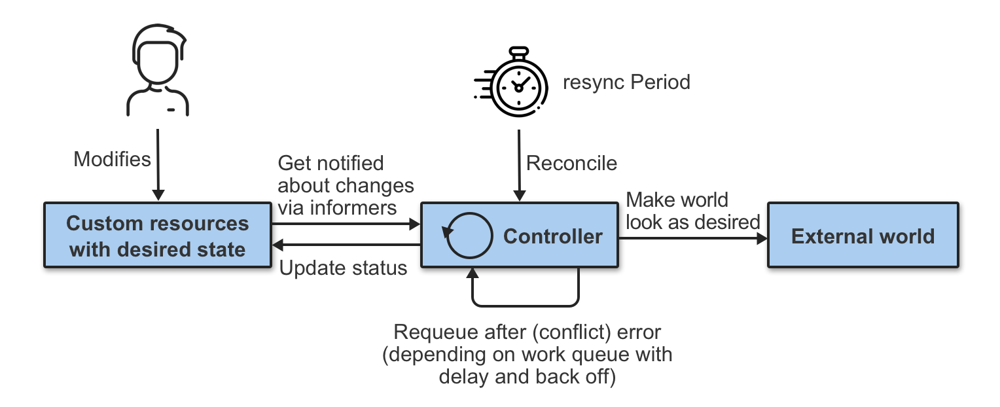

这是一个控制环的例子：房间里的温度自动调节器。当你设置了温度，告诉了温度自动调节器你的期望状态（Desired State）。 房间的实际温度是当前状态（Current State）。 通过对设备的开关控制，温度自动调节器让其当前状态接近期望状态。在 Kubernetes 中，控制器通过监控集群的公共状态，并致力于将当前状态转变为期望的状态。一个控制器至少追踪一种类型的 Kubernetes 资源。这些对象有一个代表期望状态的 spec 字段。 该资源的控制器负责确保其当前状态接近期望状态。

### Kubernetes 控制器原理

Kube-controller-manager 是与API server 结合起来实现控制层面核心功能中最重要的功能。那么我们所谓的控制循环是如何工作的呢？

**master 节点组件解析**

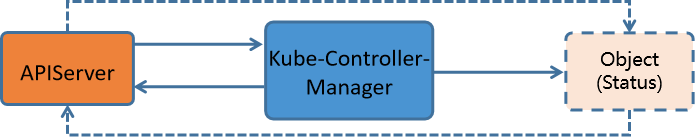

对各种应用程序对象的操作，比如pod、service、token、configmap等等。这些应用程序主要有两种在形式：

数据形态(应用程序的条目) - 存储在API Server中的各种数据条目实体形态(真正运行的对象) - 通过kube-controller-manager到各节点上创建的具体对象。API Server 从某种层面上来说，它仅仅是一个数据库DB。

它支持对资源数据条目的 watch/notify 的功能它对于数据存储的格式进行了限制定制，也就是说，只能接收固定格式的数据规范。如果仅仅将相关对象的属性信息插入到 APIServer上，就相当于做企业规划的时候，准备为某个项目配置多少资源，而这个时候，这些资源是没有到位的，无法进行项目运行的。而kube-controller-manager就相当于企业的CEO，根据APIServer上的规划，通过招人、拉投资等方式，将一个个的具体对象落地。

**Pod的调度**

每一个Pod，就是一个应用程序的定义，同时它还代表了每个节点上资源的限制，而这些节点上的应用程序，是由kube-controller-manager 结合 kubelet来负责进行落地。

**Kubernetes Controller的控制回路机制**

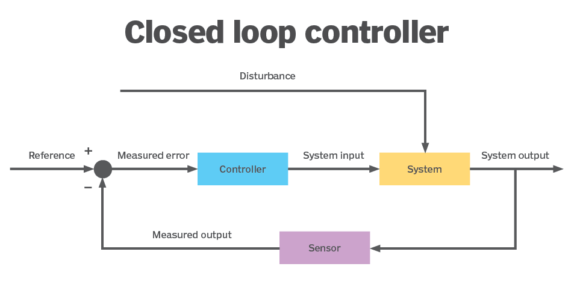

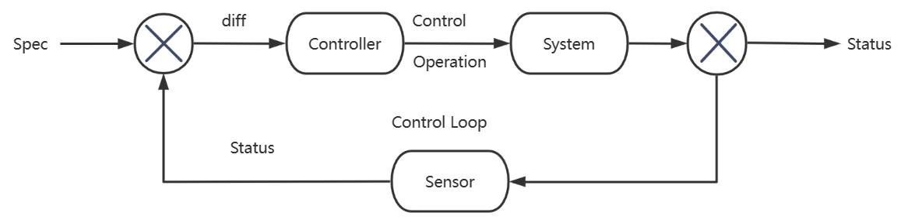

Controller根据Spec，控制Systems生成当前实际Status Controller借助于Sensor持续监视System的Spec和Status，在每一次控制回路中都会对二者进行比较确保System的Status不断逼近或完全等同Spec。

#### Kubernetes Controller 流程

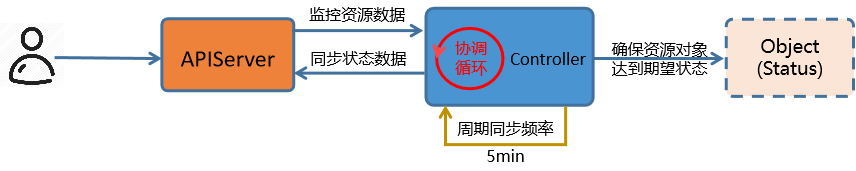

用户向 APIserver中插入一个应用资源对象的请求。这个请求包含的数据形态中定义了该资源对象的 "期望"状态。数据经由 APIserver 保存到 ETCD 中。kube-controller-manager 中的各种控制器会监视 Apiserver上与自己相关的资源对象的变动。

比如 Pod Controller只负责Pod资源的控制，Service Controller只负责Service资源的控制等。一旦API Server中的资源对象发生变动，对应的Controller执行相关的配置代码，到对应的node节点上运行。该资源对象会在当前节点上，按照用户的"期望"进行运行。

这些实体对象的运行状态称为 "实际状态"。即控制器的作用就是确保 "期望状态" 与 "实际状态" 相一致。Controller将这些实际的资源对象状态，通过APIServer存储到ETCD的同一个数据条目的status的字段中。

资源对象在运行过程中，Controller 会循环的方式向 APIServer 监控 spec 和 status 的值是否一致。如果两个状态不一致，那么就指挥node节点的资源进行修改，保证两个状态一致。状态一致后，通过APIServer同步更新当前资源对象在ETCD上的数据。

## 1.3 工作负载资源


- <https://kubernetes.io/zh-cn/docs/concepts/workloads/controllers/>


工作负载是在 Kubernetes 上运行的应用程序。在 Kubernetes 中，无论你的负载是由单个组件还是由多个一同工作的组件构成，你都可以在一组 Pod中运行它。Kubernetes Pod 遵循预定义的生命周期。 例如，当在你的集群中运行了某个 Pod，但是 Pod 所在的节点出现致命错误时， 所有该节点上的 Pod 的状态都会变成失败。Kubernetes 将这类失败视为最终状态： 即使该节点后来恢复正常运行，你也需要创建新的 Pod 以恢复应用。

不过，为了减轻用户的使用负担，通常不需要用户直接管理每个 Pod 。 而是使用负载资源来替用户管理一组 Pod。 这些负载资源通过对应的配置控制器来确保正确类型的、处于运行状态的 Pod 个数是正确的，与用户所指定的状态相一致。以编排Pod化运行的应用为核心的控制器，通常被统称为工作负载型控制器，用于管理与之同名的工作负载型资源类型的资源对象。

Kubernetes 提供若干种内置的工作负载资源：

无状态应用编排: Deployment 和 ReplicaSet （替换原来的资源 ReplicationController）。Deployment 很适合用来管理你的集群上的无状态应用，Deployment 中的所有 Pod 都是相互等价的，并且在需要的时候被替换。有状态应用编排:StatefulSet 让你能够运行一个或者多个以某种方式跟踪应用状态的 Pod。 例如，如果你的负载会将数据作持久存储，你可以运行一个 StatefulSet ，将每个 Pod 与某个PersistentVolume 对应起来。你在 StatefulSet 中各个 Pod 内运行的代码可以将数据复制到同一 StatefulSet 中的其它 Pod 中以提高整体的服务可靠性。系统级应用:DaemonSet 定义提供节点本地支撑设施的 Pod 。这些 Pod 可能对于你的集群的运维是 非常重要的，例如作为网络链接的辅助工具或者作为网络 插件 的一部分等等。每次你向集群中添加一个新节点时，如果该节点与某 DaemonSet 的规约匹配，则控制平面会为该 DaemonSet 调度一个 Pod 到该新节点上运行。作业类应用:Job 和 CronJob。 定义一些一直运行到结束并停止的任务。Job 用来执行一次性任务，而 CronJob 用来执行的根据时间规划反复运行的任务。

**控制器解析**

ReplicationController确保用户定义的 Pod 副本数保持不变,最早期的Pod控制器，目前已被废。

弃

副本集，负责管理一个应用(Pod)的多个副本状态。

Replica Set

是 RC的升级版，在选择器(Selector)的支持上优于RC RC 只支持基于等式的选择器，但 RS还支持基于集合的选择器。它不直接管理Pod，而是借助于ReplicaSet来管理Pod最常用的无状态应用控制器在 RS 的基础上提供了 Pod 的更新能力。

Deployment

在 Deployment 配置文件中 Pod template 发生变化时能将现在集群的状态逐步更新成 Deployment中定义的目标状态。DaemonSet守护进程集，用于确保在每个节点仅运行某个应用的一个Pod副本。用。

于完成系统级任务

Job有终止期限的一次性作业式任务，而非一直处于运行状态的服务进程。CronJob有终止期限的周期性作业式任务。功能类似于Deployment，但StatefulSet专用于编排有状态应用。

StatefulSet

其中的 Pod 是有序部署且具备稳定的标识，是一组存在状态的 Pod 副本。

注意：

早期的大多数控制器都位于extensions/v1beta1, v1beta2, ...，而这些版本都已经被新的替换了当前主要 apps/v1 版本下的控制器每个控制器对象也需要对应的controller来进行管理。

第三方工作负载资源：

在庞大的 Kubernetes 生态系统中，你还可以找到一些提供额外操作的第三方工作负载相关的资源。 通过使用定制资源定义（CRD）， 你可以添加第三方工作负载资源，以完成原本不是 Kubernetes 核心功能的工作。例如，如果你希望运行一组 Pod ，但要求所有 Pod 都可用时才执行操作 （比如针对某种高吞吐量的分布式任务），你可以基于定制资源实现一个能够满足这一需求的扩展， 并将其安装到集群中运行。

**有状态和无状态**

在计算机领域中，"有状态"通常指的是系统或应用程序在处理请求或执行操作时需要考虑先前的状态或上下文。与之相反，"无状态"则意味着系统或应用程序在处理请求时不依赖于先前的状态或上下文。在分布式系统中，有状态通常指的是系统或服务在处理请求时需要考虑到特定的数据状态或存储状态。这些状态可能存储在数据库、内存中的缓存、文件系统中等。有状态服务可能会维护会话信息、用户认证状态、数据缓存等。举例来说，一个有状态的网络应用程序可能需要跟踪用户的会话状态，以便在用户登录后保持用户身份的连续性。在这种情况下，服务器端需要存储用户的认证状态信息，以便后续请求可以识别用户身份。

在 Kubernetes 中，有状态应用程序通常需要持久化存储来保存状态信息。这包括诸如数据库、消息队列等需要持久性的服务。相比之下，无状态应用程序更容易水平扩展，因为它们不需要在不同实例之间共享状态。

**控制器和 Pod**

控制器主要是通过管理pod来实现任务的编排效果控制器是通过标签或者标签选择器找到pod控制器对象仅负责确保API Server上有相应数量的符合标签选择器的Pod对象的定义Pod 对象的Status如何与Spec保持一致，则要由相应节点上的kubelet负责保证。

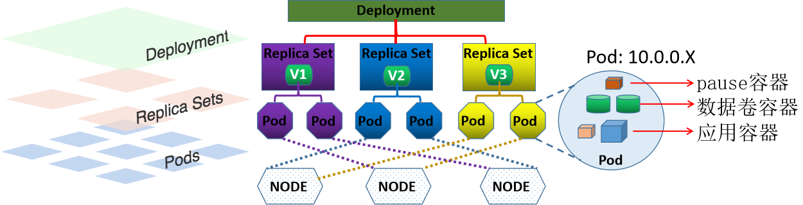

**节点控制器和Worker节点**
```text
https://www.waytoeasylearn.com/learn/kube-controller-manager/
https://kubernetes.io/docs/reference/command-line-tools-reference/kube-
controller-manager/
```

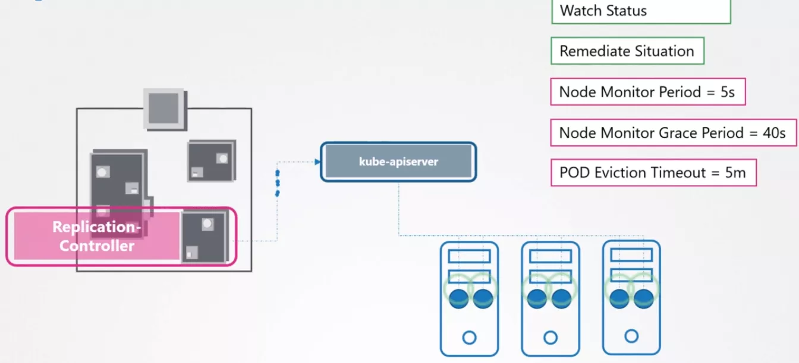

节点控制器每间隔5秒检查一次 Worker 节点的状态如果节点控制器没有收到来自Worker 节点的心跳，则将该Worker 节点被标记为不可达如果该Worker节点被标记为不可达后,节点控制器再等待40秒后仍无法得到此节点的心跳,将该节点标记为无法访问如果该Worker 节点被标记为无法访问后,再等待5分钟后,还没有心跳, 节点控制器会删除当前Worker节点上面的所有pod,并在其它可用的Worker节点重建这些 pod。

# 2 工作负载资源

## 2.1 标签

### 2.1.1 标签说明


- <https://kubernetes.io/zh-cn/docs/concepts/overview/working-with-objects/labels/>


Kubernetes通过标签来管理对应或者相关联的各种资源对象，Label是kubernetes中的核心概念之一。Label 不是一个独立的API 资源类型,但Label对象可以关联到各种资源对象上。通过对Label的管理从而达到对相同Label的资源进行分组管理、分配、调度、配置、部署等。标签Label 是可以附加在任何资源对象上的键值型元数据,即Label本质上是一个key/value键值对，其中key与value由用户自己指定。

key键标识由键前缀和键名组成,格式为 [key_prefix/]key_name。

key_prefix键前缀必须使用DNS域名格式,是可选的,即可以没有,相当于key的所在的名称空间,用于区别不同业务但 key相同的情况。

key_name键名的命名格式:支持字母、数字、连接号、下划线和点号这五类组成,且只能以字母或数字开头;最长63个字符。

kubectl label 命令可管理对象的标签。

创建：Label通常在资源对象定义时确定，也可以在对象创建后动态添加或者删除。

一个资源对象可以定义多个Label，同一个Label 也可以关联多个资源对象上去。

常用标签使用场景：

版本标签："release" : "stable"，"release" : "canary"，"release" : "beta"环境标签："environment" : "dev"，"environment" : "qa"，"environment" : "prod"应用标签："app" : "ui"，"app" : "as"，"app" : "pc"，"app" : "sc"架构层级标签："tier" : "frontend"，"tier" : "backend", "tier" : "cache"分区标签："partition" : "customerA"，"partition" : "customerB"品控级别标签："track" : "daily"，"track" : "weekly"。

### 2.1.2 管理标签

关于label的创建操作主要有两种：

命令行方法yaml文件方法

#### 2.1.2.1 命令行方法

管理标签：
```bash
#添加标签
kubectl label 资源类型 资源名称 label_name=label_value [label_name=label_value] ...

#修改标签
kubectl label 资源类型 资源名称 label_name=label_value [label_name=label_value] ...
--overwrite[=true]

#删除标签
kubectl label 资源类型 资源名称 label_name- [label_name-] ...
```


#参数说明同时增加多个标签，只需要在后面多写几个就可以了，使用空格隔开默认情况下，已存在的标签是不能修改的，使用 --overwrite=true 表示强制覆盖 label_name=label_value样式写成 label_name-  即表示删除label


查看标签和指定标签的资源：
```bash
#查看所有标签

kubectl get 资源类型 [资源名称] --show-labels
#示例:
kubectl get pods --show-labels

#查看指定标签的资源
kubectl get pods -l label_name[=label_value]
```


#参数：-l #指定标签条件，获取指定资源对象，=表示匹配，!= 表示不匹配, 如果后面的选择标签有多个的话，使用逗号隔开#如果针对标签的值进行范围过滤的话，可以使用如下格式：-l 'label_name in (value1, value2, value3, ...)'      #包括其中一个label-l 'label_name notin (value1, value2, value3, ...)'   #不包括其中任何一个label的值或者没有label_name#是否存在label的判断-l 'label_name'    #存在label-l '!label_name'   #不存在label,注意使用单引号.不支持双引号


范例: 命令行方式
```bash
#创建一个有label的自主式pod
[root@master1 ~]#kubectl run pod-label-nginx --image=bowen/nginx:1.20.0 -l
"app=nginx,env=prod"

[root@master1 ~]#kubectl get pod --show-labels
NAME              READY   STATUS    RESTARTS   AGE   LABELS
pod-label-nginx   1/1     Running   0          4s    app=nginx,env=prod

#添加新label
[root@master1 ~]# kubectl label pod pod-label-nginx release=1.20.0 role=web
pod/pod-label-nginx labeled

[root@master1 ~]#kubectl get pod --show-labels
NAME              READY   STATUS    RESTARTS   AGE   LABELS
pod-label-nginx   1/1     Running   0          80s
app=nginx,,env=prodrelease=1.20.0,role=web

#修改label
[root@master1 ~]#kubectl label pod pod-label-nginx role=proxy
error: 'role' already has a value (web), and --overwrite is false

#修改label,需要加 --overwrite 选项
[root@master1 ~]#kubectl label pod pod-label-nginx role=proxy --overwrite
pod/pod-label-nginx labeled
[root@master1 ~]#kubectl get pod --show-labels
NAME              READY   STATUS    RESTARTS   AGE     LABELS
pod-label-nginx   1/1     Running   0          2m40s
app=nginx,env=prod,release=1.20.0,role=proxy

#删除label
[root@master1 ~]#kubectl label pod pod-label-nginx role- release-
pod/pod-label-nginx labeled
[root@master1 ~]#kubectl get pod --show-labels
NAME              READY   STATUS    RESTARTS   AGE     LABELS
pod-label-nginx   1/1     Running   0          2m55s   app=nginx,env=prod

#查看
[root@master1 pod]#kubectl get node -l node-role.kubernetes.io/control-plane
NAME               STATUS   ROLES           AGE     VERSION
master1.bowen.org   Ready    control-plane   4d19h   v1.32.0

[root@master1 pod]#kubectl get node -l '!node-role.kubernetes.io/control-plane'
NAME             STATUS   ROLES    AGE     VERSION
node1.bowen.org   Ready    <none>   4d19h   v1.32.0
node2.bowen.org   Ready    <none>   4d19h   v1.32.0
node3.bowen.org   Ready    <none>   4d19h   v1.32.0
```

#### 2.1.2.2 yaml方法

资源对象 Label 不是一个独立的API资源

资源对象Label 不是单独定义的，是需要依附在某些资源对象上才可以。

比如：依附在Pod，Service，Deployment 等对象上。

初始化Pod资源对象应用时候，在资源对象的元数据metadata属性下添加一条Labels配置：

在特定的属性后面按照指定方式增加内容即可，格式如下：
```yaml
metadata:
labels:
key1: value1
key2: value2
.....

#注意：labels复数
value1 如果是数字，需要用双引号引起来
```

示例: 资源文件方式
```yaml
#Label在之前的Pod的资源文件中定义,标签的内容是：app: nginx和 version: v1.20.0
[root@master1 ~]#cat pod-label-nginx.yaml
apiVersion: v1
kind: Pod
metadata:
name: pod-label-nginx
labels:
app: nginx
version: v1.20.0
spec:
containers:
- name: pod-label-nginx-container
image: registry.cn-beijing.aliyuncs.com/bowen/nginx:1.20.0

[root@master1 ~]#kubectl apply  -f pod-label-nginx.yaml

[root@master1 ~]#kubectl get pod --show-labels
NAME               READY   STATUS    RESTARTS   AGE   LABELS
pod-label-nginx    1/1     Running   0          8s    app=nginx,version=v1.20.0

#添加新label
[root@master1 ~]#kubectl label pod pod-nginx  arch=frontend role=proxy

[root@master1 ~]#kubectl get pod --show-labels
NAME        READY   STATUS    RESTARTS   AGE     LABELS
pod-label-nginx    1/1     Running   0          2m39s
app=nginx,arch=frontend,role=proxy,version=v1.20.0

#修改label,不能直接修改
[root@master1 ~]#kubectl label pod pod-nginx arch=backend
error: 'arch' already has a value (frontend), and --overwrite is false

#修改Label,必须加--overwrite选项才可以
[root@master1 ~]#kubectl label pod pod-nginx arch=backend --overwrite
pod/pod-nginx labeled
[root@master1 ~]#kubectl get pod --show-labels
NAME        READY   STATUS    RESTARTS   AGE     LABELS
pod-label-nginx    1/1     Running   0          7m37s
app=nginx,arch=backend,role=proxy,version=v1.20.0

#删除label
[root@master1 ~]#kubectl label pod pod-nginx arch- role-
pod/pod-nginx labeled
[root@master1 ~]#kubectl get pod --show-labels
NAME        READY   STATUS    RESTARTS   AGE     LABELS
pod-label-nginx    1/1     Running   0          8m15s
app=nginx,version=v1.20.0
```

## 2.2 标签选择器 Label Selector

### 2.2.1 标签选择器说明
```text
https://kubernetes.io/zh-cn/docs/concepts/overview/working-with-
objects/labels/#label-selectors
```

Label附加到Kubernetes集群中的各种资源对象上，目的是对这些资源对象可以进行后续的分组管理。

而分组管理的核心就是：标签选择器Label Selector。

可以通过Label Selector查询和筛选某些特定Label的资源对象，进而可以对他们进行相应的操作管理。

Label Selector 类似于SQL语句中where的条件

标签选择器的主要应用场景：

监控具体的Pod、负载均衡调度、定向调度，常用于 Pod、Node等资源对象。

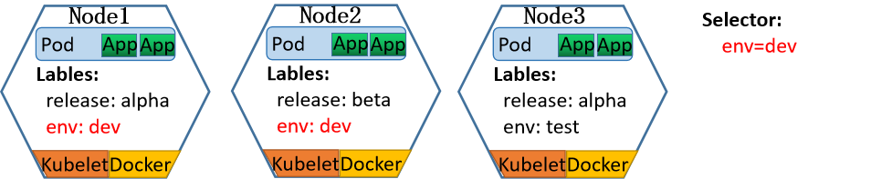

比如：当设置 env=dev的Label Selector,则会匹配到Node1和Node2上的Pod

Label Selector跟Label一样，不能单独定义，必须附加在一些资源对象的定义文件上。一般附加在RS，Deployment 和Service等资源定义文件中。Label Selector使用时候有两种常见的标签选择算符表达式：等值和集合。

**等值和不等值**


#等值：name = nginx                            #匹配所有具有标签 name = nginx 的资源对象 name == nginx                           #同上 name                                    #表示匹配存在name标签的资源对象


#不等值!name                                  #表示匹配不存在name标签的资源对象 name != nginx                          #匹配所有没有name标签或者标签name的值不等于 nginx的资源对象

```yaml
#示例:基于等值的标签要求的一种使用场景是 Pod 要指定节点选择标准。
#例如，下面的示例 Pod 选择带有标签 "accelerator=nvidia-tesla-p100"。
apiVersion: v1
kind: Pod
metadata:
name: cuda-test
spec:
containers:
- name: cuda-test
image: "registry.k8s.io/cuda-vector-add:v0.1"
resources:
limits:
nvidia.com/gpu: 1
nodeSelector:
accelerator: nvidia-tesla-p100

#示例
apiVersion: v1
kind: Service
metadata:
name: service-loadbalancer-lbaas
spec:
type: LoadBalancer
externalTrafficPolicy: Local
selector:
app: myapp
ports:
- name: http
protocol: TCP
port: 80
targetPort: 80
```

集合


#示例：env in (dev, test)                      #匹配所有具有标签 env = dev 或者 env = test 的资源对象 name notin (frontend,backent)           #匹配所有不具有标签name=frontend或者 name=backend或者没有name标签的资源对象


后续Kubernetes 的集合表达式又增加了两种新的写法：匹配标签、匹配表达式。

**匹配标签 matchLabels**
```text
#匹配标签：
matchLabels:
name: nginx
app: myapp
#当 matchLabels 中有多个标签时，它们之间的关系是逻辑与（AND）关系

#如下所示：
matchLabels:
app: frontend
environment: production

#那么只有那些标签中同时包含 app=frontend 和 environment=production 的资源才会被选中。
```

**匹配表达式 matchExpressions**
```text
#匹配表达式：
matchExpressions:
- {key: name, operator: NotIn, values: [frontend,backend]}
#当 matchExpressions 中包含多个标签表达式时，它们之间的关系是逻辑与（AND）关系。

#常见的operator操作属性值有：
In、NotIn、Exists、NotExists等
Exists和NotExist时，values必须为空，即 { key: environment, opetator:
Exists,values:}
#注意：这些表达式一般应用在RS、RC、Deployment等其它管理对象中。
```


#示例 matchExpressions:- key: environment operator: In values:- production- staging- key: app operator: NotIn values:- test#那么只有那些标签满足以下两个条件的资源才会被选中：- 标签中 environment 的值是 production 或 staging- 标签中 app 的值不是 test


### 2.2.2 标签选择器操作方式

标签选择器两种方式:

命令文件

#### 2.2.2.1 命令方式

格式
```bash
#多个SELECTOR表示并且的关系
kubectl get TYPE -l SELECTOR1[,SELECTOR2,...]
kubectl get TYPE -l SELECTOR1 [-l SELECTOR2] ...

#额外针对指定的每一个标签单独一列来显示对应的值
kubectl get TYPE -L label_name
```

范例:
```yaml
[root@master1 ~]#cat controller-deployment-test.yaml
apiVersion: apps/v1
kind: Deployment
metadata:
name: deployment-test
spec:
replicas: 3
selector:
matchLabels:
app: rs-test
template:
metadata:
labels:
app: rs-test
spec:
containers:
- name: pod-test
image: registry.cn-beijing.aliyuncs.com/bowen/pod-test:v0.1

[root@master1 ~]#kubectl apply -f controller-deployment-test.yaml

#查看检签
[root@master1 ~]#kubectl get pod --show-labels
NAME                               READY   STATUS    RESTARTS   AGE   LABELS
deployment-test-6fb8cd677f-5sp7x   1/1     Running   0          8s    app=rs-
test,pod-template-hash=6fb8cd677f
deployment-test-6fb8cd677f-7d4c7   1/1     Running   0          8s    app=rs-
test,pod-template-hash=6fb8cd677f
deployment-test-6fb8cd677f-gbc7k   1/1     Running   0          8s    app=rs-
test,pod-template-hash=6fb8cd677f

#打标签
[root@master1 ~]#kubectl label pod deployment-test-6fb8cd677f-5sp7x version=0.1

#查看标签
[root@master1 ~]#kubectl get pod --show-labels
NAME                               READY   STATUS    RESTARTS   AGE   LABELS
deployment-test-6fb8cd677f-5sp7x   1/1     Running   0          66s   app=rs-
test,pod-template-hash=6fb8cd677f,version=0.1
deployment-test-6fb8cd677f-7d4c7   1/1     Running   0          66s   app=rs-
test,pod-template-hash=6fb8cd677f
deployment-test-6fb8cd677f-gbc7k   1/1     Running   0          66s   app=rs-
test,pod-template-hash=6fb8cd677f

#查看有app标签的pod
[root@master1 ~]#kubectl get pod -l app

#标签等值过滤
[root@master1 ~]#kubectl get pod -l app=rs-test,version=0.1
NAME                               READY   STATUS    RESTARTS   AGE
deployment-test-6fb8cd677f-5sp7x   1/1     Running   0          92s

#标签不等值过滤
[root@master1 ~]#kubectl get pod -l app=rs-test,version!=0.1
NAME                               READY   STATUS    RESTARTS   AGE
deployment-test-6fb8cd677f-7d4c7   1/1     Running   0          96s
deployment-test-6fb8cd677f-gbc7k   1/1     Running   0          96s
```

范例:
```bash
[root@master1 ~]#kubectl run pod-label-nginx1 --image=bowen/nginx:1.20.0 -
l "app=nginx,env=prod"
[root@master1 ~]#kubectl run pod-label-nginx2 --image=bowen/nginx:1.20.0 -
l "app=web,env=prod"
[root@master1 ~]#kubectl run pod-label-nginx3 --image=bowen/nginx:1.20.0 -
l "role=proxy"

#等值过滤
[root@master1 ~]#kubectl get pod  -l env=prod --show-labels
NAME               READY   STATUS    RESTARTS   AGE     LABELS
pod-label-nginx1   1/1     Running   0          3m20s   app=nginx,env=prod
pod-label-nginx2   1/1     Running   0          28s     app=web,env=prod

#不等值过滤
[root@master1 ~]#kubectl get pod  -l app!=nginx --show-labels
NAME               READY   STATUS    RESTARTS   AGE   LABELS
pod-label-nginx2   1/1     Running   0          95s   app=web,env=prod

#没有applabel的pod
#注意：为了避免shell解析，这里需要添加单引号
[root@master1 ~]#kubectl get pod --show-labels  -l '!app'
NAME               READY   STATUS    RESTARTS   AGE   LABELS
pod-label-nginx3   1/1     Running   0          29s   role=proxy

#集合过滤,多条件并集
[root@master1 ~]#kubectl get pod --show-labels  -l 'app in (web,nginx)'
NAME               READY   STATUS    RESTARTS   AGE     LABELS
pod-label-nginx1   1/1     Running   0          10m     app=nginx,env=prod
pod-label-nginx2   1/1     Running   0          7m32s   app=web,env=prod

[root@master1 ~]#kubectl get po -A -l 'k8s-app in (kube-dns,kuberenets-
dashboard)' --show-labels
NAMESPACE     NAME                      READY   STATUS    RESTARTS       AGE
LABELS
kube-system   coredns-c676cc86f-8tp94   1/1     Running   12 (13h ago)   13d
k8s-app=kube-dns,pod-template-hash=c676cc86f
kube-system   coredns-c676cc86f-bt6p4   1/1     Running   13 (13h ago)   13d
k8s-app=kube-dns,pod-template-hash=c676cc86f

#多条件取反
[root@master1 ~]#kubectl get pod --show-labels  -l 'app notin (web,nginx)'
NAME               READY   STATUS    RESTARTS   AGE     LABELS

pod-label-nginx3   1/1     Running   0          5m40s   role=proxy
```

#### 2.2.2.2 配置文件
```yaml
#基于等值,多个为与关系
selector:
component: redis

#基于集合
selector:
matchLabels:
component: redis
matchExpressions:
- { key: tier, operator: In, values: [cache] }
- { key: environment, operator: NotIn, values: [dev] }
```

示例: 以service资源对象的创建为例
```yaml
#准备多个后端pod对象
[root@master1 ~]#kubectl run nginx-test1 --image=bowen/pod-test:v0.1 --
labels="app=nginx"
[root@master1 ~]#kubectl run nginx-test2 --image=bowen/pod-test:v0.1 --
labels="app=nginx"
[root@master1 ~]#kubectl run nginx-test3 --image=bowen/pod-test:v0.1 --
labels="app=nginx1"

#检查效果
[root@master1 ~]#kubectl get pod --show-labels -o wide
NAME          READY   STATUS    RESTARTS   AGE   IP            ... LABELS
nginx-test1   1/1     Running   0          12s   172.16.3.67   ... app=nginx
nginx-test2   1/1     Running   0          12s   172.16.1.25   ... app=nginx
nginx-test3   1/1     Running   0          11s   172.16.2.25   ... app=nginx1

#创建service
[root@master1 ~]#cat service-label.yaml
kind: Service
apiVersion: v1
metadata:
name: service-label
spec:
selector:         #标签选择器
app: nginx
ports:
- name: http
protocol: TCP
port: 80
targetPort: 80

#创建service对象
[root@master1 ~]#kubectl apply -f service-label.yaml

[root@master1 ~]#kubectl get all
NAME              READY   STATUS    RESTARTS   AGE
pod/nginx-test1   1/1     Running   0          4m30s
pod/nginx-test2   1/1     Running   0          4m30s
pod/nginx-test3   1/1     Running   0          4m29s

NAME                    TYPE        CLUSTER-IP       EXTERNAL-IP   PORT(S)   AGE
service/kubernetes      ClusterIP   192.168.0.1      <none>        443/TCP
108s
service/service-label   ClusterIP   192.168.50.195   <none>        80/TCP    19s

#结果显示：service 自动关联了两个Endpoints
[root@master1 ~]#kubectl describe svc service-label
Name:              service-label
Namespace:         default
Labels:            <none>
Annotations:       <none>
Selector:          app=nginx
Type:              ClusterIP
IP Family Policy:  SingleStack
IP Families:       IPv4
IP:                192.168.50.195
IPs:               192.168.50.195
Port:              http  80/TCP
TargetPort:        80/TCP
Endpoints:         172.16.1.25:80,172.16.3.67:80
Session Affinity:  None
Events:            <none>

#随机访问service的地址：
[root@master1 ~]#curl 192.168.50.195
kubernetes pod-test v0.1!! ClientIP: 172.16.0.0, ServerName: nginx-test1,
ServerIP: 172.16.3.67!
[root@master1 ~]#curl 192.168.50.195
kubernetes pod-test v0.1!! ClientIP: 172.16.0.0, ServerName: nginx-test2,
ServerIP: 172.16.1.25!
#结果显示：后端随机代理到不同的pod应用
```

## 2.3 Replication Controller (已废弃)

Replication Controller（RC），是kubernetes系统中的核心概念之一。也是最早期的Controller,当前已被Replica Set替代。RC是Kubernetes集群实现Pod资源对象自动化管理的基础.也是最初的Pod控制器。

简单来说，RC其实是定义了一个期望的场景，RC有以下特点：

组成：定义了Pod副本的期望状态：包括数量，筛选标签和模板。

Pod期待的副本数量(replicas)筛选目标Pod的标签选择器(Label Selector),但只支持=和!=Pod数量不满足预期值，自动创建Pod时候用到的模板(template)

意义：自动监控Pod运行的副本数目符合预期，保证Pod高可用的核心组件，常用于Pod的生命周期管理。

拓展：自动监控的功能是基于哪些资源对象？

**RC 作用**

当我们通过"资源定义文件"定义好了一个RC资源对象，把它提交到Kubernetes集群中以后，Master节点上的Controller Manager组件就得到通知，定期巡检系统中当前存活的Pod，并确保Pod实例数量刚到满足RC的期望值。如果Pod数量大于RC定义的期望值，那么就杀死一些Pod。如果Pod数量小于RC定义的期望值，那么就创建一些Pod。所以通过RC资源对象，Kubernetes实现了业务应用集群的高可用性，大大减少了人工干预，提高了管理的自动化。

拓展：想要扩充Pod副本的数量，可以直接修改replicas的值即可。

实现机制

如下图示例,当其中一个Node的Pod意外终止，根据RC的定义，Pod的期望值是2，所以会随机找一个Node结点重新再创建一个新的Pod，来保证整个集群中始终存在两个Pod运行。

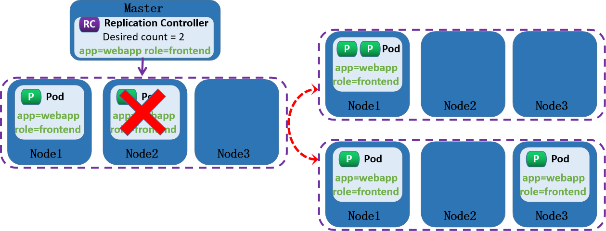

注意：

删除RC并不会影响通过该RC资源对象创建好的Pod。如果要删除所有的Pod那么可以设置RC的replicas的值为0，然后更新该RC。另外kubectl提供了stop和delete命令来一次性删除RC和RC控制的Pod。Pod提供的是无状态服务，不会影响到客户的访问效果。

RC的期望状态三结构：

replicas-副本数量selector-标签选择器template-容器模板文件。

注意: RC中spec.template.metadata.labels 的属性必须跟Pod资源对象的metadata.labels属性一致。

示例
```yaml
#RC资源对象定义文件，遵循资源对象定义文件的格式，只不过spec期望的部分是RC的主要内容,由RC自动控
制Pod资源对象的预期状态效果：运行2个nginx容器，运行的容器携带两个标签，运行容器的模板文件在
sepc.template.spec部分
[root@master1 ~]#cat controller-rc.yaml
apiVersion: v1
kind: ReplicationController
metadata:
name: controller-rc
labels:
app: nginx
spec:
replicas: 2
selector:
app: nginx
template:
metadata:
labels:

app: nginx
spec:
containers:
- name: nginx-container
image: registry.cn-beijing.aliyuncs.com/bowen/nginx:1.20.0

#创建RC
[root@master1 ~]#kubectl apply  -f controller-rc.yaml
replicationcontroller/controller-rc created

#验证结果
[root@master1 ~]#kubectl get pod --show-labels
NAME                  READY   STATUS    RESTARTS   AGE     LABELS
controller-rc-qqcsr   1/1     Running   0          3m19s   app=nginx
controller-rc-xg4px   1/1     Running   0          3m19s   app=nginx

[root@master1 ~]#kubectl get all
NAME                      READY   STATUS    RESTARTS   AGE
pod/controller-rc-qqcsr   1/1     Running   0          2s
pod/controller-rc-xg4px   1/1     Running   0          2s

NAME                                  DESIRED   CURRENT   READY   AGE
replicationcontroller/controller-rc   2         2         2       2s

#删除pod,自动再生成
[root@master1 ~]#kubectl delete pod controller-rc-qqcsr
pod "controller-rc-qqcsr" deleted
[root@master1 ~]#kubectl get pod --show-labels -o wide
NAME                  READY   STATUS    RESTARTS   AGE    IP            NODE
NOMINATED NODE   READINESS GATES   LABELS
controller-rc-9tfm8   1/1     Running   0          6s     172.16.1.26
node2.bowen.org   <none>           <none>            app=nginx
controller-rc-xg4px   1/1     Running   0          5m3s   172.16.2.28
node3.bowen.org   <none>           <none>            app=nginx

#扩容和缩容
kubectl scale replicationcontroller --replicas=3 controller-rc

#验证
[root@master1 ~]#kubectl get pod -o wide
NAME                  READY   STATUS    RESTARTS   AGE     IP            NODE
NOMINATED NODE   READINESS GATES
controller-rc-9tfm8   1/1     Running   0          97s     172.16.1.26
node2.bowen.org   <none>           <none>
controller-rc-wrlxr   1/1     Running   0          12s     172.16.3.69
node1.bowen.org   <none>           <none>
controller-rc-xg4px   1/1     Running   0          6m34s   172.16.2.28
node3.bowen.org   <none>           <none>

#关闭node3节点,观察pod是否变化
[root@node3 ~]#poweroff
[root@master1 ~]#kubectl get pod -o wide
NAME                  READY   STATUS    RESTARTS        AGE     IP
NODE               NOMINATED NODE   READINESS GATES
controller-rc-9tfm8   1/1     Running   0               8m17s   172.16.1.26
node2.bowen.org   <none>           <none>

controller-rc-wrlxr   1/1     Running   0               6m52s   172.16.3.69
node1.bowen.org   <none>           <none>
controller-rc-xg4px   1/1     Running   1 (5m22s ago)   13m     172.16.2.29
node3.bowen.org   <none>           <none>

#删除RC会自动删除相关的pod
[root@master1 ~]#kubectl delete rc controller-rc

#因为node3关机无法删除上面的pod
[root@master1 ~]#kubectl get pod
NAME                  READY   STATUS        RESTARTS        AGE
controller-rc-xg4px   1/1     Terminating   1 (6m41s ago)   14m

#node3启动后,再观察
[root@master1 ~]#kubectl get pod
No resources found in default namespace.
```

## 2.4 Replica Set

### 2.4.1 Replica Set 工作机制


- <https://kubernetes.io/zh-cn/docs/concepts/workloads/controllers/replicaset/>


Replica Set 是Pod 最常用的控制器。

Replica Set 其实是定义了一个期望的场景，RS有以下特点：

由于Replication Controller与Kubernetes代码中的模块Replication Controller同名，而且这个名称无法准确表达它的本意，即Pod副本的控制，所以从kubernetes v1.2开始，它就升级成了一个新的概念：Replica Set（RS）。

RS和RC两者功能上没有太大的区别，只不过是表现形式上不一样：

RC中的Label Selector是基于等式的RS中的Label Selector是基于等式和集合的,因为集合的特点，这就使得Replica Set的功能更强大。

负责编排无状态应用的基础控制器是ReplicaSet，定义编排一个无状态应用相应的资源类型主要的三个关键属性如下：

replicas：Pod期待的副本数量selector：筛选目标Pod的标签选择器,支持matchExpressions和matchLabels template：如果Pod数量不满足预期值，自动创建Pod时候用到的模板(template)，清单文件格式和自主式Pod一样。

意义：自动监控Pod运行的副本数目符合预期，保证Pod高可用的核心组件，常用于Pod的生命周期管理。

**工作机制**

当通过"资源定义文件"定义好了一个RS资源对象，把它提交到Kubernetes集群Master节点上的Controller Manager组件就得到通知Controller Manager 根据 ReplicaSet Control Loop 管理 ReplicaSet Object由该对象向API Server请求管理Pod对象(标签选择器选定的)如果没有pod：以Pod模板向API Server请求创建Pod对象，由Scheduler调度并绑定至某节点，由相应节点kubelet负责运行。定期巡检系统中当前存活的Pod，并确保Pod实例数量刚到满足RC的期望值。如果Pod数量大于RS定义的期望值，那么就杀死一些Pod。

如果Pod数量小于RS定义的期望值，那么就创建一些Pod。所以通过RS资源对象，Kubernetes实现了业务应用集群的高可用性，大大减少了人工干预，提高了管理的自动化。如果后续想要扩充Pod副本的数量，可以直接修改replicas的值即可。当其中一个Node的Pod意外终止，根据RS的定义，Pod的期望值是2，所以会随机找一个Node结点重新再创建一个新的Pod，来保证整个集群中始终存在两个Pod运行。

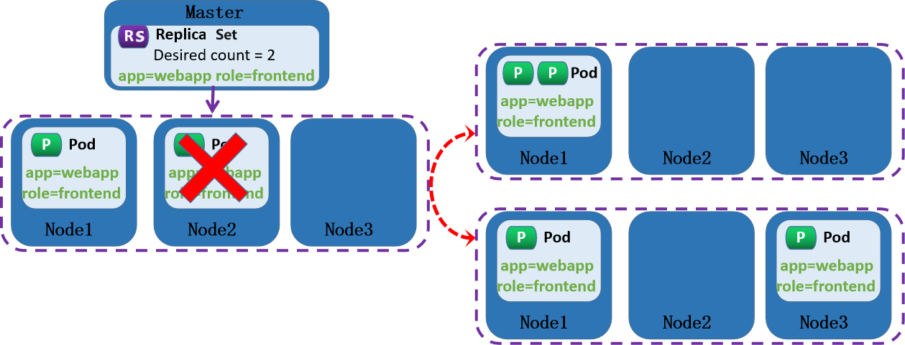

注意：

删除RS并不会影响通过该RS资源对象创建好的Pod。如果要删除所有的Pod那么可以设置RS的replicas的值为0，然后更新该RS。另外kubectl提供了stop和delete命令来一次性删除RS和RS控制的Pod。Pod提供的如果无状态服务，不会影响到客户的访问效果。

RS可以实现应用的部署，扩缩容和卸载，但一般很少单独使用。

它主要是被Deployment这个更高层的资源对象所使用，从而形成了一整套Pod的创建、删除、更新的编排机制。Replica Set 与Deployment这两个重要资源对象已经替换了RC的作用,所以当前一般直接使用Deployment。

### 2.4.2 Replica Set 基础管理

#### 2.4.2.1 Replica Set 基础管理说明
```yaml
apiVersion: apps/v1
kind: ReplicaSet
metadata:
name: …                           #ReplicaSet 名称，生成的Pod名称以此处的ReplicaSet
名称为前缀+随机字符
namespace: …
spec:
minReadySeconds <integer>         # Pod就绪后多少秒内，Pod任一容器无crash方可视为“就
绪”
replicas <integer>                # 期望的Pod副本数，默认为1
selector:                         # 标签选择器，必须匹配template字段中Pod模板中的标
签；
matchExpressions <[]Object>     # 标签选择器表达式列表，多个列表项之间为“与”关系
matchLabels <map[string]string> # map格式的标签选择器
template:                         # Pod模板对象
metadata:                       # Pod对象元数据

labels:                       # 由模板创建出的Pod对象所拥有的标签，必须要能够匹配前
面定义的标签选择器selector
spec:                           # Pod规范，格式同自主式Pod,但无需apiVersion,kind
及metadata.name字段
……
#注意：RS和RC之间selector的格式区别
```

**扩容和缩容**
```bash
#基于对象调整副本数：
kubectl scale --replicas=5 rs/rs_name
kubectl scale --replicas=5 rs rs_name

#基于文件调整副本数：
kubectl scale --replicas=3 -f rs_name.yaml
```

**更新镜像**
```bash
kubectl set image (-f FILENAME | TYPE NAME) CONTAINER_NAME_1=CONTAINER_IMAGE_1
... CONTAINER_NAME_N=CONTAINER_IMAGE_N
kubectl set image 资源类型/资源名称 容器名1=容器镜像1 ... 容器名N=容器镜像N

#注意:更新镜像，Pod不会自动更新。原因是RC和RS都是删除式更新，即只有手动删除老的Pod，新生成的
pod才会使用新的模板信息,而Deployment是自动式更新,所以Deployment更加高级
```

#### 2.4.2.2 Replica Set 资源清单文件示例

示例:  创建资源对象
```yaml
[root@master1 ~]#cat controller-replicaset.yaml
apiVersion: apps/v1
kind: ReplicaSet
metadata:
name: controller-replicaset-test
spec:
minReadySeconds: 0
replicas: 3
selector:
matchLabels:
app: rs-test
release: stable
version: v1.0
template:
metadata:
labels:
app: rs-test        #注意：此处labels和selector中label必须相同
release: stable
version: v1.0
spec:
containers:
- name: rs-test
image: registry.cn-beijing.aliyuncs.com/bowen/pod-test:v0.1

#应用资源对象
[root@master1 ~]#kubectl apply  -f controller-replicaset.yaml

[root@master1 ~]#kubectl get all
NAME                                   READY   STATUS    RESTARTS   AGE
pod/controller-replicaset-test-c87m5   1/1     Running   0          7s
pod/controller-replicaset-test-p8bxx   1/1     Running   0          7s
pod/controller-replicaset-test-q8zj7   1/1     Running   0          7s

NAME                 TYPE        CLUSTER-IP    EXTERNAL-IP   PORT(S)   AGE
service/kubernetes   ClusterIP   192.168.0.1   <none>        443/TCP   9h

NAME                                         DESIRED   CURRENT   READY   AGE
replicaset.apps/controller-replicaset-test   3         3         3       8s

#查看Pod，可以看到和自由式Pod不同的信息
[root@master1 ~]#kubectl get pod controller-replicaset-test-c87m5 -o yaml|grep -
A4 ownerReferences
metadata:
......
ownerReferences:
- apiVersion: apps/v1
blockOwnerDeletion: true
controller: true
kind: ReplicaSet
```

示例: 扩容和缩容
```yaml
[root@master1 ~]#kubectl get all
NAME                                   READY   STATUS    RESTARTS   AGE
pod/controller-replicaset-test-c87m5   1/1     Running   0          7s
pod/controller-replicaset-test-p8bxx   1/1     Running   0          7s
pod/controller-replicaset-test-q8zj7   1/1     Running   0          7s

#删除一个Pod
[root@master1 ~]#kubectl delete pod controller-replicaset-test-c87m5

#自动创建一个新的Pod代替
[root@master1 ~]#kubectl get pod
NAME                               READY   STATUS    RESTARTS   AGE
controller-replicaset-test-6cpfp   1/1     Running   0          34s
controller-replicaset-test-p8bxx   1/1     Running   0          10m
controller-replicaset-test-q8zj7   1/1     Running   0          10m

#可以看到：删除一个Pod，RC又创建了一个Pod，证明Replication Controller的作用

#扩容：调整pod副本数量更多
#方法1:修改清单文件
[root@master1 ~]#vi controller-replicaset.yaml
apiVersion: apps/v1
kind: ReplicaSet
metadata:
name: controller-replicaset-test
spec:
minReadySeconds: 0
replicas: 4    #修改此行
selector:
matchLabels:
app: rs-test
release: stable

version: v1.0
template:
metadata:
labels:
app: rs-test
release: stable
version: v1.0
spec:
containers:
- name: rs-test
image: registry.cn-beijing.aliyuncs.com/bowen/pod-test:v0.1

#应用资源对象
[root@master1 ~]#kubectl apply  -f controller-replicaset.yaml

#方法2：命令式
[root@master1 ~]#kubectl scale --replicas=4 rs/controller-replicaset-test
replicaset.apps/controller-replicaset-test scaled

#验证
[root@master1 ~]#kubectl get pod
NAME                               READY   STATUS    RESTARTS   AGE
controller-replicaset-test-6cpfp   1/1     Running   0          6m45s
controller-replicaset-test-p8bxx   1/1     Running   0          16m
controller-replicaset-test-q8zj7   1/1     Running   0          16m
controller-replicaset-test-z6t5v   1/1     Running   0          1s # 这个是新增加的

#缩容：缩小Pod数量
#方法1：清单文件
[root@master1 ~]#vi controller-replicaset.yaml
apiVersion: apps/v1
kind: ReplicaSet
metadata:
name: controller-replicaset-test
spec:
minReadySeconds: 0
replicas: 1    #修改此行
selector:
matchLabels:
app: rs-test
release: stable
version: v1.0
template:
metadata:
labels:
app: rs-test
release: stable
version: v1.0
spec:
containers:
- name: rs-test
image: registry.cn-beijing.aliyuncs.com/bowen/pod-test:v0.1

#应用资源对象
[root@master1 ~]#kubectl apply  -f controller-replicaset.yaml

#方法2：命令法
[root@master1 ~]#kubectl scale --replicas=1 -f controller-replicaset.yaml

#看到在中止三个pod
[root@master1 ~]#kubectl get pod
NAME                               READY   STATUS        RESTARTS   AGE
controller-replicaset-test-6cpfp   1/1     Terminating   0          6m55s
controller-replicaset-test-p8bxx   1/1     Terminating   0          17m
controller-replicaset-test-q8zj7   1/1     Running       0          17m
controller-replicaset-test-z6t5v   1/1     Terminating   0          11s

#最终只有一个
[root@master1 ~]#kubectl get pod
NAME                               READY   STATUS    RESTARTS   AGE
controller-replicaset-test-q8zj7   1/1     Running   0          19m
```

示例: 更新Pod镜像的版本
```yaml
#升级镜像版本
#方法1：清单文件
[root@master1 ~]#vi controller-replicaset.yaml
apiVersion: apps/v1
kind: ReplicaSet
metadata:
name: controller-replicaset-test
spec:
minReadySeconds: 0
replicas: 1
selector:
matchLabels:
app: rs-test
release: stable
version: v1.0
template:
metadata:
labels:
app: rs-test
release: stable
version: v1.0
spec:
containers:
- name: rs-test
image: registry.cn-beijing.aliyuncs.com/bowen/pod-test:v0.2  #修改
此行

#应用资源对象
[root@master1 ~]#kubectl apply  -f controller-replicaset.yaml

#方法2：命令法
[root@master1 ~]#kubectl set image replicaset/controller-replicaset-test rs-
test=registry.cn-beijing.aliyuncs.com/bowen/pod-test:v0.2
replicaset.apps/controller-replicaset-test image updated

[root@master1 ~]#kubectl get pod -o wide
NAME                               READY   STATUS    RESTARTS   AGE   IP
NODE               NOMINATED NODE   READINESS GATES
controller-replicaset-test-q8zj7   1/1     Running   0          27m
172.16.1.29   node2.bowen.org   <none>           <none>

#验证版本仍为旧版本
[root@master1 ~]#curl 172.16.1.29
kubernetes pod-test v0.1!! ClientIP: 172.16.0.0, ServerName: controller-
replicaset-test-q8zj7, ServerIP: 172.16.1.29!
#结果显示:虽然镜像的模板信息更新了，但是pod的并没有升级镜像

#手动删除pod
[root@master1 ~]#kubectl delete pod  controller-replicaset-test-q8zj7
pod "controller-replicaset-test-q8zj7" deleted

#自动重新生成新pod
[root@master1 ~]#kubectl get pod -o wide
NAME                               READY   STATUS    RESTARTS   AGE     IP
NODE               NOMINATED NODE   READINESS GATES
controller-replicaset-test-9r8kf   1/1     Running   0          2m58s
172.16.2.36   node3.bowen.org   <none>           <none>

#验证版本更新
[root@master1 ~]#curl 172.16.2.36
kubernetes pod-test v0.2!! ClientIP: 172.16.0.0, ServerName: controller-
replicaset-test-9r8kf, ServerIP: 172.16.2.36!

#结果显示：更新镜像后，需要通过手动删除Pod，最终才能RS实现pod的镜像更新
```

### 2.4.3 Replica Set 版本发布

#### 2.4.3.1 版本发布方式说明

**版本发布(更新)类型**


- <https://www.cnblogs.com/hunternet/p/14306105.html>


直接发布

直接将新的版本覆盖掉老的版本。这种方式简单而粗暴。其优点就是简单而且成本较低，但缺点同样很明显，就是发布过程中通常会导致服务中断进而导致用户受到影响。这种方式比较适应于开发环境或者测试环境或者是公司内部系统这种对可用性要求不高的场景。有些小的公司资源稀缺(服务器资源，基础设施等)的时候也会采用这种方式。

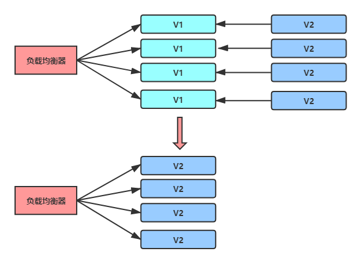

**金丝雀发布**

由于金丝雀对瓦斯极其敏感，因此以前旷工开矿下矿洞前，先会放一只金丝雀进去探是否有有毒气体，看金丝雀能否活下来，金丝雀发布由此得名。金丝雀发布是灰度发布的一种。灰度发布是指在黑与白之间，能够平滑过渡的一种发布方式。在发布过程中一部分用户继续使用老版本，一部分用户使用新版本，不断地扩大新版本的访问流量。最终实现老版本到新版本的过度。金丝雀发布过程中，先将一台或者一小部分比例的机器作为金丝雀，用于流量验证。

如果金丝雀验证通过则把剩余机器全部发布。如果金丝雀验证失败，则直接回退金丝雀。

金丝雀发布的优势在于可以用少量用户来验证新版本功能，这样即使有问题所影响的也是很小的一部分客户。如果对新版本功能或性能缺乏足够信心那么就可以采用这种方式。这种方式也有其缺点，金丝雀发布本质上仍然是一次性的全量发布，发布过程中用户体验并不平滑，有些隐藏深处的bug少量用户可能并不能验证出来问题，需要逐步扩大流量才可以。

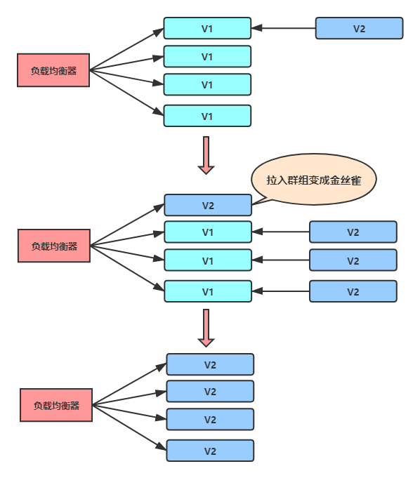

**滚动发布**

滚动发布是在金丝雀发布基础上进行改进的一种发布方式。相比于金丝雀发布，先发金丝雀，然后全发的方式，滚动发布则是整个发布过程中按批次进行发布。每个批次拉入后都可作为金丝雀进行验证，这样流量逐步放大直至结束。

滚动更新加快了更新的效率，其特点在于：

一次只更新一小部分副本上次更新成功后，再更新更多的副本最终完成所有副本的更新。这个过程中，新旧版本同时存在，并不会导致大量的资源浪费。

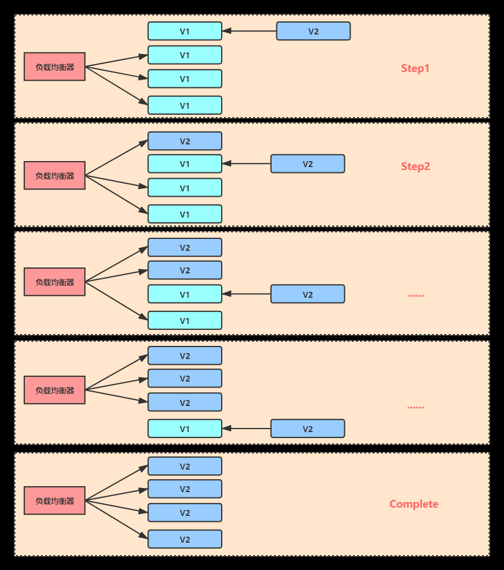

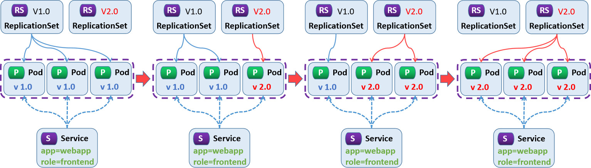

**蓝绿部署**

蓝绿部署是一种应用发布模式，可将用户流量从先前版本的应用或微服务逐渐转移到几乎相同的新版本中（两者均保持在生产环境中运行）。旧版本可以称为蓝色环境，而新版本则可称为绿色环境。一旦生产流量从蓝色完全转移到绿色，蓝色就可以在回滚或退出生产的情况下保持待机，也可以更新成为下次更新的模板。这种持续部署模式原本存在不足之处。并非所有环境都具有相同的正常运行时间要求或正确执行 CI/CD 流程（如蓝绿部署）所需的资源。在部署过程中，可能导致大量资源占用，适用于小业务。

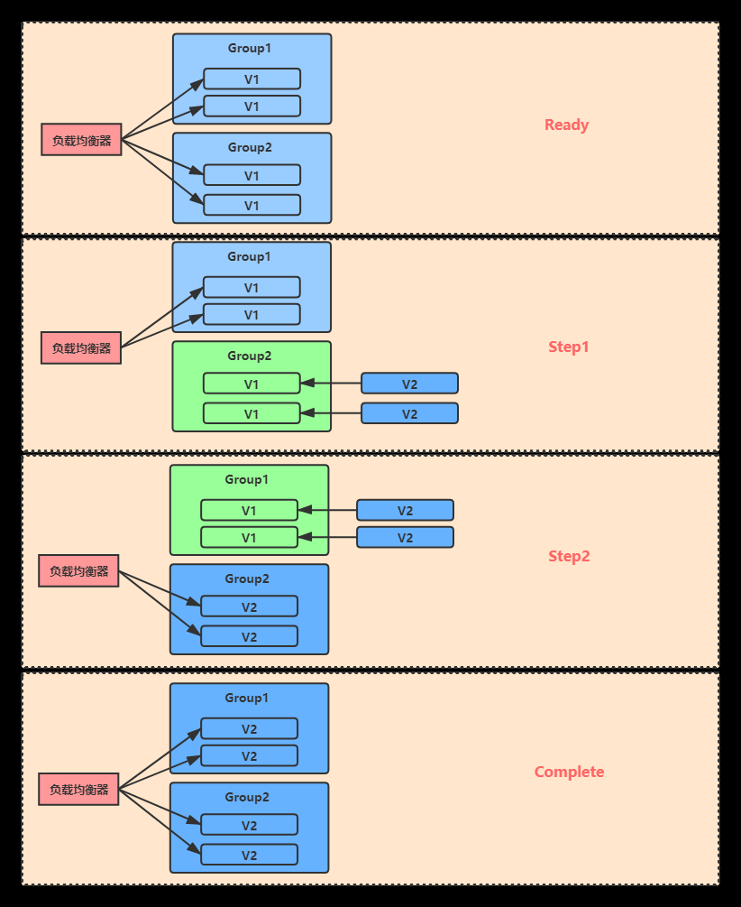

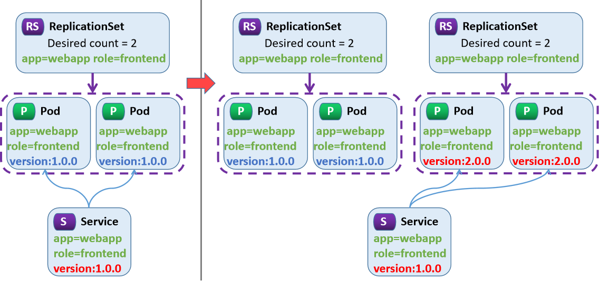

蓝绿和滚动关联关系

类型蓝绿滚动

配置文件两个两个

更新时间长短

资源需求多少

访问特点一个版本多个版本

部署影响影响范围大影响范围小

#### 2.4.3.2 利用RS实现版本发布

##### 2.4.3.2.1 滚动发布

示例: 滚动发布
```yaml
#准备service
[root@master1 ~]#cat svc-controller-replicaset.yaml
apiVersion: v1
kind: Service
metadata:
name: svc-replicaset
spec:
type: ClusterIP
selector:
app: rs-test
ports:
- name: http
port: 80
protocol: TCP
targetPort: 80

#准备旧版本的replicaset清单文件
[root@master1 ~]#cat controller-replicaset-1.yaml
apiVersion: apps/v1
kind: ReplicaSet
metadata:
name: replicaset-test-1

spec:
minReadySeconds: 0
replicas: 3
selector:
matchLabels:
app: rs-test
release: stable
version: v0.1
template:
metadata:
labels:
app: rs-test
release: stable
version: v0.1
spec:
containers:
- name: rs-test
image: registry.cn-beijing.aliyuncs.com/bowen/pod-test:v0.1

#准备新版本的replicaset清单文件
[root@master1 ~]#cat controller-replicaset-2.yaml
apiVersion: apps/v1
kind: ReplicaSet
metadata:
name: replicaset-test-2
spec:
minReadySeconds: 0
replicas: 0              #注意：此处为0
selector:
matchLabels:
app: rs-test
release: stable
version: v0.2
template:
metadata:
labels:
app: rs-test
release: stable
version: v0.2
spec:
containers:
- name: rs-test
image: registry.cn-beijing.aliyuncs.com/bowen/pod-test:v0.2

#先创建service
[root@master1 ~]#kubectl apply -f svc-controller-replicaset.yaml

#开启测试pod访问service,持续观察结果
[root@master1 ~]#kubectl run pod-$RANDOM --image=bowen/admin-box:v0.1 -it
--rm --command -- /bin/bash

[root@pod-3723 /]$  while true; do curl --connect-timeout 1 svc-replicaset-blue-
green.default.svc; sleep 1;done

#执行旧版本的RS清单文件,生成旧版本的pod
[root@master1 ~]#kubectl apply -f yaml/controller-replicaset-1.yaml

#执行新版本的RS清单文件,生成新版本的pod,但由于指定的replicas为0,所以没有新版的pod生成

[root@master1 ~]#kubectl apply -f yaml/controller-replicaset-2.yaml

#可以观察到下面显示
[root@master1 ~]#kubectl get all
NAME                        READY   STATUS    RESTARTS   AGE
pod/pod-22090                 1/1     Running   0          7m39s
pod/replicaset-test-1-624cr   1/1     Running   0          2s
pod/replicaset-test-1-cc6tq   1/1     Running   0          2s
pod/replicaset-test-1-k8tm5   1/1     Running   0          2s

NAME                     TYPE        CLUSTER-IP        EXTERNAL-IP   PORT(S)
AGE
service/kubernetes       ClusterIP   192.168.0.1       <none>        443/TCP
12h
service/svc-replicaset   ClusterIP   192.168.201.247   <none>        80/TCP
26m

NAME                                DESIRED   CURRENT   READY   AGE
replicaset.apps/replicaset-test-1   3         3         3       2s
replicaset.apps/replicaset-test-2   0         0         0       8s
```


#可以观察到下面显示 kubernetes pod-test v0.1!! ClientIP: 172.16.2.39, ServerName: replicaset-test-g7r9x, ServerIP: 172.16.1.32! kubernetes pod-test v0.1!! ClientIP: 172.16.2.39, ServerName: replicaset-test-bwmp6, ServerIP: 172.16.3.79! kubernetes pod-test v0.1!! ClientIP: 172.16.2.39, ServerName: replicaset-test-pbgt8, ServerIP: 172.16.2.40!

```bash
#对旧版的RS缩容,对新版本的RS扩容
[root@master1 ~]#kubectl scale --replicas=2 rs/replicaset-test-1;kubectl scale --
replicas=1 rs/replicaset-test-2

#观察结果
[root@master1 ~]#kubectl get pod --show-labels
NAME                      READY   STATUS    RESTARTS   AGE     LABELS
pod-22090                 1/1     Running   0          13m     run=pod-22090
replicaset-test-2-r8kcl   1/1     Running   0          21s     app=rs-
test,release=stable,version=v0.2
replicaset-test-1-g7r9x     1/1     Running   0          6m27s   app=rs-
test,release=stable,version=v0.1
replicaset-test-1-pbgt8     1/1     Running   0          6m27s   app=rs-
test,release=stable,version=v0.1
```


#持续观察访问,注意基本旧新版比例 kubernetes pod-test v0.1!! ClientIP: 172.16.2.39, ServerName: replicaset-test-g7r9x, ServerIP: 172.16.1.32! kubernetes pod-test v0.1!! ClientIP: 172.16.2.39, ServerName: replicaset-test-g7r9x, ServerIP: 172.16.1.32! kubernetes pod-test v0.1!! ClientIP: 172.16.2.39, ServerName: replicaset-test-g7r9x, ServerIP: 172.16.1.32! kubernetes pod-test v0.2!! ClientIP: 172.16.2.39, ServerName: replicaset-test-2-r8kcl, ServerIP: 172.16.3.80! kubernetes pod-test v0.1!! ClientIP: 172.16.2.39, ServerName: replicaset-test-g7r9x, ServerIP: 172.16.1.32!

```bash
#再次对旧版的RS缩容,对新版本的RS扩容

[root@master1 ~]#kubectl scale --replicas=1 rs/replicaset-test-1;kubectl scale --
replicas=2 rs/replicaset-test-2

#观察结果
[root@master1 ~]#kubectl get pod --show-labels
NAME                      READY   STATUS    RESTARTS   AGE     LABELS
pod-22090                 1/1     Running   0          16m     run=pod-22090
replicaset-test-2-pq6p6   1/1     Running   0          37s     app=rs-
test,release=stable,version=v0.2
replicaset-test-2-r8kcl   1/1     Running   0          3m26s   app=rs-
test,release=stable,version=v0.2
replicaset-test-1-pbgt8   1/1     Running   0          9m32s   app=rs-
test,release=stable,version=v0.1
```


#持续观察访问,注意基本旧新版比例 kubernetes pod-test v0.2!! ClientIP: 172.16.2.39, ServerName: replicaset-test-2-pq6p6, ServerIP: 172.16.3.81! kubernetes pod-test v0.1!! ClientIP: 172.16.2.39, ServerName: replicaset-test-pbgt8, ServerIP: 172.16.2.40! kubernetes pod-test v0.2!! ClientIP: 172.16.2.39, ServerName: replicaset-test-2-r8kcl, ServerIP: 172.16.3.80! kubernetes pod-test v0.2!! ClientIP: 172.16.2.39, ServerName: replicaset-test-2-r8kcl, ServerIP: 172.16.3.80! kubernetes pod-test v0.2!! ClientIP: 172.16.2.39, ServerName: replicaset-test-2-r8kcl, ServerIP: 172.16.3.80! kubernetes pod-test v0.1!! ClientIP: 172.16.2.39, ServerName: replicaset-test-pbgt8, ServerIP: 172.16.2.40!

```bash
#最后一次对旧版的RS缩容为0,对新版本的RS扩容到3
[root@master1 ~]#kubectl scale --replicas=0 rs/replicaset-test;kubectl scale --
replicas=3 rs/replicaset-test-2

#观察结果
[root@master1 ~]#kubectl get pod --show-labels
NAME                      READY   STATUS    RESTARTS   AGE     LABELS
pod-22090                 1/1     Running   0          18m     run=pod-22090
replicaset-test-2-4xdsq   1/1     Running   0          32s     app=rs-
test,release=stable,version=v0.2
replicaset-test-2-pq6p6   1/1     Running   0          2m38s   app=rs-
test,release=stable,version=v0.2
replicaset-test-2-r8kcl   1/1     Running   0          5m27s   app=rs-
test,release=stable,version=v0.2
```


#持续观察结果都升级为新版 kubernetes pod-test v0.2!! ClientIP: 172.16.2.39, ServerName: replicaset-test-2-r8kcl, ServerIP: 172.16.3.80! kubernetes pod-test v0.2!! ClientIP: 172.16.2.39, ServerName: replicaset-test-2-4xdsq, ServerIP: 172.16.1.33! kubernetes pod-test v0.2!! ClientIP: 172.16.2.39, ServerName: replicaset-test-2-4xdsq, ServerIP: 172.16.1.33! kubernetes pod-test v0.2!! ClientIP: 172.16.2.39, ServerName: replicaset-test-2-pq6p6, ServerIP: 172.16.3.81! kubernetes pod-test v0.2!! ClientIP: 172.16.2.39, ServerName: replicaset-test-2-4xdsq, ServerIP: 172.16.1.33! kubernetes pod-test v0.2!! ClientIP: 172.16.2.39, ServerName: replicaset-test-2-pq6p6, ServerIP: 172.16.3.81!


kubernetes pod-test v0.2!! ClientIP: 172.16.2.39, ServerName: replicaset-test-2-r8kcl, ServerIP: 172.16.3.80! kubernetes pod-test v0.2!! ClientIP: 172.16.2.39, ServerName: replicaset-test-2-pq6p6, ServerIP: 172.16.3.81! kubernetes pod-test v0.2!! ClientIP: 172.16.2.39, ServerName: replicaset-test-2-pq6p6, ServerIP: 172.16.3.81! kubernetes pod-test v0.2!! ClientIP: 172.16.2.39, ServerName: replicaset-test-2-r8kcl, ServerIP: 172.16.3.80!

```bash
#最终实现了滚动升级,但这种手动的方式的滚动更新很麻烦

#清理环境
[root@master1 ~]#kubectl delete -f controller-replicaset-1.yaml -f controller-
replicaset-2.yaml -f svc-controller-replicaset.yaml
```

##### 2.4.3.2.2 蓝绿发布

示例: 蓝绿发布
```yaml
#由于之前两个配置文件来回更新的话，导致操作繁琐，这次我们采用环境变量的方式来进行操作。
[root@master1 ~]#cat controller-replicaset-blue-green.yaml
apiVersion: v1
kind: Service
metadata:
name: svc-replicaset-blue-green
spec:
type: ClusterIP
selector:
app: rs-test
ctr: rs-${DEPLOY}
version: ${VERSION}
ports:
- name: http
port: 80
protocol: TCP
targetPort: 80
---
apiVersion: apps/v1
kind: ReplicaSet
metadata:
name: rs-${DEPLOY}
spec:
minReadySeconds: 3
replicas: 2
selector:
matchLabels:
app: rs-test
ctr: rs-${DEPLOY}
version: ${VERSION}
template:
metadata:
labels:
app: rs-test
ctr: rs-${DEPLOY}
version: ${VERSION}
spec:
containers:

- name: pod-test
image: registry.cn-beijing.aliyuncs.com/bowen/pod-test:${VERSION}

#开启测试pod访问service,观察结果
[root@master1 ~]#kubectl run pod-$RANDOM --image=registry.cn-
beijing.aliyuncs.com/bowen/admin-box:v0.1 -it --rm --command -- /bin/bash
[root@pod-3723 /]$ while true; do curl --connect-timeout 1 svc-replicaset-blue-
green.default.svc; sleep 1;done

#蓝色发布旧版本
[root@master1 ~]#DEPLOY=blue VERSION=v0.1 envsubst < controller-replicaset-blue-
green.yaml | kubectl apply -f -
```


#可以观察到出下面显示 kubernetes pod-test v0.1!! ClientIP: 172.16.1.30, ServerName: rs-blue-cwdf6, ServerIP: 172.16.2.38! kubernetes pod-test v0.1!! ClientIP: 172.16.1.30, ServerName: rs-blue-2xwhl, ServerIP: 172.16.3.77! kubernetes pod-test v0.1!! ClientIP: 172.16.1.30, ServerName: rs-blue-2xwhl, ServerIP: 172.16.3.77!

```bash
#绿色发布新版本
[root@master1 ~]#DEPLOY=green VERSION=v0.2 envsubst < controller-replicaset-blue-
green.yaml | kubectl apply -f -

#可以观察到以下结果
kubernetes pod-test v0.1!! ClientIP: 172.16.1.30, ServerName: rs-blue-cwdf6,
ServerIP: 172.16.2.38!
kubernetes pod-test v0.1!! ClientIP: 172.16.1.30, ServerName: rs-blue-2xwhl,
ServerIP: 172.16.3.77!
curl: (28) Connection timed out after 1000 milliseconds
curl: (28) Connection timed out after 1001 milliseconds
kubernetes pod-test v0.2!! ClientIP: 172.16.1.30, ServerName: rs-green-m27fv,
ServerIP: 172.16.1.31!
kubernetes pod-test v0.2!! ClientIP: 172.16.1.30, ServerName: rs-green-lvvqs,
ServerIP: 172.16.3.78!
#结果显示：进行蓝绿部署时，必须等到所有新的版本更新完毕后，再开放新的service，否则就会导致服务
中断的效果

#回滚
[root@master1 ~]#DEPLOY=blue VERSION=v0.1 envsubst < controller-replicaset-blue-
green.yaml | kubectl apply -f -
```

## 2.5 Deployment

### 2.5.1 Deployment 工作机制

#### 2.5.1.1 Deployment 介绍


- <https://kubernetes.io/zh-cn/docs/concepts/workloads/controllers/deployment/>


Deployment资源对象一般用于部署无状态服务,比如 java应用，Web等，这也是最常用的控制器。可以管理多个副本的Pod, 实现无缝迁移、自动扩容缩容、自动灾难恢复、一键回滚等功能。Deployment资源对象在作用、文件定义格式、具体操作等方面都可以看做RC的一次升级。Deployment相对于RC或RS的主要升级是:支持动态更新，回滚及滚动发布策略,其它功能几乎一样。Deployment资源对象在内部使用Replica Set来实现Pod的自动化编排。通过Deployment 可以随时知道当前Pod的"部署"进度，即Pod创建--调度--绑定Node--在目标Node上启动容器。Deployment的使用场景非常多,基本上只要是涉及到Pod资源对象的自动化管理都是它的应用场景。

**Deployment 工作流程**：创建Deployment资源对象，自动生成对应的Replicas Set并完成Pod的自动管理，而无需人为显示创建 Replicas Set检查Deployment对象状态，检查Pod自动管理效果扩展Deployment资源对象，以应对应用业务的高可用。

#### 2.5.1.2 资源对象 Deployment 和 Replica Set 关系


Deployment 本质上是依赖并调用 Replica Set 的完成来基本的编排功能，并额外提供了滚动更新，回滚的功能。

**Deployment、ReplicaSet 与 Pod 的关系**：Deployment 是位于 ReplicaSet 之上的高级控制器，依赖 ReplicaSet 完成对 Pod 的编排。Deployment 先创建并管理 ReplicaSet，ReplicaSet 再创建和管理 Pod；Deployment 不直接管理 Pod。ReplicaSet 的名称由 Deployment 名称和 Pod 模板（Template）的哈希值生成。

Deployment 基于 ReplicaSet 提供滚动更新、回滚等更强的应用编排功能。通常直接定义 Deployment 资源来编排 Pod 应用，无须显式配置 ReplicaSet。

#### 2.5.1.3 Deployment 的资源定义

Deployment的定义与Replica Set的定义类似，除了API声明与Kind类型有所区别，其他基本上都一样。

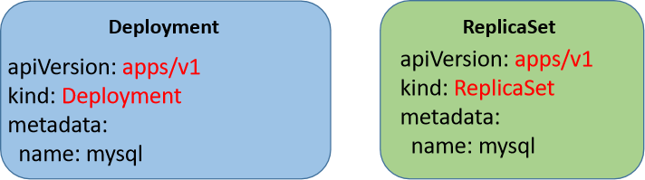

注意：Deployment对滚动更新多了一些更新策略的功能。
```yaml
apiVersion: apps/v1             # API群组及版本
kind: Deployment                # 资源类型特有标识
metadata:
name <string>                 # 资源名称，在作用域中要唯一，生成Pod名称：
Deployment+Pod模板Hash+随机字符
namespace <string>            # 名称空间；Deployment隶属名称空间级别
spec:
minReadySeconds <integer>     # Pod就绪后多少秒内任意容器无crash方可视为“就绪”,默认为
0,即一旦创建完成立即为Ready
replicas <integer>            # 期望的Pod副本数，默认为1
selector <object>             # 标签选择器，必须匹配template字段中Pod模板中的标签
matchLabels:
app: <string>             # 标签信息一旦创建不能再修改,必须和下面的
template.labels相同
template <object>             # Pod模板对象，此template的hash值将做为对应Replica
Set的名称，从而实现滚动更新和回滚等

revisionHistoryLimit <integer># 滚动更新历史记录数量，默认为10,如果为0表示不保留历史数
据
strategy <Object>             # 滚动更新策略
type <string>               # 滚动更新类型，可用值有Recreate（删除所有旧Pod再创建新
Pod）和RollingUpdate
rollingUpdate <Object>      # 滚动更新参数，专用于RollingUpdate类型，逐步更新，先创
建新Pod再逐步删除旧版本的Pod
maxSurge <string>         # 更新期间可比期望的Pod数量能够多出的最大数量或比例
maxUnavaiLabel <string>   # 更新期间可比期望的Pod数量能够缺少的最大数量或比例
progressDeadlineSeconds <integer> # 滚动更新故障超时时长，默认为600秒
paused <boolean>              # 是否暂停部署过程
```

### 2.5.2 Deployment 实现

#### 2.5.2.1 Deployment 创建

创建两种方式

**命令行创建对象**
```text
kubectl create deployment NAME --image=image -- [COMMAND] [args...]
[options]
```

示例:
```bash
#创建命令
[root@master1 ~]#kubectl create deployment deployment-pod-test --
image=registry.cn-beijing.aliyuncs.com/bowen/pod-test:v0.1 --replicas=3

#查看效果
[root@master1 ~]#kubectl get all
NAME                                       READY   STATUS    RESTARTS   AGE
pod/deployment-pod-test-64b54c98bb-6cm4m   1/1     Running   0          20s
pod/deployment-pod-test-64b54c98bb-shts6   1/1     Running   0          20s
pod/deployment-pod-test-64b54c98bb-sp5qj   1/1     Running   0          20s

NAME                                  READY   UP-TO-DATE   AVAILABLE   AGE
deployment.apps/deployment-pod-test   3/3     3            3           20s

NAME                                             DESIRED   CURRENT   READY   AGE
replicaset.apps/deployment-pod-test-64b54c98bb   3         3         3       20s

#注意:创建deployment会自动创建相应的RS和POD
#RS的名称=deployment名称+template_hash值
#Pod的名称=deployment名称+replcaset_id+pod_id
```

资源定义文件创建对象

示例:
```yaml
[root@master1 ~]#cat controller-deployment-test.yaml
apiVersion: apps/v1
kind: Deployment
metadata:
name: deployment-test
spec:
replicas: 3
selector:
matchLabels:
app: rs-test
template:
metadata:
labels:
app: rs-test
spec:
containers:
- name: pod-test
image: registry.cn-beijing.aliyuncs.com/bowen/pod-test:v0.1

#应用资源定义文件
[root@master1 ~]#kubectl apply  -f controller-deployment-test.yaml

#验证结果
[root@master1 ~]#kubectl get all
NAME                                   READY   STATUS    RESTARTS   AGE
pod/deployment-test-6c47988884-6rcfp   1/1     Running   0          8s
pod/deployment-test-6c47988884-7cwhp   1/1     Running   0          8s
pod/deployment-test-6c47988884-l2nk8   1/1     Running   0          8s

NAME                 TYPE        CLUSTER-IP    EXTERNAL-IP   PORT(S)   AGE
service/kubernetes   ClusterIP   192.168.0.1   <none>        443/TCP   13h

NAME                              READY   UP-TO-DATE   AVAILABLE   AGE
deployment.apps/deployment-test   3/3     3            3           8s

NAME                                         DESIRED   CURRENT   READY   AGE
replicaset.apps/deployment-test-6c47988884   3         3         3       8s

[root@master1 ~]#kubectl get deployments.apps
NAME              READY   UP-TO-DATE   AVAILABLE   AGE
deployment-test   3/3     3            3           52s

#自动生成RS
[root@master1 ~]#kubectl get rs
NAME                         DESIRED   CURRENT   READY   AGE

deployment-test-6c47988884   3         3         3       73s

[root@master1 ~]#kubectl get pod
NAME                               READY   STATUS    RESTARTS   AGE
deployment-test-6c47988884-6rcfp   1/1     Running   0          95s
deployment-test-6c47988884-7cwhp   1/1     Running   0          95s
deployment-test-6c47988884-l2nk8   1/1     Running   0          95s

#注意:Pod名=Deployment名+RS名的随机字符+Pod名的随机字符,如下图所示
```

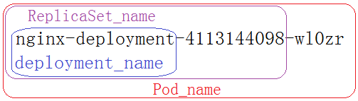
```bash
#查看 deployment的详细过程
[root@master1 ~]#kubectl describe deployment deployment-test
Name:                   deployment-test
Namespace:              default
CreationTimestamp:      Sun, 20 Mar 2022 12:56:40 +0800
Labels:                 <none>
Annotations:            deployment.kubernetes.io/revision: 1
Selector:               app=rs-test
Replicas:               3 desired | 3 updated | 3 total | 3 available | 0
unavailable
StrategyType:           RollingUpdate
MinReadySeconds:        0
RollingUpdateStrategy:  25% max unavailable, 25% max surge
Pod Template:
Labels:  app=rs-test
Containers:
pod-test:
Image:        bowen/pod-test:v0.1
Port:         <none>
Host Port:    <none>
Environment:  <none>
Mounts:       <none>
Volumes:        <none>
Conditions:
Type           Status  Reason
----           ------  ------
Available      True    MinimumReplicasAvailable
Progressing    True    NewReplicaSetAvailable
OldReplicaSets:  <none>
NewReplicaSet:   deployment-test-6c47988884 (3/3 replicas created)
Events:
Type    Reason             Age   From                   Message
----    ------             ----  ----                   -------
Normal  ScalingReplicaSet  4m3s  deployment-controller  Scaled up replica set
deployment-test-6c47988884 to 3

#将pod的80端口利用service发布出来
[root@master1 ~]#kubectl expose  deployment deployment-test --port=80

[root@master1 ~]#kubectl get svc
NAME              TYPE        CLUSTER-IP        EXTERNAL-IP   PORT(S)   AGE
deployment-test   ClusterIP   192.168.141.236   <none>        80/TCP    5s

#访问service的IP,可以看到随机访问到三个pod
[root@master1 ~]#curl 192.168.141.236
kubernetes pod-test v0.1!! ClientIP: 172.16.0.0, ServerName: deployment-test-
6c47988884-7cwhp, ServerIP: 172.16.2.44!
[root@master1 ~]#curl 192.168.141.236
kubernetes pod-test v0.1!! ClientIP: 172.16.0.0, ServerName: deployment-test-
6c47988884-6rcfp, ServerIP: 172.16.3.85!
[root@master1 ~]#curl 192.168.141.236
kubernetes pod-test v0.1!! ClientIP: 172.16.0.0, ServerName: deployment-test-
6c47988884-l2nk8, ServerIP: 172.16.1.37!

#创建一个Pod,从pod访问service
[root@master1 ~]#kubectl run pod-$RANDOM --image=bowen/admin-box:v0.1 -it
--rm --command -- /bin/bash
If you don't see a command prompt, try pressing enter.
[root@pod-23783 /]$ while true; do curl deployment-test;sleep 1;done
kubernetes pod-test v0.1!! ClientIP: 172.16.2.45, ServerName: deployment-test-
6c47988884-l2nk8, ServerIP: 172.16.1.37!
[root@pod-23783 /]$ curl deployment-test
kubernetes pod-test v0.1!! ClientIP: 172.16.2.45, ServerName: deployment-test-
6c47988884-6rcfp, ServerIP: 172.16.3.85!
[root@pod-23783 /]$ curl deployment-test
kubernetes pod-test v0.1!! ClientIP: 172.16.2.45, ServerName: deployment-test-
6c47988884-7cwhp, ServerIP: 172.16.2.44!
```

#### 2.5.2.2  Deployment  实现扩容缩容

##### 2.5.2.2.1 命令说明

基于deployment调整Pod有两种方法：
```bash
#基于资源对象调整：
kubectl scale [--current-replicas=<当前副本数>] --replicas=<新副本数>
deployment/deploy_name

#基于资源文件调整:
kubectl scale --replicas=<新副本数> -f deploy_name.yaml
```

##### 2.5.2.2.2 案例

范例: 基于资源对象扩充Pod数量
```bash
[root@master1 ~]#kubectl get pod
NAME                               READY   STATUS    RESTARTS   AGE
deployment-test-6c47988884-6rcfp   1/1     Running   0          20m
deployment-test-6c47988884-7cwhp   1/1     Running   0          20m
deployment-test-6c47988884-l2nk8   1/1     Running   0          20m

[root@master1 ~]#kubectl scale  --replicas=5 deployment/deployment-test

[root@master1 ~]#kubectl get pod
NAME                               READY   STATUS    RESTARTS   AGE

deployment-test-6c47988884-6rcfp   1/1     Running   0          20m
deployment-test-6c47988884-7cwhp   1/1     Running   0          20m
deployment-test-6c47988884-clgbd   1/1     Running   0          1s
deployment-test-6c47988884-gkz2b   1/1     Running   0          1s
deployment-test-6c47988884-l2nk8   1/1     Running   0          20m
```

范例
```bash
#查看帮助
[root@master1 ~]#kubectl help scale
Set a new size for a deployment, replica set, replication controller, or
stateful set.

#查看当前Pod
[root@master1 ~]#kubectl get deployments.apps
NAME    READY   UP-TO-DATE   AVAILABLE   AGE
nginx   1/1     1            1           16m

[root@master1 ~]#kubectl get pods
NAME                     READY   STATUS    RESTARTS   AGE
nginx-6799fc88d8-fcndt   1/1     Running   0          16m

#pod的扩容
[root@master1 ~]#kubectl scale --replicas=3 deployment/nginx
deployment.apps/nginx scaled

#验证
[root@master1 ~]#kubectl get deployments.apps  #全称
[root@master1 ~]#kubectl get deploy            #缩写
NAME    READY   UP-TO-DATE   AVAILABLE   AGE
nginx   1/3     3
[root@master1 ~]#kubectl get pod -o wide
NAME                     READY   STATUS    RESTARTS   AGE     IP           NODE
NOMINATED NODE   READINESS GATES
nginx-6799fc88d8-8rwcl   1/1     Running   0          3m49s   172.16.1.5
node2.bowen.org   <none>           <none>
nginx-6799fc88d8-b82ck   1/1     Running   0          3m49s   172.16.2.7
node3.bowen.org   <none>           <none>
nginx-6799fc88d8-fcndt   1/1     Running   0          22m     172.16.3.4
node1.bowen.org   <none>           <none>

#pod的容量收缩
[root@master1 ~]#kubectl scale --replicas=1 deployment nginx

[root@master1 ~]#kubectl get deploy
NAME    READY   UP-TO-DATE   AVAILABLE   AGE
nginx   1/1     1            1           33m
```

示例: 基于资源文件调整Pod数量
```yaml
[root@master1 ~]#cat controller-deployment-test.yaml
apiVersion: apps/v1
kind: Deployment
metadata:
name: deployment-test
spec:

replicas: 3
selector:
matchLabels:
app: rs-test
template:
metadata:
labels:
app: rs-test
spec:
containers:
- name: pod-test
image: registry.cn-beijing.aliyuncs.com/bowen/pod-test:v0.1

#缩容
[root@master1 ~]#kubectl scale  --replicas=1 -f controller-deployment-test.yaml
[root@master1 ~]#kubectl get pod
NAME                               READY   STATUS    RESTARTS   AGE
deployment-test-6c47988884-7cwhp   1/1     Running   0          25m
```

#### 2.5.2.3  Deployment 动态更新和回滚

##### 2.5.2.3.1 命令简介
```bash
#更新命令1：
kubectl set SUBCOMMAND [options] 资源类型 资源名称
SUBCOMMAND：子命令,常用的子命令就是image

#参数详解：
--record=true       #更改时，会将信息增加到历史记录中,k8s-v1.32.0不再支持

#更新命令2：
kubectl patch (-f FILENAME | TYPE NAME) -p PATCH [options]
#参数详解：
--patch=''      #设定对象属性内容

#回滚命令：
kubectl rollout SUBCOMMAND [options] 资源类型 资源名称
SUBCOMMAND 子命令：
history     #显示 rollout 历史,默认只保留最近的10个版本
pause       #标记resource为中止状态，配合resume可实现灰度发布，pause目前仅支持
deployment,可配合kubectl set实现批量更新
restart     #重启一个 resource
resume      #继续一个停止的 resource
status      #显示 rollout 的状态
undo        #撤销上一次的 rollout
--revision=n  #查看指定版本的详细信息
--to-revision=0 #rollback至指定版本,默认为0,表示前一个版本
```

##### 2.5.2.3.2 案例

范例：Pod的版本更新帮助
```sql
[root@master1 ~]#kubectl help set image
Update existing container image(s) of resources.

Possible resources include (case insensitive):

pod (po), replicationcontroller (rc), deployment (deploy), daemonset (ds),
statefulset (sts), cronjob (cj), replicaset
(rs)

Examples:
# Set a deployment's nginx container image to 'nginx:1.9.1', and its busybox
container image to 'busybox'
kubectl set image deployment/nginx busybox=busybox nginx=nginx:1.9.1

# Update all deployments' and rc's nginx container's image to 'nginx:1.9.1'
kubectl set image deployments,rc nginx=nginx:1.9.1 --all

# Update image of all containers of daemonset abc to 'nginx:1.9.1'
kubectl set image daemonset abc *=nginx:1.9.1

# Print result (in yaml format) of updating nginx container image from local
file, without hitting the server
kubectl set image -f path/to/file.yaml nginx=nginx:1.9.1 --local -o yaml

Options:
--all=false:
Select all resources, in the namespace of the specified resource types
```


--allow-missing-template-keys=true: If true, ignore any errors in templates when a field or map key is missing in the template. Only applies to golang and jsonpath output formats.


--dry-run='none': Must be "none", "server", or "client". If client strategy, only print the object that would be sent, without sending it. If server strategy, submit server-side request without persisting the resource.

```text
--field-manager='kubectl-set':
Name of the manager used to track field ownership.

-f, --filename=[]:
Filename, directory, or URL to files identifying the resource to get from a
server.

-k, --kustomize='':
Process the kustomization directory. This flag can't be used together with -
f or -R.

--local=false:
If true, set image will NOT contact api-server but run locally.

-o, --output='':
Output format. One of: (json, yaml, name, go-template, go-template-file,
template, templatefile, jsonpath,
jsonpath-as-json, jsonpath-file).

-R, --recursive=false:
Process the directory used in -f, --filename recursively. Useful when you
want to manage related manifests
organized within the same directory.

-l, --selector='':
Selector (label query) to filter on, supports '=', '==', and '!='.(e.g. -l
key1=value1,key2=value2). Matching
objects must satisfy all of the specified label constraints.

--show-managed-fields=false:
If true, keep the managedFields when printing objects in JSON or YAML
format.

--template='':
Template string or path to template file to use when -o=go-template, -o=go-
template-file. The template format
is golang templates [http://golang.org/pkg/text/template/#pkg-overview].

Usage:
kubectl set image (-f FILENAME | TYPE NAME) CONTAINER_NAME_1=CONTAINER_IMAGE_1
... CONTAINER_NAME_N=CONTAINER_IMAGE_N
[options]

Use "kubectl options" for a list of global command-line options (applies to all
commands).
```

范例：
```bash
[root@master1 pod]#kubectl rollout history deployment myapp
deployment.apps/myapp
REVISION  CHANGE-CAUSE
1         <none>
2         <none>
3         <none>
4         kubectl set image deploy myapp pod-test=registry.cn-
beijing.aliyuncs.com/bowen/pod-test:v0.4 --record=true

[root@master1 pod]#kubectl rollout history deployment myapp --revision=1
deployment.apps/myapp with revision #1
Pod Template:
Labels:   app=myapp
pod-template-hash=74f686cb98
Containers:
pod-test:
Image:  registry.cn-beijing.aliyuncs.com/bowen/pod-test:v0.1
Port:   <none>
Host Port:  <none>
Environment:    <none>
Mounts: <none>
Volumes:  <none>
Node-Selectors:   <none>
Tolerations:  <none>
```

范例: 命令式更新和回滚
```bash
#创建deployment
#--record=true 此
[root@master1 ~]#kubectl create deployment nginx --image registry.cn-
beijing.aliyuncs.com/bowen/nginx:1.18.0 --record=true

[root@master1 ~]#kubectl get deployments.apps
NAME    READY   UP-TO-DATE   AVAILABLE   AGE
nginx   1/1     1            1           10s

#查看rs
[root@master1 ~]#kubectl get rs
NAME               DESIRED   CURRENT   READY   AGE
nginx-68d5d56847   1         1         1       19s

#修改版本两种格式
[root@master1 ~]#kubectl set image deployment/nginx nginx='registry.cn-
beijing.aliyuncs.com/bowen/nginx:1.20.0' --record=true
[root@master1 ~]#kubectl set image deployment nginx nginx='registry.cn-
beijing.aliyuncs.com/bowen/nginx:1.20.0' --record=true

[root@master1 ~]#kubectl get pod
NAME                     READY   STATUS              RESTARTS   AGE
nginx-68d5d56847-5fcl4   1/1     Running             0          2m49s
nginx-79d97874f6-sdwcq   0/1     ContainerCreating   0          5s

#可以看到两个对应的rs版本
[root@master1 ~]#kubectl get rs
NAME               DESIRED   CURRENT   READY   AGE
nginx-68d5d56847   0         0         0       3m
nginx-79d97874f6   1         1         1       10s

[root@master1 ~]#kubectl get rs -o wide
NAME               DESIRED   CURRENT   READY   AGE     CONTAINERS   IMAGES
SELECTOR
nginx-68d5d56847   0         0         0       13m     nginx        nginx:1.18.0
app=nginx,pod-template-hash=68d5d56847
nginx-79d97874f6   0         0         0       12m     nginx        nginx:1.20.0
app=nginx,pod-template-hash=79d97874f6

#验证版本更新
[root@master1 ~]#kubectl exec -it nginx-79d97874f6-sdwcq -- /bin/bash
root@nginx-79d97874f6-sdwcq:/# nginx -v
nginx version: nginx/1.20.0

#查看版本更新状态和历史
[root@master1 ~]#kubectl rollout history deployment nginx
deployment.apps/nginx
REVISION  CHANGE-CAUSE
1         <none>
2         kubectl set image deployment/nginx nginx=registry.cn-
beijing.aliyuncs.com/bowen/nginx:1.20.0 --record=true

#撤销/回退上次的更改,注意:只能回退一次
[root@master1 ~]#kubectl rollout undo deployment nginx
[root@master1 ~]#kubectl rollout history deployment nginx

#回退至指定版本
[root@master1 ~]#kubectl rollout undo --to-revision=2 deployment nginx

[root@master1 ~]#kubectl rollout history deployment nginx
deployment.apps/nginx
REVISION  CHANGE-CAUSE

1         <none>
4         kubectl set image deployment/nginx nginx=registry.cn-
beijing.aliyuncs.com/bowen/nginx:1.20.0 --record=true
5         kubectl set image deployment/nginx nginx=registry.cn-
beijing.aliyuncs.com/bowen/nginx:1.18.0 --record=true
```

范例:  基于声明清单文件实现升级和降级
```yaml
[root@master1 ~]#cat controller-deployment-test.yaml
apiVersion: apps/v1
kind: Deployment
metadata:
name: deployment-test
spec:
replicas: 3
selector:
matchLabels:
app: rs-test
template:
metadata:
labels:
app: rs-test
spec:
containers:
- name: pod-test
image: registry.cn-beijing.aliyuncs.com/bowen/pod-test:v0.1

[root@master1 ~]#kubectl get svc
NAME              TYPE        CLUSTER-IP        EXTERNAL-IP   PORT(S)   AGE
deployment-test   ClusterIP   192.168.141.236   <none>        80/TCP    23m

#查看当前版本
[root@master1 ~]#curl 192.168.141.236
kubernetes pod-test v0.1!! ClientIP: 172.16.0.0, ServerName: deployment-test-
6c47988884-7cwhp, ServerIP: 172.16.2.44!

#升级版本
#方法1
[root@master1 ~]#kubectl set image deployment deployment-test pod-
test='registry.cn-beijing.aliyuncs.com/bowen/pod-test:v0.2' --record=true
#注意：pod-test是容器名称，bowen/pod-test:v0.2是 image的属性值。

#方法2
[root@master1 ~]#vim controller-deployment-test.yaml
apiVersion: apps/v1
kind: Deployment
metadata:
name: deployment-test
spec:
replicas: 3
selector:
matchLabels:
app: rs-test
template:
metadata:
labels:
app: rs-test

spec:
containers:
- name: pod-test
image: registry.cn-beijing.aliyuncs.com/bowen/pod-test:v0.2 #修改此
行版本

#应用并观察
root@master1 ~]#kubectl apply -f controller-deployment-test.yaml ; kubectl
rollout status -f controller-deployment-test.yaml

#验证版本升级
[root@master1 ~]#curl 192.168.141.236
kubernetes pod-test v0.2!! ClientIP: 172.16.0.0, ServerName: deployment-test-
8fb899745-dk62n, ServerIP: 172.16.1.39!

#查看更新状态
[root@master1 ~]#kubectl rollout status deployment deployment-test
deployment "deployment-test" successfully rolled out

#查看历史
#方法1
[root@master1 ~]#kubectl rollout history -f controller-deployment-test.yaml

#方法2
[root@master1 ~]#kubectl rollout history deployment deployment-test
deployment.apps/deployment-test
REVISION  CHANGE-CAUSE
1         <none>
2         kubectl set image deployment/deployment-test pod-test=registry.cn-
beijing.aliyuncs.com/bowen/pod-test:v0.2 --record=true

#查看指定版本的详细信息
[root@master1 ~]#kubectl rollout  history deployment deployment-test --
revision=1
deployment.apps/deployment-test with revision #1
Pod Template:
Labels:   app=deployment-test
pod-template-hash=5b8795b9bc
Containers:
pod-test:
Image:  registry.cn-beijing.aliyuncs.com/bowen/pod-test:v0.1
Port:   <none>
Host Port:  <none>
Environment:    <none>
Mounts: <none>
Volumes:  <none>

#降级版本
#修改清单文件或通过下面命令实现
[root@master1 ~]#kubectl set image deployment/deployment-test pod-
test='registry.cn-beijing.aliyuncs.com/bowen/pod-test:v0.1' --record=true
```
```bash
[root@master1 ~]#kubectl rollout history deployment deployment-test
deployment.apps/deployment-test
REVISION  CHANGE-CAUSE
2         kubectl set image deployment/deployment-test pod-test=registry.cn-
beijing.aliyuncs.com/bowen/pod-test:v0.2 --record=true

3         kubectl set image deployment/deployment-test pod-test=registry.cn-
beijing.aliyuncs.com/bowen/pod-test:v0.1 --record=true

[root@master1 ~]#kubectl rollout status deployment deployment-test
deployment "deployment-test" successfully rolled out

#确认版本降级
[root@master1 ~]#curl 192.168.141.236
kubernetes pod-test v0.1!! ClientIP: 172.16.0.0, ServerName: deployment-test-
6c47988884-rjpx5, ServerIP: 172.16.2.46!

#回滚上一个操作
[root@master1 ~]#kubectl rollout undo deployment deployment-test
deployment.apps/deployment-test rolled back

#确认回滚
[root@master1 ~]#curl 192.168.141.236
kubernetes pod-test v0.2!! ClientIP: 172.16.0.0, ServerName: deployment-test-
8fb899745-jp7kg, ServerIP: 172.16.3.87!

#查看回滚历史
[root@master1 ~]#kubectl rollout history deployment deployment-test
deployment.apps/deployment-test
REVISION  CHANGE-CAUSE
3         kubectl set image deployment/deployment-test pod-test=registry.cn-
beijing.aliyuncs.com/bowen/pod-test:v0.1 --record=true
4         kubectl set image deployment/deployment-test pod-test=registry.cn-
beijing.aliyuncs.com/bowen/pod-test:v0.2 --record=true

#扩容
[root@master1 ~]#kubectl scale  --replicas=3 deployment deployment-test

#更改1个后，就暂停，查看效果
[root@master1 ~]#kubectl set image deployment/deployment-test pod-
test='registry.cn-beijing.aliyuncs.com/bowen/pod-test:v0.2' --record=true
&& kubectl rollout pause deployment deployment-test

#查看状态
[root@master1 ~]#kubectl rollout status deployment deployment-test
Waiting for deployment "deployment-test" rollout to finish: 0 out of 3 new
replicas have been updated...
#显示卡住不动

#新开一个连接查看状态
[root@master1 ~]#kubectl rollout history deployment deployment-test
deployment.apps/deployment-test
REVISION  CHANGE-CAUSE
3         kubectl set image deployment/deployment-test pod-test=registry.cn-
beijing.aliyuncs.com/bowen/pod-test:v0.1 --record=true
4         kubectl set image deployment/deployment-test pod-test=registry.cn-
beijing.aliyuncs.com/bowen/pod-test:v0.2 --record=true
5         kubectl set image deployment/deployment-test pod-test=registry.cn-
beijing.aliyuncs.com/bowen/nginx:1.20.0 --record=true

#继续更新
[root@master1 ~]#kubectl rollout resume deployment deployment-test
deployment.apps/deployment-test resumed

#观察状态
[root@master1 ~]#kubectl rollout status deployment deployment-test
Waiting for deployment "deployment-test" rollout to finish: 0 out of 3 new
replicas have been updated...
```


Waiting for deployment spec update to be observed... Waiting for deployment spec update to be observed... Waiting for deployment spec update to be observed... Waiting for deployment "deployment-test" rollout to finish: 0 out of 3 new replicas have been updated... Waiting for deployment "deployment-test" rollout to finish: 1 out of 3 new replicas have been updated... Waiting for deployment "deployment-test" rollout to finish: 1 out of 3 new replicas have been updated... Waiting for deployment "deployment-test" rollout to finish: 1 out of 3 new replicas have been updated... Waiting for deployment "deployment-test" rollout to finish: 2 out of 3 new replicas have been updated... Waiting for deployment "deployment-test" rollout to finish: 2 out of 3 new replicas have been updated... Waiting for deployment "deployment-test" rollout to finish: 2 out of 3 new replicas have been updated... Waiting for deployment "deployment-test" rollout to finish: 1 old replicas are pending termination... Waiting for deployment "deployment-test" rollout to finish: 1 old replicas are pending termination... deployment "deployment-test" successfully rolled out

```bash
#查看历史
[root@master1 ~]#kubectl rollout history deployment deployment-test
deployment.apps/deployment-test
REVISION  CHANGE-CAUSE
3         kubectl set image deployment/deployment-test pod-test=registry.cn-
beijing.aliyuncs.com/bowen/pod-test:v0.1 --record=true
4         kubectl set image deployment/deployment-test pod-test=registry.cn-
beijing.aliyuncs.com/bowen/pod-test:v0.2 --record=true
5         kubectl set image deployment/deployment-test pod-test=registry.cn-
beijing.aliyuncs.com/bowen/nginx:1.20.0 --record=true
6         kubectl set image deployment/deployment-test pod-test=registry.cn-
beijing.aliyuncs.com/nginx:1.18.0 --record=true

#再次回退至版地本3
[root@master1 ~]#kubectl rollout undo deployment deployment-test --to-revision=3
deployment.apps/deployment-test rolled back

#验证结果
[root@master1 ~]#curl 192.168.141.236
kubernetes pod-test v0.1!! ClientIP: 172.16.0.0, ServerName: deployment-test-
6c47988884-mw8zh, ServerIP: 172.16.2.51!

#查看历史
[root@master1 ~]#kubectl rollout history deployment deployment-test
deployment.apps/deployment-test
REVISION  CHANGE-CAUSE
4         kubectl set image deployment/deployment-test pod-test=registry.cn-
beijing.aliyuncs.com/bowen/pod-test:v0.2 --record=true
5         kubectl set image deployment/deployment-test pod-test=registry.cn-
beijing.aliyuncs.com/bowen/nginx:1.20.0 --record=true

6         kubectl set image deployment/deployment-test pod-test=registry.cn-
beijing.aliyuncs.com/nginx:1.18.0 --record=true
7         kubectl set image deployment/deployment-test pod-test=registry.cn-
beijing.aliyuncs.com/bowen/pod-test:v0.1 --record=true
#结果显示：将原来的3号变成7号位置，重新执行了一遍，原来的3号就没有了
```

范例: 批量多次更新合并为一次更新

默认只更改一次就会触发重新生成新Pod可能会影响业务的稳定,可以将多次批量更新合并为只触发一次重新创建Pod,从而保证业务的稳定。
```bash
#暂停更新
[root@master1 ~]#kubectl rollout pause deployment pod-test

#第一次更改
[root@master1 ~]#kubectl set image  deploy pod-test pod-test=registry.cn-
beijing.aliyuncs.com/bowen/pod-test:v0.2 --record

#查看没有更新
[root@master1 ~]#kubectl get pod
NAME                        READY   STATUS        RESTARTS   AGE
pod-test-5b8795b9bc-2n4tx   0/1     Running       0          3h40m
pod-test-5b8795b9bc-kjt9c   0/1     Running       0          3h40m

#第二次更改
[root@master1 ~]#kubectl set resources deploy pod-test -c pod-test --
limits=cpu=200m,memory=128Mi --requests=cpu=100m,memory=64Mi

#查看没有更新
[root@master1 ~]#kubectl get pod
NAME                        READY   STATUS             RESTARTS   AGE
pod-test-5b8795b9bc-2n4tx   0/1     Running       0          3h40m
pod-test-5b8795b9bc-kjt9c   0/1     Running       0          3h40m

#查看状态
[root@master1 ~]#kubectl get deployments.apps pod-test -oyaml
......
spec:
containers:
- image: registry.cn-beijing.aliyuncs.com/bowen/pod-test:v0.2
imagePullPolicy: IfNotPresent
name: pod-test
resources:
limits:
cpu: 200m
memory: 128Mi
requests:
cpu: 100m
memory: 64Mi

#恢复批量更新
[root@master1 ~]#kubectl rollout resume  deployment pod-test

#查看更新
[root@master1 ~]#kubectl get pod
NAME                        READY   STATUS              RESTARTS   AGE
pod-test-5b8795b9bc-2n4tx   0/1     Running             0          3h43m

pod-test-5b8795b9bc-kjt9c   0/1     Running             0          3h43m
pod-test-7898f44799-p99xn   0/1     ContainerCreating   0          6s

[root@master1 ~]#kubectl get rs
NAME                  DESIRED   CURRENT   READY   AGE
pod-test-5b8795b9bc   2         2         0       3h44m
pod-test-7898f44799   1         1         0       14s
```

#### 2.5.2.4  Deployment 实现滚动更新策略

##### 2.5.2.4.1  Deployment 实现滚动更新策略说明

Deployment 控制器支持两种更新策略

**重建式更新 recreate**

当使用Recreate策略时，Deployment会直接删除全部的旧的Pod，然后创建新的Pod。这意味着在部署新版本时，整个应用会停止服务一段时间，直到所有旧的Pod都被删除并且新的Pod被创建并运行起来。这可能会导致一段时间内的服务中断，因为旧版本的Pod被直接替换掉了。当Pod资源被删除后，再使用新的模板定义新建Pod来补足缺失的Pod数量，从而完成更新。

此方式可以防止端口冲突

触发条件:现有Pod先被删除

滚动式更新 rolling updates

此为默认策略

RollingUpdate策略允许在部署新版本时逐步更新Pod。它会先创建新版本的Pod，然后逐步替换旧版本的Pod，直到所有Pod都已经更新为新版本。这种方式可以确保应用一直处于可用状态，因为在整个更新过程中，至少有一部分Pod一直在运行。

逐批次更新Pod的方式，支持按百分比或具体的数量定义批次规模。

触发条件:

podTemplate的hash码变动，即仅podTemplate的配置变动才会导致hash码改变replicas和selector的变更不会导致podTemplate的hash变动。

其实前面rollout的效果就是一种特殊的滚动更新，只不过是一个一个的变动，而真正的滚动更新远远要比默认的效果灵活.

存在的问题:必须以Pod为最小单位来调整规模比例，而无法实现流量路由比例的控制，比如: 共3个Pod实现20%流量比例。

要实现流量路由比例的控制，就需要使用更高级的工具比如: Ingress 才能实现。

**属性解析**
```bash
kubectl explain deployment.spec
revisionHistoryLimit <integer>
The number of old ReplicaSets to retain to allow rollback. This is a pointer
to distinguish between explicit zero and not specified. Defaults to 10.

kubectl explain deployment.spec.strategy
type <string>       #主要有两种类型："Recreate"、"RollingUpdate-默认"
Recreate            #重建,先删除旧Pod,再创建新Pod,比如可以防止端口冲突

kubectl explain deployment.spec.strategy.rollingUpdate
rollingUpdate        <Object>
maxSurge        <string> #更新时允许超过期望值的最大Pod数量或百分比,默认为25%,如果为0,
表示先减再加，此时maxUnavaible不能为0
maxUnavailable  <string> #更新时允许最大多少个或百分比的Pod不可用,默认为25%,如果为0,表
示先加后减，此时maxSurge不能为0

#如果maxSurge为正整数, maxUnavailabel为0,表示先添加新版本的Pod,再删除旧版本的Pod，即先加再
减
#如果maxSurge为0, maxUnavaiLabel为正整数,表示先删除旧版本的Pod,再添加新版本的Pod，即先减再
加
#如果maxSurge为100%，maxUnavaiLabel为100%，实现蓝绿发布，注意：资源要足够

#缺点:
```

**属性解析**

Kubernetes在等待设置的时间后才进行升级。

minReadySeconds

如果没有设置该值，Kubernetes会假设该容器启动起来后就提供服务了如果没有设置该值，在某些情况下可能会造成服务不正常运行。升级过程中Pod最多可比预期值多出的Pod数量，其值可以是0或正整数,或者相对预期值的百分比。

maxSurge

默认是25%例如：maxSurage=1，replicas=5,则表示Kubernetes会先启动1一个新的Pod后才删掉一个旧的POD，整个升级过程中最多会有5+1个Pod。

升级过程中最多有多少个Pod处于无法提供服务的状态默认是25%。

maxUnavailable

当maxSurge不为0时，该值也不能为0例如：maxUnavaible=1，则表示Kubernetes整个升级过程中最多会有1个POD处于无法服务的状态。

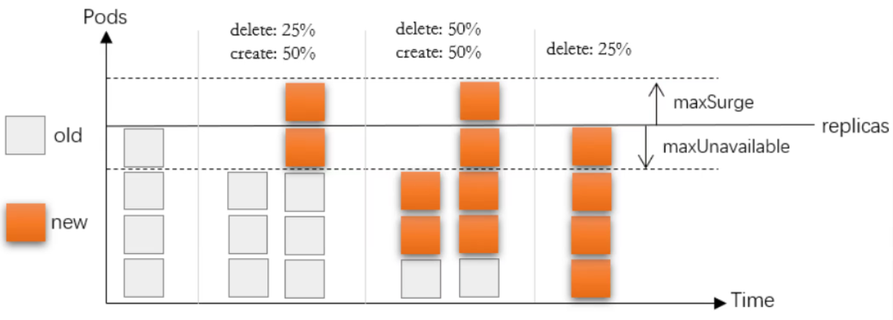

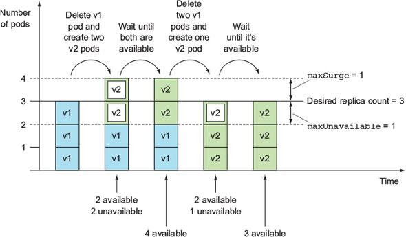

**资源清单文件基本样式**
```text
#基本属性样式：
minReadySeconds: 5
strategy:
type: RollingUpdate
rollingUpdate:
maxSurge: 1
maxUnavaiLabel: 1
```

##### 2.5.2.4.2  案例: 滚动更新
```yaml
[root@master1 ~]#cat  controller-deployment-rollupdate.yaml
apiVersion: apps/v1
kind: Deployment
metadata:
name: deployment-rolling-update
spec:
replicas: 6
selector:
matchLabels:
app: pod-test
template:
metadata:
labels:
app: pod-test
spec:
containers:
- name: pod-rolling-update
image: registry.cn-beijing.aliyuncs.com/bowen/pod-test:v0.1
minReadySeconds: 5
strategy:
type: RollingUpdate
rollingUpdate:
maxSurge: 1
maxUnavailable: 1
#属性解析：
```


minReadySeconds: 5  #表示在更新的时候，需要先等待5秒，而不是一旦发生变化就滚动更新 maxSurge: 1         #定义了在更新期间允许超过期望数量的 Pod 实例,此处表示允许超过期望数量的一个额外的 Pod 实例。maxUnavaiLabel: 1   #定义了在更新期间允许不可用的最大 Pod 数量。此处表示在更新期间允许最多一个 Pod 不可用。

```sql
[root@master1 ~]#kubectl apply -f controller-deployment-rollupdate.yaml

#创建service
[root@master1 ~]#kubectl expose  deployment deployment-rolling-update --port=80
service/deployment-rolling-update exposed

#观察状态
[root@master1 ~]#kubectl get all
NAME                                             READY   STATUS    RESTARTS
AGE
pod/deployment-rolling-update-5df8565bb7-cp2qp   1/1     Running   0
65s
pod/deployment-rolling-update-5df8565bb7-fbt9x   1/1     Running   0
65s
pod/deployment-rolling-update-5df8565bb7-kq72t   1/1     Running   0
65s
pod/deployment-rolling-update-5df8565bb7-n6cz6   1/1     Running   0
65s
pod/deployment-rolling-update-5df8565bb7-sxwcx   1/1     Running   0
65s
pod/deployment-rolling-update-5df8565bb7-z52gx   1/1     Running   0
65s

NAME                                TYPE        CLUSTER-IP       EXTERNAL-IP
PORT(S)   AGE
service/deployment-rolling-update   ClusterIP   192.168.78.161   <none>
80/TCP    3s

NAME                                        READY   UP-TO-DATE   AVAILABLE   AGE
deployment.apps/deployment-rolling-update   6/6     6            6           66s

NAME                                                   DESIRED   CURRENT   READY
AGE
replicaset.apps/deployment-rolling-update-5df8565bb7   6         6         6
66s

#观察版本变化
[root@master1 ~]#curl 192.168.78.161
kubernetes pod-test v0.1!! ClientIP: 172.16.0.0, ServerName: deployment-rolling-
update-5df8565bb7-kq72t, ServerIP: 172.16.2.52!
[root@master1 ~]#curl 192.168.78.161
kubernetes pod-test v0.1!! ClientIP: 172.16.0.0, ServerName: deployment-rolling-
update-5df8565bb7-sxwcx, ServerIP: 172.16.1.45!
[root@master1 ~]#curl 192.168.78.161
kubernetes pod-test v0.1!! ClientIP: 172.16.0.0, ServerName: deployment-rolling-
update-5df8565bb7-fbt9x, ServerIP: 172.16.1.44!
[root@master1 ~]#curl 192.168.78.161
kubernetes pod-test v0.1!! ClientIP: 172.16.0.0, ServerName: deployment-rolling-
update-5df8565bb7-z52gx, ServerIP: 172.16.3.90!

#更新镜像,也可以直接修改controller-deployment-rollupdate.yaml中的image实现

[root@master1 ~]#kubectl set image deployment deployment-rolling-update  pod-
rolling-update='registry.cn-beijing.aliyuncs.com/bowen/pod-test:v0.2' --
record=true

#跟踪查看状态
[root@master1 ~]#kubectl rollout status deployment deployment-rolling-update
Waiting for deployment "deployment-rolling-update" rollout to finish: 4 out of 6
new replicas have been updated...

[root@master1 ~]#kubectl get pod -w
NAME                                         READY   STATUS        RESTARTS
AGE
deployment-rolling-update-5df8565bb7-cp2qp   1/1     Terminating   0
4m51s
deployment-rolling-update-5df8565bb7-kq72t   1/1     Terminating   0
4m51s
deployment-rolling-update-5df8565bb7-z52gx   1/1     Terminating   0
4m51s
deployment-rolling-update-7887c6fc6b-58d95   1/1     Running       0
25s
deployment-rolling-update-7887c6fc6b-58grr   1/1     Running       0
32s
deployment-rolling-update-7887c6fc6b-9vw8q   1/1     Running       0
25s
deployment-rolling-update-7887c6fc6b-ddc7r   1/1     Running       0
38s
deployment-rolling-update-7887c6fc6b-vxb8j   1/1     Running       0
32s
deployment-rolling-update-7887c6fc6b-xgqx6   1/1     Running       0
39s
deployment-rolling-update-5df8565bb7-cp2qp   0/1     Terminating   0
4m57s
deployment-rolling-update-5df8565bb7-cp2qp   0/1     Terminating   0
4m57s
deployment-rolling-update-5df8565bb7-cp2qp   0/1     Terminating   0
4m57s
deployment-rolling-update-5df8565bb7-z52gx   0/1     Terminating   0
4m57s
deployment-rolling-update-5df8565bb7-z52gx   0/1     Terminating   0
4m57s
deployment-rolling-update-5df8565bb7-z52gx   0/1     Terminating   0
4m57s
deployment-rolling-update-5df8565bb7-kq72t   0/1     Terminating   0
5m3s
deployment-rolling-update-5df8565bb7-kq72t   0/1     Terminating   0
5m3s
deployment-rolling-update-5df8565bb7-kq72t   0/1     Terminating   0
5m3s

#观察版本变化
[root@master1 ~]#curl 192.168.78.161

#问题：更新后的原有的旧版pod是否还是在原来的node节点上呢？原生的kubernetes是没有这个功能，需
要你根据实际的调度策略来实现，或者利用相关的云平台来实现
```

##### 2.5.2.4.3  案例：金丝雀发布
```yaml
[root@master1 ~]#cat controller-deployment-rollupdate-canary.yaml
apiVersion: apps/v1
kind: Deployment
metadata:
name: deployment-rolling-update-canary
spec:
replicas: 3
selector:
matchLabels:
app: pod-test
template:
metadata:
labels:
app: pod-test
spec:
containers:
- name: pod-rolling-update-canary
image: registry.cn-beijing.aliyuncs.com/bowen/pod-test:v0.1
strategy:
type: RollingUpdate
rollingUpdate:
maxSurge: 1         #先加后减
maxUnavailable: 0
---
apiVersion: v1
kind: Service
metadata:
labels:
app: pod-test
name: pod-test
spec:
ports:
- name: "80"
port: 80
protocol: TCP
targetPort: 80
selector:
app: pod-test
type: ClusterIP
[root@master1 ~]#kubectl apply -f controller-deployment-rollupdate-canary.yaml

[root@master1 ~]#kubectl get svc,deployments.apps
NAME                 TYPE        CLUSTER-IP      EXTERNAL-IP   PORT(S)   AGE
service/kubernetes   ClusterIP   10.96.0.1       <none>        443/TCP   41d
service/pod-test     ClusterIP   10.101.101.57   <none>        80/TCP    86s

NAME                                               READY   UP-TO-DATE   AVAILABLE
AGE
deployment.apps/deployment-rolling-update-canary   3/3     3            3
86s

#当前状态
[root@master1 ~]#kubectl get pod
NAME                                                READY   STATUS    RESTARTS
AGE

deployment-rolling-update-canary-65c878c6b9-2vfmt   1/1     Running   0
4m54s
deployment-rolling-update-canary-65c878c6b9-b2559   1/1     Running   0
4m54s
deployment-rolling-update-canary-65c878c6b9-ll9dv   1/1     Running   0
4m54s
[root@master1 ~]#kubectl get rs
NAME                                          DESIRED   CURRENT   READY   AGE
deployment-rolling-update-canary-65c878c6b9   3         3         3       5m7s

#升级版本
[root@master1 ~]#sed -i 's/pod-test:v0.1/pod-test:v0.2/' controller-deployment-
rollupdate-canary.yaml

#金丝雀发布
[root@master1 ~]#kubectl apply -f controller-deployment-rollupdate-canary.yaml &&
kubectl rollout pause deployment deployment-rolling-update-canary

#查看状态
[root@master1 ~]#kubectl get rs
NAME                                          DESIRED   CURRENT   READY   AGE
deployment-rolling-update-canary-6568bf4bbd   1         1         1       21s
deployment-rolling-update-canary-65c878c6b9   3         3         3       5m46s
[root@master1 ~]#kubectl get pod
NAME                                                READY   STATUS    RESTARTS
AGE
deployment-rolling-update-canary-6568bf4bbd-xbz6q   1/1     Running   0
36s
deployment-rolling-update-canary-65c878c6b9-2vfmt   1/1     Running   0
6m1s
deployment-rolling-update-canary-65c878c6b9-b2559   1/1     Running   0
6m1s
deployment-rolling-update-canary-65c878c6b9-ll9dv   1/1     Running   0
6m1s

[root@master1 ~]#kubectl rollout status deployment deployment-rolling-update-
canary
Waiting for deployment "deployment-rolling-update-canary" rollout to finish: 1
out of 3 new replicas have been updated...

#观察版本变化
[root@master1 ~]#while true;do curl 10.101.101.57;sleep 1;done
kubernetes pod-test v0.1!! ClientIP: 10.244.0.0, ServerName: deployment-rolling-
update-canary-65c878c6b9-ll9dv, ServerIP: 10.244.3.77!
kubernetes pod-test v0.1!! ClientIP: 10.244.0.0, ServerName: deployment-rolling-
update-canary-65c878c6b9-2vfmt, ServerIP: 10.244.2.161!
kubernetes pod-test v0.1!! ClientIP: 10.244.0.0, ServerName: deployment-rolling-
update-canary-65c878c6b9-ll9dv, ServerIP: 10.244.3.77!
kubernetes pod-test v0.1!! ClientIP: 10.244.0.0, ServerName: deployment-rolling-
update-canary-65c878c6b9-2vfmt, ServerIP: 10.244.2.161!
kubernetes pod-test v0.1!! ClientIP: 10.244.0.0, ServerName: deployment-rolling-
update-canary-65c878c6b9-ll9dv, ServerIP: 10.244.3.77!
kubernetes pod-test v0.2!! ClientIP: 10.244.0.0, ServerName: deployment-rolling-
update-canary-6568bf4bbd-xbz6q, ServerIP: 10.244.1.157!
kubernetes pod-test v0.2!! ClientIP: 10.244.0.0, ServerName: deployment-rolling-
update-canary-6568bf4bbd-xbz6q, ServerIP: 10.244.1.157!
kubernetes pod-test v0.1!! ClientIP: 10.244.0.0, ServerName: deployment-rolling-
update-canary-65c878c6b9-b2559, ServerIP: 10.244.1.156!
```


kubernetes pod-test v0.2!! ClientIP: 10.244.0.0, ServerName: deployment-rolling-update-canary-6568bf4bbd-xbz6q, ServerIP: 10.244.1.157! kubernetes pod-test v0.1!! ClientIP: 10.244.0.0, ServerName: deployment-rolling-update-canary-65c878c6b9-b2559, ServerIP: 10.244.1.156! kubernetes pod-test v0.1!! ClientIP: 10.244.0.0, ServerName: deployment-rolling-update-canary-65c878c6b9-b2559, ServerIP: 10.244.1.156! kubernetes pod-test v0.1!! ClientIP: 10.244.0.0, ServerName: deployment-rolling-update-canary-65c878c6b9-b2559, ServerIP: 10.244.1.156! kubernetes pod-test v0.1!! ClientIP: 10.244.0.0, ServerName: deployment-rolling-update-canary-65c878c6b9-b2559, ServerIP: 10.244.1.156! kubernetes pod-test v0.2!! ClientIP: 10.244.0.0, ServerName: deployment-rolling-update-canary-6568bf4bbd-xbz6q, ServerIP: 10.244.1.157!

```sql
#等待观察一段时间，如果确信没有问题，继续完成一部分更新
[root@master1 ~]#kubectl rollout resume deployment deployment-rolling-update-
canary && kubectl rollout pause deployment deployment-rolling-update-canary
deployment.apps/deployment-rolling-update-canary resumed

[root@master1 ~]#kubectl get rs,deployments.apps -o wide
NAME                                                          DESIRED   CURRENT
READY   AGE     CONTAINERS                  IMAGES
SELECTOR
replicaset.apps/deployment-rolling-update-canary-6568bf4bbd   3         3
3       7m43s   pod-rolling-update-canary   registry.cn-
beijing.aliyuncs.com/bowen/pod-test:v0.2   app=pod-test,pod-template-
hash=6568bf4bbd
replicaset.apps/deployment-rolling-update-canary-65c878c6b9   0         0
0       13m     pod-rolling-update-canary   registry.cn-
beijing.aliyuncs.com/bowen/pod-test:v0.1   app=pod-test,pod-template-
hash=65c878c6b9

NAME                                               READY   UP-TO-DATE   AVAILABLE
AGE   CONTAINERS                  IMAGES                       SELECTOR
deployment.apps/deployment-rolling-update-canary   3/3     3            3
13m   pod-rolling-update-canary   registry.cn-
beijing.aliyuncs.com/bowen/pod-test:v0.2   app=pod-test

[root@master1 ~]#kubectl rollout status deployment deployment-rolling-update-
canary
Waiting for deployment "deployment-rolling-update-canary" rollout to finish: 1
out of 3 new replicas have been updated...
Waiting for deployment spec update to be observed...
Waiting for deployment spec update to be observed...
Waiting for deployment "deployment-rolling-update-canary" rollout to finish: 1
out of 3 new replicas have been updated...
Waiting for deployment "deployment-rolling-update-canary" rollout to finish: 1
out of 3 new replicas have been updated...
Waiting for deployment "deployment-rolling-update-canary" rollout to finish: 2
out of 3 new replicas have been updated...
Waiting for deployment "deployment-rolling-update-canary" rollout to finish: 2
out of 3 new replicas have been updated...
Waiting for deployment "deployment-rolling-update-canary" rollout to finish: 2
out of 3 new replicas have been updated...
Waiting for deployment "deployment-rolling-update-canary" rollout to finish: 1
old replicas are pending termination...
Waiting for deployment "deployment-rolling-update-canary" rollout to finish: 1
old replicas are pending termination...
deployment "deployment-rolling-update-canary" successfully rolled out

[root@master1 ~]#while true;do curl 10.101.101.57;sleep 1;done
kubernetes pod-test v0.2!! ClientIP: 10.244.0.0, ServerName: deployment-rolling-
update-canary-6568bf4bbd-xbz6q, ServerIP: 10.244.1.157!
kubernetes pod-test v0.2!! ClientIP: 10.244.0.0, ServerName: deployment-rolling-
update-canary-6568bf4bbd-7b4zm, ServerIP: 10.244.2.162!
kubernetes pod-test v0.2!! ClientIP: 10.244.0.0, ServerName: deployment-rolling-
update-canary-6568bf4bbd-7rd65, ServerIP: 10.244.3.78!

#清理环境
[root@master1 ~]#kubectl delete -f controller-deployment-rollupdate-canary.yaml
```

##### 2.5.2.4.4  案例：蓝绿发布
```yaml
[root@master1 ~]#cat controller-deployment-rollupdate-bluegreen.yaml
apiVersion: apps/v1
kind: Deployment
metadata:
name: deployment-rolling-update-bluegreen
spec:
replicas: 3
selector:
matchLabels:
app: pod-test
template:
metadata:
labels:
app: pod-test
spec:
containers:
- name: pod-rolling-update-bluegreen
image: registry.cn-beijing.aliyuncs.com/bowen/pod-test:v0.1
strategy:
type: RollingUpdate
rollingUpdate:
maxSurge: 100%        #蓝绿发布
maxUnavailable: 100%
---
apiVersion: v1
kind: Service
metadata:
labels:
app: pod-test
name: pod-test
spec:
ports:
- name: "80"
port: 80
protocol: TCP
targetPort: 80
selector:
app: pod-test
type: ClusterIP

[root@master1 ~]#kubectl apply -f controller-deployment-rollupdate-
bluegreen.yaml

#查看
[root@master1 ~]#kubectl get svc,deployments.apps
NAME                 TYPE        CLUSTER-IP      EXTERNAL-IP   PORT(S)   AGE
service/kubernetes   ClusterIP   10.96.0.1       <none>        443/TCP   41d
service/pod-test     ClusterIP   10.110.60.246   <none>        80/TCP    4s

NAME                                                  READY   UP-TO-DATE
AVAILABLE   AGE
deployment.apps/deployment-rolling-update-bluegreen   3/3     3            3
4s

#方法1：修改版本
[root@master1 ~]#sed -i.bak 's/pod-test:v0.1/pod-test:v0.2/' controller-
deployment-rollupdate-bluegreen.yaml
[root@master1 ~]#kubectl apply -f controller-deployment-rollupdate-
bluegreen.yaml

#方法2
[root@master1 ~]#kubectl set image deployments deployment-rolling-update-
bluegreen pod-rolling-update-bluegreen=registry.cn-
beijing.aliyuncs.com/bowen/pod-test:v0.2

#方法3：
[root@master1 ~]#kubectl  rollout  history deployment deployment-rolling-update-
bluegreen
deployment.apps/deployment-rolling-update-bluegreen
REVISION  CHANGE-CAUSE
1         <none>
2         <none>
[root@master1 ~]#kubectl rollout undo deployment deployment-rolling-update-
bluegreen
deployment.apps/deployment-rolling-update-bluegreen rolled back

#方法4：
[root@master1 ~]#kubectl edit deployments.apps deployment-rolling-update-
bluegreen

#观察结果
[root@master1 ~]#while true;do curl 10.110.60.246;sleep 1;done
kubernetes pod-test v0.1!! ClientIP: 10.244.0.0, ServerName: deployment-rolling-
update-bluegreen-777ccb56f4-kwnxh, ServerIP: 10.244.1.164!
kubernetes pod-test v0.1!! ClientIP: 10.244.0.0, ServerName: deployment-rolling-
update-bluegreen-777ccb56f4-rxqxn, ServerIP: 10.244.2.169!
kubernetes pod-test v0.1!! ClientIP: 10.244.0.0, ServerName: deployment-rolling-
update-bluegreen-777ccb56f4-gwplb, ServerIP: 10.244.3.85!
kubernetes pod-test v0.1!! ClientIP: 10.244.0.0, ServerName: deployment-rolling-
update-bluegreen-777ccb56f4-gwplb, ServerIP: 10.244.3.85!
kubernetes pod-test v0.1!! ClientIP: 10.244.0.0, ServerName: deployment-rolling-
update-bluegreen-777ccb56f4-gwplb, ServerIP: 10.244.3.85!
kubernetes pod-test v0.2!! ClientIP: 10.244.0.0, ServerName: deployment-rolling-
update-bluegreen-78ffdb4847-bjqzm, ServerIP: 10.244.3.86!
kubernetes pod-test v0.2!! ClientIP: 10.244.0.0, ServerName: deployment-rolling-
update-bluegreen-78ffdb4847-qqbws, ServerIP: 10.244.1.165!
kubernetes pod-test v0.2!! ClientIP: 10.244.0.0, ServerName: deployment-rolling-
update-bluegreen-78ffdb4847-vwlpw, ServerIP: 10.244.2.170!
kubernetes pod-test v0.2!! ClientIP: 10.244.0.0, ServerName: deployment-rolling-
update-bluegreen-78ffdb4847-bjqzm, ServerIP: 10.244.3.86!
```


kubernetes pod-test v0.2!! ClientIP: 10.244.0.0, ServerName: deployment-rolling-update-bluegreen-78ffdb4847-vwlpw, ServerIP: 10.244.2.170! kubernetes pod-test v0.2!! ClientIP: 10.244.0.0, ServerName: deployment-rolling-update-bluegreen-78ffdb4847-qqbws, ServerIP: 10.244.1.165!

```bash
#环境清理
[root@master1 ~]#kubectl delete -f controller-deployment-rollupdate-
bluegreen.yaml
```

范例: 打补丁
```bash
#修改副本数量
[root@master1 ~]#kubectl patch deployment deployment-test -p '{"spec":
{"replicas":2}}'
deployment.apps/deployment-test patched

#查看当前滚动更新策略
[root@master1 ~]#kubectl describe deployments deployment-test |grep
RollingUpdateStrategy
RollingUpdateStrategy:  25% max unavailable, 25% max surge

#修改滚动更新策略
[root@master1 ~]#kubectl  patch deployment deployment-test -p '{"spec":
{"strategy":{"rollingUpdate":{"maxSurge":1,"maxUnavaiLabel":0}}}}'

#验证滚动更新策略
[root@master1 ~]#kubectl describe deployments deployment-test |grep
RollingUpdateStrategy
RollingUpdateStrategy:  25% max unavailable, 1 max surge
```



<nav class="article-end" aria-label="章节导航">
  <a href="{{ '/subjects/Kubernetes/09-pod-health-resources.html' | relative_url }}">← 上一章：Pod 健康、资源、安全与设计模式</a>
  <a href="{{ '/subjects/Kubernetes/' | relative_url }}">返回 Kubernetes 目录</a>
  <a href="{{ '/subjects/Kubernetes/11-daemonset-jobs.html' | relative_url }}">下一章：DaemonSet、Job 与 CronJob →</a>
</nav>
