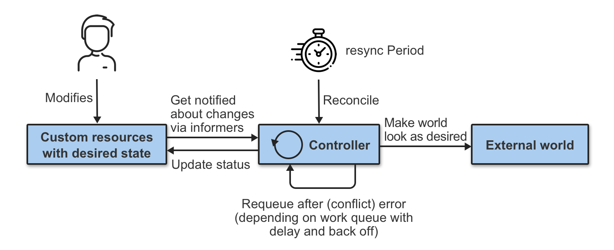

[← 返回 Kubernetes 目录]({{ '/subjects/Kubernetes/' | relative_url }})



# 10 控制器、标签与 Deployment

## 1 控制器如何维持期望状态

Kubernetes 的声明式 API 让用户描述目标，例如“保持三个可服务的 Pod”。控制器通过 watch 观察 API 对象，比较期望与实际状态，再持续调谐；它不直接“指挥某个节点”，而是创建、修改或删除 API 对象，由调度器与 kubelet完成后续工作。`spec` 往往表达期望，`status` 记录观察结果，但并非所有资源都同时拥有两者。



工作负载控制器各有适用范围：Deployment 管理无状态副本与发布；StatefulSet 管理稳定身份和有状态实例；DaemonSet 保证指定节点运行实例；Job/CronJob 管理完成型任务。直接创建 Pod 没有控制器重建保障。

## 2 标签与选择器

标签是对象的键值元数据，如 `app=web`、`environment=stage`；它不是单独的 API 对象。选择器按标签集合筛选对象，Service 用它寻找后端 Pod，ReplicaSet 和 Deployment 用它识别受管 Pod。设计标签时尽量使用稳定、语义明确的键，版本号放在合适的标签或镜像引用里，不要让多个控制器的选择器意外重叠。

```bash
kubectl label pod demo-pod environment=stage
kubectl get pods -l app=web
kubectl get pods -l 'environment in (stage,prod)'
kubectl get pods -l 'app=web,environment=stage'
kubectl label pod demo-pod environment-   # 删除该标签
```

同一选择器里的多个条件是“且”关系；`in`、`notin`、`exists` 等是集合式表达，常见的 `=`、`==`、`!=` 是等值式表达。`metadata.labels` 与 `spec.selector` 不是一回事：前者给对象打标，后者在特定控制器或 Service 中说明要选谁。Deployment 的 `spec.selector` 必须匹配 Pod 模板标签，创建后通常不能修改；迁移标签方案应设计新 Deployment，而不是原地改选择器。

## 3 ReplicationController、ReplicaSet 与 Deployment

ReplicationController 是早期副本控制器，仍可能在旧集群中看到，但新部署一般使用 Deployment。ReplicaSet 能按选择器维持副本数；多数情况下它由 Deployment 自动创建和管理，不手工更换 RS 来完成滚动发布。Deployment 的关系是：

```text
Deployment → ReplicaSet（每次 Pod 模板变化产生新版本）→ Pod
```

Service 独立通过标签选择器关联 Pod，**不**直接指向 Deployment。Deployment 更改副本数或 Pod 模板时，控制器调节 RS 并逐步替换 Pod；运行中的旧 Pod 通常不会被原地改造成新版本。

### 3.1 声明一个无状态应用

```yaml
apiVersion: apps/v1
kind: Deployment
metadata:
  name: web
spec:
  replicas: 3
  selector:
    matchLabels:
      app: web
  strategy:
    type: RollingUpdate
    rollingUpdate:
      maxSurge: 1
      maxUnavailable: 0
  template:
    metadata:
      labels:
        app: web
    spec:
      containers:
        - name: nginx
          image: nginx:stable
          ports:
            - containerPort: 80
          readinessProbe:
            httpGet:
              path: /
              port: 80
            periodSeconds: 5
          resources:
            requests:
              cpu: 100m
              memory: 64Mi
```

`maxSurge: 1` 允许更新时多创建一个 Pod；`maxUnavailable: 0` 要求期望副本数在更新过程中保持可用，但前提是集群有额外容量、就绪探针真实反映服务能力，且下游依赖稳定。三个副本也不自动跨故障域分布；需要时配置拓扑分散约束或反亲和性。

```bash
kubectl apply --dry-run=server -f web-deployment.yaml
kubectl apply -f web-deployment.yaml
kubectl rollout status deployment/web
kubectl get deployment,replicaset,pod -l app=web
kubectl describe deployment web
```

清单保存为 `web-deployment.yaml` 后按上面执行。`kubectl get` 的 READY、AVAILABLE、UP-TO-DATE 含义不同；更新是否完成以 rollout status 和实际探针/业务指标综合判断。

### 3.2 扩缩容与更新

```bash
kubectl scale deployment/web --replicas=5
kubectl rollout status deployment/web
kubectl set image deployment/web nginx=nginx:<已验证版本>
kubectl rollout status deployment/web
kubectl rollout history deployment/web
kubectl rollout undo deployment/web
```

`kubectl scale` 改变当前对象；如果清单或 GitOps 仍保留旧 `replicas`，下一次应用可能覆盖这个值。生产发布宜修改版本库中的镜像引用并统一由发布流程应用。`kubectl rollout undo` 回退的是 Pod 模板修订，并不保证数据库模式、配置、外部依赖同步回退；发布前需规划兼容性。不要依赖已移除的 `--record` 选项记录变更，版本库和部署流水线才是可信变更记录。

### 3.3 更新策略与灰度

**RollingUpdate** 在容量允许范围内逐步新增新 Pod、移除旧 Pod；**Recreate** 先删除旧 Pod 再创建新 Pod，会出现服务空窗，适合不能同时运行两版的特定场景。选择策略时要同时考虑 Service 就绪、连接排空、PodDisruptionBudget 与数据库兼容。

`kubectl rollout pause deployment/web` 可以暂时停止 Deployment 继续推进 Pod 模板变更，用于人工观察后再 `kubectl rollout resume deployment/web`；这不是精确的流量百分比金丝雀发布。要按 1%、5% 等比例导流，应使用支持权重路由的 Ingress/Gateway/服务网格，并同时监测错误率、延迟和饱和度。只有两个同选服务标签的 Deployment，副本比例也不必然等于实际请求比例。

蓝绿发布可维护两套有不同版本标签的 Deployment，例如 `release=blue` 与 `release=green`；先验证 green 的健康和兼容性，再将 Service 的 selector 从 blue 切到 green。切换只影响新建连接的后端选择，已有连接和长会话可能继续访问旧版；旧版应保留一段观察期以便回切。切换前检查 green EndpointSlice 非空，避免 Service 短暂无后端。


<nav class="article-end" aria-label="章节导航">
  <a href="{{ '/subjects/Kubernetes/09-pod-health-resources.html' | relative_url }}">← 上一章：Pod 健康、资源、安全与设计模式</a>
  <a href="{{ '/subjects/Kubernetes/' | relative_url }}">返回 Kubernetes 目录</a>
  <a href="{{ '/subjects/Kubernetes/11-daemonset-jobs.html' | relative_url }}">下一章：DaemonSet、Job 与 CronJob →</a>
</nav>
