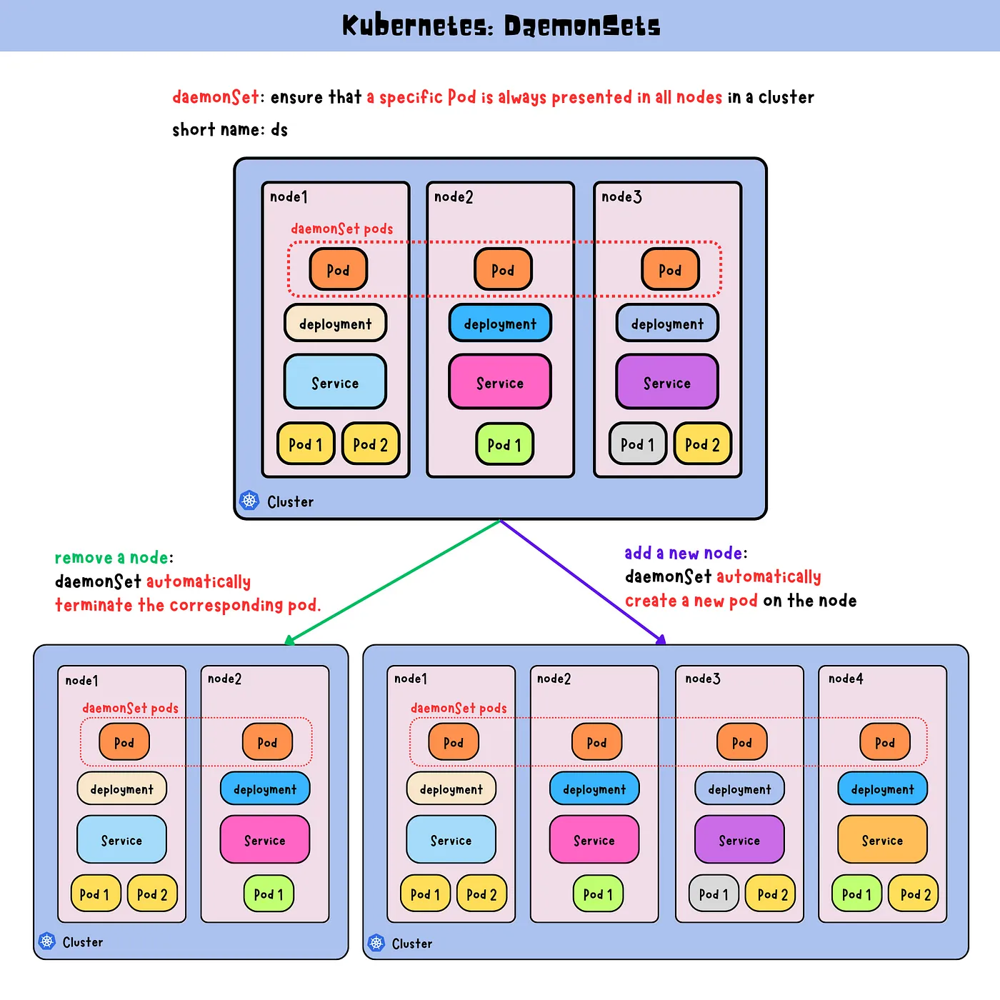
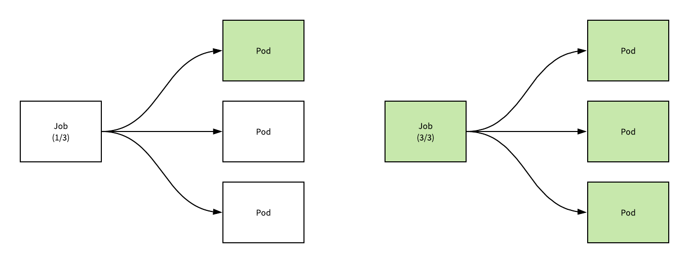
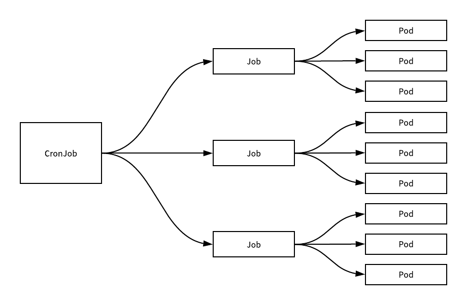

[← 返回 Kubernetes 目录]({{ '/subjects/Kubernetes/' | relative_url }})



# 11 DaemonSet、Job 与 CronJob

## 2.6 DaemonSet

### 2.6.1 DaemonSet 工作机制


- <https://kubernetes.io/zh-cn/docs/concepts/workloads/controllers/daemonset/>




Deployment/ReplicaSet 按期望副本数管理 Pod；DaemonSet 则按**符合条件的节点**管理 Pod，通常让每个目标节点运行一个守护 Pod。节点数量改变时，无需手动调整副本数。节点选择器、亲和性和污点容忍会共同影响哪些节点符合条件。

当符合条件的节点加入集群，DaemonSet 控制器会为其创建 Pod；节点不再符合条件或从集群移除时，相应 Pod 会被清理。删除 DaemonSet 时默认级联删除其 Pod。DaemonSet 与 ReplicaSet 都会协调实际状态，但前者的目标是节点覆盖率，而非固定的全局副本数。

如果一个DaemonSet的Pod被杀死、停止、或者崩溃，那么DaemonSet将会重新创建一个新的副本在这台计算节点上。

典型场景包括：每节点的网络代理（如 kube-proxy、部分 CNI 组件）、日志采集（如 Fluent Bit、Filebeat）、节点指标采集（如 Node Exporter），以及需要随节点分布的存储代理。Prometheus Server 或 Ingress Controller 是否采用 DaemonSet 取决于部署架构，并非默认都应每节点一份。

在前面部署kubernetes环境的时候，网络插件的部署就是基于这种DaemonSet的方式。

**更新策略**：默认 `RollingUpdate` 会按 `maxUnavailable` 等参数逐步替换 Pod；`OnDelete` 则只有旧 Pod 被手动删除后才使用新模板创建替代 Pod。生产中应按容错能力选择策略，而非一律使用 `OnDelete`。

范例：查看集群中已有的 DaemonSet 与每节点 Pod。

```bash
kubectl get daemonsets -A
kubectl get pods -n kube-system -l k8s-app=kube-proxy -o wide
# Flannel 等网络插件的命名空间与标签取决于实际安装清单：
kubectl get daemonsets -n kube-flannel
```

`DESIRED` 表示符合条件的节点数，`CURRENT` 表示已创建 Pod 的节点数，`READY` 表示就绪数量；若不一致，应先用 `kubectl describe daemonset <名称> -n <命名空间>` 查看事件，再检查节点污点、镜像和资源。不是所有系统组件都以 DaemonSet 运行。
### 2.6.2 DaemonSet 属性解析

**关键字段**：`metadata.name` 指定名称；`spec.selector.matchLabels` 必须与 `spec.template.metadata.labels` 匹配；`spec.template.spec` 是每节点运行的 Pod 模板。`updateStrategy.type` 可选 `RollingUpdate` 或 `OnDelete`；滚动更新时用 `maxUnavailable` 控制更新期间允许不可用的节点数，支持的版本还可使用 `maxSurge`。

下面的日志采集示例展示字段之间的关系。采集代理需要读取节点日志，因此挂载宿主机的 `/var/log`；具体日志目录和权限应按运行时与节点系统调整。

```yaml
apiVersion: apps/v1
kind: DaemonSet
metadata:
  name: fluent-bit
  namespace: kube-system
spec:
  selector:
    matchLabels:
      app: fluent-bit
  template:
    metadata:
      labels:
        app: fluent-bit
    spec:
      containers:
        - name: fluent-bit
          image: fluent/fluent-bit:2.2.2
          volumeMounts:
            - name: varlog
              mountPath: /var/log
              readOnly: true
      volumes:
        - name: varlog
          hostPath:
            path: /var/log
            type: Directory
```

这个示例只演示 DaemonSet 结构，尚未提供 Fluent Bit 的输入、过滤和输出配置，不应直接当作完整日志采集方案。若需运行在带有控制平面污点的节点，还应针对实际污点增加 `tolerations`；是否需要采集控制平面日志取决于运维需求。
### 2.6.3 DaemonSet 案例

以下示例只在带 `ds=true` 标签的节点上运行测试 Pod。先给目标节点打标签，再创建 DaemonSet；如果新节点也打上相同标签，控制器会自动为它创建 Pod。

```bash
kubectl label node node1.bowen.org node2.bowen.org ds=true
kubectl get nodes -l ds=true
```

```yaml
# controller-daemonset-label-test.yaml
apiVersion: apps/v1
kind: DaemonSet
metadata:
  name: controller-daemonset-label-test
spec:
  selector:
    matchLabels:
      app: pod-test
  template:
    metadata:
      labels:
        app: pod-test
    spec:
      nodeSelector:
        ds: "true"
      containers:
        - name: pod-test
          image: registry.cn-beijing.aliyuncs.com/bowen/pod-test:v0.1
```

```bash
kubectl apply -f controller-daemonset-label-test.yaml
kubectl get daemonset controller-daemonset-label-test
kubectl get pods -l app=pod-test -o wide
```

对照 `DESIRED` 与 `READY`，确认目标节点均有可用 Pod。即使控制平面节点打上 `ds=true`，其 `NoSchedule` 污点仍可能阻止该 Pod 运行；需要在 Pod 模板中显式容忍相应污点，不能只靠节点标签。

**滚动更新**：修改模板中的镜像后，可观察每个目标节点上的旧 Pod 逐步被新 Pod 替换。不要在新版本的命令中依赖已废弃的 `--record` 参数。

```bash
kubectl set image daemonset/controller-daemonset-label-test pod-test=registry.cn-beijing.aliyuncs.com/bowen/pod-test:v0.2
kubectl rollout status daemonset/controller-daemonset-label-test
kubectl rollout history daemonset/controller-daemonset-label-test
kubectl get pods -l app=pod-test -o wide
```

若配置 `spec.updateStrategy.type: OnDelete`，改镜像后旧 Pod 不会自动替换，必须逐个删除旧 Pod，由控制器按新模板重建。`RollingUpdate` 或 `OnDelete` 的选择取决于每节点服务的可用性要求。

**节点指标采集**：Node Exporter 也是 DaemonSet 的常见用例。使用 `hostNetwork: true` 时，容器会共享节点网络命名空间，`9100` 端口须避免冲突并限制访问；仅配置 `hostPID: true` 不能代替挂载所需的宿主机文件系统。指标可通过 `curl http://<节点IP>:9100/metrics` 验证。部署时应使用经过维护的清单或 Helm Chart，并审查宿主机挂载、服务发现和安全上下文。
## 2.7 Job

### 2.7.1 Job 工作机制


- <https://kubernetes.io/zh-cn/docs/concepts/workloads/controllers/job/>




Deployment 和 DaemonSet 面向持续运行的工作负载；Job 面向**执行后会结束**的批处理任务。Job 控制器跟踪成功完成的 Pod 数量，并在失败后根据策略重试。若任务需要按时间表周期性启动，则在 Job 之上使用 CronJob。

`completions` 表示希望完成的次数，`parallelism` 表示允许同时运行的 Pod 数上限。例如 `completions: 6`、`parallelism: 2` 可以最多同时运行两个 Pod，直至累计六次成功。失败处理还受 Pod 的 `restartPolicy`、Job 的 `backoffLimit` 与截止时间影响。

`parallelism: 1` 可用于串行处理，设为大于 1 则允许并行；这里说的是**同一个 Job 创建的 Pod**，并非多个 Job 之间的全局调度规则。`completions` 和 `parallelism` 不写时通常默认为 1。Job 使用 `batch/v1`，其 Pod 模板中的 `restartPolicy` 只能是 `Never` 或 `OnFailure`。通常让控制器自动生成选择器，不要手写可能与其他 Job 重叠的选择器。只有 `completionMode: Indexed` 时，Pod 才带完成索引；不能把带索引的命名模式泛化到所有 Job。

### 2.7.2 Job 关键字段

| 字段 | 作用 |
| --- | --- |
| `spec.template` | 必需的 Pod 模板，定义镜像、命令与重启策略。 |
| `spec.completions` | 期望成功完成次数，通常默认 1。 |
| `spec.parallelism` | 同时运行的 Pod 上限，通常默认 1。 |
| `spec.completionMode` | `NonIndexed`（默认）或 `Indexed`；后者为每次完成分配索引。 |
| `spec.backoffLimit` | 失败重试次数限制。 |
| `spec.activeDeadlineSeconds` | Job 允许的最长活动时长。 |
| `spec.ttlSecondsAfterFinished` | 完成或失败后保留 Job 的时长，到期后清理。 |
| `spec.suspend` | 暂停创建新的任务 Pod。 |

Job 的成功标准是容器进程以成功状态退出；`Completed` 并不代表其业务结果已经写入预期位置。应让任务具备幂等性或去重机制，以应对重试和偶发的重复执行。
### 2.7.3 Job 案例

**单次任务**：下面的任务每两秒输出一次数字，成功退出后 Job 显示 `1/1`。命令必须写在合法的 Pod 模板里，原 PDF 中折行的 shell 字符串不能直接复制执行。

```yaml
# controller-job-single.yaml
apiVersion: batch/v1
kind: Job
metadata:
  name: job-single
spec:
  template:
    spec:
      restartPolicy: Never
      containers:
        - name: counter
          image: registry.cn-beijing.aliyuncs.com/bowen/busybox:1.32.0
          command:
            - /bin/sh
            - -c
            - 'for i in 10 9 8 7 6 5 4 3 2 1; do echo "$i"; sleep 2; done'
```

```bash
kubectl apply -f controller-job-single.yaml
kubectl wait --for=condition=complete job/job-single --timeout=120s
kubectl logs job/job-single
kubectl get job job-single
kubectl delete -f controller-job-single.yaml
```

**串行完成五次**：`parallelism: 1` 使 Job 在任意时刻最多运行一个任务 Pod；已完成的 Pod 通常仍会保留供查看，直到清理 Job 或 TTL 生效。

```yaml
# controller-job-multi-serial.yaml
apiVersion: batch/v1
kind: Job
metadata:
  name: job-multi-serial
spec:
  completions: 5
  parallelism: 1
  template:
    spec:
      restartPolicy: OnFailure
      containers:
        - name: worker
          image: registry.cn-beijing.aliyuncs.com/bowen/busybox:1.32.0
          command: ["/bin/sh", "-c", "echo serial job; sleep 3"]
```

```bash
kubectl apply -f controller-job-multi-serial.yaml
kubectl get pods -l job-name=job-multi-serial --watch
kubectl wait --for=condition=complete job/job-multi-serial --timeout=180s
kubectl get job job-multi-serial
```

**最多两个 Pod 并行，总计成功六次**：`parallelism` 是上限而非每一时刻都保证正好有两个 Pod，实际启动还受调度资源和镜像拉取速度影响。

```yaml
# controller-job-multi-parallel.yaml
apiVersion: batch/v1
kind: Job
metadata:
  name: job-multi-parallel
spec:
  completions: 6
  parallelism: 2
  backoffLimit: 3
  activeDeadlineSeconds: 1200
  ttlSecondsAfterFinished: 3600
  template:
    spec:
      restartPolicy: OnFailure
      containers:
        - name: worker
          image: registry.cn-beijing.aliyuncs.com/bowen/busybox:1.32.0
          command: ["/bin/sh", "-c", "echo parallel job; sleep 3"]
```

```bash
kubectl apply -f controller-job-multi-parallel.yaml
kubectl get pods -l job-name=job-multi-parallel --watch
kubectl wait --for=condition=complete job/job-multi-parallel --timeout=180s
kubectl get job job-multi-parallel
```
## 2.8 CronJob

### 2.8.1 CronJob 工作机制


- <https://kubernetes.io/zh-cn/docs/concepts/workloads/controllers/cron-jobs/>




CronJob 在预定时间**创建 Job**，再由 Job 创建 Pod 执行一次任务。它适合定时备份、报表、清理等周期工作，不适合要求秒级精确定时或绝对“恰好执行一次”的场景。

调度表达式类似 crontab，最小粒度为**分钟**。控制器调度与 Pod 启动存在延迟，镜像拉取、调度拥塞也会影响实际开始时间。较新版本可通过 `spec.timeZone` 明确时区；未指定时，按 kube-controller-manager 的本地时区解释排期。生产任务应处理漏调度和重复执行，并明确幂等策略。

CronJob 名称会用于派生 Job 名称，因此不宜过长；Kubernetes 文档建议不超过 52 个字符，以给后缀留出空间。

CronJob 是 `batch/v1` 资源。默认删除 CronJob 时会级联清理其 Job 和 Pod；若需要保留执行记录，应先导出日志或明确设置删除传播策略。

在 Kubernetes Cron 表达式里，`?` 可在日期字段表示“不指定”，与 `*` 的用法相近；为减少歧义，示例统一使用 `*`。

**Cron 时间表语法**
```text
# ┌───────────── 分钟 (0 - 59)
# │ ┌───────────── 小时 (0 - 23)
# │ │ ┌───────────── 月的某天 (1 - 31)
# │ │ │ ┌───────────── 月份 (1 - 12)
# │ │ │ │ ┌───────────── 周的某天 (0 - 6)（周日到周一；在某些系统上，7 也是星期日）
# │ │ │ │ │                          或者 sun，mon，tue，wed，thu，fri，sat
# │ │ │ │ │
# │ │ │ │ │
# * * * * *
```

| 快捷写法 | 等价表达式 | 含义 |
| --- | --- | --- |
| `@yearly` / `@annually` | `0 0 1 1 *` | 每年 1 月 1 日 00:00 |
| `@monthly` | `0 0 1 * *` | 每月 1 日 00:00 |
| `@weekly` | `0 0 * * 0` | 每周日 00:00 |
| `@daily` / `@midnight` | `0 0 * * *` | 每天 00:00 |
| `@hourly` | `0 * * * *` | 每小时整点 |

### 2.8.2 CronJob 关键字段

| 字段 | 作用 |
| --- | --- |
| `spec.schedule` | 必需的 Cron 表达式。 |
| `spec.timeZone` | 显式指定时区，例如 `Etc/UTC`；使用前确认集群版本支持。 |
| `spec.jobTemplate` | 必需的 Job 模板，包含 Pod 模板。 |
| `spec.concurrencyPolicy` | `Allow`（默认）允许前一次未结束时再启动；`Forbid` 跳过重叠调度；`Replace` 以新任务替换旧任务。 |
| `spec.startingDeadlineSeconds` | 错过计划时间后允许补启动的窗口。 |
| `spec.successfulJobsHistoryLimit` / `failedJobsHistoryLimit` | 保留的成功/失败 Job 数量；日志应另行持久化。 |
| `spec.suspend` | 暂停后续调度，不会停止已经运行的 Job。 |

`concurrencyPolicy` 只约束同一个 CronJob 创建的 Job，不会限制其他 CronJob。选择 `Forbid` 时，若旧任务仍在运行，本轮可能被跳过；选择 `Replace` 时，要确认任务能够安全中断。
### 2.8.3 CronJob 案例

**每两分钟执行一次**：每次调度创建一个 Job，Job 再创建 Pod 输出一条日志。时间未到时看不到新 Pod 是正常现象；历史 Job 和 Pod 会受保留数量限制。

```yaml
# controller-cronjob-simple.yaml
apiVersion: batch/v1
kind: CronJob
metadata:
  name: cronjob-demo
spec:
  schedule: "*/2 * * * *"
  concurrencyPolicy: Forbid
  successfulJobsHistoryLimit: 3
  failedJobsHistoryLimit: 1
  jobTemplate:
    spec:
      template:
        spec:
          restartPolicy: OnFailure
          containers:
            - name: task
              image: registry.cn-beijing.aliyuncs.com/bowen/busybox:1.32.0
              command: ["/bin/sh", "-c", "date; echo Cron Job"]
```

```bash
kubectl apply -f controller-cronjob-simple.yaml
kubectl get cronjob cronjob-demo
kubectl get jobs -l cronjob-name=cronjob-demo
kubectl get pods
kubectl delete -f controller-cronjob-simple.yaml
```

标签是否包含 `cronjob-name` 与集群版本和实现有关；如果 `kubectl get jobs -l cronjob-name=cronjob-demo` 没有结果，可直接 `kubectl get jobs`，或查看 Job 的 `ownerReferences` 确认归属。

**一分钟启动一次、单个 Job 内每十秒输出日志**：这不是“秒级 CronJob”。CronJob 的排期仍是每分钟一次，循环发生在任务容器内部。若循环持续超过一分钟，下一轮是否启动取决于 `concurrencyPolicy`；这里使用 `Forbid` 避免重叠。

```yaml
# controller-cronjob-loop.yaml
apiVersion: batch/v1
kind: CronJob
metadata:
  name: cronjob-loop
spec:
  schedule: "* * * * *"
  concurrencyPolicy: Forbid
  jobTemplate:
    spec:
      template:
        spec:
          restartPolicy: OnFailure
          containers:
            - name: task
              image: registry.cn-beijing.aliyuncs.com/bowen/busybox:1.32.0
              command:
                - /bin/sh
                - -c
                - 'i=0; while [ "$i" -lt 6 ]; do i=$((i+1)); echo "$i: 10-second interval"; sleep 10; done'
```

```bash
kubectl apply -f controller-cronjob-loop.yaml
kubectl get cronjob cronjob-loop --watch
kubectl get jobs
# 找到具体 Job 名称后，再用 kubectl logs job/<Job名称> 查看其输出。
```

定时任务应将执行结果写入可靠存储或外部日志系统；依靠 Pod 日志作为唯一结果记录，会在历史对象清理后丢失证据。


<nav class="article-end" aria-label="章节导航">
  <a href="{{ '/subjects/Kubernetes/10-workload-controllers.html' | relative_url }}">← 上一章：控制器、标签与 Deployment</a>
  <a href="{{ '/subjects/Kubernetes/' | relative_url }}">返回 Kubernetes 目录</a>
  <a href="{{ '/subjects/Kubernetes/12-pod-scheduling.html' | relative_url }}">下一章：Pod 调度、拓扑与驱逐 →</a>
</nav>
