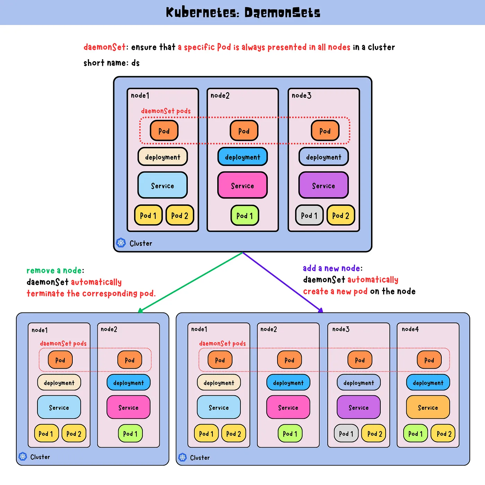
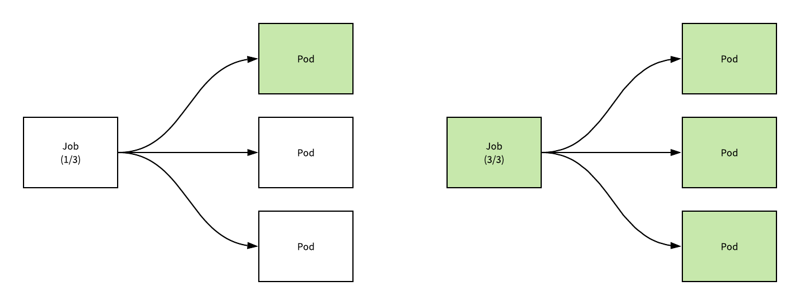
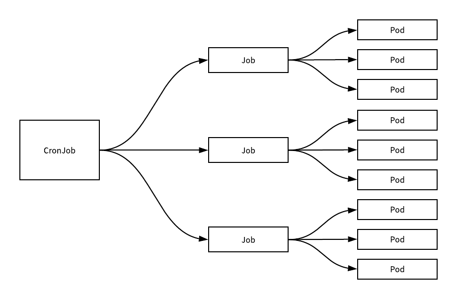

[← 返回 Kubernetes 目录]({{ '/subjects/Kubernetes/' | relative_url }})



# 11 DaemonSet、Job 与 CronJob

## 2.6 DaemonSet

### 2.6.1 DaemonSet 工作机制

```text
https://kubernetes.io/zh-cn/docs/concepts/workloads/controllers/daemonset/
```



在Node上启动Pod需要在Deployment或RS中指定replicas的副本数的值。有些情况下，需要在所有节点都运行一个Pod，因为Node数量会变化，所以指定Pod的副本数就不合适了。DaemonSet能够让所有（或者特定）的节点"精确的"运行同一个pod。一般应用在集群环境中所有节点(或者node Selector可被节点选择器匹配到的节点范围内的每个节点)都必须运行的守护进程的场景。

当节点加入到kubernetes集群中，Pod会被DaemonSet 控制器调度到该节点上运行。当节点从Kubrenetes集群中被移除，被DaemonSet调度的pod也会被移除。如果删除DaemonSet，所有跟这个DaemonSet相关的pods都会被删除。在某种程度上，DaemonSet承担了RS的部分功能，它也能保证相关pods持续运行。

如果一个DaemonSet的Pod被杀死、停止、或者崩溃，那么DaemonSet将会重新创建一个新的副本在这台计算节点上。

DaemonSet 的一些典型用法：

在每个节点上运行集群守护进程在每个节点上运行日志收集守护进程在每个节点上运行监控守护进程。

常用于后台支撑服务

Kubernetes集群的系统级应用: kube-proxy,flannel,calico集群存储守护进程，如：ceph，glusterd日志收集服务，如：filebeat，fluentd，logstash监控服务，如：Prometheus，Node-exporter，collectd暴露服务:  如: Ingress nginx。

在前面部署kubernetes环境的时候，网络插件的部署就是基于这种DaemonSet的方式。

**更新策略**：一般应为先删除一组节点上的实例，更新完成后，再进行下一组节点。

范例: 查看默认的  daemonsets

```text
#Kube-proxy组件以daemonsets方式运行
[root@master1 ~]#kubectl get ds -n kube-system
NAME              DESIRED   CURRENT   READY   UP-TO-DATE   AVAILABLE   NODE
SELECTOR            AGE
kube-proxy        6         6         6       6            6
kubernetes.io/os=linux   25d
```

```text
[root@master1 ~]#kubectl get pod -n kube-system  -l k8s-app=kube-proxy
NAME               READY   STATUS    RESTARTS      AGE
kube-proxy-2vstp   1/1     Running   1 (26m ago)   28m
kube-proxy-jq4p7   1/1     Running   1 (27m ago)   28m
kube-proxy-qbgkn   1/1     Running   1 (27m ago)   28m
kube-proxy-s6knj   1/1     Running   1 (27m ago)   28m
```

```text
#flannel网络插件以daemonsets方式运行
#新版flannel存在于kube-flannel名称空间
[root@master1 ~]#kubectl get ds -n kube-flannel --show-labels
NAME              DESIRED   CURRENT   READY   UP-TO-DATE   AVAILABLE   NODE
SELECTOR   AGE    LABELS
kube-flannel-ds   4         4         4       4            4           <none>
412d   app=flannel,k8s-app=flannel,tier=node
```

```text
[root@master1 ~]#kubectl get pod -n kube-flannel  -l k8s-app=flannel
NAME                    READY   STATUS    RESTARTS       AGE
kube-flannel-ds-bqkzc   1/1     Running   11 (29m ago)   412d
kube-flannel-ds-j2dwh   1/1     Running   10 (29m ago)   412d
kube-flannel-ds-rqbjl   1/1     Running   16 (28m ago)   412d
kube-flannel-ds-v4r6f   1/1     Running   10 (29m ago)   412d
```

```text
#旧版flannel存在于 kube-system 名称空间
[root@master1 ~]#kubectl get ds -n kube-system
NAME              DESIRED   CURRENT   READY   UP-TO-DATE   AVAILABLE   NODE
SELECTOR            AGE
kube-flannel-ds   6         6         6       6            6           <none>
25d
```

```text
[root@master1 ~]#cat kube-flannel.yml
.....
kind: DaemonSet
.....
#结果显示：除了权限和认证、配置之外的资源对象都是以DaemonSet的方式在运行
#注意:查看DaemonSet,每个节点都有一个daemonset的Pod运行
```

### 2.6.2 DaemonSet 属性解析

**DaemonSet 属性解析**

```text
apiVersion: apps/v1                 # API群组及版本
kind: DaemonSet                     # 资源类型特有标识
metadata:
name <string>                     # 资源名称，在作用域中要唯一
namespace <string>                # 名称空间；DaemonSet资源隶属名称空间级别
spec:
minReadySeconds <integer>         # Pod就绪后多少秒内任一容器无crash方可视为“就绪”
selector <object>                 # 标签选择器，必须匹配template字段中Pod模板中的标签
template <object>                 # Pod模板对象
revisionHistoryLimit <integer>    # 滚动更新历史记录数量，默认为10
updateStrategy <Object>           # 滚动更新策略
type <string>                   # 滚动更新类型，OnDelete（删除时更新，手动触发）和
RollingUpdate（默认值，滚动更新，自动触发）
rollingUpdate <Object>          # 滚动更新参数，专用于RollingUpdate类型
maxSurge                      # 更新时在删除Pod前最多的Pod的Node创建新Pod的数量或
比例,默认值为0
maxUnavailable <string>       # 更新期间可比期望的Pod数量缺少的数量或比例,默认值为
1
```

官方示例:  利用daemonset 实现fluentd日志收集。

```text
#https://kubernetes.io/zh-cn/docs/concepts/workloads/controllers/daemonset/
apiVersion: apps/v1
kind: DaemonSet
metadata:
name: fluentd-elasticsearch
namespace: kube-system
labels:
k8s-app: fluentd-logging
spec:
selector:
matchLabels:
name: fluentd-elasticsearch
template:
metadata:
labels:
name: fluentd-elasticsearch
spec:
tolerations:
# 这些容忍度设置是为了让该守护进程集在控制平面节点上运行
# 如果你不希望自己的控制平面节点运行 Pod，可以删除它们
- key: node-role.kubernetes.io/control-plane
operator: Exists
effect: NoSchedule
- key: node-role.kubernetes.io/master
operator: Exists
effect: NoSchedule
containers:
- name: fluentd-elasticsearch
image: quay.io/fluentd_elasticsearch/fluentd:v2.5.2
resources:
limits:
```

```text
memory: 200Mi
requests:
cpu: 100m
memory: 200Mi
volumeMounts:
- name: varlog
mountPath: /var/log
terminationGracePeriodSeconds: 30
volumes:
- name: varlog
hostPath:
path: /var/log
```

范例: 利用daemonset 实现fluent-bit 对容器日志收集

```text
apiVersion: apps/v1
kind: DaemonSet
metadata:
name: fluent-bit
spec:
selector:
matchLabels:
k8s-app: fluent-bit
version: v2
template:
metadata:
labels:
k8s-app: fluent-bit
version: v2
annotations:
prometheus.io/scrape: "true"
prometheus.io/port: "2020"
prometheus.io/path: /api/v1/metrics/prometheus
spec:
containers:
- name: fluent-bit
image: fluent/fluent-bit:2.2.2
imagePullPolicy: IfNotPresent
ports:
- containerPort: 2020
env:
- name: FLUENT_ELASTICSEARCH_HOST
value: "elasticsearch"
- name: FLUENT_ELASTICSEARCH_PORT
value: "9200"
volumeMounts:
- name: varlog
mountPath: /var/log
- name: varlibdockercontainers
mountPath: /var/lib/docker/containers
readOnly: true
- name: fluent-bit-config
mountPath: /fluent-bit/etc/
terminationGracePeriodSeconds: 10
volumes:
- name: varlog
```

```text
hostPath:
path: /var/log
- name: varlibdockercontainers
hostPath:
path: /var/lib/docker/containers
- name: fluent-bit-config
configMap:
name: fluent-bit-conf
serviceAccountName: fluent-bit
tolerations:
- key: node-role.kubernetes.io/master
operator: Exists
effect: NoSchedule
- operator: "Exists"
effect: "NoExecute"
- operator: "Exists"
effect: "NoSchedule"
```

### 2.6.3 DaemonSet 案例

范例:

```text
#准备配置
[root@master1 ~]#cat controller-daemonset-test.yaml
apiVersion: apps/v1
kind: DaemonSet
metadata:
name: controller-daemonset-test
spec:
selector:
matchLabels:
app: pod-test
template:
metadata:
labels:
app: pod-test
spec:
#hostNetwork: true #使用宿主机的网络和端口,可以通过宿主机直接访问Pod,性能好,但要防止
端口冲突
#hostPID: true #直接使用宿主机的PID
containers:
- name: pod-test
image: registry.cn-beijing.aliyuncs.com/wangxiaochun/pod-test:v0.1
```

```text
[root@master1 ~]#kubectl get pod
No resources found in default namespace.
```

```text
#查看worker节点数量
[root@master1 ~]#kubectl get node
NAME                 STATUS   ROLES                  AGE   VERSION
master1.wang.org   Ready    control-plane,master   25d   v1.22.1
master2.wang.org   Ready    control-plane,master   25d   v1.22.1
master3.wang.org   Ready    control-plane,master   25d   v1.22.1
node1.wang.org     Ready    <none>                 25d   v1.22.1
node2.wang.org     Ready    <none>                 25d   v1.22.1
node3.wang.org     Ready    <none>                 25d   v1.22.1
```

```text
#创建daemonset资源
[root@master1 ~]#kubectl apply  -f controller-daemonset-test.yaml
```

```text
#验证结果,发现pod数量和worker节点数量一致,且每个节点主机一个pod
[root@master1 ~]#kubectl get pod -o wide
NAME                              READY   STATUS    RESTARTS   AGE     IP
NODE               NOMINATED NODE   READINESS GATES
controller-daemonset-test-6n5cp   1/1     Running   0          2m15s
172.16.3.94   node1.wang.org   <none>           <none>
controller-daemonset-test-8jzbf   1/1     Running   0          2m15s
172.16.1.48   node2.wang.org   <none>           <none>
controller-daemonset-test-ptnpl   1/1     Running   0          2m15s
172.16.2.56   node3.wang.org   <none>           <none>
```

```text
[root@master1 ~]#kubectl get ds
NAME                        DESIRED   CURRENT   READY   UP-TO-DATE   AVAILABLE
NODE SELECTOR   AGE
controller-daemonset-test   3         3         3       3            3
<none>          2m53s
```

```text
[root@master1 ~]#kubectl get all
NAME                                  READY   STATUS    RESTARTS   AGE
pod/controller-daemonset-test-c4l9h   1/1     Running   0          89s
pod/controller-daemonset-test-d4d7b   1/1     Running   0          58s
pod/controller-daemonset-test-kqfwk   1/1     Running   0          2m1s
```

```text
NAME                                       DESIRED   CURRENT   READY   UP-TO-DATE
AVAILABLE   NODE SELECTOR   AGE
daemonset.apps/controller-daemonset-test   3         3         3       3
3           <none>          13m
```

```text
#查看所有daemonset
[root@master1 ~]#kubectl get ds -A
NAMESPACE     NAME                        DESIRED   CURRENT   READY   UP-TO-DATE
AVAILABLE   NODE SELECTOR            AGE
default       controller-daemonset-test   3         3         3       3
3           <none>                   2m59s
kube-system   kube-flannel-ds             6         6         6       6
6           <none>                   25d
kube-system   kube-proxy                  6         6         6       6
6           kubernetes.io/os=linux   25d
```

```text
#daemonset对象也支持滚动更新
[root@master1 ~]#kubectl set image  daemonsets controller-daemonset-test pod-
test='registry.cn-beijing.aliyuncs.com/wangxiaochun/pod-test:v0.2' --record=true
&& kubectl rollout status daemonset controller-daemonset-test
Flag --record has been deprecated, --record will be removed in the future
Waiting for daemon set "controller-daemonset-test" rollout to finish: 0 out of 3
new pods have been updated...
Waiting for daemon set "controller-daemonset-test" rollout to finish: 0 out of 3
new pods have been updated...
Waiting for daemon set "controller-daemonset-test" rollout to finish: 0 out of 3
new pods have been updated...
Waiting for daemon set "controller-daemonset-test" rollout to finish: 1 out of 3
new pods have been updated...
```

```text
Waiting for daemon set "controller-daemonset-test" rollout to finish: 1 out of 3
new pods have been updated...
Waiting for daemon set "controller-daemonset-test" rollout to finish: 1 out of 3
new pods have been updated...
Waiting for daemon set "controller-daemonset-test" rollout to finish: 1 out of 3
new pods have been updated...
Waiting for daemon set "controller-daemonset-test" rollout to finish: 2 out of 3
new pods have been updated...
Waiting for daemon set "controller-daemonset-test" rollout to finish: 2 out of 3
new pods have been updated...
Waiting for daemon set "controller-daemonset-test" rollout to finish: 2 out of 3
new pods have been updated...
Waiting for daemon set "controller-daemonset-test" rollout to finish: 2 of 3
updated pods are available...
daemon set "controller-daemonset-test" successfully rolled out
```

```text
#注意：daemonsets对象不支持pause动作
```

```text
#查看历史
[root@master1 ~]#kubectl rollout history daemonset controller-daemonset-test
daemonset.apps/controller-daemonset-test
REVISION  CHANGE-CAUSE
1         <none>
2         kubectl set image daemonsets controller-daemonset-test pod-
test=wangxiaochun/pod-test:v0.2 --record=true
```

范例: 在所有节点上部署监控软件prometheus采集指标数据

```text
#定制基本配置文件
[root@master1 ~]#cat controller-daemonset-prometheus.yaml
apiVersion: apps/v1
kind: DaemonSet
metadata:
name: daemonset-demo
namespace: default
labels:
app: prometheus
component: node-exporter
spec:
selector:
matchLabels:
app: prometheus
component: node-exporter
template:
metadata:
name: prometheus-node-exporter
labels:
app: prometheus
component: node-exporter
spec:
#tolerations:  #容忍度配置，支持Master节点运行Pod
#- key: node-role.kubernetes.io/control-plane
#  operator: Exists
#  effect: NoSchedule
#- key: node-role.kubernetes.io/master
#  operator: Exists
#  effect: NoSchedule
```

```text
containers:
- image: prom/node-exporter:v1.2.2
name: prometheus-node-exporter
ports:
- name: prom-node-exp
containerPort: 9100
#hostPort: 9100
livenessProbe:
tcpSocket:
port: prom-node-exp
initialDelaySeconds: 3
readinessProbe:
httpGet:
path: '/metrics'
port: prom-node-exp
scheme: HTTP
initialDelaySeconds: 5
hostNetwork: true
hostPID: true
```

```text
#属性解析：hostNetwork 和 hostPID 表示容器共享宿主机的网络和PID,从而实现对主机节点的资源监控
```

```text
#创建
[root@master1 ~]#kubectl apply  -f controller-daemonset-prometheus.yaml
```

```text
#验证结果,发现只会部署至worker节点,而因为污点策略不会调度到master节点
[root@master1 ~]#kubectl get all
NAME                       READY   STATUS              RESTARTS   AGE
pod/daemonset-demo-96fb8   0/1     ContainerCreating   0          2s
pod/daemonset-demo-cmgzt   0/1     ContainerCreating   0          2s
pod/daemonset-demo-slkzb   0/1     ContainerCreating   0          2s
```

```text
NAME                            DESIRED   CURRENT   READY   UP-TO-DATE
AVAILABLE   NODE SELECTOR   AGE
daemonset.apps/daemonset-demo   3         3         0       3            0
<none>          2s
```

```text
[root@master1 ~]#kubectl get pod -o wide
NAME                   READY   STATUS    RESTARTS   AGE    IP           NODE
NOMINATED NODE   READINESS GATES
daemonset-demo-96fb8   1/1     Running   0          2m1s   10.0.0.104
node1.wang.org   <none>           <none>
daemonset-demo-cmgzt   1/1     Running   0          2m1s   10.0.0.106
node3.wang.org   <none>           <none>
daemonset-demo-slkzb   1/1     Running   0          2m1s   10.0.0.105
node2.wang.org   <none>           <none>
```

```text
#在每个worker节点通过节点端口即可获取监控相关的数据
[root@master1 ~]#curl -s 10.0.0.104:9100/metrics | head
# HELP go_gc_duration_seconds A summary of the pause duration of garbage
collection cycles.
# TYPE go_gc_duration_seconds summary
go_gc_duration_seconds{quantile="0"} 1.9837e-05
go_gc_duration_seconds{quantile="0.25"} 2.7581e-05
go_gc_duration_seconds{quantile="0.5"} 3.0918e-05
go_gc_duration_seconds{quantile="0.75"} 4.0095e-05
go_gc_duration_seconds{quantile="1"} 7.4009e-05
go_gc_duration_seconds_sum 0.000414227
```

```text
go_gc_duration_seconds_count 12
# HELP go_goroutines Number of goroutines that currently exist.
```

```text
[root@master1 ~]#curl 10.0.0.105:9100/metrics
[root@master1 ~]#curl 10.0.0.106:9100/metrics
```

范例: 仅在指定标签的每个主机上运行一个Pod

```text
#在指定的节点打上便签
[root@master1 ~]#kubectl label node node1.wang.org node2.wang.org ds=true
node/node1.wang.org labeled
node/node2.wang.org labeled
```

```text
#查看标签
[root@master1 ~]#kubectl get node --show-labels
NAME               STATUS   ROLES           AGE   VERSION   LABELS
master1.wang.org   Ready    control-plane   13d   v1.25.3
beta.kubernetes.io/arch=amd64,beta.kubernetes.io/os=linux,kubernetes.io/arch=amd
64,kubernetes.io/hostname=master1.wang.org,kubernetes.io/os=linux,node-
role.kubernetes.io/control-plane=,node.kubernetes.io/exclude-from-external-load-
balancers=
node1.wang.org     Ready    <none>          13d   v1.25.3
beta.kubernetes.io/arch=amd64,beta.kubernetes.io/os=linux,ds=true,kubernetes.io/
arch=amd64,kubernetes.io/hostname=node1.wang.org,kubernetes.io/os=linux
node2.wang.org     Ready    <none>          13d   v1.25.3
beta.kubernetes.io/arch=amd64,beta.kubernetes.io/os=linux,ds=true,kubernetes.io/
arch=amd64,kubernetes.io/hostname=node2.wang.org,kubernetes.io/os=linux
node3.wang.org     Ready    <none>          13d   v1.25.3
beta.kubernetes.io/arch=amd64,beta.kubernetes.io/os=linux,kubernetes.io/arch=amd
64,kubernetes.io/hostname=node3.wang.org,kubernetes.io/os=linux
```

```text
[root@master1 ~]#cat controller-daemonset-label-test.yaml
apiVersion: apps/v1
kind: DaemonSet
metadata:
name: controller-daemonset-label-test
spec:
selector:
matchLabels:
app: pod-test
template:
metadata:
labels:
app: pod-test
spec:
nodeSelector:
ds: "true"       #指定条件
containers:
- name: pod-test
image: registry.cn-beijing.aliyuncs.com/wangxiaochun/pod-test:v0.1
```

```text
#应用配置
[root@master1 ~]#kubectl apply -f controller-daemonset-label-test.yaml
```

```text
#查看结果,只以指定有标签的节点上运行Pod
[root@master1 ~]#kubectl get pod -o wide
```

```text
NAME                              READY   STATUS    RESTARTS   AGE   IP
NODE             NOMINATED NODE   READINESS GATES
controller-daemonset-label-test-klnmm   1/1     Running   0          47s
10.244.2.23   node2.wang.org   <none>           <none>
controller-daemonset-label-test-w9pnm   1/1     Running   0          47s
10.244.1.31   node1.wang.org   <none>           <none>
```

```text
#给新的节点也打上标签
[root@master1 ~]#kubectl label node master1.wang.org  node3.wang.org ds=true
```

```text
#查看结果,node3节点也开始运行Pod,但master节点还是没有运行Pod
[root@master1 ~]#kubectl get pod -o wide
NAME                              READY   STATUS    RESTARTS   AGE     IP
NODE             NOMINATED NODE   READINESS GATES
controller-daemonset-label-test-klnmm   1/1     Running   0          4m54s
10.244.2.23   node2.wang.org   <none>           <none>
controller-daemonset-label-test-lgbx2   1/1     Running   0          78s
10.244.3.24   node3.wang.org   <none>           <none>
controller-daemonset-label-test-w9pnm   1/1     Running   0          4m54s
10.244.1.31   node1.wang.org   <none>           <none>
```

范例: 滚动更新

```text
#查看daemonset的更新策略,和Deployment的策略是相似的
[root@master1 ~]#kubectl get ds controller-daemonset-label-test -o yaml
......
updateStrategy:
rollingUpdate:
maxSurge: 0
maxUnavailable: 1
type: RollingUpdate  #Pod自动更新
......
```

```text
#更新镜像,会导致Pod自动更新镜像
[root@master1 ~]#kubectl set image  ds controller-daemonset-label-test pod-
test=wangxiaochun/pod-test:v0.2 --record
```

```text
#跟踪更新
[root@master1 ~]#kubectl get pod -w
NAME                              READY   STATUS    RESTARTS   AGE
controller-daemonset-label-test-klnmm   1/1     Running   0          9m50s
controller-daemonset-label-test-lgbx2   1/1     Running   0          6m14s
controller-daemonset-label-test-w9pnm   1/1     Running   0          9m50s
controller-daemonset-label-test-klnmm   1/1     Terminating   0          11m
controller-daemonset-label-test-klnmm   0/1     Terminating   0          12m
controller-daemonset-label-test-klnmm   0/1     Terminating   0          12m
controller-daemonset-label-test-klnmm   0/1     Terminating   0          12m
controller-daemonset-label-test-gxngm   0/1     Pending       0          0s
controller-daemonset-label-test-gxngm   0/1     Pending       0          0s
controller-daemonset-label-test-gxngm   0/1     ContainerCreating   0
0s
controller-daemonset-label-test-gxngm   1/1     Running             0
7s
controller-daemonset-label-test-lgbx2   1/1     Terminating         0
8m35s
controller-daemonset-label-test-lgbx2   0/1     Terminating         0
9m7s
```

```text
controller-daemonset-label-test-lgbx2   0/1     Terminating         0
9m7s
controller-daemonset-label-test-lgbx2   0/1     Terminating         0
9m7s
controller-daemonset-label-test-ddfdr   0/1     Pending             0
0s
controller-daemonset-label-test-ddfdr   0/1     Pending             0
0s
controller-daemonset-label-test-ddfdr   0/1     ContainerCreating   0
0s
controller-daemonset-label-test-ddfdr   1/1     Running             0
37s
controller-daemonset-label-test-w9pnm   1/1     Terminating         0
13m
controller-daemonset-label-test-w9pnm   0/1     Terminating         0
13m
controller-daemonset-label-test-w9pnm   0/1     Terminating         0
13m
controller-daemonset-label-test-w9pnm   0/1     Terminating         0
13m
controller-daemonset-label-test-4npw7   0/1     Pending             0
0s
controller-daemonset-label-test-4npw7   0/1     Pending             0
0s
controller-daemonset-label-test-4npw7   0/1     ContainerCreating   0
0s
controller-daemonset-label-test-4npw7   1/1     Running             0
36s
```

```text
#自动更新镜像
[root@master1 ~]#kubectl get pod
NAME                              READY   STATUS    RESTARTS   AGE
controller-daemonset-label-test-4npw7   1/1     Running   0          4m54s
controller-daemonset-label-test-ddfdr   1/1     Running   0          6m2s
controller-daemonset-label-test-gxngm   1/1     Running   0          6m41s
```

```text
#查看Pod的镜像是否更新
[root@master1 ~]#kubectl get pod controller-daemonset-label-test-4npw7
controller-daemonset-label-test-ddfdr controller-daemonset-label-test-gxngm -o
yaml | grep '\- image:'
- image: registry.cn-beijing.aliyuncs.com/wangxiaochun/pod-test:v0.2
- image: registry.cn-beijing.aliyuncs.com/wangxiaochun/pod-test:v0.2
- image: registry.cn-beijing.aliyuncs.com/wangxiaochun/pod-test:v0.2
```

```text
#修改策略Ondelete,生产建议此策略
[root@master1 ~]#kubectl edit ds
......
updateStrategy:
type: OnDelete  #只有手工删除Pod时才会更新
.....
```

```text
#修改镜像
[root@master1 ~]#kubectl set image  ds controller-daemonset-label-test pod-
test=wangxiaochun/pod-test:v0.1 --record
```

```text
#删除一个Pod,可以看到此Pod更新
[root@master1 ~]#kubectl delete pod controller-daemonset-label-test-4npw7
```

```text
[root@master1 ~]#kubeget pod
NAME                              READY   STATUS    RESTARTS   AGE
controller-daemonset-label-test-ddfdr   1/1     Running   0          35m
controller-daemonset-label-test-gxngm   1/1     Running   0          35m
controller-daemonset-label-test-ltkrx   1/1     Running   0          28s
```

```text
#查看Pod更新镜像
[root@master1 ~]#kubectl get pod controller-daemonset-label-test-ltkrx -o yaml
|grep '\- image:'
- image: registry.cn-beijing.aliyuncs.com/wangxiaochun/pod-test:v0.1
```

```text
#跟踪观察
[root@master1 ~]#kubectl get pod -w
NAME                              READY   STATUS    RESTARTS   AGE
controller-daemonset-label-test-4npw7   1/1     Running   0          31m
controller-daemonset-label-test-ddfdr   1/1     Running   0          32m
controller-daemonset-label-test-gxngm   1/1     Running   0          33m
controller-daemonset-label-test-4npw7   1/1     Terminating   0          33m
controller-daemonset-label-test-4npw7   0/1     Terminating   0          33m
controller-daemonset-label-test-4npw7   0/1     Terminating   0          33m
controller-daemonset-label-test-4npw7   0/1     Terminating   0          33m
controller-daemonset-label-test-ltkrx   0/1     Pending       0          0s
controller-daemonset-label-test-ltkrx   0/1     Pending       0          0s
controller-daemonset-label-test-ltkrx   0/1     ContainerCreating   0
0s
controller-daemonset-label-test-ltkrx   1/1     Running             0
1s
```

```text
#查看历史
[root@master1 ~]#kubectl rollout history ds controller-daemonset-label-test
```

## 2.7 Job

### 2.7.1 Job 工作机制

```text
https://kubernetes.io/zh-cn/docs/concepts/workloads/controllers/job/
```



在日常的工作中，经常会遇到临时执行一个任务，但是这个任务必须在某个时间点执行才可以。前面的Deployment和DaemonSet主要负责编排始终持续运行的守护进程类的应用，并不适合此场景。针对于这种场景，一般使用job的方式来完成任务。Job负责编排运行有结束时间的“一次性”任务。

控制器要确保Pod内的进程“正常（成功完成任务)”退出非正常退出的Pod可以根据需要重启，并在重试指定的次数后终止Job 可以是单次任务，也可以是在多个Pod分别各自运行一次，实现运行多次（次数通常固定)Job 支持同时创建及并行运行多个Pod以加快任务处理速度，Job控制器支持用户自定义其并行度。

关于job的执行主要有两种并行度的类型：

串行 job：即所有的job任务都在上一个job执行完毕后，再开始执行并行 job：如果存在多个 job，可以设定并行执行的 job 数量。

Job资源同样需要标签选择器和Pod模板，但它不需要指定replicas，且需要给定completions，即需要完成的作业次数，默认为1次。

Job资源会为其Pod对象自动添加“job-name=JOB_NAME”和“controller-uid=UID”标签，并使用标签选择器完成对controller-uid标签的关联，因此，selector并非必选字段Pod的命名格式：$(job-name)-$(index)-$(random-string)，其中的$(index)字段取值与completions和completionMode有关

注意

Job 资源是标准的API资源类型Job 资源所在群组为“batch/v1”Job 资源中，Pod的RestartPolicy的取值只能为Never或OnFailure。

### 2.7.2 Job 属性解析

**属性解析**

```text
apiVersion: batch/v1                    # API群组及版本
kind: Job                               # 资源类型特有标识
metadata:
name <string>                         # 资源名称，在作用域中要唯一
namespace <string>                    # 名称空间；Job资源隶属名称空间级别
spec:
selector <object>                     # 标签选择器，必须匹配template字段中Pod模板中
的标签
suspend  <boolean>                    # 是否挂起当前Job的执行，挂起作业会重置
StartTime字段的值
template <object>                     # Pod模板对象
completions <integer>                 # 期望的成功完成的作业次数，成功运行结束的Pod数
量,默认值为1
completionMode <string>               # 追踪Pod完成模式，支持有序的Indexed和无序的
NonIndexed（默认）两种
ttlSecondsAfterFinished  <integer>    # Completed终止状态作业的生存时长，超时将被删除
parallelism  <integer>                # 作业的最大并行度，默认为1
backoffLimit <integer>                # 将作业标记为Failed之前的重试次数，默认为6
activeDeadlineSeconds  <integer>      # 作业启动后可处于活动状态的时长
```

**并行配置示例**

```text
#串行运行共5次任务
spec
parallelism: 1
completion: 5
```

```text
#并行2个队列，总共运行6次任务
spec
parallelism: 2
completion: 6
```

### 2.7.3 Job 案例

范例: 单个任务

```text
#定制资源配置文件
[root@master1 ~]#cat controller-job-single.yaml
apiVersion: batch/v1
kind: Job
metadata:
name: job-single
spec:
template:
metadata:
name: job-single
spec:
restartPolicy: Never
containers:
- name: job-single
image: registry.cn-beijing.aliyuncs.com/wangxiaochun/busybox:1.32.0
#image: busybox:1.30.0
command: [ "/bin/sh", "-c", "for i in `seq 10 -1 1`; do echo $i; sleep
2; done" ]
```

```text
#属性解析：job重启策略只有两种：仅支持Never和OnFailure两种，不支持Always，否则的话就成死循环
了。
```

```text
[root@master1 ~]#kubectl apply  -f controller-job-single.yaml
job.batch/job-single created
```

```text
[root@master1 ~]#kubectl get pod
NAME                 READY   STATUS    RESTARTS   AGE
job-single-1-7vn2n   1/1     Running   0          6s
```

```text
[root@master1 ~]#kubectl get pod job-single-1-7vn2n --show-labels
NAME                 READY   STATUS    RESTARTS   AGE   LABELS
job-single-1-7vn2n   1/1     Running   0          30s   controller-uid=bbbf4413-
712e-443d-911d-f8a1bd511c98,job-name=job-single
```

```text
[root@master1 ~]#kubectl logs job-single-1-7vn2n -f --timestamps=true
2021-05-23T06:58:32.176818037Z 10
2021-05-23T06:58:34.177602074Z 9
2021-05-23T06:58:36.178553162Z 8
2021-05-23T06:58:38.179700574Z 7
2021-05-23T06:58:40.180708381Z 6
2021-05-23T06:58:42.181837659Z 5
```

```text
2021-05-23T06:58:44.183217344Z 4
2021-05-23T06:58:46.184596313Z 3
2021-05-23T06:58:48.185299333Z 2
2021-05-23T06:58:50.186220348Z 1
```

```text
#查看状态
[root@master1 ~]#kubectl get all
NAME                      READY   STATUS      RESTARTS   AGE
pod/job-single--1-7vn2n   0/1     Completed   0          46s
```

```text
NAME                   COMPLETIONS   DURATION   AGE
job.batch/job-single   1/1           21s        46s
```

```text
#结果显示：job任务执行完毕后，状态是Completed
[root@master1 ~]#kubectl get pod
NAME                READY   STATUS      RESTARTS   AGE
job-single--1-7vn2n   0/1     Completed   0          2m21s
```

```text
[root@master1 ~]#kubectl get jobs.batch job-single -o yaml
apiVersion: batch/v1
kind: Job
metadata:
annotations:
batch.kubernetes.io/job-tracking: ""
kubectl.kubernetes.io/last-applied-configuration: |
{"apiVersion":"batch/v1","kind":"Job","metadata":{"annotations":
{},"name":"job-single","namespace":"default"},"spec":{"template":{"metadata":
{"name":"job-single"},"spec":{"containers":[{"command":["/bin/sh","-c","for i in
`seq 10 -1 1`; do echo $i; sleep 2; done"],"image":"busybox:1.30.0","name":"job-
single"}],"restartPolicy":"Never"}}}}
creationTimestamp: ""
generation: 1
labels:
controller-uid: bbbf4413-712e-443d-911d-f8a1bd511c98
job-name: job-single
name: job-single
namespace: default
resourceVersion: "1165420"
uid: bbbf4413-712e-443d-911d-f8a1bd511c98
spec:
backoffLimit: 6
completionMode: NonIndexed
completions: 1
parallelism: 1
selector:                                                #自动生成selector
matchLabels:
controller-uid: bbbf4413-712e-443d-911d-f8a1bd511c98
suspend: false
template:
metadata:
creationTimestamp: null
labels:
controller-uid: bbbf4413-712e-443d-911d-f8a1bd511c98
job-name: job-single
name: job-single
spec:
containers:
- command:
```

```text
- /bin/sh
- -c
- for i in `seq 10 -1 1`; do echo $i; sleep 2; done
image: busybox:1.30.0
imagePullPolicy: IfNotPresent
name: job-single
resources: {}
terminationMessagePath: /dev/termination-log
terminationMessagePolicy: File
dnsPolicy: ClusterFirst
restartPolicy: Never                  #注意此处为Never,和
deployment(restartPolicy为Always)不同
schedulerName: default-scheduler
securityContext: {}
terminationGracePeriodSeconds: 30
status:
completionTime: ""
conditions:
- lastProbeTime: ""
lastTransitionTime: ""
status: "True"
type: Complete
ready: 0
startTime: ""
succeeded: 1
uncountedTerminatedPods: {}
```

```text
#清理环境
[root@master1 ~]#kubectl delete -f controller-job-single.yaml
```

范例: 多个串行任务

```text
#资源定义文件
[root@master1 ~]#cat controller-job-multi-serial.yaml
apiVersion: batch/v1
kind: Job
metadata:
name: job-multi-serial
spec:
completions: 5
parallelism: 1                   #parallelism为1表示串行
#completionMode: Indexed
template:
spec:
containers:
- name: job-multi-serial
#image: busybox:1.30.0
image: registry.cn-beijing.aliyuncs.com/wangxiaochun/busybox:1.32.0
command: ["/bin/sh","-c","echo serial job; sleep 3"]
restartPolicy: OnFailure
```

```text
[root@master1 ~]#kubectl applycontroller-job-multi-serial.yaml
#查看结果
[root@master1 ~]#kubectl get all
NAME                            READY   STATUS      RESTARTS   AGE
pod/job-multi-serial--1-bl9jb   0/1     Completed   0          58s
pod/job-multi-serial--1-mwb9c   0/1     Completed   0          62s
```

```text
pod/job-multi-serial--1-vhltw   0/1     Completed   0          66s
pod/job-multi-serial--1-xwtgm   0/1     Completed   0          50s
pod/job-multi-serial--1-zcpww   0/1     Completed   0          54s
```

```text
NAME                 TYPE        CLUSTER-IP    EXTERNAL-IP   PORT(S)   AGE
service/kubernetes   ClusterIP   192.168.0.1   <none>        443/TCP   17h
```

```text
NAME                         COMPLETIONS   DURATION   AGE
job.batch/job-multi-serial   5/5           20s        66s
```

```text
#验证是否串行
[root@master1 ~]#job_list=$(kubectl get pod |sort -k5 | awk '!/^NAME/{print
$1}')
[root@master1 ~]#for i in  $job_list ;do kubectl logs $i --timestamps;done
......08:31:51.871190519Z serial job
......08:31:47.829022860Z serial job
......08:31:43.781415550Z serial job
......08:31:39.766091751Z serial job
......08:31:35.745865837Z serial job
#结果显示：这些任务，确实是串行的方式来执行，由于涉及到任务本身是启动和删除，所以时间间隔要大于
3s
```

```text
#如果设置completionMode: Indexed,Pod名称效果如下
[root@master1 ~]#kubectl get pod -l controller-uid
NAME                       READY   STATUS      RESTARTS   AGE
job-multi-serial-0-mkmfb   0/1     Completed   0          116s
job-multi-serial-1-fzv5b   0/1     Completed   0          108s
job-multi-serial-2-fmnff   0/1     Completed   0          101s
job-multi-serial-3-ph9t6   0/1     Completed   0          94s
job-multi-serial-4-9jq7v   0/1     Completed   0          87s
```

```text
#清理环境
[root@master1 ~]#kubectl delete -f controller-job-multi-serial.yaml
```

范例: 并行任务

```text
[root@master1 ~]#cat controller-job-multi-parallel.yaml
apiVersion: batch/v1
kind: Job
metadata:
name: job-multi-parallel
spec:
completions: 6
parallelism: 2                     #completions/parallelism 如果不能整除,最后一次
为剩余的符务数
ttlSecondsAfterFinished: 3600
backoffLimit: 3
activeDeadlineSeconds : 1200
#completionMode: Indexed
template:
spec:
containers:
- name: job-multi-parallel
#image: busybox:1.30.0
image: registry.cn-beijing.aliyuncs.com/wangxiaochun/busybox:1.32.0
command: ["/bin/sh","-c","echo parallel job; sleep 3"]
restartPolicy: OnFailure
```

```text
[root@master1 ~]#kubectl apply  -f controller-job-multi-parallel.yaml
```

```text
#查看Pod
[root@master1 ~]#kubectl get pod -l job-name=job-multi-parallel
NAME                              READY   STATUS      RESTARTS   AGE
pod/job-multi-parallel--1-9nmgt   0/1     Completed   0          41s
pod/job-multi-parallel--1-djz94   0/1     Completed   0          24s
pod/job-multi-parallel--1-jvt9l   0/1     Completed   0          32s
pod/job-multi-parallel--1-kr5d9   0/1     Completed   0          41s
pod/job-multi-parallel--1-ss4sc   0/1     Completed   0          36s
pod/job-multi-parallel--1-v797h   0/1     Completed   0          28s
```

```text
[root@master1 ~]#kubectl get all
NAME                              READY   STATUS      RESTARTS   AGE
pod/job-multi-parallel--1-9nmgt   0/1     Completed   0          41s
pod/job-multi-parallel--1-djz94   0/1     Completed   0          24s
pod/job-multi-parallel--1-jvt9l   0/1     Completed   0          32s
pod/job-multi-parallel--1-kr5d9   0/1     Completed   0          41s
pod/job-multi-parallel--1-ss4sc   0/1     Completed   0          36s
pod/job-multi-parallel--1-v797h   0/1     Completed   0          28s
```

```text
NAME                           COMPLETIONS   DURATION   AGE
job.batch/job-multi-parallel   6/6           21s        41s
```

```text
#验证结果
[root@master1 ~]#job_list=$(kubectl get pod |sort -k5 | awk '!/^NAME/{print
$1}')
[root@master1 ~]#for i in  $job_list ;do kubectl logs $i --timestamps;done
... 09:51:13 ... parallel job
... 09:51:13 ... parallel job
... 09:51:06 ... parallel job
... 09:51:05 ... parallel job
... 09:50:58 ... parallel job
... 09:50:58 ... parallel job
#结果显示：这6条任务确实是两两并行执行的
```

```text
#清理环境
[root@master1 ~]#kubectl delete -f controller-job-multi-parallel.yaml
```

## 2.8 CronJob

### 2.8.1 CronJob 工作机制

```text
https://kubernetes.io/zh-cn/docs/concepts/workloads/controllers/cron-jobs/
```



对于周期性的定时任务，kubernetes提供了 Cronjob控制器实现任务的编排。CronJob 建立在Job的功能之上，是更高层级的控制器。它以Job控制器完成单批次的任务编排，而后为这种Job作业提供需要运行的周期定义。CronJob其实就是在Job的基础上加上了时间调度，可以在给定的时间点启动一个Pod 来运行任务，也可以周期性地在给定时间点启动Pod运行任务。

CronJob 效果与linux中的crontab效果非常类似。CronJob 被调用的时间是来自于controller-manager的时间,需要确保controller-manager准确。另外CronJob执行时,需要拉取镜像也需要一定的时间,所以可能会导致真正执行的时间不准确。对于没有指定时区的 CronJob，kube-controller-manager 基于本地时区解释排期表（Schedule）。

Crontab的名称最多不能超过63个字符,其中系统自动附加11个字符,所以用户指定的名称不能超过52个字符。

CronJob资源也是标准的API资源类型

删除CronJob，同时会级联删除相关的Job和Pod。一个CronJob对象其实就对应中crontab文件中的一行，它根据配置的时间格式周期性地运行一个Job，格式和crontab也是相同的。

注意：在CronJob中，通配符“?”和“*”的意义相同，它们都表示任何可用的有效值。

**Cron 时间表语法**

```text
# ┌───────────── 分钟 (0 - 59)
# │ ┌───────────── 小时 (0 - 23)
# │ │ ┌───────────── 月的某天 (1 - 31)
# │ │ │ ┌───────────── 月份 (1 - 12)
# │ │ │ │ ┌───────────── 周的某天 (0 - 6)（周日到周一；在某些系统上，7 也是星期日）
# │ │ │ │ │                          或者是 sun，mon，tue，web，thu，fri，sat
# │ │ │ │ │
# │ │ │ │ │
# * * * * *
```

输入描述相当于

@yearly (or @annually)每年 1 月 1 日的午夜运行一次0 0 1 1 *。@monthly每月第一天的午夜运行一次0 0 1 * *。@weekly每周的周日午夜运行一次0 0 * * 0。@daily (or @midnight)每天午夜运行一次0 0 * * *。

@hourly每小时的开始一次0 * * * *

### 2.8.2 CronJob 属性解析

```text
apiVersion: batch/v1                    # API群组及版本,早期版本为batch/v1beta1
kind: CronJob                           # 资源类型特有标识
metadata:
name <string>                         # 资源名称，在作用域中要唯一
namespace <string>                    # 名称空间；CronJob资源隶属名称空间级别
spec:
jobTemplate  <Object>                 # job作业模板，必选字段
metadata <object>                   # 模板元数据
spec <object>                       # 作业的期望状态
schedule <string>                     # 调度时间设定，必选字段,格式和Linux的crontab
相同
concurrencyPolicy  <string>           # 多个Cronjob是否允许并发策略，可用值有Allow、
Forbid和Replace
# Allow 允许上一个Crontjob没有完成,开始新的一
个Crontjob开始执行
# Forbid 禁止在上一个Crontjob还没有完成就开始
新的任务
# Replace 当上一个Crontjob没有完成时,杀掉旧任
务,用新的任务替代
failedJobsHistoryLimit <integer>      # 失败作业的历史记录数，默认为1,建议设置此值稍大
一些,方便查看原因
successfulJobsHistoryLimit  <integer> # 成功作业的历史记录数，默认为3
startingDeadlineSeconds  <integer>    # 因错过时间点而未执行的作业的可超期时长，仍可继
续执行
suspend  <boolean>                    # 是否挂起后续的作业，不影响当前作业，默认为
false
```

```text
#官方示例
apiVersion: batch/v1
kind: CronJob
metadata:
name: hello
```

```text
spec:
schedule: "* * * * *"
jobTemplate:
spec:
template:
spec:
containers:
- name: hello
image: busybox:1.28
imagePullPolicy: IfNotPresent
command:
- /bin/sh
- -c
- date; echo Hello from the Kubernetes cluster
restartPolicy: OnFailure
```

### 2.8.3 CronJob 案例

范例: 单周期任务

```text
[root@master1 ~]#cat controller-cronjob-simple.yaml
apiVersion: batch/v1
kind: CronJob
metadata:
name: cronjob
spec:
schedule: "*/2 * * * *"   #每2分钟执行一次
jobTemplate:
spec:
#parallelism: 2    #两路并行
#completions: 2
template:
spec:
restartPolicy: OnFailure
containers:
- name: cronjob
#image: busybox:1.30.0
image: registry.cn-beijing.aliyuncs.com/wangxiaochun/busybox:1.32.0
command: ["/bin/sh","-c","echo Cron Job"]
```

```text
[root@master1 ~]#kubectl apply  -f controller-cronjob-simple.yaml
```

```text
#时间没有到时,pod不会创建
[root@master1 ~]#kubectl get all
NAME                    SCHEDULE      SUSPEND   ACTIVE   LAST SCHEDULE   AGE
cronjob.batch/cronjob   */2 * * * *   False     0        <none>          32s
```

```text
[root@master1 ~]#kubectl get pod
No resources found in default namespace.
```

```text
[root@master1 ~]#kubectl get cj
NAME      SCHEDULE    SUSPEND   ACTIVE   LAST SCHEDULE   AGE
cronjob   */2 * * * *   False     0        <none>          10s
```

```text
#过一会再观察,可以看到cronjob早由多个job组成
[root@master1 ~]#kubectl get jobs.batch
NAME               COMPLETIONS   DURATION   AGE
```

```text
cronjob-27462776   1/1           1s         4m13s
cronjob-27462778   1/1           0s         2m13s
cronjob-27462780   1/1           1s         13s
#注意：上面是6分钟过后才进行查看的效果
```

```text
[root@master1 ~]#cornjob_list=$(kubectl get pod | grep cronjob | awk '{print
$1}')
[root@master1 ~]#for i in $cornjob_list ;do kubectl logs $i --timestamps=true;
done
... 10:18:02 ... Cron Job
... 10:20:02 ... Cron Job
... 10:22:02 ... Cron Job
```

```text
#删除任务
[root@master1 ~]#kubectl delete cronjob.batch/cronjob
```

范例: 秒级周期任务

```text
[root@master1 ~]#cat controller-cronjob-second.yaml
apiVersion: batch/v1
kind: CronJob
metadata:
name: cronjob-second
spec:
schedule: "* * * * *"
jobTemplate:
spec:
template:
spec:
restartPolicy: OnFailure
containers:
- name: cronjob
#image: busybox:1.30.0
image: registry.cn-beijing.aliyuncs.com/wangxiaochun/busybox:1.32.0
command: ["/bin/sh","-c","i=0; until [ $i -eq 60 ]; do sleep 10; let
i=i+10; echo $i sencond job; done"]
```

```text
#属性解析：调度是每秒都执行后面的命令,命令是每执行一下停止10s,这里的10s应该符合原则上的时间整除
规则
```

```text
#执行资源定义文件
[root@master1 ~]#kubectl apply  -f controller-cronjob-second.yaml
```

```text
#查看状态
[root@master1 ~]#kubectl get all
NAME                                   READY   STATUS      RESTARTS   AGE
pod/cronjob-second-27462787--1-ccqmp   0/1     Completed   0          2m7s
pod/cronjob-second-27462788--1-t9824   0/1     Completed   0          67s
pod/cronjob-second-27462789--1-n59ch   1/1     Running     0          7s
```

```text
NAME                           SCHEDULE    SUSPEND   ACTIVE   LAST SCHEDULE
AGE
cronjob.batch/cronjob-second   * * * * *   False     1        7s
2m8s
```

```text
NAME                                COMPLETIONS   DURATION   AGE
job.batch/cronjob-second-27462787   1/1           60s        2m7s
```

```text
job.batch/cronjob-second-27462788   1/1           61s        67s
job.batch/cronjob-second-27462789   0/1           7s         7s
#结果显示：周期性任务每分钟执行一次
```

```text
[root@master1 ~]#kubectl get cronjobs.batch
NAME             SCHEDULE    SUSPEND   ACTIVE   LAST SCHEDULE   AGE
cronjob-second   * * * * *   False     1        11s             3m12s
```

```text
#查看pod过程
[root@master1 ~]#kubectl  get pod -w
NAME                               READY   STATUS      RESTARTS   AGE
cronjob-second-27462789--1-n59ch   0/1     Completed   0          3m30s
cronjob-second-27462790--1-56bhx   0/1     Completed   0          2m30s
cronjob-second-27462791--1-4bdck   0/1     Completed   0          90s
cronjob-second-27462792--1-rfn8t   1/1     Running     0          30s
cronjob-second-27462793--1-7r4f8   0/1     Pending     0          0s
cronjob-second-27462793--1-7r4f8   0/1     Pending     0          0s
cronjob-second-27462793--1-7r4f8   0/1     ContainerCreating   0          0s
cronjob-second-27462793--1-7r4f8   1/1     Running             0          1s
cronjob-second-27462792--1-rfn8t   0/1     Completed           0          61s
cronjob-second-27462789--1-n59ch   0/1     Terminating         0          4m1s
cronjob-second-27462789--1-n59ch   0/1     Terminating         0          4m1s
```

```text
#查看pod日志
[root@master1 ~]#kubectl logs cronjob-second-27462787--1-ccqmp
10 sencond job
20 sencond job
30 sencond job
40 sencond job
50 sencond job
60 sencond job
#结果显示：每个任务中，周期性的执行一个动作
```



<nav class="article-end" aria-label="章节导航">
  <a href="{{ '/subjects/Kubernetes/10-workload-controllers.html' | relative_url }}">← 上一章：控制器、标签与 Deployment</a>
  <a href="{{ '/subjects/Kubernetes/' | relative_url }}">返回 Kubernetes 目录</a>
  <a href="{{ '/subjects/Kubernetes/12-pod-scheduling.html' | relative_url }}">下一章：Pod 调度、拓扑与驱逐 →</a>
</nav>
