[← 返回 Kubernetes 目录]({{ '/subjects/Kubernetes/' | relative_url }})



# 12 Pod 调度、拓扑与驱逐

# 1 Pod 调度框架

## 1.1 调度机制

### 1.1.1 基础知识

Kubernetes的调度是指为新创建的Pod挑选一个最佳的运行节点。kube-scheduler是 kubernetes 系统的核心组件之一，主要负责整个集群Pod资源的调度功能。

kube-scheduler 负责分配调度 Pod 到集群内的节点上，它 watch 监听 kube-apiserver，查询还未分配Node 的 Pod (Pod 的 nodeName 字段为空),然后根据调度策略为这些 Pod 分配节点(更新 Pod 的nodeName 字段)。kube-scheduler 根据特定的调度算法和策略，将 Pod 调度到最优的工作节点上面去，从而更加合理、更加充分的利用集群的资源。

**什么是最优节点**

满足Pod资源要求,包括资源限制 Resource limit ,QoS(Guaranteed/Burstable/BestEffort)等,资源配额 Resource quota满足Pod的特殊关系要求,包括Pod 亲和与反亲和满足Node限制条件要求,包括Node Selector, 污点和容忍实现集群资源合理利用。

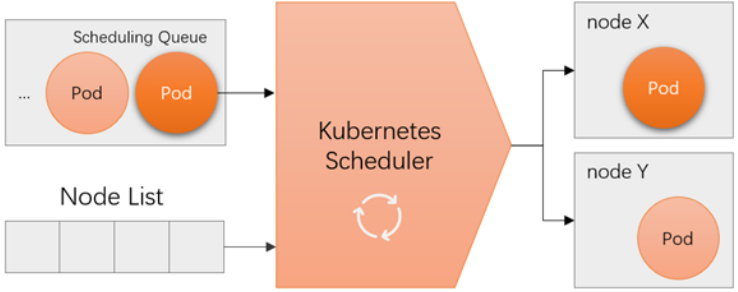

调度队列Scheduling Queue 产生的原因：任务优先级的确定。

**单个对象**：kubectl explain pod.spec.priority, 值越高,优先级越高,默认为0优先级分类：kubectl explain pod.spec.priorityClassName。

**调度过程**

当Scheduler通过API server 的watch接口监听到新建Pod副本的信息后，它会检查所有符合该Pod要求的Node列表，开始执行Pod调度逻辑。调度成功后将Pod绑定到目标节点上。Scheduler在整个系统中承担了承上启下的作用，承上是负责接收创建的新Pod，为安排一个落脚的地（Node）,启下是安置工作完成后，目标Node上的kubelet服务进程接管后继工作，负责Pod生命周期的后半生。具体来说，Scheduler的作用是将待调度的Pod安装特定的调度算法和调度策略绑定到集群中的某个合适的Node上，并将绑定信息传给API server 写入etcd中。

若没有任何一个节点能满足Pod的资源需求，则该Pod将被置于Pending状态，直至出现合适的节点。整个调度过程中涉及三个对象，分别是：待调度的Pod列表，可以运行Pod的Node列表，以及调度算法和策略。

**调度功能**

这个过程在实际的生产环境中，需要考虑的问题就有很多。

如何保证全部的节点调度的公平性？要知道并不是所有节点资源配置都是一样的如何保证每个节点都能被分配资源？集群资源如何能够被高效利用？集群资源如何才能被最大化使用？如何保证 Pod 调度的性能和效率？用户是否可以根据自己的实际需求定制自己的调度策略？考虑到实际环境中的各种复杂情况，kubernetes 的调度器采用插件化的形式实现，可以方便用户进行定制或者二次开发，我们可以自定义一个调度器并以插件形式和 kubernetes 进行集成。

**调度模型**：kubernetes 管理平台自动出现以来，其资源调度策略一直在发展中。

单从资源的调度框架的层面来分析，先后经历了两个调度的阶段：传统调度阶段、新型调度阶段。

### 1.1.2 调度模型

kubernetes的调度框架 经历了两个大的阶段的模型

#### 1.1.2.1 传统调度模型

最初的调度器基于一套预定义的规则和算法，例如资源请求和节点容量的匹配。

**调度决策分为两个阶段**：预选（Predicates）阶段和优先级（Priorities）阶段。预选用于过滤不合适的节点，优先级用于对剩余的节点打分并选择最优节点。

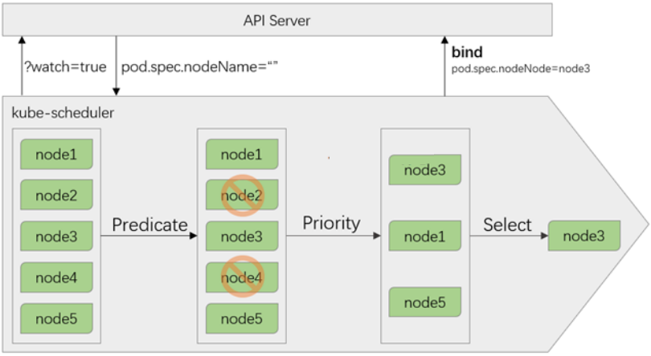

**预选策略(predicate)**

预选即挑选出可以运行的节点, 过滤掉不合格的节点

遍历nodelist，排除不满足条件的节点，剩余为符合要求的候选节点，k8s内置了多种预选规则供用户选择。只要有一个预选算法不满足，该Pod就不能被调度至该节点上。如没有Node符合Predicates策略规则，那该Pod就会被挂起，直到有Node能够满足。

**优选策略(priority)**

优选即评分高的优先

在选择出符合要求的候选节点中，采用优选规则计算出每个节点的总积分，最后选择得分最高的。

**选定(select)**

如果最高得分有多个节点，select就会从中随机选择一个节点。

**扩展支持**

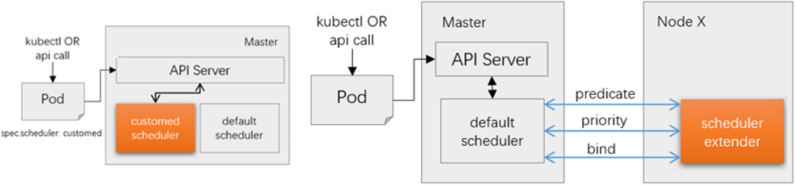

虽然kubernetes 提供了非常多的预选策略函数和优选策略函数，但仍可能需要实现定制更多的功能扩充，支持两种扩展方案。多调度器 - 通过自定义调度器的方式，让用户自己来选择使用哪一种调度策略(需要用户深度参与)扩展接口 - 通过扩展的调度接口，将相关的扩展功能整合到当前的调度策略中(每次都要编译执行)。

#### 1.1.2.2 新型调度模型

Kubernetes 1.18 引入了一个新的调度框架，这标志着调度器架构的重大变化。该框架旨在提高调度器的可扩展性和灵活性，允许开发者以插件的形式扩展和定制调度行为。

**插件机制**：新的调度框架引入了插件机制，调度过程被分解成多个可插拔的阶段（如过滤、打分、预绑定等），用户可以编写自定义插件来扩展或替换调度器的默认行为。

**调度阶段**：调度过程被划分为多个阶段，包括预过滤（Pre-filter）、过滤（Filter）、后过滤（Post-filter）、打分（Score）、绑定（Bind）等。开发者可以针对这些阶段创建自定义插件。

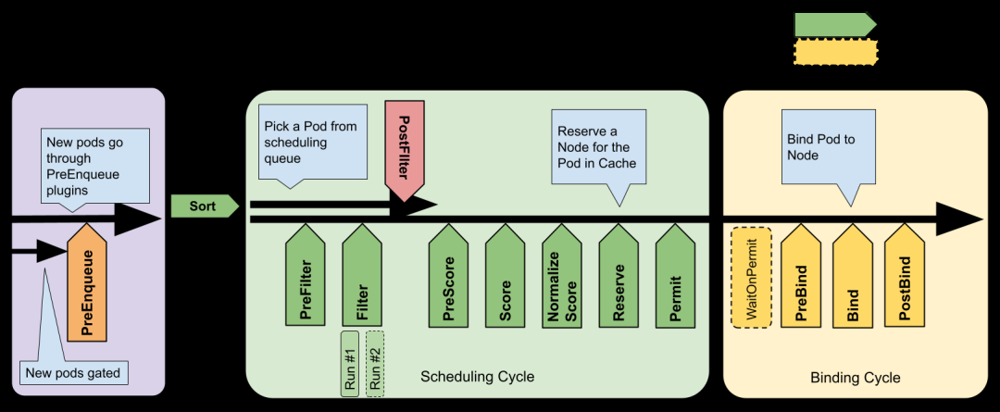

新型的调度框架是在传统调度逻辑的基础上，进行了整合再拆分。

Kubernetes 调度框架主要由以下几个组件组成：

调度队列（Scheduling Queue）: 存放待调度的 Pod。调度插件（Scheduling Plugins）: 在调度过程中用于筛选和评分节点的插件，包括过滤插件（Filter Plugins）和打分插件（Scoring Plugins）。调度循环（Scheduling Cycle）: 调度器的运行循环，它从队列中取出 Pod 并通过调度插件处理，直到找到合适的节点。预选（Predicate）: 决定一个节点是否有资格运行 Pod 的初步检查，包括节点资源、Pod 亲和性/反亲和性、节点选择器、污点和容忍度等。用于过滤掉不符合要求的节点优选（Priority）: 在通过预选的节点中进一步选择最佳节点的过程，通常使用加权评分进行优先级排序。

调度器的主要步骤包括：

1. 预过滤（Pre-filtering）：

在过滤前进行一些初始化工作

例如计算Pod资源需求的总和, 检查 Pod 是否具备必要的资源请求。

2. 过滤（Filtering）：

计算节点剩余资源是否满足Pod需求。

过滤掉不满足 Pod 调度要求的节点

例如资源不足的节点或存在污点但没有相应容忍的节点。

3. 打分（Scoring）：

依据用户配置的资源分配策略(LeastAllocated,MostAllocated,RequestedCapacityRatio请求资源/可用资源的百分比)给节点打分。选择得分最高的节点作为调度目标。打分规则可以基于多种因素，如节点剩余资源、Pod 亲和性等。

4. 预绑定（Pre-binding）：

在最终确定调度目标之前进行一些检查，如绑定验证或准备工作。

5. 绑定（Binding）：

将 Pod 绑定到选定的节点。

基本流程和传统模型还是一样的：队列-预选-评分-绑定，将这个基本流程划分为了三个部分：

任务队列 - 接收所有待分配的任务，任务本身会根据优先级合理调整队列的顺序。调度循环 - 通过扩展接口的方式整合大量的预选机制和评分(优选)机制，同时为了方便扩展预留了备用接口，实现预选和优选功能绑定循环 - 先通过等待线程后的预绑定PreBind队列，此队列可以防止突发的高优先级任务出现，然后再进行正常的节点任务绑定。

**多调度器**

如果默认的调度器不满足要求，还可以部署自定义的调度器。并且，在整个集群中还可以同时运行多个调度器实例通过 pod.Spec.schedulerName 来选择使用哪一个调度器(默认使用内置的调度器)。


- <https://github.com/kubernetes-sigs/descheduler>


范例:  默认调度器
```bash
[root@master1 ~]#kubectl get pod myapp-5bf7bf57cd-ffntl -o yaml|grep
schedulerName
schedulerName: default-scheduler
```

#### 1.1.2.3 新型 vs 传统调度

所有的传统预选函数和优选函数，都变成了扩展插件的方式实现了动态的灵活绑定一切皆代码，所有的配置都可以通过代码的方式来进行实时调整，避免传统的再编译或用户强干预。

## 1.2 调度功能

### 1.2.1 调度函数解析

无论是传统的调度功能还是新型的调度功能，都是基于各种调度的功能函数实现。默认情况下，开启了一部分通用的策略，没有开启的策略可以通过配置参数的方式来进行扩展加载。

**参数解析参考资料**
```text
#预选函数：
https://github.com/kubernetes/kubernetes/blob/release-
1.17/pkg/scheduler/algorithm/predicates/predicates.go
https://github.com/kubernetes/kubernetes/tree/master/pkg/scheduler/algorithm/pre
dicates
#优选函数:
https://github.com/kubernetes/kubernetes/blob/release-
1.17/pkg/scheduler/algorithm/priorities/priorities.go
https://github.com/kubernetes/kubernetes/tree/master/pkg/scheduler/algorithm/pri
orities
```

常见的预选函数和优选函数

下图中绿色部分为默认的插件，蓝色部分为可选的插件。

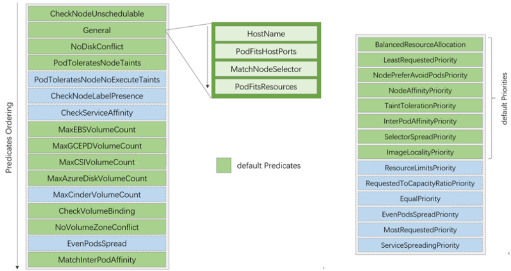

#### 1.2.1.1 预选算法

经典调度器的预选算法分类

存储约束条件

名称中带有Disk或Volume的算法。

Pod间的特殊关系限制

MatchInterPodAffinity

Pod同Node的限制约束

名称中带有Node的算法

General Predicates

Pod的散置性要求

CheckServiceAffinity

EvenPodsSpread

**预选算法功能**


#在Kubernetes Scheduler上启用相应的预选函数才能实现相关调度机制的节点过滤需求，下面给出了这些于Kubernetes 各版本中支持的各预选函数虽然细节实现稍有不同，但是功能基本没有怎么变，其简要功能如下：1）CheckNodeUnschedulable：检查节点是否被标识为Unschedulable，以及是否可将Pod调度于该类节点之上。2）HostName：若Pod资源通过spec.nodeName明确指定了要绑定的目标节点，则节点名称与与该字段值相同的节点才会被保留。3）PodFitsHostPorts：若Pod容器定义了ports.hostPort属性，该预选函数负责检查其值指定的端口是否已被节点上的其他容器或服务所占用，该端口已被占用的节点将被过滤掉。4）MatchNodeSelector：若Pod资源规范上定义了spec.nodeSelector字段，则仅那些拥有匹配该标签选择器的标签的节点才会被保留。5）NoDiskConflict：检查Pod对象请求的存储卷在此节点是否可用，不存在冲突则通过检查。6）PodFitsResources：检查节点是否有足够资源（例如 CPU、内存和GPU等）满足Pod的运行需求；节点声明其资源可用容量，而Pod定义其资源需求（requests），于是调度器会判断节点是否有足够的可用资源运行Pod对象，无法满足则返回失败原因（例如，CPU或内存资源不足等）；调度器的评判资源消耗的标准是节点已分配资源量（各容器的requests值之和），而非其上的各Pod已用资源量，但那些在注解中标记为关键性（critical）的Pod资源则不受该预选函数控制。


7）PodToleratesNodeTaints：检查Pod的容忍度（spec.tolerations字段）是否能够容忍该节点上的污点（taints），不过，它仅关注具有NoSchedule和NoExecute两个效用标识的污点。8）PodToleratesNodeNoExecuteTaints：检查Pod的容忍度是否能接纳节点上定义的NoExecute类型的污点。9）CheckNodeLabelPresence：检查节点上某些标签的存在性，要检查的标签以及其可否存在则取决于用户的定义；在集群中的部署节点以regions/zones/racks类标签的拓扑方式编制，且基于该类标签对相应节点进行了位置标识时，预选函数可以根据位置标识将Pod调度至此类节点之上。10）CheckServiceAffinity：根据调度的目标Pod对象所属的Service资源已关联的其他Pod对象的位置（所运行节点）来判断当前Pod可以运行的目标节点，其目的在于将同一Service对象的Pod放置在同一拓扑内（如同一个rack或zone）的节点上以提高效率。11）MaxEBSVolumeCount：检查节点上已挂载的EBS存储卷数量是否超过了设置的最大值。12）MaxGCEPDVolumeCount：检查节点上已挂载的GCE PD存储卷数量是否超过了设置的最大值，默认值为 16。13）MaxCSIVolumeCount：检查节点上已挂载的CSI存储卷数量是否超过了设置的最大值。14）MaxAzureDiskVolumeCount：检查节点上已挂载的Azure Disk存储卷数量是否超过了设置的最大值，默认值为16。15）MaxCinderVolumeCount：检查节点上已挂载的Cinder存储卷数量是否超过了设置的最大值。16）CheckVolumeBinding：检查节点上已绑定和未绑定的PVC是否能满足Pod的存储卷需求，对于已绑定的 PVC，此预选函数检查给定节点是否能兼容相应PV，而对于未绑定的PVC，预选函数搜索那些可满足PVC申请的可用PV，并确保它可与给定的节点兼容。17）NoVolumeZoneConflict：在给定了存储故障域的前提下，检测节点上的存储卷是否可满足Pod定义的需求。18）EvenPodsSpread：检查节点是否能满足Pod规范中topologySpreadConstraints字段中定义的约束以支持Pod的拓扑感知调度。19）MatchInterPodAffinity：检查给定节点是否能满足Pod对象的亲和性或反亲和性条件，用于实现Pod 亲和性调度或反亲和性调度。


每个节点使用所有算法从上到下进行计算,如果有任何一个算法不满足,则无法通过预选,即排除此节点。

#### 1.2.1.2 优选算法

经典优选算法的分类

节点资源分配倾向

BalancedResourceAllocation

LeastRequestedPriority/MostRequestedPriority

ResourceLimitsPriority

RequestedToCapacityRatioPriority

Pod散置

SelectorSpreadPriority

EvenPodsSpreadPriority

ServiceSpreadingPriority

Node亲和与反亲和

NodeAffinityPriority

NodePreferAvoidPodsPriority

TaintTolerationPriority

ImageLocalityPriority

Pod间的亲和与反亲和

InterPodAffinityPriority

**优选算法功能**


LeastRequestedPriority：#优先将Pod打散至集群中的各节点之上，以试图让各节点有着近似的计算资源消耗比例，适用于集群规模较少变动的场景；其分值由节点空闲资源与节点总容量的比值计算而来，即由CPU或内存资源的总容量减去节点上已有Pod对象需求的容量总和，再减去当前要创建的Pod对象的需求容量得到的结果除以总容量；CPU和内存具有相同权重，资源空闲比例越高的节点得分也就越高，其计算公式如为：(cpu((capacity –sum(requested)) * 10 / capacity) + memory((capacity – sum(requested)) * 10 /capacity))/ 2。


MostRequestedPriority：#优先堆叠Pod至部分节点上，适合云端按量计费、动态伸缩的集群环境#与优选函数LeastRequestedPriority的评估节点得分的方法相似，但二者不同的是，当前函数将给予计算资源占用比例更大的节点以更高的得分，计算公式如为：(cpu((sum(requested)) * 10 /capacity) + memory((sum(requested)) * 10 / capacity))/ 2。该函数的目标在于优先让节点以满载的方式承载Pod资源，从而能够使用更少的节点数，因而较适用于节点规模可弹性伸缩的集群中以最大化地节约节点数量。


BalancedResourceAllocation：#以CPU和内存资源占用率的相近程度作为评估标准，二者越接近的节点权重越高。该优选函数不能单独使用，它需要和LeastRequestedPriority组合使用来平衡优化节点资源的使用状态，选择那些在部署当前Pod资源后系统资源更为均衡的节点。


ResourceLimitsPriority：#以是否能够满足Pod资源限制为评估标准，那些能够满足Pod对于CPU或（和）内存资源限制的节点将计入1 分，节点未声明可分配资源或Pod未定义资源限制时不影响节点计分。


RequestedToCapacityRatio：#该函数允许用户自定义节点各类资源（例如CPU和内存等）的权重，以便提高大型集群中稀缺资源的利用率；该函数的行为可以通过名为requestedToCapacityRatioArguments的配置选项进行控制，它由shape和 resources两个参数组成。


NodeAffinityPriority：#节点亲和调度机制，它根据Pod资源规范中的spec.nodeSelector来对给定节点进行匹配度检查，成功匹配到的条目越多则节点得分越高。不过，其评估过程使用 PreferredDuringSchedulingIgnoredDuringExecution这一表示首选亲和的标签选择器。


ImageLocalityPriority：#镜像亲和调度机制，它根据给定节点上是否拥有运行当前Pod对象中的容器所依赖到的镜像文件来计算该节点的得分值。那些不具有该Pod对象所依赖到的任何镜像文件的节点得分为0，而那些存在相关镜像文件的各节点中，拥有被Pod所依赖到的镜像文件的体积之和越大的节点得分就会越高。


TaintTolerationPriority：#基于对Pod资源对节点的污点容忍调度偏好进行其优先级评估，它将Pod对象的tolerations列表与节点的污点进行匹配度检查，成功匹配的条目越多，则节点得分越低。


SelectorSpreadPriority：#尽可能分散Pod至不同节点上的调度机制，它首先查找标签选择器能够匹配到当前Pod标签的 ReplicationController、ReplicaSet和StatefulSet等控制器对象，而后查找可由这类对象的标签选择器匹配到的现存各Pod对象及其所在的节点，而那些运行此类Pod对象越少的节点得分越高。简单来说，如其名称所示，此优选函数尽量把同一标签选择器匹配到的Pod资源打散到不同的节点上运行。


ServiceSpreadingPriority：#类似于SelectorSpreadPriority，它首先查找标签选择器能够匹配到当前Pod标签的Service对象，而后查找可由这类Service对象的标签选择器匹配到的现存各Pod对象及其所在的节点，而那些运行此类Pod对象越少的节点得分越高。

```text
EvenPodsSpreadPriority：
```


#用于将一组特定的Pod对象在指定的拓扑结构上进行均衡打散，打散条件定义在Pod对象的 spec.topologySpreadConstraints字段上，它内嵌labelSelector指定标签选择器以匹配符合条件的 Pod对象，使用topologyKey指定目标拓扑结构，使用maxSkew描述最大允许的不均衡数量，而无法满足指定的调度条件时的评估策略则由whenUnsatisfiable字段定义，它有两个可用取值，默认值DoNotSchedule 表示不予调度，而ScheduleAnyway则表示以满足最小不均衡值的标准进行调度。

**EqualPriority**：设定所有节点具有相同的权重 1。

**InterPodAffinityPriority**：遍历 Pod 对象的亲和性条目，并将那些能够匹配到给定节点的条目的权重相加，结果值越大的节点得分越高。


NodePreferAvoidPodsPriority：#此优选级函数权限默认为10000，它根据节点是否设置了注解信息 scheduler.alpha.kubernetes.io/preferAvoidPods来计算其优选级。计算方式是，给定的节点无此注解信息时，其得分为10乘以权重10000，存在此注解信息时，对于那些由ReplicationController或 ReplicaSet控制器管控的Pod对象的得分为0，其他Pod对象会被忽略（得最高分）。


针对每个节点使用所有优选算法进行打分后,取得总和,得分最高者优先调度。

**Init Container 的资源需求**

当 kube-scheduler 调度带有多个 init 容器的 Pod 时，只计算 cpu.request 最多的 init 容器，而不是计算所有的 init 容器总和。由于多个 init 容器按顺序执行，并且执行完成立即退出，所以申请最多的资源 init 容器中的所需资源，即可满足所有 init 容器需求。Pod 需求的资源 = Max(所有主容器的资源需求总和，init Container 中最大资源需求)。kube-scheduler 在计算该节点被占用的资源时，init 容器的资源依然会被纳入计算。因为init 容器在特定情况下可能会被再次执行，比如由于更换镜像而引起 Sandbox 重建时。

### 1.2.2 调度策略

调度策略有一些基于资源限制实现,有一些是基于关系实现调度。

调度策略解析

节点调度为即将执行的任务，选择合理的节点。

Pod调度为即将执行的任务，分配合理的逻辑关联搭配。

污点调度避免调度到某些节点

拓扑调度在任务已确定调度的前提下，合理的分配任务，实现资源的高效利用。

调度分类

名称解析

亲和与反亲和满足条件后，就分配或者远离指定的节点。硬亲和与软亲和不会遵循绝对的条件阈值，而是根据实际情况，做出倾向性策略。硬亲和会考量预选和优选策略，而软亲和仅考虑优选策略。

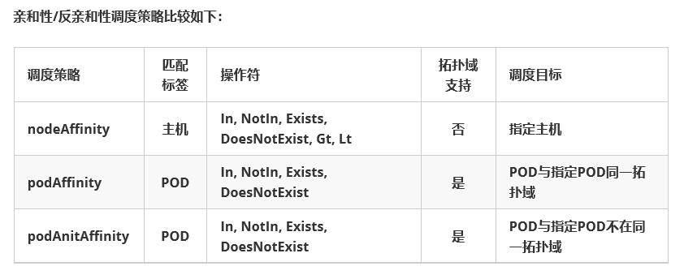

# 2 Pod 调度实现

## 2.1 节点调度

### 2.1.1 节点调度说明


- <https://kubernetes.io/zh-cn/docs/concepts/scheduling-eviction/assign-pod-node/>


节点调度即将Pod调度到哪个节点

Pod 资源对于节点的调度方式：

pod.spec.nodeName

直接指定目标节点

pod.spec.nodeSelector <map[string]string>

直接指定节点挑选条件

使用节点选择器过滤节点标签

直接将应用部署到指定的节点

如果有多个条件，节点必须同时符合才会调度，即并且的关系。

pods.spec.affinity

亲缘性判定

节点亲和 - 根据任务的配置倾向，选择合适的节点来进行资源的配置。

注意：调度策略仅在调度时候有用，一旦调度成功后，后续如果节点状态即使无法满足调度要求，也不会影响正常运行的pod。

### 2.1.2 nodeName和 nodeSelector
```text
https://kubernetes.io/zh-cn/docs/tasks/configure-pod-container/assign-pods-
nodes/
```

nodeName和nodeSelector 将 Pod 分配给指定节点。

nodeName 直接指定节点的名称，nodeName 可以忽略节点的污点。nodeSelector 将Pod调度到有指定label的节点，如果没有指定label的节点，将无法调度，Pod 处于Pending状态。nodeSelector 如果指定多个label，节点必须同时拥有多个label才会调度。nodeSelector 不能忽略节点的污点。

注意: nodeSelector 方式如果已经将Pod调度至某个节点, 即使后续再将此节点的label删除,也不会移除上面的Pod,即只在调度时有效,调度后将不再关注。

范例: 调度Pod应用到指定的节点
```yaml
#定制资源配置文件
#kubectl explain deploy.spec.template.spec.nodeName
[root@master1 ~]#cat scheduler-pod-nodename.yaml
apiVersion: v1
kind: Pod
metadata:
name: pod-nodename
spec:
nodeName: node1.bowen.org   #指定调度到指定的节点名称，可以支持master1.bowen.org忽略污点
containers:
- name: pod-test
image: registry.cn-beijing.aliyuncs.com/bowen/pod-test:v0.1
imagePullPolicy: IfNotPresent

#配置解析：nodeName 将应用调度到node1.bowen.org节点主机上

#应用资源配置文件
[root@master1 ~]#kubectl apply -f scheduler-pod-nodename.yaml

#查看效果
[root@master1 ~]#kubectl  get pod pod-nodename -o wide
NAME           READY   STATUS    RESTARTS   AGE   IP            NODE
NOMINATED NODE   READINESS GATES
pod-nodename   1/1     Running   0          80s   10.244.3.15   node1.bowen.org
<none>           <none>

#如果节点不可用，k8s会自动对节点添加污点，导致Pod处于pending状态
[root@master1 ~]#kubectl  get nodes node1.bowen.org  -o yaml|grep -A10   taints
taints:
- effect: NoSchedule
key: node.kubernetes.io/unreachable
timeAdded: "2024-10-14T08:08:38Z"
- effect: NoExecute
key: node.kubernetes.io/unreachable
timeAdded: "2024-10-14T08:08:43Z"

#清理环境
[root@master1 ~]#kubectl delete -f scheduler-pod-nodename.yaml
```

范例: 使用nodeSelector调度应用到特定的节点上
```yaml
#定制资源配置文件
#kubectl explain  pod.spec.nodeSelector
kubectl explain  deploy.spec.template.spec.nodeSelector
root@master1 ~]#cat scheduler-pod-nodeselector.yaml
apiVersion: v1
kind: Pod
metadata:

name: pod-nodeselector
spec:
nodeSelector:
node: gpu
#project: pingxixi    #多个条件，是与的关系
containers:
- name: pod-test
image: registry.cn-beijing.aliyuncs.com/bowen/pod-test:v0.1
imagePullPolicy: IfNotPresent

#配置解析：将应用调度到包含node标签，并且值为gpu的节点主机上

#应用资源配置文件
[root@master1 ~]#kubectl apply -f scheduler-pod-nodeselector.yaml

#查看效果
[root@master1 ~]#kubectl get node --show-labels   | grep gpu

#结果显示：由于没有适配标签的节点，当前的pod状态是 pending
[root@master1 ~]#kubectl get pod pod-nodeselector
NAME               READY   STATUS    RESTARTS   AGE
pod-nodeselector   0/1     Pending   0          13s

#查看原因
[root@master1 ~]#kubectl describe  pod pod-nodeselector

#为node2节点添加标签
[root@master1 ~]#kubectl label node node2.bowen.org node=gpu

#再次查看
[root@master1 ~]#kubectl get node --show-labels   | grep gpu
node2.bowen.org     Ready    <none>                 4d20h   v1.22.1
beta.kubernetes.io/arch=amd64,beta.kubernetes.io/os=linux,kubernetes.io/arch=amd
64,kubernetes.io/hostname=node2.bowen.org,kubernetes.io/os=linux,node=gpu

[root@master1 ~]#kubectl get pod pod-nodeselector
NAME               READY   STATUS    RESTARTS   AGE
pod-nodeselector   1/1     Running   0          61s

#结果显示:一旦有节点满足需求，pod就被调度到指定的node节点上

#为node2节点清除标签
[root@master1 ~]#kubectl label node node2.bowen.org node-

#Pod仍然还在节点上，说明nodeSelector仅在调度前有效
[root@master1 ~]#kubectl get pod pod-nodeselector
NAME               READY   STATUS    RESTARTS   AGE
pod-nodeselector   1/1     Running   0          61s

#清理环境
[root@master1 ~]#kubectl delete -f scheduler-pod-nodeselector.yaml
[root@master1 ~]#kubectl label node node2.bowen.org node-
```

### 2.1.3 节点亲和性 node affinity
```text
https://kubernetes.io/zh-cn/docs/tasks/configure-pod-container/assign-pods-nodes-
using-node-affinity/
```

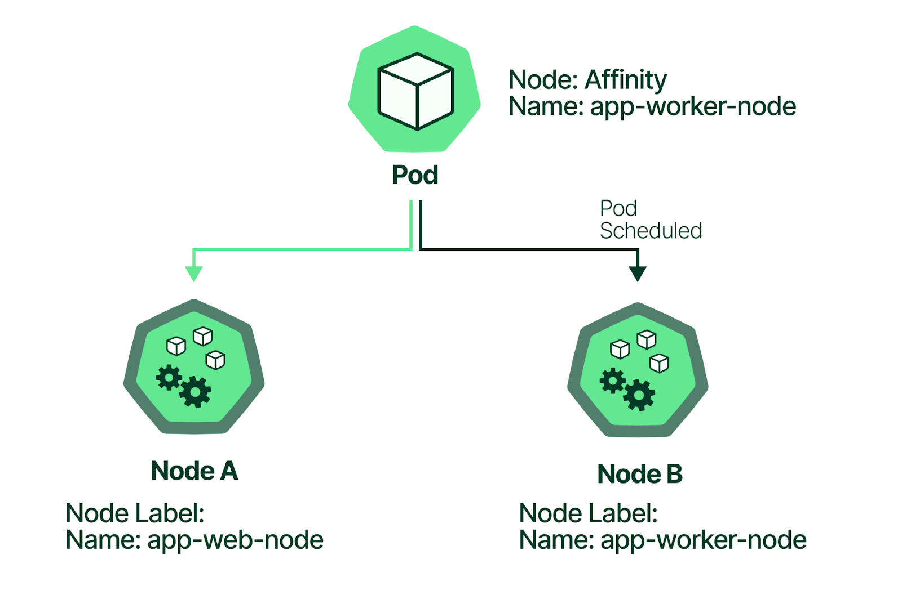

节点调度支持亲和性调度，表示Pod和节点的亲和性,即将Pod调度至具有某些标签的节点。节点亲和性nodeAffinity 和 nodeSelector 功能相似，但支持更丰富条件，相当于增强版的nodeSelector。节点亲和性只针对调度期间Pod有效,调度后条件发生变化,则无效。

注意: Kubernetes中并没有反亲和的概念,但使用污点技术可以实现类似功能。

**节点亲和分为软亲和和硬亲和**
```text
kubectl explain pod.spec.affinity.nodeAffinity
```

**节点软亲和**
```text
#倾向性,可以违反,打分逻辑，进行排序
preferredDuringSchedulingIgnoredDuringExecution
```

**节点硬亲和**
```text
#强制,不能违反,定义明确条件：必须满足，或必须不能满足
requiredDuringSchedulingIgnoredDuringExecution
```

#### 2.1.3.1 节点硬亲和

硬亲和是强制条件,如果不满足,将无法启动pod。

##### 2.1.3.1.1 节点硬亲和属性解析

**属性解析**
```text
kubectl explain pod.spec.affinity.nodeAffinity
```


requiredDuringSchedulingIgnoredDuringExecution #硬亲和性,必须满足亲和性才能部署或不部署。nodeSelectorTerms：   #节点选择术语- matchExpressions  #匹配表达式,可用如下多种运算符,如果有多个matchExpressions,只要有一个满足即可调度,即or关系 key value operator


operator有以下几种 In                #label 的值在某个列表中存在即可,即只要匹配其中一个值即可,即or关系 NotIn             #label 的值不在某个列表中，可以实现反亲和功能 Gt                #label 的值大于某个值,只支持数据字比较 Lt                #label 的值小于某个值,只支持数据字比较 Exists            #某个 label 存在 DoesNotExist      #某个 label 不存在，可以实现反亲和

```text
matchFields       #匹配字段,可以不定义标签值
```


requiredDuringSchedulingIgnoredDuringExecution中的IgnoredDuringExecution #表示在 Pod运行期间,节点的标签发生变化,导致亲和策略不能满足时，仍会继续运行Pod

```text
#如果一个nodeSelectorTerms中只定义了一个matchExpressions中指定多个key来匹配多个条件，则所
有的key对应的条件都必须满足才会调度到对应的节点，即and的关系
#如果一个nodeSelectorTerms中定义了多个matchExpressions列表指定了多个条件，则只要满足其中一
个matchExpressions条件，就会被调度到相应的节点上，即or的关系
```

##### 2.1.3.1.2 节点硬亲和案例

范例:  只有节点包含env标签值是dev 或者 test 才允许部署pod
```yaml
#资源文件内容
[root@master1 ~]#cat  scheduler-pod-node-required-affinity.yaml
apiVersion: v1
kind: Pod
metadata:
name: node-required-affinity
spec:
containers:
- name: pod-test
image: registry.cn-beijing.aliyuncs.com/bowen/pod-test:v0.1
imagePullPolicy: IfNotPresent
affinity:
nodeAffinity:
requiredDuringSchedulingIgnoredDuringExecution:
nodeSelectorTerms:

- matchExpressions:
- key: env
operator: In
values:
- dev              #多个值中，只要有一个值匹配即可，即或者关系
- test

#应用资源定义文件
[root@master1 ~]#kubectl apply -f scheduler-pod-node-required-affinity.yaml

#查看效果，如果没有满足硬亲和条件的节点，Pod处于Pending状态
[root@master1 ~]#kubectl get pod
NAME                     READY   STATUS    RESTARTS   AGE
node-required-affinity   0/1     Pending   0          4s

#任一节点添加标签
[root@master1 ~]#kubectl label node node3.bowen.org  env=dev

#验证结果
[root@master1 ~]#kubectl get pod  -o wide
NAME                     READY   STATUS    RESTARTS   AGE   IP           NODE
NOMINATED NODE   READINESS GATES
node-required-affinity   1/1     Running   0          79s   10.244.5.6
node3.bowen.org   <none>           <none>
#结果显示：只有节点上存在符合标签后，该资源才会被创建到指定节点

#清理环境
[root@master1 ~]#kubectl delete  -f   scheduler-pod-node-required-affinity.yaml

[root@master1 ~]#kubectl label node node3.bowen.org  env-
```

#### 2.1.3.2 节点软亲和

软亲和不是必要的强制条件,只是一种偏好而已, 尽量部署在满足条件的节点上。如果实在所有节点都不满足软亲和的条件,也可以支持调度运行pod。

##### 2.1.3.2.1 节点软亲和属性解析

**属性解析**
```text
kubectl explain pod.spec.affinity.nodeAffinity
preferredDuringSchedulingIgnoredDuringExecution #软亲和性，能满足最好，不满足也没关系。
- weight       #权重值，1-100,值越高优先级越高
preference   #偏好设置
matchExpressions
matchFields

#对于满足所有调度要求的每个节点，调度程序将通过迭代此字段的元素计算总和
#并在节点与对应的节点匹配时将“权重”添加到总和。

#注意：与硬亲和属性不同，这里需要注意的是软亲和属性是一个列表对象，而preference不是一个列表项。
```

##### 2.1.3.2.2 节点软亲和案例

范例: 只要节点包含env标签值是dev 或者 test就优先部署pod
```yaml
#资源文件内容
[root@master1 ~]#cat  scheduler-pod-node-preferred-affinity.yaml
apiVersion: v1
kind: Pod
metadata:
name: node-preferred-affinity
spec:
containers:
- name: pod-test
image: registry.cn-beijing.aliyuncs.com/bowen/pod-test:v0.1
imagePullPolicy: IfNotPresent
affinity:
nodeAffinity:
preferredDuringSchedulingIgnoredDuringExecution:
- weight: 50
preference:
matchExpressions:
- key: env
operator: In
values:
- test
- weight: 20
preference:
matchExpressions:
- key: env
operator: In
values:
- dev
#注意：软亲和的权重配置是与硬亲和的区别所在。

#应用资源定义文件
[root@master1 ~]#kubectl apply -f scheduler-pod-node-preferred-affinity.yaml

#查看效果
[root@master1 ~]#kubectl get pod
NAME                      READY   STATUS    RESTARTS   AGE
node-preferred-affinity   1/1     Running   0          5s

#清理环境
[root@master1 ~]#kubectl delete -f scheduler-pod-node-preferred-affinity.yaml

#准备节点标签
[root@master1 ~]#kubectl label node node1.bowen.org env=dev
[root@master1 ~]#kubectl label node node2.bowen.org env=test

[root@master1 ~]#kubectl  get nodes  -l env
NAME               STATUS   ROLES    AGE     VERSION
node1.bowen.org   Ready    <none>   4d21h   v1.22.1
node2.bowen.org   Ready    <none>   4d21h   v1.22.1

#再次创建pod
[root@master1 ~]#kubectl apply  -f scheduler-pod-node-preferred-affinity.yaml

#观察结果
[root@master1 ~]#kubectl  get pod -o wide
NAME                      READY   STATUS    RESTARTS   AGE   IP            NODE
NOMINATED NODE   READINESS GATES
node-preferred-affinity   1/1     Running   0          7s    10.244.4.10
node2.bowen.org   <none>           <none>
#结果显示：由于 node2上的标签权重较高，所以就交给了node2

#清除node2节点标签后，重启资源对象
[root@master1 ~]#kubectl label node node2.bowen.org  env-

#清理环境
[root@master1 ~]#kubectl delete -f scheduler-pod-node-preferred-affinity.yaml

#再次创建pod
[root@master1 ~]#kubectl apply -f scheduler-pod-node-preferred-affinity.yaml

#观察结果
[root@master1 ~]#kubectl  get pod -o wide
NAME                      READY   STATUS    RESTARTS   AGE   IP            NODE
NOMINATED NODE   READINESS GATES
node-preferred-affinity   1/1     Running   0          3s    10.244.3.16
node1.bowen.org   <none>           <none>
#结果显示：这个时候，资源调度到了node1上

#清理环境
[root@master1 ~]#kubectl delete -f scheduler-pod-node-preferred-affinity.yaml
[root@master1 ~]#kubectl label node node1.bowen.org env-
[root@master1 ~]#kubectl label node node2.bowen.org env-
```

#### 2.1.3.3 亲和性和资源限制

##### 2.1.3.3.1 介绍

默认的的调度策略分为预选和优选

资源限制属于预选，是强制性的，一旦满足不了，就不再继续，而优选，仅仅是选择一个最好的，而非强制，前提是预选必须通过。

比如：即使亲和性的标签能满足需求，如果资源的需求不满足的话，仍然不会去调度资源。


##### 2.1.3.3.2 案例

范例:
```yaml
#资源文件内容
[root@master1 ~]#cat  scheduler-pod-node-resourcefits-affinity.yaml
apiVersion: apps/v1
kind: Deployment
metadata:
name: node-resourcefits-affinity
spec:
replicas: 2
selector:
matchLabels:
app: podtest
template:
metadata:
labels:
app: podtest
spec:
containers:
- name: podtest
image: registry.cn-beijing.aliyuncs.com/bowen/pod-test:v0.1
imagePullPolicy: IfNotPresent
resources:
requests:
cpu: 2
memory: 2Gi
affinity:
nodeAffinity:
requiredDuringSchedulingIgnoredDuringExecution:
nodeSelectorTerms:
- matchExpressions:
- key: env
operator: Exists

#注意：软亲和的权重配置是与硬亲和的区别所在。

#应用资源定义文件

[root@master1 ~]#kubectl apply -f scheduler-pod-node-resourcefits-affinity.yaml

#查看效果
[root@master1 ~]#kubectl  get pod -o wide
NAME                                          READY   STATUS    RESTARTS   AGE
IP       NODE     NOMINATED NODE   READINESS GATES
node-resourcefits-affinity-76c7fdd9ff-59tzj   0/1     Pending   0          9s
<none>   <none>   <none>           <none>
node-resourcefits-affinity-76c7fdd9ff-98ndw   0/1     Pending   0          9s
<none>   <none>   <none>           <none>

#查看原因
[root@master1 ~]#kubectl describe  pod node-resourcefits-affinity-76c7fdd9ff-
59tzj
Name:           node-resourcefits-affinity-76c7fdd9ff-59tzj
Namespace:      default
Priority:       0
Node:           <none>
Labels:         app=podtest
pod-template-hash=76c7fdd9ff
Annotations:    <none>
Status:         Pending
IP:
IPs:            <none>
Controlled By:  ReplicaSet/node-resourcefits-affinity-76c7fdd9ff
Containers:
podtest:
Image:      registry.cn-beijing.aliyuncs.com/bowen/pod-test:v0.1
Port:       <none>
Host Port:  <none>
Requests:
cpu:        2
memory:     2Gi
Environment:  <none>
Mounts:
/var/run/secrets/kubernetes.io/serviceaccount from kube-api-access-dtssw
(ro)
Conditions:
Type           Status
PodScheduled   False
Volumes:
kube-api-access-dtssw:
Type:                    Projected (a volume that contains injected data from
multiple sources)
TokenExpirationSeconds:  3607
ConfigMapName:           kube-root-ca.crt
ConfigMapOptional:       <nil>
DownwardAPI:             true
QoS Class:                   Burstable
Node-Selectors:              <none>
Tolerations:                 node.kubernetes.io/not-ready:NoExecute op=Exists
for 300s
node.kubernetes.io/unreachable:NoExecute op=Exists
for 300s
Events:
Type     Reason            Age   From               Message
----     ------            ----  ----               -------
```


Warning  FailedScheduling  24s   default-scheduler  0/6 nodes are available: 3 node(s) didn't match Pod's node affinity/selector, 3 node(s) had taint {node-role.kubernetes.io/master: }, that the pod didn't tolerate.

```bash
#添加label
[root@master1 ~]#kubectl label node node2.bowen.org env=test
[root@master1 ~]#kubectl label node node1.bowen.org env=dev

#重新部署
[root@master1 ~]#kubectl delete -f scheduler-pod-node-resourcefits-affinity.yaml
[root@master1 ~]#kubectl apply -f scheduler-pod-node-resourcefits-affinity.yaml

#仍然不成功
[root@master1 ~]#kubectl  get pod -o wide
NAME                                          READY   STATUS    RESTARTS   AGE
IP       NODE     NOMINATED NODE   READINESS GATES
node-resourcefits-affinity-76c7fdd9ff-sc6cr   0/1     Pending   0          2s
<none>   <none>   <none>           <none>
node-resourcefits-affinity-76c7fdd9ff-sk9xc   0/1     Pending   0          2s
<none>   <none>   <none>           <none>

#查看原因是资源不足
[root@master1 ~]#kubectl describe  pod node-resourcefits-affinity-76c7fdd9ff-
sc6cr
Name:           node-resourcefits-affinity-76c7fdd9ff-sc6cr
Namespace:      default
.......
Events:
Type     Reason            Age   From               Message
----     ------            ----  ----               -------
Warning  FailedScheduling  12s   default-scheduler  0/6 nodes are available: 1
node(s) didn't match Pod's node affinity/selector, 2 Insufficient cpu, 3 node(s)
had taint {node-role.kubernetes.io/master: }, that the pod didn't tolerate.
#结果显示：节点资源不足，所以无法正常的资源调度

#查看主机资源
[root@master1 ~]#kubectl describe node node1.bowen.org
.......
Allocated resources:
(Total limits may be over 100 percent, i.e., overcommitted.)
Resource           Requests    Limits
--------           --------    ------
cpu                300m (15%)  100m (5%)
memory             190Mi (4%)  390Mi (10%)
ephemeral-storage  0 (0%)      0 (0%)
hugepages-1Gi      0 (0%)      0 (0%)
hugepages-2Mi      0 (0%)      0 (0%)
Events:              <none>
......

#调配资源限制
[root@master1 ~]#vim scheduler-pod-node-resourcefits-affinity.yaml
...
resources:
requests:
cpu: 0.2            #将值调小
memory: 200Mi       #将值调小

#重新应用资源配置
[root@master1 ~]#kubectl apply -f scheduler-pod-node-resourcefits-affinity.yaml

#查看效果
[root@master1 ~]#kubectl get pod -o wide
NAME                                          READY   STATUS    RESTARTS   AGE
IP            NODE               NOMINATED NODE   READINESS GATES
node-resourcefits-affinity-5559c956bc-9tlqf   1/1     Running   0          26s
10.244.3.17   node1.bowen.org   <none>           <none>
node-resourcefits-affinity-5559c956bc-xmkcb   1/1     Running   0          27s
10.244.4.11   node2.bowen.org   <none>           <none>

#清理环境
[root@master1 ~]#kubectl delete -f scheduler-pod-node-resourcefits-affinity.yaml

[root@master1 ~]#kubectl label nodes node1.bowen.org env-
[root@master1 ~]#kubectl label nodes node2.bowen.org env-
```

## 2.2 Pod 调度

所谓的pod调度，指 pod 彼此之间的亲和性和反亲和性，也就是说，哪些pod应该在一起或者不在同一个位置(拓扑域)。是否在同一个位置是通过拓扑域来定义。

拓扑域

在Kubernetes中，拓扑域是指按节点标签定义和分组的节点集合。例如，区域、可用区、机架、主机名都可以作为将节点划分成不同拓扑域的依据。Kubernetes使用TopologyKey(拓扑键)来定义将节点划分至不同拓扑域的标准。topologyKey 的值决定是否是同一个位置。

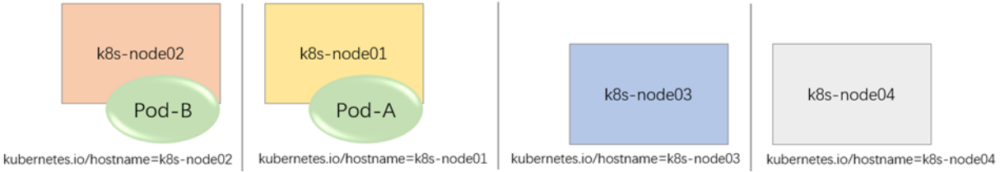

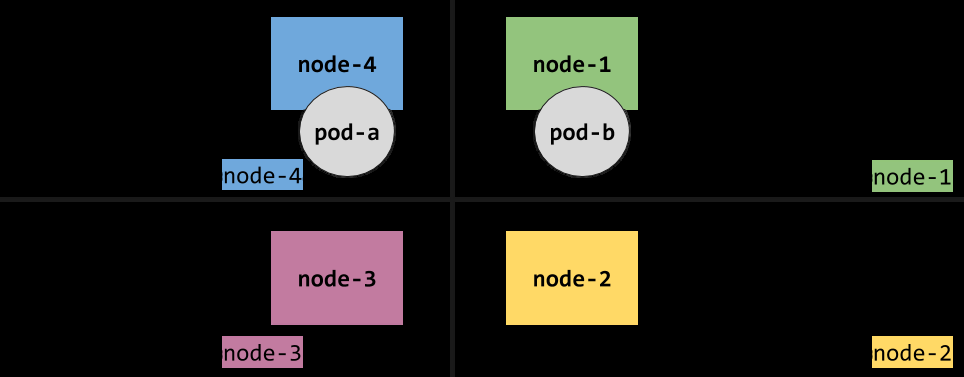

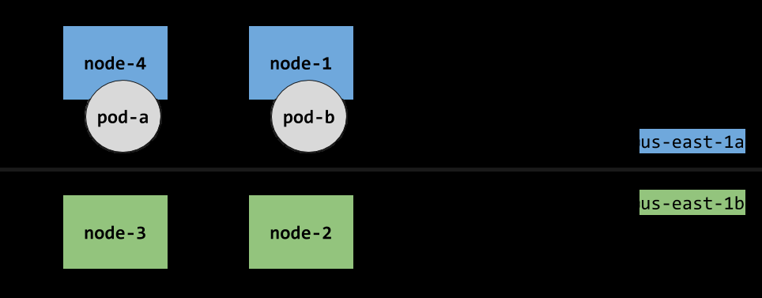

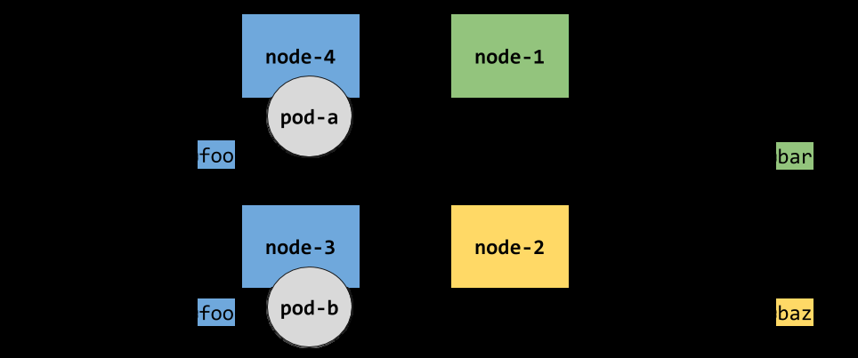

### 2.2.1 Pod 亲和性 podAffinity

#### 2.2.1.1 Pod 亲和性说明

Pod 亲和性就是将多个pod调度在同一个位置(拓扑域)上。

比如：kubernetes 集群的节点分布在不同的区域或者不同的机房,当服务A和服务B需要高效的交流数据，要求部署在同一个区域或者同一机房,甚至同一个节点。

Pod 亲和性允许跨 namespace 的Pod 间实现亲和。

Pod 亲和性分为: 硬亲和和软亲和

**属性解析**
```bash
#亲和:设定一个Pod是倾向与其它Pod运行同一个节点上
kubectl explain pod.spec.affinity.podAffinity
#反亲和:设定一个Pod是倾向与其它Pod不要运行同一个节点上
kubectl explain pod.spec.affinity.podAntiAffinity
```


requiredDuringSchedulingIgnoredDuringExecution  #硬亲和性 labelSelector       #选择跟哪组标签匹配的Pod亲和 namespaces #选择哪个命名空间进行匹配,如果namespace值为空,表示所有namespace,如果没有namespace表示当前namespace topologyKey         #用于判断是否是同一个位置,指定节点上的哪个键，这是一个必选项,不能为空#注意：这三个条件是一个逻辑与的关系 preferredDuringSchedulingIgnoredDuringExecution #软亲和性


podAffinityTerm     #与权重关联的亲和选项，这是一个必选项 labelSelector namespaces      #表示仅在指定的命名空间中查找 topologyKey     #在指定节点上的标签关键字，这是一个必选项,不能为空 weight              #权重，这是一个必选项


#### 2.2.1.2 Pod 亲和性案例

范例: 硬亲和，创建两个在不同主机上的pod，然后创建一个第三个pod要求和有标签env=test的pod部署在一起
```yaml
#两个节点准备标签,确保Pod调度至不同的节点
[root@master1 ~]#kubectl label node node1.bowen.org env=dev
[root@master1 ~]#kubectl label node node2.bowen.org env=test

#创建资源配置实现两个有不同标签的Pod
[root@master1 ~]#cat  scheduler-pod-affinity-base.yaml
---
apiVersion: v1
kind: Pod
metadata:
name: pod-dev
labels:
env: dev
spec:
containers:
- name: pod-test
image: registry.cn-beijing.aliyuncs.com/bowen/pod-test:v0.1
imagePullPolicy: IfNotPresent
nodeSelector:             #确保Pod调度至不同的节点
env: dev
---
apiVersion: v1
kind: Pod
metadata:
name: pod-test
labels:
env: test
spec:
containers:
- name: pod-test
image: registry.cn-beijing.aliyuncs.com/bowen/pod-test:v0.1
imagePullPolicy: IfNotPresent
nodeSelector:            #确保Pod调度至不同的节点
env: test

#应用资源配置文件
[root@master1 ~]#kubectl apply -f scheduler-pod-affinity-base.yaml

#确认效果
[root@master1 ~]#kubectl  get pod -o wide
NAME       READY   STATUS    RESTARTS   AGE   IP            NODE
NOMINATED NODE   READINESS GATES
pod-dev    1/1     Running   0          90s   10.244.3.18   node1.bowen.org
<none>           <none>

pod-test   1/1     Running   0          90s   10.244.4.12   node2.bowen.org
<none>           <none>

#创建资源配置文件
[root@master1 ~]#cat  scheduler-pod-affinity-required.yaml
apiVersion: v1
kind: Pod
metadata:
name: pod-affinity
spec:
containers:
- name: pod-test
image: registry.cn-beijing.aliyuncs.com/bowen/pod-test:v0.1
imagePullPolicy: IfNotPresent
affinity:
podAffinity:
requiredDuringSchedulingIgnoredDuringExecution:
- labelSelector:
matchExpressions:
- {key: env, operator: In, values: ["test"]}  #Pod 标签匹配
namespaces: ["default"]                         #名称空间
topologyKey: kubernetes.io/hostname             #根据主机名标签确认确定在同一
个节点

#属性解析： topologyKey的来源
[root@master1 ~]#kubectl get nodes -o yaml | grep kubernetes.io/hostname
kubernetes.io/hostname: master1.bowen.org
kubernetes.io/hostname: node1.bowen.org
kubernetes.io/hostname: node2.bowen.org
kubernetes.io/hostname: node3.bowen.org

#指定 kubernetes.io/hostname 和主机名效果是一样的，只不过一个是自动获取，一个是手工指定,此处
表示使用主机名做为调度pod亲和性在"同一位置"的依据

#应用资源配置文件
[root@master1 ~]#kubectl apply  -f scheduler-pod-affinity-required.yaml

#查看效果
[root@master1 ~]#kubectl  get pod --show-labels -o wide
NAME           READY   STATUS    RESTARTS   AGE     IP            NODE
NOMINATED NODE   READINESS GATES
pod-affinity   1/1     Running   0          6s      10.244.4.14   node2.bowen.org
<none>           <none>
pod-dev        1/1     Running   0          4m21s   10.244.3.18   node1.bowen.org
<none>           <none>
pod-test       1/1     Running   0          4m21s   10.244.4.12   node2.bowen.org
<none>           <none>

#结果显示：由于是硬亲和状态，所以，直接调度到对应亲和Pod所在的节点

#清理环境
[root@master1 ~]#kubectl delete -f scheduler-pod-affinity-required.yaml
```

范例: 软亲和, 多个满足条件的pod中选择最合适的Pod所在节点
```yaml
#创建资源配置文件
[root@master1 ~]#cat  scheduler-pod-affinity-preferred.yaml

apiVersion: v1
kind: Pod
metadata:
name: pod-affinity
spec:
containers:
- name: pod-test
image: registry.cn-beijing.aliyuncs.com/bowen/pod-test:v0.1
imagePullPolicy: IfNotPresent
affinity:
podAffinity:
preferredDuringSchedulingIgnoredDuringExecution:
- weight: 60
podAffinityTerm:
labelSelector:
matchExpressions:
- {key: env, operator: In, values: ["dev"]}
topologyKey: kubernetes.io/hostname
- weight: 30
podAffinityTerm:
labelSelector:
matchExpressions:
- {key: env, operator: In, values: ["test"]}
topologyKey: kubernetes.io/hostname

#应用资源配置文件
[root@master1 ~]#kubectl apply  -f  scheduler-pod-affinity-base.yaml
[root@master1 ~]#kubectl apply  -f  scheduler-pod-affinity-preferred.yaml

#查看效果
[root@master1 ~]#kubectl get pod --show-labels -o wide
NAME           READY   STATUS    RESTARTS   AGE   IP            NODE
NOMINATED NODE   READINESS GATES   LABELS
pod-affinity   1/1     Running   0          62s   10.244.3.19   node1.bowen.org
<none>           <none>            <none>
pod-dev        1/1     Running   0          10m   10.244.3.18   node1.bowen.org
<none>           <none>            env=dev
pod-test       1/1     Running   0          10m   10.244.4.12   node2.bowen.org
<none>           <none>            env=test
#结果显示：优先选择的是 node1节点上的Pod

#删除pod-dev 后，重新执行pod-affinity对象
[root@master1 ~]#kubectl delete pod pod-dev

[root@master1 ~]#kubectl delete -f scheduler-pod-affinity-preferred.yaml
[root@master1 ~]#kubectl apply  -f scheduler-pod-affinity-preferred.yaml

#查看效果,选择次优的节点node2
[root@master1 ~]#kubectl get pod --show-labels -o wide
NAME           READY   STATUS    RESTARTS   AGE   IP            NODE
NOMINATED NODE   READINESS GATES   LABELS
pod-affinity   1/1     Running   0          1s    10.244.4.15   node2.bowen.org
<none>           <none>            <none>
pod-test       1/1     Running   0          13m   10.244.4.12   node2.bowen.org
<none>           <none>            env=test

#清理环境
[root@master1 ~]#kubectl delete -f scheduler-pod-affinity-preferred.yaml
```

范例: 硬亲和, Pod必须把数据存储到redis中，必须在一起
```yaml
#定义资源配置文件
[root@master1 ~]#cat  scheduler-pod-affinity-redis-required.yaml
apiVersion: apps/v1
kind: Deployment
metadata:
name: redis
spec:
replicas: 1
selector:
matchLabels:
app: redis
template:
metadata:
labels:
app: redis
spec:
containers:
- name: redis
image: registry.cn-beijing.aliyuncs.com/bowen/redis:7.0
imagePullPolicy: IfNotPresent
---
apiVersion: apps/v1
kind: Deployment
metadata:
name: pod-affinity-required
spec:
replicas: 4
selector:
matchLabels:
app: pod-test
template:
metadata:
labels:
app: pod-test
spec:
containers:
- name: pod-test
image: registry.cn-beijing.aliyuncs.com/bowen/pod-test:v0.1
imagePullPolicy: IfNotPresent
affinity:
podAffinity:
requiredDuringSchedulingIgnoredDuringExecution:
- labelSelector:
matchExpressions:
- {key: app, operator: In, values: ["redis"]}
topologyKey: kubernetes.io/hostname

#应用
[root@master1 ~]#kubectl apply -f scheduler-pod-affinity-redis-required.yaml

#结果都运行在同一个节点
[root@master1 ~]#kubectl get pod -o wide --show-labels

NAME                                    READY   STATUS    RESTARTS   AGE   IP
NODE               NOMINATED NODE   READINESS GATES   LABELS
pod-affinity-required-bbbdddb57-28vx2   1/1     Running   0          10s
10.244.4.16   node2.bowen.org   <none>           <none>            app=pod-
test,pod-template-hash=bbbdddb57
pod-affinity-required-bbbdddb57-bbjhh   1/1     Running   0          10s
10.244.4.20   node2.bowen.org   <none>           <none>            app=pod-
test,pod-template-hash=bbbdddb57
pod-affinity-required-bbbdddb57-rkz4w   1/1     Running   0          10s
10.244.4.17   node2.bowen.org   <none>           <none>            app=pod-
test,pod-template-hash=bbbdddb57
pod-affinity-required-bbbdddb57-tqzjn   1/1     Running   0          10s
10.244.4.18   node2.bowen.org   <none>           <none>            app=pod-
test,pod-template-hash=bbbdddb57
redis-6d6944499d-ql8v2                  1/1     Running   0          10s
10.244.4.19   node2.bowen.org   <none>           <none>            app=redis,pod-
template-hash=6d6944499d

#清理环境
[root@master1 ~]#kubectl delete  -f scheduler-pod-affinity-redis-required.yaml
```

范例：将Pod调度到同一个机架的服务器上
```yaml
[root@master1 scheduler]#cat scheduler-pod-affinity-redis-required02.yaml
apiVersion: apps/v1
kind: Deployment
metadata:
name: redis
spec:
replicas: 1
selector:
matchLabels:
app: redis
template:
metadata:
labels:
app: redis
spec:
nodeSelector:
rack: rack01
containers:
- name: redis
image: registry.cn-beijing.aliyuncs.com/bowen/redis:7.0
imagePullPolicy: IfNotPresent
---
apiVersion: apps/v1
kind: Deployment
metadata:
name: pod-affinity-required
spec:
replicas: 4
selector:
matchLabels:
app: pod-test
template:
metadata:

labels:
app: pod-test
spec:
containers:
- name: pod-test
image: registry.cn-beijing.aliyuncs.com/bowen/pod-test:v0.1
imagePullPolicy: IfNotPresent
affinity:
podAffinity:
requiredDuringSchedulingIgnoredDuringExecution:
- labelSelector:
matchExpressions:
- {key: app, operator: In, values: ["redis"]}
#topologyKey: kubernetes.io/hostname
topologyKey: rack #根据机架确定位置
```

范例: 软亲和, pod要把数据存储到redis中，原则上最好在一起，实在不行也可以调度到其他节点
```yaml
#定义资源配置文件
[root@master1 ~]#cat  scheduler-pod-affinity-redis-preferred.yaml
apiVersion: apps/v1
kind: Deployment
metadata:
name: redis-preferred
spec:
replicas: 1
selector:
matchLabels:
app: redis
template:
metadata:
labels:
app: redis
spec:
nodeName: node1.bowen.org
containers:
- name: redis
image: registry.cn-beijing.aliyuncs.com/bowen/redis:7.0
imagePullPolicy: IfNotPresent
resources:
requests:
cpu: 300m
memory: 512Mi
---
apiVersion: apps/v1
kind: Deployment
metadata:
name: pod-affinity-preferred
spec:
replicas: 6
selector:
matchLabels:
app: pod-test
template:
metadata:
labels:
app: pod-test

spec:
containers:
- name: pod-test
image: registry.cn-beijing.aliyuncs.com/bowen/pod-test:v0.1
imagePullPolicy: IfNotPresent
resources:
requests:
cpu: 300m
memory: 1000Mi
affinity:
podAffinity:
preferredDuringSchedulingIgnoredDuringExecution:
- weight: 100
podAffinityTerm:
labelSelector:
matchExpressions:
- {key: app, operator: In, values: ["redis"]}
topologyKey: kubernetes.io/hostname
- weight: 50
podAffinityTerm:
labelSelector:
matchExpressions:
- {key: app, operator: In, values: ["redis"]}
topologyKey: env          #根据env标签确认是否为同一个节点
#属性解析：如果第一条件满足不了，那就用第二条件，第二条件不满足，就用其他条件

#应用
[root@master1 ~]#kubectl apply -f scheduler-pod-affinity-redis-preferred.yaml

#可以看到pod分布到多个节点
[root@master1 ~]#kubectl get pod -o wide
NAME                                      READY   STATUS    RESTARTS   AGE   IP
NODE               NOMINATED NODE   READINESS GATES
pod-affinity-preferred-7885c89ccb-5xv4f   1/1     Running   0          31s
10.244.3.34   node1.bowen.org   <none>           <none>
pod-affinity-preferred-7885c89ccb-6xvl8   1/1     Running   0          31s
10.244.3.35   node1.bowen.org   <none>           <none>
pod-affinity-preferred-7885c89ccb-b8qbd   1/1     Running   0          2s
10.244.5.12   node3.bowen.org   <none>           <none>
pod-affinity-preferred-7885c89ccb-h5ch6   1/1     Running   0          2s
10.244.5.13   node3.bowen.org   <none>           <none>
pod-affinity-preferred-7885c89ccb-w8v2q   1/1     Running   0          31s
10.244.4.24   node2.bowen.org   <none>           <none>
pod-affinity-preferred-7885c89ccb-wntsk   1/1     Running   0          31s
10.244.3.33   node1.bowen.org   <none>           <none>
redis-preferred-7c86b594db-bk8p5          1/1     Running   0          31s
10.244.3.32   node1.bowen.org   <none>           <none>
#注意：这种方式，有可能会受到其他调度算法的影响。

#观察worker节点资源使用状态
[root@master1 ~]#kubectl describe  nodes node1
....
Allocated resources:
(Total limits may be over 100 percent, i.e., overcommitted.)
Resource           Requests      Limits
--------           --------      ------
cpu                1500m (75%)   100m (5%)
memory             3702Mi (97%)  390Mi (10%)

ephemeral-storage  0 (0%)        0 (0%)
hugepages-1Gi      0 (0%)        0 (0%)
hugepages-2Mi      0 (0%)        0 (0%)
Events:              <none>

[root@master1 ~]#kubectl describe  nodes node2
.....
Allocated resources:
(Total limits may be over 100 percent, i.e., overcommitted.)
Resource           Requests      Limits
--------           --------      ------
cpu                400m (20%)    100m (5%)
memory             1050Mi (27%)  50Mi (1%)
ephemeral-storage  0 (0%)        0 (0%)
hugepages-1Gi      0 (0%)        0 (0%)
hugepages-2Mi      0 (0%)        0 (0%)
Events:              <none>

[root@master1 ~]#kubectl describe  nodes node3
......
Allocated resources:
(Total limits may be over 100 percent, i.e., overcommitted.)
Resource           Requests      Limits
--------           --------      ------
cpu                700m (35%)    100m (5%)
memory             2050Mi (53%)  50Mi (1%)
ephemeral-storage  0 (0%)        0 (0%)
hugepages-1Gi      0 (0%)        0 (0%)
hugepages-2Mi      0 (0%)        0 (0%)
Events:              <none>

[root@master1 ~]#kubectl delete -f scheduler-pod-affinity-redis-preferred.yaml
```

### 2.2.2 Pod 反亲和性 podAntiAffinity

#### 2.2.2.1 Pod 反亲和性说明

所谓的反亲和，其实就是满足条件，就不能pod调度在一起，与亲和正好相反。

反亲和功能:

**避免单点失败**

kubernetes 集群的节点分布在不同的区域或者不同的机房, 当服务A需要做冗余操作，那么多个服务A必须在不同的位置。

Redis集群的Pod 分别部署至不同的节点

避免资源竞争和冲突

使用hostNetwork, 避免端口冲突。

Pod 反亲和性分为: 硬反亲和和软反亲和

**属性解析**
```text
kubectl explain pod.spec.affinity.podAntiAffinity

requiredDuringSchedulingIgnoredDuringExecution #硬反亲和性
labelSelector       #选择跟哪组具有此标签的Pod反亲和
```


namespaces #选择哪个命名空间进行匹配,如果namespace值为空,表示所有namespace,如果没有namespace表示当前namespace topologyKey         #指定节点上的哪个键做为同一位置的条件，这是一个必选项#注意：上面三个条件是一个逻辑与的关系 preferredDuringSchedulingIgnoredDuringExecution #软反亲和性 podAffinityTerm     #与权重关联的亲和选项，这是一个必选项 labelSelector namespaces topologyKey weight              #权重，这是一个必选项

注意：Pod反亲和性场景，当应用服务A和数据库服务B要求尽量不要在同一台节点上的时候。

#### 2.2.2.2 Pod 反亲和性案例

范例: 硬性反亲和性，两个pod不能放在一起
```yaml
#准备工作,准备两个有不同标签的Pod
#创建资源配置实现两个有不同标签的Pod
[root@master1 ~]#cat  scheduler-pod-affinity-base.yaml
---
apiVersion: v1
kind: Pod
metadata:
name: pod-dev
labels:
env: dev
spec:
containers:
- name: pod-test
image: registry.cn-beijing.aliyuncs.com/bowen/pod-test:v0.1
imagePullPolicy: IfNotPresent
nodeSelector:             #确保Pod调度至不同的节点
env: dev
---
apiVersion: v1
kind: Pod
metadata:
name: pod-test
labels:
env: test
spec:
containers:
- name: pod-test
image: registry.cn-beijing.aliyuncs.com/bowen/pod-test:v0.1
imagePullPolicy: IfNotPresent
nodeSelector:            #确保Pod调度至不同的节点
env: test

#应用资源配置文件
[root@master1 ~]#kubectl apply -f scheduler-pod-affinity-base.yaml

[root@master1 ~]#kubectl get pod
NAME                                      READY   STATUS        RESTARTS   AGE
pod-dev                                   1/1     Running       0          5s
pod-test                                  1/1     Running       0          5s

#创建资源配置文件
[root@master1 ~]#cat  scheduler-pod-antiaffinity-required.yaml
apiVersion: v1
kind: Pod
metadata:
name: pod-antiaffinity
spec:
containers:
- name: pod-test
image: registry.cn-beijing.aliyuncs.com/bowen/pod-test:v0.1
imagePullPolicy: IfNotPresent
affinity:
podAntiAffinity:                                         #反亲和
requiredDuringSchedulingIgnoredDuringExecution:        #硬反亲和
- labelSelector:
matchExpressions:
- {key: env, operator: In, values: ["dev"]}
topologyKey: kubernetes.io/hostname

#应用资源配置文件
[root@master1 ~]#kubectl apply  -f  scheduler-pod-antiaffinity-required.yaml

#查看效果, 肯定不会部署到有dev标签的pod所在的节点上
[root@master1 ~]#kubectl get pod -o wide
NAME               READY   STATUS    RESTARTS   AGE   IP            NODE
NOMINATED NODE   READINESS GATES
pod-antiaffinity   1/1     Running   0          1s    10.244.4.27
node2.bowen.org   <none>           <none>
pod-dev            1/1     Running   0          13m   10.244.3.40
node1.bowen.org   <none>           <none>
pod-test           1/1     Running   0          13m   10.244.4.26
node2.bowen.org   <none>           <none>

#清理环境
[root@master1 ~]#kubectl delete  -f  scheduler-pod-antiaffinity-required.yaml
```

范例: 软性反亲和性，最好不要哪些pod放在一起
```yaml
#创建资源配置文件
[root@master1 ~]#cat  scheduler-pod-antiaffinity-preferred.yaml
apiVersion: v1
kind: Pod
metadata:
name: pod-antiaffinity
spec:
containers:
- name: pod-test
image: registry.cn-beijing.aliyuncs.com/bowen/pod-test:v0.1
imagePullPolicy: IfNotPresent
affinity:
podAntiAffinity:                                    #反亲和
preferredDuringSchedulingIgnoredDuringExecution:  #软反亲和
- weight: 100
podAffinityTerm:
labelSelector:
matchExpressions:

- {key: env, operator: In, values: ["dev"]}
topologyKey: kubernetes.io/hostname
- weight: 50
podAffinityTerm:
labelSelector:
matchExpressions:
- {key: env, operator: In, values: ["test"]}
topologyKey: kubernetes.io/hostname

#应用资源配置文件
[root@master1 ~]#kubectl apply -f scheduler-pod-antiaffinity-preferred.yaml

#查看效果
[root@master1 ~]#kubectl get pod --show-labels -o wide
NAME               READY   STATUS    RESTARTS   AGE     IP            NODE
NOMINATED NODE   READINESS GATES   LABELS
pod-antiaffinity   1/1     Running   0          2s      10.244.5.17
node3.bowen.org   <none>           <none>            <none>
pod-dev            1/1     Running   0          3m18s   10.244.3.40
node1.bowen.org   <none>           <none>            env=dev
pod-test           1/1     Running   0          3m18s   10.244.4.26
node2.bowen.org   <none>           <none>            env=test
#结果显示:所有满足条件的都不能部署了

#清理环境
[root@master1 ~]#kubectl delete -f scheduler-pod-antiaffinity-preferred.yaml
[root@master1 ~]#kubectl delete -f scheduler-pod-affinity-base.yaml
```

范例: coredns 的多个Pod 通过硬反亲和性强制调度至不同节点实现高可用和高性能
```bash
#查看coredns的deployment有两个Pod副本
[root@master1 ~]#kubectl get deployments.apps -n kube-system -l k8s-app=kube-dns
NAME      READY   UP-TO-DATE   AVAILABLE   AGE
coredns   2/2     2            2           103d

#发现coredns的两个Pod被调度至同一个worker节点
[root@master1 ~]#kubectl get pod -n kube-system -l k8s-app=kube-dns -o wide
NAME                       READY   STATUS    RESTARTS       AGE    IP
NODE             NOMINATED NODE   READINESS GATES
coredns-7b5944fdcf-6fhf9   1/1     Running   30 (89m ago)   103d   10.244.23.25
node1.bowen.org   <none>           <none>
coredns-7b5944fdcf-ftlzm   1/1     Running   30 (89m ago)   103d   10.244.23.23
node1.bowen.org   <none>           <none>

#查看Pod是通过软反亲和性实现
[root@master1 ~]#kubectl get deployments.apps coredns -n kube-system  -o
yaml|grep -A12 affinity
affinity:
podAntiAffinity:
preferredDuringSchedulingIgnoredDuringExecution:
- podAffinityTerm:
labelSelector:
matchExpressions:
- key: k8s-app
operator: In
values:
- kube-dns

topologyKey: kubernetes.io/hostname
weight: 100
containers:

#修改为硬亲和性
[root@master1 ~]#kubectl edit deployments.apps coredns -n kube-system
spec:
affinity:
podAntiAffinity:
#################################替换为下面段的内容
#####################################################
requiredDuringSchedulingIgnoredDuringExecution:
- labelSelector:
matchExpressions:
#- {key: k8s-app, operator: In, values: ["kube-dns"]}

- key: k8s-app
operator: In
values:
- kube-dns
topologyKey: kubernetes.io/hostname
################################################################################
#######
containers:

#验证结果
[root@master1 ~]#kubectl get pod -n kube-system -l k8s-app=kube-dns -o wide
NAME                       READY   STATUS    RESTARTS   AGE    IP
NODE               NOMINATED NODE   READINESS GATES
coredns-549fc667b5-lqq9r   1/1     Running   0          116s   10.244.213.3
master1.bowen.org   <none>           <none>
coredns-549fc667b5-x7f95   1/1     Running   0          117s   10.244.163.209
node3.bowen.org     <none>           <none>
```

范例: Nacos 高可用集群基于反亲和性部署Pod
```yaml
#https://github.com/nacos-group/nacos-k8s/blob/master/deploy/nacos/nacos-quick-
start.yaml

---
apiVersion: v1
kind: Service
metadata:
name: nacos-headless
labels:
app: nacos-headless
spec:
type: ClusterIP
clusterIP: None
ports:
- port: 8848
name: server
targetPort: 8848
- port: 9848
name: client-rpc
targetPort: 9848
- port: 9849

name: raft-rpc
targetPort: 9849
## 兼容1.4.x版本的选举端口
- port: 7848
name: old-raft-rpc
targetPort: 7848
selector:
app: nacos
---
apiVersion: v1
kind: ConfigMap
metadata:
name: nacos-cm
data:
mysql.host: "mysql"
mysql.db.name: "nacos_devtest"
mysql.port: "3306"
mysql.user: "nacos"
mysql.password: "nacos"
---
apiVersion: apps/v1
kind: StatefulSet
metadata:
name: nacos
spec:
serviceName: nacos-headless
replicas: 3
template:
metadata:
labels:
app: nacos
annotations:
pod.alpha.kubernetes.io/initialized: "true"
spec:
affinity:
podAntiAffinity:
requiredDuringSchedulingIgnoredDuringExecution:
- labelSelector:
matchExpressions:
- key: "app"
operator: In
values:
- nacos
topologyKey: "kubernetes.io/hostname"
containers:
- name: nacos
imagePullPolicy: Always
image: nacos/nacos-server:latest
resources:
requests:
memory: "2Gi"
cpu: "500m"
ports:
- containerPort: 8848
name: client
- containerPort: 9848
name: client-rpc
- containerPort: 9849

name: raft-rpc
- containerPort: 7848
name: old-raft-rpc
env:
- name: NACOS_REPLICAS
value: "3"
- name: MYSQL_SERVICE_HOST
valueFrom:
configMapKeyRef:
name: nacos-cm
key: mysql.host
- name: MYSQL_SERVICE_DB_NAME
valueFrom:
configMapKeyRef:
name: nacos-cm
key: mysql.db.name
- name: MYSQL_SERVICE_PORT
valueFrom:
configMapKeyRef:
name: nacos-cm
key: mysql.port
- name: MYSQL_SERVICE_USER
valueFrom:
configMapKeyRef:
name: nacos-cm
key: mysql.user
- name: MYSQL_SERVICE_PASSWORD
valueFrom:
configMapKeyRef:
name: nacos-cm
key: mysql.password
- name: SPRING_DATASOURCE_PLATFORM
value: "mysql"
- name: NACOS_SERVER_PORT
value: "8848"
- name: NACOS_APPLICATION_PORT
value: "8848"
- name: PREFER_HOST_MODE
value: "hostname"
- name: NACOS_SERVERS
value: "nacos-0.nacos-headless.default.svc.cluster.local:8848
nacos-1.nacos-headless.default.svc.cluster.local:8848 nacos-2.nacos-
headless.default.svc.cluster.local:8848"
selector:
matchLabels:
app: nacos
```

## 2.3 节点污点和Pod容忍

### 2.3.1 污点Taint和容忍tolerations介绍
```text
https://kubernetes.io/zh-cn/docs/concepts/scheduling-eviction/taint-and-
toleration/
```

生产中可能希望让新的pod基于node节点的属性,创建在某些节点或不能创建在某些节点之上。

通过前面的节点调度，可以实现将Pod运行在指定的节点，

但是如果想让Pod不要运行在哪此节点上，Kubernetes 却没有提供所谓的节点反亲和性功能。

**但是有一种类似的策略**：污点和容忍度。可以实现类似的功能。

节点亲和性是 Pod 的一种属性，它使 Pod 被吸引到一类特定的节点 （这可能出于一种偏好，也可能是硬性要求）。污点（Taint） 则相反——它使节点能够排斥一类特定的 Pod，是定义在节点的属性。容忍度（Toleration） 是应用于 Pod 上的属性。容忍度允许调度器调度 Pod到有污点的节点上。 容忍度允许调度但并不保证调度：作为其功能的一部分， 调度器也会评估其他参数。

术语解析

**术语解析**

污点(taints)定义在node节点上的键值属性数据。主要作用是让节点拒绝pod，尤其是不符合。

node规则的pod。

**容忍度**

定义在Pod上的键值属性数据，用于配置可容忍的污点，调度器将其调度至容忍污点的节点或无污点的节点上。

(tolerations)

Taint(污点)和 Toleration(容忍)是相互配合的，可以用来避免 pod 被分配到不合适的节点上。每个节点上都可以拥有一个或多个 taint ，这表示对于那些不能容忍这些 taint 的 pod，是不会被该节点接受的。

比如：A节点是集群中很重要的节点，不要将无关的pod来这里运行，那么就可以在A上面添加一些污点标识。

如果节点只打上Taint,但Pod上没有添加容忍度,则默认不会调度Pod至该节点。

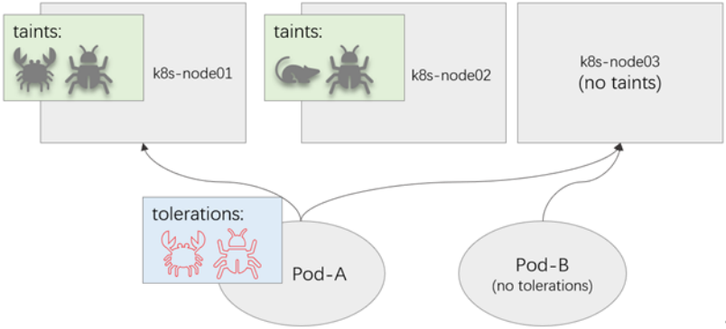

**作用来源**

我们可以使用PodToleratesNodeTaints预选策略和TaintTolerationPriority优选函数完成该机制。

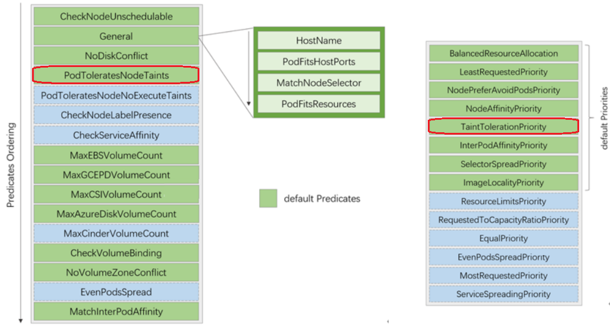

**内置的污点功能**

Kubernetes自1.6起支持使用污点自动标识问题节点，它通过节点控制器在特定条件下自动为节点添加污点信息实现。它们都使用NoExecute效用标识，因此非能容忍此类污点的现在Pod对象也会遭到驱逐。节点状态相关的某种条件为真时，节点控制器会自动给节点添加一个污点。

目前，内建使用的此类污点有如下几个。

node.kubernetes.io/not-ready：节点进入NotReady状态时被自动添加的污点。node.alpha.kubernetes.io/unreachable：节点进入NotReachable状态时被自动添加的污点。node.kubernetes.io/out-of-disk：节点进入OutOfDisk状态时被自动添加的污点。node.kubernetes.io/memory-pressure：节点内存资源面临压力。node.kubernetes.io/disk-pressure：节点磁盘资源面临压力node.kubernetes.io/pid-pressure：节点PID资源紧张node.kubernetes.io/network-unavailable：节点网络不可用node.kubernetes.io/unschedulable：节点不可用于调度node.cloudprovider.kubernetes.io/uninitialized：kubelet由外部的云环境程序启动时，它自动为节点添加此污点，待到云控制器管理器中的控制器初始化此节点时再将其删除。

不过，Kubernetes的核心组件通常都要容忍此类的污点，以确保其相应的DaemonSet控制器能够无视此类污点于节点上部署相应的关键Pod对象，例如kube-proxy或kube-flannel等。

### 2.3.2 属性解析

#### 2.3.2.1 Taint 污点属性

Taint是节点上的属性，Taints如下定义。
```text
kubectl explain node.spec.taints（对象列表）
key     #定义一个key=value:effect
value   #定义一个值，这是一个可选项
effect  #pod不能容忍这个污点时，有三个行为值：NoSchedule、PreferNoSchedule、
NoExecute
timeAdded  #记录污点被添加的具体时间,此属性仅与NoExecute类型的污点相关,在使用kubectl
taint命令添加或删除污点时，Kubernetes会自动处理TimeAdded属性的更新或移除,此字段由系统自动添
加，无需人为管理
```

污点处理方式effect的属性值(优先级从低到高)

**属性解析**

处于在调度优选阶段，属于柔性约束，即调度器尽量确保不会将那些不能容忍此污点的Pod对象调度至当前节点，除非不存在其他任何能够容忍此污。

PreferNoSchedule

点的节点可用；添加该类效用的污点同样对节点上现存的Pod对象不产生影响。处于在调度预选阶段，不能容忍此污点的新Pod对象，不可以调度至当前节。

NoSchedule

点，属于强制型约束关系，但新添加的污点对节点上现存的Pod对象不产生影响。不能容忍此污点的新Pod对象不可调度至当前节点，属于强制型约束关系节点上现存的Pod因节点污点变动或Pod容忍度变动而不再满足匹配条件时，Pod对象将可能会被驱逐可能会对节点上已有的业务Pod产生如下影响。

NoExecute

1)不能容忍该污点的Pod将立即被驱逐2)若Pod能够容忍该污点，且Pod的容忍度上未定义tolerationSeconds，则Pod可以一直运行于该节点3)若Pod能够容忍该污点，且Pod的容忍度上定义了tolerationSeconds，则Pod运行指定的时长后即会被驱逐

范例:  查看属性
```bash
#查看节点上的污点
#所有master节点默认都有污点
[root@master1 ~]#kubectl describe  node master1.bowen.org |grep Taint
Taints:             node-role.kubernetes.io/control-plane:NoSchedule

#所有worker节点默认都没有污点
[root@master1 ~]#kubectl describe  node node1.bowen.org |grep Taint
Taints:             <none>

[root@master1 ~]#kubectl get node master1.bowen.org -o yaml
...
taints:   #污点
- effect: NoSchedule      #效用标识
key: node-role.kubernetes.io/master
...

#查看Pod上的污点容忍度
[root@master1 ~]#kubectl describe pod myapp-7dbd45d496-7jb76 | grep -A3
Tolerations:
Tolerations:                 node.kubernetes.io/not-ready:NoExecute op=Exists
for 300s

node.kubernetes.io/unreachable:NoExecute op=Exists
for 300s
Events:                      <none>

[root@master1 ~]# kubectl describe pod kube-apiserver-master -n kube-system
...
Tolerations:       :NoExecute

[root@master1 ~]#kubectl describe pod kube-proxy -n kube-system
...
Node-Selectors:              kubernetes.io/os=linux
Tolerations:                 op=Exists              #污点容忍度
node.kubernetes.io/disk-pressure:NoSchedule
op=Exists
node.kubernetes.io/memory-pressure:NoSchedule
op=Exists
node.kubernetes.io/network-unavailable:NoSchedule
op=Exists
node.kubernetes.io/not-ready:NoExecute op=Exists
node.kubernetes.io/pid-pressure:NoSchedule
op=Exists
node.kubernetes.io/unreachable:NoExecute op=Exists
node.kubernetes.io/unschedulable:NoSchedule
op=Exists
```

#### 2.3.2.2 Tolerations 容忍度属性

Tolerations 是Pod上的属性，Tolerations如下定义。
```text
kubectl explain pod.spec.tolerations
key             #被容忍的key
value           #被容忍key的值,当operator为exists时,此value无需定义
operator      #Equal（等值比较）表示key对应的value值以及effect三者必须要和tains的值
相同才能容忍,此为默认值
#Exists 表示只要存在key和effect二者相同，但不关注value就可容忍,必须不能定义
value, 即可以调度Pod,如果没有定义key和effect,表示容忍所有污点
effect              #可以容忍的节点的行为值,必须和Traint中的effect值相同或高于才能容
忍
tolerationSeconds   #被驱逐的宽限时间，默认是0就是立即被驱逐
```

容忍度的判断方式

在Pod对象上定义容忍度时，它支持两种操作符。一种是等值比较Equal，表示容忍度与污点必须在key、value和effect三者之上完全匹配,此为默认值一种是存在性判断Exists，表示key和effect 二者必须完全匹配，而容忍度tolerations中的value字段无需定义。

**特殊情形**

operator为Exists，且容忍度的key为空，表示其可以容忍任意污点若effect为空，则可以匹配所有键名相同的污点。

容忍度的匹配原则

一个节点可以配置使用多个污点，而一个Pod对象也可以有多个容忍度。Kubernetes 处理多个污点和容忍度的过程就像一个过滤器：从一个节点的所有污点开始遍历， 过滤掉那些 Pod 中存在与之相匹配的容忍度的污点。余下未被过滤的污点的 effect 值决定了 Pod 是否会被分配到该节点。一个节点上如果有多个污点Taint,对每个Taint 都需要容忍才能部署Pod。将一个Pod对象的容忍度套用到特定节点的污点之上进行匹配度检测时，将遵循如下逻辑。

遍历该节点的所有污点，并过滤掉容忍度可匹配到的污点。余下未被过滤掉的污点，则由污点的effect来判定其满足状态。

对于剩余的不能匹配到容忍度的所有污点中，若存在至少一个污点使用了NoSchedule效用标识，则拒绝调度当前Pod至该节点对于不能匹配到容忍度的所有污点，若都不具有NoSchedule效用标识，但至少有一个污点使用了PreferNoScheduler效用标准，则调度器会尽量避免将当前Pod对象调度至该节点如果至少有一个不能匹配容忍度的污点使用了NoExecute效用标识，节点将立即驱逐当前Pod对象，或者不允许该Pod调度至给定的节点；而且，即便容忍度可以匹配到使用了NoExecute效用标识的污点，若在Pod上定义容忍度时同时使用tolerationSeconds属性定义了容忍时限，则在超出时限后当前Pod也将会被节点所驱逐。

### 2.3.3 污点管理命令

**命令格式**
```bash
#查看污点：
kubectl get nodes <nodename> -o go-template={{.spec.taints}}
kubectl describe nodes | grep -i taint

#添加污点：
#指定节点添加污点
kubectl taint node <node-name> <key>=<value>:<effect> ...
#所有节点添加污点
kubectl taint node --all <key>=<value>:<effect> ...

#删除污点：
kubectl taint node <node-name> <key>[:<effect>]-
kubectl patch nodes <node-name> -p '{"spec":{"taints":[]}}'

#cordon封锁节点,即添加污点node.kubernetes.io/unschedulable:NoSchedule,只影响新Pod
kubectl cordon <node-name>

#删除污点node.kubernetes.io/unschedulable:NoSchedule
kubectl uncordon <node-name>

#强制驱逐节点上Pod
#方法1: drain 排空节点上面的 Pod,同时添加污点
node.kubernetes.io/unschedulable:NoSchedule
#注意:要删除node.kubernetes.io/unschedulable:NoSchedule污点,需要执行kubectl uncordon
<node-name>
#--ignore-daemonsets 默认kubectl drain删除daemonset资源会报错,加此项可以忽略错误提示
kubectl drain <nodename> --ignore-daemonsets --delete-emptydir-data --force

#取消强制驱逐节点上Pod
kubectl uncordon <node-name>

#方法2:使用污点NoExecute实现
kubectl taint nodes node3.bowen.org name=bowen:NoExecute
```

### 2.3.4 污点和容忍度案例

范例: 查看节点的污点和DaemonSet类型系统组件calico,kube-proxy的容忍度
```bash
#查看节点默认的污点
[root@master1 ~]#kubectl describe nodes | grep -Ei 'taint|^Name'
Name:               master1.bowen.org
Taints:             node-role.kubernetes.io/control-plane:NoSchedule
Name:               master2.bowen.org
Taints:             node-role.kubernetes.io/control-plane:NoSchedule
Name:               master3.bowen.org
Taints:             node-role.kubernetes.io/control-plane:NoSchedule
Name:               node1.bowen.org
Taints:             <none>
Name:               node2.bowen.org
Taints:             <none>
Name:               node3.bowen.org
Taints:             <none>

[root@master1 ~]#kubectl get ds -n kube-system kube-proxy -o yaml|grep -A3
tolerations:
tolerations:
- operator: Exists  #没有定义key和value表示容忍所有污点
volumes:
- configMap:
```

范例: cordon添加污点
```bash
[root@master1 ~]#kubectl describe nodes | grep -Ei 'taint|^Name'
Name:               master1.bowen.org
Taints:             node-role.kubernetes.io/control-plane:NoSchedule
Name:               master2.bowen.org
Taints:             node-role.kubernetes.io/control-plane:NoSchedule
Name:               master3.bowen.org
Taints:             node-role.kubernetes.io/control-plane:NoSchedule
Name:               node1.bowen.org
Taints:             <none>
Name:               node2.bowen.org
Taints:             <none>
Name:               node3.bowen.org
Taints:             <none>

#添加污点
[root@master1 ~]#kubectl cordon node3.bowen.org
node/node3.bowen.org cordoned

[root@master1 ~]#kubectl get nodes
NAME               STATUS                     ROLES           AGE   VERSION
master1.bowen.org   Ready                      control-plane   9d    v1.22.3
master2.bowen.org   Ready                      control-plane   9d    v1.22.3
master3.bowen.org   Ready                      control-plane   9d    v1.22.3
node1.bowen.org     Ready                      <none>          9d    v1.22.3
node2.bowen.org     Ready                      <none>          9d    v1.22.3
node3.bowen.org     Ready,SchedulingDisabled   <none>          9d    v1.22.3

[root@master1 ~]#kubectl describe nodes | grep -Ei 'taint|^Name'
Name:               master1.bowen.org
Taints:             node-role.kubernetes.io/control-plane:NoSchedule
Name:               master2.bowen.org
Taints:             node-role.kubernetes.io/control-plane:NoSchedule
Name:               master3.bowen.org
Taints:             node-role.kubernetes.io/control-plane:NoSchedule
Name:               node1.bowen.org
Taints:             <none>
Name:               node2.bowen.org
Taints:             <none>
Name:               node3.bowen.org
Taints:             node.kubernetes.io/unschedulable:NoSchedule

#取消污点
[root@master1 ~]#kubectl uncordon master3.bowen.org
node/master3.bowen.org already uncordoned

[root@master1 ~]#kubectl describe nodes | grep -Ei 'taint|^Name'
Name:               master1.bowen.org
Taints:             node-role.kubernetes.io/control-plane:NoSchedule
Name:               master2.bowen.org
Taints:             node-role.kubernetes.io/control-plane:NoSchedule
Name:               master3.bowen.org
Taints:             node-role.kubernetes.io/control-plane:NoSchedule
Name:               node1.bowen.org
Taints:             <none>
Name:               node2.bowen.org
Taints:             <none>
Name:               node3.bowen.org
Taints:             node.kubernetes.io/unschedulable:NoSchedule
```

范例：
```bash
[root@master1 ~]#kubectl get nodes master1.bowen.org -o yaml |grep -i -A3 taints
taints:
- effect: NoSchedule
key: node-role.kubernetes.io/control-plane
status:

[root@master1 ~]#kubectl get ds -n kube-system  calico-node -o yaml | grep -A 10
tolerations
tolerations:
- effect: NoSchedule
operator: Exists
- key: CriticalAddonsOnly
operator: Exists
- effect: NoExecute
operator: Exists
volumes:
- hostPath:

[root@master1 ~]#kubectl get ds -n kube-system kube-proxy -o yaml |grep -A 5
tolerations
tolerations:
- operator: Exists
```

范例: 污点
```yaml
#查看污点,默认所有Master节点都有污点,所以不会被调度运行Pod
[root@master1 ~]#kubectl describe nodes | grep -i taint
Taints:             node-role.kubernetes.io/master:NoSchedule
Taints:             node-role.kubernetes.io/master:NoSchedule
Taints:             node-role.kubernetes.io/master:NoSchedule
Taints:             <none>
Taints:             <none>
Taints:             <none>

[root@master1 ~]#kubectl get nodes master1.bowen.org -o go-template=
{{.spec.taints}}
[map[effect:NoSchedule key:node-role.kubernetes.io/master]]

#添加污点
[root@master1 ~]#kubectl taint node node1.bowen.org node-
type=production:NoSchedule
node/node1.bowen.org tainted

#查看污点
[root@master1 ~]#kubectl  describe  nodes |grep -i taint
Taints:             node-role.kubernetes.io/master:NoSchedule
Taints:             node-role.kubernetes.io/master:NoSchedule
Taints:             node-role.kubernetes.io/master:NoSchedule
Taints:             node-type=production:NoSchedule
Taints:             <none>
Taints:             <none>

#查看污点
[root@master1 ~]#kubectl get nodes node1.bowen.org -o go-template=
{{.spec.taints}}
[map[effect:NoSchedule key:node-type value:production]]

[root@master1 ~]#kubectl describe node node1.bowen.org |grep Taints
Taints:             node-type=production:NoSchedule

[root@master1 ~]#kubectl get node node1.bowen.org -o yaml |grep -A3 taints
taints:
- effect: NoSchedule
key: node-type
value: production

#给node1增加标签
[root@master1 ~]#kubectl label node node1.bowen.org env=dev

#增加新资源
[root@master1 ~]#cat  scheduler-pod-taint-test.yaml
apiVersion: v1
kind: Pod
metadata:
name: pod-test
spec:
containers:

- name: pod-test
image: registry.cn-beijing.aliyuncs.com/bowen/pod-test:v0.1
imagePullPolicy: IfNotPresent
nodeSelector:
env: dev

#应用资源配置文件
[root@master1 ~]#kubectl apply -f scheduler-pod-taint-test.yaml

#查看效果
[root@master1 ~]#kubectl get pod
NAME       READY   STATUS    RESTARTS   AGE
pod-test   0/1     Pending   0          3s

#结果显示：由于污点原因，无法将pod创建到指定节点上
[root@master1 ~]#kubectl describe pod pod-test
Name:         pod-test
.......
Events:
Type     Reason            Age   From               Message
----     ------            ----  ----               -------
Warning  FailedScheduling  10s   default-scheduler  0/6 nodes are available: 1
node(s) had taint {node-type: production}, that the pod didn't tolerate, 2
node(s) didn't match Pod's node affinity/selector, 3 node(s) had taint {node-
role.kubernetes.io/master: }, that the pod didn't tolerate.

#删除key为node-type，effect为NoSchedule的污点
#方法一：
[root@master1 ~]#kubectl taint node node1.bowen.org node-type-
#方法二：
[root@master1 ~]#kubectl patch nodes node1.bowen.org -p '{"spec":{"taints":[]}}'

#确认污点清除
[root@master1 ~]#kubectl  describe  nodes |grep -i taint
Taints:             node-role.kubernetes.io/master:NoSchedule
Taints:             node-role.kubernetes.io/master:NoSchedule
Taints:             node-role.kubernetes.io/master:NoSchedule
Taints:             <none>
Taints:             <none>
Taints:             <none>

#查看效果
[root@master1 ~]#kubectl  get pod -o wide
NAME       READY   STATUS    RESTARTS   AGE    IP            NODE
NOMINATED NODE   READINESS GATES
pod-test   1/1     Running   0          4m5s   10.244.3.44   node1.bowen.org
<none>           <none>
#结果显示：node1上立刻就有pod正常运行了

#清理环境
[root@master1 ~]#kubectl delete  pod pod-test
```

范例：所有节点添加污点
```bash
[root@master1 ~]#kubectl  taint node --all name=bowen:NoSchedule
node/master1.bowen.org tainted
node/node1.bowen.org tainted

node/node2.bowen.org tainted
node/node3.bowen.org tainted

[root@master1 ~]#kubectl  get nodes -o yaml|grep -A 3 taints
taints:
- effect: NoSchedule
key: name
value: bowen
--
taints:
- effect: NoSchedule
key: name
value: bowen
--
taints:
- effect: NoSchedule
key: name
value: bowen
--
taints:
- effect: NoSchedule
key: name
value: bowen

#删除所有节点的污点
[root@master1 ~]#kubectl  taint nodes --all name-
node/master1.bowen.org untainted
node/node1.bowen.org untainted
node/node2.bowen.org untainted
node/node3.bowen.org untainted

[root@master1 ~]#kubectl  get nodes -o yaml|grep -A 3 taints
taints:
- effect: NoSchedule
key: node-role.kubernetes.io/control-plane
status:
```

范例: 污点容忍度
```yaml
#为node1添加污点
[root@master1 ~]#kubectl taint node node1.bowen.org node-
type=production:NoSchedule

#查看效果
[root@master1 ~]#kubectl  describe  nodes node1.bowen.org |grep -i taint
Taints:             node-type=production:NoSchedule

[root@master1 ~]#kubectl get node node1.bowen.org -o yaml |grep -A3 -i taint
taints:
- effect: NoSchedule
key: node-type
value: production

#创建资源定义文件
[root@master1 ~]#cat  scheduler-pod-toleration-test.yaml
apiVersion: v1
kind: Pod

metadata:
name: pod-tol
spec:
containers:
- name: pod-test
image: registry.cn-beijing.aliyuncs.com/bowen/pod-test:v0.1
imagePullPolicy: IfNotPresent
nodeSelector:
env: dev
tolerations:
- key: "node-type"       #添加下面四行指定容忍度属性,如果没有容忍度配置,是不会调度新的
Pod至此节点的
value: "production"
effect: "NoSchedule"
operator: "Equal"

#应用资源定义文件
[root@master1 ~]#kubectl apply -f scheduler-pod-toleration-test.yaml

#查看效果
[root@master1 ~]# kubectl get pod -o wide
NAME      READY   STATUS    RESTARTS   AGE   IP           NODE
NOMINATED NODE
pod-tol   1/1     Running   0          20s   10.244.3.45  node1.bowen.org
<none>

#结果显示：pod的容忍度实现了污点的节点的调度

#清理环境
[root@master1 ~]#kubectl delete -f scheduler-pod-toleration-test.yaml
```

范例: 容忍所有污点
```yaml
[root@master1 ~]#cat scheduler-pod-tolerations-daemonset.yaml
apiVersion: apps/v1
kind: DaemonSet     #默认只能部署到没有污点的每个节点上，Master节点有污点，Daemonset默认无
法部署
metadata:
labels:
app: myapp
name: myapp
spec:
selector:
matchLabels:
app: myapp
template:
metadata:
labels:
app: myapp
spec:
containers:
- image: registry.cn-beijing.aliyuncs.com/bowen/myapp:v1.0
name: myapp
tolerations:
- operator: Exists    #方法1：Exists并且没有key和value,可以容忍所有污点，可以支持
能部署到包括有污点的每个节点上

#- effect: NoSchedule #方法2：容忍所有污点，但需要指定两种effect
#  operator: Exists
#- effect: NoExecute
#  operator: Exists
[root@master1 ~]#kubectl apply -f scheduler-pod-tolerations-daemonset.yaml

#检查结果发现也会部署到Master节点
[root@master1 ~]#kubectl  get pod -o wide
NAME          READY   STATUS    RESTARTS   AGE   IP            NODE
NOMINATED NODE   READINESS GATES
myapp-2l4ds   1/1     Running   0          26s   10.244.1.31   node1.bowen.org
<none>           <none>
myapp-7t6j6   1/1     Running   0          26s   10.244.2.56   node2.bowen.org
<none>           <none>
myapp-m9dfs   1/1     Running   0          26s   10.244.3.30   node3.bowen.org
<none>           <none>
myapp-w8zwn   1/1     Running   0          26s   10.244.0.2    master1.bowen.org
<none>           <none>
```

范例: 部署node-exporter到所有节点上，包括有污点的Master节点
```yaml
[root@master1 ~]#cat node-exporter-ds.yaml
apiVersion: apps/v1
kind: DaemonSet
metadata:
name: prometheus-node-exporter
namespace: prom
labels:
app: prometheus
component: node-exporter
spec:
selector:
matchLabels:
app: prometheus
component: node-exporter
template:
metadata:
name: prometheus-node-exporter
labels:
app: prometheus
component: node-exporter
spec:
tolerations:
- operator: Exists          #Exists并没有key和valu表示可以容忍所有污点
#- effect: NoSchedule
#  key: node-role.kubernetes.io/control-plane
containers:
- image: prom/node-exporter:v1.5.0
name: prometheus-node-exporter
ports:
- name: prom-node-exp
containerPort: 9100
hostPort: 9100
hostNetwork: true
hostPID: true
```

范例：立即驱逐Pod
```bash
#立即驱逐node3节点的Pod
[root@master1 ~]#kubectl drain node3.bowen.org --ignore-daemonsets --delete-
emptydir-data --force
node/node3.bowen.org cordoned
Warning: ignoring DaemonSet-managed Pods: kube-system/calico-node-nrprs, kube-
system/kube-proxy-jswx7
evicting pod default/myapp-6b59f8f86-sbwd8
pod/myapp-6b59f8f86-sbwd8 evicted
node/node3.bowen.org drained

#除daemonsets对应的Pod都被驱逐
[root@master1 ~]#kubectl  get pod -A -o wide |grep node3
kube-system calico-node-nrprs   1/1  Running 5 (3h6m ago) 6d14h   10.0.0.203
node3.bowen.org  <none>  <none>
kube-system kube-proxy-jswx7   1/1   Running   6 (3h6m ago)  13d  10.0.0.203
node3.bowen.org  <none>  <none>

#Node3节点自动添加相应的污点
[root@master1 ~]#kubectl  get nodes node3.bowen.org
NAME             STATUS                     ROLES    AGE   VERSION
node3.bowen.org   Ready,SchedulingDisabled   <none>   13d   v1.22.3

#查看添加污点信息
[root@master1 ~]#kubectl  describe nodes node3.bowen.org  |grep -A1 Taints
Taints:             node.kubernetes.io/unschedulable:NoSchedule
Unschedulable:      true

#对比其它没有驱逐的节点的污点信息
[root@master1 ~]#kubectl  describe nodes node1.bowen.org  |grep -A1 Taints
Taints:             <none>
Unschedulable:      false

#取消污点
[root@master1 ~]#kubectl  uncordon node3.bowen.org
node/node3.bowen.org uncordoned

[root@master1 ~]#kubectl  describe nodes node3.bowen.org  |grep -A1 Taints
Taints:             <none>
Unschedulable:      false

[root@master1 ~]#kubectl get nodes node3.bowen.org
NAME             STATUS   ROLES    AGE   VERSION
node3.bowen.org   Ready    <none>   13d   v1.22.3
```

范例: 使用容忍度驱离方法立即驱逐Pod
```bash
#为node1添加驱离NoExecute污点
[root@master1 ~]#kubectl taint node node1.bowen.org diskfull=true:NoExecute

#注意：一旦打上这个标签，当前节点上的所有pod都会被驱离
#diskfull=true 这个key/value不重要,可以是任意值,起作用的是NoExecute

#查看效果
[root@master1 ~]#kubectl get pod -w
#结果显示:当前节点上的容器，自动就被移除了

#清理环境
[root@master1 ~]#kubectl taint node node1.bowen.org node-type-
[root@master1 ~]#kubectl taint node node1.bowen.org diskfull-
```

范例: node 缩容
```bash
#获取节点列表
kubectl get node

#设置不可调度
kubectl cordon <node_name>

#驱逐节点上的pod
kubectl drain <node_name> --ignore-daemonsets

#移除节点
kubectl delete node <node_name>
```

## 2.4 拓扑调度

### 2.4.1 Pod 拓扑分布约束说明
```text
https://kubernetes.io/zh-cn/docs/concepts/scheduling-eviction/topology-spread-
constraints/
```

拓扑分布约束可以控制Pod的调度实现平均分布的程度。在定义pod亲和性和反亲和时，有一个 topologyKey的属性，但是默认情况下，pod的亲和性调度，仅仅针对单一的拓扑场景，也就是说，要么所有的pod都在这里，要么所有的pod都不要在这里，这样会导致应用过于集中，反而导致物理资源的浪费。如果希望在进行正常pod亲和性调度的时候，能够自动识别多个不同的调度节点，然后均匀的分散到多个节点中，从而实现资源的有效利用。通过拓扑调度来实现的功能。

注意：此功能 k8s 1.19版本才支持，v1.18 之前版本要用 Pod 拓扑扩展，需要在 API 服务器 和调度器中启用 EvenPodsSpread 特性。

敏置偏差Skew

偏差Skew 是当前每一个拓扑域Pod数量和Pod数量最少的拓扑域之间的Pod数量的差值。

公式：当前i拓扑域 skew[i] = 拓扑域[i]中匹配的 Pod 个数 - min{拓扑域[*]中匹配的 Pod 个数}

当前第i拓扑域 的skew[i] 值不能大于最大偏差maxSkew。

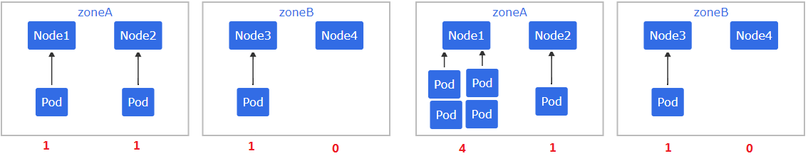

Pod分布约束中允许的最大偏差maxSkew及妥协策略

Pod分散约束策略基于允许的最大偏差(maxSkew)来定义Pod在拓扑域中的分散逻辑。当无法满足最大偏差约束时，whenUnsatisfable则用于定义妥协策略。

DoNotSchedule(默认)：不予调度，Pod将处于Pending状态，即硬限制ScheduleAnyway：根据每个节点的skew值打分排序后进行调度，即软限制。

示例:  maxSkew=1 ,新创建的Pod放在哪个zone

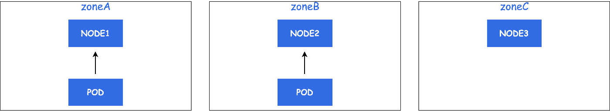

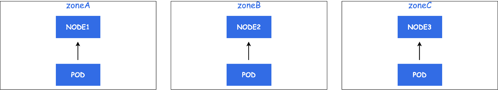

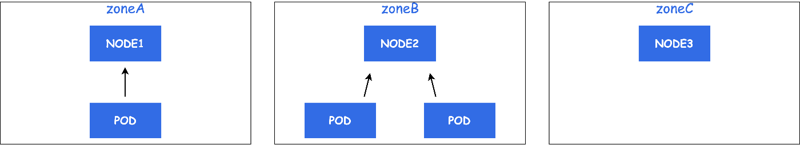

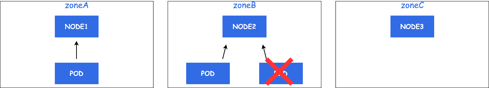

**属性解析**
```text
kubectl explain pod.spec.topologySpreadConstraints
labelSelector        #根据 LabelSelector来计算出匹配的pod的数量
maxSkew              #描述了 pod 可能不均匀分布的程度，不同拓扑域之间的各节点pod数量比
例的最大限制
topologyKey          #用于指定带有此标签的值相同的节点在同一拓扑中。
whenUnsatisfiable    #指示如果 Pod 不满足扩展约束，如何处理它。默认值是DoNotSchedule

#maxSkew 默认值是1，即各个不同的拓扑中的Pod总数量之差最大不能超过1，如果这个值越大，则pod的分
布可能会是不均匀的。
```

**案例分析**

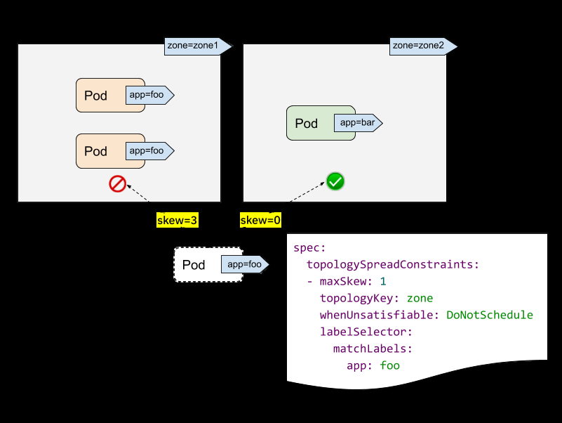

labelSelector 用于查找匹配的 Pod。对于每个拓扑，我们计算 与此标签选择器匹配的 Pod 数量。在上面的例子中，给定 labelSelector为“app： foo”，“zone1”中的匹配数字为2;而 “Zone2”中的数字为 0。topologyKey 是在节点标签中定义拓扑的键。如果两个 Node 的 label 同时具有该 key 并且 label值相同，就说它们在同一个拓扑域。在上图中，指定 topologyKey 为 zone， 具有 "zone=zone1"标签的 Node 被分在一个拓扑域，具有 "zone=zone2"  标签的 Node 被分在另一个拓扑域。

maxSkew 描述了 Pod 在不同拓扑域中Skew不均匀分布的最大程度，maxSkew 的取值必须大于0。每个拓扑域都有一个 skew，计算的公式是：skew[i] = 拓扑域[i]中匹配的 Pod 个数 - min{拓扑域[*]中匹配的 Pod 个数}。skew 不能大于maxSkew ，在上图中，我们新建一个带有 "app=foo"label 的 Pod：

如果将传入的 Pod 放在 “zone1”，则 “zone1” 上的偏斜 skew 值将变为 3 （ 在“zone1”中匹配的 Pod为3个;在“zone2”上匹配的全局最小值为 0 个 Pod），违反了“maxSkew： 1”约束。如果将传入的 Pod 放置在 “zone2”，则 “zone1“ 中 的 skew 值变为 1， “zone2” 上的偏斜skew 值为 0 (zone2 有 1 个匹配的 Pod，拥有全局最小匹配 Pod 数的拓扑域正是 zone2 自己), 则满足“maxSkew： 1”约束。

### 2.4.2 案例

范例: 均匀分散到多个节点中
```yaml
#准备工作,为所有节点添加标识
[root@master1 ~]#kubectl label node node1.bowen.org node=node1 zone=zoneA
[root@master1 ~]#kubectl label node node2.bowen.org node=node2 zone=zoneB
[root@master1 ~]#kubectl label node node3.bowen.org node=node3 zone=zoneA

#定制资源配置文件
[root@master1 ~]#cat  scheduler-pod-topology-test.yaml
apiVersion: apps/v1
kind: Deployment

metadata:
name: pod-affinity-preferred
spec:
replicas: 10
selector:
matchLabels:
foo: bar
template:
metadata:
labels:
foo: bar
spec:
tolerations:
- operator: Exists #包括所有有污点的节点
containers:
- name: pod-test
image: registry.cn-beijing.aliyuncs.com/bowen/pod-test:v0.1
imagePullPolicy: IfNotPresent
topologySpreadConstraints:
- maxSkew: 2
#topologyKey: kubernetes.io/hostname
topologyKey: zone
whenUnsatisfiable: DoNotSchedule
labelSelector:
matchLabels:
foo: bar

#应用资源配置文件
[root@master1 ~]#kubectl apply  -f scheduler-pod-topology-test.yaml

#检查效果
[root@master1 ~]#kubectl get pod -o wide
NAME                                      READY   STATUS    RESTARTS   AGE   IP
NODE               NOMINATED NODE   READINESS GATES
pod-affinity-preferred-75c85df4d9-8fqjg   1/1     Running   0          4s
10.244.4.50   node2.bowen.org   <none>           <none>
pod-affinity-preferred-75c85df4d9-bqbjq   1/1     Running   0          4s
10.244.5.37   node3.bowen.org   <none>           <none>
pod-affinity-preferred-75c85df4d9-d2wdz   1/1     Running   0          4s
10.244.3.60   node1.bowen.org   <none>           <none>
pod-affinity-preferred-75c85df4d9-ghgt6   1/1     Running   0          4s
10.244.4.47   node2.bowen.org   <none>           <none>
pod-affinity-preferred-75c85df4d9-k4c6x   1/1     Running   0          4s
10.244.3.61   node1.bowen.org   <none>           <none>
pod-affinity-preferred-75c85df4d9-lf8w4   1/1     Running   0          4s
10.244.4.48   node2.bowen.org   <none>           <none>
pod-affinity-preferred-75c85df4d9-mv28r   1/1     Running   0          4s
10.244.4.49   node2.bowen.org   <none>           <none>
pod-affinity-preferred-75c85df4d9-p5g2h   1/1     Running   0          4s
10.244.3.62   node1.bowen.org   <none>           <none>
pod-affinity-preferred-75c85df4d9-r969x   1/1     Running   0          4s
10.244.5.36   node3.bowen.org   <none>           <none>
pod-affinity-preferred-75c85df4d9-xrl7f   1/1     Running   0          4s
10.244.3.59   node1.bowen.org   <none>           <none>
[root@master1 ~]#kubectl get pod -o wide |grep -E "node[13]" |wc -l
6
[root@master1 ~]#kubectl get pod -o wide |grep -E "node1" |wc -l
4

[root@master1 ~]#kubectl get pod -o wide |grep -E "node2" |wc -l
4
[root@master1 ~]#kubectl get pod -o wide |grep -E "node3" |wc -l
2
#结果显示：Zone间是 zoneA=6, zoneB=4,各个Zone的Pod数量之差=6-4=2<=2 符合要求

#清理环境
[root@master1 ~]#kubectl delete -f scheduler-pod-topology-test.yaml
[root@master1 ~]#kubectl label node node1.bowen.org node- zone-
[root@master1 ~]#kubectl label node node2.bowen.org node- zone-
[root@master1 ~]#kubectl label node node3.bowen.org node- zone-
```

## 2.5 优先级调度

集群资源不够用时候怎么办?

先到先得策略(FIFO):简单、相对公平、上手快优先级策略(Priority): 符合日常公司业务特点, 优先级值越大,优先级越高。

**PodPriority和Preemption**

v1.14-stable PodPriority 和  Preemption 默认开启 ON

优先级调度过程(发生在Pending Pod出队列开始调度):

Pod2(低优先级)和Pod1(高优先级)先后进入调度队列，但均未被调度当进行一轮调度时，PriorityQueue会优先将优先级更大的Pod1弹出队列进行调度调度成功后，对此Pod1进行Bind，并开始下一轮调度Pod2。

优先级抢占过程(发生在调度失败):

Pod2先进行调度，调度成功后分配至Node1上运行之后Pod1再进行调度，由于Node1资源不足出现了调度失败，此时进入抢占流程在经过抢占算法计算后，选中了Pod2作为Pod1的承让者驱逐了Node1上运行的Pod2，并将Pod1调度至Node1。

**配置流程**：创建PriorityClass并指定value, value越大优先越高为各个Pod配置上不同的priorityClassName。

一些内置优先级

内置默认优先级

DefaultPriorityWhenNoDefaultClassExists=0

用户可配置的最大优先级限制

源码定义

HighestUserDefinablePriority= 1000000000

系统级别优先级

SystemCriticalPriority=2000000000

Kubernetes 的优先级值范围是 0 到 10^9 - 1（即 999,999,999），而 2000000000 超出了这个常规范围这是一个硬编码的特殊值，专门用于系统最核心的组件（如 kubelet、API Server 等）,确保系统关键组件的 Pod 不会被 Kubernetes 的调度机制（如资源压力下的驱逐）优先终止,即使在集群资源极度紧张时，也能最大限度保证系统基础功能的可用性。

内置系统级别优先级

system-cluster-critical 2000000000

system-node-critical    2000001000

这是两个公共的优先级类，主要用来确保 Kubernetes 系统的关键组件或者关键插件总是能够优先被调度，比如 coredns 等。


// HighestUserDefinablePriority is the highest priority for user defined priority classes. Priority values larger than 1 billion are reserved for Kubernetes system use. HighestUserDefinablePriority = int32(1000000000)// SystemCriticalPriority is the beginning of the range of priority values for critical system components. SystemCriticalPriority = 2 * HighestUserDefinablePriority


范例: 查看优先级类
```bash
#默认的最高级的优先级类
[root@master1 ~]#kubectl get priorityclasses.scheduling.k8s.io
NAME                      VALUE        GLOBAL-DEFAULT   AGE
system-cluster-critical   2000000000   false            161d
system-node-critical      2000001000   false            161d

#抢占策略
[root@master1 ~]#kubectl explain pod.spec.preemptionPolicy
KIND:       Pod
VERSION:    v1
```


FIELD: preemptionPolicy <string>ENUM: Never                 #表示 Pod 永远不会抢占优先级较低的其他 Pod。PreemptLowerPriority  #允许抢占低优先级的其它Pod，默认值

```text
DESCRIPTION:
PreemptionPolicy is the Policy for preempting pods with lower priority. One
of Never, PreemptLowerPriority. Defaults to PreemptLowerPriority if unset.
```


Possible enum values:- `"Never"` means that pod never preempts other pods with lower priority.- `"PreemptLowerPriority"` means that pod can preempt other pods with lower priority.

```bash
#自定义优先级类
[root@master1 ~]#kubectl explain PriorityClass
GROUP:      scheduling.k8s.io
KIND:       PriorityClass
VERSION:    v1

DESCRIPTION:
PriorityClass defines mapping from a priority class name to the priority
integer value. The value can be any valid integer.

FIELDS:
apiVersion    <string>
APIVersion defines the versioned schema of this representation of an object.
```


Servers should convert recognized schemas to the latest internal value, and may reject unrecognized values. More info:

<https://git.k8s.io/community/contributors/devel/sig-architecture/api->

conventions.md#resources

```text
description   <string>
description is an arbitrary string that usually provides guidelines on when
this priority class should be used.
```


globalDefault <boolean>globalDefault specifies whether this PriorityClass should be considered as the default priority for pods that do not have any priority class. Only one PriorityClass can be marked as `globalDefault`. However, if more than one PriorityClasses exists with their `globalDefault` field set to true, the smallest value of such global default PriorityClasses will be used as the default priority.


kind  <string>Kind is a string value representing the REST resource this object represents. Servers may infer this from the endpoint the client submits requests to. Cannot be updated. In CamelCase. More info:

<https://git.k8s.io/community/contributors/devel/sig-architecture/api->

conventions.md#types-kinds

```text
metadata  <ObjectMeta>
Standard object's metadata. More info:
https://git.k8s.io/community/contributors/devel/sig-architecture/api-
conventions.md#metadata

preemptionPolicy  <string>
enum: Never, PreemptLowerPriority
preemptionPolicy is the Policy for preempting pods with lower priority. One
of Never, PreemptLowerPriority. Defaults to PreemptLowerPriority if unset.
```


Possible enum values:- `"Never"` means that pod never preempts other pods with lower priority.- `"PreemptLowerPriority"` means that pod can preempt other pods with lower priority.


value <integer> -required-value represents the integer value of this priority class. This is the actual priority that pods receive when they have the name of this class in their pod spec.

```bash
#Pod支持设置优先级类
[root@master1 ~]#kubectl explain pod.spec
........
priority <integer>  #此值根据下面的priorityClassName自动生成,需非手动指定,值越的优先
级越高
The priority value. Various system components use this field to find the
priority of the pod. When Priority Admission Controller is enabled, it
prevents users from setting this field. The admission controller populates
this field from PriorityClassName. The higher the value, the higher the
priority.

priorityClassName    <string>
If specified, indicates the pod's priority. "system-node-critical" and
"system-cluster-critical" are two special keywords which indicate the
```


highest priorities with the former being the highest priority. Any other name must be defined by creating a PriorityClass object with that name. If not specified, the pod priority will be default or zero if there is no default.......

```bash
#默认Pod的优先级为0
[root@master1 ~]#kubectl get pod myapp-547df679bb-7hjlj -o yaml|grep  priority
priority: 0

[root@master1 ~]#kubectl api-resources |grep priorityclasses
priorityclasses                     pc           scheduling.k8s.io/v1
false        PriorityClass
```

范例:  自定义的优先级
```yaml
[root@master1 ~]#cat scheduler-PriorityClass-high.yaml
apiVersion: scheduling.k8s.io/v1
kind: PriorityClass
metadata :
name: high
value: 10000
globalDefault: false

[root@master1 ~]#cat scheduler-PriorityClass-lower.yaml
apiVersion: scheduling.k8s.io/v1
kind: PriorityClass
metadata :
name: lower
value: 100
globalDefault: false

[root@master1 ~]#kubectl apply -f scheduler-PriorityClass-lower.yaml -f
scheduler-PriorityClass-high.yaml

[root@master1 ~]#kubectl get priorityclasses.scheduling.k8s.io
NAME                      VALUE        GLOBAL-DEFAULT   AGE
high                      10000        false            6s
lower                     100          false            6s
system-cluster-critical   2000000000   false            60d
system-node-critical      2000001000   false            60d

#使用自定义的优先级
[root@master1 ~]#cat scheduler-PriorityClass-pod-test.yaml
apiVersion: apps/v1
kind: Deployment
metadata:
labels:
app: myapp
name: myapp
spec:
replicas: 1
selector:
matchLabels:

app: myapp
template:
metadata:
labels:
app: myapp
spec:
priorityClassName: high
containers:
- image: registry.cn-beijing.aliyuncs.com/bowen/pod-test:v0.1
name: pod-test

[root@master1 ~]#kubectl apply -f scheduler-PriorityClass-pod-test.yaml

#查看优先级
[root@master1 ~]#kubectl get pod myapp-5bf7bf57cd-4vc4d -o yaml|grep pri
priority: 10000
priorityClassName: high
```

## 2.6 节点压力驱逐 Node-pressure Eviction
```text
https://kubernetes.io/zh-cn/docs/concepts/scheduling-eviction/node-pressure-
eviction/
```

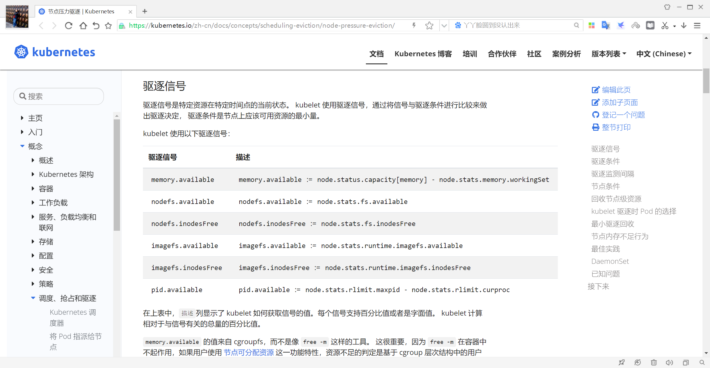

节点压力驱逐是 kubelet 主动终止 Pod 以回收节点上资源的过程。在 kubernetes 的每个集群节点上，都有一个 kubelet 服务，它会监控集群节点的内存、磁盘空间和文件系统的 inode 等资源。当这些资源中的一个或者多个达到特定的消耗水平，kubelet 可以主动驱逐节点上一个或者多个 Pod，以回收资源防止出现资源饥饿。

kubelet 会主动给节点打上一个或者多个污点标记，这些标记的 effect 为 NoExecute。内存比较紧张，会打上 node.kubernetes.io/memory-pressure磁盘比较紧张，会打上 node.kubernetes.io/disk-pressure pid 比较紧张，会打上 node.kubernetes.io/pid-pressure。

而如果该节点上，已有一些 Pod 在运行，并且这些 Pod 没有配置以上三种对应的容忍度，则 kubelet会开始驱逐的流程，一个一个的驱逐，直到节点不再有存在资源压力为止，才会清除污点，结束驱逐。在节点压力驱逐期间，kubelet 将所选 Pod 的 PodPhase 设置为 Failed。这将终止 Pod。通常还会带上一个 tolerationSeconds ，它意思是在污点出现后，Pod 还可以正常工作多少时间，也就是延迟多久再进行驱逐。

除了以上污点之外，还有其他常见的

node.kubernetes.io/not-ready ：节点未准备好。这相当于节点状态 Ready 的值为 “ False ”node.kubernetes.io/unreachable ：节点控制器访问不到节点. 这相当于节点状态 Ready 的值为 “Unknown”。node.kubernetes.io/network-unavailable ：节点网络不可用。node.kubernetes.io/unschedulable : 节点不可调度。而这些污点的 effect 通常为 NoSchedule，以防新的 Pod 调度过来，却无法正常工作。

**驱逐信号**

驱逐信号是特定资源在特定时间点的当前状态。 kubelet 使用驱逐信号，通过将信号与驱逐条件进行比较来做出驱逐决定， 驱逐条件是节点上应该可用资源的最小量。

kubelet 使用以下驱逐信号：

**驱逐信号描述**

memory.available := node.status.capacity[memory] -
```text
memory.available
node.stats.memory.workingSet
nodefs.available
nodefs.available := node.stats.fs.available
nodefs.inodesFree
nodefs.inodesFree := node.stats.fs.inodesFree
imagefs.available
imagefs.available := node.stats.runtime.imagefs.available
```

imagefs.inodesFree :=
```text
imagefs.inodesFree
node.stats.runtime.imagefs.inodesFree
```

pid.available := node.stats.rlimit.maxpid -
```text
pid.available
node.stats.rlimit.curproc
```

在上表中，描述列显示了 kubelet 如何获取信号的值。每个信号支持百分比值或者是字面值。 kubelet计算相对于与信号有关的总量的百分比值。

memory.available 的值来自 cgroupfs，而不是像 free -m 这样的工具。 这很重要，因为 free -m在容器中不起作用，如果用户使用 节点可分配资源 这一功能特性，资源不足的判定是基于 cgroup 层次结构中的用户 Pod 所处的局部及 cgroup 根节点作出的。 这个脚本 重现了 kubelet 为计算memory.available 而执行的相同步骤。 kubelet 在其计算中排除了 inactive_file（即非活动 LRU 列表上基于文件来虚拟的内存的字节数）， 因为它假定在压力下内存是可回收的。

kubelet 支持以下文件系统分区：

1. nodefs ：节点的主要文件系统，用于本地磁盘卷、emptyDir、日志存储等。 例如，nodefs 包含/var/lib/kubelet/ 。

2. imagefs ：可选文件系统，供容器运行时存储容器镜像和容器可写层。

驱逐条件

你可以为 kubelet 指定自定义驱逐条件，以便在作出驱逐决定时使用。

驱逐条件的形式为 [eviction-signal][operator][quantity] ，其中：

eviction-signal 是要使用的驱逐信号。operator 是你想要的关系运算符， 比如 < （小于）。quantity 是驱逐条件数量，例如 1Gi 。 quantity 的值必须与 Kubernetes 使用的数量表示相匹配。 你可以使用文字值或百分比（% ）。例如，如果一个节点的总内存为 10Gi 并且你希望在可用内存低于 1Gi 时触发驱逐， 则可以将驱逐条件定义为 memory.available<10% 或 memory.available< 1G 。 你不能同时使用二者。

你可以配置软和硬驱逐条件。

**软驱逐条件**

软驱逐条件将驱逐条件与管理员所必须指定的宽限期配对。 在超过宽限期之前，kubelet 不会驱逐Pod。 如果没有指定的宽限期，kubelet 会在启动时返回错误。你可以既指定软驱逐条件宽限期，又指定 Pod 终止宽限期的上限，给 kubelet 在驱逐期间使用。 如果你指定了宽限期的上限并且 Pod 满足软驱逐阈条件，则 kubelet 将使用两个宽限期中的较小者。 如果你没有指定宽限期上限，kubelet 会立即杀死被驱逐的 Pod，不允许其体面终止。

你可以使用以下标志来配置软驱逐条件：

eviction-soft ：一组驱逐条件，如 memory.available<1.5Gi ， 如果驱逐条件持续时长超过指定的宽限期，可以触发 Pod 驱逐。eviction-soft-grace-period ：一组驱逐宽限期， 如 memory.available=1m30s ，定义软驱逐条件在触发 Pod 驱逐之前必须保持多长时间。eviction-max-pod-grace-period ：在满足软驱逐条件而终止 Pod 时使用的最大允许宽限期（s为单位），超过此值就强制杀死

**硬驱逐条件**

硬驱逐条件没有宽限期。当达到硬驱逐条件时， kubelet 会立即杀死 pod，而不会正常终止以回收紧缺的资源。你可以使用 eviction-hard 标志来配置一组硬驱逐条件， 例如 memory.available<1Gi 。

kubelet 具有以下默认硬驱逐条件：
```text
memory.available<100Mi
nodefs.available<10%
imagefs.available<15%
```

nodefs.inodesFree<5% （Linux 节点）

只有在没有更改任何参数的情况下，硬驱逐阈值才会被设置成这些默认值。 如果你更改了任何参数的值，则其他参数的取值不会继承其默认值设置，而将被设置为零。 为了提供自定义值，你应该分别设置所有阈值。

**驱逐监测间隔**

kubelet 根据其配置的 housekeeping-interval （默认为 10s ）评估驱逐条件。

**kubelet 驱逐时 Pod 的选择**

如果 kubelet 回收节点级资源的尝试没有使驱逐信号低于条件， 则 kubelet 开始驱逐最终用户 Pod。

kubelet 使用以下参数来确定 Pod 驱逐顺序：

1. Pod 的资源使用是否超过其请求

2. Pod 优先级

3. Pod 相对于请求的资源使用情况

因此，kubelet 按以下顺序排列和驱逐 Pod：

1. 首先考虑资源使用量超过其请求的 BestEffort 或 Burstable Pod。 这些 Pod 会根据它们的优先级以及它们的资源使用级别超过其请求的程度被逐出。

2. 资源使用量少于请求量的 Guaranteed Pod 和 Burstable Pod 根据其优先级被最后驱逐。

仅当 Guaranteed Pod 中所有容器都被指定了请求和限制并且二者相等时，才保证 Pod 不被驱逐。 这些 Pod 永远不会因为另一个 Pod 的资源消耗而被驱逐。 如果系统守护进程（例如 kubelet 和journald ） 消耗的资源比通过 system-reserved 或 kube-reserved 分配保留的资源多， 并且该节点只有 Guaranteed 或 Burstable Pod 使用的资源少于其上剩余的请求， 那么 kubelet 必须选择驱逐这些 Pod 中的一个以保持节点稳定性并减少资源匮乏对其他 Pod 的影响。 在这种情况下，它会选择首先驱逐最低优先级的 Pod。

当 kubelet 因 inode 或 PID 不足而驱逐 Pod 时， 它使用优先级来确定驱逐顺序，因为 inode 和 PID 没有请求。

**节点内存不足行为**

如果节点在 kubelet 能够回收内存之前遇到内存不足（OOM）事件， 则节点依赖 oom_killer 来响应。kubelet 根据 Pod 的服务质量（QoS）为每个容器设置一个 oom_score_adj 值。

服务质量oom_score_adj
```text
Guaranteed高优
```

先级-997
```text
BestEffort低优
```

先级1000
```text
Burstable中优
```

min(max(2, 1000 - (1000 * memoryRequestBytes) /
```text
先级
```

machineMemoryCapacityBytes), 999)

说明：

kubelet 还将具有 system-node-critical 优先级 的 Pod 中的容器 oom_score_adj 值设为 -997 。如果 kubelet 在节点遇到 OOM 之前无法回收内存， 则 oom_killer 根据它在节点上使用的内存百分比计算 oom_score ， 然后加上 oom_score_adj 得到每个容器有效的 oom_score 。 然后它会杀死得分最高的容器。这意味着低 QoS Pod 中相对于其调度请求消耗内存较多的容器，将首先被杀死。

与 Pod 驱逐不同，如果容器被 OOM 杀死， kubelet 可以根据其 RestartPolicy 重新启动它。

范例:  基于二进制安装查看驱逐条件信息
```bash
#基于二进制安装才可以看到下面压力驱逐条件信息，基于kubeadm安装的kubernetes集群节点上有此文
件，但无下面信息
[root@master1 ~]#systemctl cat  kubelet.service |grep config.yaml
Environment="KUBELET_CONFIG_ARGS=--config=/var/lib/kubelet/config.yaml"

[root@node1 ~]#cat /var/lib/kubelet/config.yaml
......
evictionHard:
imagefs.available 15%
memory.available: 300Mi
nodefs.available: 10%
nodefs.inodesFree: 5%
......
```

范例: 查看相关配置
```bash
#查看相关配置
[root@node1 ~]#/usr/bin/kubelet --help|grep '\-\-eviction'
--eviction-hard mapStringString                            A set of
eviction thresholds (e.g. memory.available<1Gi) that if met would trigger a pod
eviction. (default
imagefs.available<15%,memory.available<100Mi,nodefs.available<10%,nodefs.inodesF
ree<5%) (DEPRECATED: This parameter should be set via the config file specified
by the Kubelet's --config flag. See https://kubernetes.io/docs/tasks/administer-
cluster/kubelet-config-file/ for more information.)
--eviction-max-pod-grace-period int32                      Maximum allowed
grace period (in seconds) to use when terminating pods in response to a soft
eviction threshold being met.  If negative, defer to pod specified value.
(DEPRECATED: This parameter should be set via the config file specified by the
Kubelet's --config flag. See https://kubernetes.io/docs/tasks/administer-
cluster/kubelet-config-file/ for more information.)
--eviction-minimum-reclaim mapStringString                 A set of
minimum reclaims (e.g. imagefs.available=2Gi) that describes the minimum amount
of resource the kubelet will reclaim when performing a pod eviction if that
resource is under pressure. (DEPRECATED: This parameter should be set via the
config file specified by the Kubelet's --config flag. See
https://kubernetes.io/docs/tasks/administer-cluster/kubelet-config-file/ for more
information.)
--eviction-pressure-transition-period duration             Duration for
which the kubelet has to wait before transitioning out of an eviction pressure
condition. (default 5m0s) (DEPRECATED: This parameter should be set via the
config file specified by the Kubelet's --config flag. See
https://kubernetes.io/docs/tasks/administer-cluster/kubelet-config-file/ for more
information.)
--eviction-soft mapStringString                            A set of
eviction thresholds (e.g. memory.available<1.5Gi) that if met over a
corresponding grace period would trigger a pod eviction. (DEPRECATED: This
parameter should be set via the config file specified by the Kubelet's --config
flag. See https://kubernetes.io/docs/tasks/administer-cluster/kubelet-config-
file/ for more information.)
--eviction-soft-grace-period mapStringString               A set of
eviction grace periods (e.g. memory.available=1m30s) that correspond to how long
a soft eviction threshold must hold before triggering a pod eviction.
(DEPRECATED: This parameter should be set via the config file specified by the
Kubelet's --config flag. See https://kubernetes.io/docs/tasks/administer-
cluster/kubelet-config-file/ for more information.)
--maximum-dead-containers int32                            Maximum number
of old instances of containers to retain globally.  Each container takes up some
disk space. To disable, set to a negative number. (default -1) (DEPRECATED: Use
--eviction-hard or --eviction-soft instead. Will be removed in a future
version.)
--maximum-dead-containers-per-container int32              Maximum number
of old instances to retain per container.  Each container takes up some disk
space. (default 1) (DEPRECATED: Use --eviction-hard or --eviction-soft instead.
Will be removed in a future version.)
--minimum-container-ttl-duration duration                  Minimum age for
a finished container before it is garbage collected.  Examples: '300ms', '10s'
or '2h45m' (DEPRECATED: Use --eviction-hard or --eviction-soft instead. Will be
removed in a future version.)
```

**最小驱逐回收**

在某些情况下，驱逐 Pod 只会回收少量的紧俏资源。 这可能导致 kubelet 反复达到配置的驱逐条件并触发多次驱逐。你可以使用 --eviction-minimum-reclaim 标志或 kubelet 配置文件 为每个资源配置最小回收量。 当kubelet 注意到某个资源耗尽时，它会继续回收该资源，直到回收到你所指定的数量为止。

例如，以下配置设置最小回收量：
```yaml
apiVersion: kubelet.config.k8s.io/v1beta1
kind: KubeletConfiguration
evictionHard:
memory.available: "500Mi"
nodefs.available: "1Gi"
imagefs.available: "100Gi"
evictionMinimumReclaim:
memory.available: "0Mi"
nodefs.available: "500Mi"
imagefs.available: "2Gi"
```

在这个例子中，如果 nodefs.available 信号满足驱逐条件， kubelet 会回收资源，直到信号达到1Gi 的条件， 然后继续回收至少 500Mi 直到信号达到 1.5Gi 。类似地，kubelet 会回收 imagefs 资源，直到 imagefs.available 信号达到 102Gi 。



<nav class="article-end" aria-label="章节导航">
  <a href="{{ '/subjects/Kubernetes/11-daemonset-jobs.html' | relative_url }}">← 上一章：DaemonSet、Job 与 CronJob</a>
  <a href="{{ '/subjects/Kubernetes/' | relative_url }}">返回 Kubernetes 目录</a>
  <a href="{{ '/subjects/Kubernetes/13-hpa-core-metrics.html' | relative_url }}">下一章：HPA 原理与核心指标 →</a>
</nav>
