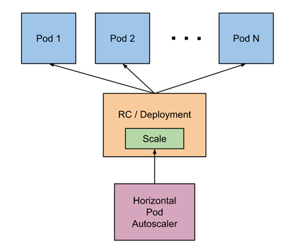
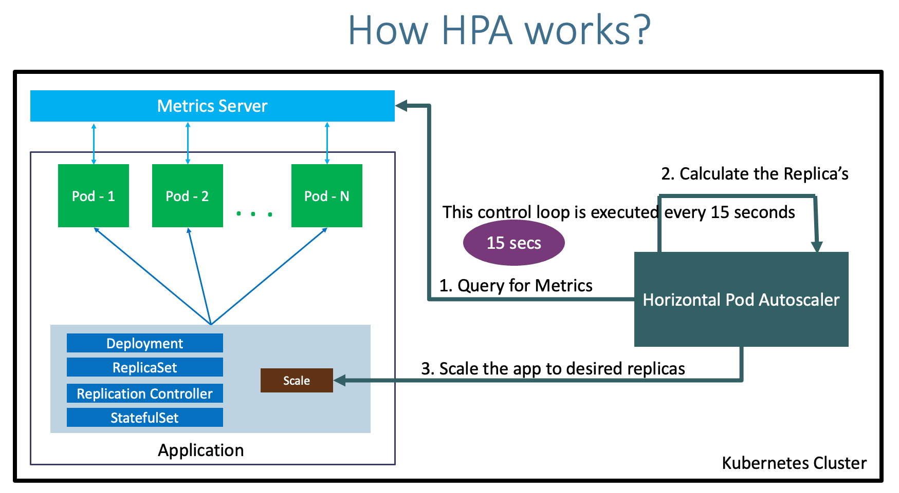
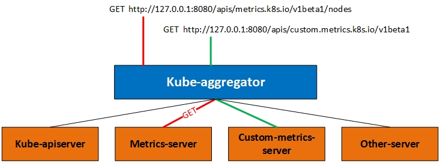
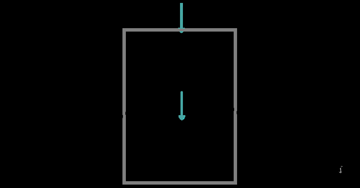
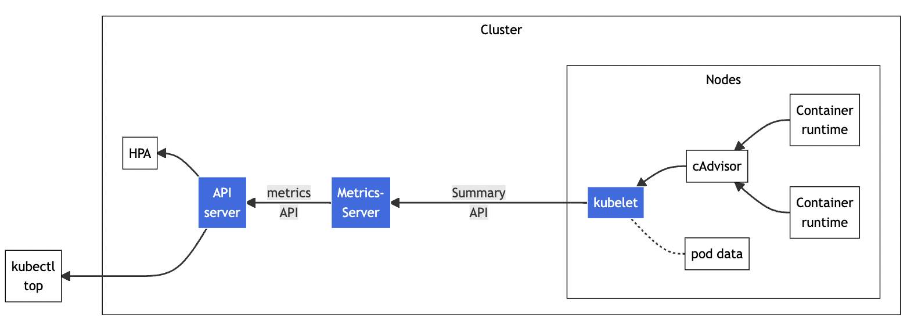
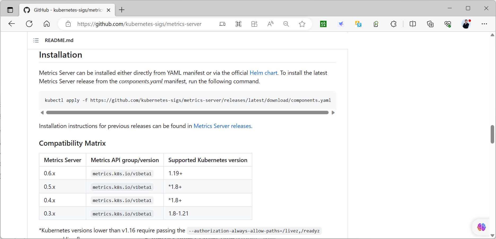

[← 返回 Kubernetes 目录]({{ '/subjects/Kubernetes/' | relative_url }})



# 13 HPA 原理与核心指标

# 1 HPA 介绍

## 1.1 扩缩容

### 1.1.1 扩缩容说明

在实际工作中，业务对资源要求是不断变化的，如：电商平台在六一八, 双十一 或者秒杀活动以及访问低谷期, 由于资源紧张或者工作负载降低等都需要对服务实例数进行扩缩容操作。在 Kubernetes 中可以根据当前的资源需求扩缩工作负载。 这让你的集群可以更灵活、更高效地面对资源需求的变化。Kubernetes 的扩缩容可以多个级别实现。

扩缩容可以发生在三个层级：

- **Cluster**：调整集群数量。
- **Node**：调整节点资源或节点数量。
- **Pod**：调整 Pod 的资源或副本数。

### 1.1.2 扩缩容实现

```text
https://kubernetes.io/zh-cn/docs/concepts/workloads/autoscaling/
```

#### 1.1.2.1 手动扩缩容

Kubernetes 支持工作负载的Pod手动扩缩。当你扩缩工作负载时，你可以增加或减少工作负载所管理的副本数量，或者就地调整副本的可用资源。

第一种手段称为水平扩缩，第二种称为垂直扩缩。

扩缩工作负载有手动和自动两种方式，这取决于你的使用情况。当Kubernetes集群中资源不能满足要求时，可以针对Pod级别进行手动和自动扩缩容（autoscale）。

这两种策略的示例

水平扩缩：运行应用程序的多个实例

水平扩缩可以使用 kubectl 命令行工具完成。 对于垂直扩缩，你需要更新工作负载的资源定义。

```text
kubectl scale deployments/kubernetes-bootcamp --replicas=4
```

垂直扩缩：调整分配给容器的 CPU 和内存资源。

```text
#https://kubernetes.io/zh-cn/docs/tasks/configure-pod-container/resize-
container-resources/#create-pod-with-resource-requests-and-limits
```

```text
apiVersion: v1
kind: Pod
metadata:
name: qos-demo-5
namespace: qos-example
spec:
containers:
- name: qos-demo-ctr-5
image: nginx
resources:
limits:
memory: "200Mi"
cpu: "700m"
requests:
memory: "200Mi"
cpu: "700m"
```

#### 1.1.2.2 动态扩缩容

动态(弹性)伸缩是根据用户的业务需求和策略，自动“调整”其“弹性资源”的管理服务。用户可设置定时、周期或者监控策略，通过弹性伸缩功能，自动的完成增加或减少恰当的弹性资源，并完成实例配置修改和保证业务平稳健康运行。

Kubernetes 被誉为新一代数据中心操作系统（DCOS），其核心工作也是管理整个集群的计算资源，并按需合理分配给以Pod为基础的各种workload。其本质是解决资源与业务负载之间供需平衡的问题，随着业务需求和部署规模的增大，Kubernetes 集群就要相应扩容计算资源，集群扩容的最直接的办法是新增资源，一般单机器很难垂直扩展（Kubernetes  node也不支持），所以一般都是直接增加节点。但是随着机器的不断增加成本也不断加大，而实际上大量服务大部分时间负载很低导致机器的整体使用率很低，一方面业务为了应对每日随机流量高峰会把副本数尽量扩得很高，另一方面业务方并不能准确评估服务实际需要的CPU等资源，也出现大量浪费。

为了充分利用集群现有资源优化成本，当一个资源占用已经很大的业务需要扩容时，其实可以先尝试优化业务负载自身的资源需求配置（request与实际的差距），只有当集群的资源池确实已经无法满足负载的实际的资源需求时，再调整资源池的总量保证资源的可用性，这样可以将资源用到极致。为了解决业务服务负载时刻存在的巨大波动和资源实际使用与预估之间差距，就有了针对业务本身的“弹性扩缩容”解决方案。

弹性伸缩包括：


Cluster-Autoscale

集群容量（node数量）自动伸缩，跟自动化部署相关的，依赖iaas的弹性伸缩，主要用于虚拟机容器集群。Cluster AutoScaler 定期检测是否有充足的资源来调度新创建的 Pod，当资源不足时会调用 Cloud Provider 创建新的 Node。

```text
#支持的云提供商：
#阿里云：
https://github.com/kubernetes/autoscaler/blob/master/cluster-
autoscaler/cloudprovider/alicloud/README.md
#AWS：
https://github.com/kubernetes/autoscaler/blob/master/cluster-
autoscaler/cloudprovider/aws/README.md
#Azure：
https://github.com/kubernetes/autoscaler/blob/master/cluster-
autoscaler/cloudprovider/azure/README.md
```

Vertical Pod Autoscaler VPA

Vertical Pod AutoScaler 容器垂直伸缩，动态调整单个Pod的最大资源限制，主要支持有状态服务的扩缩容和升级场景,由第三方开源组件实现。工作负载Pod垂直（资源配置）自动伸缩，如自动计算或调整deployment的Pod模板limit/request，依赖业务历史负载指标。Vertical Pod Autoscaler （VPA）使用名为 VerticalPodAutoscaler 的自定义资源定义对象进行配置。

```text
#基于CRD实现
https://github.com/kubernetes/autoscaler/tree/master/vertical-pod-autoscaler
```

```text
#需要自行安装
https://github.com/kubernetes/autoscaler/blob/master/vertical-pod-
autoscaler/docs/installation.md
```

```text
#安装方法
kubectl apply -f
https://raw.githubusercontent.com/kubernetes/autoscaler/vpa-release-
1.0/vertical-pod-autoscaler/deploy/vpa-v1-crd-gen.yaml
kubectl apply -f
https://raw.githubusercontent.com/kubernetes/autoscaler/vpa-release-
1.0/vertical-pod-autoscaler/deploy/vpa-rbac.yaml
```

```text
#实现Vertical Pod Autoscaler示例:
```

```text
#https://github.com/kubernetes/autoscaler/blob/master/vertical-pod-
autoscaler/examples/hamster.yaml
```

```text
---
apiVersion: "autoscaling.k8s.io/v1"
kind: VerticalPodAutoscaler
metadata:
name: hamster-vpa
spec:
# recommenders field can be unset when using the default recommender.
# When using an alternative recommender, the alternative recommender's
name
# can be specified as the following in a list.
# recommenders:
#   - name: 'alternative'
targetRef:
apiVersion: "apps/v1"
kind: Deployment
name: hamster
resourcePolicy:
containerPolicies:
- containerName: '*'
minAllowed:
cpu: 100m
memory: 50Mi
maxAllowed:
cpu: 1
memory: 500Mi
controlledResources: ["cpu", "memory"]
---
apiVersion: apps/v1
kind: Deployment
metadata:
name: hamster
spec:
selector:
matchLabels:
app: hamster
replicas: 2
template:
metadata:
labels:
app: hamster
spec:
securityContext:
runAsNonRoot: true
runAsUser: 65534 # nobody
containers:
- name: hamster
image: registry.k8s.io/ubuntu-slim:0.14
resources:
requests:
cpu: 100m
memory: 50Mi
command: ["/bin/sh"]
args:
- "-c"
- "while true; do timeout 0.5s yes >/dev/null; sleep 0.5s; done"
```

Horizontal-Pod-Autoscaler HPA

Horizontal Pod Autoscaler 容器水平伸缩,动态调整Pod的数量，由Kubernetes 内置组件实现。工作负载Pod水平自动伸缩，如自动scale deployment的replicas，依赖业务实时负载指标。

cronHPA

Cron  Horizontal Pod Autoscaler 容器定时伸缩，主要面向的是周期性负载，预测有规律的负载周期，并通过周期性伸缩，实现资源成本的节约,由第三方开源组件实现。直接按照cron的格式设定扩容和缩容时间及对应副本数，这种不需要动态识别业务繁忙度属于静态HPA，适用于业务流量变化有固定时间周期规律的情况，这种比较简单可以算做HPA的一种简单特例。

Knative Pod Autoscaler KPA

```text
https://knative.dev/docs/serving/autoscaling/
```

Knative提供了简单易用的自动扩缩容KPA（Knative Pod Autoscaler）功能。您可以基于Pod并发数（Concurrency）、每秒请求数（RPS）配置自动扩缩容的条件。此外，Knative默认会在没有业务请求时将Pod数量缩减至0。

KPA的主要限制在于它不支持基于CPU的自动扩缩容。

实现原理

Knative Serving会为每个Pod注入一个名为queue-proxy 的QUEUE代理容器，该容器负责向Autoscaler报告业务容器的并发指标。Autoscaler接收到这些指标之后，会根据并发请求数及相应的算法，调整Deployment的Pod数量，从而实现自动扩缩容。

active route

Route

inactive route

create

Activator resize

Pods

Deployment

activate

Autoscaler metrics

Revision

Knative Pod Autoscaler 主要基于观测到的指标（如请求每秒速率、并发请求数等）来决定是否对Pod 进行扩缩容操作。其工作流程大致如下：

1. 指标收集：KPA 持续从各种数据源（如 Istio、Prometheus 等）收集与应用程序相关的指标数据。

2. 指标分析：根据收集到的指标数据，KPA 会将其与预先设定的目标值进行比较。例如，若设定目标是每个 Pod 每秒处理 100 个请求，KPA 会计算当前每个 Pod 实际处理的请求速率。

3. 扩缩容决策：如果实际指标与目标值存在偏差，KPA 会做出相应的扩缩容决策。若当前请求速率超过目标值，KPA 会增加 Pod 数量；若请求速率低于目标值，KPA 则会减少 Pod 数量。

4. 执行操作：KPA 会与 Kubernetes 的 API Server 进行交互，通过调整 Deployment 或ReplicaSet 来实现 Pod 数量的动态调整。

支持的指标类型

并发请求数（Concurrency）：指每个 Pod 同时处理的请求数量。KPA 可以根据并发请求数来调整 Pod 数量，确保每个 Pod 不会因处理过多并发请求而导致性能下降。请求每秒速率（Requests per Second, RPS）：表示每个 Pod 每秒处理的请求数量。通过设置目标 RPS，KPA 可以根据实际的请求速率动态扩缩容 Pod。

```text
apiVersion: serving.knative.dev/v1
kind: Service
metadata:
name: my-service
spec:
template:
metadata:
annotations:
autoscaling.knative.dev/target: "10"  # 目标并发请求数为 10
autoscaling.knative.dev/targetUtilizationPercentage: "70"  # 目标利用
率为 70%
autoscaling.knative.dev/scaleToZero: "true"  # 允许缩容到零
spec:
containers:
- image: gcr.io/my-project/my-image
```

其中VPA和HPA都是从业务负载角度从发的优化，VPA是解决资源配额（Pod的CPU、内存的limit/request）评估不准的问题，HPA则要解决的是业务负载压力波动很大，需要人工根据监控报警来不断调整副本数的问题，有了HPA后，被关联上HPA的deployment，后续副本数修改就不用人工管理，HPA controller将会根据业务忙闲情况自动帮你动态调整。

## 1.2 HPA工作机制

```text
https://kubernetes.io/zh-cn/docs/tasks/run-application/horizontal-pod-autoscale/
https://kubernetes.io/zh-cn/docs/reference/kubernetes-api/workload-
resources/horizontal-pod-autoscaler-v1/
https://kubernetes.io/zh-cn/docs/reference/kubernetes-api/workload-
resources/horizontal-pod-autoscaler-v2/
```

### 1.2.1 HPA 介绍



HPA全称是 Horizontal Pod Autoscaler，Pod的水平自动伸缩器。也就是对k8s的workload的副本数进行自动水平扩缩容（scale）机制，也是k8s里使用需求最广泛的一种Autoscaler机制。

水平扩缩意味着对增加的负载的响应是部署更多的 Pod。 这与 “垂直（Vertical）” 扩缩不同，对于Kubernetes， 垂直扩缩意味着将更多资源（例如：内存或 CPU）分配给已经为工作负载运行的 Pod。如果负载减少，并且 Pod 的数量高于配置的最小值， HorizontalPodAutoscaler 会指示工作负载资源（Deployment、StatefulSet 或其他类似资源）缩减。在 Kubernetes 中，HorizontalPodAutoscaler 自动更新工作负载资源 （例如Deployment或者StatefulSet）， 目的是自动扩缩工作负载以满足需求。

水平 Pod 自动扩缩不适用于无法扩缩的对象，例如：DaemonSet。

资源决定了控制器的行为。 在 Kubernetes 控制平面内运行的水平 Pod 自动扩缩控制器会定期调整其目标（例如：Deployment）的所需规模，以匹配观察到的指标， 例如，平均 CPU 利用率、平均内存利用率或你指定的任何其他自定义指标。既然是自动根据业务忙闲来调整业务工作负载的副本数，其实HPA的实现思路很容易想到：通过监控业务繁忙情况，在业务忙时，就要对workload扩容副本数；等到业务闲下来时，自然又要把副本数再缩下去。

实现水平扩缩容的关键就在于：

如何识别业务的忙闲程度使用什么样的副本调整策略

### 1.2.2 HPA 的 API 的版本

HorizontalPodAutoscaler 被实现为 Kubernetes API 资源和控制器。

HorizontalPodAutoscaler 的API 的版本：

目前版本 HPA 支持了 autoscaling/v1、autoscaling/v2 两个版本早期版本支持 autoscaling/v1,autoscaling/v2beta1和autoscaling/v2beta2 autoscaling/v1 这个版本只支持CPU一个指标的弹性伸缩。autoscaling/v2 可以支持使用更多的指标比如内存等作为扩缩容的标准, 还增加了支持自定义指标和外部指标。

范例:

```text
[root@master1 ~]#kubectl api-versions |grep  autoscaling
autoscaling/v1
autoscaling/v2
```

### 1.2.3 HPA 工作机制



**HPA 工作流程**

Kubernetes HPA 控制器通过 API Server(聚合 API)持续采集所有 Pod 副本的指标数据。HPA 基于用户定义的扩缩容规则进行计算，得到目标 Pod 副本数量。当目标 Pod 副本数量与当前副本数量不同时，HPA 控制器就向 Pod 的副本控制器（Deployment、RC 或 ReplicaSet）发起 scale 操作，调整 Pod 的副本数量，完成扩缩容操作。

Kubernetes 将水平 Pod 自动扩缩实现为一个间歇运行的控制回路（它不是一个连续的过程）。间隔由kube-controller-manager 的 --horizontal-pod-autoscaler-sync-period 参数设置（默认间隔为 15秒）。在每个时间段内，控制器管理器都会根据每个 HorizontalPodAutoscaler 定义中指定的指标查询资源利用率。 控制器管理器找到由 scaleTargetRef 定义的目标资源，然后根据目标资源的 .spec.selector 标签选择 Pod， 并从资源指标 API（针对每个 Pod 的资源指标）或自定义指标获取指标 API（适用于所有其他指标）。

对于按 Pod 统计的资源指标（如 CPU），控制器从资源指标 API 中获取每一个HorizontalPodAutoscaler 指定的 Pod 的度量值，如果设置了目标使用率， 控制器获取每个 Pod 中的容器资源使用情况， 并计算资源使用率。如果设置了 target 值，将直接使用原始数据（不再计算百分比）。 接下来，控制器根据平均的资源使用率或原始值计算出扩缩的比例，进而计算出目标副本数。需要注意的是，如果 Pod 某些容器不支持资源采集，那么控制器将不会使用该 Pod 的 CPU 使用率。如果 Pod 使用自定义指标，控制器机制与资源指标类似，区别在于自定义指标只使用原始值，而不是使用率。

如果 Pod 使用对象指标和外部指标（每个指标描述一个对象信息）。 这个指标将直接根据目标设定值相比较，并生成一个上面提到的扩缩比例。 在 autoscaling/v2 版本 API 中，这个指标也可以根据 Pod 数量平分后再计算。HorizontalPodAutoscaler 控制器访问支持扩缩的相应工作负载资源（例如：Deployment 和StatefulSet）。 这些资源每个都有一个名为 scale 的子资源，该接口允许你动态设置副本的数量并检查它们的每个当前状态。

要实现HPA, 必须安装metric-server或其它类似服务, 以及在Pod中定义Requests参数。

### 1.2.4 HPA 扩缩容算法

```text
https://kubernetes.io/zh-cn/docs/tasks/run-application/horizontal-pod-
autoscale/#algorithm-details
```

Pod 水平自动扩缩控制器根据当前指标和期望指标来计算扩缩比例。

```text
期望副本数desiredReplicas=向上取整ceil[当前副本数currentReplicas*(当前指标
currentMetricValue/期望指标desiredMetricValue)]
#ceil 函数表示向上取整
```

例如：

如果当前指标值为 200m ，而期望值为 100m ，则副本数将加倍， 因为 200.0 / 100.0 == 2.0

如果当前指标值为 50m ，则副本数将减半， 因为 50.0 / 100.0 == 0.5 。如果比率足够接近 1.0（在全局可配置的容差范围内，默认为 0.1）， 则控制平面会跳过扩缩操作。

说明:

如果 HorizontalPodAutoscaler 指定的是targetAverageValue 或 targetAverageUtilization ， 那么将会把指定 Pod 度量值的平均值做为 currentMetricValue 。 然而，在检查容忍度和决定最终扩缩值前，仍然会把那些无法获取指标的 Pod 统计进去。当使用CPU指标进行HPA时，任何还未就绪（例如还在初始化）状态的 Pod 或 最近的指标度量值采集于就绪状态前的 Pod，该 Pod 也会被搁置，即不统计在内。

### 1.2.5 HPA 相关配置

```text
--horizontal-pod-autoscaler-sync-period #HPA控制器同步pod副本数的时间间隔，默认值为15s
--horizontal-pod-autoscaler-downscale-stabilization: #表示缩容冷却时间。即自从上次缩容
执行结束后，多久可以再次执行缩容，默认5分钟，此值可以防止抖动
--horizontal-pod-autoscaler-tolerance #HPA控制器能够容忍的当前值和期望值的数据差异的浮点
数，默认值为0.1，即期望的指标与当前的阈值的差异超过0.1以上,即要大于1.1则会触发扩容，或小于0.9
则会触发缩容
--horizontal-pod-autoscaler-initial-readiness-delay #设置Pod准备就绪时间，在此时间内的
Pod处于未就绪状态并不会采集数据,默认为30秒
--horizontal-pod-autoscaler-cpu-initialization-period #用于设置Pod的初始化时间，在此
时间内的Pod的CPU资源度量值将不会被采纳，默认为5分钟
```

范例:

```text
[root@master1 ~]#kubectl exec -n kube-system    kube-controller-manager-
master1.wang.org -- kube-controller-manager --help |grep horizontal-pod-
autoscaler-sync-period
--horizontal-pod-autoscaler-sync-period duration                 The
period for syncing the number of pods in horizontal pod autoscaler. (default
15s)
```

```text
#可以修改如下配置文件
[root@master1 ~]#vim /etc/kubernetes/manifests/kube-controller-manager.yaml
apiVersion: v1
kind: Pod
metadata:
```

```text
creationTimestamp: null
labels:
component: kube-controller-manager
tier: control-plane
name: kube-controller-manager
namespace: kube-system
spec:
containers:
- command:
- kube-controller-manager
- --allocate-node-cidrs=true
- --authentication-kubeconfig=/etc/kubernetes/controller-manager.conf
- --authorization-kubeconfig=/etc/kubernetes/controller-manager.conf
- --bind-address=127.0.0.1
- --client-ca-file=/etc/kubernetes/pki/ca.crt
- --cluster-cidr=10.244.0.0/16
- --cluster-name=kubernetes
- --horizontal-pod-autoscaler-sync-period=30s
.......
```

## 1.3 HPA 资源管理

### 1.3.1 HPA 资源配置前提条件

安装 Metrics Server 或者 Prometheus-Adapter

需部署 Metrics Server 或者Prometheus-Adapter其它的以提供资源监控数据。若未安装，HPA 将无法获取 CPU 指标。

Pod 配置资源请求 requests

Deployment 的 Pod 模板需定义resources.requests.cpu

否则 HPA 无法计算 CPU 使用率百分比,提示如下：

```text
[root@master1 ~]#kubectl describe  hpa
.......
Warning  FailedGetResourceMetric       3m15s (x11 over 23m)  horizontal-pod-
autoscaler  failed to get cpu utilization: missing request for cpu in
container nginx of Pod hpa-test-f9994bdc5-cfwbf
```

```text
[root@master1 ~]#kubectl get hpa
NAME       REFERENCE             TARGETS              MINPODS   MAXPODS
REPLICAS   AGE
hpa-test   Deployment/hpa-test   cpu: <unknown>/20%   2         5         3
14m
```

例如：

```text
resources:
requests:
cpu: "100m"  # 表示 0.1 核 CPU
```

当前CPU 利用率的计算公式为：

```text
CPU 利用率 = (实际使用的 CPU 量 / Pod 配置 requests.cpu) * 100%`
```

```text
#比如:  Pod 的 requests.cpu 设置为 100m，实际使用 80m，则 CPU 利用率为 80%
```

### 1.3.2  HPA 配置和实现流程

1. 创建Deployment等资源，要求配置Pod的requests

2. 创建HPA资源，设定目标CPU使用率限额，以及最大、最小实例数

3. 收集PodSelector中每个Pod最近一分钟内的CPU使用率，并计算所有Pod的平均值

4. 读取HPA中设定的 CPU使用期望指标desiredMetricValue，计算所有Pod平均值之和/期望指标desiredMetricValue并向上取整，求出目标调整的实例个数

```text
扩容后Pod的个数=(当前副本数*最近一分钟内每个Pod的CPU使用率的平均值)/HPA中设定的 CPU使用
期望指标+1
```

5. 调整的实例数不能超过HPA中设定的最大、最小实例数，如果没有超过最大实例数则扩容；如果超过最大值则扩容至最大实例个数

6. 不断循环第3步后面的步骤

### 1.3.3 HPA 创建说明

HPA 创建两种方式

命令式资源清单方式

#### 1.3.3.1 命令行创建对象

```text
kubectl autoscale --help
Usage:
kubectl autoscale (-f FILENAME | TYPE NAME | TYPE/NAME) [--min=MINPODS] --
max=MAXPODS [--cpu-percent=CPU] [options]
```

```text
#TYPE 支持 deployment, replica set, stateful set, or replication controller
#详细解释
1)CPU 使用率计算：CPU 使用率 = (Pod 实际使用的 CPU 量 / 容器配置的
resources.requests.cpu ) * 100%
2)触发自动伸缩：如果所有Pod 的平均 CPU 使用率超过了 --cpu-percent 指定的百分比，HPA 就会增
加 Pod 的数量；反之，若低于这个百分比，HPA 会减少 Pod 的数量。
```

```text
#示例:
kubectl autoscale deployment hpa-demo --cpu-percent=20 --min=2 --max=5
```

```text
#说明
假设在 hpa-demo Deployment 中，每个 Pod 的 requests.cpu 设置为 0.5（也就是 500m CPU，1
个 CPU 核心等于 1000m）
若某个Pod实际使用的 CPU 量达到了 0.1（即 100m），此时该 Pod 的 CPU 使用率为 (0.1 / 0.5) *
100% = 20%。
当所有Pod的平均CPU使用率与设定的目标值（如 --cpu-percent 指定的值20%）进行比较,超过20%时，
HPA 就会开始进行自动伸缩操作。
```

```text
#注意:kubectl autoscale deployment hpa-demo --cpu-percent=20 --min=2 --max=5 --
dry-run=client -o yaml
```

```text
#k8s-v1.33以前版本默认生成为的HPA-v1版本,但在线编辑时 kubectl edit hpa  hpa-test 为HPA-
v2版
```

#### 1.3.3.2 资源定义文件创建对象

##### 1.3.3.2.1 HPA-v1版本

```text
#HPA-v1版本
apiVersion: autoscaling/v1
kind: HorizontalPodAutoscaler
metadata:
name: hpa-demo
spec:
maxReplicas: 10
minReplicas: 1
scaleTargetRef:
apiVersion: apps/v1
kind: Deployment
name: hpa-demo
targetCPUUtilizationPercentage: 50 #对应上面命令的--cpu-percent
```

```text
#各字段说明
#1. apiVersion
指定使用的 API 版本，对于 HPA-v1 来说，值为 autoscaling/v1。
#2. kind
指定资源的类型，这里是 HorizontalPodAutoscaler。
#3. metadata
包含资源的元数据，如名称、标签等。
name：HPA 的名称，在同一个命名空间内必须唯一。
#4. spec
定义 HPA 的具体规格。
#scaleTargetRef
指定 HPA 要控制的目标资源。
#apiVersion：目标资源的 API 版本，例如 apps/v1 表示使用 Deployment 或 ReplicaSet 的
API 版本。
#kind：目标资源的类型，可以是 Deployment、ReplicaSet 或 StatefulSet。
#name：目标资源的名称。
#minReplicas
指定目标资源允许的最小 Pod 副本数。当指标低于阈值时，HPA 不会将 Pod 副本数缩容到低于这个值。
#maxReplicas
指定目标资源允许的最大 Pod 副本数。当指标高于阈值时，HPA 不会将 Pod 副本数扩容到超过这个值。
#targetCPUUtilizationPercentage
这是 HPA-v1 中唯一支持的指标，用于指定目标 CPU 利用率的百分比。当目标资源中所有 Pod 的平均
CPU 利用率超过这个百分比时，HPA 会自动增加 Pod 副本数；当平均 CPU 利用率低于这个百分比时，HPA
会自动减少 Pod 副本数。
```

##### 1.3.3.2.2 HPA-v2版本

```text
#autoscaling/v2 配置说明
#apiVersion: autoscaling/v2beta2 旧版
apiVersion: autoscaling/v2
kind: HorizontalPodAutoscaler
metadata:
name: php-apache
namespace: default
spec:
# HPA的伸缩对象描述，HPA会动态修改该对象的pod数量
```

```text
scaleTargetRef:
apiVersion: apps/v1
kind: Deployment
name: php-apache
# HPA的最小pod数量和最大pod数量
minReplicas: 1
maxReplicas: 10
# 监控的指标数组，支持多种类型的指标共存
behavior:
scaleDown:
stabilizationWindowSeconds: 30 #缩小稳定窗口为 30 秒,默认值为300s
metrics:
# Object类型的指标
- type: Object
object:
metric:
# 指标名称
name: requests-per-second
# 监控指标的对象描述，指标数据来源于该对象
describedObject:
apiVersion: networking.k8s.io/v1beta1
kind: Ingress
name: main-route
# Value类型的目标值，Object类型的指标只支持Value和AverageValue类型的目标值
target:
type: Value
value: 10k
# Resource类型的指标
- type: Resource
resource:
name: cpu
# Utilization类型的目标值，Resource类型的指标只支持Utilization和AverageValue类型
的目标值
target:
type: Utilization
averageUtilization: 50 #平均利用率 < (所有Pod的实际资源使用总量/所有Pod的资源
resources.requests.cpu的总量×100%)时会扩容，否则缩容
# Pods类型的指标
- type: Pods
pods:
metric:
name: packets-per-second
# AverageValue类型的目标值，Pods指标类型下只支持AverageValue类型的目标值
target:
type: AverageValue
averageValue: 1k
# External类型的指标
- type: External
external:
metric:
name: queue_messages_ready
# 该字段与第三方的指标标签相关联，（此处官方文档有问题，正确的写法如下）
selector:
matchLabels:
env: "stage"
app: "myapp"
# External指标类型下只支持Value和AverageValue类型的目标值
target:
```

```text
type: AverageValue
averageValue: 30
```

```text
#HPA-v2版本示例
apiVersion: autoscaling/v2
kind: HorizontalPodAutoscaler
metadata:
name: my-app-hpa
spec:
scaleTargetRef:
apiVersion: apps/v1
kind: Deployment
name: my-app-deployment
minReplicas: 1
maxReplicas: 10
behavior:
scaleDown:
stabilizationWindowSeconds: 30 #缩小稳定窗口为 30 秒,默认值为300s,HPA-v1 不支持
此字段
metrics:
- type: Resource
resource:
name: cpu
target:
type: Utilization
averageUtilization: 50
- type: Resource
resource:
name: memory
target:
type: Utilization
averageUtilization: 60
```

范例: 查看 HPA 资源帮助

```text
#新版默认为autoscaling/v2,早期版本默认为autoscaling/v1
[root@master1 ~]#kubectl explain hpa
[root@master1 ~]#kubectl explain hpa.spec --api-version=autoscaling/v2
KIND:     HorizontalPodAutoscaler
VERSION:  autoscaling/v2
```

```text
DESCRIPTION:
HorizontalPodAutoscaler is the configuration for a horizontal pod
autoscaler, which automatically manages the replica count of any resource
implementing the scale subresource based on the metrics specified.
```

```text
FIELDS:
apiVersion   <string>
APIVersion defines the versioned schema of this representation of an
object. Servers should convert recognized schemas to the latest internal
value, and may reject unrecognized values. More info:
https://git.k8s.io/community/contributors/devel/sig-architecture/api-
conventions.md#resources
```

```text
kind <string>
Kind is a string value representing the REST resource this object
represents. Servers may infer this from the endpoint the client submits
```

```text
requests to. Cannot be updated. In CamelCase. More info:
https://git.k8s.io/community/contributors/devel/sig-architecture/api-
conventions.md#types-kinds
```

```text
metadata <Object>
metadata is the standard object metadata. More info:
https://git.k8s.io/community/contributors/devel/sig-architecture/api-
conventions.md#metadata
```

```text
spec <Object>
spec is the specification for the behaviour of the autoscaler. More info:
https://git.k8s.io/community/contributors/devel/sig-architecture/api-
conventions.md#spec-and-status.
```

```text
status   <Object>
status is the current information about the autoscaler.
```

```text
#当前默认为autoscaling/v2
[root@master1 ~]#kubectl explain hpa.spec
KIND:     HorizontalPodAutoscaler
VERSION:  autoscaling/v2
```

```text
RESOURCE: spec <Object>
```

```text
DESCRIPTION:
spec is the specification for the behaviour of the autoscaler. More info:
https://git.k8s.io/community/contributors/devel/sig-architecture/api-
conventions.md#spec-and-status.
```

```text
HorizontalPodAutoscalerSpec describes the desired functionality of the
HorizontalPodAutoscaler.
```

```text
FIELDS:
behavior <Object>
behavior configures the scaling behavior of the target in both Up and Down
directions (scaleUp and scaleDown fields respectively). If not set, the
default HPAScalingRules for scale up and scale down are used.
```

```text
maxReplicas  <integer> -required-
maxReplicas is the upper limit for the number of replicas to which the
autoscaler can scale up. It cannot be less that minReplicas.
```

```text
metrics  <[]Object>           #v2支持各种丰富的指标
metrics contains the specifications for which to use to calculate the
desired replica count (the maximum replica count across all metrics will be
used). The desired replica count is calculated multiplying the ratio
between the target value and the current value by the current number of
pods. Ergo, metrics used must decrease as the pod count is increased, and
vice-versa. See the individual metric source types for more information
about how each type of metric must respond. If not set, the default metric
will be set to 80% average CPU utilization.
```

```text
minReplicas  <integer>
minReplicas is the lower limit for the number of replicas to which the
autoscaler can scale down. It defaults to 1 pod. minReplicas is allowed to
be 0 if the alpha feature gate HPAScaleToZero is enabled and at least one
Object or External metric is configured. Scaling is active as long as at
least one metric value is available.
```

```text
scaleTargetRef   <Object> -required-
scaleTargetRef points to the target resource to scale, and is used to the
pods for which metrics should be collected, as well as to actually change
the replica count.
```

```text
[root@master1 ~]#kubectl explain
hpa.spec.behavior.scaleDown.stabilizationWindowSeconds
GROUP:      autoscaling
KIND:       HorizontalPodAutoscaler
VERSION:    v2
```

```text
FIELD: stabilizationWindowSeconds <integer>
```

```text
DESCRIPTION:
stabilizationWindowSeconds is the number of seconds for which past
recommendations should be considered while scaling up or scaling down.
StabilizationWindowSeconds must be greater than or equal to zero and less
than or equal to 3600 (one hour). If not set, use the default values: - For
scale up: 0 (i.e. no stabilization is done). - For scale down: 300 (i.e. the
stabilization window is 300 seconds long).
```

```text
#查看autoscaling/v1
[root@master1 ~]#kubectl explain hpa.spec --api-version=autoscaling/v1
KIND:     HorizontalPodAutoscaler
VERSION:  autoscaling/v1
```

```text
RESOURCE: spec <Object>
```

```text
DESCRIPTION:
behaviour of autoscaler. More info:
https://git.k8s.io/community/contributors/devel/sig-architecture/api-
conventions.md#spec-and-status.
```

```text
specification of a horizontal pod autoscaler.
```

```text
FIELDS:
maxReplicas  <integer> -required-
upper limit for the number of pods that can be set by the autoscaler;
cannot be smaller than MinReplicas.
```

```text
minReplicas  <integer>
minReplicas is the lower limit for the number of replicas to which the
autoscaler can scale down. It defaults to 1 pod. minReplicas is allowed to
be 0 if the alpha feature gate HPAScaleToZero is enabled and at least one
Object or External metric is configured. Scaling is active as long as at
least one metric value is available.
```

```text
scaleTargetRef   <Object> -required-
reference to scaled resource; horizontal pod autoscaler will learn the
current resource consumption and will set the desired number of pods by
using its Scale subresource.
```

```text
targetCPUUtilizationPercentage   <integer>#v1只支持CPU指标,定义了HPA监控的CPU使用
率的目标值。当集群中Pod的平均CPU使用率达到或超过这个百分比时，HPA会自动增加Pod的副本数量；当
CPU使用率低于这个百分比时，HPA会减少Pod的副本数量。这样，可以根据实际的负载情况自动调整资源，确
保系统的稳定性和高效性。
target average CPU utilization (represented as a percentage of requested
CPU) over all the pods; if not specified the default autoscaling policy
will be used.
```

## 1.4 Kubernetes 的指标系统

### 1.4.1 Kubernetes API Aggregation

HPA和VPA 控制器的实现都依赖指标数据，需要从一系列的 API 中检索到相应的指标的度量值。除了Kubernetes API Server 内置的指标外，如果需要自定义指标,还需要扩展Kubernetes的 API。Kubernetes扩展支持更多API的方式。

APIServer源代码二次开发CRD API Aggregation:  API聚合额外的API Server,

Kubernetes API Aggregation



在 Kubernetes 1.7 版本引入了API Aggregation Layer，集成在API Server 中, 允许第三方应用程序通过将自己注册到kube-apiserver上，仍然通过 API Server 的 HTTP URL 对新的 API 进行访问和操作，用于将扩展 API 的访问请求转发到用户服务的功能。当你访问 apis/metrics.k8s.io/v1beta1 的时候，实际上访问到的是一个叫作 kube-aggregator 的代理。而 kube-apiserver，正是这个代理的一个后端；而 Metrics Server，则是另一个后端 。通过这种方式，我们就可以很方便地扩展 Kubernetes 的 API 了。

Kubernetes 集群管理员需要确保下述条件，以保证 HPA 控制器能够访问这些 API：

```text
https://kubernetes.io/zh-cn/docs/tasks/run-application/horizontal-pod-
autoscale/#support-for-metrics-apis
```

启用了 API 聚合层

基于APIService资源的相应的 API 已注册：

对于Kubernetes 内置的资源指标，将使用 metrics.k8s.io API， 一般由 metrics-server将节点和Pod使用CPU和内存两种指标数据暴露出来给HPA和VPA使用。 它可以作为集群插件启动。

```text
https://APISERVER:PORT/apis/metrics.k8s.io/v1beta1/namespaces/default/po
ds/mypod
```

对于自定义指标，将使用 custom.metrics.k8s.io API。 它由其他度量指标方案厂商的适配器（Adapter） API 服务器暴露出来给HPA和VPA使用。 检查你的指标管道以查看是否有可用的 Kubernetes 指标适配器。

```text
https://APISERVER:PORT/apis/custom.metrics.k8s.io/v1beta1/namespaces/def
ault/pods/mypod
```

对于外部指标，将使用 external.metrics.k8s.io API。 也可能由上面的自定义指标适配器提供。HorizontalPodAutoscaler 将其配置为从聚合 API （metrics.k8s.io、custom.metrics.k8s.io 或external.metrics.k8s.io）获取指标。



### 1.4.2 Kubernetes 的指标系统

为HPA,dashboard,kubectl top 等提供相应的指标相关组件。

**核心指标流水线**

负责支撑Metrics API、生成并提供只包括节点和Pod的CPU和内存的两种核心指标数据的相关组件。

自定义指标流水线

负责支撑 Custom Metrics API、生成并提供各种自定义的指标数据的相关组件。

# 2 核心指标流水线

## 2.1 核心指标流水线

核心指标流水线 Core Metrics Pipeline 负责支撑Metrics API、生成并提供CPU和内存的两种核心指标数据的相关组件。

核心指标流水线主要组件构成：

**Kubelet**：作为每个节点上的代理，通过Kubelet内置的cAdvisor组件负责收集运行在该节点上的Pod 和容器的资源使用情况，包括 CPU、内存、网络和磁盘 I/O 等指标。Metrics Server：是一个轻量级的应用，负责从各个节点的 Kubelet 收集指标数据，并对这些数据进行聚合和存储。Metrics Server 本身并不持久化存储数据，数据仅在内存中保留较短时间。API Server：作为 Kubernetes 集群的核心控制组件，Metrics Server 会将收集到的指标数据通过自定义的 API 端点暴露给 API Server，使得其他组件可以通过 API Server 查询这些指标。

**核心指标流水线流程**：HPA/kubectl top  --> API Serve (metrics.k8s.io/v1beta1) --> Metrics Server --> Kubelet (cAdvisor)



1. 指标收集：Kubelet 在每个节点上定期收集 Pod 和容器的资源使用指标，并将这些数据存储在本地。

2. 数据传输：Metrics Server 会定期从各个节点的 Kubelet 拉取指标数据，进行聚合处理。

3. 指标暴露：Metrics Server 将聚合后的指标数据通过 /apis/metrics.k8s.io 这个 API 端点暴露给 Kubernetes API Server。

4. 指标查询：其他 Kubernetes 组件（如 HPA、VPA 等）可以通过 API Server 查询所需的指标数据，以进行自动化决策。

## 2.2 Kubernetes 指标服务器 Metrics Server

### 2.2.1 Metrics Server 介绍

```text
https://kubernetes-sigs.github.io/metrics-server/
https://github.com/kubernetes-sigs/metrics-server
```


Kubernetes有一些依赖于指标数据的组件，例如HPA和VPA等,Kubernetes使用Metrics API暴露系统指标给这些组件。

kubernetes提供的metrics接口，HPA controller通过这个统一metrics接口可以查询到任意一个HPA对象关联的deployment业务的繁忙指标metrics数据，不同的业务的繁忙指标均可以自定义，只需要在对应的HPA里定义关联deployment对应的metrics即可。

标准的metrics查询接口有了，还需要实现metrics API的服务端，并提供各种metrics数据，k8s的所有核心组件之间都是通过apiserver进行通信，所以作为k8s API的扩展，metrics APIserver自然选择了基于API Aggregation聚合层，这样HPA controller的metrics查询请求就自动通过apiserver的聚合层转发到后端真实的metrics API的服务端（比如：Metrics server 或者 Prometheus adapter）。

Kubernetes自身并未提供Metrics API，其功能要借助于名为Metrics Server辅助APIServer提供，并经由Aggregation Layer聚合至主API Server。metrics.k8s.io API 仅提供CPU和内存相关的指标数据,通常由名为 Metrics Server 的插件提供，需要单独启动。

metrics-server

Metrics Server 是一个受 Heapster 启发并实现的由Kubernetes SIG社区维护的项目Metrics Server 是 Kubernetes 提供的监控工具，主要用来收集 Node 和 Pod 的 CPU、内存使用情况。其本质就是通过 kube-aggregator 实现的一个 API server。Metrics Server 通过将各node端Kubelet提供的metrics接口收集CPU和内存指标，默认每15秒收集一次，并经由Metrics API暴露Metrics-Server 将采集到的数据汇总到本地，因为Metrics-Server是没有持久模块的，数据全在内存中所以也没有保留历史数据，只提供当前最新采集的数据查询Metrics Server 仅用于HPA和VPA等组件自动扩展目的。例如，不能使用它来将指标转发到监控解决方案，也不要将其用作监控解决方案指标的来源。

Metrics Server 提供：

适用于大多数集群的单个部署（请参阅要求)快速自动扩展，每 15 秒收集一次指标。资源效率，为集群中的每个节点使用 1 个 mili 内核的 CPU 和 2 MB 的内存。可扩展支持多达 5000 个节点的集群。

Metrics Server 用于：

基于 CPU/内存的水平自动扩展（了解有关水平自动扩展的更多信息)自动调整/建议容器所需的资源（了解有关 Vertical Autoscaling 的更多信息)。

当您需要时，请不要使用 Metrics Server：

非 Kubernetes 集群资源使用指标的准确来源基于 CPU/内存以外的其他资源的水平自动扩展。

### 2.2.2 Metrics Server 部署

```text
https://github.com/kubernetes-sigs/metrics-server
```



**Metrics Server 部署要求**

kube-apiserver必须启用聚合层aggregation layer各节点必须启用(ebhook认证和鉴权机制kubelet证书需要由Kubernetes CA签名，或者要使用--kubelet-insecure-tls 选项禁用证书验证Container Runtime需要支持container metrics RPC，或者内置了cAdvisor控制平面节点需要经由10250/TCP端口访问Metrics Server Metrics Server需要访问所有的节点以采集指标，默认为kubelet监听的10250端口。

范例: 部署metrics-server

```text
#如果没有提前部署metrics-server时,会提示下面错误
[root@master1 ~]#kubectl top node
error: Metrics API not available
```

```text
#先安装Metric-server
#官方链接:https://github.com/kubernetes-sigs/metrics-server
[root@master1 ~]#curl -LO https://github.com/kubernetes-sigs/metrics-
server/releases/latest/download/components.yaml
```

```text
#默认文件需要修改才能工作,因为默认配置需要内部证书验证和镜像地址k8s.gcr.io所以修改
[root@master1 ~]#vim components.yaml
.......
containers:
- args:
- --cert-dir=/tmp
- --secure-port=4443
- --kubelet-preferred-address-types=InternalIP,ExternalIP,Hostname
- --kubelet-use-node-status-port
- --metric-resolution=15s
- --kubelet-insecure-tls   #添加本行和下面共两行,不加此行导致Pod无法ready，提
示：Warning  Unhealthy  5s (x19 over 2m45s)  kubelet   Readiness probe failed:
HTTP probe failed with statuscode: 500
image: registry.cn-hangzhou.aliyuncs.com/google_containers/metrics-
server:v0.7.2
#image: registry.cn-hangzhou.aliyuncs.com/google_containers/metrics-
server:v0.7.1
#image: registry.cn-hangzhou.aliyuncs.com/google_containers/metrics-
server:v0.6.3
#image: registry.cn-hangzhou.aliyuncs.com/google_containers/metrics-
server:v0.6.1
```

```text
#image: k8s.gcr.io/metrics-server/metrics-server:v0.6.1
......
```

```text
#metric server添加了新的资源类型
[root@master1 ~]#tail -n 15  components.yaml
apiVersion: apiregistration.k8s.io/v1
kind: APIService
metadata:
labels:
k8s-app: metrics-server
name: v1beta1.metrics.k8s.io
spec:
group: metrics.k8s.io
groupPriorityMinimum: 100
insecureSkipTLSVerify: true
service:
name: metrics-server
namespace: kube-system
version: v1beta1
versionPriority: 100
```

```text
#应用
[root@master1 ~]#kubectl apply -f components.yaml
```

```text
#查看新生成的资源
[root@master1 ~]#kubectl api-versions
......
autoscaling/v1
autoscaling/v2
.....
metrics.k8s.io/v1beta1
......
```

```text
[root@master1 ~]#kubectl api-resources  |grep metrics.k8s.io/v1beta1
nodes                 metrics.k8s.io/v1beta1                 false
NodeMetrics
pods                  metrics.k8s.io/v1beta1                 true
PodMetrics
```

```text
[root@master1 ~]#kubectl top nodes
NAME               CPU(cores)   CPU%   MEMORY(bytes)   MEMORY%
master1.wang.org   117m         5%     1396Mi          36%
node1.wang.org     35m          1%     940Mi           51%
node2.wang.org     36m          1%     1031Mi          56%
node3.wang.org     34m          1%     898Mi           48%
```

```text
[root@master1 ~]#kubectl get pod -A |grep metrics-server
kube-system            metrics-server-75bb9d5cc5-7bq7w              1/1
Running   0              118s
```

## 2.3  核心指标流水线HPA案例

注意: 提前部署metrics-server, 参看2.2.2小节。

```text
https://github.com/kubernetes-sigs/metrics-server
```

### 2.3.1 范例：官方案例 HPA-v1

```text
https://kubernetes.io/zh-cn/docs/tasks/run-application/horizontal-pod-autoscale-
walkthrough/
```

```text
#准备工作负载资源
[root@master1 srv]#cat php-apache.yaml
#https://k8s.io/examples/application/php-apache.yaml
apiVersion: apps/v1
kind: Deployment
metadata:
name: php-apache
spec:
selector:
matchLabels:
run: php-apache
template:
metadata:
labels:
run: php-apache
spec:
containers:
- name: php-apache
#image: registry.k8s.io/hpa-example
image: registry.cn-beijing.aliyuncs.com/wangxiaochun/hpa-example
ports:
- containerPort: 80
resources:
limits:
cpu: 500m
requests:
cpu: 200m
---
apiVersion: v1
kind: Service
metadata:
name: php-apache
labels:
run: php-apache
spec:
ports:
- port: 80
selector:
run: php-apache
```

```text
#准备HPA
[root@master1 ~]#cat hpa-php-apache.yaml
#kubectl autoscale deployment php-apache --cpu-percent=50 --min=1 --max=10
apiVersion: autoscaling/v1
kind: HorizontalPodAutoscaler
metadata:
name: php-apache
spec:
maxReplicas: 10
minReplicas: 1
scaleTargetRef:
```

```text
apiVersion: apps/v1
kind: Deployment
name: php-apache
targetCPUUtilizationPercentage: 50
```

```text
#应用
[root@master1 ~]#kubectl apply -f php-apache.yaml -f hpa-php-apache.yaml
```

```text
[root@master1 ~]#kubectl get deployments,svc,hpa
NAME                         READY   UP-TO-DATE   AVAILABLE   AGE
deployment.apps/php-apache   1/1     1            1           6m34s
```

```text
NAME                 TYPE        CLUSTER-IP       EXTERNAL-IP   PORT(S)   AGE
service/kubernetes   ClusterIP   10.96.0.1        <none>        443/TCP   112d
service/php-apache   ClusterIP   10.111.123.238   <none>        80/TCP    6m34s
```

```text
NAME                                             REFERENCE               TARGETS
MINPODS   MAXPODS   REPLICAS   AGE
horizontalpodautoscaler.autoscaling/php-apache   Deployment/php-apache   cpu:
0%/50%   1         10        1          6m34s
```

```text
[root@master1 ~]#kubectl get pod
NAME                          READY   STATUS    RESTARTS   AGE
php-apache-5cb6fd6778-j962t   1/1     Running   0          13s
```

```text
[root@master1 ~]#kubectl top pod
NAME                          CPU(cores)   MEMORY(bytes)
php-apache-5cb6fd6778-j962t   1m           8Mi
```

```text
[root@master1 ~]#kubectl get hpa php-apache --watch
NAME         REFERENCE               TARGETS       MINPODS   MAXPODS   REPLICAS
AGE
php-apache   Deployment/php-apache   cpu: 0%/50%   1         10        7
9m7s
```

```text
#测试访问
[root@master1 ~]#kubectl run -i --tty load-generator --rm --image=registry.cn-
beijing.aliyuncs.com/wangxiaochun/busybox:1.32.0 --restart=Never -- /bin/sh -c
"while sleep 0.01; do wget -q -O- http://php-apache; done"
If you don't see a command prompt, try pressing enter.
OK!OK!OK!OK!OK!OK!OK!OK!OK!OK!OK!OK!OK!OK!OK!OK!OK!OK!OK!OK
```

```text
#观察HPA的指标变化
[root@master1 ~]#kubectl get hpa php-apache --watch
NAME         REFERENCE               TARGETS       MINPODS   MAXPODS   REPLICAS
AGE
php-apache   Deployment/php-apache   cpu: 0%/50%   1         10        1
8m19s
php-apache   Deployment/php-apache   cpu: 168%/50%   1         10        1
15m
php-apache   Deployment/php-apache   cpu: 227%/50%   1         10        4
15m
php-apache   Deployment/php-apache   cpu: 72%/50%    1         10        5
15m
php-apache   Deployment/php-apache   cpu: 72%/50%    1         10        5
15m
```

```text
php-apache   Deployment/php-apache   cpu: 58%/50%    1         10        6
16m
php-apache   Deployment/php-apache   cpu: 50%/50%    1         10        6
16m
php-apache   Deployment/php-apache   cpu: 49%/50%    1         10        6
16m
php-apache   Deployment/php-apache   cpu: 51%/50%    1         10        6
16m
php-apache   Deployment/php-apache   cpu: 50%/50%    1         10        6
17m
php-apache   Deployment/php-apache   cpu: 48%/50%    1         10        6
17m
php-apache   Deployment/php-apache   cpu: 51%/50%    1         10        6
18m
php-apache   Deployment/php-apache   cpu: 48%/50%    1         10        6
18m
```

```text
[root@master1 ~]#kubectl describe hpa  php-apache
......
Warning  FailedGetResourceMetric       15s   horizontal-pod-autoscaler  failed
to get cpu utilization: unable to get metrics for resource cpu: no metrics
returned from resource metrics API
Warning  FailedComputeMetricsReplicas  15s   horizontal-pod-autoscaler  invalid
metrics (1 invalid out of 1), first error is: failed to get cpu resource metric
value: failed to get cpu utilization: unable to get metrics for resource cpu: no
metrics returned from resource metrics API
Normal   SuccessfulRescale             0s    horizontal-pod-autoscaler  New
size: 4; reason: cpu resource utilization (percentage of request) above target
```

```text
[root@master1 ~]#kubectl get pod
NAME                          READY   STATUS    RESTARTS   AGE
load-generator                1/1     Running   0          4m8s
php-apache-5cb6fd6778-94bzn   1/1     Running   0          111s
php-apache-5cb6fd6778-fxrjz   1/1     Running   0          81s
php-apache-5cb6fd6778-g2v8g   1/1     Running   0          111s
php-apache-5cb6fd6778-rzw4r   1/1     Running   0          96s
php-apache-5cb6fd6778-sj9gl   1/1     Running   0          2m21s
php-apache-5cb6fd6778-vw7gb   1/1     Running   0          111s
```

```text
#停止访问,等几分种,发现Pod缩容为1个
[root@master1 srv]#kubectl get hpa php-apache --watch
NAME         REFERENCE               TARGETS       MINPODS   MAXPODS   REPLICAS
AGE
php-apache   Deployment/php-apache   cpu: 0%/50%   1         10        1
8m19s
```

```text
[root@master1 ~]#kubectl top pod
NAME                          CPU(cores)   MEMORY(bytes)
php-apache-5cb6fd6778-p86w4   1m           8Mi
```

### 2.3.2 范例：基于CPU实现 HPA-v1

```text
#准备清单文件，初始创建3个Pod
[root@master1 ~]#cat > controller-hpa-test.yaml
apiVersion: v1
kind: Service
metadata:
name: nginx
labels:
app: nginx
spec:
ports:
- port: 80
name: http
selector:
app: nginx
---
apiVersion: apps/v1
kind: Deployment
metadata:
name: hpa-cpu-test
spec:
replicas: 3                   #初始创建3个Pod
selector:
matchLabels:
app: nginx
template:
metadata:
labels:
app: nginx
spec:
containers:
- name: nginx
image: registry.cn-beijing.aliyuncs.com/wangxiaochun/nginx:1.20.0
ports:
- containerPort: 80
name: http
resources:
requests:
memory: "100Mi"
cpu: "10m"
limits:
memory: "1000Mi"
cpu: "1000m"
```

```text
[root@master1 ~]#kubectl apply -f controller-hpa-test.yaml
```

```text
[root@master1 ~]#kubectl get svc
NAME         TYPE        CLUSTER-IP      EXTERNAL-IP   PORT(S)   AGE
kubernetes   ClusterIP   10.96.0.1       <none>        443/TCP   13d
nginx        ClusterIP   10.99.244.134   <none>        80/TCP    86s
```

```text
[root@master1 ~]#kubectl top pod
NAME                        CPU(cores)   MEMORY(bytes)
hpa-test-6f98c86cff-22h9b   0m           2Mi
hpa-test-6f98c86cff-q79ql   0m           2Mi
hpa-test-6f98c86cff-g8s5l   0m           2Mi
```

```text
#实现HPA,当cpu达到20%就扩容，查看相关文件格式
[root@master1 ~]#kubectl autoscale  deployment hpa-cpu-test --cpu-percent=20  --
min=2 --max=5 --dry-run=client -o yaml
apiVersion: autoscaling/v1
kind: HorizontalPodAutoscaler
metadata:
creationTimestamp: null
name: hpa-cpu-test
spec:
maxReplicas: 5                    #最大副本数
minReplicas: 2                    #最小副本数,建议和deployment等指定的副本值一致
scaleTargetRef:
apiVersion: apps/v1
kind: Deployment
name: hpa-test
targetCPUUtilizationPercentage: 20
```

```text
#创建HPA
[root@master1 ~]#kubectl autoscale  deployment hpa-cpu-test --cpu-percent=20  --
min=2 --max=5
horizontalpodautoscaler.autoscaling/hpa-test autoscaled
```

```text
[root@master1 ~]#kubectl get hpa
NAME       REFERENCE             TARGETS   MINPODS   MAXPODS   REPLICAS   AGE
hpa-cpu-test   Deployment/hpa-test   0%/20%    2         5         5
32m
```

```text
#查看HPA状态,注意:显示为HPA-v2版本
[root@master1 ~]#kubectl get  hpa  hpa-cpu-test -o yaml
apiVersion: autoscaling/v2
kind: HorizontalPodAutoscaler
metadata:
name: hpa-cpu-test
namespace: default
......
```

```text
[root@master1 ~]#kubectl describe hpa hpa-cpu-test
Warning: autoscaling/v2beta2 HorizontalPodAutoscaler is deprecated in v1.23+,
unavailable in v1.26+; use autoscaling/v2 HorizontalPodAutoscaler
Name:                                                  hpa-cpu-test
Namespace:                                             default
Labels:                                                <none>
Annotations:                                           <none>
CreationTimestamp:                                     Tue, 23 Nov 2021 21:03:39
+0800
Reference:                                             Deployment/hpa-test
Metrics:                                               ( current / target )
resource cpu on pods  (as a percentage of request):  0% (0) / 20%
Min replicas:                                          2
Max replicas:                                          5
Deployment pods:                                       2 current / 2 desired
Conditions:
Type            Status  Reason            Message
----            ------  ------            -------
AbleToScale     True    ReadyForNewScale  recommended size matches current
size
```

```text
ScalingActive   True    ValidMetricFound  the HPA was able to successfully
calculate a replica count from cpu resource utilization (percentage of request)
ScalingLimited  True    TooFewReplicas    the desired replica count is less
than the minimum replica count
Events:
Type     Reason                        Age                    From
Message
----     ------                        ----                   ----
-------
Warning  FailedGetResourceMetric       2m31s (x2 over 2m46s)  horizontal-pod-
autoscaler  failed to get cpu utilization: unable to get metrics for resource
cpu: no metrics returned from resource metrics API
Warning  FailedComputeMetricsReplicas  2m31s (x2 over 2m46s)  horizontal-pod-
autoscaler  invalid metrics (1 invalid out of 1), first error is: failed to get
cpu resource metric value: failed to get cpu utilization: unable to get metrics
for resource cpu: no metrics returned from resource metrics API
```

```text
#压力测试访问SVC
#方法1
[root@master1 ~]#kubectl run -i --tty load-generator --rm --image=registry.cn-
beijing.aliyuncs.com/wangxiaochun/busybox:1.32.0 --restart=Never -- /bin/sh -c
"while sleep 0.01; do wget -q -O- http://nginx; done"
```

```text
#方法2
#安装压力测试工具
[root@master1 ~]#apt update && apt -y  install apache2-utils
[root@master1 ~]#while true;do ab -c 1000 -n 2000 http://10.99.244.134/;done
```

```text
#观察HPA变化
[root@master1 ~]#kubectl describe hpa hpa-cpu-test
Name:                                                  hpa-cpu-test
Namespace:                                             default
Labels:                                                <none>
Annotations:                                           <none>
CreationTimestamp:                                     Tue, 23 Nov 2021 21:03:39
+0800
Reference:                                             Deployment/hpa-test
Metrics:                                               ( current / target )
resource cpu on pods  (as a percentage of request):  873% (87m) / 20%
Min replicas:                                          2
Max replicas:                                          5
Deployment pods:                                       5 current / 5 desired
Conditions:
Type            Status  Reason            Message
----            ------  ------            -------
AbleToScale     True    ReadyForNewScale  recommended size matches current
size
ScalingActive   True    ValidMetricFound  the HPA was able to successfully
calculate a replica count from cpu resource utilization (percentage of request)
ScalingLimited  True    TooManyReplicas   the desired replica count is more
than the maximum replica count
Events:
Type    Reason             Age   From                       Message
----    ------             ----  ----                       -------
Normal  SuccessfulRescale  19s   horizontal-pod-autoscaler  New size: 5;
reason: cpu resource utilization (percentage of request) above target
```

```text
#过一会儿查看到Pod扩容到5个
[root@master1 ~]#kubectl top pod
NAME                        CPU(cores)   MEMORY(bytes)
hpa-test-6f98c86cff-22h9b   20m          2Mi
hpa-test-6f98c86cff-bp5cz   17m          2Mi
hpa-test-6f98c86cff-g8s5l   17m          2Mi
hpa-test-6f98c86cff-q79ql   21m          2Mi
hpa-test-6f98c86cff-qxwvk   16m          2Mi
```

```text
#关闭ab的压力测试后,等几分钟可以看到Pod恢复为2个，注意：缩容比较慢，默认5分钟
[root@master1 ~]#kubectl describe hpa hpa-cpu-test ;kubectl top pod
Name:                                                  hpa-cpu-test
Namespace:                                             default
Labels:                                                <none>
Annotations:                                           <none>
CreationTimestamp:                                     Tue, 23 Nov 2021 21:03:39
+0800
Reference:                                             Deployment/hpa-test
Metrics:                                               ( current / target )
resource cpu on pods  (as a percentage of request):  0% (0) / 20%
Min replicas:                                          2
Max replicas:                                          5
Deployment pods:                                       2 current / 2 desired
Conditions:
Type            Status  Reason            Message
----            ------  ------            -------
AbleToScale     True    ReadyForNewScale  recommended size matches current
size
ScalingActive   True    ValidMetricFound  the HPA was able to successfully
calculate a replica count from cpu resource utilization (percentage of request)
ScalingLimited  True    TooFewReplicas    the desired replica count is less
than the minimum replica count
Events:
Type    Reason             Age    From                       Message
----    ------             ----   ----                       -------
Normal  SuccessfulRescale  8m15s  horizontal-pod-autoscaler  New size: 5;
reason: cpu resource utilization (percentage of request) above target
Normal  SuccessfulRescale  29s    horizontal-pod-autoscaler  New size: 2;
reason: All metrics below target
```

```text
#查看Pod缩减为2个
[root@master1 ~]#kubectl top pod
NAME                        CPU(cores)   MEMORY(bytes)
hpa-test-6f98c86cff-g8s5l   0m           2Mi
hpa-test-6f98c86cff-qxwvk   0m           2Mi
```

```text
#清理环境
[root@master1 ~]#kubectl delete -f controller-hpa-test.yaml
```

```text
#删除HPA
[root@master1 ~]#kubectl delete horizontalpodautoscalers hpa-cpu-test
```

```text
[root@master1 ~]#kubectl get hpa
No resources found in default namespace.
```

### 2.3.3 范例：基于CPU实现 HPA-v2

```text
#准备清单文件
[root@master1 ~]#cat hpav2-cpu-demo.yaml
apiVersion: apps/v1
kind: Deployment
metadata:
name: hpav2-demo-deployment
spec:
replicas: 3
selector:
matchLabels:
app: hpav2-demo
template:
metadata:
labels:
app: hpav2-demo
spec:
containers:
- name: hpav2-demo-deployment
image: registry.cn-beijing.aliyuncs.com/wangxiaochun/nginx:1.20.0
ports:
- containerPort: 80
resources:
requests:
cpu: "200m"
memory: "256Mi"
limits:
cpu: "500m"
memory: "512Mi"
---
apiVersion: v1
kind: Service
metadata:
name: hpav2-demo-svc
labels:
app: nginx
spec:
ports:
- port: 80
name: http
selector:
app: hpav2-demo
---
apiVersion: autoscaling/v2
kind: HorizontalPodAutoscaler
metadata:
name: hpav2-cpu-demo
spec:
scaleTargetRef:
apiVersion: apps/v1
kind: Deployment
name: hpav2-demo-deployment
minReplicas: 1
maxReplicas: 10
metrics:
- type: Resource
```

```text
resource:
name: cpu
target:
type: Utilization
averageUtilization: 50
#- type: Resource
#resource:
#name: memory
#target:
#type: Utilization
#averageUtilization: 30
behavior:
scaleDown:
stabilizationWindowSeconds: 10 #默认值为300s,缩容等待时间
```

```text
#应用清单
[root@master1 ~]#kubectl apply -f hpav2-cpu-demo.yaml
```

```text
#查看当前状态
[root@master1 ~]#kubectl top pod
NAME                                     CPU(cores)   MEMORY(bytes)
hpav2-demo-deployment-7c869c45f8-2s548   0m           2Mi
hpav2-demo-deployment-7c869c45f8-47jx5   0m           2Mi
hpav2-demo-deployment-7c869c45f8-h2ncn   0m           3Mi
```

```text
[root@master1 ~]#kubectl get svc
NAME             TYPE        CLUSTER-IP      EXTERNAL-IP   PORT(S)   AGE
hpav2-demo-svc   ClusterIP   10.100.66.136   <none>        80/TCP    18m
```

```text
#压力测试访问SVC
#安装压力测试工具
[root@master1 ~]#apt update && apt -y  install apache2-utils
[root@master1 ~]#while true;do ab -c 1000 -n 2000 http://10.100.66.136/;done
```

```text
[root@master1 ~]#kubectl describe hpa hpav2-cpu-demo
----     ------                        ----                 ----
-------
Warning  FailedGetResourceMetric       14m (x8 over 16m)    horizontal-pod-
autoscaler  failed to get memory utilization: unable to get metrics for resource
memory: unable to fetch metrics from resource metrics API: the server could not
find the requested resource (get pods.metrics.k8s.io)
Warning  FailedComputeMetricsReplicas  14m (x8 over 16m)    horizontal-pod-
autoscaler  invalid metrics (2 invalid out of 2), first error is: failed to get
cpu resource metric value: failed to get cpu utilization: unable to get metrics
for resource cpu: unable to fetch metrics from resource metrics API: the server
could not find the requested resource (get pods.metrics.k8s.io)
Warning  FailedGetResourceMetric       11m (x21 over 16m)   horizontal-pod-
autoscaler  failed to get cpu utilization: unable to get metrics for resource
cpu: unable to fetch metrics from resource metrics API: the server could not find
the requested resource (get pods.metrics.k8s.io)
Warning  FailedGetResourceMetric       6m (x15 over 9m30s)  horizontal-pod-
autoscaler  failed to get cpu utilization: unable to get metrics for resource
cpu: no metrics returned from resource metrics API
Normal   SuccessfulRescale             59s                  horizontal-pod-
autoscaler  New size: 6; reason: cpu resource utilization (percentage of
request) above target
```

```text
[root@master1 ~]#kubectl top pod
NAME                                     CPU(cores)   MEMORY(bytes)
hpav2-demo-deployment-7c869c45f8-2s548   52m          3Mi
hpav2-demo-deployment-7c869c45f8-47jx5   48m          3Mi
hpav2-demo-deployment-7c869c45f8-cm2bj   92m          2Mi
hpav2-demo-deployment-7c869c45f8-gx2th   27m          2Mi
hpav2-demo-deployment-7c869c45f8-h2ncn   35m          3Mi
hpav2-demo-deployment-7c869c45f8-j8bht   16m          2Mi
hpav2-demo-deployment-7c869c45f8-k6r2j   37m          2Mi
hpav2-demo-deployment-7c869c45f8-tbxcn   49m          2Mi
hpav2-demo-deployment-7c869c45f8-ttjzq   97m          2Mi
```

```text
[root@master1 ~]#kubectl get deployments.apps
NAME                    READY   UP-TO-DATE   AVAILABLE   AGE
hpav2-demo-deployment   10/10   10           10          17m
```

```text
#停止访问，等一会儿后观察到自动缩容
[root@master1 ~]#kubectl get deployments.apps
NAME                    READY   UP-TO-DATE   AVAILABLE   AGE
hpav2-demo-deployment   1/1     1            1           36m
```

```text
[root@master1 ~]#kubectl top pod
NAME                                     CPU(cores)   MEMORY(bytes)
hpav2-demo-deployment-7c869c45f8-47jx5   0m           2Mi
```

```text
[root@master1 ~]#kubectl get pod
NAME                                     READY   STATUS    RESTARTS   AGE
hpav2-demo-deployment-7c869c45f8-47jx5   1/1     Running   0          26m
```

```text
#清理环境
[root@master1 ~]#kubectl delete -f cat hpav2-cpu-demo.yaml
```

### 2.3.4 范例：基于内存实现 HPA-v2

```text
[root@master1 ~]#cat hpav2-memory-demo.yaml
apiVersion: apps/v1
kind: Deployment
metadata:
name: hpav2-demo-deployment
spec:
replicas: 3
selector:
matchLabels:
app: hpav2-demo
template:
metadata:
labels:
app: hpav2-demo
spec:
containers:
- name: hpav2-demo-deployment
#image: registry.cn-beijing.aliyuncs.com/wangxiaochun/nginx:1.20.0
image: registry.cn-beijing.aliyuncs.com/wangxiaochun/hpa-example
ports:
- containerPort: 80
resources:
```

```text
requests:
cpu: "200m"
memory: "256Mi"
limits:
cpu: "500m"
memory: "512Mi"
---
apiVersion: v1
kind: Service
metadata:
name: hpav2-demo-svc
labels:
app: nginx
spec:
ports:
- port: 80
name: http
selector:
app: hpav2-demo
---
apiVersion: autoscaling/v2
kind: HorizontalPodAutoscaler
metadata:
name: hpav2-memory-demo
spec:
scaleTargetRef:
apiVersion: apps/v1
kind: Deployment
name: hpav2-demo-deployment
minReplicas: 1
maxReplicas: 10
metrics:
- type: Resource
resource:
name: memory
target:
type: Utilization
averageUtilization: 20
behavior:
scaleDown:
stabilizationWindowSeconds: 10
```

```text
[root@master1 ~]#kubectl apply -f hpav2-memory-demo.yaml
deployment.apps/hpav2-demo-deployment created
service/hpav2-demo-svc created
horizontalpodautoscaler.autoscaling/hpav2-memory-demo created
```

```text
[root@master1 ~]#kubectl get pod
NAME                                     READY   STATUS    RESTARTS   AGE
hpav2-demo-deployment-656dd757cd-58h54   1/1     Running   0          8s
hpav2-demo-deployment-656dd757cd-bqz4d   1/1     Running   0          8s
hpav2-demo-deployment-656dd757cd-vh955   1/1     Running   0          8s
```

```text
#一会儿发现deployment副本变少
[root@master1 ~]#kubectl get svc,deployments.apps
NAME                     TYPE        CLUSTER-IP     EXTERNAL-IP   PORT(S)   AGE
service/hpav2-demo-svc   ClusterIP   10.97.128.23   <none>        80/TCP    61s
```

```text
service/kubernetes       ClusterIP   10.96.0.1      <none>        443/TCP   125d
```

```text
NAME                                    READY   UP-TO-DATE   AVAILABLE   AGE
deployment.apps/hpav2-demo-deployment   1/1     1            1           61s
```

```text
[root@master1 ~]#kubectl get pod
NAME                                     READY   STATUS    RESTARTS   AGE
hpav2-demo-deployment-656dd757cd-58h54   1/1     Running   0          2m48s
```

```text
#查看原因
[root@master1 ~]#kubectl describe horizontalpodautoscalers.autoscaling hpav2-
memory-demo
```

```text
Events:
Type     Reason                        Age   From
Message
----     ------                        ----  ----                       ------
-
Warning  FailedGetResourceMetric       54s   horizontal-pod-autoscaler  failed
to get memory utilization: unable to get metrics for resource memory: no metrics
returned from resource metrics API
Warning  FailedComputeMetricsReplicas  54s   horizontal-pod-autoscaler  invalid
metrics (1 invalid out of 1), first error is: failed to get memory resource
metric value: failed to get memory utilization: unable to get metrics for
resource memory: no metrics returned from resource metrics API
Normal   SuccessfulRescale             39s   horizontal-pod-autoscaler  New
size: 1; reason: All metrics below target
```

```text
[root@master1 ~]#kubectl get hpa hpav2-memory-demo
NAME                REFERENCE                          TARGETS          MINPODS
MAXPODS   REPLICAS   AGE
hpav2-memory-demo   Deployment/hpav2-demo-deployment   memory: 4%/20%   1
10        1          48s
```

```text
#安装压力测试工具
[root@master1 ~]#apt update && apt -y  install apache2-utils
[root@master1 ~]#while true;do ab -c 1000 -n 2000 http://10.97.128.23/;sleep
1;done
```

```text
#观察Pod副本数增长
[root@master1 ~]#kubectl get pod -w
NAME                                     READY   STATUS    RESTARTS   AGE
hpav2-demo-deployment-656dd757cd-4r2xw   1/1     Running   0          53s
hpav2-demo-deployment-656dd757cd-4r848   1/1     Running   0          83s
hpav2-demo-deployment-656dd757cd-58h54   1/1     Running   0          5m53s
hpav2-demo-deployment-656dd757cd-7qwrl   1/1     Running   0          8s
hpav2-demo-deployment-656dd757cd-7t8rj   1/1     Running   0          53s
hpav2-demo-deployment-656dd757cd-b2b8s   1/1     Running   0          38s
hpav2-demo-deployment-656dd757cd-ccxqw   1/1     Running   0          7s
hpav2-demo-deployment-656dd757cd-ls8s7   1/1     Running   0          38s
hpav2-demo-deployment-656dd757cd-qcsnz   1/1     Running   0          38s
hpav2-demo-deployment-656dd757cd-x49tj   1/1     Running   0          83s
```

```text
#查看HPA状态
[root@master1 ~]#kubectl describe hpa  hpav2-memory-demo
Conditions:
```

```text
Type            Status  Reason              Message
----            ------  ------              -------
AbleToScale     True    SucceededRescale    the HPA controller was able to
update the target scale to 5
ScalingActive   True    ValidMetricFound    the HPA was able to successfully
calculate a replica count from memory resource utilization (percentage of
request)
ScalingLimited  False   DesiredWithinRange  the desired count is within the
acceptable range
Events:
Type     Reason                        Age    From
Message
----     ------                        ----   ----                       -----
--
Warning  FailedGetResourceMetric       4m59s  horizontal-pod-autoscaler  failed
to get memory utilization: unable to get metrics for resource memory: no metrics
returned from resource metrics API
Warning  FailedComputeMetricsReplicas  4m59s  horizontal-pod-autoscaler
invalid metrics (1 invalid out of 1), first error is: failed to get memory
resource metric value: failed to get memory utilization: unable to get metrics
for resource memory: no metrics returned from resource metrics API
Normal   SuccessfulRescale             4m44s  horizontal-pod-autoscaler  New
size: 1; reason: All metrics below target
Normal   SuccessfulRescale             44s    horizontal-pod-autoscaler  New
size: 3; reason: memory resource utilization (percentage of request) above
target
Normal   SuccessfulRescale             14s    horizontal-pod-autoscaler  New
size: 5; reason: memory resource utilization (percentage of request) above
target
```

```text
#停止访问
[root@master1 ~]#kubectl describe hpa  hpav2-memory-demo
......
Normal   SuccessfulRescale             25s (x2 over 40s)      horizontal-pod-
autoscaler  (combined from similar events): New size: 2; reason: All metrics
below target
Normal   SuccessfulRescale             10s (x2 over 11m)      horizontal-pod-
autoscaler  New size: 1; reason: All metrics below target
```

```text
[root@master1 ~]#kubectl get hpa hpav2-memory-demo
NAME                REFERENCE                          TARGETS          MINPODS
MAXPODS   REPLICAS   AGE
hpav2-memory-demo   Deployment/hpav2-demo-deployment   memory: 8%/20%   1
10        1          12m
```

```text
[root@master1 ~]#kubectl get pod
NAME                                     READY   STATUS    RESTARTS   AGE
hpav2-demo-deployment-656dd757cd-58h54   1/1     Running   0          12m
```



<nav class="article-end" aria-label="章节导航">
  <a href="{{ '/subjects/Kubernetes/12-pod-scheduling.html' | relative_url }}">← 上一章：Pod 调度、拓扑与驱逐</a>
  <a href="{{ '/subjects/Kubernetes/' | relative_url }}">返回 Kubernetes 目录</a>
  <a href="{{ '/subjects/Kubernetes/14-hpa-custom-metrics.html' | relative_url }}">下一章：自定义指标、Prometheus Adapter 与 KEDA →</a>
</nav>
