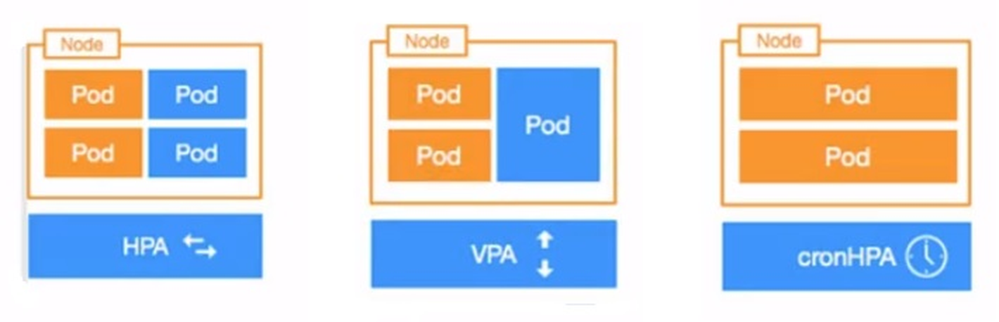
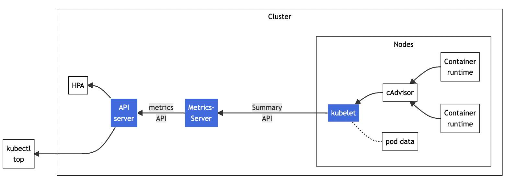
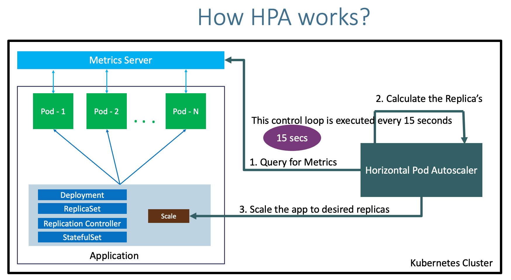
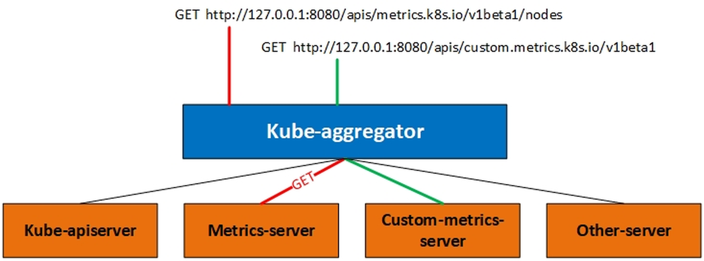
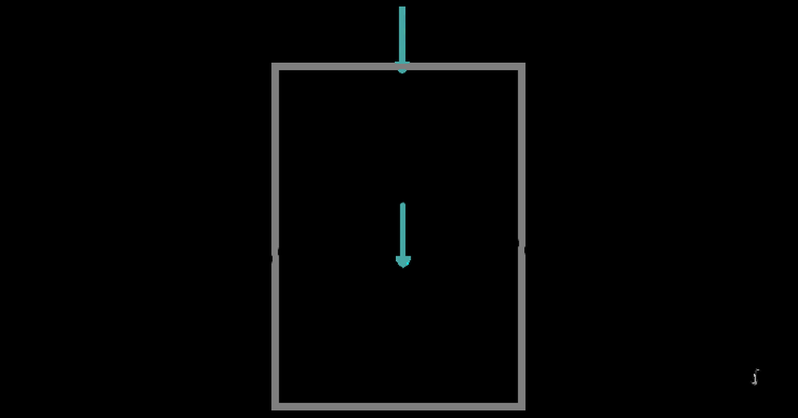
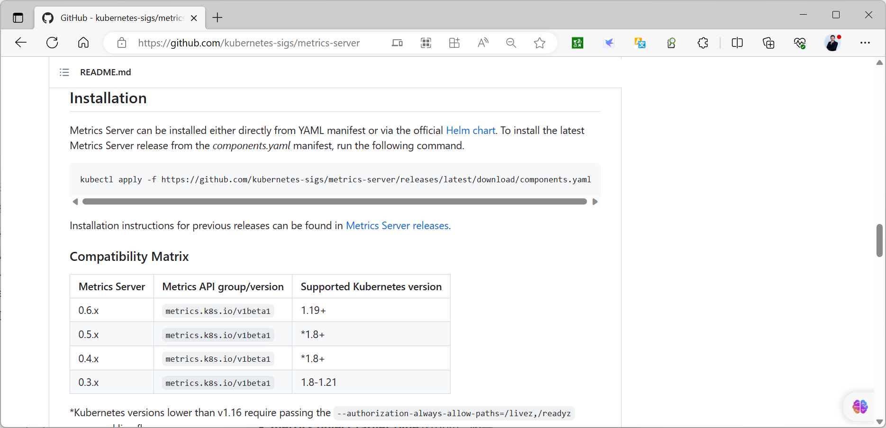

[← 返回 Kubernetes 目录]({{ '/subjects/Kubernetes/' | relative_url }})



# 13 HPA 原理与核心指标

## 1 扩缩容究竟调整什么

流量和资源需求随时间变化，扩缩容要先明确**调整对象**。增加 Pod 副本是水平扩缩；调整单个 Pod 的 CPU、内存请求量是垂直扩缩；增加或减少节点则是集群容量扩缩。三者相互关联，但不是同一个控制器的三种名称。



| 机制 | 调整对象 | 适用情况与注意点 |
| --- | --- | --- |
| `kubectl scale` | 工作负载副本数 | 临时手动调整；若同一工作负载受 HPA 管理，HPA 后续可能覆盖手动副本数。 |
| HPA（Horizontal Pod Autoscaler） | Deployment、StatefulSet 等的副本数 | 根据资源、对象、自定义或外部指标水平伸缩；不能缩放 DaemonSet。 |
| VPA（Vertical Pod Autoscaler） | 容器资源请求及可选限制 | 需要另装组件与 CRD；更新模式、是否重建 Pod 取决于版本和配置，不应假设能无中断就地修改。 |
| Cluster Autoscaler | 节点数量 | Pod 因资源不足无法调度时增加节点，或在安全条件下减少空闲节点；需要基础设施提供商支持。 |
| 定时伸缩 / KEDA / Knative | 视实现而定 | 用于可预测时段、事件驱动或请求驱动场景，均不是 HPA 的内置“Cron 模式”。 |

例如将 Deployment 手动调到四个副本：

```bash
kubectl scale deployment/example --replicas=4
```

业务低谷不一定应缩到零。标准 CPU/内存 HPA 通常以至少一个副本为起点；若需要零副本、请求到达时唤醒或队列驱动扩缩，应评估相应扩展方案及其冷启动影响。

## 2 HPA 的计算与前提

[官方 HPA 文档](https://kubernetes.io/zh-cn/docs/tasks/run-application/horizontal-pod-autoscale/)介绍了控制回路：HPA 定期读取指标，找到 `scaleTargetRef` 指向的工作负载，通过其 `scale` 子资源调整目标副本数。它并不是持续实时运行；默认同步周期常见为 15 秒，还受到采样延迟、Pod 就绪、容差和稳定窗口的影响。


核心近似公式为：

```text
期望副本数 = ceil[当前副本数 × (当前指标值 / 目标指标值)]
```

例如当前有 3 个副本、平均 CPU 利用率 80%、目标 40%，初步建议为 `ceil(3 × 80/40) = 6`。最终还要受 `minReplicas`/`maxReplicas`、扩缩策略、缺失指标和初始化期影响；接近目标值时，默认约 10% 的容差可避免反复抖动。多个指标同时配置时，控制器通常取各指标计算出的**最大建议副本数**，避免某一高负载指标被其他低负载指标掩盖。

CPU **利用率百分比**是相对于 Pod 模板中容器的 `resources.requests.cpu` 计算的，不是占节点总 CPU 的百分比。若请求为 `200m`，实际用量为 `100m`，其利用率约为 50%。使用 `averageUtilization` 的 CPU 或内存指标时，相关容器必须设置对应资源的 `requests`，否则 HPA 可能显示 `<unknown>` 并报告 `missing request`。`averageValue` 则按绝对资源量计算，语义不同。

启动中的 Pod、尚未就绪的 Pod 或缺失指标会触发保守处理。缩容还受稳定窗口影响，默认常见为 300 秒；“停止压测后没有立刻缩容”不一定是故障。`autoscaling/v1` 主要表达 CPU 百分比目标，`autoscaling/v2` 可表达 CPU、内存、多指标及 `behavior`。新清单优先使用集群支持的 `autoscaling/v2`，避免照搬历史 `v2beta*` 字段。

## 3 指标从哪里来

HPA 读取 API Server 提供的指标 API，而不是直接抓取每个容器。资源指标的典型路径为：

```text
HPA / kubectl top → API Server 聚合层 → metrics.k8s.io → Metrics Server → 各节点 kubelet
```



Metrics Server 通过 kubelet 获取近期 CPU 与内存用量，并把它们暴露为 `metrics.k8s.io`。它只服务于自动伸缩和 `kubectl top` 等实时查询，不是历史监控数据库；长期指标、告警和趋势分析应另用 Prometheus 等系统。自定义指标和外部指标分别走 `custom.metrics.k8s.io`、`external.metrics.k8s.io`，通常需要适配器；它们留到下一篇讨论。

```bash
kubectl get apiservice v1beta1.metrics.k8s.io
kubectl get deployment metrics-server -n kube-system
kubectl top nodes
kubectl top pods -A
```

若 `kubectl top` 报 `Metrics API not available`，先确认 Metrics Server 是否安装且 APIService 可用，再查看其日志及到 kubelet 的网络与证书。安装时应选与 Kubernetes 版本兼容的 [Metrics Server 官方发布清单](https://github.com/kubernetes-sigs/metrics-server/releases)；原文把 `--kubelet-insecure-tls` 当成默认必加项会跳过证书验证，应先解决 kubelet 证书信任链，只有明确了解测试环境风险时才临时使用该选项。还需保证 Metrics Server 能访问节点 kubelet 端口（通常 10250/TCP）及 API 聚合层服务。

## 4 一个可运行的 CPU HPA 案例

下例沿用官方演示思路：`php-apache` Deployment 定义 CPU 请求，Service 提供访问地址，HPA 以平均 CPU 利用率 50% 为目标，在 1–10 个副本之间调整。把三个资源保存为同一个 `php-apache-hpa.yaml` 后再应用；代码围栏里不混入终端提示符。

```yaml
apiVersion: apps/v1
kind: Deployment
metadata:
  name: php-apache
spec:
  replicas: 1
  selector:
    matchLabels:
      app: php-apache
  template:
    metadata:
      labels:
        app: php-apache
    spec:
      containers:
        - name: php-apache
          image: registry.cn-beijing.aliyuncs.com/bowen/hpa-example
          ports:
            - containerPort: 80
          resources:
            requests:
              cpu: 200m
              memory: 64Mi
            limits:
              cpu: 500m
              memory: 128Mi
---
apiVersion: v1
kind: Service
metadata:
  name: php-apache
spec:
  selector:
    app: php-apache
  ports:
    - name: http
      port: 80
      targetPort: 80
---
apiVersion: autoscaling/v2
kind: HorizontalPodAutoscaler
metadata:
  name: php-apache
spec:
  scaleTargetRef:
    apiVersion: apps/v1
    kind: Deployment
    name: php-apache
  minReplicas: 1
  maxReplicas: 10
  metrics:
    - type: Resource
      resource:
        name: cpu
        target:
          type: Utilization
          averageUtilization: 50
```

```bash
kubectl apply -f php-apache-hpa.yaml
kubectl rollout status deployment/php-apache
kubectl get hpa php-apache --watch
```

可在独立终端以测试 Pod 产生请求（压测强度应与测试集群容量匹配，不要无限循环轰击共享环境）：

```bash
kubectl run load-generator --image=registry.cn-beijing.aliyuncs.com/bowen/busybox:1.32.0 --restart=Never -- /bin/sh -c 'for i in $(seq 1 300); do wget -q -O- http://php-apache >/dev/null; done'
```

再观察 `kubectl get hpa php-apache`、`kubectl describe hpa php-apache`、`kubectl top pods` 和 Deployment 副本数。CPU 上升、HPA 建议扩容、Pod 启动后指标回落是可能的过程，具体幅度取决于负载，不应把原终端截图的数值当成必然结果。停止请求后，缩容可能等待稳定窗口。结束实验时执行 `kubectl delete -f php-apache-hpa.yaml`。

## 5 内存 HPA 与行为配置

内存指标也可用 `autoscaling/v2` 配置，只需把资源名设为 `memory`，并给容器设置 `requests.memory`。但与 CPU 不同，内存占用通常不会随请求结束立即下降；仅用内存利用率可能导致持续扩容或迟迟不缩容。应先分析应用缓存、GC 与内存限制，再决定是否以内存作为伸缩信号。

```yaml
# 以下片段位于 HorizontalPodAutoscaler.spec 内
metrics:
  - type: Resource
    resource:
      name: memory
      target:
        type: Utilization
        averageUtilization: 70
behavior:
  scaleDown:
    stabilizationWindowSeconds: 300
```

若同时配置 CPU 与内存，任一指标要求更多副本时可能触发扩容。多指标中的某个指标不可用时，应查看 HPA Conditions 与事件；不要仅凭当前副本数判断 HPA 工作正常。`behavior.scaleDown.stabilizationWindowSeconds` 可调整缩容观察窗口，设置很短可能造成频繁增减，须结合流量波动和冷启动时长测试。

## 6 排障顺序

1. `kubectl describe hpa <名称>`：确认目标工作负载、当前/目标指标、`AbleToScale`、`ScalingActive`、`ScalingLimited` 和事件。
2. `kubectl top pods`：确认资源指标 API 可用；若不可用，查 APIService、Metrics Server Pod 与日志、kubelet 证书及网络。
3. 检查目标 Deployment 的 Pod 标签选择器与每个容器的 `requests.cpu` / `requests.memory`。`missing request for cpu` 指的是请求量缺失，不是节点没有 CPU。
4. 区分 `ScalingLimited`（触及最小/最大副本数）、稳定窗口等待、指标缺失和调度失败。HPA 修改了期望副本数，也不保证新 Pod 一定能调度；节点容量不足还需处理资源或节点扩容。

<details class="historical-figures" markdown="1">
<summary>查看原始讲义中的其余配图与历史操作截图（12 张）</summary>










</details>



<nav class="article-end" aria-label="章节导航">
  <a href="{{ '/subjects/Kubernetes/12-pod-scheduling.html' | relative_url }}">← 上一章：Pod 调度、拓扑与驱逐</a>
  <a href="{{ '/subjects/Kubernetes/' | relative_url }}">返回 Kubernetes 目录</a>
  <a href="{{ '/subjects/Kubernetes/14-hpa-custom-metrics.html' | relative_url }}">下一章：自定义指标、Prometheus Adapter 与 KEDA →</a>
</nav>
