[← 返回 Kubernetes 目录]({{ '/subjects/Kubernetes/' | relative_url }})



# 14 自定义指标、Prometheus Adapter 与 KEDA

# 3 自定义指标流水线

**HPA和Metrics 架构**

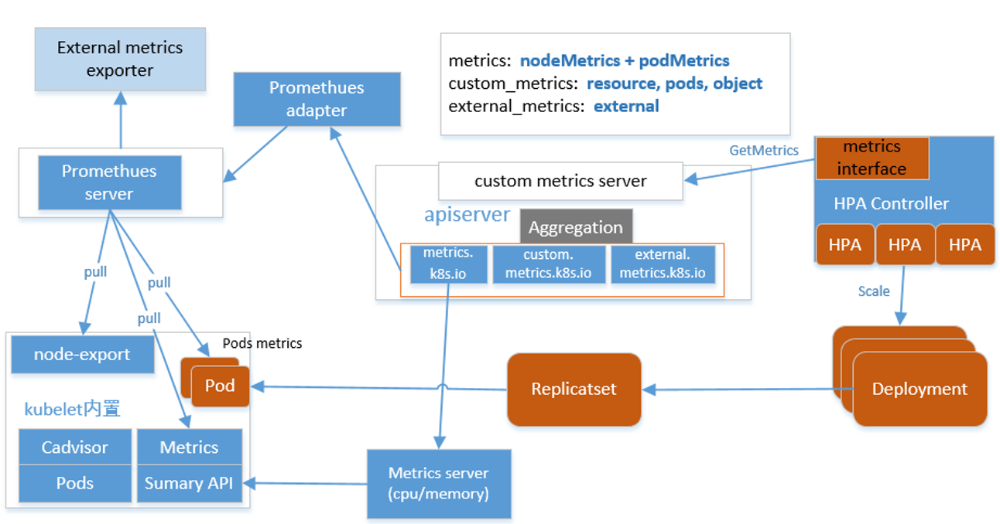

## 3.1 自定义指标流水线

最早的kubernetes的metrics数据是由metrics-server提供的，只支持Pod使用CPU和内存的指标。

除了常见的CPU、内存资源指标以外，用户还需要了解kubernetes中更多的指标数据，比如Kubernetes 指标、容器指标、节点资源指标以及应用程序指标等等。后来为了适应更灵活的需求，metrics API开始扩展支持用户自定义metrics指标（custom metrics），自定义数据则需要用户自行开发custom metrics server，社区有提供专门的custom adpater框架custom-metrics-apiserver ，该框架定义了Custom和External的MetricsProvider接口，需要自行实现对应的接口。

Kubernetes 如果需要暴露其它指标的API，由Custom Metrics API和External Metrics API 实现。

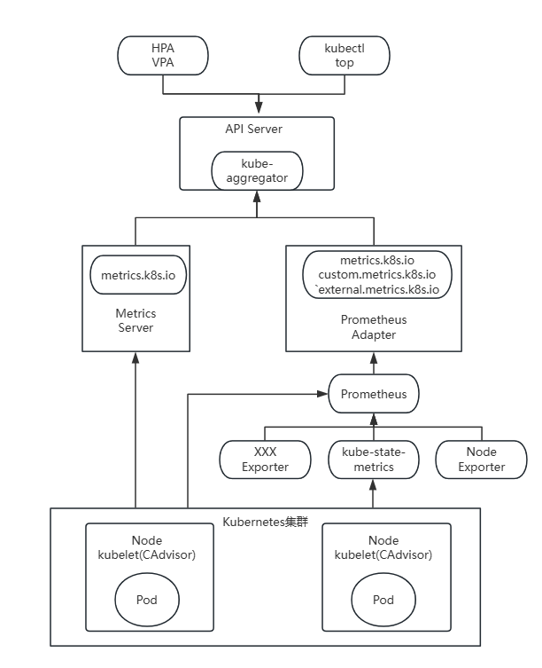

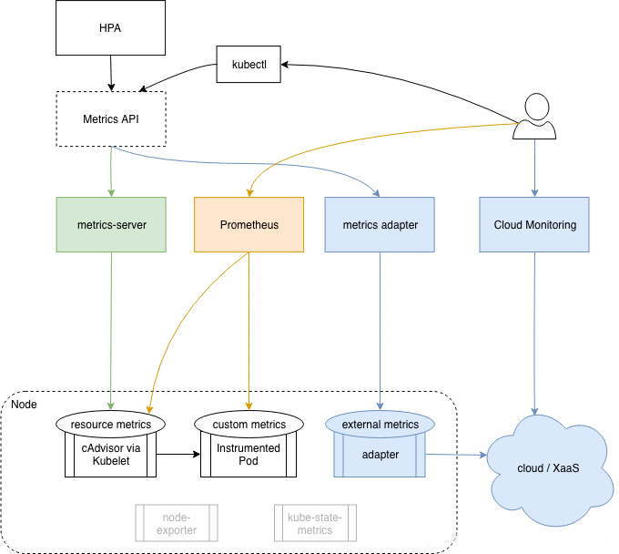

负责支撑 Custom Metrics API、生成并提供各种自定义的指标数据的相关组件，称为自定义指标流水线。自定义指标流水线可以取代核心指标流水线,实现它的基于CPU和内存指标功能,并提供更多自定义的指标。

自定义指标流水线需要准备如下组件

prometheus-server

必要组件

**采集指标数据**

默认只能采集Kubernetes 的Node,Pod,endpoint,SVC，ingress

prometheus-adapter

**必要组件**

提供custom.metrics.k8s.io和external.metrics.k8s.io 相关API，注册到API聚合层。负责将Prometheus的指标数据转换为Kubernetes的指标格式。

kube-state-metrics

**可选组件**

基于 kubernetes_sd 只能采集Node,Pod,Service,endpoint,Ingress五种资源。使用 kube-state-metrics 可以支持更多类型的Kubernetes 资源,比如:deployment等。

相当于K8s-exporter功能

Pormetheus 可以做为一个监控系统使用,所需要组件如下：

prometheus-server alertmanager grafana blackbox-exporter push-gateway node-exporter kube-state-metrics其它的exporter

Prometheus 能够直接把 Kubernetes API Server 作为服务发现系统使用进而动态发现和监控集群中的所有可被监控的对象。这里需要特别说明的是， Pod 资源需要添加下列注解信息才能被 Prometheus 系统自动发现并抓取其内建的指标数据。

prometheus. io/scrape： 用于标识是否需要被采集指标数据， 布尔型值 true 或 false prometheus. io/path： 抓取指标数据时使用的URL路径， 默认为/ metrics prometheus. io/port： 抓取指标数据时使用的套接字端口， 如 8080。

### 自定义指标流线线流程

Node/Pod/Ingress/Service/Endpoint/Deployment/PV等 ---> Node_exporter / Kube -state-metrics/Instrumentation/各种Exporters/Pushgateway ---> Prometheus Server  ---> Prometheus Adapater(PromQL)   ---> API Server (custom.metrics.k8s.io/v1beta1,external.metrics.k8s.io/v1beta1) --->HPA

## 3.2 Prometheus Adapter

### 3.2.1 Prometheus Adapter 说明

自定义指标API允许请求任意的指标，其指标API的实现要指定相应的后端的指标监控系统。最常见的监控工具有Prometheus、Datadog以及Sysdig等。而不同的工具所使用的格式也有所区别。在使用Kubernetes API聚合来暴露endpoint之前，我们需要将指标转换为合适的格式。此时需要使用的adapter，它在监控工具和Kubernetes API之间架起了一座桥梁。

例如，Prometheus有专门的Prometheus adapter或者Datadog有Datadog Cluster Agent。它们位于指标监控系统和API之间，并从一种格式转换到另一个种格式。

prometheus-adapter

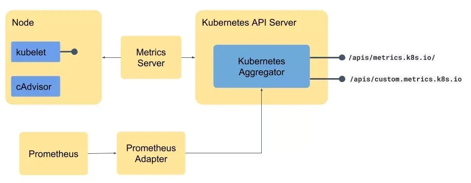

Prometheus 是提供丰富指标的监控系统，可以通过 PromQL 查询指标数据。但是，Prometheus 属于第三方方案，原生 Kubernetes 系统不能直接解析其自定义指标，因此需要通过 k8s-prometheus-adapter 项目，将 Prometheus 的指标查询接口转换为标准的 Kubernetes 自定义指标。

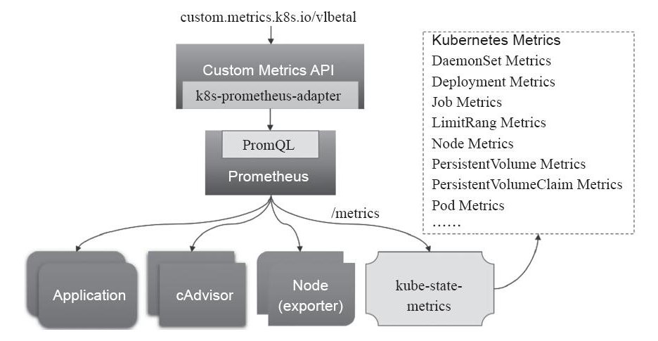

Prometheus Adapter


- <https://github.com/kubernetes-sigs/prometheus-adapter>


Custom Metrics API和External Metrics API 要由专用的第三方的API Server提供，例如著名的Prometheus Adapter项目Prometheus Adapter 注册至API Server ，使其支持更多的扩展的API 群组:custom.metrics.k8s.io和external.metrics.k8s.io Prometheus Adapter 同时也支持核心流水线API群组metrics.k8s.io，从而可以替换已运行Kubernetes集群上的Metrics Server并收集相应的指标。Prometheus Adapter 相当于增强版本的Metrics Server，可以支持包括CPU和内存两种核心指标以及更多自定义指标适用于 Kubernetes 1.6+ 中的autoscaling/v2 水平 Pod 自动缩放程序。


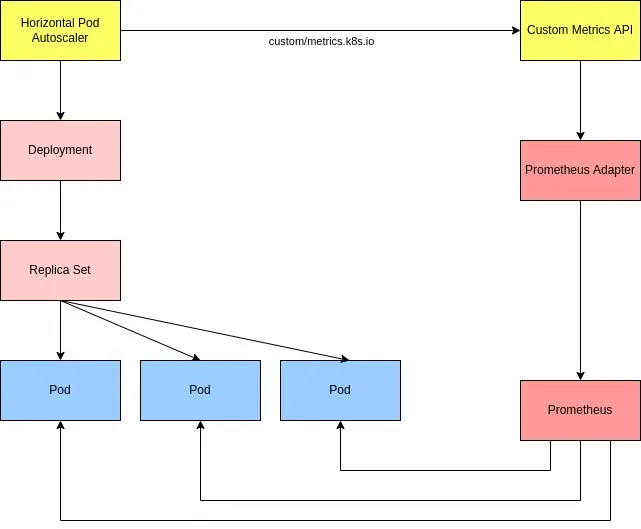

### 3.2.2 Prometheus Adapter 部署

#### 3.2.2.1 方法1: YAML文件部署
```text
https://github.com/kubernetes-sigs/prometheus-adapter/tree/master/deploy
https://github.com/kubernetes-sigs/prometheus-
adapter/tree/master/deploy/manifests
```

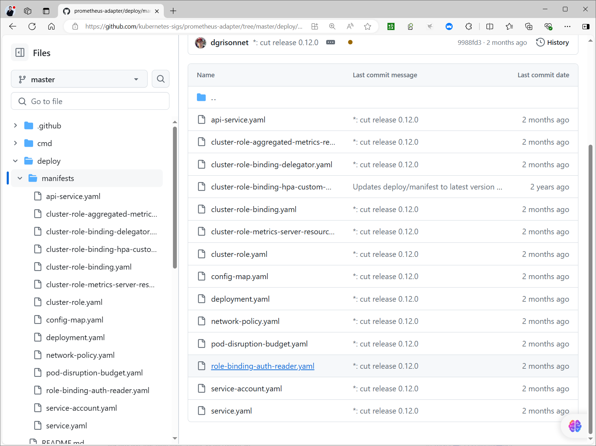

1. 创建名为custom-metrics的名称空间。
```bash
[root@master1 ~]#kubectl create namespace custom-metrics
```

2. 创建一个名为cm-adapter-serving-certs的secret对象，它需要具备serving.crt和serving.key两个键。这些是适配器 adapter用于处理 HTTPS 流量的服务证书，更多的信息，请参考auth concepts documentation。

可通过如下命令，运行目录中预置的gencerts.sh脚本进行创建此secret 资源。
```bash
#该脚本依赖于golang的cfssl模块，下面的命令也能在Ubuntu Server完成该模块的安装。
[root@master1 prometheus-adpater]#apt update && apt install -y golang-cfssl
[root@master1 prometheus-adpater]#bash gencerts.sh

#查看生成的文件
[root@master1 prometheus-adpater]#ls manifests/
cm-adapter-serving-certs.yaml     #上面脚本生成一个新文件              custom-
metrics-apiserver-service.yaml
custom-metrics-apiserver-auth-delegator-cluster-role-binding.yaml   custom-
metrics-apiservice.yaml
custom-metrics-apiserver-auth-reader-role-binding.yaml              custom-
metrics-cluster-role.yaml
custom-metrics-apiserver-deployment.yaml                            custom-
metrics-config-map.yaml
custom-metrics-apiserver-resource-reader-cluster-role-binding.yaml  custom-
metrics-resource-reader-cluster-role.yaml
custom-metrics-apiserver-service-account.yaml
```

该脚本会在manifests目录下创建一个cm-adapter-serving-certs.yaml的文件，它提供了相关secret对象的配置。另外，

3. 运行如下命令，在custom-metrics名称空间中部署prometheus-adapter。
```yaml
#新加APIService
[root@master1 prometheus-adpater]#cat manifests/custom-metrics-
apiservice.yaml
apiVersion: apiregistration.k8s.io/v1
kind: APIService
metadata:
name: v1beta1.custom.metrics.k8s.io
spec:
service:
name: custom-metrics-apiserver
namespace: custom-metrics
group: custom.metrics.k8s.io
version: v1beta1
insecureSkipTLSVerify: true
groupPriorityMinimum: 100
versionPriority: 100
---
apiVersion: apiregistration.k8s.io/v1
kind: APIService
metadata:
name: v1beta2.custom.metrics.k8s.io
spec:
service:
name: custom-metrics-apiserver
namespace: custom-metrics
group: custom.metrics.k8s.io
version: v1beta2
insecureSkipTLSVerify: true
groupPriorityMinimum: 100
versionPriority: 200
---
apiVersion: apiregistration.k8s.io/v1
kind: APIService
metadata:
name: v1beta1.external.metrics.k8s.io
spec:
service:
name: custom-metrics-apiserver
namespace: custom-metrics
group: external.metrics.k8s.io
version: v1beta1
insecureSkipTLSVerify: true
groupPriorityMinimum: 100
versionPriority: 100
---

#定义Prometheus的地址
[root@master1 prometheus-adpater]#cat manifests/custom-metrics-apiserver-
deployment.yaml
apiVersion: apps/v1
kind: Deployment
metadata:
labels:
app: custom-metrics-apiserver
name: custom-metrics-apiserver
namespace: custom-metrics
spec:

replicas: 1
selector:
matchLabels:
app: custom-metrics-apiserver
template:
metadata:
labels:
app: custom-metrics-apiserver
name: custom-metrics-apiserver
spec:
serviceAccountName: custom-metrics-apiserver
containers:
- name: custom-metrics-apiserver
#image: gcr.io/k8s-staging-prometheus-adapter-amd64
#image: registry.k8s.io/prometheus-adapter/prometheus-
adapter:v0.10.0
image: registry.cn-beijing.aliyuncs.com/bowen/prometheus-
adapter:v0.10.0
args:
- --secure-port=6443
- --tls-cert-file=/var/run/serving-cert/serving.crt
- --tls-private-key-file=/var/run/serving-cert/serving.key
- --logtostderr=true
- --prometheus-url=http://prometheus.prom.svc:9090/ #指向当前
prometheus Server的SVC
......

#定义prometheus-adpater对应prometheus的规则
[root@master1 prometheus-adpater]#cat manifests/custom-metrics-config-
map.yaml

[root@master1 prometheus-adpater]#kubectl apply -f manifests/
secret/cm-adapter-serving-certs created
clusterrolebinding.rbac.authorization.k8s.io/custom-metrics:system:auth-
delegator created
rolebinding.rbac.authorization.k8s.io/custom-metrics-auth-reader created
deployment.apps/custom-metrics-apiserver created
clusterrolebinding.rbac.authorization.k8s.io/custom-metrics-resource-reader
created
serviceaccount/custom-metrics-apiserver created
service/custom-metrics-apiserver created
apiservice.apiregistration.k8s.io/v1beta1.custom.metrics.k8s.io created
apiservice.apiregistration.k8s.io/v1beta2.custom.metrics.k8s.io created
apiservice.apiregistration.k8s.io/v1beta1.external.metrics.k8s.io created
clusterrole.rbac.authorization.k8s.io/custom-metrics-server-resources
created
configmap/adapter-config created
clusterrole.rbac.authorization.k8s.io/custom-metrics-resource-reader created
clusterrolebinding.rbac.authorization.k8s.io/hpa-controller-custom-metrics
created

[root@master1 prometheus-adpater]#kubectl get all -n custom-metrics
NAME                                            READY   STATUS    RESTARTS
AGE
pod/custom-metrics-apiserver-5dbc646c6b-qr5dl   1/1     Running   0
2m39s

NAME                               TYPE        CLUSTER-IP      EXTERNAL-IP
PORT(S)   AGE
service/custom-metrics-apiserver   ClusterIP   10.103.85.202   <none>
443/TCP   2m39s

NAME                                       READY   UP-TO-DATE   AVAILABLE
AGE
deployment.apps/custom-metrics-apiserver   1/1     1            1
2m39s

NAME                                                  DESIRED   CURRENT
READY   AGE
replicaset.apps/custom-metrics-apiserver-5dbc646c6b   1         1         1
2m39s

#添加的API 群组
[root@master1 prometheus-adpater]#kubectl api-versions
.....
custom.metrics.k8s.io/v1beta1
custom.metrics.k8s.io/v1beta2
......
external.metrics.k8s.io/v1beta1
```

4. 测试访问
```bash
#此方式没有安装metrics.k8s.io的API
[root@master1 ~]#kubectl get --raw /apis/metrics.k8s.io/v1beta1
Error from server (NotFound): the server could not find the requested resource

#安装生成custom.metrics.k8s.io和external.metrics.k8s.io
[root@master1 ~]#kubectl get --raw /apis/custom.metrics.k8s.io/v1beta1
[root@master1 ~]#kubectl get --raw /apis/external.metrics.k8s.io/v1beta1

#在实现自定义流水线规则后，才执行下面查看到相应的内容
[root@master1 ~]#kubectl get --raw
/apis/custom.metrics.k8s.io/v1beta1/namespaces/default/pods/*/http_requests_per_
second | jq
```

#### 3.2.2.2 方法2: Helm部署


- <https://github.com/kubernetes-sigs/prometheus-adapter>


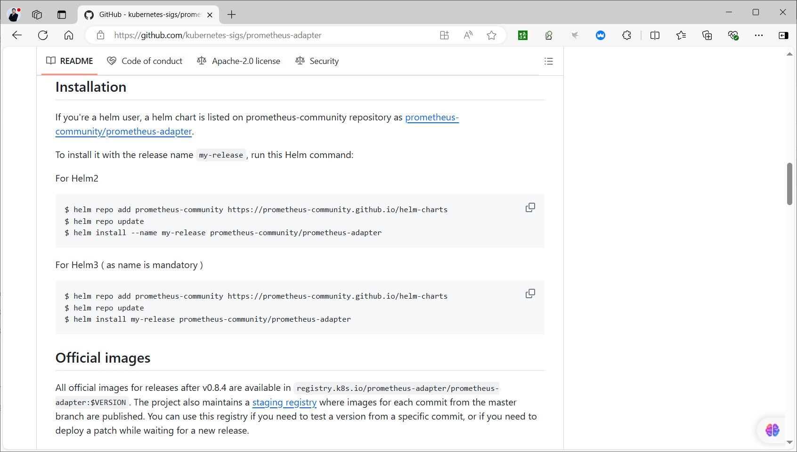
```bash
#可能需要配置科学上网
$ helm repo add prometheus-community https://prometheus-
community.github.io/helm-charts
$ helm repo update
$ helm install my-release prometheus-community/prometheus-adapter
```

范例: Helm部署
```bash
[root@master1 ~]#kubectl api-versions
admissionregistration.k8s.io/v1
apiextensions.k8s.io/v1
apiregistration.k8s.io/v1
apps/v1
authentication.k8s.io/v1
authorization.k8s.io/v1
autoscaling/v1
autoscaling/v2
batch/v1
certificates.k8s.io/v1
coordination.k8s.io/v1
discovery.k8s.io/v1
events.k8s.io/v1
flowcontrol.apiserver.k8s.io/v1
metallb.io/v1beta1
metallb.io/v1beta2
networking.k8s.io/v1
node.k8s.io/v1
policy/v1
rbac.authorization.k8s.io/v1
scheduling.k8s.io/v1
snapshot.storage.k8s.io/v1
storage.k8s.io/v1
v1

#需要配置科学上网
[root@master1 ~]#bash set_http_proxy.sh start
HTTP 代理配置完成!                                         [  OK  ]

[root@master1 ~]#helm repo add prometheus-community https://prometheus-
community.github.io/helm-charts
"prometheus-community" has been added to your repositories
[root@master1 ~]#helm repo update
Hang tight while we grab the latest from your chart repositories...
...Successfully got an update from the "prometheus-community" chart repository
```

Update Complete. ⎈Happy Helming!⎈
```bash
[root@master1 ~]#helm install prometheus-adapter prometheus-community/prometheus-
adapter --namespace monitoring --create-namespace --values prometheus-adapter-
values.yaml
NAME: prometheus-adapter
LAST DEPLOYED: Tue Apr 22 17:59:43 2025
NAMESPACE: monitoring
STATUS: deployed
REVISION: 1
TEST SUITE: None
NOTES:
prometheus-adapter has been deployed.
In a few minutes you should be able to list metrics using the following
command(s):

kubectl get --raw /apis/metrics.k8s.io/v1beta1
kubectl get --raw /apis/custom.metrics.k8s.io/v1beta1

kubectl get --raw /apis/external.metrics.k8s.io/v1beta1

#下载镜像失败
[root@master1 ~]#kubectl get pod -n monitoring
NAME                                  READY   STATUS             RESTARTS   AGE
prometheus-adapter-698c8577df-9xg2v   1/1     ImagePullBackOff   0
8m46s

[root@master1 ~]#kubectl describe pod -n monitoring       prometheus-adapter-
698c8577df-9xg2v
Events:
Type     Reason          Age                    From               Message
----     ------          ----                   ----               -------
Normal   Scheduled       4m58s                  default-scheduler  Successfully
assigned monitoring/prometheus-adapter-698c8577df-9xg2v to node3.bowen.org
Normal   Pulling         2m22s (x4 over 4m58s)  kubelet            Pulling
image "registry.k8s.io/prometheus-adapter/prometheus-adapter:v0.12.0"
Warning  Failed          119s (x4 over 4m35s)   kubelet            Failed to
pull image "registry.k8s.io/prometheus-adapter/prometheus-adapter:v0.12.0":
Error response from daemon: Head "https://us-west2-docker.pkg.dev/v2/k8s-
artifacts-prod/images/prometheus-adapter/prometheus-adapter/manifests/v0.12.0":
dial tcp 64.233.188.82:443: connect: connection refused
Warning  Failed          119s (x4 over 4m35s)   kubelet            Error:
ErrImagePull
Normal   SandboxChanged  112s                   kubelet            Pod sandbox
changed, it will be killed and re-created.
Normal   BackOff         93s (x9 over 4m35s)    kubelet            Back-off
pulling image "registry.k8s.io/prometheus-adapter/prometheus-adapter:v0.12.0"

#下载镜像需要容器的科学上网
[root@node3 ~]#bash install/set_docker_proxy.sh start

Docker 服务代理配置完成!                                   [  OK  ]
[root@node3 ~]#docker pull registry.k8s.io/prometheus-adapter/prometheus-
adapter:v0.12.0

#查看多了三个API
[root@master1 ~]#kubectl api-versions
admissionregistration.k8s.io/v1
apiextensions.k8s.io/v1
apiregistration.k8s.io/v1
apps/v1
authentication.k8s.io/v1
authorization.k8s.io/v1
autoscaling/v1
autoscaling/v2
batch/v1
certificates.k8s.io/v1
coordination.k8s.io/v1
custom.metrics.k8s.io/v1beta1
discovery.k8s.io/v1
events.k8s.io/v1
external.metrics.k8s.io/v1beta1
flowcontrol.apiserver.k8s.io/v1
metallb.io/v1beta1
metallb.io/v1beta2
metrics.k8s.io/v1beta1
networking.k8s.io/v1
node.k8s.io/v1
policy/v1
rbac.authorization.k8s.io/v1
scheduling.k8s.io/v1
snapshot.storage.k8s.io/v1
storage.k8s.io/v1
v1
[root@master1 ~]#kubectl api-versions |wc -l
27
[root@master1 ~]#kubectl api-versions |grep metrics
custom.metrics.k8s.io/v1beta1
external.metrics.k8s.io/v1beta1
metrics.k8s.io/v1beta1

[root@master1 ~]#kubectl get pod -A|grep prometheus
monitoring       prometheus-adapter-698c8577df-9xg2v         1/1     Running
0                6m47s

#可以替代metric-server功能
[root@master1 ~]#kubectl top nodes
NAME               CPU(cores)   CPU(%)   MEMORY(bytes)   MEMORY(%)
master1.bowen.org   126m         6%       1141Mi          62%
node1.bowen.org     61m          3%       843Mi           46%
node2.bowen.org     59m          2%       849Mi           46%
node3.bowen.org     94m          4%       1113Mi          60%

#测试访问查看API
[root@master1 ~]#kubectl get --raw /apis/metrics.k8s.io/v1beta1
[root@master1 ~]#kubectl get --raw /apis/custom.metrics.k8s.io/v1beta1
[root@master1 ~]#kubectl get --raw /apis/external.metrics.k8s.io/v1beta1
```

### 3.2.3 Prometheus Adapter 规则配置说明
```text
https://github.com/kubernetes-sigs/prometheus-adapter/blob/master/docs/config.md
https://github.com/kubernetes-sigs/prometheus-adapter/blob/master/docs/config-
walkthrough.md
https://github.com/kubernetes-sigs/prometheus-adapter/blob/master/docs/sample-
config.yaml
```

Prometheus Adapter通过一组“发现（discovery）”规则（rules）来确定要公开哪些指标，以及如何公开这些指标。每条规则都是独立执行的（因此要确保规则彼此互斥），它通常包含需要由Adpater在API 公开指标时所需采取的多个步骤。

每条规则大致可以分为四个部分：

发现：指定Adpater如何找到此规则的所有 Prometheus 指标关联：指定Adpater应如何确定特定指标与哪些 Kubernetes 资源相关联命名：指定Adpater应如何在自定义指标 API 中公开指标查询：指定如何将对一个或多个 Kubernetes 对象上的特定指标的请求转换为对 Prometheus 的查询。

下面是一个示例：
```yaml
- seriesQuery: 'http_requests_total{namespace!="",pod!=""}'
resources:
overrides:
namespace: {resource: "namespace"}
pod: {resource: "pod"}
name:
matches: "^(.*)_total"
as: "${1}_per_second"
metricsQuery: rate(<<.Series>>{<<.LabelMatchers>>}[1m])
```


#解析 1）seriesQuery（系列查询）：在 Prometheus 中查找匹配的指标系列在 Prometheus 中查找名为 http_requests_total的指标要求必须包含以下标签且不为空：namespace!="": 必须有 Kubernetes 命名空间标签 pod!="": 必须有 Kubernetes Pod 名称标签这确保了只选择与 Kubernetes 资源关联的 HTTP 请求指标


2）resources（资源映射）：将 Prometheus 标签映射到 Kubernetes API 资源：namespace标签 → Kubernetes namespace资源 pod 标签 → Kubernetes pod资源这样 HPA 就能知道指标关联到哪个命名空间和哪个 Pod

```text
3）name（指标名称转换）
matches: "^(.*)_total": 使用正则表达式匹配指标名
(.*)捕获组：匹配 http_requests部分
_total：匹配后缀
as: "${1}_per_second": 重命名指标
${1}：引用第一个捕获组，即 http_requests
最终名称：http_requests_per_second

4）metricsQuery（指标查询）
<<.Series>>: 替换为原始指标名 http_requests_total

<<.LabelMatchers>>: 自动包含查询时的标签匹配条件
rate(...[1m]): 计算 1 分钟内的请求速率（QPS）
完整查询示例：rate(http_requests_total{namespace="default",pod="app-pod"}[1m])
```

待Prometheus和Prometheus Adapter的相关Pod均就绪后，获取针对现存系统环境由规则生成的自定义指标信息。
```text
kubectl get --raw /apis/custom.metrics.k8s.io/v1beta1
```

部署示例应用metrcis app，它附带有“http_requests_total”指标。
```text
kubectl apply -f https://raw.githubusercontent.com/iKubernetes/k8s-
prom/master/prometheus-adpater/example-metrics/metrics-example-app.yaml
```

待Metrics App的Pod就绪后，等待Prometheus Server的几个指标抓取周期，即可尝试获取由规则生成自定义指标http_requests_per_second。
```text
kubectl get --raw
/apis/custom.metrics.k8s.io/v1beta1/namespaces/default/pods/*/http_requests_per_
second | jq
```

## 3.3 kube-state-metrics (可选)

如果只是实现HPA-v2的自动扩容，此kube-state-metrics组件可无需安装。如果需要通过Prometheus实现监控Kubernetes的deplyment,statefulset等资源，才需要安装此组件。

### 3.3.1 kube-state-metrics  说明

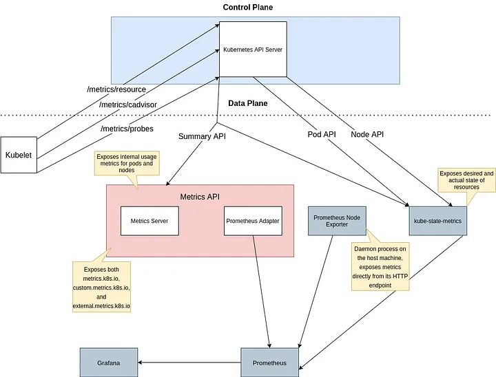

prometheus 本身就是一个监控系统，分为server 端和agent 端。server 端从被监控主机获取数据，而agent 端需要部署一个exporter ，主要用于数据采集和暴露节点的数据。

基于Kubernetes_sd 只能支持如下五种资源

Node --> node role Pods --> pod role Endpoint --> endpoint role Service --> service role Ingress --> ingress role

对于Kubernetes 的还有更多的其它的资源,比如: Deployment,PV等 想要获取其指标数据，就需要部署相关的exporter 。

kube-state-metrics


- <https://github.com/kubernetes/kube-state-metrics>


kube-state-metrics （KSM） 相当于 kubernetes-exporter kube-state-metrics  是一个监听 Kubernetes API  Server 的简单服务,可以生成有关对象状态的指标。kube-state-metrics 专注于从 Kubernetes 的对象状态（例如，基于deployments, replica sets等）。它将 Kubernetes 状态的完整快照保存在内存中，并且 根据它不断生成新的指标Prometheus 默认只支持对Node,Pod,Endpoint,Serivce,Ingress 这五个资源进行采集指标，而不支持常见的其它资源，如：Deployment,statefulset等,kube-state-metrics可以支持更多的资源的指标,比如:Deployment,statefulset,DaemonSet,PVC等,做为Prometheus 指标采集的补充kube-state-metrics 从Kubernetes API  Server 查询所有可被监控对象的State字段获取相关指标数据,再将这些资源的指标转换为Prometheus的标准格式,由Prometheus进行指标采集Kubernetes 资源对象指标 --> kube-state-metrics --> Prometheus

### 3.3.2 kube-state-metrics 的指标


- <https://github.com/kubernetes/kube-state-metrics/tree/main/docs>


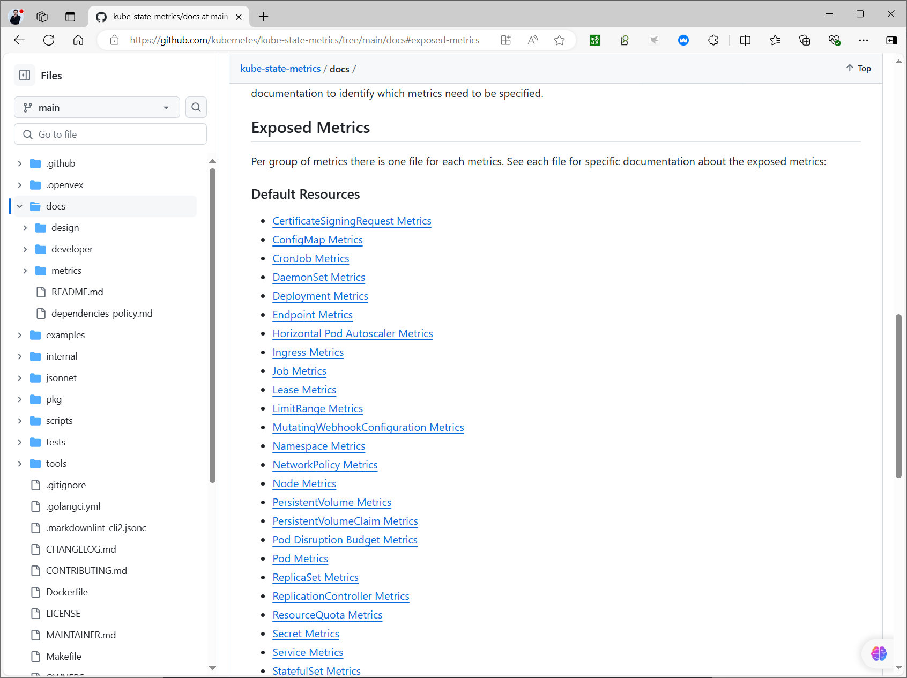

**Kube-state-metrics 自身的 metrics**

kube-state-metrics 公开了自己的通用进程指标 --telemetry-host and --telemetry-port (default 8081).

kube-state-metrics 还公开了 List 和 Watch Success 和 Error 指标。这些可用于计算 list 或 watch 资源的错误率。
```text
kube_state_metrics_list_total{resource="*v1.Node",result="success"} 1
kube_state_metrics_list_total{resource="*v1.Node",result="error"} 52
kube_state_metrics_watch_total{resource="*v1beta1.Ingress",result="success"} 1
```

kube-state-metrics 还公开了一些 HTTP 请求指标
```text
http_request_duration_seconds_bucket{handler="metrics",method="get",le="2.5"} 30
http_request_duration_seconds_bucket{handler="metrics",method="get",le="5"} 30
http_request_duration_seconds_bucket{handler="metrics",method="get",le="10"} 30
http_request_duration_seconds_bucket{handler="metrics",method="get",le="+Inf"}
30
http_request_duration_seconds_sum{handler="metrics",method="get"}
0.021113919999999998
http_request_duration_seconds_count{handler="metrics",method="get"} 30
```

kube-state-metrics 还公开了构建和配置指标：
```text
#kube_state_metrics_build_info用于公开版本和其他生成信息
kube_state_metrics_build_info{branch="main",goversion="go1.15.3",revision="6c9d7
75d",version="v2.0.0-beta"}

kube_state_metrics_shard_ordinal{shard_ordinal="0"} 0
kube_state_metrics_total_shards 1
```

kube-state-metrics 还公开了有关它的配置文件和自定义资源状态配置文件的指标：
```text
kube_state_metrics_config_hash{filename="crs.yml",type="customresourceconfig"}
2.38272279311849e+14
kube_state_metrics_config_hash{filename="config.yml",type="config"}
2.65285922340846e+14
kube_state_metrics_last_config_reload_success_timestamp_seconds{filename="crs.ym
l",type="customresourceconfig"} 1.6704882592037103e+09
kube_state_metrics_last_config_reload_success_timestamp_seconds{filename="config
.yml",type="config"} 1.6704882592035313e+09
kube_state_metrics_last_config_reload_successful{filename="crs.yml",type="custom
resourceconfig"} 1
kube_state_metrics_last_config_reload_successful{filename="config.yml",type="con
fig"} 1
```

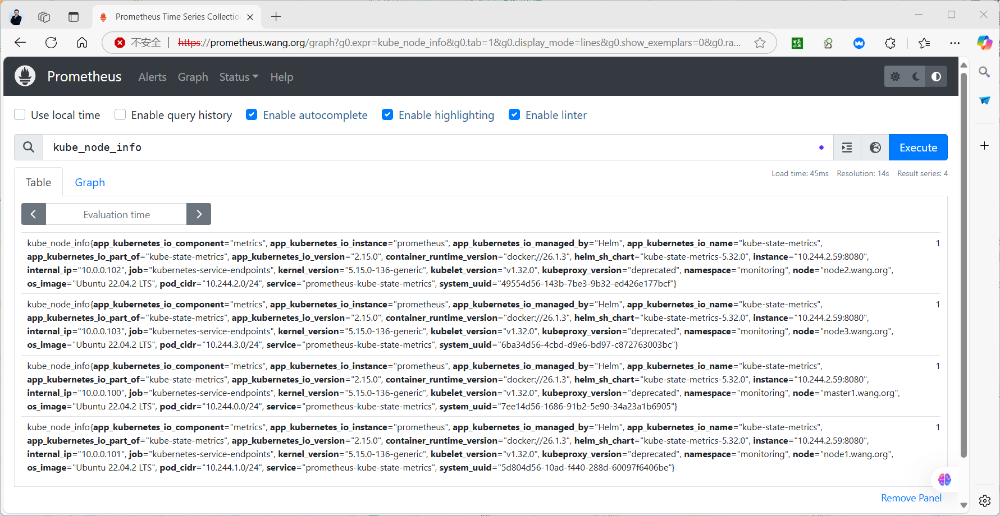


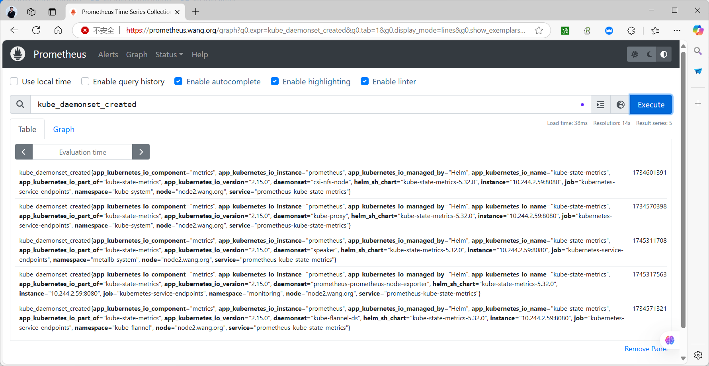


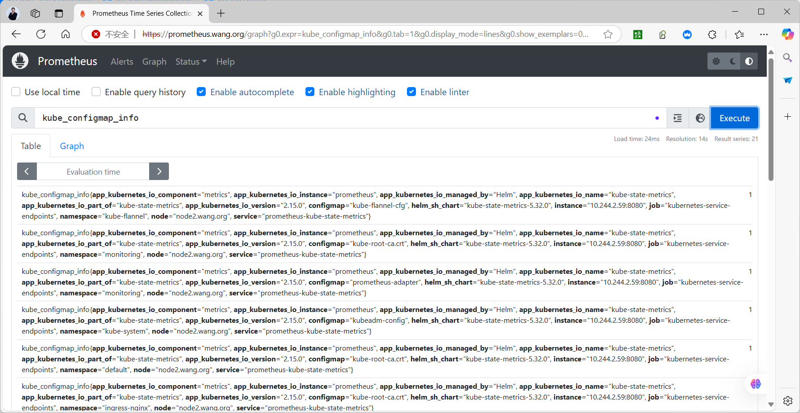

### 3.3.3 kube-state-metrics  部署


- <https://github.com/kubernetes/kube-state-metrics#kubernetes-deployment>
- <https://github.com/kubernetes/kube-state-metrics/tree/main/examples/standard>


**资源使用推荐**

kube-state-metrics 的资源使用量随集群的 Kubernetes 对象（Pods/Nodes/Deployments/Secrets等）大小而变化。 在某种程度上，集群中的 Kubernetes 对象与集群的节点号成正比。

作为一般规则，您应该分配：

250MiB 内存0.1 个核心

#### 3.3.3.1 YAML 清单文件方式部署 kube-state-metrics

范例：YAML 清单文件方式部署 kube-state-metrics
```yaml
[root@master1 kube-state-metrics]#ls
kube-state-metrics-deploy.yaml  kube-state-metrics-rbac.yaml  kube-state-metrics-
svc.yaml

[root@master1 kube-state-metrics]#cat kube-state-metrics-deploy.yaml
apiVersion: apps/v1
kind: Deployment
metadata:
name: kube-state-metrics
namespace: prom
spec:
replicas: 1
selector:
matchLabels:
app: kube-state-metrics
template:
metadata:
labels:
app: kube-state-metrics
spec:
serviceAccountName: kube-state-metrics
containers:
- name: kube-state-metrics
#image: gcr.io/google_containers/kube-state-metrics-amd64:v1.3.1
#image: gcmirrors/kube-state-metrics-amd64:v1.7.1
image: registry.cn-beijing.aliyuncs.com/bowen/kube-state-metrics-
amd64:v1.7.1
ports:
- containerPort: 8080

[root@master1 kube-state-metrics]#cat kube-state-metrics-svc.yaml
apiVersion: v1
kind: Service
metadata:
annotations:
prometheus.io/scrape: 'true'
prometheus.io/port: '8080'
name: kube-state-metrics

namespace: prom
labels:
app: kube-state-metrics
spec:
ports:
- name: kube-state-metrics
port: 8080
protocol: TCP
selector:
app: kube-state-metrics

[root@master1 kube-state-metrics]#cat kube-state-metrics-rbac.yaml
---
apiVersion: v1
kind: ServiceAccount
metadata:
name: kube-state-metrics
namespace: prom
---
apiVersion: rbac.authorization.k8s.io/v1
kind: ClusterRole
metadata:
name: kube-state-metrics
rules:
- apiGroups: [""]
resources: ["nodes", "pods", "services", "resourcequotas",
"replicationcontrollers", "limitranges", "persistentvolumeclaims",
"persistentvolumes", "namespaces", "endpoints"]
verbs: ["list", "watch"]
- apiGroups: ["extensions"]
resources: ["daemonsets", "deployments", "replicasets"]
verbs: ["list", "watch"]
- apiGroups: ["apps"]
resources: ["statefulsets"]
verbs: ["list", "watch"]
- apiGroups: ["batch"]
resources: ["cronjobs", "jobs"]
verbs: ["list", "watch"]
- apiGroups: ["autoscaling"]
resources: ["horizontalpodautoscalers"]
verbs: ["list", "watch"]
---
apiVersion: rbac.authorization.k8s.io/v1
kind: ClusterRoleBinding
metadata:
name: kube-state-metrics
roleRef:
apiGroup: rbac.authorization.k8s.io
kind: ClusterRole
name: kube-state-metrics
subjects:
- kind: ServiceAccount
name: kube-state-metrics
namespace: prom

[root@master1 kube-state-metrics]#kubectl create ns prom
[root@master1 kube-state-metrics]#kubectl apply -f .

#确认安装
[root@master1 k8s-prom]#kubectl get pod,svc -n prom
NAME                                     READY   STATUS    RESTARTS       AGE
pod/kube-state-metrics-8bfc6ff57-qhg2k   1/1     Running   0              4m14s
pod/prometheus-server-554b65958d-5xmhm   1/1     Running   4 (4h5m ago)   12d

NAME                         TYPE        CLUSTER-IP       EXTERNAL-IP   PORT(S)
AGE
service/kube-state-metrics   ClusterIP   10.104.193.129   <none>        8080/TCP
4m14s

#访问kube-state-metrics对应的SVC
[root@master1 ~]#curl 10.104.193.129:8080/metrics
# TYPE kube_certificatesigningrequest_labels gauge
# HELP kube_certificatesigningrequest_created Unix creation timestamp
# TYPE kube_certificatesigningrequest_created gauge
# HELP kube_certificatesigningrequest_condition The number of each
certificatesigningrequest condition
# TYPE kube_certificatesigningrequest_condition gauge
# HELP kube_certificatesigningrequest_cert_length Length of the issued cert
# TYPE kube_certificatesigningrequest_cert_length gauge
# HELP kube_certificatesigningrequest_annotations Kubernetes annotations
converted to Prometheus labels.
# TYPE kube_certificatesigningrequest_annotations gauge
.....

#通过Prometheus查看相关指标
kube_service_info
kube_persistentvolume_info
kube_deployment_created
kube_statefulset_created
kube_node_status_condition
```

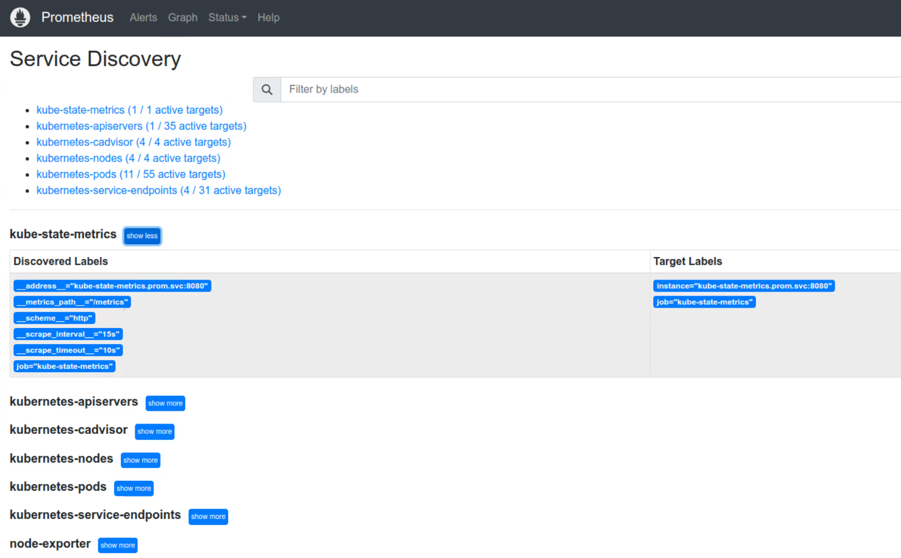

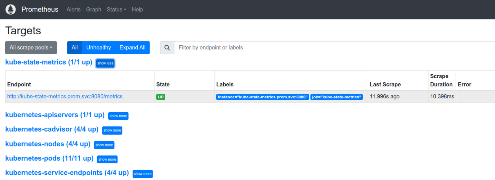

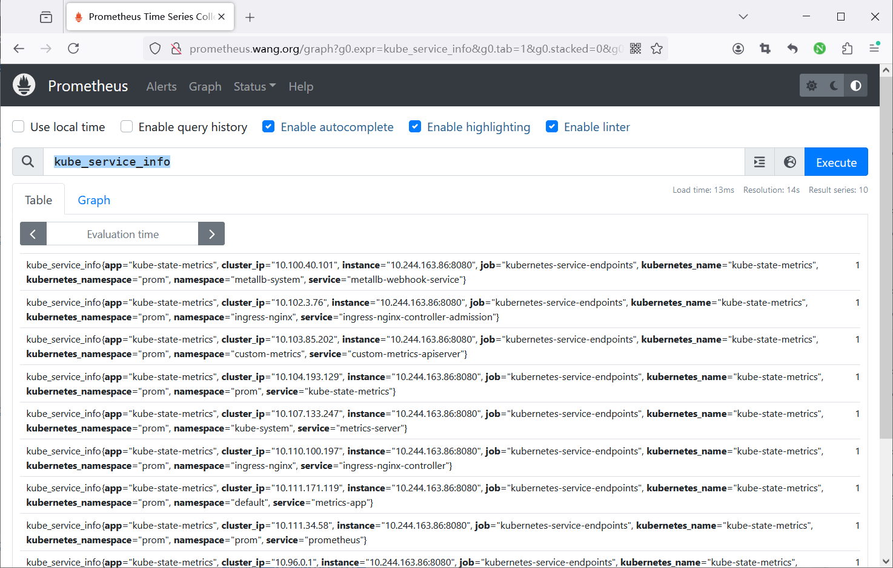

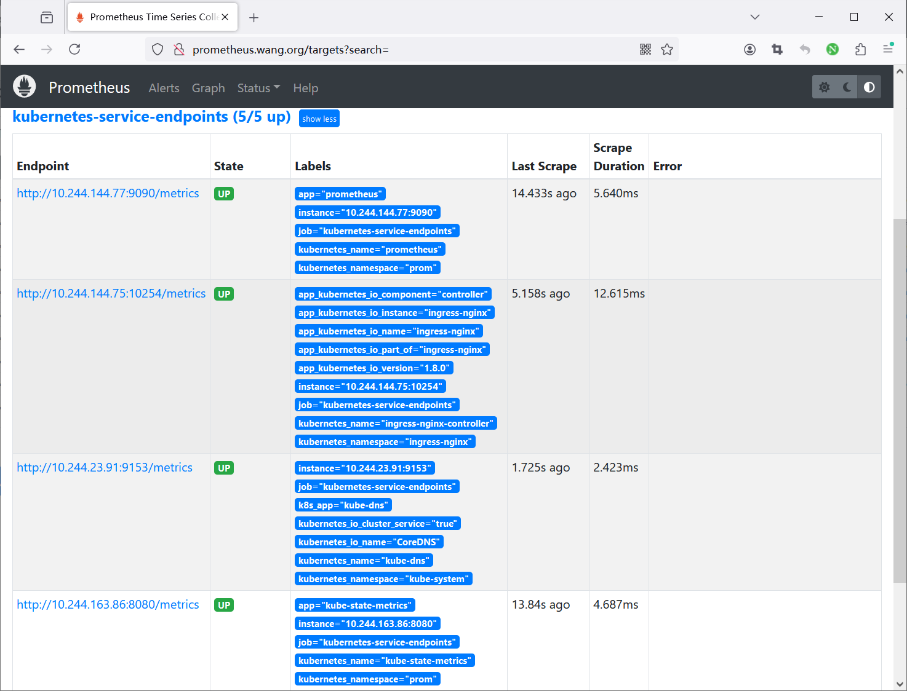

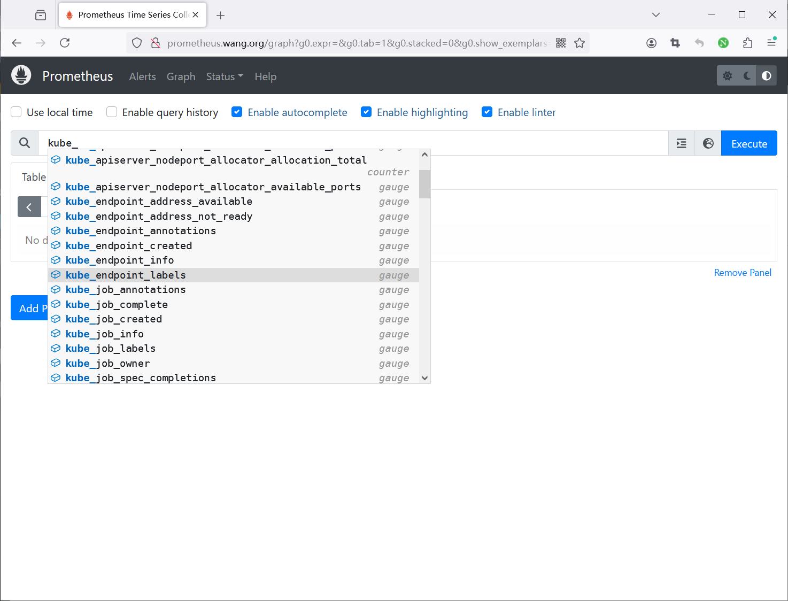

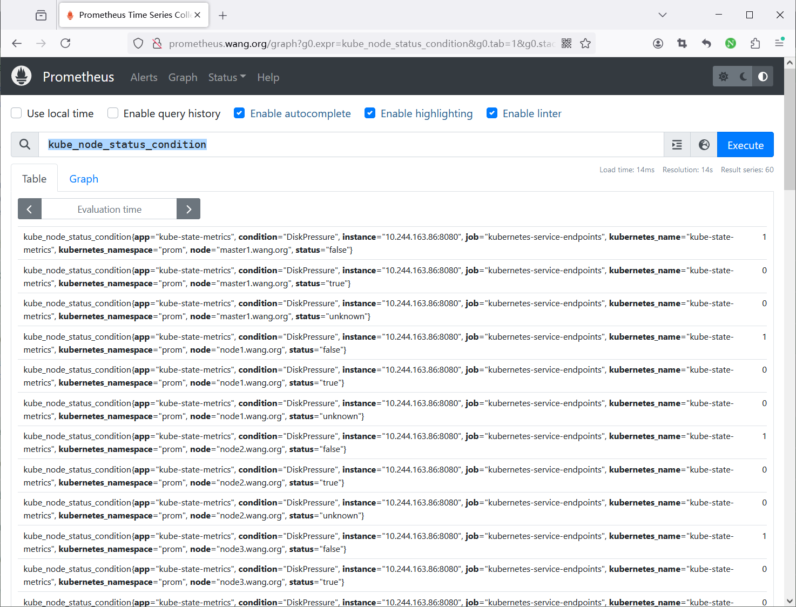

#### 3.3.3.2 使用 Helm 安装 Prometheus 与 kube-state-metrics

范例：使用 Helm 安装 Prometheus 与 kube-state-metrics
```bash
helm repo add prometheus-community https://prometheus-community.github.io/helm-
charts
helm repo update

helm install \
prometheus prometheus-community/prometheus \
--namespace prometheus \
--create-namespace \
--set alertmanager.enabled=false \
--set prometheus-node-exporter.enabled=false \
--set prometheus-pushgateway.enabled=false
```

范例：使用 Helm 安装 Prometheus 与 kube-state-metrics
```bash
[root@master1 ~]#grep -Ev "#|^$" prometheus-kube-state-metrics-values.yaml
server:
name: server
image:
repository: quay.io/prometheus/prometheus
tag: "v2.55.1"
pullPolicy: IfNotPresent
defaultFlagsOverride: []
extraFlags:
- web.enable-lifecycle
configPath: /etc/config/prometheus.yml
global:
scrape_interval: 15s

scrape_timeout: 10s
evaluation_interval: 15s
remoteWrite: []
remoteRead: []
ingress:
enabled: true
ingressClassName: nginx
annotations: {}
hosts:
- prometheus.bowen.org
path: /
pathType: Prefix
persistentVolume:
enabled: true
accessModes:
- ReadWriteOnce
mountPath: /data
size: 8Gi
storageClass: "sc-nfs"
emptyDir:
sizeLimit: ""
replicaCount: 1
statefulSet:
enabled: false
podManagementPolicy: OrderedReady
headless:
servicePort: 9090
gRPC:
enabled: false
servicePort: 10901
pvcDeleteOnStsDelete: false
pvcDeleteOnStsScale: false
service:
enabled: true
externalIPs: []
servicePort: 9090
type: ClusterIP
retention: "15d"
retentionSize: ""
ruleFiles: {}
scrapeConfigFiles: []
serverFiles:
alerting_rules.yml: {}
extraScrapeConfigs: ""
alertmanager:
enabled: true
persistence:
size: 2Gi
storageClass: "sc-nfs"
accessModes:
- ReadWriteOnce
kube-state-metrics:
enabled: true
prometheus-node-exporter:
enabled: true
prometheus-pushgateway:
enabled: true
serviceAnnotations:

prometheus.io/probe: pushgateway

[root@master1 ~]#helm repo add prometheus-community https://prometheus-
community.github.io/helm-charts

[root@master1 ~]#helm install prometheus prometheus-community/prometheus --
namespace monitoring --values prometheus-kube-state-metrics-values.yaml --create-
namespace
NAME: prometheus
LAST DEPLOYED: Tue Apr 22 18:26:02 2024
NAMESPACE: monitoring
STATUS: deployed
REVISION: 1
TEST SUITE: None
NOTES:
The Prometheus server can be accessed via port 9090 on the following DNS name
from within your cluster:
prometheus-server.monitoring.svc.cluster.local

From outside the cluster, the server URL(s) are:
http://prometheus.bowen.org

The Prometheus alertmanager can be accessed via port 9093 on the following DNS
name from within your cluster:
prometheus-alertmanager.monitoring.svc.cluster.local

Get the Alertmanager URL by running these commands in the same shell:
export POD_NAME=$(kubectl get pods --namespace monitoring -l
"app.kubernetes.io/name=alertmanager,app.kubernetes.io/instance=prometheus" -o
jsonpath="{.items[0].metadata.name}")
kubectl --namespace monitoring port-forward $POD_NAME 9093
################################################################################
#
######   WARNING: Pod Security Policy has been disabled by default since
#####
######            it deprecated after k8s 1.25+. use
#####
######            (index .Values "prometheus-node-exporter" "rbac"
#####
###### .          "pspEnabled") with (index .Values
#####
######            "prometheus-node-exporter" "rbac" "pspAnnotations")
#####
######            in case you still need it.
#####
################################################################################
#

The Prometheus PushGateway can be accessed via port 9091 on the following DNS
name from within your cluster:
prometheus-prometheus-pushgateway.monitoring.svc.cluster.local

Get the PushGateway URL by running these commands in the same shell:

export POD_NAME=$(kubectl get pods --namespace monitoring -l "app=prometheus-
pushgateway,component=pushgateway" -o jsonpath="{.items[0].metadata.name}")
kubectl --namespace monitoring port-forward $POD_NAME 9091

For more information on running Prometheus, visit:
https://prometheus.io/
```
```bash
[root@master1 ~]#kubectl get ingress -n monitoring
NAME                CLASS   HOSTS                 ADDRESS     PORTS   AGE
prometheus-server   nginx   prometheus.bowen.org   10.0.0.10   80      3m33s

#默认kube-state-metrics需要科学上网才能下载
[root@master1 ~]#kubectl get pod -A |grep prometheus-kube-state-metrics
monitoring       prometheus-kube-state-metrics-c7cbfcc5d-xnqbr        0/1
ImagePullBackOff   0              28m

[root@node2 ~]#bash install/set_docker_proxy.sh start
Docker 服务代理配置完成!                                   [  OK  ]
[root@node2 ~]#docker pull registry.k8s.io/kube-state-metrics/kube-state-
metrics:v2.15.0

#确认运行成功
[root@master1 ~]#kubectl get pod -A |grep prometheus-kube-state-metrics
monitoring       prometheus-kube-state-metrics-c7cbfcc5d-xnqbr        1/1
Running     0              30m

#浏览器访问
http://prometheus.bowen.org/
```

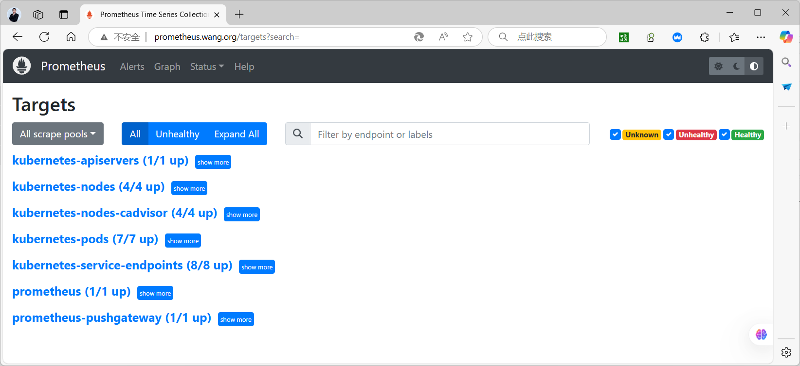

## 3.4 案例：自定义指标流水线

前提准备

ingress-nginx metallb storage Class: sc-nfs

### 3.4.1 部署 Prometheus

#### 3.4.1.1 基于YAML清单文件方式部署 Prometheus

范例: 基于清单方式部署 Prometheus
```yaml
#准备:提前安装ingress-nginx
[root@master1 prometheus]#ls
ingress-prometheus.yaml  prometheus-cfg.yaml     prometheus-rbac.yaml
prometheus-svc.yaml
namespace.yaml           prometheus-deploy.yaml  prometheus-rules.yaml

[root@master1 prometheus]#cat namespace.yaml
---
apiVersion: v1
kind: Namespace
metadata:
name: prom
[root@master1 prometheus]#kubectl apply -f namespace.yaml

[root@master1 prometheus]#kubectl apply -f . -n prom

[root@master1 prometheus]#kubectl get all -n prom
NAME                                     READY   STATUS    RESTARTS       AGE
pod/prometheus-server-554b65958d-5xmhm   1/1     Running   3 (5d5h ago)   12d

NAME                 TYPE       CLUSTER-IP     EXTERNAL-IP   PORT(S)
AGE
service/prometheus   NodePort   10.111.34.58   <none>        9090:30090/TCP
12d

NAME                                READY   UP-TO-DATE   AVAILABLE   AGE
deployment.apps/prometheus-server   1/1     1            1           12d

NAME                                           DESIRED   CURRENT   READY   AGE
replicaset.apps/prometheus-server-554b65958d   1         1         1       12d

[root@master1 ~]#kubectl get ingress -n prom
NAME         CLASS   HOSTS                               ADDRESS     PORTS   AGE
prometheus   nginx   prom.bowen.org,prometheus.bowen.org   10.0.0.10   80      12d

#浏览器访问,注意:名称解析prometheus.bowen.org   10.0.0.10
http://prometheus.bowen.org
```

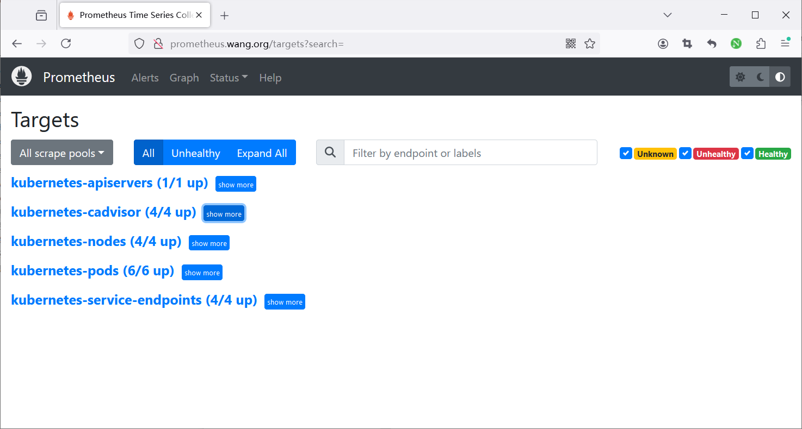

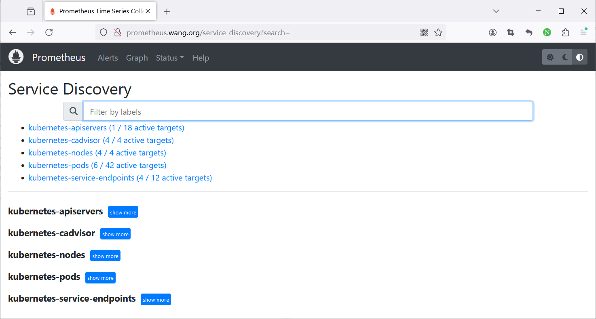


#### 3.4.1.2 基于 Helm 部署 Prometheus

范例: Helm 部署 Prometheus和kube-state-metrics（可选） 生态组件
```bash
#部署Prometheus生态组件包括promethues,kube-state-
metrics,node_exporter,alertmanager,pushgateway。
#注意:Prometheus的v2版本才支持才支持自定义指标流水线,v3不支持
[root@master1 ~]#grep -Ev "#|^$" prometheus-kube-state-metrics-values.yaml
server:
name: server
image:
repository: quay.io/prometheus/prometheus
tag: "v2.55.1"
pullPolicy: IfNotPresent
defaultFlagsOverride: []
extraFlags:
- web.enable-lifecycle
configPath: /etc/config/prometheus.yml
global:
scrape_interval: 15s
scrape_timeout: 10s
evaluation_interval: 15s
remoteWrite: []
remoteRead: []
ingress:
enabled: true
ingressClassName: nginx
annotations: {}
hosts:
- prometheus.bowen.org
path: /
pathType: Prefix
persistentVolume:
enabled: true
accessModes:
- ReadWriteOnce
mountPath: /data
size: 8Gi
storageClass: "sc-nfs"
emptyDir:
sizeLimit: ""
replicaCount: 1
statefulSet:
enabled: false
podManagementPolicy: OrderedReady
headless:
servicePort: 9090
gRPC:
enabled: false
servicePort: 10901
pvcDeleteOnStsDelete: false
pvcDeleteOnStsScale: false
service:
enabled: true
externalIPs: []
servicePort: 9090
type: ClusterIP

retention: "15d"
retentionSize: ""
ruleFiles: {}
scrapeConfigFiles: []
serverFiles:
alerting_rules.yml: {}
extraScrapeConfigs: ""
alertmanager:
enabled: true
persistence:
size: 2Gi
storageClass: "sc-nfs"
accessModes:
- ReadWriteOnce
kube-state-metrics:
enabled: true
prometheus-node-exporter:
enabled: true
prometheus-pushgateway:
enabled: true
serviceAnnotations:
prometheus.io/probe: pushgateway

#添加仓库
[root@master1 ~]#helm repo add prometheus-community https://prometheus-
community.github.io/helm-charts

#部署prometheus和kube-state-metrics
[root@master1 ~]#helm install prometheus prometheus-community/prometheus --
namespace monitoring --values prometheus-kube-state-metrics-values.yaml --create-
namespace
NAME: prometheus
LAST DEPLOYED: Tue Apr 22 18:26:02 2024
NAMESPACE: monitoring
STATUS: deployed
REVISION: 1
TEST SUITE: None
NOTES:
The Prometheus server can be accessed via port 9090 on the following DNS name
from within your cluster:
prometheus-server.monitoring.svc.cluster.local

From outside the cluster, the server URL(s) are:
http://prometheus.bowen.org

The Prometheus alertmanager can be accessed via port 9093 on the following DNS
name from within your cluster:
prometheus-alertmanager.monitoring.svc.cluster.local

Get the Alertmanager URL by running these commands in the same shell:
export POD_NAME=$(kubectl get pods --namespace monitoring -l
"app.kubernetes.io/name=alertmanager,app.kubernetes.io/instance=prometheus" -o
jsonpath="{.items[0].metadata.name}")
kubectl --namespace monitoring port-forward $POD_NAME 9093
################################################################################
#

######   WARNING: Pod Security Policy has been disabled by default since
#####
######            it deprecated after k8s 1.25+. use
#####
######            (index .Values "prometheus-node-exporter" "rbac"
#####
###### .          "pspEnabled") with (index .Values
#####
######            "prometheus-node-exporter" "rbac" "pspAnnotations")
#####
######            in case you still need it.
#####
################################################################################
#

The Prometheus PushGateway can be accessed via port 9091 on the following DNS
name from within your cluster:
prometheus-prometheus-pushgateway.monitoring.svc.cluster.local

Get the PushGateway URL by running these commands in the same shell:
export POD_NAME=$(kubectl get pods --namespace monitoring -l "app=prometheus-
pushgateway,component=pushgateway" -o jsonpath="{.items[0].metadata.name}")
kubectl --namespace monitoring port-forward $POD_NAME 9091

For more information on running Prometheus, visit:
https://prometheus.io/
```
```bash
[root@master1 ~]#kubectl get ingress -n monitoring
NAME                CLASS   HOSTS                 ADDRESS     PORTS   AGE
prometheus-server   nginx   prometheus.bowen.org   10.0.0.10   80      3m33s

#默认kube-state-metrics需要科学上网才能下载
[root@master1 ~]#kubectl get pod -A |grep prometheus-kube-state-metrics
monitoring       prometheus-kube-state-metrics-c7cbfcc5d-xnqbr        0/1
ImagePullBackOff   0              28m

[root@node2 ~]#bash install/set_docker_proxy.sh start
Docker 服务代理配置完成!                                   [  OK  ]
[root@node2 ~]#docker pull registry.k8s.io/kube-state-metrics/kube-state-
metrics:v2.15.0

#确认运行成功
[root@master1 ~]#kubectl get pod -A |grep prometheus-kube-state-metrics
monitoring       prometheus-kube-state-metrics-c7cbfcc5d-xnqbr        1/1
Running     0              30m

#浏览器访问
http://prometheus.bowen.org/
```

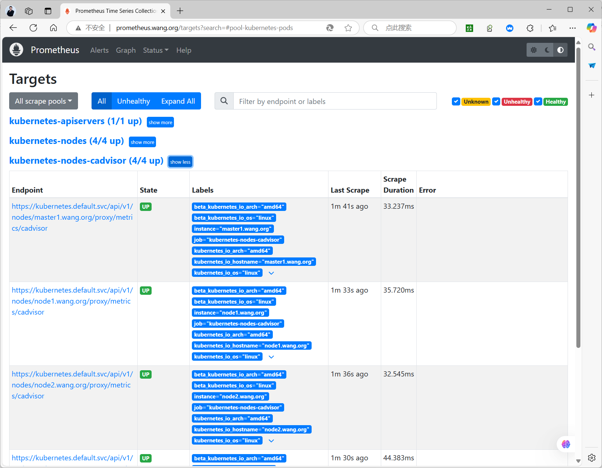

### 3.4.2 部署测试 APP

首先部署Metrics APP示例于指定的名称空间，例如default。
```yaml
#准备测试的Deployment和Service
[root@master1 example-metrics]#cat metrics-example-app.yaml
apiVersion: apps/v1
kind: Deployment
metadata:
name: metrics-app
spec:
replicas: 2
selector:
matchLabels:
app: metrics-app
controller: metrics-app
template:
metadata:
labels:
app: metrics-app
controller: metrics-app
annotations:
prometheus.io/scrape: "true"   #下面三行表示可以支持被prometheus采集
prometheus.io/port: "80"
prometheus.io/path: "/metrics"
spec:
containers:
- name: metrics-app
image: registry.cn-beijing.aliyuncs.com/bowen/metrics-app:v0.1
ports:
- name: web

containerPort: 80
resources:
requests:
memory: "256Mi"
cpu: "500m"
limits:
memory: "256Mi"
cpu: "500m"
---
apiVersion: v1
kind: Service
metadata:
name: metrics-app
spec:
#type: NodePort
type: LoadBalancer #需要提提前部署MetalLB组件
ports:
- name: web
port: 80
targetPort: 80
selector:
app: metrics-app
controller: metrics-app

[root@master1 example-metrics]#kubectl apply -f metrics-example-app.yaml

[root@master1 ~]#kubectl get pod,svc -o wide
NAME                               READY   STATUS    RESTARTS   AGE     IP
NODE             NOMINATED NODE   READINESS GATES
pod/metrics-app-7d64986cbd-9kbqd   1/1     Running   0          5m26s
10.244.163.82   node3.bowen.org   <none>           <none>
pod/metrics-app-7d64986cbd-b5rv2   1/1     Running   0          5m26s
10.244.144.78   node2.bowen.org   <none>           <none>

NAME                  TYPE        CLUSTER-IP       EXTERNAL-IP   PORT(S)
AGE     SELECTOR
service/kubernetes    ClusterIP   10.96.0.1        <none>        443/TCP
25d     <none>
service/metrics-app   NodePort    10.111.171.119   <none>        80:31918/TCP
5m26s   app=metrics-app,controller=metrics-app

#测试访问
[root@master1 ~]#curl 10.111.171.119/
Hello! My name is metrics-app-6c8bbdf9b4-9rkts. The last 10 seconds, the average
QPS has been 0.2. Total requests served: 812

#查看指标
[root@master1 ~]#curl 10.111.171.119/metrics
# HELP http_requests_total The amount of requests in total
# TYPE http_requests_total counter
http_requests_total 229
# HELP http_requests_per_second The amount of requests per second the latest ten
seconds
# TYPE http_requests_per_second gauge
http_requests_per_second 0.2

#测试发起大量访问

[root@master1 ~]#while true;do curl 10.111.171.119;sleep 0.$[RANDOM%10];done
```

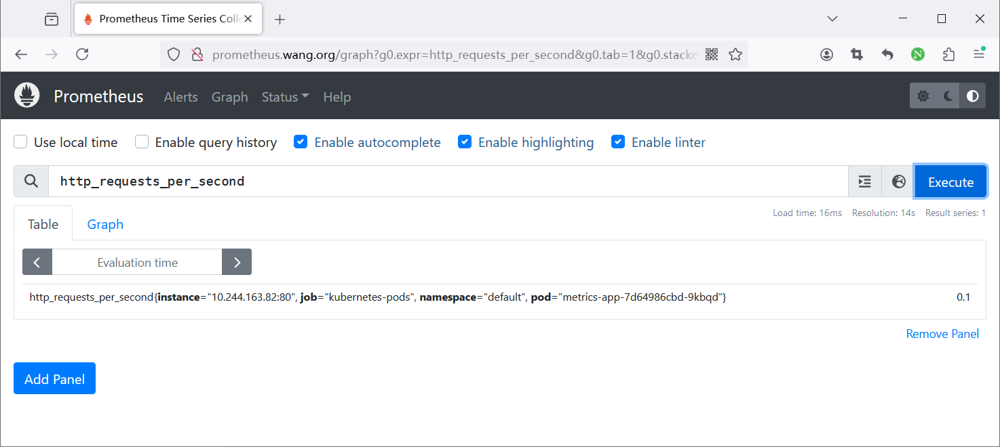

### 3.4.3 部署 HPAv2

部署HPA的定义于同一名称空间
```yaml
[root@master1 example-metrics]#cat metrics-app-hpa.yaml
kind: HorizontalPodAutoscaler
apiVersion: autoscaling/v2
metadata:
name: metrics-app-hpa
spec:
scaleTargetRef:
apiVersion: apps/v1
kind: Deployment
name: metrics-app  #扩缩容的目标
minReplicas: 2       #和默认部署时相同
maxReplicas: 10
metrics:
- type: Pods
pods:
metric:
name: http_requests_per_second
target:
type: AverageValue
averageValue: 3  #http_requests_per_second的AverageValue平均值大于等于3时，
会触发扩容
behavior:
scaleDown:
stabilizationWindowSeconds: 10  #触发缩容条件后，进缩容前的等待时间

#应用清单文件
[root@master1 example-metrics]#kubectl apply -f metrics-app-hpa.yaml

#生成的结果类似如下所示，其中的“TARGETS”字段中，左侧为当前的指标值，右侧为执行扩容的标准值。
[root@master1 example-metrics]#kubectl get horizontalpodautoscalers
NAME              REFERENCE                TARGETS   MINPODS   MAXPODS   REPLICAS
AGE
metrics-app-hpa   Deployment/metrics-app   <unknown>/3   2         10        2
54s
```

### 3.4.4 部署  prometheus-adapter

范例：基于 YAML 文件安装 prometheus-adapter
```text
#参看3.2.2.1 方法1: YAML文件部署
```

范例: 基于 Helm 安装 prometheus-adapter
```bash
[root@master1 ~]#cat prometheus-adapter-values.yaml
# Url to access prometheus
prometheus:
# Value is templated
url: http://prometheus-server.monitoring.svc
port: 9090
path: ""

replicas: 1

rules:
default: true

# Enabling this option will cause custom metrics to be served at
/apis/custom.metrics.k8s.io/v1beta1.
custom: []
# - seriesQuery: '{__name__=~"^some_metric_count$"}'
#   resources:
#     template: <<.Resource>>
#   name:
#     matches: ""
#     as: "my_custom_metric"
#   metricsQuery: sum(<<.Series>>{<<.LabelMatchers>>}) by (<<.GroupBy>>)

# Mounts a configMap with pre-generated rules for use. Overrides the
# default, custom, external and resource entries
existing:

# Enabling this option will cause external metrics to be served at
/apis/external.metrics.k8s.io/v1beta1.
external:
# 基于应用上特定的http_requests_total指标生成http_requests_per_second指标的示例
- seriesQuery:
'http_requests_total{kubernetes_namespace!="",kubernetes_pod_name!=""}'
resources:
overrides:
kubernetes_namespace: {resource: "namespace"}
kubernetes_pod_name: {resource: "pod"}
name:
matches: "^(.*)_total"
as: "${1}_per_second"
metricsQuery: rate(<<.Series>>{<<.LabelMatchers>>}[1m])

# 有时，对于有些Java程序来说，基于内存资源用量进行自动扩缩容并不总是有效，因而可考虑根据
JVM的平均使用量作为衡量指标；
# 下面就是用于生成相关自定义指标的规则示例；
- seriesQuery: '{__name__=~"jvm_memory_bytes_(used|max)",area="heap"}'
seriesFilters:

- is: ^jvm_memory_bytes_(used|max)$
resources:
overrides:
namespace:
resource: namespace
service:
resource : service
pod:
resource : pod
name:
matches: ^jvm_memory_bytes_(used|max)$
as: "jvm_used_percent_housing"
metricsQuery: ((sum((jvm_memory_used_bytes{area="heap",
<<.LabelMatchers>>}))by(<<.GroupBy>>)*100/sum((jvm_memory_max_bytes{area="heap",
<<.LabelMatchers>>}))by(<<.GroupBy>>)))/1000

# Enabling this option will cause resource metrics to be served at
/apis/metrics.k8s.io/v1beta1
resource:
cpu:
containerQuery: |
sum by (<<.GroupBy>>) (
rate(container_cpu_usage_seconds_total{container!="",
<<.LabelMatchers>>}[3m])
)
nodeQuery: |
sum  by (<<.GroupBy>>) (
rate(node_cpu_seconds_total{mode!="idle",mode!="iowait",mode!="steal",
<<.LabelMatchers>>}[3m])
)
resources:
overrides:
node:
resource: node
namespace:
resource: namespace
pod:
resource: pod
containerLabel: container
memory:
containerQuery: |
sum by (<<.GroupBy>>) (
avg_over_time(container_memory_working_set_bytes{container!="",
<<.LabelMatchers>>}[3m])
)
nodeQuery: |
sum by (<<.GroupBy>>) (
avg_over_time(node_memory_MemTotal_bytes{<<.LabelMatchers>>}[3m])
-
avg_over_time(node_memory_MemAvailable_bytes{<<.LabelMatchers>>}[3m])
)
resources:
overrides:
node:
resource: node
namespace:
resource: namespace
pod:

resource: pod
containerLabel: container
window: 3m

#需要科学上网
[root@master1 ~]#helm repo add prometheus-community https://prometheus-
community.github.io/helm-charts
[root@master1 ~]#helm repo update
[root@master1 ~]#helm install my-release prometheus-community/prometheus-adapter
[root@master1 ~]#helm install prometheus-adapter prometheus-community/prometheus-
adapter --namespace monitoring --create-namespace --values prometheus-adapter-
values.yaml
```

### 3.4.5 自定义指标流水线规则

如果是执行3.4.1.2基于Helm安装prometheus-adapter时,在prometheus-adapter-values.yaml文件中已经提供了自定义指标流水线规则,所以此步可不用执行。如果是执行3.4.1.1基于YAML文件方法安装prometheus-adapter，还需要执行下面操作添加自定义规则。Prometheus Adapter需要基于定义的规则来生成自定义指标。

例如：要将示例应用Metrics APP上的指标http_requests_total转为Prometheus上可用的指标http_requests_per_second，需要类似如下规则的支撑。
```yaml
- seriesQuery: 'http_requests_total{namespace!="",pod!=""}'
resources:
overrides:
namespace: {resource: "namespace"}
pod: {resource: "pod"}
name:
matches: "^(.*)_total"
as: "${1}_per_second"
metricsQuery: rate(<<.Series>>{<<.LabelMatchers>>}[1m])
```

ConfigMap配置文件“custom-metrics-config-map.yaml”在默认配置的基础上添加了如上配置，若部署prometheus-adapter无其它配置变化，则直接运行如下命令即可完成添加自定义的规则。
```yaml
[root@master1 prometheus-adpater]#cat custom-metrics-config-map.yaml
apiVersion: v1
kind: ConfigMap
metadata:
name: adapter-config
namespace: custom-metrics
data:
config.yaml: |
rules:
#- {}
#添加自定义指标的信息
- seriesQuery: 'http_requests_total{namespace!="",pod!=""}'
resources:
overrides:
namespace: {resource: "namespace"}
pod: {resource: "pod"}
name:
matches: "^(.*)_total"
as: "${1}_per_second"

metricsQuery: rate(<<.Series>>{<<.LabelMatchers>>}[1m])

#应用清单文件
[root@master1 prometheus-adpater]#kubectl  apply -f example-metrics/custom-
metrics-config-map.yaml

#生效
[root@master1 prometheus-adpater]#kubectl  rollout restart deployment -n custom-
metrics prometheus-adapter
```

等待几个指标抓取周期，即可从Metrics APP的Pod上查看到相关的指标信息。
```bash
[root@master1 ~]#apt update && apt -y install jq
[root@master1 ~]#kubectl get --raw
/apis/custom.metrics.k8s.io/v1beta1/namespaces/default/pods/*/http_requests_per_
second | jq
#生成的结果类似如下所示，其中的“metricName”为指标名称，“value”为相关的值，“100m”代表平均每秒
钟接收到的请求数为0.1个。
{
"kind": "MetricValueList",
"apiVersion": "custom.metrics.k8s.io/v1beta1",
"metadata": {},
"items": [
{
"describedObject": {
"kind": "Pod",
"namespace": "default",
"name": "metrics-app-7d64986cbd-9kbqd",
"apiVersion": "/v1"
},
"metricName": "http_requests_per_second",
"timestamp": "2024-07-23T09:59:49Z",
"value": "1400m",
"selector": null
},
{
"describedObject": {
"kind": "Pod",
"namespace": "default",
"name": "metrics-app-7d64986cbd-b5rv2",
"apiVersion": "/v1"
},
"metricName": "http_requests_per_second",
"timestamp": "2024-07-23T09:59:49Z",
"value": "100m",
"selector": null
}
]
}
```

### 3.4.6 测试访问
```bash
[root@master1 ~]#kubectl get svc metrics-app
NAME          TYPE       CLUSTER-IP       EXTERNAL-IP   PORT(S)        AGE
metrics-app   NodePort   10.111.171.119   <none>        80:31918/TCP   150m

[root@master1 ~]#kubectl get pod
NAME                           READY   STATUS    RESTARTS   AGE
metrics-app-7d64986cbd-9kbqd   1/1     Running   0          154m
metrics-app-7d64986cbd-b5rv2   1/1     Running   0          154m

#加速访问APP对应的SVC
[root@master1 ~]#while true;do curl 10.111.171.119;sleep 0.0$[RANDOM%10];done
Hello! My name is metrics-app-6c8bbdf9b4-9zff6. The last 10 seconds, the average
QPS has been 0.3. Total requests served: 796
.....

#可看到
root@master1 ~]#curl 10.111.171.119/metrics
# HELP http_requests_total The amount of requests in total
# TYPE http_requests_total counter
http_requests_total 9931
# HELP http_requests_per_second The amount of requests per second the latest ten
seconds
# TYPE http_requests_per_second gauge
http_requests_per_second 7.9

#查看到达到9700m即9.7超过3的阈值
[root@master1 ~]#kubectl get hpa
NAME              REFERENCE                TARGETS   MINPODS   MAXPODS   REPLICAS
AGE
metrics-app-hpa   Deployment/metrics-app   9700m/3   2         10        2
7m56s

#过一会儿可以看到Pod扩容
[root@master1 ~]#kubectl get pod
NAME                           READY   STATUS    RESTARTS   AGE
metrics-app-7d64986cbd-95dw5   1/1     Running   0          40s
metrics-app-7d64986cbd-9kbqd   1/1     Running   0          158m
metrics-app-7d64986cbd-b5rv2   1/1     Running   0          158m
metrics-app-7d64986cbd-bnkpn   1/1     Running   0          2m10s
metrics-app-7d64986cbd-c75qv   1/1     Running   0          40s
metrics-app-7d64986cbd-l2nwn   1/1     Running   0          2m10s
metrics-app-7d64986cbd-ph8x9   1/1     Running   0          40s

[root@master1 ~]#kubectl get hpa
NAME              REFERENCE                TARGETS   MINPODS   MAXPODS   REPLICAS
AGE
metrics-app-hpa   Deployment/metrics-app   2600m/3   2         10        7
10m

#加快访问后,可以看到最多达到10个Pod
[root@master1 ~]#kubectl get hpa
NAME              REFERENCE                TARGETS   MINPODS   MAXPODS   REPLICAS
AGE
metrics-app-hpa   Deployment/metrics-app   8333m/3   2         10        10
11m

NAME                           READY   STATUS    RESTARTS   AGE
metrics-app-7d64986cbd-95dw5   1/1     Running   0          2m43s
metrics-app-7d64986cbd-9kbqd   1/1     Running   0          160m
metrics-app-7d64986cbd-b5rv2   1/1     Running   0          160m
metrics-app-7d64986cbd-bnkpn   1/1     Running   0          4m13s
metrics-app-7d64986cbd-c75qv   1/1     Running   0          2m43s

metrics-app-7d64986cbd-jxkhn   0/1     Pending   0          57s
metrics-app-7d64986cbd-l2nwn   1/1     Running   0          4m13s
metrics-app-7d64986cbd-ph8x9   1/1     Running   0          2m43s
metrics-app-7d64986cbd-whbsd   1/1     Running   0          57s
metrics-app-7d64986cbd-wz45f   1/1     Running   0          57s

#停止访问,等一会儿,可以看到Pod数据减少
[root@master1 ~]#kubectl get po -w
NAME                           READY   STATUS        RESTARTS   AGE
metrics-app-7d64986cbd-95dw5   1/1     Running       0          4m9s
metrics-app-7d64986cbd-9kbqd   1/1     Running       0          162m
metrics-app-7d64986cbd-b5rv2   1/1     Running       0          162m
metrics-app-7d64986cbd-bnkpn   1/1     Running       0          5m39s
metrics-app-7d64986cbd-c75qv   1/1     Running       0          4m9s
metrics-app-7d64986cbd-l2nwn   1/1     Running       0          5m39s
metrics-app-7d64986cbd-ph8x9   1/1     Running       0          4m9s
metrics-app-7d64986cbd-whbsd   1/1     Terminating   0          2m23s
metrics-app-7d64986cbd-wz45f   1/1     Terminating   0          2m23s

[root@master1 ~]#kubectl get hpa -w
NAME              REFERENCE                TARGETS   MINPODS   MAXPODS   REPLICAS
AGE
metrics-app-hpa   Deployment/metrics-app   100m/3    2         10        10
13m
metrics-app-hpa   Deployment/metrics-app   100m/3    2         10        10
13m
metrics-app-hpa   Deployment/metrics-app   100m/3    2         10        7
13m
metrics-app-hpa   Deployment/metrics-app   100m/3    2         10        2
13m

[root@master1 ~]#kubectl get deployments.apps
NAME          READY   UP-TO-DATE   AVAILABLE   AGE
metrics-app   2/2     2            2           13m

[root@master1 ~]#kubectl get po
NAME                           READY   STATUS    RESTARTS   AGE
metrics-app-7d64986cbd-b5rv2   1/1     Running   0          162m
metrics-app-7d64986cbd-l2nwn   1/1     Running   0          6m20s
```
```sql
[root@master1 ~]#kubectl get hpa
NAME              REFERENCE                TARGETS   MINPODS   MAXPODS   REPLICAS
AGE
metrics-app-hpa   Deployment/metrics-app   100m/3    2         10        2
11m

#查看事件
[root@master1 ~]#kubectl describe hpa metrics-app-hpa
Name:                                  metrics-app-hpa
Namespace:                             default
Labels:                                <none>
Annotations:                           <none>
CreationTimestamp:                     Tue, 23 Jul 2024 18:18:14 +0800
Reference:                             Deployment/metrics-app

Metrics:                               ( current / target )
"http_requests_per_second" on pods:  100m / 3
Min replicas:                          2
Max replicas:                          10
Behavior:
Scale Up:
Stabilization Window: 0 seconds
Select Policy: Max
Policies:
- Type: Pods     Value: 4    Period: 15 seconds
- Type: Percent  Value: 100  Period: 15 seconds
Scale Down:
Stabilization Window: 60 seconds
Select Policy: Max
Policies:
- Type: Percent  Value: 100  Period: 15 seconds
Deployment pods:       2 current / 2 desired
Conditions:
Type            Status  Reason            Message
----            ------  ------            -------
AbleToScale     True    ReadyForNewScale  recommended size matches current
size
ScalingActive   True    ValidMetricFound  the HPA was able to successfully
calculate a replica count from pods metric http_requests_per_second
ScalingLimited  True    TooFewReplicas    the desired replica count is less
than the minimum replica count
Events:
Type    Reason             Age    From                       Message
----    ------             ----   ----                       -------
Normal  SuccessfulRescale  8m59s  horizontal-pod-autoscaler  New size: 4;
reason: pods metric http_requests_per_second above target
Normal  SuccessfulRescale  7m29s  horizontal-pod-autoscaler  New size: 7;
reason: pods metric http_requests_per_second above target
Normal  SuccessfulRescale  5m43s  horizontal-pod-autoscaler  New size: 10;
reason: pods metric http_requests_per_second above target
Normal  SuccessfulRescale  3m28s  horizontal-pod-autoscaler  New size: 7;
reason: All metrics below target
Normal  SuccessfulRescale  3m13s  horizontal-pod-autoscaler  New size: 2;
reason: All metrics below target
```

# 4  第三方项目

## 4.1 KEDA

HPA  只支持一种数据源，即kubernetes指标。KEDA  支持更多的数据源，实现自动扩缩容。


- <https://keda.sh/>


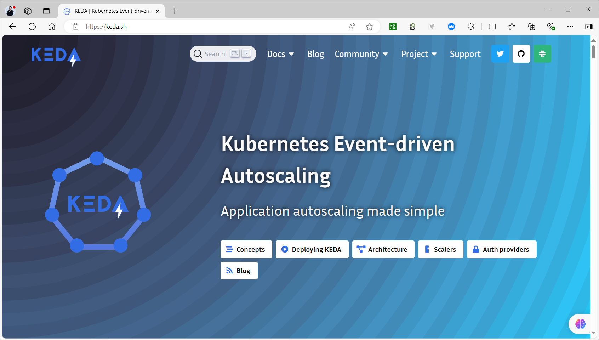

KEDA（Kubernetes Event-Driven Autoscaling）是一种开源的 Kubernetes 扩展，它能够基于事件驱动的方式进行自动扩缩容。

KEDA 的主要功能包括：

1. 事件驱动扩展：KEDA 允许用户基于多种事件源（如消息队列、数据库、HTTP 请求等）来自动扩展 Kubernetes 的工作负载。

2. 多种事件源支持：KEDA 支持多种事件源，包括 Azure Queue Storage, AWS SQS, Kafka,RabbitMQ, Prometheus, HTTP 等等。

3. 自动缩容：当事件源的负载减少时，KEDA 也能自动缩容工作负载，确保资源的高效使用。

4. 与 HPA 集成：KEDA 可以与 Kubernetes 的 Horizontal Pod Autoscaler (HPA) 集成，利用 HPA 的能力进行基于事件的自动扩展。

5. 可定制的扩展逻辑：用户可以定义自定义的扩展逻辑和策略，满足特定的业务需求。

6. 简易的配置：KEDA 通过 ScaledObject 和 TriggerAuthentication 等自定义资源定义 (CRD) 来配置和管理事件驱动的扩展。

KEDA 的主要目的是帮助 Kubernetes 用户实现更高效和灵活的资源管理，通过事件驱动的方式应对动态变化的工作负载。

KEDA  支持丰富的数据源


- <https://keda.sh/docs/2.17/scalers/>


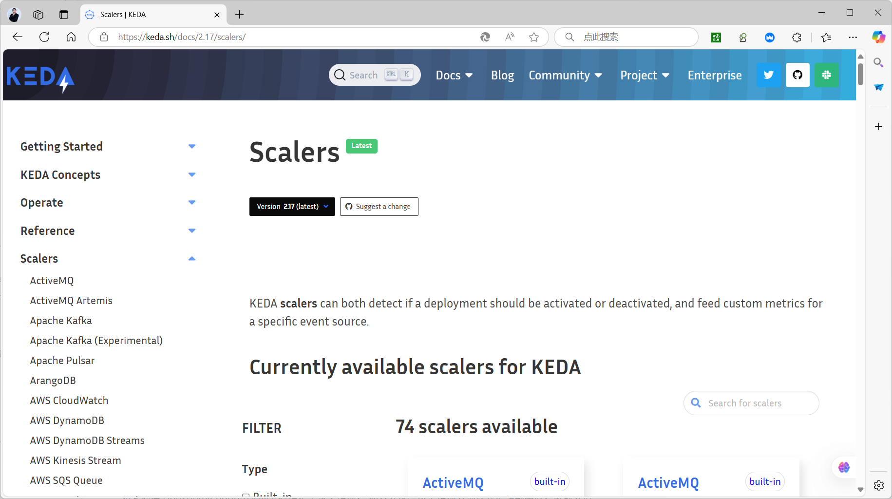

## 4.2  Kapacity


- <https://kapacity.netlify.app/zh-cn/>
- <https://github.com/traas-stack/kapacity>


Kapacity 旨在为用户提供一套具备完善技术风险能力的、智能且开放的云原生容量技术，帮助用户安全稳定地实现极致降本增效，解决容量相关问题。Kapacity 基于蚂蚁集团内部容量系统的核心理念和多年的大规模生产实践经验而构建，该内部容量系统目前已能安全稳定地为蚂蚁持续节省年均约 10w 核的算力成本，同时，Kapacity 也结合了来自云原生社区的最佳实践。

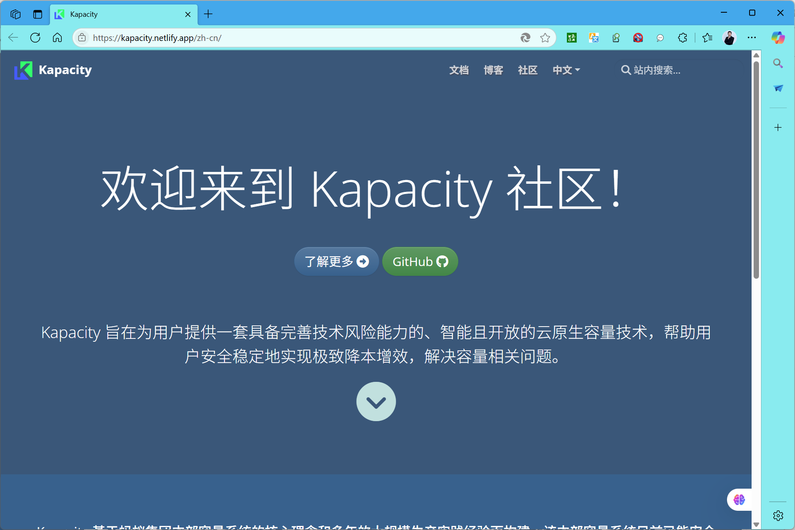

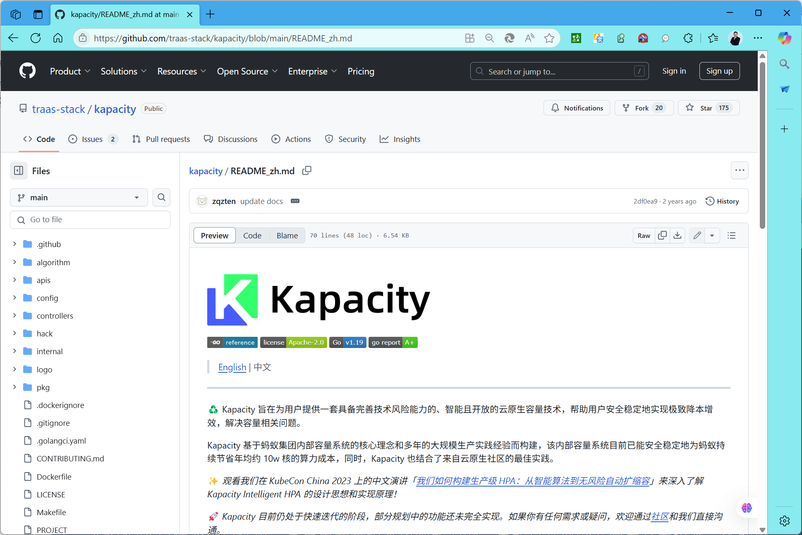



<nav class="article-end" aria-label="章节导航">
  <a href="{{ '/subjects/Kubernetes/13-hpa-core-metrics.html' | relative_url }}">← 上一章：HPA 原理与核心指标</a>
  <a href="{{ '/subjects/Kubernetes/' | relative_url }}">返回 Kubernetes 目录</a>
  <a href="{{ '/subjects/Kubernetes/15-network-flannel.html' | relative_url }}">下一章：网络基础与 Flannel →</a>
</nav>
