[← 返回 Kubernetes 目录]({{ '/subjects/Kubernetes/' | relative_url }})



# 15 网络基础与 Flannel

# 1 Kubernetes 网络

## 1.1 Kubernetes 网络机制

```text
https://kubernetes.io/zh-cn/docs/concepts/extend-kubernetes/compute-storage-
net/network-plugins/
https://github.com/containernetworking/cni
```

### 1.1.1 Kubernetes 的网络模型

Kubernetes 集群内一般有三种网络: 节点网络, Service 网络, Pod网络。此三个网络通过集群节点的内核实现交汇和路由通信。


因此有如下的四类通信

Kubernetes 集群中主要有四类通信：

- **同一 Pod 内的容器间通信（Container to Container）**：容器共享网络命名空间，可通过 loopback 直接通信。
- **Pod 间通信（Pod to Pod）**：网络插件负责为 Pod 分配 IP 地址（network plugin is configured to assign IP addresses to Pods）。
- **Service 到 Pod 的通信（Service to Pod）**：依赖 kube-proxy 管理的 Service，并通过内核中的 iptables 或 IPVS 策略实现。
- **集群外部与 Service 的通信（external to Service）**：依赖 NodePort、LoadBalancer 等不同的 Service 类型。

Kube Proxy 功能

指供service网络通信iptables 或 IPVS 规则实现服务发现。

### 1.1.2 CNI

```text
https://www.cni.dev/
https://github.com/containernetworking/cni
```

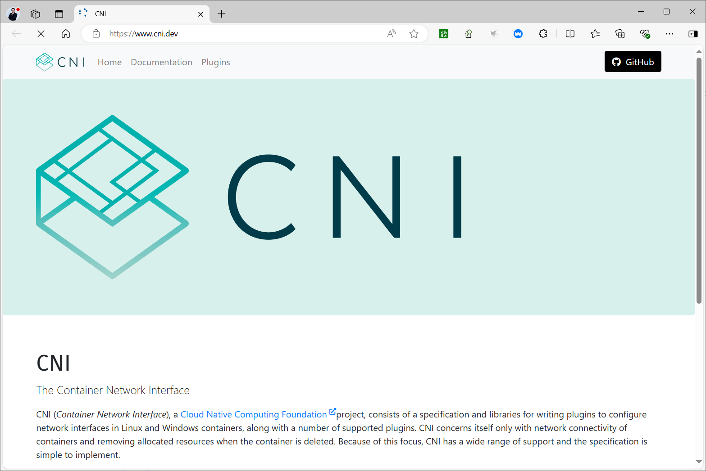

Kubernetes 中并没有提供一个核心组件完成Pod 之间的网络通信功能，而是Kubernetes 定义了CNI（Container Network Interface ）接口标准。

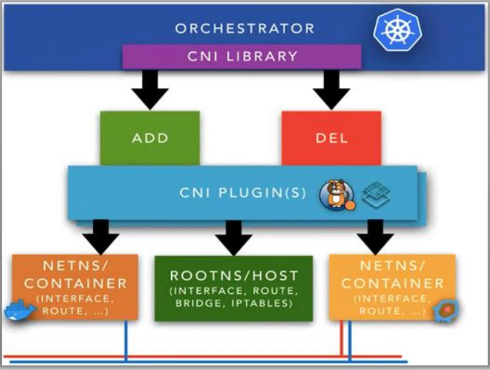

Kubernetes 将Pod 间的网络通信功能通过CNI委托给了第三方的外部的插件。只要由第三方的网络插件遵守CNI规范，即可支持Kubernetes的Pod通信。在创建kubernetes集群时，需要安装CNI兼容的网络插件，否则多个节点间无法正常通信，每个节点都会处于 NotReady 状态。

CNI容器网络接口是CNCF的项目 , 是由 google 和 CoreOS 主导制定的容器网络标准，但自身并非负责具体实现，只是一种协议和标准。CNI是容器引擎与遵循该规范网络插件的中间层，专用于为容器配置网络子系统。

使用CNI插件编排网络，Pod初始化或删除时，kubelet会调用默认CNI插件，创建虚拟设备接口附加到相关的底层网络，设置IP、路由并映射到Pod对象网络名称空间.

CNI基本思想：创建容器时，先创建好网络名称空间，然后调用CNI插件配置这个网络，而后启动容器内的进程。

CNI网络插件主要功能

创建Pod的网络接口设备

IPAM IP Address Management，用于给 Pod 分配IP地址

flannel: 10.244.0.0/16 calico: 192.168.0.0/16 cilium: 192.168.0.0/16

同一个节点Pod间通信

不同节点的Pod间通信

也可以支持额外功能, 比如:加密，流量控制。

#### CNI 网络插件将Pod 接入Pod 网络流程

创建Pod专用的虚拟网络网段创建每一个Pod时为每个Pod创建对应虚拟网络接口将新创建的Pod的虚拟网络接口连接至Pod网络中给启动的Pod的虚拟网络接口分配IP地址。

CNI 网络插件可以分为三部分：

main、meta、ipam (按照源代码中的存放目录可以看出)。

```text
https://github.com/containernetworking/plugins/tree/main/plugins
https://www.cni.dev/plugins/current/
```

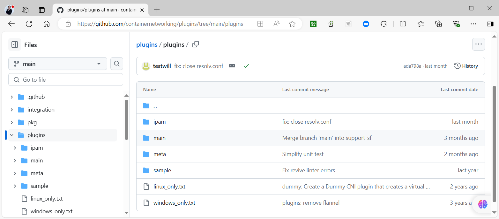


Main

主要负责创建和删除网络以及向网络中添加删除Pod容器。

专注于连通容器与容器之间以及容器与宿主机之间的通信

该类插件还负责创建和容器相关网络设备,例如：bridge、ipvlan、macvlan、loopback、ptp、veth以及vlan等虚拟设备。

IPAM：

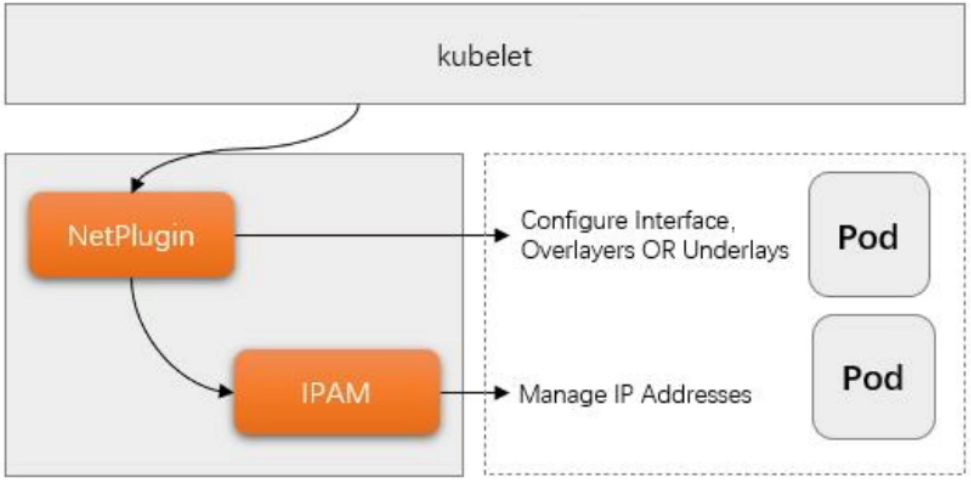

IP Address Management，仅用于给当前节点的Pod分配IP地址，不提供网络实现。IPAM Plugin 作为 CNI NetPlugin的一部分，与 CNI Plugin 一起工作。该类插件API负责创建/删除地址池以及分配/回收容器的IP地址。目前，该类型插件的实现主要有dhcp，host-local和static。

**DHCP**：通过上节点运行dhcp服务进程通过DHCP协议获取地址host-local:基于预置的本地地址范围库进行地址分配Static: 静态IP。

Meta：

其它的plugins,包括如下：

常见的 CNI 链式插件：

- **tuning**：修改已有网络接口的 sysctl 参数。
- **portmap**：基于 iptables 的端口映射插件，将宿主机地址空间中的端口映射到容器。
- **bandwidth**：通过流量控制 TBF 限制入向／出向带宽（ingress/egress）。
- **sbr**：为所链接的网络接口配置基于源地址的路由。
- **firewall**：通过 iptables 或 firewalld 添加规则，允许容器流量进入或离开。

## 1.2  Underlay Network 和 Overlay Network

Kubernetes 的NetPlugin目前常用的实现Pod网络的方案有承载网络（Underlay Network）和叠加网络（Overlay Network）两类。

**Underlay Network  底层(承载)网络**

即实际的物理网络，包括所有的物理设备（如路由器，交换机，电缆等），以及它们之间的网线连接。在大多数情况下，Underlay网络负责数据包的物理传输，包括IP路由，网络拓扑，带宽等。基础网络通常由网络管理员直接管理，并使用传统的网络协议和技术（如IP，Ethernet，MPLS等）。

底层(承载)网络支持两种模型:

二层网络

使用Bridge, MACVLAN或IPVLAN等技术直接将容器暴露至外部网络中。

**路由模型**：承载网络通常使用direct routing（直接路由,即将节点做为路由器）技术在Pod的各子网间路由Pod的IP报文。

把节点当路由器，每个节点背后都是一个末端网络，即持有的Pod子网(PodCIDR)。

每个节点的路由表通过查询中央数据库(如:ETCD)或BGP协议生成到达其它节点上的Pod目标子网的路由记录。

承载网络的解决方案就是一类非借助于隧道协议而构建的容器通信网络。容器网络中的承载网络是指借助驱动程序将宿主机的底层网络接口直接暴露给容器使用的一种网络构建技术。此方式不支持节点间的跨物理网段通信，需要网络支持。

Overlay Network 叠加（隧道）网络

即虚拟网络

在Underlay Network之上创建的虚拟网络被称为Overlay Network 叠加网络。叠加网络使用软件来抽象Underlay Network的硬件细节，从而创建虚拟的网络设备和连接。叠加网络可以用来创建复杂的网络拓扑，实现网络虚拟化，实现多租户隔离，以及满足特定应用程序的特殊网络需求。叠加网络使用各种封装隧道协议（如VXLAN，IPIP，GRE，STT等）在Underlay Network上封装和传输数据包。

叠加网络通过隧道协议封装 Pod 间的通信报文（IP 报文或以太网帧）来构建虚拟网络。相较于承载网络，额外的隧道报文封装会带来一定的性能开销。

叠加网络的底层网络也就是承载网络

但希望创建跨越多个L2或L3的逻辑网络子网时，只能借助于叠加封装协议实现节点间跨网段通信。

此方式支持节点间的跨物理网段通信

此方式比较灵活，生产较为常见

总的来说，Underlay Network和Overlay Network的主要区别在于：

Underlay Network是物理的，实际的，负责数据包的实际传输，性能更好Overlay Network是虚拟的，由软件实现，并且提供了对网络资源的更灵活的管理和使用，功能更强。

## 1.3 容器接入网络方式

不同的容器虚拟化网络解决方案中为Pod的网络名称空间创建虚拟接口设备的方式也会有所不同。

### 1.3.1 容器接入网络的方式

目前较为流行的实现方式有虚拟以太网设备（veth）、多路复用及硬件交换三种。

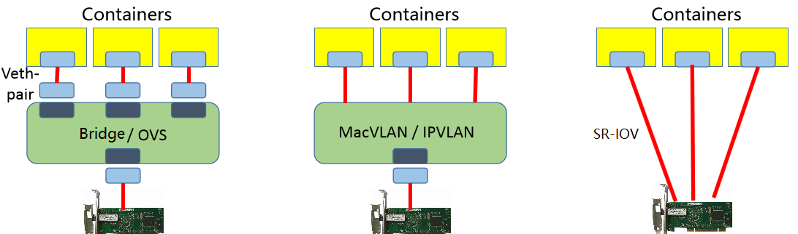

虚拟VETH设备：

用纯软件的方式实现一个虚拟网络，用一个虚拟网卡接入到虚拟网桥上去。先在宿主机上创建一个网桥，并为每个容器创建一对虚拟以太网接口（ VETH Virtual Ethernet Device Pair）。每一对网卡一半留在pod之上一半留在宿主机之上，并添加为Linux内核桥接功能或OpenVSwitch（OVS）网桥的从设备。甚至能接入到真实的物理网桥上实现物理桥接的方式。

这样就能保证每一个容器和每一个pod都能有一个专用的网络接口。

对Linux 内核版本要求较低

此方式适用虚拟机环境,但性能较差

当前此方式支持网络模型更灵活和广泛,所以在企业中使用最为主流。

多路复用：

多路复用由一个中间软件实现的虚拟网络设备组成，它暴露多个虚拟接口，使用数据包转发规则来控制每个数据包转到的目标接口。节点上的Pod 直接使用物理网卡并直接使用物理网卡进行跨节点之间进行通信。需要借助于LInux较高版本的内核级的VLAN模块来实现。此方式适用于物理机环境,性能较好,一般在运营商中使用更为广泛。

主要有下面两种实现

MACVLAN技术为每个容器的虚拟网卡接口配置一个独立的MAC地址，并将宿主机模拟为一个交换机，基于此地址完成二层报文收发IPVLAN技术则是每个容器的虚拟网卡分配一个独立的IP地址，但共享宿主机的同一个MAC，根据目标IP完成容器报文转。

硬件交换：

通过硬件实现的技术

当前很多网卡都支持单根I/O虚拟化（SR-IOV  Single Root I/O Virtualization），也是创建虚拟设备的一种实现方式。一个网卡支持直接在物理机虚拟出多个接口来，所以称为单根的网络连接方式。一个网卡能够虚拟出在硬件级多个网卡来。然后让每个容器使用一个网卡。每个虚拟设备自身表现为一个独立的网卡设备，自己的MAC地址，VLAN及硬件强制关联的QoS。

SR-IOV提供了接近硬件级别的性能，但是依赖特有硬件。

三种方式中硬件交换的方式性能是最好的

但是很多情况下用户期望去创建二层或三层的一些逻辑网络子网，这就需要借助于叠加的网络协议来实现。

### 1.3.2 虚拟网卡对 VETH

VETH（Virtual Ethernet Device Pair） 是 Linux 系统中用于创建虚拟网络设备对的工具，属于虚拟网络设备（Virtual Network Device）的一种。其核心功能是在操作系统内核中模拟真实的以太网设备，并通过 “成对” 的方式实现两个网络命名空间（Network Namespace，简称 NetNS）之间的通信，或在同一网络命名空间内模拟双向通信通道。

VETH实现更为强大的控制能力的解决方案，但是此方式对网络传输有额外的性能开销，毕竟它为全虚拟化的隧道网络或者叠加网络，要多封装IP首部或者封装mac首部。

**工作原理**

成对特性：VETH 设备必须 “成对” 创建（如 veth0 和 veth1 ），数据从其中一个设备进入时，会立即从另一个设备发出，反之亦然，类似于一条虚拟的网线连接两个端口。跨命名空间通信：将一对 VETH 设备分别分配到两个不同的 NetNS 中，即可实现两个隔离网络环境之间的通信，常用于容器（如 Docker）、虚拟机或网络虚拟化场景中。同一命名空间测试：在同一 NetNS 中使用VETH设备对，可模拟网络环路或测试网络协议（如 TCP/IP），数据从一端流入后会从另一端流出，方便调试。

范例：通过veth网卡在不同名称空间通信

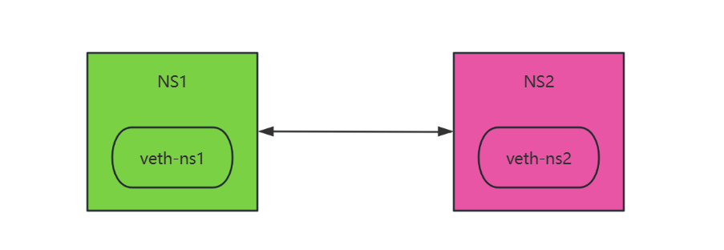

```text
#查看网络名称空间
[root@node1 ~]#ip netns
```

```text
#创建网络名称空间
[root@node1 ~]#ip netns add ns1
[root@node1 ~]#ip netns add ns2
[root@node1 ~]#ip netns
ns2
ns1
```

```text
[root@node1 ~]#ip netns exec ns1 ip a
1: lo: <LOOPBACK> mtu 65536 qdisc noop state DOWN group default qlen 1000
link/loopback 00:00:00:00:00:00 brd 00:00:00:00:00:00
[root@node1 ~]#ip netns exec ns2 ip a
1: lo: <LOOPBACK> mtu 65536 qdisc noop state DOWN group default qlen 1000
link/loopback 00:00:00:00:00:00 brd 00:00:00:00:00:00
```

```text
#创建veth的网卡对,注意：名称不能使用关健字，比如a
[root@node1 ~]#ip link add  veth-ns1 type veth peer name  veth-ns2
[root@node1 ~]#ip a
.......
7: veth-ns2@veth-ns1: <BROADCAST,MULTICAST,M-DOWN> mtu 1500 qdisc noop state
DOWN group default qlen 1000
link/ether ba:ca:48:ad:d9:c5 brd ff:ff:ff:ff:ff:ff
8: veth-ns1@veth-ns2: <BROADCAST,MULTICAST,M-DOWN> mtu 1500 qdisc noop state
DOWN group default qlen 1000
link/ether d6:36:47:df:80:1e brd ff:ff:ff:ff:ff:ff
```

```text
[root@node1 ~]#ethtool -i veth-ns1
driver: veth
version: 1.0
firmware-version:
expansion-rom-version:
bus-info:
supports-statistics: yes
supports-test: no
supports-eeprom-access: no
supports-register-dump: no
supports-priv-flags: no
```

```text
[root@node1 ~]#ethtool -S veth-ns1
NIC statistics:
peer_ifindex: 7
```

```text
rx_queue_0_xdp_packets: 0
rx_queue_0_xdp_bytes: 0
rx_queue_0_drops: 0
rx_queue_0_xdp_redirect: 0
rx_queue_0_xdp_drops: 0
rx_queue_0_xdp_tx: 0
rx_queue_0_xdp_tx_errors: 0
tx_queue_0_xdp_xmit: 0
tx_queue_0_xdp_xmit_errors: 0
rx_pp_alloc_fast: 0
rx_pp_alloc_slow: 0
rx_pp_alloc_slow_ho: 0
rx_pp_alloc_empty: 0
rx_pp_alloc_refill: 0
rx_pp_alloc_waive: 0
rx_pp_recycle_cached: 0
rx_pp_recycle_cache_full: 0
rx_pp_recycle_ring: 0
rx_pp_recycle_ring_full: 0
rx_pp_recycle_released_ref: 0
```

```text
#将网卡对分别加入不同的名称空间
[root@node1 ~]#ip link set veth-ns1 netns ns1
[root@node1 ~]#ip a
......
7: veth-ns2@if8: <BROADCAST,MULTICAST> mtu 1500 qdisc noop state DOWN group
default qlen 1000
link/ether ba:ca:48:ad:d9:c5 brd ff:ff:ff:ff:ff:ff link-netns ns1
```

```text
[root@node1 ~]#ip netns list
ns2
ns1 (id: 0)
```

```text
[root@node1 ~]#ip link set veth-ns2 netns ns2
[root@node1 ~]#ip a
```

```text
[root@node1 ~]#ip netns
ns2 (id: 1)
ns1 (id: 0)
```

```text
#查看网络名称空间的网卡信息
[root@node1 ~]#ip netns exec ns1 ip a
1: lo: <LOOPBACK> mtu 65536 qdisc noop state DOWN group default qlen 1000
link/loopback 00:00:00:00:00:00 brd 00:00:00:00:00:00
8: veth-ns1@if7: <BROADCAST,MULTICAST> mtu 1500 qdisc noop state DOWN group
default qlen 1000
link/ether d6:36:47:df:80:1e brd ff:ff:ff:ff:ff:ff link-netns ns2
```

```text
[root@node1 ~]#ip netns exec ns2 ip a
1: lo: <LOOPBACK> mtu 65536 qdisc noop state DOWN group default qlen 1000
link/loopback 00:00:00:00:00:00 brd 00:00:00:00:00:00
7: veth-ns2@if8: <BROADCAST,MULTICAST> mtu 1500 qdisc noop state DOWN group
default qlen 1000
link/ether ba:ca:48:ad:d9:c5 brd ff:ff:ff:ff:ff:ff link-netns ns1
```

```text
#启用网卡对
[root@node1 ~]#ip netns exec ns1 ip link set veth-ns1 up
```

```text
[root@node1 ~]#ip netns exec ns1 ip a
1: lo: <LOOPBACK> mtu 65536 qdisc noop state DOWN group default qlen 1000
link/loopback 00:00:00:00:00:00 brd 00:00:00:00:00:00
8: veth-ns1@if7: <NO-CARRIER,BROADCAST,MULTICAST,UP> mtu 1500 qdisc noqueue
state LOWERLAYERDOWN group default qlen 1000
link/ether d6:36:47:df:80:1e brd ff:ff:ff:ff:ff:ff link-netns ns2
```

```text
[root@node1 ~]#ip netns exec ns2 ip link set veth-ns2 up
[root@node1 ~]#ip netns exec ns2 ip a
1: lo: <LOOPBACK> mtu 65536 qdisc noop state DOWN group default qlen 1000
link/loopback 00:00:00:00:00:00 brd 00:00:00:00:00:00
7: veth-ns2@if8: <BROADCAST,MULTICAST,UP,LOWER_UP> mtu 1500 qdisc noqueue state
UP group default qlen 1000
link/ether ba:ca:48:ad:d9:c5 brd ff:ff:ff:ff:ff:ff link-netns ns1
inet6 fe80::b8ca:48ff:fead:d9c5/64 scope link
valid_lft forever preferred_lft forever
```

```text
#给网卡对配置IP
[root@node1 ~]#ip netns exec ns1 ip a a 1.1.1.1/24 dev veth-ns1
[root@node1 ~]#ip netns exec ns1 ip a
1: lo: <LOOPBACK> mtu 65536 qdisc noop state DOWN group default qlen 1000
link/loopback 00:00:00:00:00:00 brd 00:00:00:00:00:00
8: veth-ns1@if7: <BROADCAST,MULTICAST,UP,LOWER_UP> mtu 1500 qdisc noqueue state
UP group default qlen 1000
link/ether d6:36:47:df:80:1e brd ff:ff:ff:ff:ff:ff link-netns ns2
inet 1.1.1.1/24 scope global veth-ns1
valid_lft forever preferred_lft forever
inet6 fe80::d436:47ff:fedf:801e/64 scope link
valid_lft forever preferred_lft forever
```

```text
[root@node1 ~]#ip netns exec ns2 ip a a 1.1.1.2/24 dev veth-ns2
[root@node1 ~]#ip netns exec ns2 ip a
1: lo: <LOOPBACK> mtu 65536 qdisc noop state DOWN group default qlen 1000
link/loopback 00:00:00:00:00:00 brd 00:00:00:00:00:00
7: veth-ns2@if8: <BROADCAST,MULTICAST,UP,LOWER_UP> mtu 1500 qdisc noqueue state
UP group default qlen 1000
link/ether ba:ca:48:ad:d9:c5 brd ff:ff:ff:ff:ff:ff link-netns ns1
inet 1.1.1.2/24 scope global veth-ns2
valid_lft forever preferred_lft forever
inet6 fe80::b8ca:48ff:fead:d9c5/64 scope link
valid_lft forever preferred_lft forever
```

```text
#测试不同名称空间的网卡对相互访问
[root@node1 ~]#ip netns exec ns1 ping =c1 1.1.1.2
PING 1.1.1.2 (1.1.1.2) 56(84) bytes of data.
64 bytes from 1.1.1.2: icmp_seq=1 ttl=64 time=0.055 ms
```

```text
#默认无法访问自身
[root@node1 ~]#ip netns exec ns1 ping -c1 1.1.1.1
PING 1.1.1.1 (1.1.1.1) 56(84) bytes of data.
--- 1.1.1.1 ping statistics ---
1 packets transmitted, 0 received, 100% packet loss, time 3055ms
```

```text
#查看原因lo网卡没有启用
[root@node1 ~]#ip netns exec ns1 ip a
1: lo: <LOOPBACK> mtu 65536 qdisc noop state DOWN group default qlen 1000
```

```text
link/loopback 00:00:00:00:00:00 brd 00:00:00:00:00:00
8: veth-ns1@if7: <BROADCAST,MULTICAST,UP,LOWER_UP> mtu 1500 qdisc noqueue state
UP group default qlen 1000
link/ether d6:36:47:df:80:1e brd ff:ff:ff:ff:ff:ff link-netns ns2
inet 1.1.1.1/24 scope global veth-ns1
valid_lft forever preferred_lft forever
inet6 fe80::d436:47ff:fedf:801e/64 scope link
valid_lft forever preferred_lft forever
```

```text
#启用lo网卡
[root@node1 ~]#ip netns exec ns1 ip link set lo up
```

```text
#再次访问成功
[root@node1 ~]#ip netns exec ns1 ping -c1 1.1.1.1
PING 1.1.1.1 (1.1.1.1) 56(84) bytes of data.
64 bytes from 1.1.1.1: icmp_seq=1 ttl=64 time=0.027 ms
--- 1.1.1.1 ping statistics ---
1 packets transmitted, 1 received, 0% packet loss, time 1025ms
rtt min/avg/max/mdev = 0.027/0.029/0.031/0.002 ms
```

```text
#清理环境：删除网络名称空间和veth网卡对
[root@node1 ~]#ip netns delete ns1
[root@node1 ~]#ip netns delete ns2
[root@node1 ~]#ip netns
```

范例:  veth 桥接

```text
#创建网桥
[root@node1 ~]#ip link add br0 type bridge
```

```text
#创建虚拟网卡对veth
[root@node1 ~]#ip link add veth1 type veth peer veth1-eth0
```

```text
#veth桥接
[root@node1 ~]#ip link set veth1-eth0 master br0
```

```text
#查看桥接
[root@node1 ~]#ip link show master br0
9: veth1-eth0@veth1: <BROADCAST,MULTICAST,M-DOWN> mtu 1500 qdisc noop master br0
state DOWN mode DEFAULT group default qlen 1000
link/ether 56:e8:ef:3f:8e:af brd ff:ff:ff:ff:ff:ff
```

```text
#veth桥接
[root@node1 ~]#ip link set veth1 master br0
```

```text
[root@node1 ~]#ip link show master br0
9: veth1-eth0@veth1: <BROADCAST,MULTICAST,M-DOWN> mtu 1500 qdisc noop master br0
state DOWN mode DEFAULT group default qlen 1000
link/ether 56:e8:ef:3f:8e:af brd ff:ff:ff:ff:ff:ff
10: veth1@veth1-eth0: <BROADCAST,MULTICAST,M-DOWN> mtu 1500 qdisc noop master
br0 state DOWN mode DEFAULT group default qlen 1000
link/ether a6:55:12:8c:96:c6 brd ff:ff:ff:ff:ff:ff
```

### 1.3.3 MACVLAN 和 IPVLAN

#### 1.3.3.1 MACVLAN

同一主机上的每个Pod 的虚拟网卡各有MAC地址和不同的IP地址。

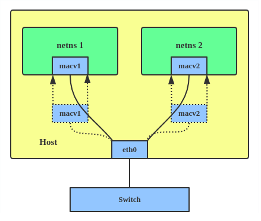

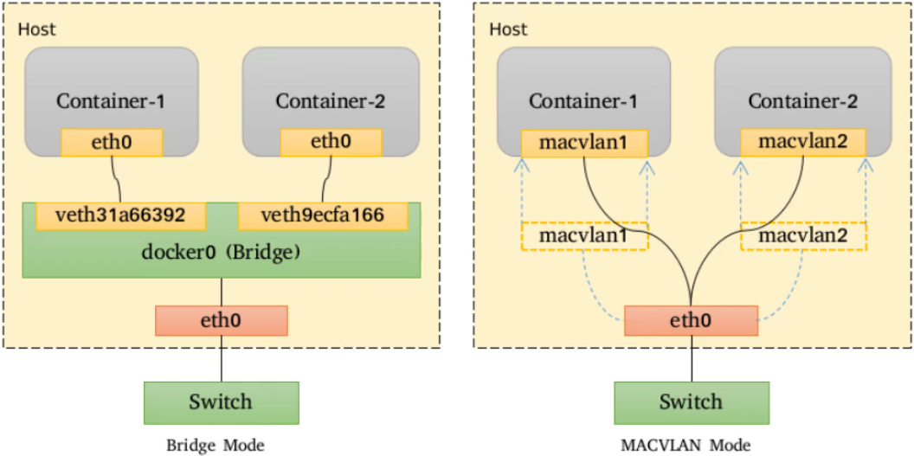

MACVLAN 属于  Underlay Network MACVLAN 支持在同一个物理以太网接口上虚拟出多个网络子接口，每个虚拟接口都拥有惟一的MAC地址，并可按需配置独立IP地址，相当于实现了每一个物理网卡都有配置一个独立IP的效果MACVLAN 要求节点的物理接口工作在混杂模式才能接收到发送给网络子接口的数据报文, 有安全风险MACVLAN允许传输广播和多播流量与Bridge模式相比，MACVLAN不再依赖虚拟网桥、NAT和端口映射，它允许容器以虚拟接口方式直接连接至物理接口Flannel ,calico 和 cilium 网络附件本身默认不直接支持 MACVLAN,但可以安装macvlan CNI 插件实现公有云运维商，比如:阿里的Terway 网络附件支持此模式MACVLAN从Linux内核3.9版本开始支持。

#### 1.3.3.2 IPVLAN

同一主机上的每个Pod 的虚拟网卡共享宿主机的网卡的MAC地址和不同IP地址。

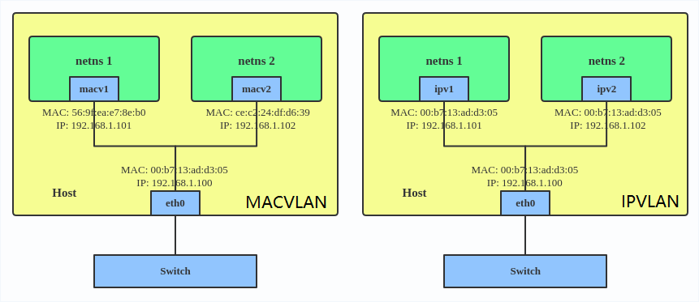

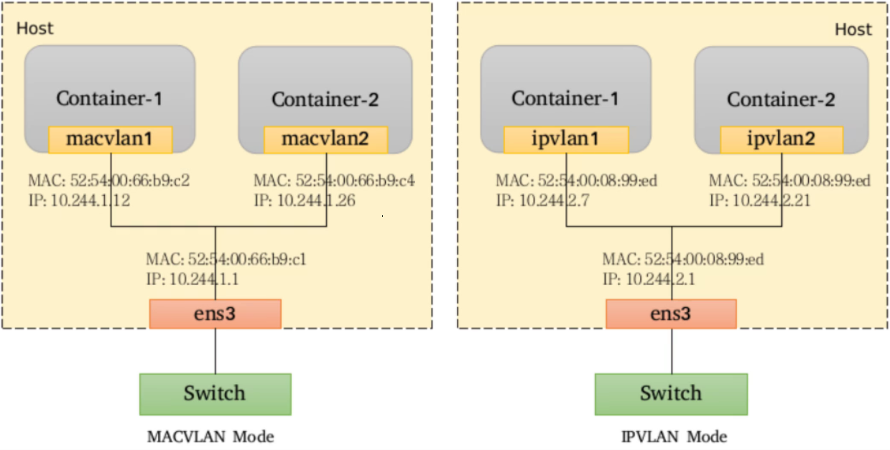

IPVLAN 属于  Underlay Network IPVLAN和MACVLAN类似，同样也是创建新的虚拟子网络接口并为每个子接口分配惟一的IP地址和MACVLAN不同的在于，IPVLAN的每个虚拟接口都共享使用同一物理接口的MAC地址，从而无需违反防止MAC欺骗的交换机的安全策略，即不再要求在物理接口上启用混杂模式，相当于实现了同一个物理网卡使用同一个MAC同时有多个IP的效果Flannel ,calico 和 cilium 网络附件本身默认不直接支持IPVLAN,但可以安装ipvlan CNI 插件实现公有云运维商，比如:阿里的Terway 网络附件支持此模式IPVLAN从Linux内核从3.19版本开始支持，更稳定和推荐的版本是4.2及以上。

## 1.4 常见网络技术实现

### 1.4.1 VxLAN

VXLAN 是 Visual eXtensible Local Area Network（虚拟扩展局域网），这是一个 VLAN 的扩展协议。参看IETF RFC 7348网络规范，是一种隧道协议,属于 Overlay Network。其解决了在划分大规模网络VLAN IDs不足（只有4096）的缺点。

VXLAN有一个24-bit的 ID, 一共支持2^24(16777216)个virtual LANs。其将L2的数据包添加上 VXLAN头，然后整个数据包作为一个UDP( 8472端口) IP包在网络上传输。

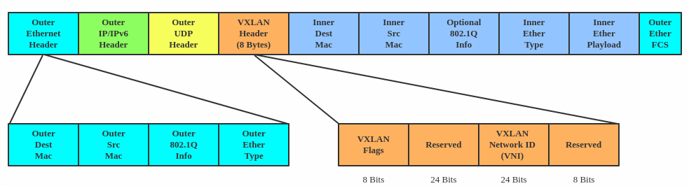

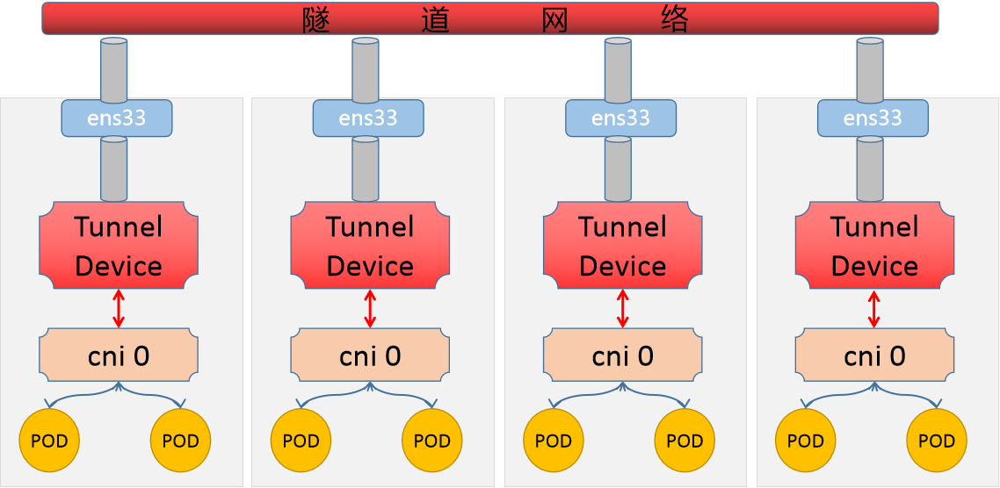

2012 年 Stephen Hemminger 把相关的VXLAN 功能合并到 kernel 中，并最终出现在 kernel 3.7.0版本。到了 kernel 3.12 版本，Linux 对 VXLAN 的支持已经完备，支持单播和组播，IPv4 和IPv6。

目前最流行的叠加网络隧道协议之一

也是由IETF定义的NVO3（Network Virtualization over Layer 3）标准技术之一。采用L2 over L4（MAC-in-UDP）的报文封装模式，将二层报文用三层协议进行封装，可实现二层网络在三层范围内进行扩展。所有节点的内核都启用了VXLAN的功能模块，每个节点都有一个唯一的编号。节点内部的pod的跨节点通信需要借助于VXLAN内部的路由机制或隧道转发机制实现通信。

每个cni0上维护了各个节点所在的隧道网段的路由列表。

node上的pod发出请求到达cni0，根据内核的路由列表判断对端网段的节点在哪里。

然后经由 隧道设备 对数据包进行封装标识，接下来对端节点的隧道设备解封标识数据包，当前数据包一看当前节点的路由表发现有自身的ip地址，这直接交给本地的pod。多个节点上的路由表信息维护，就是各种网络解决方案的工作位置。

### 1.4.2 Direct Routing

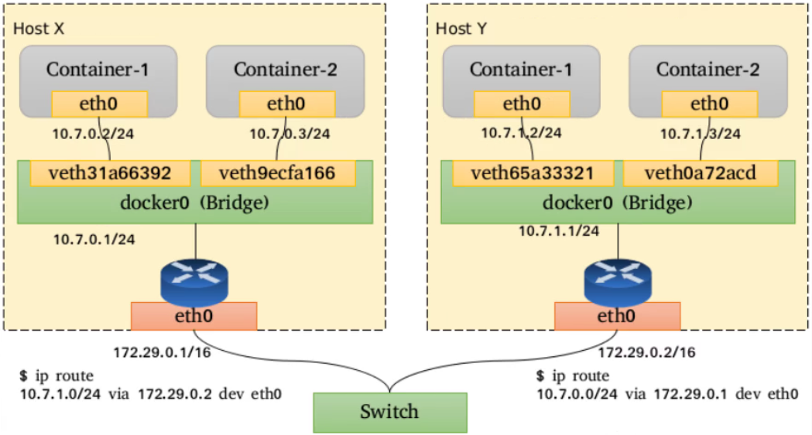

Direct Routing  属于  Underlay Network Direct Routing 不再关注跨主机的容器在Layer2的连通性，而通过路由协议解决容器间在Layer3的通信跨主机的容器间通信，需要借助于主机上的路由表指示完成报文路由，因此每个主机的物理接口地址都有可能做为另一个主机路由报文时的下一跳（nexthop）的网关地址要求所有主机的物理接口必须位于同一个Layer2网络中。

## 1.5 Kubernetes 常见网络插件

### 1.5.1 网络插件主要功能:

Pod间的网络通信，最为核心的功能。

构建一个Pod的虚拟网络为 Pod 创建网络接口，并分配置IP同时接入到这个网络中实时维护所有Pod和节点上的路由信息，实现所有节点上Pod之间的通信。

网络策略，实现网络通信的安全控制

通信加密，默认Pod间的通信是明文的，但安全要求较高时，也可以实现tls的安全加密通信。

注意：这些网络插件可以完成所有的功能，也可以完成部分的功能，再借助于其他方案实现完整的方案,但是需要注意的是: 不要同时部署多个插件来做同一件事情，因为对于CNI来说，只会有一个生效。

### 1.5.2 常见的CNI解决方案

```text
https://github.com/containernetworking/cni
https://kubernetes.io/zh-cn/docs/concepts/cluster-administration/addons/
```

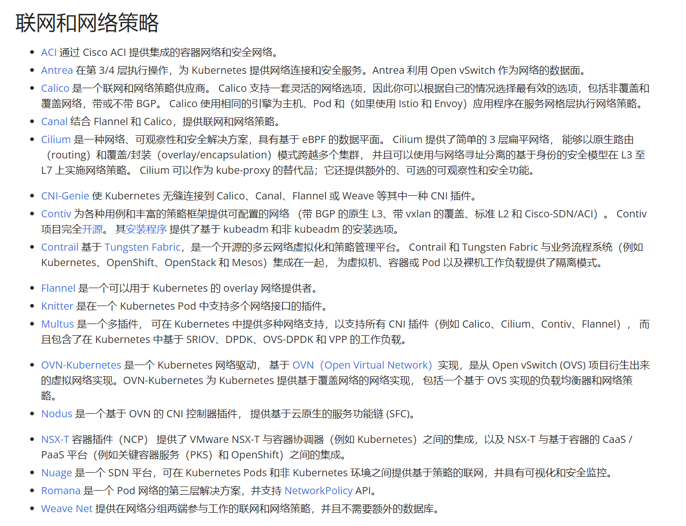

Flannel

是CoreOS团队开源的最早的支持kubernetes的网络插件。用于让集群中不同节点创建的容器都具有集群内全局唯一的网络(集群外无法感知)，也是当前Kubernetes开源方案中比较成熟的方案。支持HostGW和VXLAN模式，基于linux TUN/TAP，使用UDP封装IP报文来创建叠加网络，并借助etcd维护网络分配情况。功能简单,特性较少,无法实现网络流量的控制和Mesh(跨集群不同节点的Pod间通信)等高级功能。

纯开源无商业服务

Calico

纯3层的数据中心网络方案，支持IPIP和BGP模式，后者可以无缝集成像OpenStack这种laaS云架构，能够提供可控的VM、容器、裸机之间的IP通信。但是，需要网络设备对BGP的支持, 比如阿里云vpc子网内是不支持BGP的。

在每台机器上运行一个vRouter，利用内核转发数据包，

性能优秀,而且借助iptables/nftables实现网络策略控制等功能。不支持多播功能的应用,比如keepalived的多播。

有商业级服务提供

Canal

由Flannel和Calico联合发布的一个统一网络插件，相当于两者的合体。即集成了flannel和Calico的特性, 也支持网络策略。

当前活跃度较低

cilium

```text
https://github.com/cilium/cilium
```

Cilium 是一款基于 eBPF 技术的 Kubernetes CNI 插件。

Cilium 最初由 Isovalent 创建，于 2021 年 10 月成为 CNCF 孵化项目，现在有来自 7 家不同公司的维护者和 800 多名个人贡献者。就提交数量而言，Cilium 在 CNCF 项目的活跃度中排名第二 ，仅次于 Kubernetes。2023年10月11日，CNCF 发文宣布容器网络开源项目Cilium正式毕业。Cilium 在其官网上对产品的定位为 “eBPF-based Networking, Observability, Security”，致力于为容器工作负载提供基于 eBPF 的网络、可观察性和安全性的一系列解决方案。

Cilium使用eBPF（Extended Berkeley Packet Filter）技术，在网卡驱动模式级别而非传统的内核级可以管理网络流量，执行负载均衡、安全策略、服务发现等任务,在Linux内核中运行高性能的程序来处理网络数据包，从而实现高效的网络功能。Cilium 通过使用 eBPF 技术在 Linux 内部动态插入一些控制逻辑，可以在不修改应用程序代码或容器配置的情况下进行应用和更新，从而实现网络、可观察性和安全性相关的功能。

当你选择使用Cilium作为网络插件时，Cilium会接管网络功能，包括服务发现和负载均衡，Cilium可以替代kube-proxy来提供更强大和高效的网络功能。因此不再依赖于kube-proxy，不再需要安装或配置kube-proxy。Cilium 也支持七层代理功能,替换Ingress Controller 的功能。

支持多集群和安装多个CNI插件来增强功能

此网络附件相对复杂,如果想实现BGP还需要安装额外的插件,比如:kube-router。

Terway

Terway是阿里云开源的基于VPC网络的CNI插件，支持VPC和ENl(弹性网卡)模式，后者可实现容器网络使用VPC子网网络。

Pod会通过弹性网卡资源直接被分配使用VPC中的IP地址，而不需要额外指定虚拟Pod网段。Pod地址即为VPC中地址，无NAT损耗支持独占ENI模式，几乎无损。支持基于Kubernetes标准的网络策略(Network Policy)来定义容器间的访问策略，并兼容Calico的网络策略。

支持对单个容器做带宽的限流。

Contiv

思科开源的用于跨虚拟机、裸机、公有云或私有云的异构容器部署的开源容器网络架构方案。直接提供多租户网络，支持L2(VLAN)、L3(BGP)、Overlay(VXLAN)。

kube-router

K8s网络一体化解决方案，可取代kube-proxy实现基于ipvs的Service，支持网络策略、完美兼容BGP的高级特性。

Weave Net

由weaveworks 公司开发,当前此公司已倒闭。WeaveNet最初是为容器开发的,但后来演变成了Kubernetes网络插件。多主机容器的网络方案，支持去中心化的控制平面，数据平面上，通过UDP封装实现L2 Overlay。

**安装及配置的便捷性比较**

```text
https://itnext.io/
```


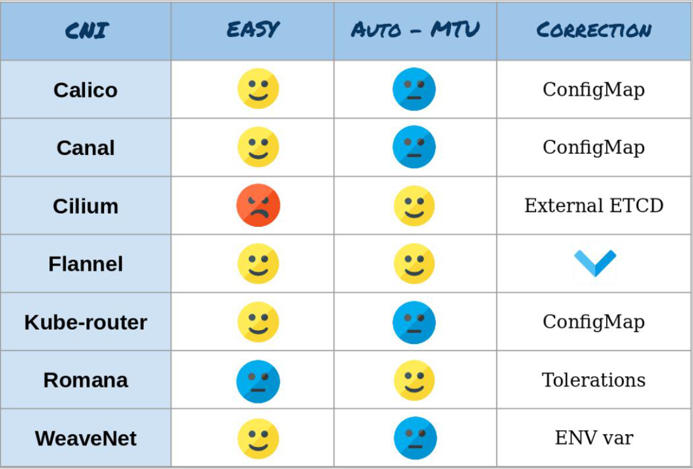

**安全特性**

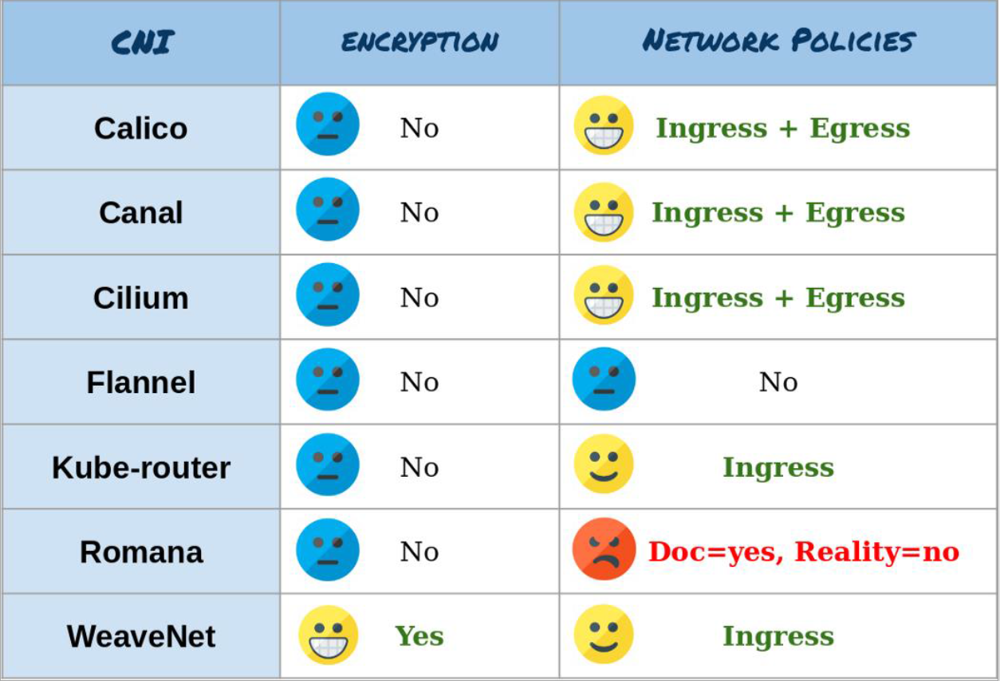

**性能对比**

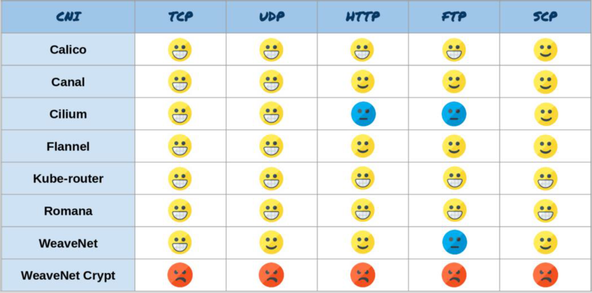

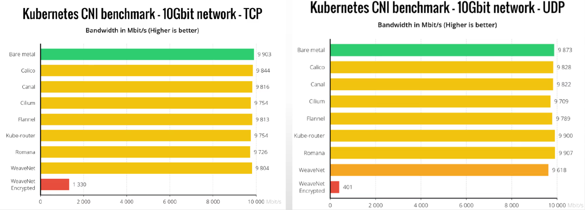

**资源消耗**

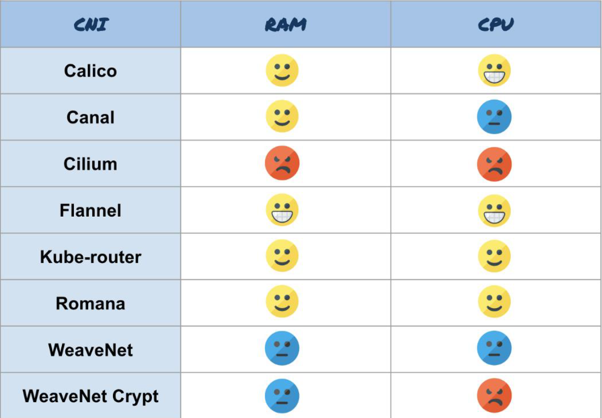

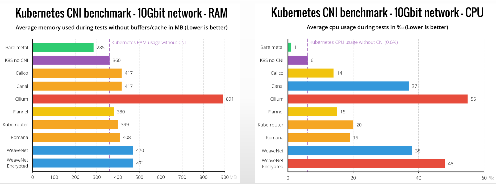

**综合对比**

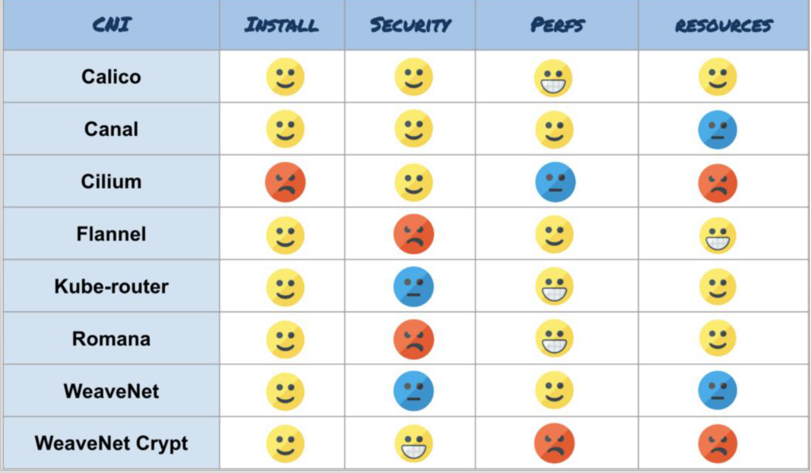

通常来说，选择网络插件时应该通过底层系统环境限制、容器网络的功能需求和性能需求三个重要的评估标准来衡量插件的适用性。

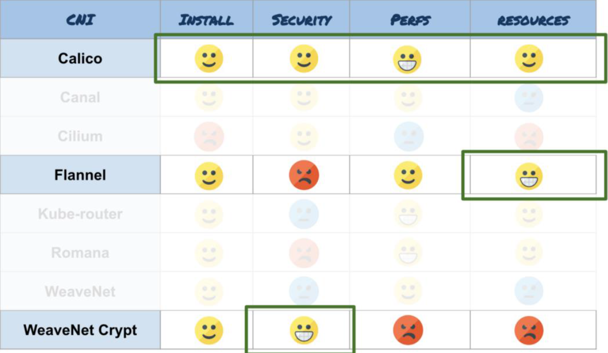

### 1.5.3 选择网络附件

底层系统环境限制：

公有云环境多有专有的实现，例如Google GCE、Azure CNI、AWS VPC CNI和Aliyun Terway等，通常是相应环境上较佳的选择。

虚拟化环境限制较多，一般只支持叠加网络模型，可用有Flannel vxlan、Calico ipip、Weave和Antrea等；

物理机环境几乎支持任何类型的网络插件，此时一般应该选择性能较好的的Calico BGP、Flannel host-gw或DAMM IPVLAN等。

**容器网络功能需求**：支持NetworkPolicy的解决方案以Calico、WeaveNet和Antrea为代表，而且后两个支持节点到节点间的通信加密。

而大量Pod需要与集群外部资源互联互通时应该选择承载网络模型一类的解决方案。

**容器网络性能需求**：Overlay网络中的协议报文有隧道开销，性能略差，而Underlay网络则几乎不存这方面的问题。

Overlay或Underlay路由模型的网络插件支持较快的Pod创建速度。

而Underlay模型中IPVLAN或MACVLAN模式中较慢

更少的资源消耗及好性能，选Cilium、flannel。

更好的各因素均衡特征，选 Calico

这些方案中,当前主流的是：calico、flannel、Cilium、kube-router。

# 2 Flannel

## 2.1 Flannel 介绍


Flannel(毛巾)是Kubernetes的一种兼容CNI的API的开源的网络插件,基于Golang开发, 由CoreOS研发。Kubernetes 在发布CNI之前,使用的是kubenet网络规范,当时唯一网络实现就是Flannel。因此Flannel 是kubernetes最早的网络解决方案。

支持Kubernetes、OpenShift、Cloud Foundry、Mesos、Amazon ECS、 Singularity和OpenSVC等平台

```text
2013年1月CoreOS发布CoreOS操作系统，后改名为Container Linux,是一个基于Linux内核的轻量级操
作系统，为了计算机集群的基础设施建设而生，专注于自动化、轻松部署、安全、可靠及可扩缩性。作为一个
操作系统，CoreOS 提供了在应用容器内部署应用所需要的基础功能环境以及一系列用于服务发现和配置共享
的内建工具。
2013年7月21日：Flannel 由 CoreOS 开发，作为一个用于容器网络的解决方案
2013年7月30日：etcd 在 CoreOS 的开发过程中首次发布
2015年：CoreOS 发布了自己的容器运行时 rkt
2018年1月30日，RedHat宣布已经签署了收购CoreOS。
2020年5月26日，CoreOS Container Linux达到其寿命的终结，不再接收更新。Fedora CoreOS是其正
式继任者
```

官网:

```text
http://coreos.com/flannel/
https://github.com/flannel-io/flannel
https://github.com/flannel-io/flannel#deploying-flannel-manually
https://docs.openshift.com/container-
platform/3.4/architecture/additional_concepts/flannel.html
```

## 2.2 Flannel 原理

### 2.2.1 Flannel 工作机制

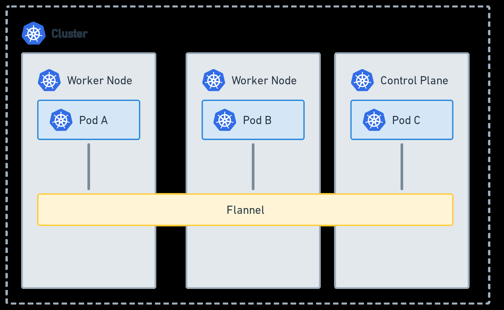

#### 2.2.1.1 Flannel 的相关术语

veth

Flannel 使用虚拟网桥和veth设备的方式为Pod创建虚拟网络接口。veth 是一种虚拟以太网设备。veth 可作为 netns 间的隧道，创建桥接另一个 netns 中物理网络设备，也可作为独立的网络设备使用。每个Pod启动后,会自动在所在节点生成一个对应的veth虚拟以太网网卡。

cni0

cni0 是一种 Linux 网桥bridge设备。所有Pod的虚拟网卡 veth 设备将连接到该网桥，使得所有位于同一节点的 Pod 间可相互通信。

cni0的IP 为此主机上所有Pod的默认网关,一般为节点Pod对应子网的第1个IP, 比如:10.244.1.1/24。

注意：只有使用Pod网络的Pod在该节点创建后，才会生成cni0网卡，而 使用节点网络hostNetwork为true 的Pod 不会创建cni0。

flannel.1

flannel.1 是 VXLAN 终端设备,也被称为 VXLAN 通道终端（VETP），它是 VXLAN 通道的起点和终点。

flannel.1做为VXLAN 接口的主要功能是确保 Pod 及其网络间的通信经由 Overlay 二层网络。

让各节点的 VXLAN 如同连接在同一个大的网络(默认为10.244.0.0/16)中工作。每个节点具有一个独立的子网(10.244.X.0/24)，每个 Pod 的 IP 位于该子网中。即每个节点的 VXLAN 网络自成体系,有自己独立的子网，但同时也处于同一个大网络域内。

flannel.1接口地址一般为子网的第0个, 比如:10.244.1.0/32。

flanneld

flanneld 是一个进程，由每个节点的daemonset的 kube-flannel Pod提供此功能。由于flannel是以pod的形式存在，flannel 启动后就相当于在每个节点上启动了一个守护进程。

该守护进程：

该进程会负责当前节点上的所有报文封装解封等动作。通过 kube-apiserver 组件从集群的etcd服务获取每个节点的网络信息，并生成本地路由表信息给本地的flannel.1网卡配置相关的ip地址。

#### 2.2.1.2 Flannel 的工作机制

Flannel 将预留的一个专用网络（默认为10.244.0.0/16）针对每个集群节点切分成相对应的一个CIDR子网。每个节点上CIDR子网专用于给该上节点上的Pod分配IP，而后由节点以IPAM插件host-local进行地址分配，并将子网分配信息保存于etcd之中。Flannel在每个主机上运行一个名为flanneld的二进制代理程序。该程序负责从预留的网络中按照指定或默认的掩码长度为每个集群节点申请分配一个子网，并将网络配置、已分配的子网和辅助数据（例如主机的公网IP等）存储于Kubernetes API或etcd之中。

所有节点的 Pod 使用默认分配置在10.244.0.0/16这样一个大的网段。kube-controller-manager  会从这个大的网段中再会为每个节点分配一个小的子网网段podCIDR10.244.0.0/24。从 podCIDR 中的子网值为节点上的 Pod 分配 IP 地址。由于所有节点上的 podCIDR 是不相交的子网，因此它允许为每个 Pod 分配唯一的 IP 地址。

默认使用 10.244.0..0/16的网段,并给每个节点划分子网 10.244.0.0/24,

每个节点的子网网段PodCIDR分配给每个节点上的Pod 使用, 比如:

Master1上的Pod:10.244.0.0/24

Master2上的Pod:10.244.1.0/24

Master3上的Pod:10.244.2.0/24

Node1上的Pod:10.244.3.0/24

Node2上的Pod:10.244.4.0/24

Node3上的Pod:10.244.5.0/24

即支持2^8个子网,每个节点的子网支持2^8-2=254个Pod。每个节点的flannel.1占用每个子网的0号IP,同时每个flannel.1做为到达集群中其它节点上各个Pod网段对应路由的网关。

比如Master1上flannel.1为10.244.0.0/32,Node1上的flannel.1为10.244.3.0/32

每个节点的cni0虚拟网桥会占用子网的第一个IP，所有本节点的Pod的网卡都会创建一对veth网卡，一端在Pod上，另一端在节点上，节点上的接口都桥接到cni0网桥上，同时做为本节点上面的所有Pod的网关。

比如Master1上cni0为10.244.0.1/24,Node1上的cni0为10.244.3.1/24

Pod之间的通信被用VXLAN的UDP协议封装后,向目标Pod所在的主机8472/UDP端口发送。

**网段的分配原理**：集群的 kube-controller-manager 负责控制每个节点的网段分配集群的 etcd 负责存储所有节点的网络配置存储集群的 flannel 负责各个节点的路由表定制及其数据包的拆分和封装。

所以flannel各个节点是平等的，仅负责数据平面的操作。网络功能相对来说比较简单。

官网Flannel 的网络通信

注意:官网图中docker0是错误的,应该为cni0。

```text
https://docs.openshift.com/container-
platform/3.4/architecture/additional_concepts/flannel.html
```

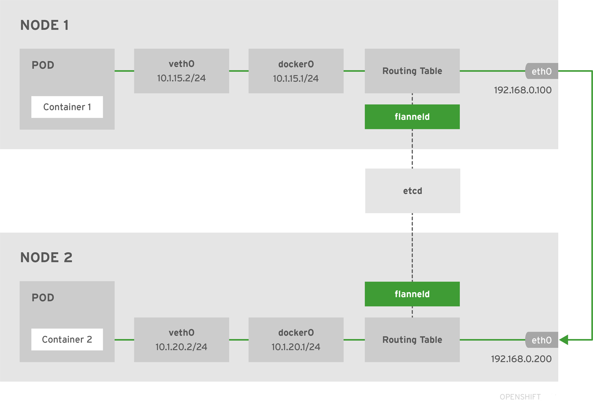

kube-apiserver为了更方便后续 flannel与etcd 直接的交流，单独分配一个url用于flannel和etcd的交流。在二进制部署集群中可以看到效果。

#### 2.2.1.3 范例：通过网卡桥接veth网卡对，实现不同名称空间网卡相互通信

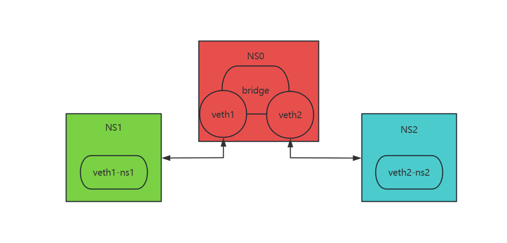

```text
#创建网络名称空间
[root@node1 ~]#ip netns
[root@node1 ~]#ip netns add ns1
[root@node1 ~]#ip netns add ns2
[root@node1 ~]#ip netns
```

```text
ns2
ns1
```

```text
#创建网桥
[root@node1 ~]#ip link add br0 type bridge
```

```text
[root@node1 ~]#ip a show br0
9: br0: <BROADCAST,MULTICAST> mtu 1500 qdisc noop state DOWN group default qlen
1000
link/ether e2:6c:6b:49:ee:78 brd ff:ff:ff:ff:ff:ff
```

```text
[root@node1 ~]#apt update && apt -y install bridge-utils
[root@node1 ~]#brctl show
bridge name bridge id       STP enabled interfaces
br0     8000.e26c6b49ee78   no
```

```text
#启用网桥
[root@node1 ~]#ip link set br0 up
[root@node1 ~]#ip a show br0
9: br0: <NO-CARRIER,BROADCAST,MULTICAST,UP> mtu 1500 qdisc noqueue state DOWN
group default qlen 1000
link/ether e2:6c:6b:49:ee:78 brd ff:ff:ff:ff:ff:ff
```

```text
#创建veth网卡对
[root@node1 ~]#ip link add  veth1 type veth peer name veth1-ns1
[root@node1 ~]#ip link add  veth2 type veth peer name veth2-ns2
[root@node1 ~]#ip a
.......
9: br0: <NO-CARRIER,BROADCAST,MULTICAST,UP> mtu 1500 qdisc noqueue state DOWN
group default qlen 1000
link/ether e2:6c:6b:49:ee:78 brd ff:ff:ff:ff:ff:ff
10: veth1-ns1@veth1: <BROADCAST,MULTICAST,M-DOWN> mtu 1500 qdisc noop state DOWN
group default qlen 1000
link/ether 96:ab:a3:21:3d:c3 brd ff:ff:ff:ff:ff:ff
11: veth1@veth1-ns1: <BROADCAST,MULTICAST,M-DOWN> mtu 1500 qdisc noop state DOWN
group default qlen 1000
link/ether a6:55:12:8c:96:c6 brd ff:ff:ff:ff:ff:ff
12: veth2-ns2@veth2: <BROADCAST,MULTICAST,M-DOWN> mtu 1500 qdisc noop state DOWN
group default qlen 1000
link/ether c6:a3:df:ea:2f:e3 brd ff:ff:ff:ff:ff:ff
13: veth2@veth2-ns2: <BROADCAST,MULTICAST,M-DOWN> mtu 1500 qdisc noop state DOWN
group default qlen 1000
link/ether 9e:fd:86:30:9c:10 brd ff:ff:ff:ff:ff:ff
```

```text
#将网卡对加入不同的名称空间
[root@node1 ~]#ip link set veth1-ns1 netns ns1
[root@node1 ~]#ip link set veth2-ns2 netns ns2
```

```text
[root@node1 ~]#ip netns
ns2 (id: 1)
ns1 (id: 0)
```

```text
#查看宿主机网络空间
[root@node1 ~]#ip a
.......
9: br0: <NO-CARRIER,BROADCAST,MULTICAST,UP> mtu 1500 qdisc noqueue state DOWN
group default qlen 1000
```

```text
link/ether e2:6c:6b:49:ee:78 brd ff:ff:ff:ff:ff:ff
11: veth1@if10: <BROADCAST,MULTICAST> mtu 1500 qdisc noop state DOWN group
default qlen 1000
link/ether a6:55:12:8c:96:c6 brd ff:ff:ff:ff:ff:ff link-netns ns1
13: veth2@if12: <BROADCAST,MULTICAST> mtu 1500 qdisc noop state DOWN group
default qlen 1000
link/ether 9e:fd:86:30:9c:10 brd ff:ff:ff:ff:ff:ff link-netns ns2
```

```text
#查看不同网络空间的网络信息
[root@node1 ~]#ip netns exec ns1 ip a
1: lo: <LOOPBACK> mtu 65536 qdisc noop state DOWN group default qlen 1000
link/loopback 00:00:00:00:00:00 brd 00:00:00:00:00:00
10: veth1-ns1@if11: <BROADCAST,MULTICAST> mtu 1500 qdisc noop state DOWN group
default qlen 1000
link/ether 96:ab:a3:21:3d:c3 brd ff:ff:ff:ff:ff:ff link-netnsid 0
```

```text
[root@node1 ~]#ip netns exec ns2 ip a
1: lo: <LOOPBACK> mtu 65536 qdisc noop state DOWN group default qlen 1000
link/loopback 00:00:00:00:00:00 brd 00:00:00:00:00:00
12: veth2-ns2@if13: <BROADCAST,MULTICAST> mtu 1500 qdisc noop state DOWN group
default qlen 1000
link/ether c6:a3:df:ea:2f:e3 brd ff:ff:ff:ff:ff:ff link-netnsid 0
```

```text
#启用不同网络空间的网卡对
[root@node1 ~]#ip netns exec ns1 ip link set veth1-ns1 up
[root@node1 ~]#ip netns exec ns2 ip link set veth2-ns2 up
```

```text
#确认启用
[root@node1 ~]#ip netns exec ns1 ip a
1: lo: <LOOPBACK> mtu 65536 qdisc noop state DOWN group default qlen 1000
link/loopback 00:00:00:00:00:00 brd 00:00:00:00:00:00
10: veth1-ns1@if11: <NO-CARRIER,BROADCAST,MULTICAST,UP> mtu 1500 qdisc noqueue
state LOWERLAYERDOWN group default qlen 1000
link/ether 96:ab:a3:21:3d:c3 brd ff:ff:ff:ff:ff:ff link-netnsid 0
[root@node1 ~]#ip netns exec ns2 ip a
1: lo: <LOOPBACK> mtu 65536 qdisc noop state DOWN group default qlen 1000
link/loopback 00:00:00:00:00:00 brd 00:00:00:00:00:00
12: veth2-ns2@if13: <NO-CARRIER,BROADCAST,MULTICAST,UP> mtu 1500 qdisc noqueue
state LOWERLAYERDOWN group default qlen 1000
link/ether c6:a3:df:ea:2f:e3 brd ff:ff:ff:ff:ff:ff link-netnsid 0
```

```text
#给不同网络空间的网卡配置IP
[root@node1 ~]#ip netns exec ns1 ip a a 1.1.1.1/24 dev veth1-ns1
[root@node1 ~]#ip netns exec ns2 ip a a 1.1.1.2/24 dev veth2-ns2
```

```text
#确认配置
[root@node1 ~]#ip netns exec ns1 ip a
1: lo: <LOOPBACK> mtu 65536 qdisc noop state DOWN group default qlen 1000
link/loopback 00:00:00:00:00:00 brd 00:00:00:00:00:00
10: veth1-ns1@if11: <NO-CARRIER,BROADCAST,MULTICAST,UP> mtu 1500 qdisc noqueue
state LOWERLAYERDOWN group default qlen 1000
link/ether 96:ab:a3:21:3d:c3 brd ff:ff:ff:ff:ff:ff link-netnsid 0
inet 1.1.1.1/24 scope global veth1-ns1
valid_lft forever preferred_lft forever
[root@node1 ~]#ip netns exec ns2 ip a
1: lo: <LOOPBACK> mtu 65536 qdisc noop state DOWN group default qlen 1000
link/loopback 00:00:00:00:00:00 brd 00:00:00:00:00:00
```

```text
12: veth2-ns2@if13: <NO-CARRIER,BROADCAST,MULTICAST,UP> mtu 1500 qdisc noqueue
state LOWERLAYERDOWN group default qlen 1000
link/ether c6:a3:df:ea:2f:e3 brd ff:ff:ff:ff:ff:ff link-netnsid 0
inet 1.1.1.2/24 scope global veth2-ns2
valid_lft forever preferred_lft forever
```

```text
#查看网桥
[root@node1 ~]#brctl show
bridge name bridge id       STP enabled interfaces
br0     8000.e26c6b49ee78   no
cni0        8000.eaff474161e4   no
```

```text
#测试不同名空间的网络通信不成功
[root@node1 ~]#ip netns exec ns1 ping -c1 1.1.1.2
PING 1.1.1.2 (1.1.1.2) 56(84) bytes of data.
```

```text
--- 1.1.1.2 ping statistics ---
1 packets transmitted, 0 received, 100% packet loss, time 0ms
```

```text
#将网卡桥接至br0
[root@node1 ~]#ip link set veth1 master br0
[root@node1 ~]#ip link set veth2 master br0
```

```text
#查看桥接
[root@node1 ~]#ip link show master br0
10: veth1@veth1-ns1: <BROADCAST,MULTICAST,M-DOWN> mtu 1500 qdisc noop master br0
state DOWN mode DEFAULT group default qlen 1000
link/ether a6:55:12:8c:96:c6 brd ff:ff:ff:ff:ff:ff
12: veth2@veth2-ns2: <BROADCAST,MULTICAST,M-DOWN> mtu 1500 qdisc noop master br0
state DOWN mode DEFAULT group default qlen 1000
link/ether a6:55:12:8c:96:86 brd ff:ff:ff:ff:ff:ff
```

```text
[root@node1 ~]#brctl show
bridge name bridge id       STP enabled interfaces
br0     8000.e26c6b49ee78   no      veth1
veth2
cni0        8000.eaff474161e4   no
```

```text
#启用网卡对
[root@node1 ~]#ip link set veth1 up
[root@node1 ~]#ip link set veth2 up
```

```text
#测试不同名称空间的网卡相互访问成功
[root@node1 ~]#ip netns exec ns1 ping -c1 1.1.1.2
PING 1.1.1.2 (1.1.1.2) 56(84) bytes of data.
64 bytes from 1.1.1.2: icmp_seq=1 ttl=64 time=0.135 ms
```

```text
--- 1.1.1.2 ping statistics ---
1 packets transmitted, 1 received, 0% packet loss, time 0ms
rtt min/avg/max/mdev = 0.135/0.135/0.135/0.000 ms
```

```text
[root@node1 ~]#ip netns exec ns2 ping -c1 1.1.1.1
PING 1.1.1.1 (1.1.1.1) 56(84) bytes of data.
64 bytes from 1.1.1.1: icmp_seq=1 ttl=64 time=0.087 ms
```

```text
--- 1.1.1.1 ping statistics ---
1 packets transmitted, 1 received, 0% packet loss, time 0ms
```

```text
rtt min/avg/max/mdev = 0.087/0.087/0.087/0.000 ms
```

```text
#清理环境
[root@node1 ~]#ip netns
ns2 (id: 1)
ns1 (id: 0)
[root@node1 ~]#ip netns delete ns1
[root@node1 ~]#ip netns delete ns2
[root@node1 ~]#ip netns
[root@node1 ~]#ip link delete br0
```

### 2.2.2 Flannel 网络模型

Flannel使用称为后端（backend）的容器网络机制转发跨节点的Pod报文。通过可配置的“后端”定义Pod间的通信网络,支持基于VXLAN和UDP的Overlay网络，以及基于三层路由的Underlay网络。它目前支持的主流backend如下,即flannel网络通信模型。

**模型解析**

此为Flannel的默认模式使用Linux内核中的vxlan模块封装隧道报文，以overlay叠加网络模型支持跨节点的Pod间互联互通。

vxlan

Pod与Pod之间的通信是经由隧道封装后实现，各节点彼此间能通信就行，不要求在同一个二层网络vxlan后端模式中，flanneld监听于8472/UDP发送封装的数据包。Pod与Pod不经隧道封装而直接通信，要求各节点必须位于同一个二层网络,属于UnderLay网络由于这种方式强制要求各节点本身必须在同一个二层网络中，不太适用于较大。

host-gw

的网络规模此模式有着较好的转发性能，且易于设定，推荐对报文转发性能要求较高的场景使用。

vxlan 也支持直接路由（Direct Routing）模式

vxlan

如果在同一个二层网络的不同节点上的Pod间通信，无须隧道封装直接路由通信即可。

directrouting

如果在不同的二层网络的不同节点上的Pod间通信，仍须隧道封装VXLAN通信。使用常规UDP报文封装完成隧道转发，性能较前两种方式低很多。

udp

UDP后端模式中，flanneld监听于8285/UDP发送封装的报文仅应该用在不支持前两种后端环境中使用。

#### 2.2.2.1 VXLAN 模式

##### 2.2.2.1.1 VXLAN 介绍

Flannel默认网络模型就是以VXLAN( Visual eXtensible Local Area Network)的隧道模型来实现正常的跨节点的网络通信。VxLAN 本质上是一种隧道封装技术。支持kernetes的节点跨网段通信。它使用 TCP/IP 协议栈的封装/解封装技术，将 Layer 2 的以太网帧（Ethernet frames）封装成 Layer4的 UDP 数据报（datagrams），然后在 Layer3 的网络中传输，效果就像 Layer 2 的以太网帧在一个广播域中传输一样，实际上是跨越了 L3 网络，但却感知不到 Layer 3 网络的存在。

如下图所示，左右两边是 Layer 2 广播域，中间跨越一个 Layer 3 网络，VTEP (VxLAN Tunnel Point)是VxLAN 隧道端点(可以是源和目的端点)，当 Layer 2 以太网帧到达 VTEP 的时候，通过 VxLAN 进行封装，跨越 L3 层网络到达目标VTEP, 目标VTEP将XVLAN解封装,还原为原始报文,最终完成通信。

由于 VxLAN 的封装"屏蔽"了 Layer3 网络的存在，所以整个过程就像在同一个 L2 广播域中传输一样。

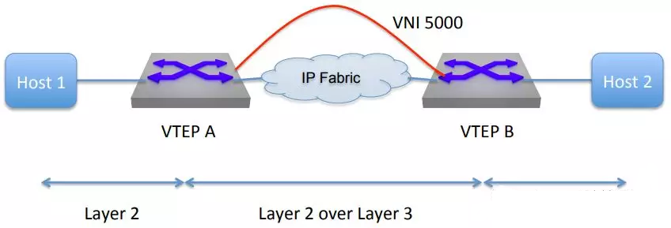

##### 2.2.2.1.2 VXLAN 报文结构

VxLAN 是一种隧道封装技术，它的报文格式也是一种封装的结构，如下图展现了 VxLAN 的封装报文格式。首先，最里面是原始的 L2 以太网帧，也就是虚拟机发出的数据帧，接着封装上 VxLAN 的头部，然后整个 VxLAN 帧再封装在物理网络中的 UDP 报文中，接着是 IP 包头，MAC 头。为了和内部的原始以太网帧区别，外部封装的都加上外层 IP 头，外层 MAC 头。在Flannel网络插件中，VXLAN模式的默认MTU设置通常为1450字节。这是因为Flannel会为VXLAN封装预留50字节的开销，从而避免因封装而导致的IP分片或丢包。

计算方式如下：

标准以太网的MTU通常为1500字节。VXLAN封装会增加50字节的开销（包括VXLAN头部、UDP头部和IP头部等）。因此，Flannel将默认MTU设置为1450字节（1500 - 50），确保封装后的数据包大小不会超过底层网络的MTU限制。

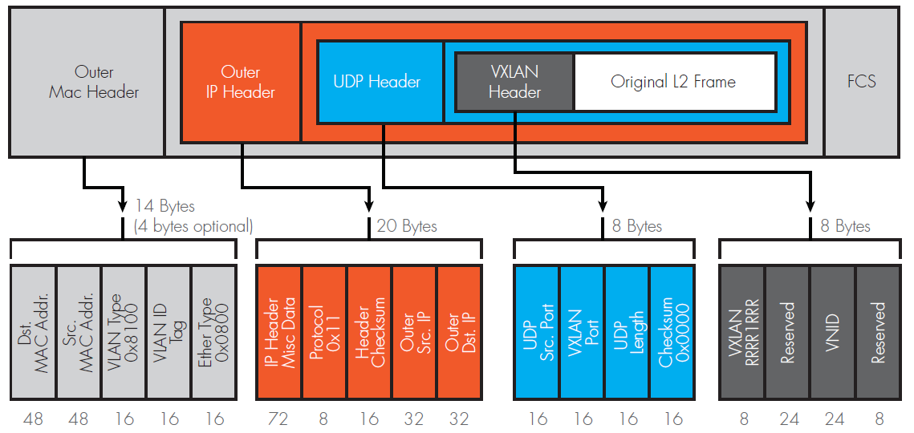

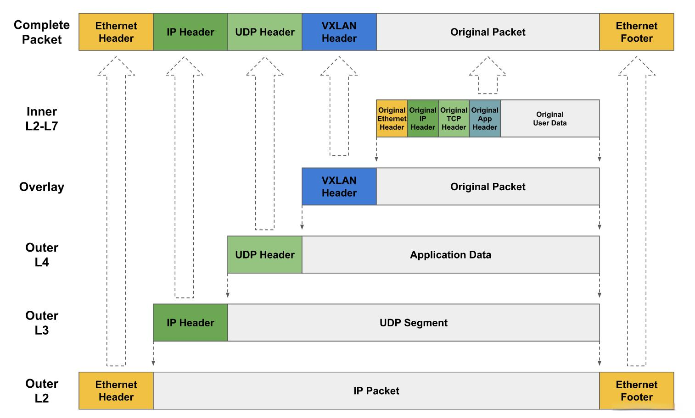

其中，VxLAN Header 头由 8Bytes 组成，分别是：

**Flags**：占 8bits，具体是 RRRRIRRR ，其中 I 必须设置为 1，表示是是一个合法的 VxLAN ID，其它 7bits 的 R 作为保留字段并且设置为 0。VNI(VxLAN Network Identifier)：VxLAN的ID标识占24位，支持 ID 个数为 2^24=16777216，约等于16M个。而VLAN的 ID只有12位

VNI用于标识租户，不同VNI中的主机不能进行二层互通。

**Reserved**：有两个字段，分别占 24 bits 和 8 bits，作为保留字段并且设置为 0。对于 UDP 头部，目的端口(dst port) 默认设置为 8472，这是 IANA 分配的 VxLAN 协议使用端口号。

##### 2.2.2.1.3 VXLAN 通信过程

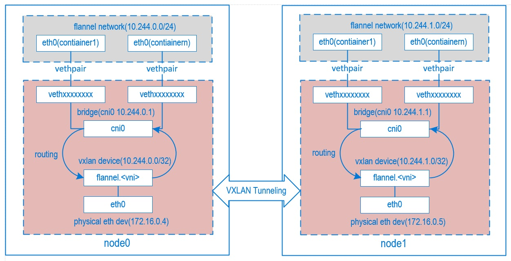

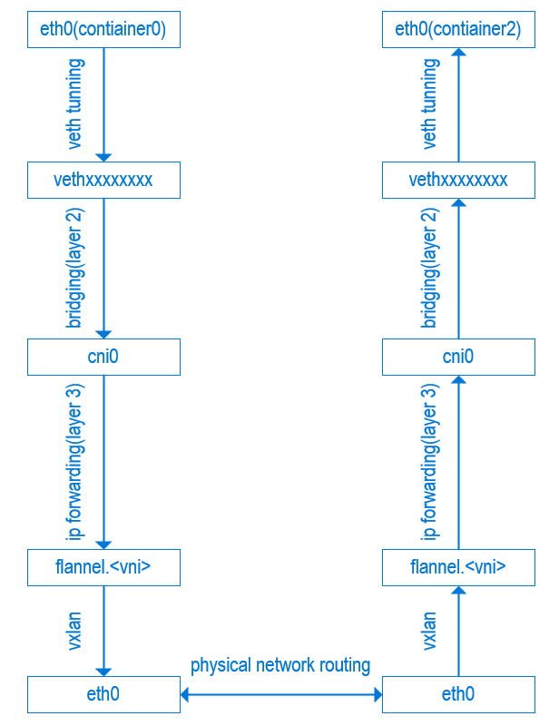

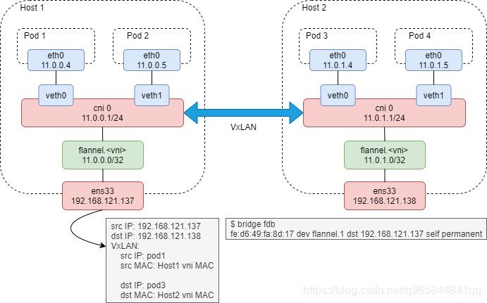

节点上的pod通过虚拟网卡对，连接到cni0的虚拟网桥上。当和同一个节点的Pod进行内部通信时，通过 cni0 虚拟网桥直接利用ARP就可进行通信。当和不同节点的Pod进行外部网络通信时，将cni0的IP做为网关查询路由表，再借助于 flannel.1网卡进行VxLAN的封装后再向外发出数据包。当和非Pod的节点主机通信时，会利用当前Pod所在节点的IP通过SNAT做地址转换后再进行通信。

到达flannel.1接口,再查询路由表经过 flannel.1 网卡的数据包，借助于flanneld实现数据包的封装和解封。

查询主机的路由表, 目标Pod所在网段的路由记录中将目标Pod所在节点的Flannel.1接口地址做为网关,将本节点的flannel.1做为接口,

最后送给宿主机的物理接口，发送出去。

对于Pod来说，它以为是直接通过 flannel.x -> vxlan tunnel -> flannel.x 实现跨主机Pod间的数据通信。

因为它们的隧道标识都是".1"，所以认为是同一个vxlan，直接路由过去，没有意识到底层的通信机制。Vxlan 报文中外层IP中集群节点的IP，MAC层集群节点的MAC。

Vxlan 报文中内层IP中Pod的IP，MAC层flannel.1的接口MAC

注意：由于这种方式，是对数据报文进行了多次的封装，降低了单个数据包的有效载荷。所以效率有所降低。

范例: 用 Wireshark 和tcpdump 抓包分析

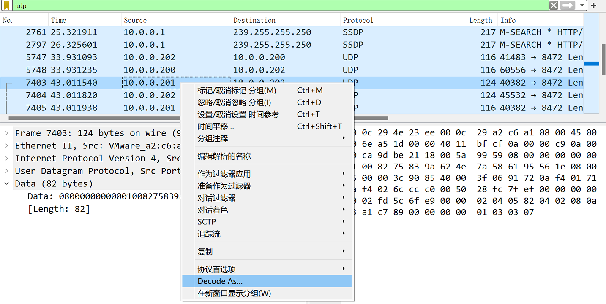

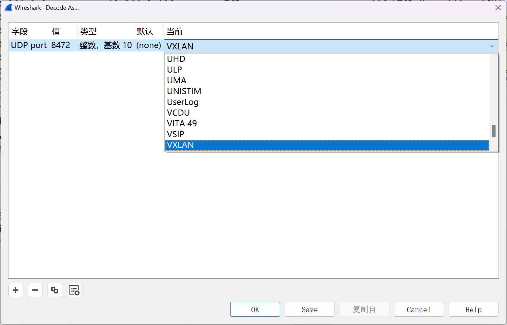

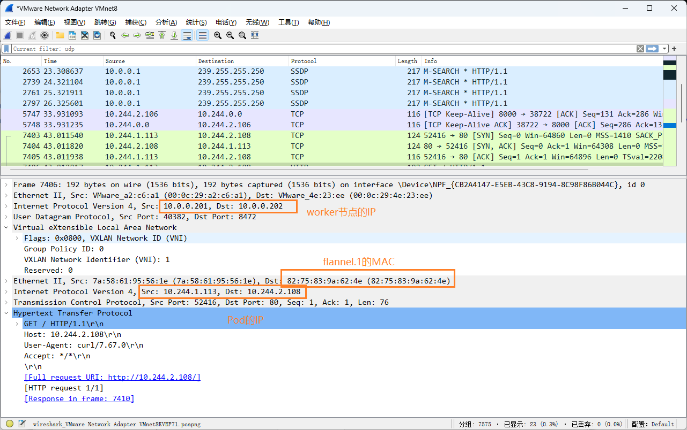

```text
https://www.cnblogs.com/bakari/p/11131268.html
```

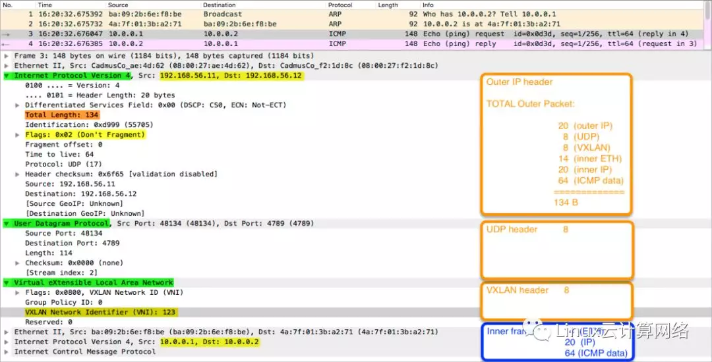

```text
#测试访问Pod
[root@master1 ~]#kubectl  create deployment myapp --image  registry.cn-
beijing.aliyuncs.com/wangxiaochun/pod-test:v0.1
```

```text
[root@master1 ~]#kubectl run client-test-$RANDOM --image registry.cn-
beijing.aliyuncs.com/registry.cn-beijing.aliyuncs.com/wangxiaochun/admin-
box:v0.1:v0.1 --restart=Never --rm -it --command -- /bin/bash
root@client-test-646 /# curl 10.244.2.108
kubernetes pod-test v0.1!! ClientIP: 10.244.1.113, ServerName: myapp-684cc94c55-
p5mdz, ServerIP: 10.244.2.10!
```

```text
#在源节点的cni和flannel.1接口抓包都显示未封装为XVLAN之前的原始的Pod 10.244.2.108 通信的数
据包
[root@node1 ~]#tcpdump  -i cni0 -nn net 10.244.0.0/16
[root@node1 ~]#tcpdump  -i cni0 -nn host 10.244.2.108 and tcp port 80
```

```text
[root@node1 ~]#tcpdump  -i flannel.1 -nn host 10.244.2.108 and tcp port 80
tcpdump: verbose output suppressed, use -v[v]... for full protocol decode
listening on cni0, link-type EN10MB (Ethernet), snapshot length 262144 bytes
19:19:09.524645 IP 10.244.1.113.54114 > 10.244.2.108.80: Flags [S], seq
2324384965, win 64860, options [mss 1410,sackOK,TS val 2210939309 ecr
0,nop,wscale 7], length 0
19:19:09.529258 IP 10.244.2.108.80 > 10.244.1.113.54114: Flags [S.], seq
3781617286, ack 2324384966, win 64308, options [mss 1410,sackOK,TS val
3567778559 ecr 2210939309,nop,wscale 7], length 0
19:19:09.529295 IP 10.244.1.113.54114 > 10.244.2.108.80: Flags [.], ack 1, win
507, options [nop,nop,TS val 2210939313 ecr 3567778559], length 0
19:19:09.529409 IP 10.244.1.113.54114 > 10.244.2.108.80: Flags [P.], seq 1:77,
ack 1, win 507, options [nop,nop,TS val 2210939313 ecr 3567778559], length 76:
HTTP: GET / HTTP/1.1
19:19:09.529696 IP 10.244.2.108.80 > 10.244.1.113.54114: Flags [.], ack 77, win
502, options [nop,nop,TS val 3567778560 ecr 2210939313], length 0
19:19:09.531934 IP 10.244.2.108.80 > 10.244.1.113.54114: Flags [P.], seq 1:18,
ack 77, win 502, options [nop,nop,TS val 3567778562 ecr 2210939313], length 17:
HTTP: HTTP/1.0 200 OK
19:19:09.531959 IP 10.244.1.113.54114 > 10.244.2.108.80: Flags [.], ack 18, win
507, options [nop,nop,TS val 2210939316 ecr 3567778562], length 0
19:19:09.532487 IP 10.244.2.108.80 > 10.244.1.113.54114: Flags [FP.], seq
18:266, ack 77, win 502, options [nop,nop,TS val 3567778562 ecr 2210939313],
length 248: HTTP
19:19:09.532595 IP 10.244.1.113.54114 > 10.244.2.108.80: Flags [F.], seq 77, ack
267, win 506, options [nop,nop,TS val 2210939317 ecr 3567778562], length 0
19:19:09.532872 IP 10.244.2.108.80 > 10.244.1.113.54114: Flags [.], ack 78, win
502, options [nop,nop,TS val 3567778563 ecr 2210939317], length 0
```

```text
#在源节点物理网卡上抓包显示为VXLAN协议,默认使用8472/UDP
[root@node1 ~]#tcpdump  -i eth0 -nn host 10.0.0.202 and udp port 8472
tcpdump: verbose output suppressed, use -v[v]... for full protocol decode
listening on eth0, link-type EN10MB (Ethernet), snapshot length 262144 bytes
19:26:21.334773 IP 10.0.0.201.43036 > 10.0.0.202.8472: OTV, flags [I] (0x08),
overlay 0, instance 1
IP 10.244.1.113.37374 > 10.244.2.108.80: Flags [S], seq 1708490886, win 64860,
options [mss 1410,sackOK,TS val 2211371119 ecr 0,nop,wscale 7], length 0
19:26:21.335161 IP 10.0.0.202.37513 > 10.0.0.201.8472: OTV, flags [I] (0x08),
overlay 0, instance 1
IP 10.244.2.108.80 > 10.244.1.113.37374: Flags [S.], seq 2231134419, ack
1708490887, win 64308, options [mss 1410,sackOK,TS val 3568210363 ecr
2211371119,nop,wscale 7], length 0
19:26:21.335218 IP 10.0.0.201.43036 > 10.0.0.202.8472: OTV, flags [I] (0x08),
overlay 0, instance 1
IP 10.244.1.113.37374 > 10.244.2.108.80: Flags [.], ack 1, win 507, options
[nop,nop,TS val 2211371119 ecr 3568210363], length 0
19:26:21.335297 IP 10.0.0.201.43036 > 10.0.0.202.8472: OTV, flags [I] (0x08),
overlay 0, instance 1
IP 10.244.1.113.37374 > 10.244.2.108.80: Flags [P.], seq 1:77, ack 1, win 507,
options [nop,nop,TS val 2211371119 ecr 3568210363], length 76: HTTP: GET /
HTTP/1.1
19:26:21.335476 IP 10.0.0.202.37513 > 10.0.0.201.8472: OTV, flags [I] (0x08),
overlay 0, instance 1
IP 10.244.2.108.80 > 10.244.1.113.37374: Flags [.], ack 77, win 502, options
[nop,nop,TS val 3568210364 ecr 2211371119], length 0
19:26:21.336662 IP 10.0.0.202.37513 > 10.0.0.201.8472: OTV, flags [I] (0x08),
overlay 0, instance 1
```

```text
IP 10.244.2.108.80 > 10.244.1.113.37374: Flags [P.], seq 1:18, ack 77, win 502,
options [nop,nop,TS val 3568210365 ecr 2211371119], length 17: HTTP: HTTP/1.0
200 OK
19:26:21.336687 IP 10.0.0.202.37513 > 10.0.0.201.8472: OTV, flags [I] (0x08),
overlay 0, instance 1
IP 10.244.2.108.80 > 10.244.1.113.37374: Flags [FP.], seq 18:266, ack 77, win
502, options [nop,nop,TS val 3568210365 ecr 2211371119], length 248: HTTP
19:26:21.336706 IP 10.0.0.201.43036 > 10.0.0.202.8472: OTV, flags [I] (0x08),
overlay 0, instance 1
IP 10.244.1.113.37374 > 10.244.2.108.80: Flags [.], ack 18, win 507, options
[nop,nop,TS val 2211371121 ecr 3568210365], length 0
19:26:21.336832 IP 10.0.0.201.43036 > 10.0.0.202.8472: OTV, flags [I] (0x08),
overlay 0, instance 1
IP 10.244.1.113.37374 > 10.244.2.108.80: Flags [F.], seq 77, ack 267, win 506,
options [nop,nop,TS val 2211371121 ecr 3568210365], length 0
19:26:21.337044 IP 10.0.0.202.37513 > 10.0.0.201.8472: OTV, flags [I] (0x08),
overlay 0, instance 1
IP 10.244.2.108.80 > 10.244.1.113.37374: Flags [.], ack 78, win 502, options
[nop,nop,TS val 3568210365 ecr 2211371121], length 0
```

```text
#查看node1的路由表,发现只要到达10.244.2.0/24网段的IP,需要走flannel.1接口下一跳到达
10.244.2.0网关
[root@node1 ~]#route -n
内核 IP 路由表
目标            网关            子网掩码        标志  跃点   引用  使用 接口
0.0.0.0         10.0.0.2        0.0.0.0         UG    0      0        0 eth0
10.0.0.0        0.0.0.0         255.255.255.0   U     0      0        0 eth0
10.244.0.0      10.244.0.0      255.255.255.0   UG    0      0        0
flannel.1
10.244.1.0      0.0.0.0         255.255.255.0   U     0      0        0 cni0
10.244.2.0      10.244.2.0      255.255.255.0   UG    0      0        0
flannel.1
10.244.3.0      10.244.3.0      255.255.255.0   UG    0      0        0
flannel.1
172.17.0.0      0.0.0.0         255.255.0.0     U     0      0        0 docker0
```

```text
#从节点node1访问node2的flannel.1接口
[root@node1 ~]#ping 10.244.2.0 -c1
PING 10.244.2.0 (10.244.2.0) 56(84) bytes of data.
64 bytes from 10.244.2.0: icmp_seq=1 ttl=64 time=1.05 ms
```

```text
--- 10.244.2.0 ping statistics ---
1 packets transmitted, 1 received, 0% packet loss, time 0ms
rtt min/avg/max/mdev = 1.054/1.054/1.054/0.000 ms
```

```text
#在节点node2上抓包可以看到下面显示
[root@node2 ~]#tcpdump  -i eth0 -nn  port 8472
tcpdump: verbose output suppressed, use -v[v]... for full protocol decode
listening on eth0, link-type EN10MB (Ethernet), snapshot length 262144 bytes
15:36:22.062571 IP 10.0.0.201.35775 > 10.0.0.202.8472: OTV, flags [I] (0x08),
overlay 0, instance 1
IP 10.244.1.0 > 10.244.2.0: ICMP echo request, id 7, seq 1, length 64
15:36:22.062690 IP 10.0.0.202.53977 > 10.0.0.201.8472: OTV, flags [I] (0x08),
overlay 0, instance 1
IP 10.244.2.0 > 10.244.1.0: ICMP echo reply, id 7, seq 1, length 64
```

```text
#从节点node1访问node2的cni0接口
```

```text
[root@node1 ~]#ping 10.244.2.1 -c1
PING 10.244.2.1 (10.244.2.1) 56(84) bytes of data.
64 bytes from 10.244.2.1: icmp_seq=1 ttl=64 time=0.692 ms
```

```text
--- 10.244.2.1 ping statistics ---
1 packets transmitted, 1 received, 0% packet loss, time 0ms
rtt min/avg/max/mdev = 0.692/0.692/0.692/0.000 ms
```

```text
#在节点node2上抓包可以看到下面显示
[root@node2 ~]#tcpdump  -i eth0 -nn  port 8472
tcpdump: verbose output suppressed, use -v[v]... for full protocol decode
listening on eth0, link-type EN10MB (Ethernet), snapshot length 262144 bytes
15:38:33.673738 IP 10.0.0.201.32805 > 10.0.0.202.8472: OTV, flags [I] (0x08),
overlay 0, instance 1
IP 10.244.1.0 > 10.244.2.1: ICMP echo request, id 9, seq 1, length 64
15:38:33.673816 IP 10.0.0.202.60718 > 10.0.0.201.8472: OTV, flags [I] (0x08),
overlay 0, instance 1
IP 10.244.2.1 > 10.244.1.0: ICMP echo reply, id 9, seq 1, length 64
```

```text
#从节点node1访问node2的flannel.1接口接口
[root@node1 ~]#ping 10.244.2.0 -c1
PING 10.244.2.0 (10.244.2.0) 56(84) bytes of data.
64 bytes from 10.244.2.0: icmp_seq=1 ttl=64 time=0.626 ms
```

```text
--- 10.244.2.0 ping statistics ---
1 packets transmitted, 1 received, 0% packet loss, time 0ms
rtt min/avg/max/mdev = 0.626/0.626/0.626/0.000 ms
```

```text
#节点node1访问node2的cni0接口
[root@node1 ~]#ping 10.244.2.1 -c1
PING 10.244.2.1 (10.244.2.1) 56(84) bytes of data.
64 bytes from 10.244.2.1: icmp_seq=1 ttl=64 time=1.14 ms
```

```text
--- 10.244.2.1 ping statistics ---
1 packets transmitted, 1 received, 0% packet loss, time 0ms
rtt min/avg/max/mdev = 1.141/1.141/1.141/0.000 ms
```

```text
#在节点node2上的flannel.1接口抓包可以看到下面显示
[root@node2 ~]#tcpdump  -i flannel.1 -nn
tcpdump: verbose output suppressed, use -v[v]... for full protocol decode
listening on flannel.1, link-type EN10MB (Ethernet), snapshot length 262144
bytes
15:43:34.701743 IP 10.244.1.0 > 10.244.2.0: ICMP echo request, id 15, seq 1,
length 64
15:43:34.701809 IP 10.244.2.0 > 10.244.1.0: ICMP echo reply, id 15, seq 1,
length 64
15:43:36.682527 IP 10.244.1.0 > 10.244.2.1: ICMP echo request, id 16, seq 1,
length 64
15:43:36.682590 IP 10.244.2.1 > 10.244.1.0: ICMP echo reply, id 16, seq 1,
length 64
```

##### 2.2.2.1.4 VXLAN 配置

范例:

```text
[root@master1 ~]#kubectl get cm -n kube-flannel
NAME               DATA   AGE
```

```text
kube-flannel-cfg   2      56d
kube-root-ca.crt   1      56d
```

```text
[root@master1 ~]#kubectl get cm kube-flannel-cfg -o yaml -n kube-flannel
apiVersion: v1
data:
cni-conf.json: |
{
"name": "cbr0",
"cniVersion": "0.3.1",
"plugins": [
{
"type": "flannel",
"delegate": {
"hairpinMode": true,
"isDefaultGateway": true
}
},
{
"type": "portmap",
"capabilities": {
"portMappings": true
}
}
]
}
net-conf.json: |
{
"Network": "10.244.0.0/16",
"Backend": {
"Type": "vxlan"   #默认使用VXLAN模式
}
}
kind: ConfigMap
metadata:
annotations:
kubectl.kubernetes.io/last-applied-configuration: |
{"apiVersion":"v1","data":{"cni-conf.json":"{\n  \"name\": \"cbr0\",\n
\"cniVersion\": \"0.3.1\",\n  \"plugins\": [\n    {\n      \"type\":
\"flannel\",\n      \"delegate\": {\n        \"hairpinMode\": true,\n
\"isDefaultGateway\": true\n      }\n    },\n    {\n      \"type\":
\"portmap\",\n      \"capabilities\": {\n        \"portMappings\": true\n
}\n    }\n  ]\n}\n","net-conf.json":"{\n  \"Network\": \"10.244.0.0/16\",\n
\"Backend\": {\n    \"Type\": \"vxlan\"\n
}\n}\n"},"kind":"ConfigMap","metadata":{"annotations":{},"labels":
{"app":"flannel","k8s-app":"flannel","tier":"node"},"name":"kube-flannel-
cfg","namespace":"kube-flannel"}}
creationTimestamp: ""
labels:
app: flannel
k8s-app: flannel
tier: node
name: kube-flannel-cfg
namespace: kube-flannel
resourceVersion: "1119278"
uid: f8cb1488-41bf-46dc-8492-24f361295f61
```

```text
[root@master1 ~]#kubectl describe  cm kube-flannel-cfg -n kube-system
```

```text
Name:         kube-flannel-cfg
Namespace:    kube-system
Labels:       app=flannel
tier=node
Annotations:  <none>
```

```text
Data
====
net-conf.json:
----
{
"Network": "10.244.0.0/16",
"Backend": {
"Type": "vxlan"  #默认模式
}
}
```

```text
cni-conf.json:
----
{
"name": "cbr0",
"cniVersion": "0.3.1",
"plugins": [
{
"type": "flannel",
"delegate": {
"hairpinMode": true,
"isDefaultGateway": true
}
},
{
"type": "portmap",
"capabilities": {
"portMappings": true
}
}
]
}
```

```text
BinaryData
====
```

```text
Events:  <none>
```

```text
#worker节点的路由表
[root@node1 ~]#route -n
内核 IP 路由表
目标            网关            子网掩码        标志  跃点   引用  使用 接口
0.0.0.0         10.0.0.2        0.0.0.0         UG    0      0        0 eth0
10.0.0.0        0.0.0.0         255.255.255.0   U     0      0        0 eth0
10.244.0.0      10.244.0.0      255.255.255.0   UG    0      0        0
flannel.1
10.244.1.0      0.0.0.0         255.255.255.0   U     0      0        0 cni0
10.244.2.0      10.244.2.0      255.255.255.0   UG    0      0        0
flannel.1
10.244.3.0      10.244.3.0      255.255.255.0   UG    0      0        0
flannel.1
```

```text
172.17.0.0      0.0.0.0         255.255.0.0     U     0      0        0 docker0
```

```text
[root@node2 ~]#route -n
内核 IP 路由表
目标            网关            子网掩码        标志  跃点   引用  使用 接口
0.0.0.0         10.0.0.2        0.0.0.0         UG    0      0        0 eth0
10.0.0.0        0.0.0.0         255.255.255.0   U     0      0        0 eth0
10.244.0.0      10.244.0.0      255.255.255.0   UG    0      0        0
flannel.1
10.244.1.0      10.244.1.0      255.255.255.0   UG    0      0        0
flannel.1
10.244.2.0      0.0.0.0         255.255.255.0   U     0      0        0 cni0
10.244.3.0      10.244.3.0      255.255.255.0   UG    0      0        0
flannel.1
172.17.0.0      0.0.0.0         255.255.0.0     U     0      0        0 docker0
```

```text
[root@node3 ~]#route -n
内核 IP 路由表
目标            网关            子网掩码        标志  跃点   引用  使用 接口
0.0.0.0         10.0.0.2        0.0.0.0         UG    0      0        0 eth0
10.0.0.0        0.0.0.0         255.255.255.0   U     0      0        0 eth0
10.244.0.0      10.244.0.0      255.255.255.0   UG    0      0        0
flannel.1
10.244.1.0      10.244.1.0      255.255.255.0   UG    0      0        0
flannel.1
10.244.2.0      10.244.2.0      255.255.255.0   UG    0      0        0
flannel.1
10.244.3.0      0.0.0.0         255.255.255.0   U     0      0        0 cni0
172.17.0.0      0.0.0.0         255.255.0.0     U     0      0        0 docker0
```

#### 2.2.2.2 host-gw 模式

如果所有集群中的主机节点处于同一个可以直接通信的二层网络，本来就可以直接连通，那么还做VXLAN的二次的数据包封装，pod通信效率受到影响，所以flannel就出现了host-gw的通信模式。Host-gw即Host GateWay的简写,只支持所有节点在同一个网段。

**Host-gw模式下的通信过程**

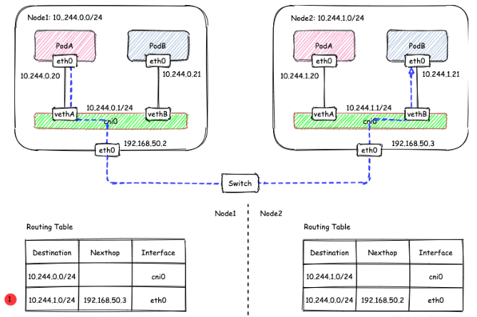

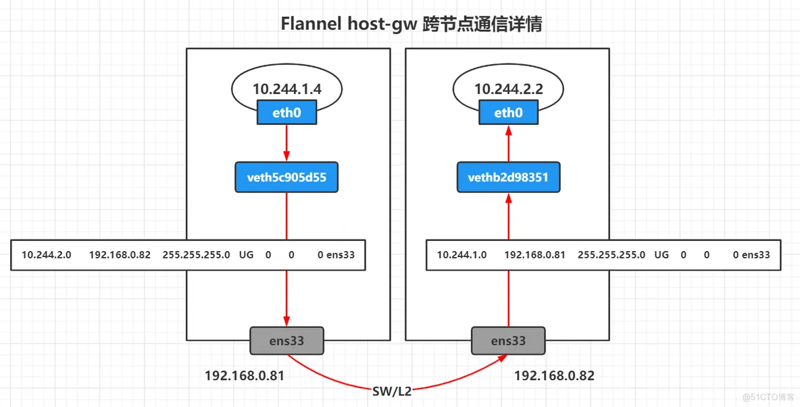

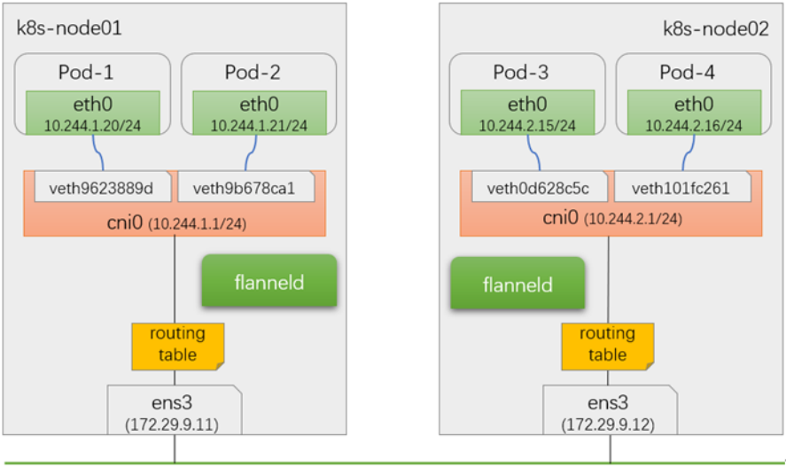

节点上的pod通过虚拟网卡对，连接到cni0的虚拟网络网桥上pod向外通信的时候，到达CNI0的时候，不再交给flannel.1由flanneld来进行打包处理基于保存在API Server和ETCD中的网络数据库信息会自动生成的每个节点的内核的路由表cni0直接借助于此节点上的路由表通过宿主机的网卡交给同网段的其他主机节点对端节点查看内核中的路由表，发现目标就是当前节点，所以交给对应的cni0，进而找到对应的pod通过在每个节点上创建到达各目标容器地址的路由表而完成报文的转发此模式下,flannel.1的虚拟接口不再存在和需要,但cni0接口仍然存在此模式要求各node节点本身必须处于同一个二层网络中,不能跨多个不同网段,因为如果中间存在路由器是无法直接获取各个节点上的路由表信息,而导致无法跨网段通信此方式并不适用于网络变动频繁或都比较大型的复杂多网段的环境此方式相对VxLan 性能更好。

#### 2.2.2.3 VXLAN Directrouting 模式

host-gw 模式要求所有集群主机的节点必须处于同一个二层网络中。

如果集群节点还需要跨网段通信,则无法支持此模式

为了平衡上面的两种场景，就出现了第三种模式： VxLAN Directrouting模式。

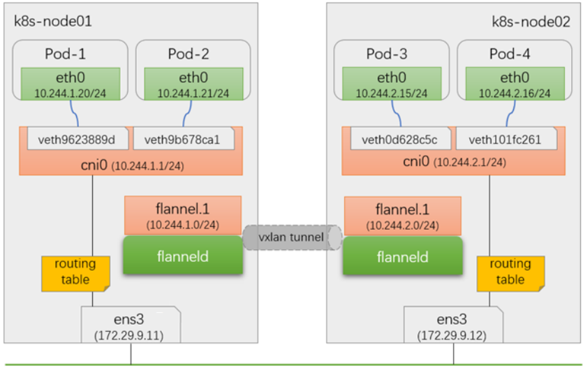

pod向外通信的时候，到达CNI0的时候，不再直接交给flannel.1由flanneld来进行打包处理了。如果两个pod不是处于同一网段，那么还是通过VXLAN的原始的方式进行正常的隧道封装通信。

如果两个pod是处于同一网段内。

cni0直接借助于内核中的路由表，通过宿主机的网卡交给同网段的其他主机节点对端节点查看内核中的路由表，发现目标就是当前节点，所以交给对应的cni0，进而找到对应的pod。

注意：

这种Directrouting就大大提高了同网段间的跨节点的pod数据传输效率。由此可知，flannel 可以不要求所有的节点都处于同一个二层网络中。

### 2.2.3 Flannel 的网络配置和相关文件

```text
https://github.com/flannel-io/flannel/blob/master/Documentation/configuration.md
```

范例：查看Flannel地址和一个节点最多的Pod数量

```text
[root@master1 ~]#kubectl get nodes master1.wang.org -o yaml|grep pod
podCIDR: 10.244.0.0/24
podCIDRs:
pods: "110"    #一个节点上可分配的Pod最大数量
pods: "110"
```

```text
[root@master1 ~]#kubectl get nodes node1.wang.org -o yaml|grep CIDR
podCIDR: 10.244.1.0/24
podCIDRs:
[root@master1 ~]#kubectl get nodes node2.wang.org -o yaml|grep CIDR
podCIDR: 10.244.2.0/24
podCIDRs:
[root@master1 ~]#kubectl get nodes node3.wang.org -o yaml|grep CIDR
podCIDR: 10.244.3.0/24
podCIDRs:
```

范例: 创建flannel的yaml文件

```text
[root@master1 ~]#wget https://github.com/flannel-
io/flannel/releases/latest/download/kube-flannel.yml
[root@master1 ~]#wget https://raw.githubusercontent.com/flannel-
io/flannel/master/Documentation/kube-flannel.yml
```

```text
[root@master1 ~]#cat kube-flannel.yml
---
kind: Namespace
apiVersion: v1
metadata:
name: kube-flannel
labels:
pod-security.kubernetes.io/enforce: privileged
---
kind: ClusterRole
apiVersion: rbac.authorization.k8s.io/v1
metadata:
name: flannel
rules:
- apiGroups:
- ""
resources:
- pods
verbs:
- get
- apiGroups:
- ""
resources:
- nodes
verbs:
- list
- watch
- apiGroups:
- ""
resources:
- nodes/status
verbs:
- patch
---
kind: ClusterRoleBinding
apiVersion: rbac.authorization.k8s.io/v1
metadata:
name: flannel
roleRef:
apiGroup: rbac.authorization.k8s.io
kind: ClusterRole
name: flannel
subjects:
- kind: ServiceAccount
name: flannel
namespace: kube-flannel
---
apiVersion: v1
kind: ServiceAccount
metadata:
```

```text
name: flannel
namespace: kube-flannel
---
kind: ConfigMap
apiVersion: v1
metadata:
name: kube-flannel-cfg
namespace: kube-flannel
labels:
tier: node
app: flannel
data:
cni-conf.json: |
{
"name": "cbr0",
"cniVersion": "0.3.1",
"plugins": [
{
"type": "flannel",
"delegate": {
"hairpinMode": true,
"isDefaultGateway": true
}
},
{
"type": "portmap",
"capabilities": {
"portMappings": true
}
}
]
}
net-conf.json: |
{
"Network": "10.244.0.0/16",
"Backend": {
"Type": "vxlan"
}
}
---
apiVersion: apps/v1
kind: DaemonSet
metadata:
name: kube-flannel-ds
namespace: kube-flannel
labels:
tier: node
app: flannel
spec:
selector:
matchLabels:
app: flannel
template:
metadata:
labels:
tier: node
app: flannel
spec:
```

```text
affinity:
nodeAffinity:
requiredDuringSchedulingIgnoredDuringExecution:
nodeSelectorTerms:
- matchExpressions:
- key: kubernetes.io/os
operator: In
values:
- linux
hostNetwork: true
priorityClassName: system-node-critical
tolerations:
- operator: Exists
effect: NoSchedule
serviceAccountName: flannel
initContainers:
- name: install-cni-plugin
#image: flannelcni/flannel-cni-plugin:v1.1.0 for ppc64le and mips64le
(dockerhub limitations may apply)
image: docker.io/rancher/mirrored-flannelcni-flannel-cni-plugin:v1.1.0
command:
- cp
args:
- -f
- /flannel
- /opt/cni/bin/flannel
volumeMounts:
- name: cni-plugin
mountPath: /opt/cni/bin
- name: install-cni
#image: flannelcni/flannel:v0.19.1 for ppc64le and mips64le (dockerhub
limitations may apply)
image: docker.io/rancher/mirrored-flannelcni-flannel:v0.19.1
command:
- cp
args:
- -f
- /etc/kube-flannel/cni-conf.json
- /etc/cni/net.d/10-flannel.conflist
volumeMounts:
- name: cni
mountPath: /etc/cni/net.d
- name: flannel-cfg
mountPath: /etc/kube-flannel/
containers:
- name: kube-flannel
#image: flannelcni/flannel:v0.19.1 for ppc64le and mips64le (dockerhub
limitations may apply)
image: docker.io/rancher/mirrored-flannelcni-flannel:v0.19.1
command:
- /opt/bin/flanneld
args:
- --ip-masq
- --kube-subnet-mgr
resources:
requests:
cpu: "100m"
memory: "50Mi"
```

```text
limits:
cpu: "100m"
memory: "50Mi"
securityContext:
privileged: false
capabilities:
add: ["NET_ADMIN", "NET_RAW"]
env:
- name: POD_NAME
valueFrom:
fieldRef:
fieldPath: metadata.name
- name: POD_NAMESPACE
valueFrom:
fieldRef:
fieldPath: metadata.namespace
- name: EVENT_QUEUE_DEPTH
value: "5000"
volumeMounts:
- name: run
mountPath: /run/flannel
- name: flannel-cfg
mountPath: /etc/kube-flannel/
- name: xtables-lock
mountPath: /run/xtables.lock
volumes:
- name: run
hostPath:
path: /run/flannel
- name: cni-plugin
hostPath:
path: /opt/cni/bin
- name: cni
hostPath:
path: /etc/cni/net.d
- name: flannel-cfg
configMap:
name: kube-flannel-cfg
- name: xtables-lock
hostPath:
path: /run/xtables.lock
type: FileOrCreate
```

```text
[root@master1 ~]#kubectl apply -f https://raw.githubusercontent.com/flannel-
io/flannel/master/Documentation/kube-flannel.yml
```

```text
#自动生成configmap
[root@master1 ~]#kubectl get cm -n kube-flannel
NAME               DATA   AGE
kube-flannel-cfg   2      44d
kube-root-ca.crt   1      44d
```

```text
[root@master1 ~]#kubectl get cm -n kube-flannel kube-flannel-cfg -o yaml
apiVersion: v1
data:
cni-conf.json: |
{
"name": "cbr0",
```

```text
"cniVersion": "0.3.1",
"plugins": [
{
"type": "flannel",
"delegate": {
"hairpinMode": true,
"isDefaultGateway": true
}
},
{
"type": "portmap",
"capabilities": {
"portMappings": true
}
}
]
}
net-conf.json: |
{
"Network": "10.244.0.0/16",
"Backend": {
"Type": "vxlan"
}
}
kind: ConfigMap
metadata:
annotations:
kubectl.kubernetes.io/last-applied-configuration: |
{"apiVersion":"v1","data":{"cni-conf.json":"{\n  \"name\": \"cbr0\",\n
\"cniVersion\": \"0.3.1\",\n  \"plugins\": [\n    {\n      \"type\":
\"flannel\",\n      \"delegate\": {\n        \"hairpinMode\": true,\n
\"isDefaultGateway\": true\n      }\n    },\n    {\n      \"type\":
\"portmap\",\n      \"capabilities\": {\n        \"portMappings\": true\n
}\n    }\n  ]\n}\n","net-conf.json":"{\n  \"Network\": \"10.244.0.0/16\",\n
\"Backend\": {\n    \"Type\": \"vxlan\"\n
}\n}\n"},"kind":"ConfigMap","metadata":{"annotations":{},"labels":
{"app":"flannel","tier":"node"},"name":"kube-flannel-cfg","namespace":"kube-
flannel"}}
creationTimestamp: "2022-08-25T09:26:46Z"
labels:
app: flannel
tier: node
name: kube-flannel-cfg
namespace: kube-flannel
resourceVersion: "532"
uid: 4432b601-013f-43e5-a529-ded5f928f43d
[root@master1 ~]#
```

范例; Flannel相关文件

```text
[root@master1 ~]#find / -name "flannel"
/opt/cni/bin/flannel
/run/flannel
/var/lib/docker/overlay2/652019cbd604cccda3223a13f3dded3e4cd7419fe5150fffc83df03
5aaab157f/merged/run/flannel
/var/lib/docker/overlay2/652019cbd604cccda3223a13f3dded3e4cd7419fe5150fffc83df03
5aaab157f/diff/run/flannel
```

```text
/var/lib/docker/overlay2/46fc2daf9f617d15f5ccba070969836c6f56e3dd989a3e762c025f3
4a022a423/diff/run/flannel
/var/lib/docker/overlay2/a106dc111c3cc4048f4fd1a5ca17a9b79543f44e56411db8692400c
69462424d/diff/flannel
/var/lib/cni/flannel
```

```text
#相关二进制程序
[root@master1 ~]#ls /opt/cni/bin/
bandwidth  dhcp   firewall  host-device  ipvlan    macvlan  ptp  static  vlan
bridge     dummy  flannel   host-local   loopback  portmap  sbr  tuning  vrf
```

```text
[root@master1 ~]#file /opt/cni/bin/flannel
/opt/cni/bin/flannel: ELF 64-bit LSB executable, x86-64, version 1 (SYSV),
statically linked, Go BuildID=TA3IAC4IGjof2nNGZbNc/J3CYt8XKF-ZIjcZE6v69/c9VYx4-
TdB1BqeVCjt48/Bhgb-dOVqbui4_Bnjvkb, not stripped
[root@master1 ~]#ll /run/flannel/
总用量 4
drwxr-xr-x  2 root root   60 10月  9 08:48 ./
drwxr-xr-x 33 root root 1060 10月  9 11:36 ../
-rw-r--r--  1 root root   96 10月  9 08:48 subnet.env
[root@master1 ~]#cat /run/flannel/subnet.env
FLANNEL_NETWORK=10.244.0.0/16
FLANNEL_SUBNET=10.244.0.1/24
FLANNEL_MTU=1450
FLANNEL_IPMASQ=true
```

```text
#/var/lib/cni/flannel/目录下文件是由Pod生成，Pod删除后也会自动删除对应的文件
[root@master1 ~]#file /var/lib/cni/flannel/*
/var/lib/cni/flannel/0973661b27d16e0a174ab88e9f13fba2ffb0ec12e9605baec686362c050
71deb: JSON data
/var/lib/cni/flannel/17e3b2a86015534d935006b9eca3a495764552f049ff703e54375164db3
5c91c: JSON data
```

```text
[root@master1 ~]#cat
/var/lib/cni/flannel/0973661b27d16e0a174ab88e9f13fba2ffb0ec12e9605baec686362c050
71deb
{"cniVersion":"0.3.1","hairpinMode":true,"ipMasq":false,"ipam":{"ranges":
[[{"subnet":"10.244.0.0/24"}]],"routes":[{"dst":"10.244.0.0/16"}],"type":"host-
local"},"isDefaultGateway":true,"isGateway":true,"mtu":1450,"name":"cbr0","type"
:"bridge"}[root@master1 ~]#
[root@master1 ~]#cat
/var/lib/cni/flannel/17e3b2a86015534d935006b9eca3a495764552f049ff703e54375164db3
5c91c
{"cniVersion":"0.3.1","hairpinMode":true,"ipMasq":false,"ipam":{"ranges":
[[{"subnet":"10.244.0.0/24"}]],"routes":[{"dst":"10.244.0.0/16"}],"type":"host-
local"},"isDefaultGateway":true,"isGateway":true,"mtu":1450,"name":"cbr0","type"
:"bridge"}[root@master1 ~]#
```

```text
#每个节点的网络配置
[root@node1 ~]#cat /run/flannel/subnet.env
FLANNEL_NETWORK=10.244.0.0/16
FLANNEL_SUBNET=10.244.1.1/24
FLANNEL_MTU=1450
FLANNEL_IPMASQ=true
```

```text
[root@node2 ~]#cat /run/flannel/subnet.env
FLANNEL_NETWORK=10.244.0.0/16
```

```text
FLANNEL_SUBNET=10.244.2.1/24
FLANNEL_MTU=1450
FLANNEL_IPMASQ=true
```

```text
[root@node3 ~]#cat /run/flannel/subnet.env
FLANNEL_NETWORK=10.244.0.0/16
FLANNEL_SUBNET=10.244.3.1/24
FLANNEL_MTU=1450
FLANNEL_IPMASQ=true
```

```text
#所有节点打开8472/UDP端口
[root@master1 ~]#ss -ntul|grep 8472
udp    UNCONN  0       0              0.0.0.0:8472         0.0.0.0:*
```

范例: 查看集群节点的网络分配

```text
#查看静态Pod的配置
[root@master1 ~]#cat /etc/kubernetes/manifests/kube-controller-manager.yaml
apiVersion: v1
kind: Pod
metadata:
creationTimestamp: null
labels:
component: kube-controller-manager
tier: control-plane
name: kube-controller-manager
namespace: kube-system
spec:
containers:
- command:
- kube-controller-manager
- --allocate-node-cidrs=true
- --authentication-kubeconfig=/etc/kubernetes/controller-manager.conf
- --authorization-kubeconfig=/etc/kubernetes/controller-manager.conf
- --bind-address=127.0.0.1
- --client-ca-file=/etc/kubernetes/pki/ca.crt
- --cluster-cidr=10.244.0.0/16
- --cluster-name=kubernetes
- --cluster-signing-cert-file=/etc/kubernetes/pki/ca.crt
- --cluster-signing-key-file=/etc/kubernetes/pki/ca.key
- --controllers=*,bootstrapsigner,tokencleaner
- --kubeconfig=/etc/kubernetes/controller-manager.conf
- --leader-elect=true
- --port=0
- --requestheader-client-ca-file=/etc/kubernetes/pki/front-proxy-ca.crt
- --root-ca-file=/etc/kubernetes/pki/ca.crt
- --service-account-private-key-file=/etc/kubernetes/pki/sa.key
- --service-cluster-ip-range=192.168.0.0/16
- --use-service-account-credentials=true
image: registry.cn-hangzhou.aliyuncs.com/google_containers/kube-controller-
manager:v1.22.1
imagePullPolicy: IfNotPresent
livenessProbe:
```

```text
#配置解析：
#allocate-node-cidrs属性表示，每增加一个新的节点，都从cluster-cidr子网中切分一个新的子网网
段分配给对应的节点上。
```

```text
#这些相关的网络状态属性信息，会经过 kube-apiserver 存储到etcd中。
```

kubelet在/etc/cni/net.d目录查找cni json配置文件，基于type属性到/opt/cni/bin中查找相关插件的二进制文件，然后调用相应插件设置网络。

```text
[root@master1 ~]#cat /etc/cni/net.d/10-flannel.conflist
{
"name": "cbr0",
"cniVersion": "0.3.1",
"plugins": [
{
"type": "flannel",
"delegate": {
"hairpinMode": true,
"isDefaultGateway": true
}
},
{
"type": "portmap",
"capabilities": {
"portMappings": true
}
}
]
}
```

范例:  flannel状态

```text
#k8s节点上所有节点都运行了flannel容器
[root@master1 ~]#kubectl get pod -o wide -n kube-system  |grep flannel
kube-flannel-ds-4q5zk                        1/1     Running   3 (21h ago)
4d21h   10.0.0.105    node2.wang.org     <none>           <none>
kube-flannel-ds-5tsz8                        1/1     Running   5 (2m6s ago)
4d21h   10.0.0.102    master2.wang.org   <none>           <none>
kube-flannel-ds-bd6nx                        1/1     Running   3 (21h ago)
4d21h   10.0.0.103    master3.wang.org   <none>           <none>
kube-flannel-ds-csjt6                        1/1     Running   3 (21h ago)
4d21h   10.0.0.101    master1.wang.org   <none>           <none>
kube-flannel-ds-snfbt                        1/1     Running   4 (21h ago)
4d21h   10.0.0.106    node3.wang.org     <none>           <none>
kube-flannel-ds-xx7hc                        1/1     Running   4 (21h ago)
4d21h   10.0.0.104    node1.wang.org     <none>           <none>
```

```text
[root@node1 ~]#ps aux|grep flanneld
root        3966  0.0  0.4 1340616 35852 ?       Ssl  09:20   0:29
/opt/bin/flanneld --ip-masq --kube-subnet-mgr
root      701127  0.0  0.0   9716  2356 pts/0    S+   17:35   0:00 grep --
color=auto flanneld
```

```text
#每个节点上都生成了一个网卡 flannel.1,并且每个节点都有自已的独立网段
#注意：flannel.1 后面的.1 就是 vxlan的网络标识。便于隧道正常通信。
[root@master1 ~]#ip a show  flannel.1
4: flannel.1: <BROADCAST,MULTICAST,UP,LOWER_UP> mtu 1450 qdisc noqueue state
UNKNOWN group default
```

```text
link/ether de:95:94:85:ad:12 brd ff:ff:ff:ff:ff:ff
inet10.244.0.0/32 scope global flannel.1
```

```text
[root@master2 ~]#ip a show  flannel.1
4: flannel.1: <BROADCAST,MULTICAST,UP,LOWER_UP> mtu 1450 qdisc noqueue state
UNKNOWN group default
link/ether 56:3c:fc:74:1c:57 brd ff:ff:ff:ff:ff:ff
inet10.244.5.0/32 scope global flannel.1
```

```text
[root@master3 ~]#ip a show  flannel.1
4: flannel.1: <BROADCAST,MULTICAST,UP,LOWER_UP> mtu 1450 qdisc noqueue state
UNKNOWN group default
link/ether 96:bd:44:a3:41:b4 brd ff:ff:ff:ff:ff:ff
inet10.244.4.0/32 scope global flannel.1
```

```text
[root@node1 ~]#ip a show  flannel.1
4: flannel.1: <BROADCAST,MULTICAST,UP,LOWER_UP> mtu 1450 qdisc noqueue state
UNKNOWN group default
link/ether 06:3b:df:68:3d:67 brd ff:ff:ff:ff:ff:ff
inet10.244.1.0/32 scope global flannel.1
```

```text
[root@node2 ~]#ip a show  flannel.1
4: flannel.1: <BROADCAST,MULTICAST,UP,LOWER_UP> mtu 1450 qdisc noqueue state
UNKNOWN group default
link/ether 46:1e:de:bf:3b:f7 brd ff:ff:ff:ff:ff:ff
inet10.244.2.0/32 scope global flannel.1
```

```text
[root@node3 ~]#ip a show  flannel.1
4: flannel.1: <BROADCAST,MULTICAST,UP,LOWER_UP> mtu 1450 qdisc noqueue state
UNKNOWN group default
link/ether 2a:d2:bb:0b:d8:5c brd ff:ff:ff:ff:ff:ff
inet10.244.3.0/32 scope global flannel.1
```

```text
[root@master1 ~]#ip route
default via 10.0.0.2 dev eth0 proto static
10.0.0.0/24 dev eth0 proto kernel scope link src 10.0.0.101
10.244.0.0/24 dev cni0 proto kernel scope link src10.244.0.1
10.244.1.0/24 via10.244.1.0 dev flannel.1 onlink
10.244.2.0/24 via10.244.2.0 dev flannel.1 onlink
10.244.3.0/24 via10.244.3.0 dev flannel.1 onlink
10.244.4.0/24 via10.244.4.0 dev flannel.1 onlink
10.244.5.0/24 via10.244.5.0 dev flannel.1 onlink
172.17.0.0/16 dev docker0 proto kernel scope link src 172.17.0.1 linkdown
```

范例：默认的网络配置

```text
[root@master1 ~]#ip a
1: lo: <LOOPBACK,UP,LOWER_UP> mtu 65536 qdisc noqueue state UNKNOWN group
default qlen 1000
link/loopback 00:00:00:00:00:00 brd 00:00:00:00:00:00
inet 127.0.0.1/8 scope host lo
valid_lft forever preferred_lft forever
inet6 ::1/128 scope host
valid_lft forever preferred_lft forever
2: eth0: <BROADCAST,MULTICAST,UP,LOWER_UP> mtu 1500 qdisc fq_codel state UP
group default qlen 1000
link/ether 00:0c:29:36:5e:a3 brd ff:ff:ff:ff:ff:ff
```

```text
altname enp2s1
altname ens33
inet 10.0.0.200/24 brd 10.0.0.255 scope global eth0
valid_lft forever preferred_lft forever
inet6 fe80::20c:29ff:fe36:5ea3/64 scope link
valid_lft forever preferred_lft forever
3: docker0: <NO-CARRIER,BROADCAST,MULTICAST,UP> mtu 1500 qdisc noqueue state
DOWN group default
link/ether 02:42:fd:28:c8:3c brd ff:ff:ff:ff:ff:ff
inet 172.17.0.1/16 brd 172.17.255.255 scope global docker0
valid_lft forever preferred_lft forever
4: flannel.1: <BROADCAST,MULTICAST,UP,LOWER_UP> mtu 1450 qdisc noqueue state
UNKNOWN group default
link/ether d2:dd:17:e8:24:98 brd ff:ff:ff:ff:ff:ff
inet 10.244.0.0/32 scope global flannel.1
valid_lft forever preferred_lft forever
inet6 fe80::d0dd:17ff:fee8:2498/64 scope link
valid_lft forever preferred_lft forever
5: cni0: <BROADCAST,MULTICAST,UP,LOWER_UP> mtu 1450 qdisc noqueue state UP group
default qlen 1000
link/ether 3e:f2:e5:f3:d9:6f brd ff:ff:ff:ff:ff:ff
inet 10.244.0.1/24 brd 10.244.0.255 scope global cni0
valid_lft forever preferred_lft forever
inet6 fe80::e8ff:47ff:fe41:61e4/64 scope link
valid_lft forever preferred_lft forever
6: veth5c6a3bc8@if2: <BROADCAST,MULTICAST,UP,LOWER_UP> mtu 1450 qdisc noqueue
master cni0 state UP group default
link/ether 5a:ac:a7:a3:9f:1d brd ff:ff:ff:ff:ff:ff link-netnsid 0
inet6 fe80::58ac:a7ff:fea3:9f1d/64 scope link
valid_lft forever preferred_lft forever
```

```text
[root@master1 ~]#route -n
Kernel IP routing table
Destination     Gateway         Genmask         Flags Metric Ref    Use Iface
0.0.0.0         10.0.0.2        0.0.0.0         UG    0      0        0 eth0
10.0.0.0        0.0.0.0         255.255.255.0   U     0      0        0 eth0
10.244.0.0      0.0.0.0         255.255.255.0   U     0      0        0 cni0
10.244.1.0      10.244.1.0      255.255.255.0   UG    0      0        0
flannel.1
10.244.2.0      10.244.2.0      255.255.255.0   UG    0      0        0
flannel.1
10.244.3.0      10.244.3.0      255.255.255.0   UG    0      0        0
flannel.1
172.17.0.0      0.0.0.0         255.255.0.0     U     0      0        0 docker0
```

```text
[root@node1 ~]#ip a
1: lo: <LOOPBACK,UP,LOWER_UP> mtu 65536 qdisc noqueue state UNKNOWN group
default qlen 1000
link/loopback 00:00:00:00:00:00 brd 00:00:00:00:00:00
inet 127.0.0.1/8 scope host lo
valid_lft forever preferred_lft forever
inet6 ::1/128 scope host
valid_lft forever preferred_lft forever
2: eth0: <BROADCAST,MULTICAST,UP,LOWER_UP> mtu 1500 qdisc fq_codel state UP
group default qlen 1000
link/ether 00:0c:29:a2:c6:a1 brd ff:ff:ff:ff:ff:ff
altname enp2s1
```

```text
altname ens33
inet 10.0.0.201/24 brd 10.0.0.255 scope global eth0
valid_lft forever preferred_lft forever
inet6 fe80::20c:29ff:fea2:c6a1/64 scope link
valid_lft forever preferred_lft forever
4: docker0: <BROADCAST,MULTICAST,UP,LOWER_UP> mtu 1500 qdisc noqueue state UP
group default
link/ether 02:42:69:97:ae:cb brd ff:ff:ff:ff:ff:ff
inet 172.17.0.1/16 brd 172.17.255.255 scope global docker0
valid_lft forever preferred_lft forever
inet6 fe80::42:69ff:fe97:aecb/64 scope link
valid_lft forever preferred_lft forever
6: vethc9f89f6@if5: <BROADCAST,MULTICAST,UP,LOWER_UP> mtu 1500 qdisc noqueue
master docker0 state UP group default
link/ether f6:2c:6c:58:d0:68 brd ff:ff:ff:ff:ff:ff link-netnsid 0
inet6 fe80::f42c:6cff:fe58:d068/64 scope link
valid_lft forever preferred_lft forever
7: flannel.1: <BROADCAST,MULTICAST,UP,LOWER_UP> mtu 1450 qdisc noqueue state
UNKNOWN group default
link/ether 4e:89:6a:9e:48:88 brd ff:ff:ff:ff:ff:ff
inet 10.244.1.0/32 scope global flannel.1
valid_lft forever preferred_lft forever
inet6 fe80::4c89:6aff:fe9e:4888/64 scope link
valid_lft forever preferred_lft forever
8: cni0: <BROADCAST,MULTICAST,UP,LOWER_UP> mtu 1450 qdisc noqueue state UP group
default qlen 1000
link/ether ea:ff:47:41:61:e4 brd ff:ff:ff:ff:ff:ff
inet 10.244.1.1/24 brd 10.244.1.255 scope global cni0
valid_lft forever preferred_lft forever
inet6 fe80::e8ff:47ff:fe41:61e4/64 scope link
valid_lft forever preferred_lft forever
11: vethdef28f15@if2: <BROADCAST,MULTICAST,UP,LOWER_UP> mtu 1450 qdisc noqueue
master cni0 state UP group default
link/ether 72:ac:92:0e:22:17 brd ff:ff:ff:ff:ff:ff link-netnsid 3
inet6 fe80::541d:68ff:fe7c:4a26/64 scope link
valid_lft forever preferred_lft forever
```

```text
[root@node1 ~]#route -n
内核 IP 路由表
目标            网关            子网掩码        标志  跃点   引用  使用 接口
0.0.0.0         10.0.0.2        0.0.0.0         UG    0      0        0 eth0
10.0.0.0        0.0.0.0         255.255.255.0   U     0      0        0 eth0
10.244.0.0      10.244.0.0      255.255.255.0   UG    0      0        0
flannel.1
10.244.1.0      0.0.0.0         255.255.255.0   U     0      0        0 cni0
10.244.2.0      10.244.2.0      255.255.255.0   UG    0      0        0
flannel.1
10.244.3.0      10.244.3.0      255.255.255.0   UG    0      0        0
flannel.1
172.17.0.0      0.0.0.0         255.255.0.0     U     0      0        0 docker0
```

```text
[root@node2 ~]#ip a
1: lo: <LOOPBACK,UP,LOWER_UP> mtu 65536 qdisc noqueue state UNKNOWN group
default qlen 1000
link/loopback 00:00:00:00:00:00 brd 00:00:00:00:00:00
inet 127.0.0.1/8 scope host lo
valid_lft forever preferred_lft forever
```

```text
inet6 ::1/128 scope host
valid_lft forever preferred_lft forever
2: eth0: <BROADCAST,MULTICAST,UP,LOWER_UP> mtu 1500 qdisc fq_codel state UP
group default qlen 1000
link/ether 00:0c:29:4e:23:ee brd ff:ff:ff:ff:ff:ff
altname enp2s1
altname ens33
inet 10.0.0.202/24 brd 10.0.0.255 scope global eth0
valid_lft forever preferred_lft forever
inet6 fe80::20c:29ff:fe4e:23ee/64 scope link
valid_lft forever preferred_lft forever
3: docker0: <NO-CARRIER,BROADCAST,MULTICAST,UP> mtu 1500 qdisc noqueue state
DOWN group default
link/ether 02:42:9a:5e:78:79 brd ff:ff:ff:ff:ff:ff
inet 172.17.0.1/16 brd 172.17.255.255 scope global docker0
valid_lft forever preferred_lft forever
4: flannel.1: <BROADCAST,MULTICAST,UP,LOWER_UP> mtu 1450 qdisc noqueue state
UNKNOWN group default
link/ether da:bd:d6:48:b6:99 brd ff:ff:ff:ff:ff:ff
inet 10.244.2.0/32 scope global flannel.1
valid_lft forever preferred_lft forever
inet6 fe80::d8bd:d6ff:fe48:b699/64 scope link
valid_lft forever preferred_lft forever
5: cni0: <NO-CARRIER,BROADCAST,MULTICAST,UP> mtu 1500 qdisc noqueue state DOWN
group default qlen 1000
link/ether ea:ff:47:41:61:e4 brd ff:ff:ff:ff:ff:ff
inet 10.244.2.1/24 brd 10.244.2.255 scope global cni0
valid_lft forever preferred_lft forever
inet6 fe80::e8ff:47ff:fe41:61e4/64 scope link
valid_lft forever preferred_lft forever
```

```text
[root@node2 ~]#route -n
内核 IP 路由表
目标            网关            子网掩码        标志  跃点   引用  使用 接口
0.0.0.0         10.0.0.2        0.0.0.0         UG    0      0        0 eth0
10.0.0.0        0.0.0.0         255.255.255.0   U     0      0        0 eth0
10.244.0.0      10.244.0.0      255.255.255.0   UG    0      0        0
flannel.1
10.244.1.0      10.244.1.0      255.255.255.0   UG    0      0        0
flannel.1
10.244.2.0      0.0.0.0         255.255.255.0   U     0      0        0 cni0
10.244.3.0      10.244.3.0      255.255.255.0   UG    0      0        0
flannel.1
172.17.0.0      0.0.0.0         255.255.0.0     U     0      0        0 docker0
```

```text
[root@node3 ~]#ip a
1: lo: <LOOPBACK,UP,LOWER_UP> mtu 65536 qdisc noqueue state UNKNOWN group
default qlen 1000
link/loopback 00:00:00:00:00:00 brd 00:00:00:00:00:00
inet 127.0.0.1/8 scope host lo
valid_lft forever preferred_lft forever
inet6 ::1/128 scope host
valid_lft forever preferred_lft forever
2: eth0: <BROADCAST,MULTICAST,UP,LOWER_UP> mtu 1500 qdisc fq_codel state UP
group default qlen 1000
link/ether 00:0c:29:5d:31:24 brd ff:ff:ff:ff:ff:ff
altname enp2s1
```

```text
altname ens33
inet 10.0.0.203/24 brd 10.0.0.255 scope global eth0
valid_lft forever preferred_lft forever
inet6 fe80::20c:29ff:fe5d:3124/64 scope link
valid_lft forever preferred_lft forever
3: docker0: <NO-CARRIER,BROADCAST,MULTICAST,UP> mtu 1500 qdisc noqueue state
DOWN group default
link/ether 02:42:f6:59:bd:52 brd ff:ff:ff:ff:ff:ff
inet 172.17.0.1/16 brd 172.17.255.255 scope global docker0
valid_lft forever preferred_lft forever
4: flannel.1: <BROADCAST,MULTICAST,UP,LOWER_UP> mtu 1450 qdisc noqueue state
UNKNOWN group default
link/ether 22:cf:41:f7:05:92 brd ff:ff:ff:ff:ff:ff
inet 10.244.3.0/32 scope global flannel.1
valid_lft forever preferred_lft forever
inet6 fe80::20cf:41ff:fef7:592/64 scope link
valid_lft forever preferred_lft forever
5: cni0: <NO-CARRIER,BROADCAST,MULTICAST,UP> mtu 1500 qdisc noqueue state DOWN
group default qlen 1000
link/ether c6:73:3e:f0:6d:72 brd ff:ff:ff:ff:ff:ff
inet 10.244.3.1/24 brd 10.244.3.255 scope global cni0
valid_lft forever preferred_lft forever
inet6 fe80::c473:3eff:fef0:6d72/64 scope link
valid_lft forever preferred_lft forever
```

```text
[root@node3 ~]#route -n
内核 IP 路由表
目标            网关            子网掩码        标志  跃点   引用  使用 接口
0.0.0.0         10.0.0.2        0.0.0.0         UG    0      0        0 eth0
10.0.0.0        0.0.0.0         255.255.255.0   U     0      0        0 eth0
10.244.0.0      10.244.0.0      255.255.255.0   UG    0      0        0
flannel.1
10.244.1.0      10.244.1.0      255.255.255.0   UG    0      0        0
flannel.1
10.244.2.0      10.244.2.0      255.255.255.0   UG    0      0        0
flannel.1
10.244.3.0      0.0.0.0         255.255.255.0   U     0      0        0 cni0
172.17.0.0      0.0.0.0         255.255.0.0     U     0      0        0 docker0
```

```text
#创建Pod,查看Pod的默认网络配置
[root@master1 ~]#kubectl  create deployment myapp --image  registry.cn-
beijing.aliyuncs.com/wangxiaochun/pod-test:v0.1 --replicas 3
deployment.apps/myapp created
[root@master1 ~]#kubectl  get pod -o wide
NAME                     READY   STATUS    RESTARTS   AGE   IP            NODE
NOMINATED NODE   READINESS GATES
myapp-684cc94c55-2qz5x   1/1     Running   0          3s    10.244.1.5
node1.wang.org   <none>           <none>
myapp-684cc94c55-p5mdz   1/1     Running   0          3s    10.244.2.10
node2.wang.org   <none>           <none>
myapp-684cc94c55-w8pg2   1/1     Running   0          3s    10.244.3.3
node3.wang.org   <none>           <none>
[root@master1 ~]#kubectl  exec myapp-684cc94c55-2qz5x  -- ip route
default via 10.244.1.1 dev eth0
10.244.0.0/16 via 10.244.1.1 dev eth0
10.244.1.0/24 dev eth0 proto kernel scope link src 10.244.1.5
[root@master1 ~]#kubectl  exec myapp-684cc94c55-2qz5x  -- route -n
Kernel IP routing table
```

```text
Destination     Gateway         Genmask         Flags Metric Ref    Use Iface
0.0.0.0         10.244.1.1      0.0.0.0         UG    0      0        0 eth0
10.244.0.0      10.244.1.1      255.255.0.0     UG    0      0        0 eth0
10.244.1.0      0.0.0.0         255.255.255.0   U     0      0        0 eth0
```

```text
[root@master1 ~]#kubectl  exec myapp-684cc94c55-p5mdz  -- ip a
1: lo: <LOOPBACK,UP,LOWER_UP> mtu 65536 qdisc noqueue state UNKNOWN group
default qlen 1000
link/loopback 00:00:00:00:00:00 brd 00:00:00:00:00:00
inet 127.0.0.1/8 scope host lo
valid_lft forever preferred_lft forever
2: eth0@if10: <BROADCAST,MULTICAST,UP,LOWER_UP> mtu 1450 qdisc noqueue state UP
group default
link/ether fe:fb:83:02:9e:14 brd ff:ff:ff:ff:ff:ff link-netnsid 0
inet 10.244.2.10/24 brd 10.244.2.255 scope global eth0
valid_lft forever preferred_lft forever
[root@master1 ~]#kubectl  exec myapp-684cc94c55-p5mdz  -- route -n
Kernel IP routing table
Destination     Gateway         Genmask         Flags Metric Ref    Use Iface
0.0.0.0         10.244.2.1      0.0.0.0         UG    0      0        0 eth0
10.244.0.0      10.244.2.1      255.255.0.0     UG    0      0        0 eth0
10.244.2.0      0.0.0.0         255.255.255.0   U     0      0        0 eth0
```

```text
[root@master1 ~]#kubectl  exec myapp-684cc94c55-w8pg2  -- ip a
1: lo: <LOOPBACK,UP,LOWER_UP> mtu 65536 qdisc noqueue state UNKNOWN group
default qlen 1000
link/loopback 00:00:00:00:00:00 brd 00:00:00:00:00:00
inet 127.0.0.1/8 scope host lo
valid_lft forever preferred_lft forever
2: eth0@if7: <BROADCAST,MULTICAST,UP,LOWER_UP> mtu 1450 qdisc noqueue state UP
group default
link/ether 7e:f6:ab:9c:27:d7 brd ff:ff:ff:ff:ff:ff link-netnsid 0
inet 10.244.3.3/24 brd 10.244.3.255 scope global eth0
valid_lft forever preferred_lft forever
[root@master1 ~]#kubectl  exec myapp-684cc94c55-w8pg2  -- route -n
Kernel IP routing table
Destination     Gateway         Genmask         Flags Metric Ref    Use Iface
0.0.0.0         10.244.3.1      0.0.0.0         UG    0      0        0 eth0
10.244.0.0      10.244.3.1      255.255.0.0     UG    0      0        0 eth0
10.244.3.0      0.0.0.0         255.255.255.0   U     0      0        0 eth0
```

```text
#查看MAC
[root@master1 ~]#ip neigh show dev flannel.1
10.244.1.0 lladdr de:10:30:ea:a0:4b PERMANENT #de:10:30:ea:a0:4b是集群节点上的
flannel.1网卡10.244.1.0的mac
10.244.3.0 lladdr 32:7a:85:b3:8d:cf PERMANENT
10.244.2.0 lladdr 86:85:f6:1a:c7:31 PERMANENT
```

```text
[root@master1 ~]#arp -n
地址                     类型    硬件地址            标志  Mask            接口
10.244.1.0               ether   de:10:30:ea:a0:4b   CM
flannel.1
10.0.0.203               ether   00:0c:29:92:df:f7   C                     eth0
10.244.3.0               ether   32:7a:85:b3:8d:cf   CM
flannel.1
```

```text
10.244.2.0               ether   86:85:f6:1a:c7:31   CM
flannel.1
10.0.0.201               ether   00:0c:29:ad:94:b5   C                     eth0
10.0.0.202               ether   00:0c:29:ed:d6:40   C                     eth0
```

## 2.3 Flannel 案例

通常一个网络解决方案要实现多个功能：

构建一个网络将pod接入到这个网络中实时维护所有节点上的路由信息，实现隧道的通信。

但并不是每个解决方案都能实现所有的步骤功能

对于flannel来说，它实现的仅仅是第一步 -- 构建虚拟网络的功能，而其他的步骤是需要借助于其他功能来实现。

### 2.3.1 Flannel 部署和默认环境

flannel 默认会在每个节点上创建cni0的网桥,并将该节点上的每个Pod对应生成对应的vethXXXX网卡并桥接至cni0。

```text
#要接入到虚拟网络的功能，在部署flannel的时候，有一个配置文件，在这个配置文件中的configmap中就
定义了虚拟网络的接入功能。
[root@master1 ~]#wget https://github.com/flannel-
io/flannel/releases/latest/download/kube-flannel.yml
[root@master1 ~]#wget https://raw.githubusercontent.com/flannel-
io/flannel/master/Documentation/kube-flannel.yml
```

```text
[root@master1 ~]#grep ^kind kube-flannel.yml
kind: Namespace
kind: ServiceAccount
kind: ClusterRole
kind: ClusterRoleBinding
kind: ConfigMap
kind: DaemonSet
```

```text
[root@master1 ~]#cat kube-flannel.yml
.....
apiVersion: v1
data:
cni-conf.json: |                      #cni插件的功能配置
{
"name": "cbr0",
"cniVersion": "0.3.1",
"plugins": [
{
"type": "flannel",            #基于flannel实现网络通信
"delegate": {
"hairpinMode": true,
"isDefaultGateway": true
}
},
{
"type": "portmap",            #来实现端口映射的功能
"capabilities": {
```

```text
"portMappings": true
}
}
]
}
net-conf.json: |                      #flannel的网址分配
{
"Network": "10.244.0.0/16",      #默认为10.244.0.0/16
"Backend": {
"Type": "vxlan"                 #新节点时，基于vxlan从network中获取子网
}
}
kind: ConfigMap
metadata:
labels:
app: flannel
k8s-app: flannel
tier: node
name: kube-flannel-cfg
namespace: kube-flannel
......
```

```text
[root@master1 ~]#kubectl apply -f  kube-flannel.yml
```

**每个节点上都有一个路由表**

```text
[root@node1 ~]#route -n
Kernel IP routing table
Destination     Gateway         Genmask         Flags Metric Ref    Use Iface
0.0.0.0         10.0.0.2        0.0.0.0         UG    0      0        0 eth0
10.0.0.0        0.0.0.0         255.255.255.0   U     0      0        0 eth0
10.244.0.0     10.244.0.0      255.255.255.0   UG    0      0        0 flannel.1
10.244.1.0      0.0.0.0         255.255.255.0   U     0      0        0 cni0
10.244.2.0     10.244.2.0      255.255.255.0   UG    0      0        0 flannel.1
10.244.3.0     10.244.3.0      255.255.255.0   UG    0      0        0 flannel.1
10.244.4.0     10.244.4.0      255.255.255.0   UG    0      0        0 flannel.1
10.244.5.0     10.244.5.0      255.255.255.0   UG    0      0        0 flannel.1
172.17.0.0      0.0.0.0         255.255.0.0     U     0      0        0 docker0
```

```text
[root@node2 ~]#route -n
Kernel IP routing table
Destination     Gateway         Genmask         Flags Metric Ref    Use Iface
0.0.0.0         10.0.0.2        0.0.0.0         UG    0      0        0 eth0
10.0.0.0        0.0.0.0         255.255.255.0   U     0      0        0 eth0
10.244.0.0     10.244.0.0      255.255.255.0   UG    0      0        0 flannel.1
10.244.1.0     10.244.1.0      255.255.255.0   UG    0      0        0 flannel.1
10.244.2.0      0.0.0.0         255.255.255.0   U     0      0        0 cni0
10.244.3.0     10.244.3.0      255.255.255.0   UG    0      0        0 flannel.1
10.244.4.0     10.244.4.0      255.255.255.0   UG    0      0        0 flannel.1
10.244.5.0     10.244.5.0      255.255.255.0   UG    0      0        0 flannel.1
172.17.0.0      0.0.0.0         255.255.0.0     U     0      0        0 docker0
```

```text
[root@node3 ~]#route -n
Kernel IP routing table
Destination     Gateway         Genmask         Flags Metric Ref    Use Iface
0.0.0.0         10.0.0.2        0.0.0.0         UG    0      0        0 eth0
10.0.0.0        0.0.0.0         255.255.255.0   U     0      0        0 eth0
```

```text
10.244.0.0     10.244.0.0      255.255.255.0   UG    0      0        0 flannel.1
10.244.1.0     10.244.1.0      255.255.255.0   UG    0      0        0 flannel.1
10.244.2.0     10.244.2.0      255.255.255.0   UG    0      0        0 flannel.1
10.244.3.0      0.0.0.0         255.255.255.0   U     0      0        0 cni0
10.244.4.0     10.244.4.0      255.255.255.0   UG    0      0        0 flannel.1
10.244.5.0     10.244.5.0      255.255.255.0   UG    0      0        0 flannel.1
172.17.0.0      0.0.0.0         255.255.0.0     U     0      0        0 docker0
```

结果显示：

如果数据包的目标是当前节点的Pod，这直接通过cni来进行处理如果数据包的目标是其他节点的Pod，根据路由配置转交给当前节点上的flannel.1网卡来进行处理然后交给flanneld对数据包进行封装。

**flannel.1子网内处理**

当flannel.1接收到子网请求的时候，首先有flanneld进行数据包的解封。会从etcd中获取相关的网络细节配置。为了避免每次请求都去etcd中获取相关的数据信息，所以会在第一次查询后，会在本地生成一个历史的查询记录。

```text
[root@node1 ~]#ip neigh | grep flannel
10.244.0.0 dev flannel.1 lladdr de:95:94:85:ad:12 PERMANENT
10.244.5.0 dev flannel.1 lladdr 56:3c:fc:74:1c:57 PERMANENT
10.244.3.0 dev flannel.1 lladdr 2a:d2:bb:0b:d8:5c PERMANENT
10.244.4.0 dev flannel.1 lladdr 96:bd:44:a3:41:b4 PERMANENT
10.244.2.0 dev flannel.1 lladdr 46:1e:de:bf:3b:f7 PERMANENT
```

```text
#注意：这些条目记录，都是由flanneld来进行自动维护的，一旦节点丢弃或者关闭后，这里面的信息会自动
更新的。
```

flannel的转发逻辑，对于节点上的数据包转发，都保存在内核的FDB(Forwarding Database entry)的二层转发表中。

如果涉及到转发的会有相关的目标如果不涉及转发的会直接有对应的记录信息。

```text
[root@node1 ~]#bridge fdb show  flannel.1 |grep flannel.1
46:1e:de:bf:3b:f7 dev flannel.1 dst 10.0.0.105 self permanent
06:2f:17:8e:f5:f9 dev flannel.1 dst 10.0.0.103 self permanent
92:90:4c:28:d1:f8 dev flannel.1 dst 10.0.0.102 self permanent
5e:be:15:59:28:52 dev flannel.1 dst 10.0.0.101 self permanent
96:bd:44:a3:41:b4 dev flannel.1 dst 10.0.0.103 self permanent
ca:ed:a5:0e:b8:a6 dev flannel.1 dst 10.0.0.105 self permanent
2a:d2:bb:0b:d8:5c dev flannel.1 dst 10.0.0.106 self permanent
d6:50:76:40:6e:dc dev flannel.1 dst 10.0.0.103 self permanent
12:d1:a1:d3:1c:a2 dev flannel.1 dst 10.0.0.102 self permanent
de:95:94:85:ad:12 dev flannel.1 dst 10.0.0.101 self permanent
56:3c:fc:74:1c:57 dev flannel.1 dst 10.0.0.102 self permanent
#前面的mac地址是本地对应dst ip地址的信息。
```

```text
[root@node1 ~]#bridge fdb show dev flannel.1
2e:f5:17:b6:9f:7b dst 10.0.0.200 self permanent
d2:dd:17:e8:24:98 dst 10.0.0.200 self permanent
22:cf:41:f7:05:92 dst 10.0.0.203 self permanent
```

```text
da:bd:d6:48:b6:99 dst 10.0.0.202 self permanent
0a:5f:07:60:60:88 dst 10.0.0.202 self permanent
a6:30:69:72:76:92 dst 10.0.0.202 self permanent
5e:b2:f8:2c:4a:67 dst 10.0.0.203 self permanent
```

范例:

```text
[root@master1 ~]#kubectl create deployment pod-test --image=registry.cn-
beijing.aliyuncs.com/wangxiaochun/pod-test:v0.1 --replicas 3
```

```text
[root@master1 ~]#kubectl get pod -o wide
NAME                                      READY   STATUS    RESTARTS       AGE
IP            NODE             NOMINATED NODE   READINESS GATES
pod-test-5b8795b9bc-8k6sd                 1/1     Running   0              85m
10.244.1.18   node1.wang.org   <none>           <none>
pod-test-5b8795b9bc-thx5k                 1/1     Running   0              85m
10.244.3.11   node3.wang.org   <none>           <none>
pod-test-5b8795b9bc-tmctw                 1/1     Running   0              85m
10.244.2.15   node2.wang.org   <none>           <none>
```

```text
#从node1的Pod访问node2中的Pod
[root@master1 ~]#kubectl exec -it pod-test-5b8795b9bc-8k6sd  -- sh
[root@pod-test-5b8795b9bc-8k6sd /]# route -n
Kernel IP routing table
Destination     Gateway         Genmask         Flags Metric Ref    Use Iface
0.0.0.0         10.244.1.1      0.0.0.0         UG    0      0        0 eth0
10.244.0.0      10.244.1.1      255.255.0.0     UG    0      0        0 eth0
10.244.1.0      0.0.0.0         255.255.255.0   U     0      0        0 eth0
```

```text
[root@pod-test-5b8795b9bc-8k6sd /]# ping -c1 10.244.2.15
PING 10.244.2.15 (10.244.2.15): 56 data bytes
64 bytes from 10.244.2.15: seq=0 ttl=62 time=0.914 ms
```

```text
--- 10.244.2.15 ping statistics ---
1 packets transmitted, 1 packets received, 0% packet loss
round-trip min/avg/max = 0.914/0.914/0.914 ms
[root@pod-test-5b8795b9bc-8k6sd /]# curl  10.244.2.15
kubernetes pod-test v0.1!! ClientIP: 10.244.1.18, ServerName: pod-test-
5b8795b9bc-tmctw, ServerIP: 10.244.2.15!
```

```text
#网桥信息
[root@node1 ~]#brctl show
bridge name bridge id       STP enabled interfaces
cni0        8000.32bd6cf9242c   no      veth6977fe6c
docker0     8000.02422420184b   no
```

```text
[root@node1 ~]#ip a
1: lo: <LOOPBACK,UP,LOWER_UP> mtu 65536 qdisc noqueue state UNKNOWN group
default qlen 1000
link/loopback 00:00:00:00:00:00 brd 00:00:00:00:00:00
inet 127.0.0.1/8 scope host lo
valid_lft forever preferred_lft forever
inet6 ::1/128 scope host
valid_lft forever preferred_lft forever
2: eth0: <BROADCAST,MULTICAST,UP,LOWER_UP> mtu 1500 qdisc fq_codel state UP
group default qlen 1000
link/ether 00:0c:29:2b:7d:2b brd ff:ff:ff:ff:ff:ff
```

```text
inet 10.0.0.104/24 brd 10.0.0.255 scope global eth0
valid_lft forever preferred_lft forever
inet6 fe80::20c:29ff:fe2b:7d2b/64 scope link
valid_lft forever preferred_lft forever
3: docker0: <NO-CARRIER,BROADCAST,MULTICAST,UP> mtu 1500 qdisc noqueue state
DOWN group default
link/ether 02:42:24:20:18:4b brd ff:ff:ff:ff:ff:ff
inet 172.17.0.1/16 brd 172.17.255.255 scope global docker0
valid_lft forever preferred_lft forever
4: flannel.1: <BROADCAST,MULTICAST,UP,LOWER_UP> mtu 1450 qdisc noqueue state
UNKNOWN group default
link/ether 36:29:31:bb:04:ff brd ff:ff:ff:ff:ff:ff
inet 10.244.1.0/32 scope global flannel.1
valid_lft forever preferred_lft forever
inet6 fe80::3429:31ff:febb:4ff/64 scope link
valid_lft forever preferred_lft forever
5: cni0: <BROADCAST,MULTICAST,UP,LOWER_UP> mtu 1450 qdisc noqueue state UP group
default qlen 1000
link/ether 32:bd:6c:f9:24:2c brd ff:ff:ff:ff:ff:ff
inet 10.244.1.1/24 brd 10.244.1.255 scope global cni0
valid_lft forever preferred_lft forever
inet6 fe80::30bd:6cff:fef9:242c/64 scope link
valid_lft forever preferred_lft forever
6: vethd995d92f@if2: <BROADCAST,MULTICAST,UP,LOWER_UP> mtu 1450 qdisc noqueue
master cni0 state UP group default
link/ether 46:ce:48:4f:e8:68 brd ff:ff:ff:ff:ff:ff link-netns cni-1c837b3d-
32e7-48dc-fbac-10f95d2ae1df
inet6 fe80::44ce:48ff:fe4f:e868/64 scope link
valid_lft forever preferred_lft forever
```

```text
#查看桥接到cni0网卡
[root@node1 ~]#ip link show master cni0
6: vethd995d92f@if2: <BROADCAST,MULTICAST,UP,LOWER_UP> mtu 1450 qdisc noqueue
master cni0 state UP group default
link/ether 46:ce:48:4f:e8:68 brd ff:ff:ff:ff:ff:ff link-netns cni-1c837b3d-
32e7-48dc-fbac-10f95d2ae1df
```

```text
#查看网卡类型
[root@node1 ~]#ethtool -i flannel.1
driver: vxlan
version: 0.1
firmware-version:
expansion-rom-version:
bus-info:
supports-statistics: no
supports-test: no
supports-eeprom-access: no
supports-register-dump: no
supports-priv-flags: no
```

```text
[root@node1 ~]#ethtool -i cni0
driver: bridge
version: 2.3
firmware-version: N/A
expansion-rom-version:
bus-info: N/A
supports-statistics: no
```

```text
supports-test: no
supports-eeprom-access: no
supports-register-dump: no
supports-priv-flags: no
```

```text
[root@node1 ~]#ethtool -i vethd995d92f
driver: veth
version: 1.0
firmware-version:
expansion-rom-version:
bus-info:
supports-statistics: yes
supports-test: no
supports-eeprom-access: no
supports-register-dump: no
supports-priv-flags: no
```

```text
#查看网络名称空间
[root@node1 ~]#ip netns
cni-1c837b3d-32e7-48dc-fbac-10f95d2ae1df (id: 0)
```

```text
#查看指定网络名称空间的IP信息
[root@node1 ~]#ip netns exec cni-1c837b3d-32e7-48dc-fbac-10f95d2ae1df  ip a
1: lo: <LOOPBACK,UP,LOWER_UP> mtu 65536 qdisc noqueue state UNKNOWN group
default qlen 1000
link/loopback 00:00:00:00:00:00 brd 00:00:00:00:00:00
inet 127.0.0.1/8 scope host lo
valid_lft forever preferred_lft forever
inet6 ::1/128 scope host
valid_lft forever preferred_lft forever
2: eth0@if6: <BROADCAST,MULTICAST,UP,LOWER_UP> mtu 1450 qdisc noqueue state UP
group default
link/ether a6:59:f2:61:41:26 brd ff:ff:ff:ff:ff:ff link-netnsid 0
inet 10.244.1.60/24 brd 10.244.1.255 scope global eth0
valid_lft forever preferred_lft forever
inet6 fe80::a459:f2ff:fe61:4126/64 scope link
valid_lft forever preferred_lft forever
```

```text
#抓包分析,因为是跨主机的Pod通信,可以看到下面8472/UDP的通信,但如果在同一个节点的Pod间通信,将不
会产生通过eth0的8472/UDP的流量
[root@node1 ~]#tcpdump  -i eth0 -nn -X udp port 8472
tcpdump: verbose output suppressed, use -v or -vv for full protocol decode
listening on eth0, link-type EN10MB (Ethernet), capture size 262144 bytes
12:12:53.842607 IP 10.0.0.104.37483 > 10.0.0.105.8472: OTV, flags [I] (0x08),
overlay 0, instance 1
IP 10.244.1.18.33534 > 10.244.2.15.80: Flags [S], seq 1142944494, win 64860,
options [mss 1410,sackOK,TS val 1922593000 ecr 0,nop,wscale 7], length 0
12:12:53.843070 IP 10.0.0.105.50519 > 10.0.0.104.8472: OTV, flags [I] (0x08),
overlay 0, instance 1
IP 10.244.2.15.80 > 10.244.1.18.33534: Flags [S.], seq 3183550743, ack
1142944495, win 64308, options [mss 1410,sackOK,TS val 3433060110 ecr
1922593000,nop,wscale 7], length 0
12:12:53.843200 IP 10.0.0.104.37483 > 10.0.0.105.8472: OTV, flags [I] (0x08),
overlay 0, instance 1
IP 10.244.1.18.33534 > 10.244.2.15.80: Flags [.], ack 1, win 507, options
[nop,nop,TS val 1922593001 ecr 3433060110], length 0
```

```text
12:12:53.843340 IP 10.0.0.104.37483 > 10.0.0.105.8472: OTV, flags [I] (0x08),
overlay 0, instance 1
IP 10.244.1.18.33534 > 10.244.2.15.80: Flags [P.], seq 1:76, ack 1, win 507,
options [nop,nop,TS val 1922593001 ecr 3433060110], length 75: HTTP: GET /
HTTP/1.1
12:12:53.844383 IP 10.0.0.105.50519 > 10.0.0.104.8472: OTV, flags [I] (0x08),
overlay 0, instance 1
IP 10.244.2.15.80 > 10.244.1.18.33534: Flags [.], ack 76, win 502, options
[nop,nop,TS val 3433060111 ecr 1922593001], length 0
12:12:53.847403 IP 10.0.0.105.50519 > 10.0.0.104.8472: OTV, flags [I] (0x08),
overlay 0, instance 1
IP 10.244.2.15.80 > 10.244.1.18.33534: Flags [P.], seq 1:18, ack 76, win 502,
options [nop,nop,TS val 3433060114 ecr 1922593001], length 17: HTTP: HTTP/1.0
200 OK
12:12:53.847574 IP 10.0.0.104.37483 > 10.0.0.105.8472: OTV, flags [I] (0x08),
overlay 0, instance 1
IP 10.244.1.18.33534 > 10.244.2.15.80: Flags [.], ack 18, win 507, options
[nop,nop,TS val 1922593005 ecr 3433060114], length 0
12:12:53.847992 IP 10.0.0.105.50519 > 10.0.0.104.8472: OTV, flags [I] (0x08),
overlay 0, instance 1
IP 10.244.2.15.80 > 10.244.1.18.33534: Flags [P.], seq 18:155, ack 76, win 502,
options [nop,nop,TS val 3433060115 ecr 1922593005], length 137: HTTP
12:12:53.848085 IP 10.0.0.105.50519 > 10.0.0.104.8472: OTV, flags [I] (0x08),
overlay 0, instance 1
IP 10.244.2.15.80 > 10.244.1.18.33534: Flags [FP.], seq 155:267, ack 76, win
502, options [nop,nop,TS val 3433060115 ecr 1922593005], length 112: HTTP
12:12:53.848117 IP 10.0.0.104.37483 > 10.0.0.105.8472: OTV, flags [I] (0x08),
overlay 0, instance 1
IP 10.244.1.18.33534 > 10.244.2.15.80: Flags [.], ack 155, win 506, options
[nop,nop,TS val 1922593006 ecr 3433060115], length 0
12:12:53.848421 IP 10.0.0.104.37483 > 10.0.0.105.8472: OTV, flags [I] (0x08),
overlay 0, instance 1
IP 10.244.1.18.33534 > 10.244.2.15.80: Flags [F.], seq 76, ack 268, win 506,
options [nop,nop,TS val 1922593006 ecr 3433060115], length 0
12:12:53.849025 IP 10.0.0.105.50519 > 10.0.0.104.8472: OTV, flags [I] (0x08),
overlay 0, instance 1
IP 10.244.2.15.80 > 10.244.1.18.33534: Flags [.], ack 77, win 502, options
[nop,nop,TS val 3433060116 ecr 1922593006], length 0
```

```text
[root@node1 ~]#tcpdump  -i flannel.1 -nn port 80
tcpdump: verbose output suppressed, use -v or -vv for full protocol decode
listening on flannel.1, link-type EN10MB (Ethernet), capture size 262144 bytes
11:16:37.962398 IP 10.244.1.18.50640 > 10.244.2.15.80: Flags [S], seq
3061136550, win 64860, options [mss 1410,sackOK,TS val 1919217120 ecr
0,nop,wscale 7], length 0
11:16:37.962922 IP 10.244.2.15.80 > 10.244.1.18.50640: Flags [S.], seq
2630752844, ack 3061136551, win 64308, options [mss 1410,sackOK,TS val
3429684228 ecr 1919217120,nop,wscale 7], length 0
11:16:37.963040 IP 10.244.1.18.50640 > 10.244.2.15.80: Flags [.], ack 1, win
507, options [nop,nop,TS val 1919217121 ecr 3429684228], length 0
11:16:37.963132 IP 10.244.1.18.50640 > 10.244.2.15.80: Flags [P.], seq 1:76, ack
1, win 507, options [nop,nop,TS val 1919217121 ecr 3429684228], length 75: HTTP:
GET / HTTP/1.1
11:16:37.963516 IP 10.244.2.15.80 > 10.244.1.18.50640: Flags [.], ack 76, win
502, options [nop,nop,TS val 3429684228 ecr 1919217121], length 0
```

```text
11:16:37.964803 IP 10.244.2.15.80 > 10.244.1.18.50640: Flags [P.], seq 1:18, ack
76, win 502, options [nop,nop,TS val 3429684229 ecr 1919217121], length 17:
HTTP: HTTP/1.0 200 OK
11:16:37.964945 IP 10.244.1.18.50640 > 10.244.2.15.80: Flags [.], ack 18, win
507, options [nop,nop,TS val 1919217123 ecr 3429684229], length 0
11:16:37.965398 IP 10.244.2.15.80 > 10.244.1.18.50640: Flags [FP.], seq 18:267,
ack 76, win 502, options [nop,nop,TS val 3429684230 ecr 1919217121], length 249:
HTTP
11:16:37.965781 IP 10.244.1.18.50640 > 10.244.2.15.80: Flags [F.], seq 76, ack
268, win 506, options [nop,nop,TS val 1919217124 ecr 3429684230], length 0
11:16:37.966270 IP 10.244.2.15.80 > 10.244.1.18.50640: Flags [.], ack 77, win
502, options [nop,nop,TS val 3429684231 ecr 1919217124], length 0
```

```text
[root@node1 ~]#tcpdump  -i cni0 -nn port 80
tcpdump: verbose output suppressed, use -v or -vv for full protocol decode
listening on cni0, link-type EN10MB (Ethernet), capture size 262144 bytes
11:23:43.083841 IP 10.244.1.18.58468 > 10.244.2.15.80: Flags [S], seq
2191470360, win 64860, options [mss 1410,sackOK,TS val 1919642242 ecr
0,nop,wscale 7], length 0
11:23:43.084538 IP 10.244.2.15.80 > 10.244.1.18.58468: Flags [S.], seq
2831609287, ack 2191470361, win 64308, options [mss 1410,sackOK,TS val
3430109349 ecr 1919642242,nop,wscale 7], length 0
11:23:43.084584 IP 10.244.1.18.58468 > 10.244.2.15.80: Flags [.], ack 1, win
507, options [nop,nop,TS val 1919642242 ecr 3430109349], length 0
11:23:43.085352 IP 10.244.1.18.58468 > 10.244.2.15.80: Flags [P.], seq 1:76, ack
1, win 507, options [nop,nop,TS val 1919642243 ecr 3430109349], length 75: HTTP:
GET / HTTP/1.1
11:23:43.085801 IP 10.244.2.15.80 > 10.244.1.18.58468: Flags [.], ack 76, win
502, options [nop,nop,TS val 3430109351 ecr 1919642243], length 0
11:23:43.088352 IP 10.244.2.15.80 > 10.244.1.18.58468: Flags [P.], seq 1:18, ack
76, win 502, options [nop,nop,TS val 3430109353 ecr 1919642243], length 17:
HTTP: HTTP/1.0 200 OK
11:23:43.088381 IP 10.244.2.15.80 > 10.244.1.18.58468: Flags [FP.], seq 18:267,
ack 76, win 502, options [nop,nop,TS val 3430109353 ecr 1919642243], length 249:
HTTP
11:23:43.088414 IP 10.244.1.18.58468 > 10.244.2.15.80: Flags [.], ack 18, win
507, options [nop,nop,TS val 1919642246 ecr 3430109353], length 0
11:23:43.088814 IP 10.244.1.18.58468 > 10.244.2.15.80: Flags [F.], seq 76, ack
268, win 506, options [nop,nop,TS val 1919642247 ecr 3430109353], length 0
11:23:43.089932 IP 10.244.2.15.80 > 10.244.1.18.58468: Flags [.], ack 77, win
502, options [nop,nop,TS val 3430109355 ecr 1919642247], length 0
```

```text
[root@node1 ~]#tcpdump  -i veth6977fe6c -nn port 80
tcpdump: verbose output suppressed, use -v or -vv for full protocol decode
listening on veth6977fe6c, link-type EN10MB (Ethernet), capture size 262144
bytes
11:28:42.727437 IP 10.244.1.18.32872 > 10.244.2.15.80: Flags [S], seq
1549841377, win 64860, options [mss 1410,sackOK,TS val 1919941885 ecr
0,nop,wscale 7], length 0
11:28:42.728023 IP 10.244.2.15.80 > 10.244.1.18.32872: Flags [S.], seq
4172558891, ack 1549841378, win 64308, options [mss 1410,sackOK,TS val
3430408993 ecr 1919941885,nop,wscale 7], length 0
11:28:42.728046 IP 10.244.1.18.32872 > 10.244.2.15.80: Flags [.], ack 1, win
507, options [nop,nop,TS val 1919941886 ecr 3430408993], length 0
11:28:42.728269 IP 10.244.1.18.32872 > 10.244.2.15.80: Flags [P.], seq 1:76, ack
1, win 507, options [nop,nop,TS val 1919941886 ecr 3430408993], length 75: HTTP:
GET / HTTP/1.1
```

```text
11:28:42.728554 IP 10.244.2.15.80 > 10.244.1.18.32872: Flags [.], ack 76, win
502, options [nop,nop,TS val 3430408994 ecr 1919941886], length 0
11:28:42.730291 IP 10.244.2.15.80 > 10.244.1.18.32872: Flags [P.], seq 1:18, ack
76, win 502, options [nop,nop,TS val 3430408995 ecr 1919941886], length 17:
HTTP: HTTP/1.0 200 OK
11:28:42.730311 IP 10.244.2.15.80 > 10.244.1.18.32872: Flags [FP.], seq 18:267,
ack 76, win 502, options [nop,nop,TS val 3430408995 ecr 1919941886], length 249:
HTTP
11:28:42.730331 IP 10.244.1.18.32872 > 10.244.2.15.80: Flags [.], ack 18, win
507, options [nop,nop,TS val 1919941888 ecr 3430408995], length 0
11:28:42.730555 IP 10.244.1.18.32872 > 10.244.2.15.80: Flags [F.], seq 76, ack
268, win 506, options [nop,nop,TS val 1919941888 ecr 3430408995], length 0
11:28:42.730818 IP 10.244.2.15.80 > 10.244.1.18.32872: Flags [.], ack 77, win
502, options [nop,nop,TS val 3430408996 ecr 1919941888], length 0
```

**在宿主机的物理网卡抓包**

```text
ip.addr == 10.0.0.104 and  ip.addr == 10.0.0.105
#注意:先在wireshark中配置如下的分析中的解码方式再抓包才能解码VXLAN
```

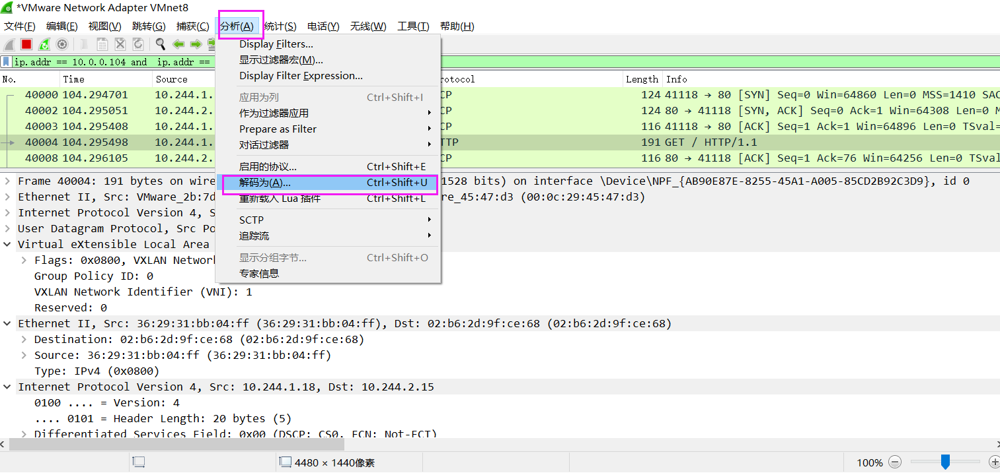

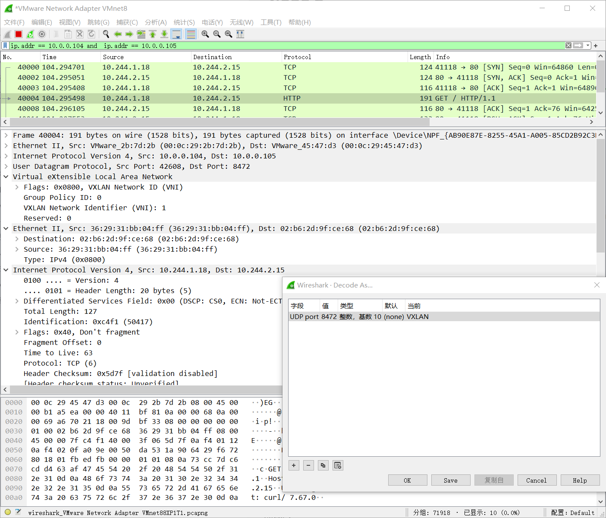

### 2.3.2 VXLAN 模式

VXLAN 模式下在每个节点上：

虚拟网桥：cni0

每个节点都会创建cni0网桥设备，cni0设备获得的ip地址是该节点分配到的网段的第一个地址。每个节点创建一个pod时都会创建一对veth pair，其中一端对应于pod中的eth0，另一端是cni0网桥中的网卡vethXXXX。每个Pod从eth0发出的流量都会发送到cni0网桥设备的桥接的网卡vethXXXX。

隧道设备：flannel.1隧道报文的出入口，overlay网络的设备。

Flannel.1 用来进行vxlan报文的封包和解包处理，如果要实现跨节点之间的Pod通讯,Pod的流量先到达cni网桥,查询路由表后,都从Flannel.1 设备以隧道的形式封装后发送到对端的Flannel.1 设备,再解封装,转发到cni0网桥,再转发给相应的Pod。

范例: 查看

```text
[root@node1 ~]#brctl show
bridge name bridge id       STP enabled interfaces
cni0        8000.ce904d8918e0   no      vethb04cd1e7
vethb77ce501
docker0     8000.0242f9a566e7   no
[root@node1 ~]#ip a  show flannel.1
4: flannel.1: <BROADCAST,MULTICAST,UP,LOWER_UP> mtu 1450 qdisc noqueue state
UNKNOWN group default
link/ether 1e:8d:ab:49:f3:fe brd ff:ff:ff:ff:ff:ff
inet 10.244.1.0/32 scope global flannel.1
```

```text
valid_lft forever preferred_lft forever
inet6 fe80::1c8d:abff:fe49:f3fe/64 scope link
valid_lft forever preferred_lft forever
[root@node1 ~]#ip a show cni0
5: cni0: <BROADCAST,MULTICAST,UP,LOWER_UP> mtu 1450 qdisc noqueue state UP group
default qlen 1000
link/ether ce:90:4d:89:18:e0 brd ff:ff:ff:ff:ff:ff
inet 10.244.1.1/24 brd 10.244.1.255 scope global cni0
valid_lft forever preferred_lft forever
inet6 fe80::cc90:4dff:fe89:18e0/64 scope link
valid_lft forever preferred_lft forever
```

```text
[root@node1 ~]#ethtool -i flannel.1
driver: vxlan
version: 0.1
firmware-version:
expansion-rom-version:
bus-info:
supports-statistics: no
supports-test: no
supports-eeprom-access: no
supports-register-dump: no
supports-priv-flags: no
```

```text
[root@node1 ~]#ethtool -i cni0
driver: bridge
version: 2.3
firmware-version: N/A
expansion-rom-version:
bus-info: N/A
supports-statistics: no
supports-test: no
supports-eeprom-access: no
supports-register-dump: no
supports-priv-flags: no
```

范例： 默认使用vxlan模式

```text
[root@master1 ~]#kubectl get cm kube-flannel-cfg  -o yaml -n kube-flannel
apiVersion: v1
data:
cni-conf.json: |
{
"name": "cbr0",
"cniVersion": "0.3.1",
"plugins": [
{
"type": "flannel",
"delegate": {
"hairpinMode": true,
"isDefaultGateway": true
}
},
{
"type": "portmap",
"capabilities": {
```

```text
"portMappings": true
}
}
]
}
net-conf.json: |
{
"Network": "10.244.0.0/16",
"Backend": {
"Type": "vxlan"
}
}
kind: ConfigMap
metadata:
annotations:
kubectl.kubernetes.io/last-applied-configuration: |
{"apiVersion":"v1","data":{"cni-conf.json":"{\n  \"name\": \"cbr0\",\n
\"cniVersion\": \"0.3.1\",\n  \"plugins\": [\n    {\n      \"type\":
\"flannel\",\n      \"delegate\": {\n        \"hairpinMode\": true,\n
\"isDefaultGateway\": true\n      }\n    },\n    {\n      \"type\":
\"portmap\",\n      \"capabilities\": {\n        \"portMappings\": true\n
}\n    }\n  ]\n}\n","net-conf.json":"{\n  \"Network\": \"10.244.0.0/16\",\n
\"Backend\": {\n    \"Type\": \"vxlan\"\n
}\n}\n"},"kind":"ConfigMap","metadata":{"annotations":{},"labels":
{"app":"flannel","k8s-app":"flannel","tier":"node"},"name":"kube-flannel-
cfg","namespace":"kube-flannel"}}
creationTimestamp: ""
labels:
app: flannel
k8s-app: flannel
tier: node
name: kube-flannel-cfg
namespace: kube-flannel
resourceVersion: "3682845"
uid: f8cb1488-41bf-46dc-8492-24f361295f61
```

```text
#开启第1个测试容器
[root@master1 ~]#kubectl run pod-client --image="registry.cn-
beijing.aliyuncs.com/wangxiaochun/admin-box:v0.1" -it --rm --command -- /bin/sh
If you don't see a command prompt, try pressing enter.
/ # ifconfig eth0
eth0      Link encap:Ethernet  HWaddr 0A:2C:4F:F2:EA:08
inet addr:10.244.1.21  Bcast:10.244.1.255  Mask:255.255.255.0
```

```text
#查看节点部署效果
[root@master1 ~]#kubectl get pod -o wide
NAME         READY   STATUS    RESTARTS   AGE    IP            NODE
NOMINATED NODE   READINESS GATES
pod-client   1/1     Running   0          30s   10.244.1.21   node1.wang.org
<none>           <none>
```

```text
#开启第2个测试容器
[root@master1 ~]#cat pod-test.yaml
apiVersion: v1
kind: Pod
metadata:
```

```text
name: pod-test
spec:
containers:
- name: pod-test
image: registry.cn-beijing.aliyuncs.com/wangxiaochun/pod-test:v0.1
```

```text
[root@master1 ~]#kubectl apply -f pod-test.yaml
```

```text
[root@master1 ~]#kubectl get pod -o wide
NAME         READY   STATUS    RESTARTS   AGE    IP            NODE
NOMINATED NODE   READINESS GATES
pod-client   1/1     Running   0          30s   10.244.1.21   node1.wang.org
<none>           <none>
pod-test     1/1     Running   0          104s  10.244.3.17   node3.wang.org
<none>           <none>
```

```text
#从node1上的pod中发起访问node3的pod网络请求
root@pod-client #/ # ping -c1 10.244.3.17
PING10.244.3.17 (10.244.3.17): 56 data bytes
64 bytes from10.244.3.17: seq=0 ttl=62 time=0.439 ms
```

```text
#根据上面的结果,在node3节点上启动一个数据包的抓取工具,抓取从node1发过来的数据
#注意：Flannel默认使用8285端口作为UDP封装报文的端口，VxLan使用8472端口
[root@node3 ~]#tcpdump -i eth0 -vvv -en host 10.0.0.104  and udp port 8472
#注意：抓取从node1节点主机10.0.0.104主机发过来到达node2本机的数据
#可以看到抓包信息
tcpdump: verbose output suppressed, use -v or -vv for full protocol decode
listening on eth0, link-type EN10MB (Ethernet), capture size 262144 bytes
19:21:51.172031 00:0c:29:1b:f4:31 > 00:0c:29:a8:71:33, ethertype IPv4 (0x0800),
length 148: 10.0.0.104.54728 > 10.0.0.106.8472: OTV, flags [I] (0x08), overlay
0, instance 1
06:3b:df:68:3d:67 > 2a:d2:bb:0b:d8:5c, ethertype IPv4 (0x0800), length
98:10.244.1.21 >10.244.3.17: ICMP echo request, id 3072, seq 0, length 64
19:21:51.172164 00:0c:29:a8:71:33 > 00:0c:29:1b:f4:31, ethertype IPv4 (0x0800),
length 148: 10.0.0.106.58843 > 10.0.0.104.8472: OTV, flags [I] (0x08), overlay
0, instance 1
2a:d2:bb:0b:d8:5c > 06:3b:df:68:3d:67, ethertype IPv4 (0x0800), length
98:10.244.3.17 >10.244.1.21: ICMP echo reply, id 3072, seq 0, length 64
#结果显示：这里面每一条数据，都包括了两层ip数据包
```

### 2.3.3 host-gw 模式

```text
#开启flannel的host-gw直连路由模型
#方法1：在线编辑CM
[root@master1 ~]#kubectl edit cm kube-flannel-cfg -n kube-flannel
.....
net-conf.json: |
{
"Network": "10.244.0.0/16",
"Backend": {
"Type": "host-gw"  #修改此行的vxlan为host-gw
}
}
......
#方法2：修改配置文件
```

```text
[root@master1 ~]#kubectl get  cm kube-flannel-cfg  -o yaml -n kube-flannel >
/tmp/kube-flannel.yml
[root@master1 ~]#vim /tmp/kube-flannel.yml
......
net-conf.json: |
{
"Network": "10.244.0.0/16",
"Backend": {
"Type": "host-gw"  #修改此行的vxlan为host-gw
}
}
......
```

```text
#重启flannel相关的pod
[root@master1 ~]#kubectl apply -f /tmp/kube-flannel.yml
```

```text
#删除旧的flannel相关Pod才能使配置生效
#方法1:
[root@master1 ~]#kubectl rollout restart ds -n kube-flannel kube-flannel-ds
```

```text
#方法2:
#新版:
[root@master1 ~]#kubectl delete pod -n kube-flannel -l app=flannel
#旧版
[root@master1 ~]#kubectl delete pod -n kube-system -l app=flannel
```

```text
#自动重新创建pod
[root@master1 ~]#kubectl get pod -A |grep flannel
kube-system   kube-flannel-ds-4g9vf                        1/1     Running   0
22s
kube-system   kube-flannel-ds-c427k                        1/1     Running   0
21s
kube-system   kube-flannel-ds-gtghz                        1/1     Running   0
21s
kube-system   kube-flannel-ds-hhh5d                        1/1     Running   0
22s
kube-system   kube-flannel-ds-r79ls                        1/1     Running   0
21s
kube-system   kube-flannel-ds-vkzp9                        1/1     Running   0
21s
```

```text
#重启所有节点,可以看到flannel.1接口不再存在
[root@node1 ~]#ip a
1: lo: <LOOPBACK,UP,LOWER_UP> mtu 65536 qdisc noqueue state UNKNOWN group
default qlen 1000
link/loopback 00:00:00:00:00:00 brd 00:00:00:00:00:00
inet 127.0.0.1/8 scope host lo
valid_lft forever preferred_lft forever
inet6 ::1/128 scope host
valid_lft forever preferred_lft forever
2: eth0: <BROADCAST,MULTICAST,UP,LOWER_UP> mtu 1500 qdisc fq_codel state UP
group default qlen 1000
link/ether 00:0c:29:ad:94:b5 brd ff:ff:ff:ff:ff:ff
altname enp2s1
altname ens33
inet 10.0.0.104/24 brd 10.0.0.255 scope global eth0
valid_lft forever preferred_lft forever
```

```text
inet6 fe80::20c:29ff:fead:94b5/64 scope link
valid_lft forever preferred_lft forever
3: docker0: <NO-CARRIER,BROADCAST,MULTICAST,UP> mtu 1500 qdisc noqueue state
DOWN group default
link/ether 02:42:7f:51:43:31 brd ff:ff:ff:ff:ff:ff
inet 172.17.0.1/16 brd 172.17.255.255 scope global docker0
valid_lft forever preferred_lft forever
4: cni0: <BROADCAST,MULTICAST,UP,LOWER_UP> mtu 1500 qdisc noqueue state UP group
default qlen 1000
link/ether 9e:d1:4d:3f:5a:78 brd ff:ff:ff:ff:ff:ff
inet 10.244.1.1/24 brd 10.244.1.255 scope global cni0
valid_lft forever preferred_lft forever
inet6 fe80::9cd1:4dff:fe3f:5a78/64 scope link
valid_lft forever preferred_lft forever
5: vethd13af8c4@if2: <BROADCAST,MULTICAST,UP,LOWER_UP> mtu 1500 qdisc noqueue
master cni0 state UP group default
link/ether ca:1c:86:4d:8e:b3 brd ff:ff:ff:ff:ff:ff link-netnsid 0
inet6 fe80::d40a:56ff:fee6:b7b6/64 scope link
valid_lft forever preferred_lft forever
6: veth7fd9f854@if2: <BROADCAST,MULTICAST,UP,LOWER_UP> mtu 1500 qdisc noqueue
master cni0 state UP group default
link/ether 3a:ce:36:79:98:4d brd ff:ff:ff:ff:ff:ff link-netnsid 1
inet6 fe80::38ce:36ff:fe79:984d/64 scope link
valid_lft forever preferred_lft forever
```

```text
#查看路由效果，
[root@master1 ~]#route -n
Kernel IP routing table
Destination     Gateway         Genmask         Flags Metric Ref    Use Iface
0.0.0.0         10.0.0.2        0.0.0.0         UG    0      0        0 eth0
10.0.0.0        0.0.0.0         255.255.255.0   U     0      0        0 eth0
10.244.0.0      0.0.0.0         255.255.255.0   U     0      0        0 cni0
10.244.1.0      10.0.0.104      255.255.255.0   UG    0      0        0 eth0
10.244.2.0      10.0.0.105      255.255.255.0   UG    0      0        0 eth0
10.244.3.0      10.0.0.106      255.255.255.0   UG    0      0        0 eth0
10.244.4.0      10.0.0.103      255.255.255.0   UG    0      0        0 eth0
10.244.5.0      10.0.0.102      255.255.255.0   UG    0      0        0 eth0
172.17.0.0      0.0.0.0         255.255.0.0     U     0      0        0 docker0
```

```text
#所有的路由转发，都不再使用flannel了，直接进行路由转发了
#如果是第一次安装flannel的时候，使用这种模式，flannel.1网卡不会生成
#显示的路表由表和VXLAN DirectRouting 模式一样
```

```text
#开启两个测试pod
[root@master1 ~]#kubectl run pod-client --image="registry.cn-
beijing.aliyuncs.com/wangxiaochun/admin-box:v0.1:v0.1" -it --rm --command --
/bin/sh
```

```text
#开启第2个测试容器
#方法1
[root@master1 ~]#kubectl run pod-test --image registry.cn-
beijing.aliyuncs.com/wangxiaochun/pod-test:v0.1
#方法2
[root@master1 ~]#cat pod-test.yaml
apiVersion: v1
kind: Pod
metadata:
```

```text
name: pod-test
spec:
containers:
- name: pod-test
image: registry.cn-beijing.aliyuncs.com/wangxiaochun/pod-test:v0.1
[root@master1 ~]#kubectl apply -f pod-test.yaml
```

```text
#查看pod的IP
[root@master1 ~]#kubectl get pod -o wide
NAME         READY   STATUS    RESTARTS   AGE     IP            NODE
NOMINATED NODE   READINESS GATES
pod-client   1/1     Running   0          2m58s  10.244.1.22   node1.wang.org
<none>           <none>
pod-test     1/1     Running   0          35m    10.244.3.17   node3.wang.org
<none>           <none>
```

```text
#在第2个pod运行的节点node3上tcpdump抓包目标是本机Pod的http请求
[root@node3 ~]#tcpdump -i eth0 -nn host 10.244.3.17 and tcp port 80
```

```text
#在测试容器里面使用curl来进行访问
root@pod-client # curl 10.244.3.17
kubernetes pod-test v0.1!! ClientIP:10.244.1.22, ServerName: pod-test,
ServerIP:10.244.3.17!
```

```text
#由于这种模式下，与直连路由的工作方式一致，所以抓包效果是一样的。
19:58:27.519784 IP10.244.1.22.53752 >10.244.3.17.80: Flags [S], seq 1504809261,
win 64860, options [mss 1410,sackOK,TS val 3890284537 ecr 0,nop,wscale 7],
length 0
19:58:27.519962 IP10.244.3.17.80 >10.244.1.22.53752: Flags [S.], seq 2311390902,
ack 1504809262, win 64308, options [mss 1410,sackOK,TS val 1865518312 ecr
3890284537,nop,wscale 7], length 0
19:58:27.520177 IP10.244.1.22.53752 >10.244.3.17.80: Flags [.], ack 1, win 507,
options [nop,nop,TS val 3890284538 ecr 1865518312], length 0
19:58:27.528113 IP10.244.1.22.53752 >10.244.3.17.80: Flags [P.], seq 1:76, ack
1, win 507, options [nop,nop,TS val 3890284546 ecr 1865518312], length 75: HTTP:
GET / HTTP/1.1
19:58:27.528202 IP10.244.3.17.80 >10.244.1.22.53752: Flags [.], ack 76, win 502,
options [nop,nop,TS val 1865518320 ecr 3890284546], length 0
19:58:27.529133 IP10.244.3.17.80 >10.244.1.22.53752: Flags [P.], seq 1:18, ack
76, win 502, options [nop,nop,TS val 1865518321 ecr 3890284546], length 17:
HTTP: HTTP/1.0 200 OK
19:58:27.529303 IP10.244.3.17.80 >10.244.1.22.53752: Flags [FP.], seq 18:249,
ack 76, win 502, options [nop,nop,TS val 1865518322 ecr 3890284546], length 231:
HTTP
19:58:27.529324 IP10.244.1.22.53752 >10.244.3.17.80: Flags [.], ack 18, win 507,
options [nop,nop,TS val 3890284547 ecr 1865518321], length 0
19:58:27.529512 IP10.244.1.22.53752 >10.244.3.17.80: Flags [F.], seq 76, ack
250, win 506, options [nop,nop,TS val 3890284547 ecr 1865518322], length 0
19:58:27.529560 IP10.244.3.17.80 >10.244.1.22.53752: Flags [.], ack 77, win 502,
options [nop,nop,TS val 1865518322 ecr 3890284547], length 0
```

### 2.3.4 VXLAN DirectRouting 模式

```text
#修改flannel为直连路由模型
#方法1：在线修改CM
[root@master1 ~]#kubectl edit cm kube-flannel-cfg -n kube-flannel
...,,
net-conf.json: |
{
"Network": "10.244.0.0/16",
"Backend": {
"Type": "vxlan",
"DirectRouting": true  #添加此行
}
}
.....
```

```text
#方法2：修改配置文件
[root@master1 ~]#kubectl get  cm kube-flannel-cfg  -o yaml -n kube-flannel >
/tmp/kube-flannel.yml
[root@master1 ~]#vim /tmp/kube-flannel.yml
...
net-conf.json: |
{
"Network": "10.244.0.0/16",
"Backend": {
"Type": "vxlan",       #注意:最后需要添加一个逗号
"DirectRouting": true  #添加此行
}
}
.....
```

```text
#重启flannel相关的pod
[root@master1 ~]#kubectl apply -f kube-flannel.yml
```

```text
#删除旧的flannel相关Pod,才能生效
#新版:
[root@master1 ~]#kubectl get daemonset -n kube-flannel
NAME              DESIRED   CURRENT   READY   UP-TO-DATE   AVAILABLE   NODE
SELECTOR   AGE
kube-flannel-ds   4         4         4       4            4           <none>
56d
```

```text
#配置生效
#方法1
[root@master1 ~]#kubectl rollout restart daemonset kube-flannel-ds -n kube-
flannel
```

```text
#方法2
#新版
[root@master1 ~]#kubectl delete pod -n kube-flannel -l app=flannel
#旧版
[root@master1 ~]#kubectl delete pod -n kube-system -l app=flannel
```

```text
#自动重新生成pod
#新版
[root@master1 ~]#kubectl get pod -A |grep flannel
```

```text
kube-flannel   kube-flannel-ds-57xzq                      1/1     Running
0             110s
kube-flannel   kube-flannel-ds-bdxmj                      1/1     Running
0             111s
kube-flannel   kube-flannel-ds-p8z8q                      1/1     Running
0             110s
kube-flannel   kube-flannel-ds-qtmlw                      1/1     Running
0             110s
kube-flannel   kube-flannel-ds-wmw5s                      1/1     Running
0             111s
kube-flannel   kube-flannel-ds-zkslg                      1/1     Running
0             110s
```

```text
#旧版
[root@master1 ~]#kubectl get pod -A |grep flannel
kube-system   kube-flannel-ds-55rb8                        1/1     Running   0
35s
kube-system   kube-flannel-ds-97k6s                        1/1     Running   0
35s
kube-system   kube-flannel-ds-pnwbb                        1/1     Running   0
35s
kube-system   kube-flannel-ds-q22pd                        1/1     Running   0
35s
kube-system   kube-flannel-ds-r6sjn                        1/1     Running   0
35s
kube-system   kube-flannel-ds-txvdn                        1/1     Running   0
35s
```

```text
#如果节点间没有跨网段的环境,查看路由效果和host-gw模式相同
[root@master1 ~]#route -n
Kernel IP routing table
Destination     Gateway         Genmask         Flags Metric Ref    Use Iface
0.0.0.0         10.0.0.2        0.0.0.0         UG    0      0        0 eth0
10.0.0.0        0.0.0.0         255.255.255.0   U     0      0        0 eth0
10.244.0.0      0.0.0.0         255.255.255.0   U     0      0        0 cni0
10.244.1.0      10.0.0.104      255.255.255.0   UG    0      0        0 eth0
10.244.2.0      10.0.0.105      255.255.255.0   UG    0      0        0 eth0
10.244.3.0      10.0.0.106      255.255.255.0   UG    0      0        0 eth0
10.244.4.0      10.0.0.103      255.255.255.0   UG    0      0        0 eth0
10.244.5.0      10.0.0.102      255.255.255.0   UG    0      0        0 eth0
172.17.0.0      0.0.0.0         255.255.0.0     U     0      0        0 docker0
#结果显示：所有的路由转发，都不再使用flannel，直接进行路由转发,这是因为当前环境没有涉及到跨网段
的主机节点
```

```text
#自动生成flannel.1网卡接口
[root@node1 ~]#ip a
1: lo: <LOOPBACK,UP,LOWER_UP> mtu 65536 qdisc noqueue state UNKNOWN group
default qlen 1000
link/loopback 00:00:00:00:00:00 brd 00:00:00:00:00:00
inet 127.0.0.1/8 scope host lo
valid_lft forever preferred_lft forever
inet6 ::1/128 scope host
valid_lft forever preferred_lft forever
2: eth0: <BROADCAST,MULTICAST,UP,LOWER_UP> mtu 1500 qdisc fq_codel state UP
group default qlen 1000
link/ether 00:0c:29:ad:94:b5 brd ff:ff:ff:ff:ff:ff
altname enp2s1
altname ens33
```

```text
inet 10.0.0.201/24 brd 10.0.0.255 scope global eth0
valid_lft forever preferred_lft forever
inet6 fe80::20c:29ff:fead:94b5/64 scope link
valid_lft forever preferred_lft forever
3: docker0: <NO-CARRIER,BROADCAST,MULTICAST,UP> mtu 1500 qdisc noqueue state
DOWN group default
link/ether 02:42:7f:51:43:31 brd ff:ff:ff:ff:ff:ff
inet 172.17.0.1/16 brd 172.17.255.255 scope global docker0
valid_lft forever preferred_lft forever
4: cni0: <BROADCAST,MULTICAST,UP,LOWER_UP> mtu 1500 qdisc noqueue state UP group
default qlen 1000
link/ether 9e:d1:4d:3f:5a:78 brd ff:ff:ff:ff:ff:ff
inet 10.244.1.1/24 brd 10.244.1.255 scope global cni0
valid_lft forever preferred_lft forever
inet6 fe80::9cd1:4dff:fe3f:5a78/64 scope link
valid_lft forever preferred_lft forever
5: vethd13af8c4@if2: <BROADCAST,MULTICAST,UP,LOWER_UP> mtu 1500 qdisc noqueue
master cni0 state UP group default
link/ether ca:1c:86:4d:8e:b3 brd ff:ff:ff:ff:ff:ff link-netnsid 0
inet6 fe80::d40a:56ff:fee6:b7b6/64 scope link
valid_lft forever preferred_lft forever
6: veth7fd9f854@if2: <BROADCAST,MULTICAST,UP,LOWER_UP> mtu 1500 qdisc noqueue
master cni0 state UP group default
link/ether 3a:ce:36:79:98:4d brd ff:ff:ff:ff:ff:ff link-netnsid 1
inet6 fe80::38ce:36ff:fe79:984d/64 scope link
valid_lft forever preferred_lft forever
7: flannel.1: <BROADCAST,MULTICAST,UP,LOWER_UP> mtu 1450 qdisc noqueue state
UNKNOWN group default
link/ether 5a:bd:dd:02:ea:18 brd ff:ff:ff:ff:ff:ff
inet 10.244.1.0/32 scope global flannel.1
valid_lft forever preferred_lft forever
inet6 fe80::58bd:ddff:fe02:ea18/64 scope link tentative
valid_lft forever preferred_lft forever
```

```text
#开启第1个测试pod
[root@master1 ~]#kubectl run pod-client --image="registry.cn-
beijing.aliyuncs.com/wangxiaochun/admin-box:v0.1" -it --rm --command -- /bin/sh
```

```text
#开启第2个测试容器
#方法1
[root@master1 ~]#kubectl run pod-test --image registry.cn-
beijing.aliyuncs.com/wangxiaochun/pod-test:v0.1
#方法2
[root@master1 ~]#cat pod-test.yaml
apiVersion: v1
kind: Pod
metadata:
name: pod-test
spec:
containers:
- name: pod-test
image: registry.cn-beijing.aliyuncs.com/wangxiaochun/pod-test:v0.1
```

```text
[root@master1 ~]#kubectl apply -f pod-test.yaml
```

```text
#查看pod的IP
[root@master1 ~]#kubectl get pod -o wide
```

```text
NAME         READY   STATUS    RESTARTS   AGE     IP            NODE
NOMINATED NODE   READINESS GATES
pod-client   1/1     Running   0          2m58s  10.244.1.22   node1.wang.org
<none>           <none>
pod-test     1/1     Running   0          35m    10.244.3.17   node3.wang.org
<none>           <none>
```

```text
#在第2个pod运行的节点node3上tcpdump抓包
[root@node3 ~]#tcpdump -i eth0 -nn host10.244.3.17 and tcp port 80
```

```text
#在测试容器里面使用curl来进行访问
root@pod-client # curl10.244.3.17
kubernetes pod-test v0.1!! ClientIP:10.244.1.22, ServerName: pod-test,
ServerIP:10.244.3.17!
```

```text
#查看抓包效果，显示不再通XVLAN封装跨节点的通信
[root@node1 ~]#tcpdump  -i cni0 -nn host 10.244.1.22 and tcp port 80
tcpdump: verbose output suppressed, use -v or -vv for full protocol decode
listening on eth0, link-type EN10MB (Ethernet), capture size 262144 bytes
19:47:12.801993 IP10.244.1.22.53748 >10.244.3.17.80: Flags [S], seq 4273757738,
win 64860, options [mss 1410,sackOK,TS val 3889609820 ecr 0,nop,wscale 7],
length 0
19:47:12.802103 IP10.244.3.17.80 >10.244.1.22.53748: Flags [S.], seq 3860130752,
ack 4273757739, win 64308, options [mss 1410,sackOK,TS val 1864843594 ecr
3889609820,nop,wscale 7], length 0
19:47:12.802244 IP10.244.1.22.53748 >10.244.3.17.80: Flags [.], ack 1, win 507,
options [nop,nop,TS val 3889609820 ecr 1864843594], length 0
19:47:12.802310 IP10.244.1.22.53748 >10.244.3.17.80: Flags [P.], seq 1:76, ack
1, win 507, options [nop,nop,TS val 3889609820 ecr 1864843594], length 75: HTTP:
GET / HTTP/1.1
19:47:12.802324 IP10.244.3.17.80 >10.244.1.22.53748: Flags [.], ack 76, win 502,
options [nop,nop,TS val 1864843595 ecr 3889609820], length 0
19:47:12.803411 IP10.244.3.17.80 >10.244.1.22.53748: Flags [P.], seq 1:18, ack
76, win 502, options [nop,nop,TS val 1864843596 ecr 3889609820], length 17:
HTTP: HTTP/1.0 200 OK
19:47:12.803549 IP10.244.3.17.80 >10.244.1.22.53748: Flags [FP.], seq 18:249,
ack 76, win 502, options [nop,nop,TS val 1864843596 ecr 3889609820], length 231:
HTTP
19:47:12.803578 IP10.244.1.22.53748 >10.244.3.17.80: Flags [.], ack 18, win 507,
options [nop,nop,TS val 3889609821 ecr 1864843596], length 0
19:47:12.803759 IP10.244.1.22.53748 >10.244.3.17.80: Flags [F.], seq 76, ack
250, win 506, options [nop,nop,TS val 3889609821 ecr 1864843596], length 0
19:47:12.803786 IP10.244.3.17.80 >10.244.1.22.53748: Flags [.], ack 77, win 502,
options [nop,nop,TS val 1864843596 ecr 3889609821], length 0
```



<nav class="article-end" aria-label="章节导航">
  <a href="{{ '/subjects/Kubernetes/14-hpa-custom-metrics.html' | relative_url }}">← 上一章：自定义指标、Prometheus Adapter 与 KEDA</a>
  <a href="{{ '/subjects/Kubernetes/' | relative_url }}">返回 Kubernetes 目录</a>
  <a href="{{ '/subjects/Kubernetes/16-calico-network.html' | relative_url }}">下一章：Calico 网络部署与管理 →</a>
</nav>
