[← 返回 Kubernetes 目录]({{ '/subjects/Kubernetes/' | relative_url }})



# 16 Calico 网络部署与管理

# 3 Calico

## 3.1 Calico 网络机制

### 3.1.1 Calico 介绍


Calico (斑点猫)是一个开源的虚拟化网络方案,用于为云原生应用实现互联及策略控制,同时也提供了商业性的服务。相较于 Flannel 来说,Calico 的主要优势是支持网络策略network policy。Calico 允许用户动态定义 ACL 规则控制进出容器的数据报文,实现为 Pod 间的通信按需施加安全策略。Calico 还可以整合进大多数具备编排能力的各种平台，包括Kubernetes、OpenShift、Docker EE、OpenStack等，为虚机和容器提供多主机间通信的功能。

所以Calico 可以认为是 Flannel的增强版。

官方地址：https://www.tigera.io/project-calico/

### 3.1.2 Calico 工作机制

#### 3.1.2.1 Calico 工作机制

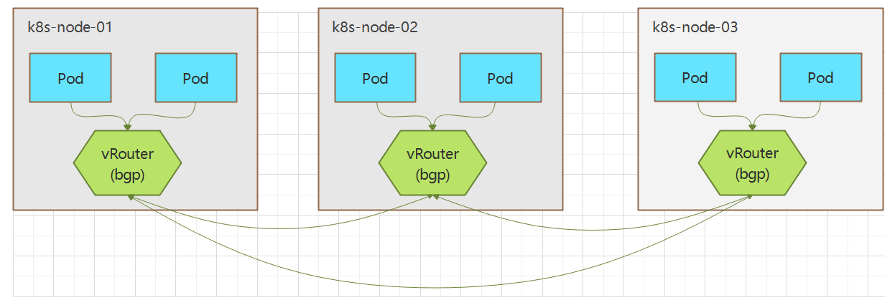

Calico是三层的虚拟网络方案,而不需要像flannel的cni0网桥设备它把每个节点都当作虚拟路由器（vRouter），把每个节点上的Pod都当作是“节点路由器”后的一个终端设备并为其分配一个IP地址。

各节点路由器通过BGP（Border Gateway Protocol 边界网关协议）协议学习生成路由规则从而实现不同节点上Pod间的互联互通Calico 由于是一个纯三层的解决方案,通过每个节点协议栈的三层（网络层）确保容器之间的连通性,即所有容器(包括同一个节点的容器间)都需要通过路由实现通信, 这摆脱了 flannel host-gw 类型的所有节点必须位于同一二层网络的限制,从而极大地扩展了网络规模和网络边界。Calico 在每一个节点利用Linux内核实现了一个高效的vRouter（虚拟路由器）进行报文转发，而每个vRouter通过BGP协议负责把自身所属的节点上运行的Pod资源的IP地址信息基于节点的agent程序（Felix）直接由vRouter生成路由规则向整个Calico网络内传播Calico把Kubernetes集群环境中的每个节点上的Pod所组成的网络视为一个自治系统，各节点也就是各自治系统的边界网关，它们彼此间通过BGP协议交换路由信息生成路由规则由于不是所有网络(比如公有云)都能支持BGP，以及BGP路由模型要求所有节点必须要位于同一个二层网络，Calico还支持基于IPIP 或者 VXLAN的叠加网络模型类似于Flannel在VXLAN后端中启用DirectRouting时的网络模型，Calico也支持混合使用路由和叠加网络模型， BGP路由模型用于二层网络的高性能通信，IPIP或VXLAN用于跨网段的节点间（Cross-Subnet）报文转发Calico不使用隧道或者NAT来实现转发，而是巧妙的把所有二三层流量转换成三层流量，并通过host上路由配置完成跨host转发。Pod 网络默认使用 192.168.0.0/16的网段,并给每个节点的Pod划分一个子网 192.168.0.0/26,即支持2^10个子网,每个节点的子网支持2^6-2=62个Pod

#### 3.1.2.2 Calico 的 Pod 网络

##### 3.1.2.2.1 Calico 的 Pod 网络工作机制

Calico 的每个Pod也会生成一对veth虚拟网卡,一半在Pod内,另一半在节点主机表现为caliXXXXXXXX@ifN形式的的虚拟卡。其中11个X表示函数自动生成,  N为Pod的网卡的编号。但和Flannel不同的是, Calico 并不使用一个虚拟网桥连接同一个节点主机上的多个不同Pod。

**Proxy ARP 介绍**

当局域网内部主机发起逻辑是同一个网段,但物理上不同网段的ARP请求时,出口路由器/网关设备将自身mac地址回复给这个请求这个过程称为 Proxy ARP。

Proxy ARP （代理ARP）是一种网络功能，它允许路由器代替目标主机回应 ARP 请求。通常情况下，ARP（地址解析协议）用于将 IP 地址解析为 MAC 地址，以便在同一个物理网络上的主机之间进行通信。然而，当主机不在同一个物理网络上时，proxy_arp 可以让路由器模拟(代替)目标设备的MAC地址响应ARP请求，从而使得发送方主机认为目标主机与自己在同一个物理网络上,实现位于不同物理网络的主机之间建立通信。

**Proxy ARP 的工作原理**

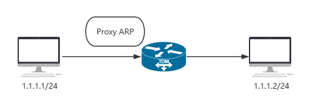

1. ARP 请求：当一台主机（如Host_A）需要与同一IP网段内的另一台主机（如Host_B）通信时，它首先会发送ARP请求报文以获取Host_B的MAC地址。如果Host_A和Host_B位于不同的物理网络，

Host_B将无法收到这个ARP请求。

2. 路由器回应：如果连接这两个网络的设备（如路由器或交换机）启用了Proxy ARP功能，它将会接收到这个ARP请求。该设备会查找其路由表或ARP表，以确认是否存在到Host_B的路由或ARP表项。

3. MAC地址代理：如果设备能够确认到Host_B的路由或ARP表项存在，它将使用自己的MAC地址作为响应，发送给Host_A。这样，Host_A就会认为它已经找到了Host_B的MAC地址，并开始使用这个MAC地址进行数据转发

4. 数据包转发：主机Host_A会将数据包发送到路由器，路由器再将数据包转发给真正的目标主机Host_B

**Proxy ARP 的应用场景**

1. 跨物理网络通信：当两台主机在同一个逻辑网络（子网）上，但不在同一个物理网络上时，在没有配置默认网关或静态路由的情况下, proxy_arp 可以用来实现跨物理网络的通信。

2. 简化网络配置：在某些情况下，使用 proxy_arp 可以简化网络配置，避免复杂的 NAT（网络地址转换）和路由配置。

Proxy ARP 配置

Proxy ARP 是在网卡上启用的, 可通过下面文件查看是否启用Proxy ARP。

```text
/proc/sys/net/ipv4/conf/<DEV>/proxy_arp
#值为0则未开启,此为默认值
#值为1则已经开启
```

节点为每个cali 接口都开启了ARP Proxy功能，从而让宿主机扮演网关设备，并以自己的MAC地址代为应答对端Pod中发来的ARP请求。同一节点上的Pod间通信依赖于节点主机上为每个Pod单独配置的路由规则,即同一个节点的Pod间通信也是通过三层路由实现的。

Pod 内生成的路由如下：

```text
[root@myapp-6b59f8f86-mfdn8 /]# route -n
Kernel IP routing table
Destination     Gateway         Genmask         Flags Metric Ref    Use Iface
0.0.0.0         169.254.1.1     0.0.0.0         UG    0      0        0 eth0
169.254.1.1     0.0.0.0         255.255.255.255 UH    0      0        0 eth0
```

节点主机上生成的路由如下：

```text
[root@node1 ~]#route -n
Kernel IP routing table
Destination     Gateway         Genmask         Flags Metric Ref    Use Iface
0.0.0.0         10.0.0.2        0.0.0.0         UG    0      0        0 eth0
10.0.0.0        0.0.0.0         255.255.255.0   U     0      0        0 eth0
10.244.36.0     10.0.0.202      255.255.255.192 UG    0      0        0 tunl0
10.244.53.64    10.0.0.200      255.255.255.192 UG    0      0        0 tunl0
10.244.101.128  0.0.0.0         255.255.255.192 U     0      0        0 *
10.244.101.129  0.0.0.0         255.255.255.255 UH    0      0        0
cali2ad752e56a1  #对应Pod的veth网卡
10.244.101.130  0.0.0.0         255.255.255.255 UH    0      0        0
cali47ddc65abff
```

```text
#开启ARP Proxy
[root@node1 ~]#ls /proc/sys/net/ipv4/conf/
```

```text
all              cali13251176854  cali3d321aef9c7  cali7f09440efda
cali8e36c4d65e6  default  eth0  tunl0
cali0e6b75291c2  cali25e96b97a8c  cali72c6e46c423  cali7f22771d9d2
calid568e889c3c  docker0  lo
[root@node1 ~]#cat /proc/sys/net/ipv4/conf/cali*/proxy_arp
1
1
1
1
1
1
1
1
1
```

不同节点上的Pod间通信，则由Calico的网络模式决定。

##### 3.1.2.2.2 范例: Calico 同一个节点不同容器间通信

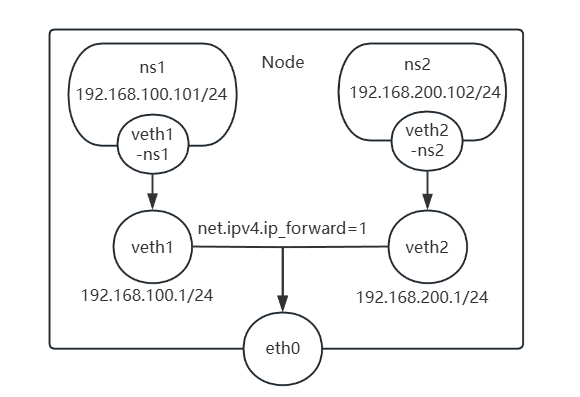

```text
#创建名称空间
[root@ubuntu2204 ~]#ip netns add ns1
[root@ubuntu2204 ~]#ip netns add ns2
```

```text
#创建网卡veth pair
[root@ubuntu2204 ~]#ip link add  veth1 type veth peer name veth1-ns1
[root@ubuntu2204 ~]#ip link add  veth2 type veth peer name veth2-ns2
[root@ubuntu2204 ~]#ip link set veth1-ns1 netns ns1
[root@ubuntu2204 ~]#ip link set veth2-ns2 netns ns2
```

```text
#添加IP
[root@ubuntu2204 ~]#ip netns exec ns1 ip addr add 192.168.100.101/24 dev veth1-
ns1
[root@ubuntu2204 ~]#ip netns exec ns1 ip link set veth1-ns1 up
```

```text
[root@ubuntu2204 ~]#ip netns exec ns2 ip addr add 192.168.200.102/24 dev veth2-
ns2
[root@ubuntu2204 ~]#ip netns exec ns2 ip link set veth2-ns2 up
```

```text
#主机网卡IP配置
[root@ubuntu2204 ~]#ip a a  192.168.100.1/24 dev veth1
[root@ubuntu2204 ~]#ip a a  192.168.200.1/24 dev veth2
[root@ubuntu2204 ~]#ip link set  veth1 up
[root@ubuntu2204 ~]#ip link set  veth2 up
```

```text
#添加路由
[root@ubuntu2204 ~]#ip netns exec ns1 ip route add default via 192.168.100.1 dev
veth1-ns1
[root@ubuntu2204 ~]#ip netns exec ns2 ip route add default via 192.168.200.1 dev
veth2-ns2
```

```text
#开启路由转发
[root@ubuntu2204 ~]#sysctl -w net.ipv4.ip_forward=1
```

```text
[root@ubuntu2204 ~]#ip a
1: lo: <LOOPBACK,UP,LOWER_UP> mtu 65536 qdisc noqueue state UNKNOWN group
default qlen 1000
link/loopback 00:00:00:00:00:00 brd 00:00:00:00:00:00
inet 127.0.0.1/8 scope host lo
valid_lft forever preferred_lft forever
inet6 ::1/128 scope host
valid_lft forever preferred_lft forever
2: eth0: <BROADCAST,MULTICAST,UP,LOWER_UP> mtu 1500 qdisc fq_codel state UP
group default qlen 1000
link/ether 00:0c:29:bf:18:84 brd ff:ff:ff:ff:ff:ff
altname enp2s1
altname ens33
inet 10.0.0.100/24 brd 10.0.0.255 scope global eth0
valid_lft forever preferred_lft forever
inet6 fe80::20c:29ff:febf:1884/64 scope link
valid_lft forever preferred_lft forever
4: veth1@if3: <BROADCAST,MULTICAST,UP,LOWER_UP> mtu 1500 qdisc noqueue state UP
group default qlen 1000
link/ether a6:55:12:8c:96:c6 brd ff:ff:ff:ff:ff:ff link-netns ns1
inet 192.168.100.1/24 scope global veth1
valid_lft forever preferred_lft forever
inet6 fe80::a455:12ff:fe8c:96c6/64 scope link
valid_lft forever preferred_lft forever
6: veth2@if5: <BROADCAST,MULTICAST,UP,LOWER_UP> mtu 1500 qdisc noqueue state UP
group default qlen 1000
link/ether 9e:fd:86:30:9c:10 brd ff:ff:ff:ff:ff:ff link-netns ns2
inet 192.168.200.1/24 scope global veth2
valid_lft forever preferred_lft forever
inet6 fe80::9cfd:86ff:fe30:9c10/64 scope link
valid_lft forever preferred_lft forever
```

```text
#测试通信
[root@ubuntu2204 ~]#ip netns exec ns1 ping -c1 192.168.200.102
PING 192.168.200.102 (192.168.200.102) 56(84) bytes of data.
64 bytes from 192.168.200.102: icmp_seq=1 ttl=63 time=0.039 ms
```

```text
--- 192.168.200.102 ping statistics ---
```

```text
1 packets transmitted, 1 received, 0% packet loss, time 0ms
rtt min/avg/max/mdev = 0.039/0.039/0.039/0.000 ms
```

```text
#查看ARP缓存
[root@ubuntu2204 ~]#ip netns exec ns1 arp -n
Address                  HWtype  HWaddress           Flags Mask            Iface
192.168.100.1            ether   a6:55:12:8c:96:c6   C
veth1-ns1
```

```text
[root@ubuntu2204 ~]#ip netns exec ns2 arp -n
Address                  HWtype  HWaddress           Flags Mask            Iface
192.168.200.1            ether   9e:fd:86:30:9c:10   C
veth2-ns2
```

##### 3.1.2.2.3 范例: Calico 同一个节点不同容器间通信

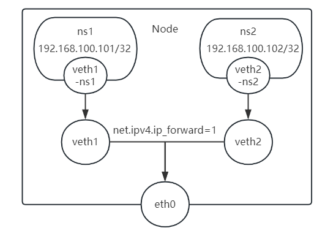

```text
#1.创建ns
[root@ubuntu2204 ~]#ip netns add ns1
[root@ubuntu2204 ~]#ip netns add ns2
[root@ubuntu2204 ~]#ip netns
ns2
ns1
```

```text
#2.创建一对veth peer
[root@ubuntu2204 ~]#ip link add  veth1 type veth peer name veth1-ns1
[root@ubuntu2204 ~]#ip link add  veth2 type veth peer name veth2-ns2
```

```text
[root@ubuntu2204 ~]#ip a
......
3: veth1-ns1@veth1: <BROADCAST,MULTICAST,M-DOWN> mtu 1500 qdisc noop state DOWN
group default qlen 1000
link/ether 96:ab:a3:21:3d:c3 brd ff:ff:ff:ff:ff:ff
4: veth1@veth1-ns1: <BROADCAST,MULTICAST,M-DOWN> mtu 1500 qdisc noop state DOWN
group default qlen 1000
link/ether a6:55:12:8c:96:c6 brd ff:ff:ff:ff:ff:ff
```

```text
5: veth2-ns2@veth2: <BROADCAST,MULTICAST,M-DOWN> mtu 1500 qdisc noop state DOWN
group default qlen 1000
link/ether c6:a3:df:ea:2f:e3 brd ff:ff:ff:ff:ff:ff
6: veth2@veth2-ns2: <BROADCAST,MULTICAST,M-DOWN> mtu 1500 qdisc noop state DOWN
group default qlen 1000
link/ether 9e:fd:86:30:9c:10 brd ff:ff:ff:ff:ff:ff
```

```text
#3.把veth1-ns1/veth2-ns2分别放在ns1/ns2名称空间中
[root@ubuntu2204 ~]#ip link set veth1-ns1 netns ns1
[root@ubuntu2204 ~]#ip link set veth2-ns2 netns ns2
[root@ubuntu2204 ~]#ip netns
ns2 (id: 1)
ns1 (id: 0)
[root@ubuntu2204 ~]#ip a
1: lo: <LOOPBACK,UP,LOWER_UP> mtu 65536 qdisc noqueue state UNKNOWN group
default qlen 1000
link/loopback 00:00:00:00:00:00 brd 00:00:00:00:00:00
inet 127.0.0.1/8 scope host lo
valid_lft forever preferred_lft forever
inet6 ::1/128 scope host
valid_lft forever preferred_lft forever
2: eth0: <BROADCAST,MULTICAST,UP,LOWER_UP> mtu 1500 qdisc fq_codel state UP
group default qlen 1000
link/ether 00:0c:29:8d:9a:2e brd ff:ff:ff:ff:ff:ff
altname enp2s1
altname ens33
inet 10.0.0.100/24 brd 10.0.0.255 scope global eth0
valid_lft forever preferred_lft forever
inet6 fe80::20c:29ff:fe8d:9a2e/64 scope link
valid_lft forever preferred_lft forever
4: veth1@if3: <BROADCAST,MULTICAST> mtu 1500 qdisc noop state DOWN group default
qlen 1000
link/ether a6:55:12:8c:96:c6 brd ff:ff:ff:ff:ff:ff link-netns ns1
6: veth2@if5: <BROADCAST,MULTICAST> mtu 1500 qdisc noop state DOWN group default
qlen 1000
link/ether 9e:fd:86:30:9c:10 brd ff:ff:ff:ff:ff:ff link-netns ns2
```

```text
#4.设置ns1和ns2的网卡ip地址
#配置ns1名称空间的网卡IP
[root@ubuntu2204 ~]#ip netns exec ns1 ip addr add 192.168.100.101/32 dev veth1-
ns1
[root@ubuntu2204 ~]#ip netns exec ns1 ip link set veth1-ns1 up
```

```text
[root@ubuntu2204 ~]#ip netns exec ns1 ip addr
1: lo: <LOOPBACK> mtu 65536 qdisc noop state DOWN group default qlen 1000
link/loopback 00:00:00:00:00:00 brd 00:00:00:00:00:00
3: veth1-ns1@if4: <BROADCAST,MULTICAST,UP,LOWER_UP> mtu 1500 qdisc noqueue state
UP group default qlen 1000
link/ether 96:ab:a3:21:3d:c3 brd ff:ff:ff:ff:ff:ff link-netnsid 0
inet 192.168.100.101/32 scope global veth1-ns1
valid_lft forever preferred_lft forever
inet6 fe80::94ab:a3ff:fe21:3dc3/64 scope link
valid_lft forever preferred_lft forever
```

```text
#默认无法访问自身的IP
[root@ubuntu2204 ~]#ip netns exec ns1 ping -c1 192.168.100.101
PING 192.168.100.101 (192.168.100.101) 56(84) bytes of data.
```

```text
--- 192.168.100.101 ping statistics ---
1 packets transmitted, 0 received, 100% packet loss, time 0ms
```

```text
#启用lo网卡即可
[root@ubuntu2204 ~]#ip netns exec ns1 ip link set lo up
[root@ubuntu2204 ~]#ip netns exec ns1 ping -c1 192.168.100.101
PING 192.168.100.101 (192.168.100.101) 56(84) bytes of data.
64 bytes from 192.168.100.101: icmp_seq=1 ttl=64 time=0.018 ms
```

```text
--- 192.168.100.101 ping statistics ---
1 packets transmitted, 1 received, 0% packet loss, time 0ms
rtt min/avg/max/mdev = 0.018/0.018/0.018/0.000 ms
```

```text
#配置ns2名称空间的网卡IP
[root@ubuntu2204 ~]#ip netns exec ns2 ip addr add 192.168.100.102/32 dev veth2-
ns2
[root@ubuntu2204 ~]#ip netns exec ns2 ip link set veth2-ns2 up
[root@ubuntu2204 ~]#ip netns exec ns2 ip addr
1: lo: <LOOPBACK> mtu 65536 qdisc noop state DOWN group default qlen 1000
link/loopback 00:00:00:00:00:00 brd 00:00:00:00:00:00
5: veth2-ns2@if6: <BROADCAST,MULTICAST,UP,LOWER_UP> mtu 1500 qdisc noqueue state
UP group default qlen 1000
link/ether c6:a3:df:ea:2f:e3 brd ff:ff:ff:ff:ff:ff link-netnsid 0
inet 192.168.100.102/32 scope global veth2-ns2
valid_lft forever preferred_lft forever
inet6 fe80::c4a3:dfff:feea:2fe3/64 scope link
valid_lft forever preferred_lft forever
[root@ubuntu2204 ~]#ip netns exec ns1 ip link set lo up
#ns1和ns2无法通信
[root@ubuntu2204 ~]#ip netns exec ns1 ping -c1 192.168.100.102
ping: connect: Network is unreachable
```

```text
#5.设置route
[root@ubuntu2204 ~]#ip netns exec ns1 ip route add 169.254.1.1 dev veth1-ns1
scope link
[root@ubuntu2204 ~]#ip netns exec ns1 ip route add default via 169.254.1.1 dev
veth1-ns1
[root@ubuntu2204 ~]#ip netns exec ns1 route -n
Kernel IP routing table
Destination     Gateway         Genmask         Flags Metric Ref    Use Iface
0.0.0.0         169.254.1.1     0.0.0.0         UG    0      0        0 veth1-
ns1
169.254.1.1     0.0.0.0         255.255.255.255 UH    0      0        0 veth1-
ns1
```

```text
[root@ubuntu2204 ~]#ip netns exec ns2 ip route add 169.254.1.1 dev veth2-ns2
scope link
[root@ubuntu2204 ~]#ip netns exec ns2 ip route add default via 169.254.1.1 dev
veth2-ns2
[root@ubuntu2204 ~]#ip netns exec ns2 route -n
Kernel IP routing table
Destination     Gateway         Genmask         Flags Metric Ref    Use Iface
0.0.0.0         169.254.1.1     0.0.0.0         UG    0      0        0 veth2-
ns2
169.254.1.1     0.0.0.0         255.255.255.255 UH    0      0        0 veth2-
ns2
```

```text
#6.把veth设备up
[root@ubuntu2204 ~]#ip link set veth1 up
[root@ubuntu2204 ~]#ip link set veth2 up
```

```text
#7.开启路由
[root@ubuntu2204 ~]#sysctl -w net.ipv4.ip_forward=1
```

```text
#8.在hosts上设置回复路由
[root@ubuntu2204 ~]#ip route add 192.168.100.101/32 dev veth1
[root@ubuntu2204 ~]#ip route add 192.168.100.102/32 dev veth2
[root@ubuntu2204 ~]#route -n
Kernel IP routing table
Destination     Gateway         Genmask         Flags Metric Ref    Use Iface
0.0.0.0         10.0.0.2        0.0.0.0         UG    0      0        0 eth0
10.0.0.0        0.0.0.0         255.255.255.0   U     0      0        0 eth0
192.168.100.101 0.0.0.0         255.255.255.255 UH    0      0        0 veth1
192.168.100.102 0.0.0.0         255.255.255.255 UH    0      0        0 veth2
```

```text
#无法访问外网
[root@ubuntu2204 ~]#ip netns exec ns1 ping -c1 192.168.100.102
PING 192.168.100.102 (192.168.100.102) 56(84) bytes of data.
From 192.168.100.101 icmp_seq=1 Destination Host Unreachable
```

```text
--- 192.168.100.102 ping statistics ---
1 packets transmitted, 0 received, +1 errors, 100% packet loss, time 0ms
```

```text
#9.为veth网卡开启proxy arp
[root@ubuntu2204 ~]#cat /proc/sys/net/ipv4/conf/veth1/proxy_arp
0
[root@ubuntu2204 ~]#cat /proc/sys/net/ipv4/conf/veth2/proxy_arp
0
[root@ubuntu2204 ~]#echo 1 > /proc/sys/net/ipv4/conf/veth1/proxy_arp
[root@ubuntu2204 ~]#echo 1 > /proc/sys/net/ipv4/conf/veth2/proxy_arp
```

```text
#10.测试相互访问
[root@ubuntu2204 ~]#ip netns exec ns1 ping -c1 192.168.100.102
PING 192.168.100.102 (192.168.100.102) 56(84) bytes of data.
64 bytes from 192.168.100.102: icmp_seq=1 ttl=63 time=0.051 ms
```

```text
--- 192.168.100.102 ping statistics ---
1 packets transmitted, 1 received, 0% packet loss, time 0ms
rtt min/avg/max/mdev = 0.051/0.051/0.051/0.000 ms
```

```text
#查看MAC,看到网关对应veth网卡的MAC
[root@ubuntu2204 ~]#ip netns exec ns1 arp -n
Address                  HWtype  HWaddress           Flags Mask            Iface
169.254.1.1              ether   a6:55:12:8c:96:c6   C
veth1-ns1
10.0.0.100               ether   a6:55:12:8c:96:c6   C
veth1-ns1
```

```text
[root@ubuntu2204 ~]#ip netns exec ns2 ping -c1 192.168.100.101
PING 192.168.100.101 (192.168.100.101) 56(84) bytes of data.
```

```text
64 bytes from 192.168.100.101: icmp_seq=1 ttl=63 time=0.036 ms
```

```text
--- 192.168.100.101 ping statistics ---
1 packets transmitted, 1 received, 0% packet loss, time 0ms
rtt min/avg/max/mdev = 0.036/0.036/0.036/0.000 ms
```

```text
#查看MAC,看到网关对应veth网卡的MAC
[root@ubuntu2204 ~]#ip netns exec ns2 arp -n
Address                  HWtype  HWaddress           Flags Mask            Iface
10.0.0.100               ether   9e:fd:86:30:9c:10   C
veth2-ns2
169.254.1.1              ether   9e:fd:86:30:9c:10   C
veth2-ns2
```

##### 3.1.2.2.4 范例: Calico 跨不同节点的不同容器间通信

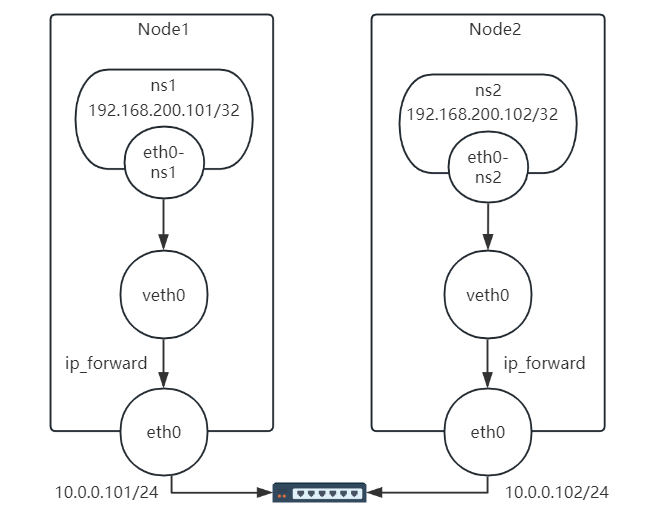

```text
#节点1上执行
[root@ubuntu2204 ~]#ip netns add ns1
[root@ubuntu2204 ~]#ip link add veth0 type veth peer name eth0-ns1
[root@ubuntu2204 ~]#ip link set veth0 up
```

```text
[root@ubuntu2204 ~]#ip link set eth0-ns1 netns ns1
[root@ubuntu2204 ~]#ip netns exec ns1 ip addr add 192.168.200.101/32 dev eth0-
ns1
[root@ubuntu2204 ~]#ip netns exec ns1 ip link set eth0-ns1 up
```

```text
#添加ns1名称空间的路由
[root@ubuntu2204 ~]#ip netns exec ns1 ip route add 169.254.1.1 dev eth0-ns1
scope link
[root@ubuntu2204 ~]#ip netns exec ns1 ip route add default via 169.254.1.1 dev
eth0-ns1
```

```text
[root@ubuntu2204 ~]#ip netns exec ns1 route -n
Kernel IP routing table
Destination     Gateway         Genmask         Flags Metric Ref    Use Iface
0.0.0.0         169.254.1.1     0.0.0.0         UG    0      0        0 eth0-ns1
169.254.1.1     0.0.0.0         255.255.255.255 UH    0      0        0 eth0-ns1
```

```text
#在宿主机上添加分别到达各个Pod的路由
[root@ubuntu2204 ~]#ip route add 192.168.200.101 dev veth0 scope link
[root@ubuntu2204 ~]#ip route add 192.168.200.102 via 10.0.0.102 dev eth0
[root@ubuntu2204 ~]#route -n
Kernel IP routing table
192.168.200.101 0.0.0.0         255.255.255.255 UH    0      0        0 veth0
192.168.200.102 10.0.0.102      255.255.255.255 UGH   0      0        0 eth0
```

```text
#开启路由
[root@ubuntu2204 ~]#sysctl -w net.ipv4.ip_forward=1
#开启proxy ARP
[root@ubuntu2204 ~]#echo 1 > /proc/sys/net/ipv4/conf/veth0/proxy_arp
```

```text
#节点2上执行
[root@ubuntu2204 ~]#ip netns add ns2
[root@ubuntu2204 ~]#ip link add veth0 type veth peer name eth0-ns2
[root@ubuntu2204 ~]#ip link set veth0 up
```

```text
[root@ubuntu2204 ~]#ip link set eth0-ns2 netns ns2
[root@ubuntu2204 ~]#ip netns exec ns2 ip addr add 192.168.200.102/32 dev eth0-
ns2
[root@ubuntu2204 ~]#ip netns exec ns2 ip link set eth0-ns2 up
```

```text
#添加ns2名称空间的路由
[root@ubuntu2204 ~]#ip netns exec ns2 ip route add 169.254.1.1 dev eth0-ns2
scope link
[root@ubuntu2204 ~]#ip netns exec ns2 ip route add default via 169.254.1.1 dev
eth0-ns2
```

```text
#在宿主机上添加分别到达各个Pod的路由
[root@ubuntu2204 ~]#ip route add 192.168.200.102 dev veth0 scope link
[root@ubuntu2204 ~]#ip route add 192.168.200.101 via 10.0.0.101 dev eth0
```

```text
#开启路由
[root@ubuntu2204 ~]#sysctl -w net.ipv4.ip_forward=1
#开启proxy ARP
[root@ubuntu2204 ~]#echo 1 > /proc/sys/net/ipv4/conf/veth0/proxy_arp
```

```text
#测试访问
#在第1个节点上执行
[root@ubuntu2204 ~]#ip netns exec ns1  ping -c1 192.168.200.102
PING 192.168.200.102 (192.168.200.102) 56(84) bytes of data.
64 bytes from 192.168.200.102: icmp_seq=1 ttl=62 time=1.44 ms
```

```text
--- 192.168.200.102 ping statistics ---
1 packets transmitted, 1 received, 0% packet loss, time 0ms
rtt min/avg/max/mdev = 1.442/1.442/1.442/0.000 ms
```

```text
#查看网关的MAC为veth的网卡MAC
[root@ubuntu2204 ~]#ip netns exec ns1  arp -n
```

```text
Address                  HWtype  HWaddress           Flags Mask            Iface
10.0.0.101               ether   1a:1d:32:3f:e9:06   C                     eth0-
ns1
169.254.1.1              ether   1a:1d:32:3f:e9:06   C                     eth0-
ns1
```

```text
#在第2个节点上执行
[root@ubuntu2204 ~]#ip netns exec ns2  ping -c1 192.168.200.101
PING 192.168.200.101 (192.168.200.101) 56(84) bytes of data.
64 bytes from 192.168.200.101: icmp_seq=1 ttl=62 time=0.608 ms
```

```text
--- 192.168.200.101 ping statistics ---
1 packets transmitted, 1 received, 0% packet loss, time 0ms
rtt min/avg/max/mdev = 0.608/0.608/0.608/0.000 ms
```

```text
[root@ubuntu2204 ~]#ip netns exec ns2  arp -n
Address                  HWtype  HWaddress           Flags Mask            Iface
169.254.1.1              ether   1a:1d:32:3f:e9:06   C                     eth0-
ns2
10.0.0.102               ether   1a:1d:32:3f:e9:06   C                     eth0-
ns2
```

### 3.1.3  Calico 网络模型

Calico为了实现更广层次的虚拟网络的应用场景，它支持多种网络模型来满足需求。

underlay network : BGP overlay network : IPIP(默认模式)、VXLAN

calico支持的模式很多，但是默认情况下，calico不知道当前环境中的节点是否支持 BGP(许多的公有云不支持BGP)，所以，默认情况下，在安装calico的时候，它采用的模式是 IPIP模式。此模式生产使用较多。如果要使用BGP模型，需要自己修改配置清单文件或者选择适合我们自己的BGP配置。

#### 3.1.3.1 BGP Native Routing

BGP(Border Gateway Protocol - 边界网关协议) ，这是一种三层虚拟网络解决方案。BGP 是互联网上一个核心的去中心化自治路由协议。

iBGP: Interior Border Gateway Protocol，负责在同一自治系统（Autonomous System, AS ) 内的BGP路由器间传播路由，它通过递归方式进行路径选择eBGP: Exterior Border Gateway Protocol，用于在不同AS间传播BGP路由，它基于hop-by-hop机制进行路径选择。

BGP是一种纯粹的三层路由解决方案，并没有叠加，而是一种承载物理网络。BGP要求所有的节点处于一个二层网络中，同时所有的主机也需要支持BGP协议。但是如果要构建大规模的网络集群，比如是一个B类网段中有很多的节点主机，此时由于网络报文无法被隔离，可能会导致广播风暴，对网络产生很大的影响。所以，正常情况下，一般不推荐在一个大的网络内创建大量的节点主机。而且一旦节点跨子网，BGP就不支持了。BGP 有点类似于flannel的host-gw模型，但是与host-gw的区别在于，host-gw是由flanneld通过kube-apiserver来操作etct内部的各种网络配置，进而实时更新到当前节点上的路由表中。

BGP 方案中，各节点上的vRouter通过BGP协议学习生成路由表，基于路径、网络策略或规则集来动态生成路由规则。

**Calico BGP 工作机制**：每个工作节点都是一个网络主机边缘节点。

由一个虚拟路由vrouter和一系列其他节点组成的一个 自治系统AS (Autonomous system)。每个工作节点都有自已的独立的网段,负责给该节点的Pod分配置IP。各个节点上的vrouter基于BGP协议，通过互相学习的方式，动态生成路由规则，实现各节点之间的网络互通性。

BGP不使用传统的内部网关协议(IGP)的指标，而使用基于路径、网络策略或规则集来决定路由规则。它属于矢量路由协议。在默认配置下，Calico会在集群内的所有节点之间建立iBGP邻居关系。每个节点都会与集群中的其他节点交换路由信息。

为了减少iBGP邻居关系的数量，Calico支持使用路由反射器（Route Reflector）。路由反射器是一种特殊的BGP路由器，它可以将路由信息从一个iBGP邻居传递给其他iBGP邻居，从而减少每个节点需要维护的iBGP邻居关系数量。简单来说，BGP就是通过动态生成的路由表的方式，以类似flannel的host-gw方式，来完成pod之间报文的直接路由，通信效率较高。它要求所有的节点处于一个二层网络中，同时所有的主机也需要支持BGP协议。

Calico Node能够基于BGP协议将物理路由器作为BGP Peer，每个路由器都存在一到多个对等端BGP Peer。

BGP 支持多种网络拓扑模型：

Full mesh

BGP peer 以一对多(N-1)的方式，形成了mesh(网格)的效果。

彼此更新网络信息，主机量多的时候，性能不好。因为每个节点都要进行(N-1)的网络信息更新，

启用BGP时，Calico默认在所有节点间建立一个AS(64512)，并基于iBGP为它们创建full-mesh连接。该模式较适用于集群规模较小，比如100个节点以内的场景。

BGP Reflector

BGP Reflector 以中央反射器的方式收集所有节点主机的信息，然后将收集后的信息，发布给所有节点，从而减轻集群中的路由同步的报文效率。但是需要对中央BGP反射器进行冗余处理。在大规模的iBGP场景中，BGP route refectors 能显著降低每个节点需要维护的BGP Peer的数量。可选择至少两个节点作为BGP RR，并在这些 RR 之间建立fullmesh拓扑。其它节点只需要同这些RR之间建立Peer连接即可。

ToR( Top of Rack )

节点直接同机柜顶部的L3交换机建立Peer连接，并禁用默认的full-mesh模式。机柜顶部的L3交换机充当路由反射器，每个机柜内的所有节点位于同一个AS，彼此之间通过iBGP通信，机柜之间通过eBGP通信。Calico也能够完全支持eBGP机制，从而允许用户灵活构建出需要的网络拓扑。

同一个主机上的容器直接走宿主机网桥

同一机架上的容器访问只走TOR交换机。

不同机架上容器访问走核心交换机

同一个机架的主机和对应的TOR交换机连接同一个AS,使用 iBGP 路由反射器模式。TOR交换机和核心交换机 spine 之间不通过AS，而走eBGP 协议。

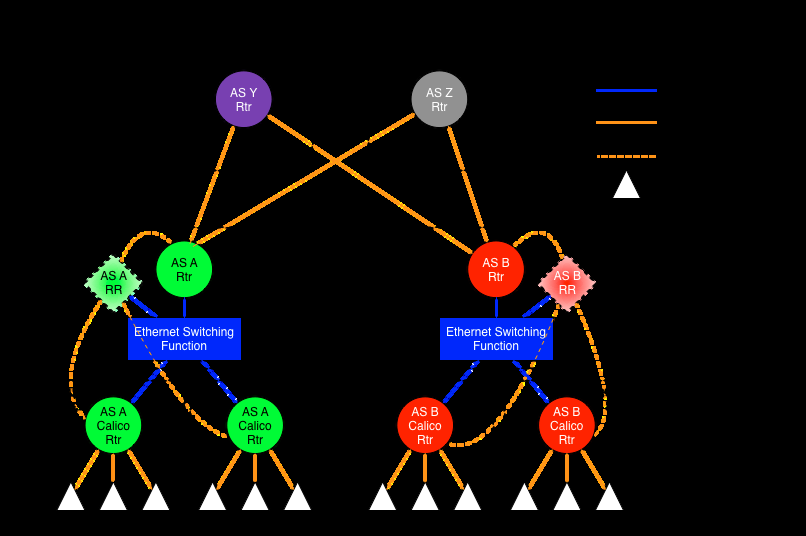

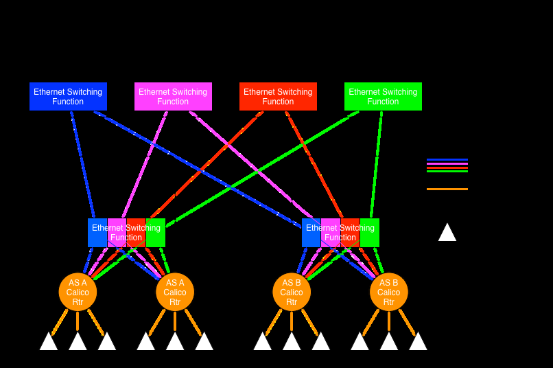

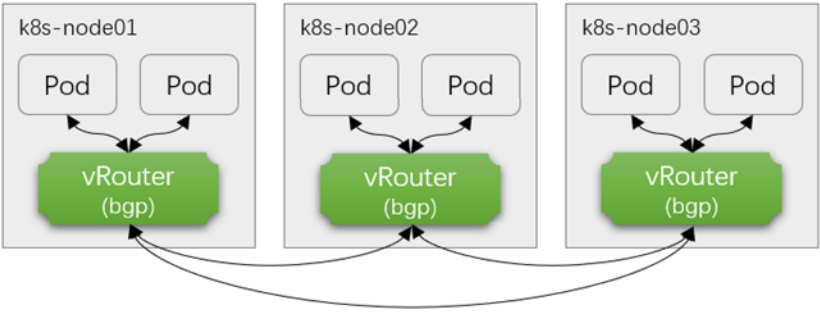

**BGP Pod 通信过程示例**

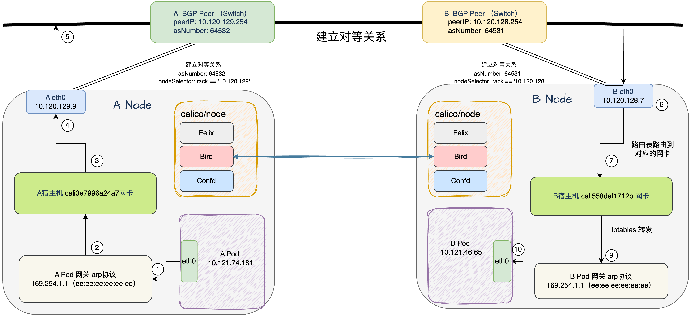

```text
A POD eth0 10.121.74.181 ----->A  POD 网关 ARP ----->  A 宿主机 cali3e7996a24a7网卡
----> 默认路由0.0.0.0 ----> A 宿主机 eth0 10.120.129.9  ----->  到达 B 宿主机 eth0
10.120.128.7 -----> 通过路由表 ip为 10.121.46.65 到达 B 宿主机 cali558def1712b网卡 通
过iptables 转发 ----->  B POD eth0 10.121.46.65
```

```text
#有bug
A POD eth0 10.121.74.181 ----->A  POD 网关 ARP ----->  A 宿主机 cali3e7996a24a7网卡
----> 默认路由0.0.0.0 ----> A eth0 10.120.129.9  ----->  A Node 网关 10.120.129.254
----->  B Node 网关 10.120.128.254   -----> 达到 B NODE eth0 10.120.128.7 ----->
通过路由表 ip为 10.121.46.65 到达 B 宿主机 cali558def1712b网卡 通过iptables 转发 -----
>  B POD eth0 10.121.46.65
```

不支持BGP的场景：

节点是跨网段，会因为目标地址找不到，而无法发送数据包阻止BGP报文的网络环境, 比如: 很多公有云不支持BGP对入站数据包强制执行源地址和目标地址的校验。

#### 3.1.3.2 IPIP

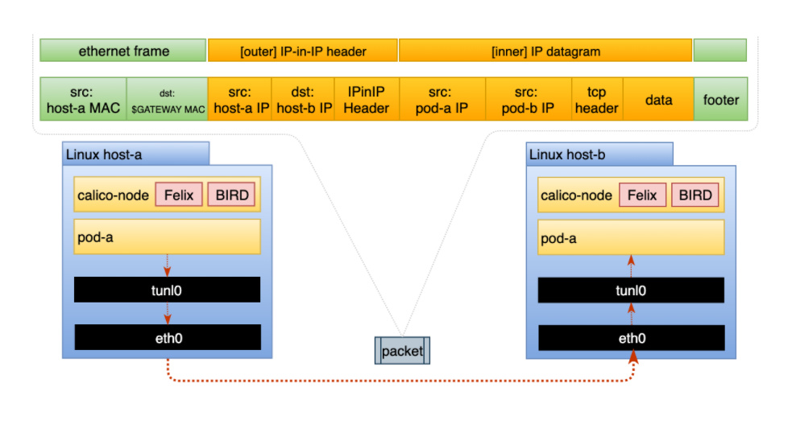

IPIP 是Calico的默认模式，生产使用较多。通过把一个IP数据包又套在另一个IP包里，即把IP层封装到IP层的一个 tunnel，实现两层IP头。IPIP模式仍然还需要使用BGP协议,实现生成当前节点到达其它节点的Pod所在子网的路由信息。在每个节点的路由表中每条目标地址 Pod所在子网的路由记录的网关指向Pod所在节点的IP,接口为隧道接口tunl0设备。

此模式因为报文结构更简洁,MTU默认为 1480（通过configmap/calico-config配置）, 因此相对VXLAN模式性能更好，

当 CALICO_IPV4POOL_IPIP 配置为 Cross-Subnet,表示同一网络使用BGP,跨网段时才启用IPIP。

**Pod 通信流程示例**

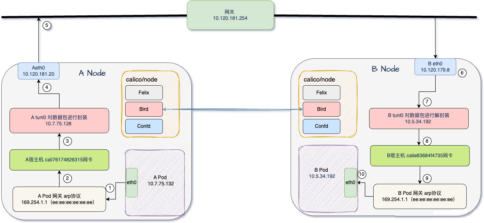

```text
A POD eth0 10.7.75.132 -----> A POD 网关 -----> A 宿主机 cali76174826315网卡 ----->
A tunl0 10.7.75.128 封装 ----> A eth0 10.120.181.20 -----> 通过网关 10.120.181.254
-----> 下一跳 B NODE eth0 10.120.179.8 解封装 -----> B tunl0 10.5.34.192 -----> 路
由 B 宿主机 calie83684f4735 -----> B POD eth0 10.5.34.192
```

不支持IPIP的场景：

禁止使用IPIP协议的网络, 比如: Azure阻止BGP报文的网络环境。

#### 3.1.3.3  IPIP with BGP

IPIP  还实现了这样一种类似于 flannel的 VXLAN with directrouting的机制，支持一种 IPIP With BGP的方式。

即当CALICO_IPV4POOL_VXLAN配置为 Cross-Subnet时

如果是同一网段，就使用BGP如果不是同一网段，就用IPIP机制。

#### 3.1.3.4 VXLAN


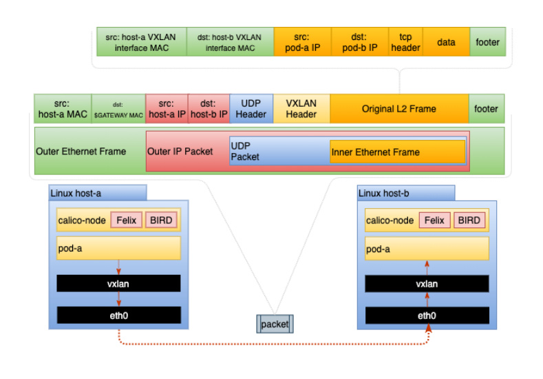

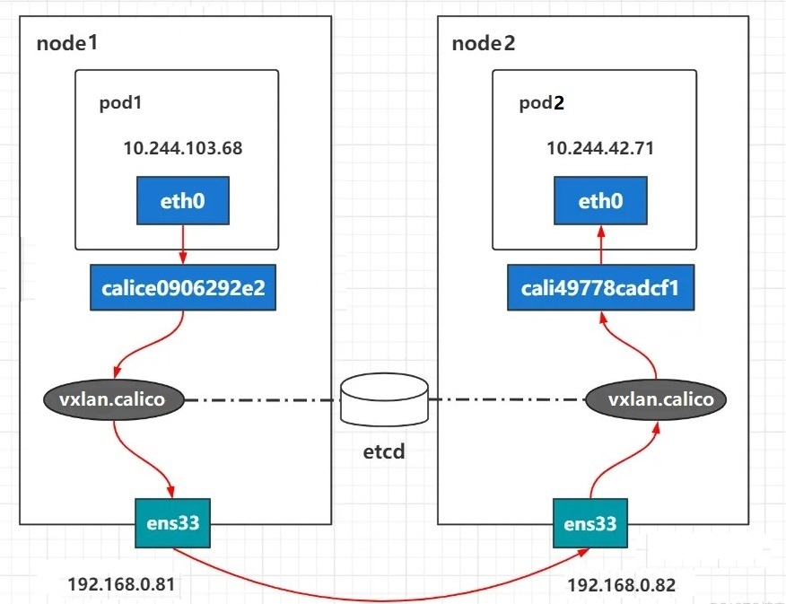

VXLAN 把数据包封装在UDP(4789端口)中，并使用物理网络的IP/MAC作为outer-header进行封装标识。然后在物理IP网上传输，根据标识到达目的地后, 由隧道终点对报文进行解封, 最终将数据发送给目标。VXLAN不依赖于BGP协议,功能强大。

Calico的VXLAN模式默认MTU设置为1450字节（通过configmap/calico-config 配置）,这是因为Calico在计算VXLAN封装的开销时，预留了更多的字节，以确保封装后的数据包不会超过底层网络的标准MTU。封装的报文头较大和复杂, 因此性能较差,但功能更多。

具体计算如下：

标准以太网的MTU为1500字节。VXLAN封装通常会增加50字节的开销。Calico默认预留90字节的封装开销，以适应不同的网络环境和可能的附加协议开销。Calico的VXLAN模式不需要BGP生成路由表,而使用VXLAN隧道自身来维护的路由表实现。

VXLAN（Virtual Extensible LAN）是一种覆盖网络技术，它在现有的三层网络之上构建了一个虚拟的二层网络，使得连接在这个VXLAN网络上的主机（无论是虚拟机还是容器）可以像在同一个局域网内一样自由通信。在VXLAN模式下，Calico通过在源节点上的VTEP（VXLAN Tunnel Endpoint）将Pod发出的以太网帧封装在VXLAN报文中，并通过三层网络传输到目标节点的VTEP，目标节点的VTEP解封报文并将原始的以太网帧转发给目标Pod。

VXLAN模式不依赖于BGP协议来传播路由信息，因为它使用VXLAN隧道来封装和传输数据包，而不是通过BGP协议来控制路由的传播。因此，即使在没有BGP的环境中，VXLAN模式也可以工作。VXLAN模式适用于需要跨越不同三层网络（如不同的子网或VLAN）实现Pod之间通信的场景。在VXLAN模式下，Calico会为每个节点创建一个vxlan.calico设备，用于VXLAN的封装和解封装工作，而不需要BGP的参与

每个节点的路由记录了到达其它节点的Pod所在网段的路由信息。网关指向Pod网络所在节点的vxlan.calico的接口地址,接口为当前本机的vxlan.calico接口。

#### 3.1.3.5 VXLAN With BGP

VXLAN 还实现了这样一种类似于 flannel的 VXLAN with directrouting的机制，支持一种 Vxlan With BGP的方式。

即当CALICO_IPV4POOL_VXLAN配置为 Cross-Subnet时

如果是同一网段，就使用BGP如果不是同一网段，就用VXLAN机制。

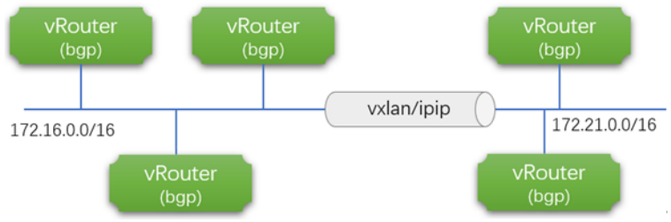

### 3.1.4 Calico 软件架构

参考资料：

```text
https://docs.projectcalico.org/reference/architecture/overview
```

由于Calico是一种纯三层的实现，因此可以避免与二层方案相关的数据包封装的操作，中间没有任何的NAT，没有任何的overlay，所以它的转发效率可能是所有方案中最高的，因为它的包直接走原生TCP/IP的协议栈，它的隔离也因为这个栈而变得容易实现。因为TCP/IP的协议栈提供了一整套的防火墙的规则，所以它可以通过IPTABLES的规则达到比较复杂的隔离逻辑。

#### 3.1.4.1 Calico 逻辑组件

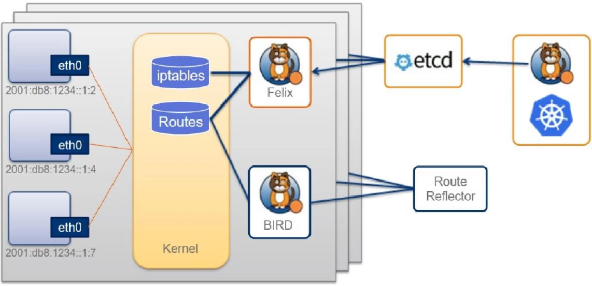

**组件解析**

Calico Agent，以Pod形式运行于每个节点，主要负责维护虚拟接口设备、路由信息、ACL并向etcd宣告状态等。

Felix

由kube-system名称空间的daemonset的calico-node提供,表现为节点的一个独立进程。负责分发路由信息BGP客户端，以Pod形式在每个节点，负责把 Felix 写入Kernel路由信息分发到整个 Calico网络。

BIRD

由kube-system名称空间的daemonset的calico-node提供,表现为节点的一个独立进程。etcd持久存储Calico数据(节点,网段,IP等)的存储系统，可以结合kube-apiserver来。

工作

Route Reflector BGP路由反射器(中央路由器,类似于HUB)，可选组件，可以集中式的动态生成。所有主机的路由表，用于较大规模的网络场景。

Calico编排系统

支持不同的编排系统（例如Kubernetes、OpenStack等）的插件，用于将

插件

Calico整合进行不同的系统中,例如Kubernetes的提供了CNI,实现更广范围的

Orchestrator

虚拟网络解决方案。

Plugin

Felix

运行在每一台host的Calico 的agent进程，主要负责网络接口管理和监听、路由规划、Iptables规则、ARP管理、ACL管理和同步、状态报告等。Felix会监听Etcd中心的存储，从它获取事件，比如说用户在这台机器上加了一个IP，或者是创建了一个容器等，用户创建Pod后，Felix负责将其网卡、IP、MAC都设置好，然后在内核的路由表里面写一条，注明这个IP应该到这张网卡。用户如果制定了隔离策略，Felix同样会将该策略创建到Iptables的ACL规则，以实现隔离。

注意：这里的网络策略规则是通过内核的iptables方式实现的。

Etcd

分布式键值存储，主要负责网络元数据一致性，确保Calico网络状态的准确性，可以与Kubernetes共用。ETCD相当于所有calico节点的通信总线，也是calico对接到到其他编排系统的通信总线。少于 50节点可以结合 kube-apiserver 来实现数据的存储。多于 50节点可以使用独立的ETCD集群来进行处理,但无法使用RBAC实现安全控制。

BIRD

Calico为每一台host部署一个BGP Client，使用BIRD实现。

BIRD是一个单独的持续发展的项目，实现了众多动态路由协议比如：BGP、OSPF、RIP等。BIRD监听Host上由Felix注入的路由信息，然后通过BGP协议广播告诉剩余Host节点，从而实现网络互通。BIRD是一个标准的路由程序，它会从内核里面获取哪一些IP的路由发生了变化，然后通过标准BGP的路由协议扩散到整个其他的宿主机上，让外界都知道这个IP网段在这主机，你们路由的时候得到这里来。

Route Reflector

在大型网络规模中，如果仅仅使用BGP Client形成mesh全网互联的方案就会导致规模限制，因为所有节点之间两两互连，需要N^2个连接，为了解决这个规模问题，可以采用BGP的Route Reflector的方法，使所有BGP Client仅与特定RR节点互连并做路由同步，从而大大减少连接数。

注意：以下内容不属于calico的组成部分

每个灰色的背景就是一个边缘自治worker节点，里面有很多工作中的pod对象每个pod对象不同于flannel通过一对虚拟网卡连接到cni0，而是直接连接到内核中借助于内核中的iptables 和 routers路由表来完成转发的功能。

#### 3.1.4.2  Calico 软件组件

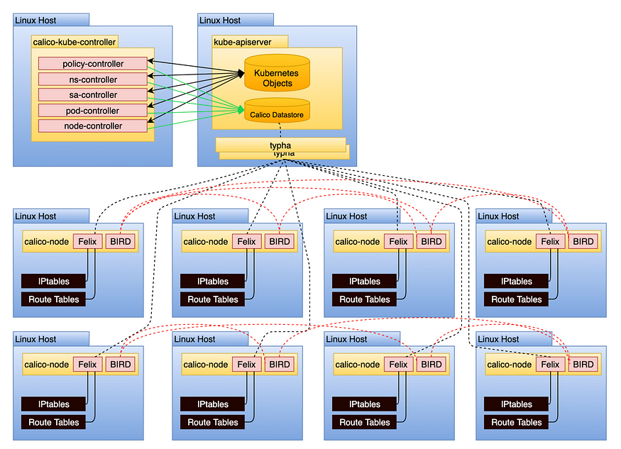

calico-kube-controller

控制器, 实现网络策略功能,支持calico相关的CRD资源。表现在为kube-system空间中的deployment。

calico Datastore

可以基于API Server或者独立的ETCD来存储的Calico配置、路由、策略及其它信息，它们通常表现为Calico CRD资源对象。虽然支持将数据保存在集群外独立的ETCD来减少API Server压力,但因为其复杂和安全性(不支持RBAC)并不建议此方式。而Calico 一般将数据保存在Kube-apiserver中,但是可以利用typha减轻访问压力。

支持的CRD包括BGPConfiguration、BGPFilter、BGPPeer、BlockAffinity、CalicoNodeStatus、ClusterInformation、FelixConfiguration、GlobalNetworkPolicy、GlobalNetworkSet、HostEndpoint、IPAMBlock、IPAMConfig、IPAMHandle、IPPool、IPReservation、NetworkPolicy、NetworkSet和KubeControllersConfiguration等

常用的CRD功能说明

**BGPConfguration**：全局BGP配置，用于设定AS(自治系统)编号、node mesh，以及用于通告CusterIP的设置。

FelixConfiguration:  Felix相关的低级别配置，包括iptables、MTU和路由协议等GlobalNetworkPolicy:  全局网络策略，生效于整个集群级别GlobalNetworkSet:  全局网络集，是指可由GlobalNetworkPolicy引用的外部网络IP列表或CIDR列表IPPool:  Pod所在IP地址池及相关选项，包括要使用的路由协议(IPIP、VXLAN或Native);一个集群支持使用多个Pool。

calico-node:

以daemonset类型的 pod 在每个主机上运行, 提供 Felix 和 BIRD 组件, 同时维护iptables的相关规则。

**Typha**：可选

各calico-node实例同Calico Datastore通信的中间层，由其负责将Calico Datastore中生成的更改信息分发给各calico-node，以减轻较大规模集群中的Calico Datastore的负载,具有缓存功能，且能够通过删除重复事件，降低系统负载。如果没有 Calico-Typha，每个 calico-node 都必须向 API 服务器注册自己的监视，并且随着节点数量的增加，API 服务器上的负载会成倍增加。 有了 Typha，所有监视事件都会由 Typha 实现，并且只从 API 服务器读取一次。因此，如果集群规模超过50个节点以上,建议可以使用Typha。

Typha 以 deployment 方式运行，replicas 数量根据节点数决定，一般每200个节点对应一个Typha，但Typha副本最多不超过20个。

## 3.2 Calico 部署和管理

### 3.2.1 部署流程说明

参考资料：

```text
https://docs.projectcalico.org/getting-started/kubernetes/quickstart
https://docs.tigera.io/calico/latest/getting-started/kubernetes/requirements
```

注意:如果要使用calico，必须要提前将 flannel 删除，然后再安装calico。因为对于kubernetes的cni同时只支持一个网络插件。

对于calico在k8s集群上的部署上面提到的四个组件，这里会涉及到两个组件。

组件名组件作用

calico-node需要部署到所有集群节点上的代理守护进程，提供封装好的Felix和BIRD。

calico-kube-

专用于k8s上对calico所有节点管理的中央控制器。负责calico与k8s集群的协。

controller

同及calico核心功能实现。

部署思路

calico的官方对于k8s集群上的环境部署，提供了三种方式：

小于50节点大于50节点专属的etcd节点

部署方法

Calico  operator

Calico 由 operator安装，该 operator管理 Calico 集群的安装、升级和一般生命周期。operator作为部署直接安装在集群上，并通过一个或多个自定义 Kubernetes API 资源进行配置。

Calico manifests

Calico 也可以使用原始清单manifests作为操作器的替代方案进行安装。manifests包含在 Kubernetes 集群中每个节点上安装 Calico 所需的资源。不建议使用manifests清单，因为它们无法像操作器那样自动管理 Calico 的生命周期。但是，manifests清单对于需要对底层 Kubernetes 资源进行高度特定修改的集群可能很有用。

参考资料：

```text
https://docs.projectcalico.org/getting-started/kubernetes/self-managed-
onprem/onpremises
https://projectcalico.docs.tigera.io/getting-started/kubernetes/self-managed-
onprem/onpremises
```

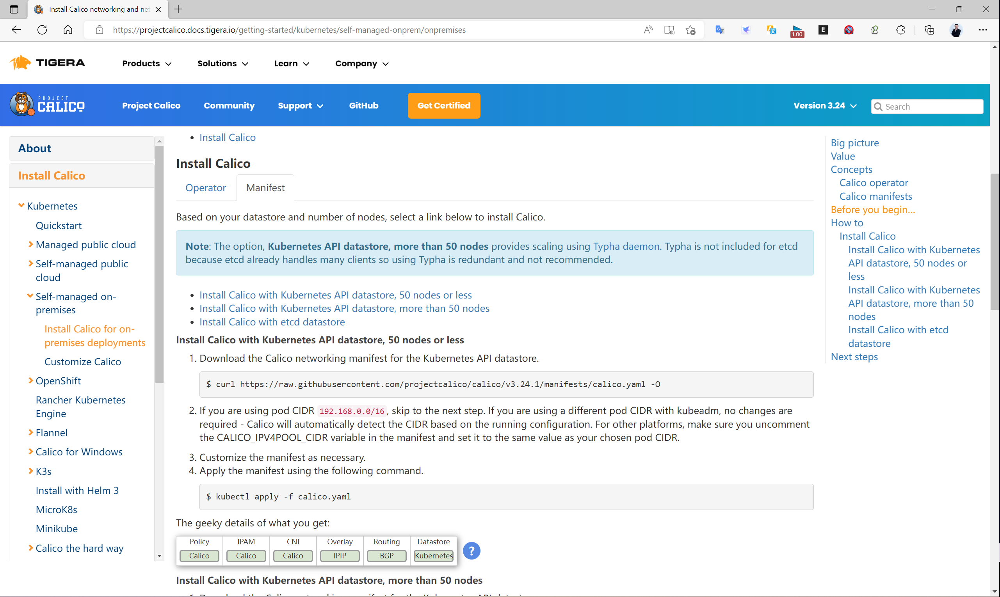

这里采用第一种，小于50节点的场景。

部署步骤

清理无关的网络其他插件

获取资源配置文件

从calico官网获取相关的配置信息。

定制CIDR配置

定制calico自身对于pod网段的配置信息。

**定制pod的manifest文件分配网络配置**

默认的k8s集群在启动的时候，会有一个cidr的配置，有可能与calico进行冲突，需要进行修改。

应用资源配置文件

注意事项：

对于calico来说，它自己会生成自己的路由表，如果路由表中存在相应的记录，默认情况下会直接使用，而不是覆盖掉当前主机的路由表。所以如果在部署calico之前，曾经使用过其它网络插件,比如flannel，尤其是flannel的host-gw模式，一定要注意，在使用calico之前，将之前所有的路由表信息清空，否则无法看到calico的tunl的封装效果。

### 3.2.2 部署 Calico 案例: 使用默认配置IPIP模式

#### 3.2.2.1 清理之前的网络插件（可选）

如果之前部署过其它网络插件，需要清理干净，Kubernetes 不允许同时多个网络插件存在。

```text
#清理之前的flannel插件
[root@master1 ~]#kubectl delete -f kube-flannel.yml
```

```text
#确认flannel的相关Pod被删除
[root@master1 ~]#kubectl get pod -n kube-system | grep flannel
```

```text
#先清除旧网卡，然后重启一下主机，直接清空所有的路由表信息
[root@master1 ~]#reboot
```

```text
#重启后，查看网络效果
[root@master1 ~]#ip a
1: lo: <LOOPBACK,UP,LOWER_UP> mtu 65536 qdisc noqueue state UNKNOWN group
default qlen 1000
link/loopback 00:00:00:00:00:00 brd 00:00:00:00:00:00
inet 127.0.0.1/8 scope host lo
valid_lft forever preferred_lft forever
inet6 ::1/128 scope host
valid_lft forever preferred_lft forever
2: eth0: <BROADCAST,MULTICAST,UP,LOWER_UP> mtu 1500 qdisc fq_codel state UP
group default qlen 1000
link/ether 00:0c:29:56:15:a2 brd ff:ff:ff:ff:ff:ff
inet 10.0.0.101/24 brd 10.0.0.255 scope global eth0
valid_lft forever preferred_lft forever
inet6 fe80::20c:29ff:fe56:15a2/64 scope link
valid_lft forever preferred_lft forever
3: docker0: <NO-CARRIER,BROADCAST,MULTICAST,UP> mtu 1500 qdisc noqueue state
DOWN group default
link/ether 02:42:13:00:f2:cd brd ff:ff:ff:ff:ff:ff
inet 172.17.0.1/16 brd 172.17.255.255 scope global docker0
valid_lft forever preferred_lft forever
```

#### 3.2.2.2 下载和修改calico 清单文件

**查看calico版本的k8s 版本的兼容性**

```text
https://projectcalico.docs.tigera.io/getting-started/kubernetes/requirements
```

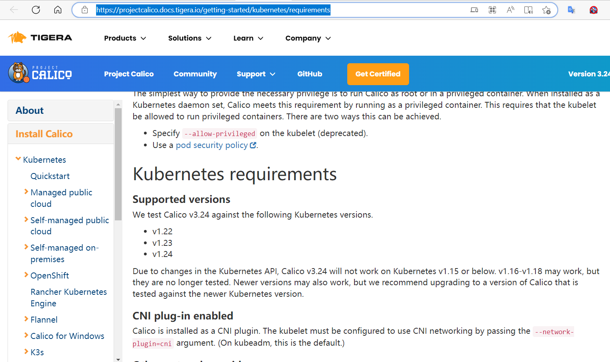

**查看安装方法**

```text
https://docs.tigera.io/calico/latest/getting-started/kubernetes/self-managed-
onprem/onpremises
https://docs.tigera.io/calico/latest/getting-started/kubernetes/self-managed-
onprem/onpremises#install-calico-with-kubernetes-api-datastore-50-nodes-or-less
```

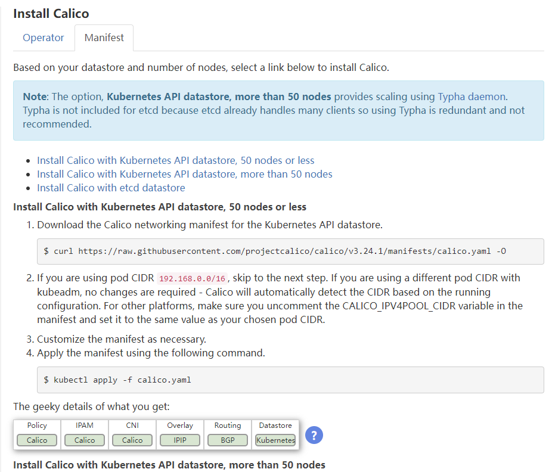

范例:  选择少于50个节点以内的Manifest 清单部署方式使用官方默认的配置文件

```text
#下载最新版本的yaml文件
[root@master1 ~]#curl
https://raw.githubusercontent.com/projectcalico/calico/master/manifests/calico.y
aml -O
[root@master1 ~]#wget https://docs.projectcalico.org/manifests/calico.yaml
```

```text
#指定下载版本
CALICO_VERSION=v3.29.1
#CALICO_VERSION=v3.28.0
#CALICO_VERSION=v3.27.3
#CALICO_VERSION=v3.26.1
#CALICO_VERSION=v3.24.1
```

```text
#加速下载
#50节点以下
https://raw.githubusercontent.com/projectcalico/calico/v3.31.0/manifests/calico.
yaml
#50节点以上
https://raw.githubusercontent.com/projectcalico/calico/v3.31.0/manifests/calico-
typha.yaml
```

```text
[root@master1 ~]#wget -O calico-${CALICO_VERSION=}.yaml
https://mirror.ghproxy.com/https://raw.githubusercontent.com/projectcalico/calic
o/${CALICO_VERSION=}/manifests/calico.yaml
#正常下载
[root@master1 ~]#curl
https://raw.githubusercontent.com/projectcalico/calico/${CALICO_VERSION=}/manife
sts/calico.yaml -Lo calico-${CALICO_VERSION=}.yaml
[root@master1 ~]#curl
https://raw.githubusercontent.com/projectcalico/calico/${CALICO_VERSION=}/manife
sts/calico.yaml -O
```

```text
#可以直接使用原文件，如果修改可以先备份原文件(可选)
[root@master1 ~]#cp calico.yaml calico.yaml.bak
```

```text
#可以直接使用原来的flannel的网络配置，测试环境也可以做下面配置修改CIDR，(可选)
[root@master1 ~]# vim calico.yaml
#官网推荐的修改内容(基于kubeadm安装可不做修改,其它安装方式,需要修改，可选)
#1)指定Pod的网段,如果使用当前默认配置，即保留当前注释,Pod的IP将使用安装k8s时的--pod-
network-cidr选项指定IP网段(可选)
- name: CALICO_IPV4POOL_CIDR #删除注释可以覆盖安装k8s时的--pod-network-
cidr选项，使用指定Pod网段
value: "192.168.0.0/16"   #默认值为value: "192.168.0.0/16"
```

```text
#2)开放默认注释的CALICO_IPV4POOL_CIDR变量，此处改为24,生产环境可不用修改，当前为测试环境建议
修改
#默认没有下面内容,手动加下面两行,调大单个节点上的Pod所在网段,默认使用/26,即255.255.255.192的
子网掩码，每个节点只有62个Pod的地址
- name: CALICO_IPV4POOL_BLOCK_SIZE
value: "24"
```

```text
#3)是否启用IPIP或VXLAN,注意,两者互斥,不能同时启用，默认启用IPIP(可选)
#value 可以支持Always（启用），Never（禁用），Cross-Subnet（表示同一网络使用BGP,跨网段时才
启用IPIP或VXLAN）
#当IPIP和VXLAN都为Never时，表示使用BGP，要求所有节点不能跨网段，才能使用此方式
# Enable IPIP
- name: CALICO_IPV4POOL_IPIP
```

```text
value: "Always"  #此项修改为"Cross-Subnet",表示同一网络使用BGP,跨网段时才启用IPIP,但
XvLAN必须为Never
# Enable or Disable VXLAN on the default IP pool.
- name: CALICO_IPV4POOL_VXLAN
value: "Never"   #此项修改为"Cross-Subnet",表示同一网络使用BGP,跨网段时才启用VXLAN,
但IPIP必须为Never
```

```text
#4)BGP 使用地址自动探测,默认值不用修改,如何有多块网卡,需要指定哪个网卡的IP用于BGP通信（可选）
containers
env
.....
# Auto-detect the BGP IP address.
- name: IP
value: "autodetect"
```

#### 3.2.2.3 定制 Docker 镜像地址

从2024年6月开始，docker hub官网从国内无法访问，因此修改镜像地址。

```text
#查看默认的镜像文件
[root@master1 ~]#grep image: calico.yaml
image: docker.io/calico/cni:v3.29.1
image: docker.io/calico/cni:v3.29.1
image: docker.io/calico/node:v3.29.1
image: docker.io/calico/node:v3.29.1
image: docker.io/calico/kube-controllers:v3.29.1
```

```text
[root@master1 ~]#grep docker.io calico.yaml
image: docker.io/calico/cni:v3.22.0
image: docker.io/calico/cni:v3.22.0
image: docker.io/calico/pod2daemon-flexvol:v3.22.0
image: docker.io/calico/node:v3.22.0
image: docker.io/calico/kube-controllers:v3.22.0
```

```text
#修改为定制的镜像
#新版docker
[root@master1 ~]#sed -i 's@docker.io/calico/@registry.cn-
beijing.aliyuncs.com/wangxiaochun/@g' calico-v3.29.1.yaml
[root@master1 ~]#sed -i 's@docker.io/calico/@registry.cn-
beijing.aliyuncs.com/wangxiaochun/@g' calico-v3.28.0.yaml
```

```text
#旧版
[root@master1 ~]#sed -i 's#docker.io/calico#harbor.wang.org/google_containers#g'
calico.yaml
```

```text
#查看效果
#新版
[root@master1 ~]#grep image: calico-v3.29.1.yaml
image: registry.cn-beijing.aliyuncs.com/wangxiaochun/cni:v3.29.1
image: registry.cn-beijing.aliyuncs.com/wangxiaochun/cni:v3.29.1
image: registry.cn-beijing.aliyuncs.com/wangxiaochun/node:v3.29.1
image: registry.cn-beijing.aliyuncs.com/wangxiaochun/node:v3.29.1
image: registry.cn-beijing.aliyuncs.com/wangxiaochun/kube-
controllers:v3.29.1
```

```text
[root@master1 ~]#grep image: calico-v3.28.0.yaml
image: registry.cn-beijing.aliyuncs.com/wangxiaochun/cni:v3.28.0
image: registry.cn-beijing.aliyuncs.com/wangxiaochun/cni:v3.28.0
image: registry.cn-beijing.aliyuncs.com/wangxiaochun/node:v3.28.0
image: registry.cn-beijing.aliyuncs.com/wangxiaochun/node:v3.28.0
image: registry.cn-beijing.aliyuncs.com/wangxiaochun/kube-
controllers:v3.28.0
```

```text
#旧版
[root@master1 ~]## grep google calico.yaml
image: harbor.wang.org/google_containers/cni:v3.22.0
image: harbor.wang.org/google_containers/cni:v3.22.0
image: harbor.wang.org/google_containers/pod2daemon-flexvol:v3.22.0
image: harbor.wang.org/google_containers/node:v3.22.0
image: harbor.wang.org/google_containers/kube-controllers:v3.22.0
```

#### 3.2.2.4 应用官方清单文件实现安装Calico

范例: 使用官方默认文件的网络配置不做修改

```text
[root@master1 ~]#kubectl  get crd
No resources found
```

```text
[root@master1 ~]#kubectl  api-resources |wc -l
59
```

```text
#应用calico插件
[root@master1 ~]#kubectl apply -f calico.yaml
```

```text
#查看master和worker节点的镜像有三个
[root@master1 ~]#docker images  |grep calico|awk '{print $1,$2,$NF}'
calico/cni v3.22.0 236MB
calico/pod2daemon-flexvol v3.22.0 21.4MB
calico/node v3.22.0 213MB
```

```text
#只有一个节点有kube-controllers镜像,其它节点都只有三个
[root@node1 ~]#docker images  |grep calico|awk '{print $1,$2,$NF}'
calico/kube-controllers v3.22.0 132MB
calico/cni v3.22.0 236MB
calico/pod2daemon-flexvol v3.22.0 21.4MB
calico/node v3.22.0 213MB
```

```text
#环境部署完毕后，查看效果
[root@master1 ~]#kubectl get pod -n kube-system | egrep 'NAME|calico'
NAME                                         READY   STATUS    RESTARTS
AGE
calico-kube-controllers-6fd7b9848d-7wtvh     1/1     Running   0
11m
calico-node-5rfrl                            1/1     Running   0
11m
calico-node-8624w                            1/1     Running   0
11m
calico-node-g4tcn                            1/1     Running   0
11m
calico-node-hgwd9                            1/1     Running   0
11m
```

```text
calico-node-msjqp                            1/1     Running   0
11m
calico-node-tbh9k                            1/1     Running   0
11m
```

```text
#自动生成一个api版本信息,calico部署完毕后，会生成一系列的自定义配置属性信息
[root@master1 ~]#kubectl api-versions  | grep crd
crd.projectcalico.org/v1
```

```text
#查看生成CRD
[root@master1 ~]#kubectl get crds
NAME                                                  CREATED AT
bgpconfigurations.crd.projectcalico.org               2021-09-17T12:20:14Z
bgppeers.crd.projectcalico.org                        2021-09-17T12:20:14Z
blockaffinities.crd.projectcalico.org                 2021-09-17T12:20:14Z
caliconodestatuses.crd.projectcalico.org              2021-09-17T12:20:14Z
clusterinformations.crd.projectcalico.org             2021-09-17T12:20:14Z
felixconfigurations.crd.projectcalico.org             2021-09-17T12:20:14Z
globalnetworkpolicies.crd.projectcalico.org           2021-09-17T12:20:14Z
globalnetworksets.crd.projectcalico.org               2021-09-17T12:20:14Z
hostendpoints.crd.projectcalico.org                   2021-09-17T12:20:14Z
ipamblocks.crd.projectcalico.org                      2021-09-17T12:20:14Z
ipamconfigs.crd.projectcalico.org                     2021-09-17T12:20:15Z
ipamhandles.crd.projectcalico.org                     2021-09-17T12:20:15Z
ippools.crd.projectcalico.org                         2021-09-17T12:20:15Z
ipreservations.crd.projectcalico.org                  2021-09-17T12:20:15Z
kubecontrollersconfigurations.crd.projectcalico.org   2021-09-17T12:20:15Z
networkpolicies.crd.projectcalico.org                 2021-09-17T12:20:15Z
networksets.crd.projectcalico.org                     2021-09-17T12:20:15Z
```

```text
#发现添加20个资源
[root@master1 ~]#kubectl  api-resources |wc -l
79
```

```text
#该api版本信息中有的CRD资源
[root@master1 ~]#kubectl api-resources --api-group=crd.projectcalico.org
NAME                            SHORTNAMES   APIVERSION
NAMESPACED   KIND
bgpconfigurations                            crd.projectcalico.org/v1   false
BGPConfiguration
bgppeers                                     crd.projectcalico.org/v1   false
BGPPeer
blockaffinities                              crd.projectcalico.org/v1   false
BlockAffinity
caliconodestatuses                           crd.projectcalico.org/v1   false
CalicoNodeStatus
clusterinformations                          crd.projectcalico.org/v1   false
ClusterInformation
felixconfigurations                          crd.projectcalico.org/v1   false
FelixConfiguration
globalnetworkpolicies                        crd.projectcalico.org/v1   false
GlobalNetworkPolicy
globalnetworksets                            crd.projectcalico.org/v1   false
GlobalNetworkSet
hostendpoints                                crd.projectcalico.org/v1   false
HostEndpoint
ipamblocks                                   crd.projectcalico.org/v1   false
IPAMBlock
```

```text
ipamconfigs                                  crd.projectcalico.org/v1   false
IPAMConfig
ipamhandles                                  crd.projectcalico.org/v1   false
IPAMHandle
ippools                                      crd.projectcalico.org/v1   false
IPPool
ipreservations                               crd.projectcalico.org/v1   false
IPReservation
kubecontrollersconfigurations                crd.projectcalico.org/v1   false
KubeControllersConfiguration
networkpolicies                              crd.projectcalico.org/v1   true
NetworkPolicy
networksets                                  crd.projectcalico.org/v1   true
NetworkSet
NetworkSet
```

```text
#上面自定义资源,如下面的控制器进行控制
[root@master1 ~]#kubectl get pod -n kube-system |grep calico
calico-kube-controllers-5d6f95db4f-czg7z   1/1     Running   0
5h48m
calico-node-687qb                          1/1     Running   0
5h48m
calico-node-ddp56                          1/1     Running   0
5h48m
calico-node-strl2                          1/1     Running   0
5h48m
calico-node-wdh75                          1/1     Running   0
5h48m
```

```text
#节点状态正常
[root@master1 ~]#kubectl  get nodes
NAME               STATUS   ROLES           AGE    VERSION
master1.wang.org   Ready    control-plane   160d   v1.30.2
node1.wang.org     Ready    <none>          160d   v1.30.2
node2.wang.org     Ready    <none>          160d   v1.30.2
node3.wang.org     Ready    <none>          160d   v1.30.2
```

```text
#ippools自定义资源
[root@master1 ~]#kubectl get  ippools
NAME                  AGE
default-ipv4-ippool   10m
```

```text
[root@master1 ~]#kubectl get  ippools.crd.projectcalico.org default-ipv4-ippool
-o yaml
apiVersion: crd.projectcalico.org/v1
kind: IPPool
metadata:
annotations:
projectcalico.org/metadata: '{"uid":"d756dce9-6384-427d-bfa6-
35ffa4625640","creationTimestamp":"2023-07-11T10:05:42Z"}'
creationTimestamp: ""
generation: 1
name: default-ipv4-ippool
resourceVersion: "4403"
uid: fa62275f-ccc6-4a61-97d9-809605c5a89d
spec:
allowedUses:
```

```text
- Workload
- Tunnel
blockSize: 26            #默认24位
cidr: 10.244.0.0/16      #Pod默认使用集群初始化时--pod-network-cidr选项指定的网段
ipipMode: Always
natOutgoing: true
nodeSelector: all()
vxlanMode: Never
```

#### 3.2.2.5 创建 Pod 测试效果

范例：查看网卡和路由的信息

```text
#查看每个Node的Pod的网段,但实际上Calico自行定义子网,并没有使用此网段
[root@master1 ~]#kubectl get nodes -o yaml|grep -E 'podCIDR:|hostname'
kubernetes.io/hostname: master1.wang.org
podCIDR: 10.244.0.0/24
kubernetes.io/hostname: node1.wang.org
podCIDR: 10.244.2.0/24
kubernetes.io/hostname: node2.wang.org
podCIDR: 10.244.1.0/24
kubernetes.io/hostname: node3.wang.org
podCIDR: 10.244.3.0/24
```

```text
[root@master1 calico]#kubectl get nodes -o yaml|grep -A3 spec
spec:
podCIDR: 10.244.0.0/24
podCIDRs:
- 10.244.0.0/24
--
spec:
podCIDR: 10.244.2.0/24
podCIDRs:
- 10.244.2.0/24
--
spec:
podCIDR: 10.244.1.0/24
podCIDRs:
- 10.244.1.0/24
--
spec:
podCIDR: 10.244.3.0/24
podCIDRs:
- 10.244.3.0/24
```

```text
#查看实际使用的子网网段
[root@master1 ~]#kubectl get ipamhandles.crd.projectcalico.org -o yaml |grep -A1
block: | sort |uniq
--
10.244.144.0/24: 1
10.244.163.0/24: 1
10.244.213.0/24: 1
10.244.23.0/24: 1
block:
```

```text
#创建Pod，观察结果
```

```text
[root@master1 ~]#kubectl create deployment myapp --image registry.cn-
beijing.aliyuncs.com/wangxiaochun/pod-test:v0.1 --replicas 6
```

```text
#观察到同一个节点的Pod使用相同的网段IP
[root@master1 ~]#kubectl get pod -o wide |awk 'NR>1{print $7,$6}' |sort
node1.wang.org 10.244.101.129
node1.wang.org 10.244.101.130
node2.wang.org 10.244.36.1
node2.wang.org 10.244.36.2
node3.wang.org 10.244.168.196
node3.wang.org 10.244.168.197
```

```text
#发现Calico并不使用Node节点指令的网段,而是自主分配
[root@master1 ~]#kubectl get pod -o wide
NAME                    READY   STATUS    RESTARTS   AGE   IP               NODE
NOMINATED NODE   READINESS GATES
myapp-6b59f8f86-2t2bn   1/1     Running   0          65s   10.244.36.1
node2.wang.org   <none>           <none>
myapp-6b59f8f86-7q7k4   1/1     Running   0          65s   10.244.168.197
node3.wang.org   <none>           <none>
myapp-6b59f8f86-dtcql   1/1     Running   0          65s   10.244.36.2
node2.wang.org   <none>           <none>
myapp-6b59f8f86-lvsx9   1/1     Running   0          65s   10.244.168.196
node3.wang.org   <none>           <none>
myapp-6b59f8f86-mfdn8   1/1     Running   0          65s   10.244.101.129
node1.wang.org   <none>           <none>
myapp-6b59f8f86-w6gll   1/1     Running   0          65s   10.244.101.130
node1.wang.org   <none>           <none>
```

```text
#每个Pod所在节点自动会生成对应的calixxxx的网卡，且此网卡的MAC都为ee:ee:ee:ee:ee:ee
#环境创建完毕后，会生成一个tunl0的网卡，所有的流量会走这个tunl0网卡
[root@node1 ~]#ip a
1: lo: <LOOPBACK,UP,LOWER_UP> mtu 65536 qdisc noqueue state UNKNOWN group
default qlen 1000
link/loopback 00:00:00:00:00:00 brd 00:00:00:00:00:00
inet 127.0.0.1/8 scope host lo
valid_lft forever preferred_lft forever
inet6 ::1/128 scope host
valid_lft forever preferred_lft forever
2: eth0: <BROADCAST,MULTICAST,UP,LOWER_UP> mtu 1500 qdisc fq_codel state UP
group default qlen 1000
link/ether 00:0c:29:2e:29:f3 brd ff:ff:ff:ff:ff:ff
altname enp2s1
altname ens33
inet 10.0.0.201/24 brd 10.0.0.255 scope global eth0
valid_lft forever preferred_lft forever
inet6 fe80::20c:29ff:fe2e:29f3/64 scope link
valid_lft forever preferred_lft forever
3: docker0: <NO-CARRIER,BROADCAST,MULTICAST,UP> mtu 1500 qdisc noqueue state
DOWN group default
link/ether 02:42:6e:5b:1d:3e brd ff:ff:ff:ff:ff:ff
inet 172.17.0.1/16 brd 172.17.255.255 scope global docker0
valid_lft forever preferred_lft forever
4: tunl0@NONE: <NOARP,UP,LOWER_UP> mtu 1480 qdisc noqueue state UNKNOWN group
default qlen 1000
link/ipip 0.0.0.0 brd 0.0.0.0
inet 10 2 scope global tunl0
valid_lft forever preferred_lft forever
```

```text
7: cali2ad752e56a1@if4: <BROADCAST,MULTICAST,UP,LOWER_UP> mtu 1480 qdisc noqueue
state UP group default qlen 1000
link/ether ee:ee:ee:ee:ee:ee brd ff:ff:ff:ff:ff:ff link-netnsid 0
inet6 fe80::ecee:eeff:feee:eeee/64 scope link
valid_lft forever preferred_lft forever
8: cali47ddc65abff@if4: <BROADCAST,MULTICAST,UP,LOWER_UP> mtu 1480 qdisc noqueue
state UP group default qlen 1000
link/ether ee:ee:ee:ee:ee:ee brd ff:ff:ff:ff:ff:ff link-netnsid 1
inet6 fe80::ecee:eeff:feee:eeee/64 scope link
valid_lft forever preferred_lft forever
```

```text
#tunl0 是一个虚拟网络接口，不支持 ethtool -i 操作
[root@node1 ~]#ethtool -i tunl0
Cannot get driver information: Operation not supported
```

```text
[root@node1 ~]#ip addr show tunl0
4: tunl0@NONE: <NOARP,UP,LOWER_UP> mtu 1480 qdisc noqueue state UNKNOWN group
default qlen 1000
link/ipip 0.0.0.0 brd 0.0.0.0
inet 10.244.23.0/32 scope global tunl0
valid_lft forever preferred_lft forever
```

```text
#每个Pod在宿主机上生成veth的网卡对
[root@node1 ~]#ethtool -i cali2ad752e56a1
driver: veth
version: 1.0
firmware-version:
expansion-rom-version:
bus-info:
supports-statistics: yes
supports-test: no
supports-eeprom-access: no
supports-register-dump: no
supports-priv-flags: no
```

```text
#查看和Pod的对应编号
[root@node1 ~]#ethtool -S cali13251176854
NIC statistics:
peer_ifindex: 4             #对应Pod网卡编号
rx_queue_0_xdp_packets: 0
rx_queue_0_xdp_bytes: 0
rx_queue_0_drops: 0
rx_queue_0_xdp_redirect: 0
rx_queue_0_xdp_drops: 0
rx_queue_0_xdp_tx: 0
rx_queue_0_xdp_tx_errors: 0
tx_queue_0_xdp_xmit: 0
tx_queue_0_xdp_xmit_errors: 0
```

```text
#和flannel不同,calico不会生成新的网桥
[root@node1 ~]#brctl show
bridge name bridge id       STP enabled interfaces
docker0     8000.0242fd8a2fc8   no
```

```text
#当前主机上的每个Pod对应一条/32的路由
[root@node1 ~]#route -n
Kernel IP routing table
```

```text
Destination     Gateway         Genmask         Flags Metric Ref    Use Iface
0.0.0.0         10.0.0.2        0.0.0.0         UG    0      0        0 eth0
10.0.0.0        0.0.0.0         255.255.255.0   U     0      0        0 eth0
10.244.36.0     10.0.0.202      255.255.255.192 UG    0      0        0 tunl0
10.244.53.64    10.0.0.200      255.255.255.192 UG    0      0        0 tunl0
10.244.101.128  0.0.0.0         255.255.255.192 U     0      0        0 *
10.244.101.129  0.0.0.0         255.255.255.255 UH    0      0        0
cali2ad752e56a1
10.244.101.130  0.0.0.0         255.255.255.255 UH    0      0        0
cali47ddc65abff
10.244.168.192  10.0.0.203      255.255.255.192 UG    0      0        0 tunl0
172.17.0.0      0.0.0.0         255.255.0.0     U     0      0        0 docker0
```

```text
#查看节点上calixxxx的网卡信息
[root@node1 ~]#ethtool -i cali2ad752e56a1
driver: veth
version: 1.0
firmware-version:
expansion-rom-version:
bus-info:
supports-statistics: yes
supports-test: no
supports-eeprom-access: no
supports-register-dump: no
supports-priv-flags: no
```

```text
[root@node1 ~]#ethtool -S cali2ad752e56a1
NIC statistics:
peer_ifindex: 4              #对应Pod的4号网卡
rx_queue_0_xdp_packets: 0
rx_queue_0_xdp_bytes: 0
rx_queue_0_drops: 0
rx_queue_0_xdp_redirect: 0
rx_queue_0_xdp_drops: 0
rx_queue_0_xdp_tx: 0
rx_queue_0_xdp_tx_errors: 0
tx_queue_0_xdp_xmit: 0
tx_queue_0_xdp_xmit_errors: 0
```

```text
#进入Pod查看网卡信息
[root@master1 ~]#kubectl exec -it myapp-6b59f8f86-mfdn8 -- sh
```

```text
#安装ethtool工具
[root@myapp-6b59f8f86-mfdn8 /]# apk add ethtool
#查看网卡信息
[root@myapp-6b59f8f86-mfdn8 /]# ip a
1: lo: <LOOPBACK,UP,LOWER_UP> mtu 65536 qdisc noqueue state UNKNOWN group
default qlen 1000
link/loopback 00:00:00:00:00:00 brd 00:00:00:00:00:00
inet 127.0.0.1/8 scope host lo
valid_lft forever preferred_lft forever
2: tunl0@NONE: <NOARP> mtu 1480 qdisc noop state DOWN group default qlen 1000
link/ipip 0.0.0.0 brd 0.0.0.0
#Pod内的4号网卡对应节点的7号网卡
4: eth0@if7: <BROADCAST,MULTICAST,UP,LOWER_UP> mtu 1480 qdisc noqueue state UP
group default qlen 1000
link/ether 4e:a9:cf:b0:59:f9 brd ff:ff:ff:ff:ff:ff link-netnsid 0
inet 10.244.101.129/32 scope global eth0
```

```text
valid_lft forever preferred_lft forever
```

```text
[root@myapp-6b59f8f86-mfdn8 /]# ethtool -i eth0
driver: veth
version: 1.0
firmware-version:
expansion-rom-version:
bus-info:
supports-statistics: yes
supports-test: no
supports-eeprom-access: no
supports-register-dump: no
supports-priv-flags: no
```

```text
[root@myapp-6b59f8f86-mfdn8 /]# ethtool -S eth0
NIC statistics:
peer_ifindex: 7            #对应节点的7号网卡
rx_queue_0_xdp_packets: 0
rx_queue_0_xdp_bytes: 0
rx_queue_0_drops: 0
rx_queue_0_xdp_redirect: 0
rx_queue_0_xdp_drops: 0
rx_queue_0_xdp_tx: 0
rx_queue_0_xdp_tx_errors: 0
tx_queue_0_xdp_xmit: 0
tx_queue_0_xdp_xmit_errors: 0
```

```text
[root@myapp-6b59f8f86-mfdn8 /]# route -n
Kernel IP routing table
Destination     Gateway         Genmask         Flags Metric Ref    Use Iface
0.0.0.0         169.254.1.1     0.0.0.0         UG    0      0        0 eth0
169.254.1.1     0.0.0.0         255.255.255.255 UH    0      0        0 eth0
```

#### 3.2.2.6 Pod 网络通信分析

范例：tcpdump抓包分析

```text
#由于在calico的默认网络模型是 IPIP，所以在进行Pod之间的数据包测试的时候，可以通过直接抓取宿主
机数据包，来发现双层ip效果
[root@master1 ~]#kubectl run pod-client --image=registry.cn-
beijing.aliyuncs.com/wangxiaochun/admin-box:v0.1 -it --rm --command -- /bin/bash
```

```text
#如果在同一个节点的Pod间通信,也需要路由一跳通信,说明同一个节点的Pod间通信也是需要跨路由的,即每
一个Pod都需要有一条路由记录
[root@myapp-547df679bb-7gjlh /]# ping -c1 10.244.163.231
PING 10.244.163.231 (10.244.163.231): 56 data bytes
64 bytes from 10.244.163.231: seq=0 ttl=63 time=0.416 ms
```

```text
--- 10.244.163.231 ping statistics ---
1 packets transmitted, 1 packets received, 0% packet loss
round-trip min/avg/max = 0.416/0.416/0.416 ms
```

```text
#如果在不同个节点的Pod间通信,路由需要2跳
[root@myapp-547df679bb-7gjlh /]# ping -c1 10.244.23.45
PING 10.244.23.45 (10.244.23.45): 56 data bytes
64 bytes from 10.244.23.45: seq=0 ttl=62 time=0.643 ms
```

```text
--- 10.244.23.45 ping statistics ---
1 packets transmitted, 1 packets received, 0% packet loss
round-trip min/avg/max = 0.643/0.643/0.643 ms
```

```text
root@pod-client /# ping 192.168.144.4
```

```text
#或者使用之前的Pod
[root@master1 ~]#kubectl exec -it myapp-7c47997446-8h99v -- /bin/sh
[root@myapp-7c47997446-8h99v /]# ping 192.168.144.4
```

```text
[root@master1 ~]#kubectl get pod -o wide |awk '{print $1,$2,$6,$7}'
NAME READY IP NODE
myapp-7c47997446-8h99v 1/1 192.168.23.4 node1.wang.org
myapp-7c47997446-p9tn8 1/1 192.168.144.4 node2.wang.org
myapp-7c47997446-zx2rd 1/1 192.168.163.5 node3.wang.org
```

```text
#抓包观察
[root@node2 ~]#tcpdump  -i eth0 -nn -vvv ip host 10.0.0.104 and host 10.0.0.105
tcpdump: verbose output suppressed, use -v or -vv for full protocol decode
listening on eth0, link-type EN10MB (Ethernet), capture size 262144 bytes
12:16:35.240634 IP 10.0.0.104 > 10.0.0.105: IP 192.168.23.4 > 192.168.144.4:
ICMP echo request, id 6656, seq 0, length 64 (ipip-proto-4)
12:16:35.240844 IP 10.0.0.105 > 10.0.0.104: IP 192.168.144.4 > 192.168.23.4:
ICMP echo reply, id 6656, seq 0, length 64 (ipip-proto-4)
12:16:36.240975 IP 10.0.0.104 > 10.0.0.105: IP 192.168.23.4 > 192.168.144.4:
ICMP echo request, id 6656, seq 1, length 64 (ipip-proto-4)
12:16:36.241130 IP 10.0.0.105 > 10.0.0.104: IP 192.168.144.4 > 192.168.23.4:
ICMP echo reply, id 6656, seq 1, length 64 (ipip-proto-4)
12:16:37.241220 IP 10.0.0.104 > 10.0.0.105: IP 192.168.23.4 > 192.168.144.4:
ICMP echo request, id 6656, seq 2, length 64 (ipip-proto-4)
12:16:37.241349 IP 10.0.0.105 > 10.0.0.104: IP 192.168.144.4 > 192.168.23.4:
ICMP echo reply, id 6656, seq 2, length 64 (ipip-proto-4)
12:16:38.241473 IP 10.0.0.104 > 10.0.0.105: IP 192.168.23.4 > 192.168.144.4:
ICMP echo request, id 6656, seq 3, length 64 (ipip-proto-4)
12:16:38.241595 IP 10.0.0.105 > 10.0.0.104: IP 192.168.144.4 > 192.168.23.4:
ICMP echo reply, id 6656, seq 3, length 64 (ipip-proto-4)
```

```text
#结果显示：
每个数据包都是基于双层ip嵌套的方式来进行传输，而且协议是 ipip-proto-4
结合路由的分发详情，可以看到具体的操作效果。
具体效果：192.168.23.4 -> 10.0.0.104 -> 10.0.0.105 -> 192.168.144.4
```

```text
[root@node1 ~]#tcpdump  -i eth0 -nn -vvv ip host 10.0.0.201 and host 10.0.0.202
tcpdump: listening on eth0, link-type EN10MB (Ethernet), snapshot length 262144
bytes
14:45:07.745422 IP (tos 0x0, ttl 63, id 5475, offset 0, flags [DF], proto IPIP
(4), length 80)
10.0.0.201 > 10.0.0.202: IP (tos 0x0, ttl 63, id 31692, offset 0, flags
[DF], proto TCP (6), length 60)
192.168.23.2.52676 > 192.168.144.3.80: Flags [S], cksum 0xab9c (correct),
seq 2731853996, win 64800, options [mss 1440,sackOK,TS val 3752943032 ecr
0,nop,wscale 7], length 0
14:45:07.746048 IP (tos 0x0, ttl 63, id 6018, offset 0, flags [DF], proto IPIP
(4), length 80)
10.0.0.202 > 10.0.0.201: IP (tos 0x0, ttl 63, id 0, offset 0, flags [DF],
proto TCP (6), length 60)
```

```text
192.168.144.3.80 > 192.168.23.2.52676: Flags [S.], cksum 0xb241 (correct),
seq 3643199396, ack 2731853997, win 64260, options [mss 1440,sackOK,TS val
1306330301 ecr 3752943032,nop,wscale 7], length 0
14:45:07.746158 IP (tos 0x0, ttl 63, id 5476, offset 0, flags [DF], proto IPIP
(4), length 72)
10.0.0.201 > 10.0.0.202: IP (tos 0x0, ttl 63, id 31693, offset 0, flags
[DF], proto TCP (6), length 52)
192.168.23.2.52676 > 192.168.144.3.80: Flags [.], cksum 0xda02 (correct),
seq 1, ack 1, win 507, options [nop,nop,TS val 3752943033 ecr 1306330301],
length 0
14:45:07.746276 IP (tos 0x0, ttl 63, id 5477, offset 0, flags [DF], proto IPIP
(4), length 149)
10.0.0.201 > 10.0.0.202: IP (tos 0x0, ttl 63, id 31694, offset 0, flags
[DF], proto TCP (6), length 129)
192.168.23.2.52676 > 192.168.144.3.80: Flags [P.], cksum 0x3f94 (correct),
seq 1:78, ack 1, win 507, options [nop,nop,TS val 3752943033 ecr 1306330301],
length 77: HTTP, length: 77
GET / HTTP/1.1
Host: 192.168.144.3
User-Agent: curl/7.67.0
Accept: */*
14:45:07.746607 IP (tos 0x0, ttl 63, id 6019, offset 0, flags [DF], proto IPIP
(4), length 72)
10.0.0.202 > 10.0.0.201: IP (tos 0x0, ttl 63, id 2398, offset 0, flags [DF],
proto TCP (6), length 52)
192.168.144.3.80 > 192.168.23.2.52676: Flags [.], cksum 0xd9ba (correct),
seq 1, ack 78, win 502, options [nop,nop,TS val 1306330301 ecr 3752943033],
length 0
14:45:07.749036 IP (tos 0x0, ttl 63, id 6020, offset 0, flags [DF], proto IPIP
(4), length 89)
10.0.0.202 > 10.0.0.201: IP (tos 0x0, ttl 63, id 2399, offset 0, flags [DF],
proto TCP (6), length 69)
192.168.144.3.80 > 192.168.23.2.52676: Flags [P.], cksum 0x19da (correct),
seq 1:18, ack 78, win 502, options [nop,nop,TS val 1306330304 ecr 3752943033],
length 17: HTTP, length: 17
HTTP/1.0 200 OK
```

范例：wireshark 抓包查看通信过程

```text
#创建Pod
[root@master1 ~]#kubectl create deployment myapp --image registry.cn-
beijing.aliyuncs.com/wangxiaochun/pod-test:v0.1 --replicas 6
```

```text
[root@master1 ~]#kubectl get pod -o wide
NAME                    READY   STATUS    RESTARTS   AGE   IP               NODE
NOMINATED NODE   READINESS GATES
myapp-6b59f8f86-2t2bn   1/1     Running   0          65s   10.244.36.1
node2.wang.org   <none>           <none>
myapp-6b59f8f86-7q7k4   1/1     Running   0          65s   10.244.168.197
node3.wang.org   <none>           <none>
myapp-6b59f8f86-dtcql   1/1     Running   0          65s   10.244.36.2
node2.wang.org   <none>           <none>
myapp-6b59f8f86-lvsx9   1/1     Running   0          65s   10.244.168.196
node3.wang.org   <none>           <none>
myapp-6b59f8f86-mfdn8   1/1     Running   0          65s   10.244.101.129
node1.wang.org   <none>           <none>
```

```text
myapp-6b59f8f86-w6gll   1/1     Running   0          65s   10.244.101.130
node1.wang.org   <none>           <none>
```

```text
#在节点网卡上抓包，可以观察跨节点Pod间的通信过程
[root@master1 ~]#kubectl exec -it myapp-6b59f8f86-mfdn8 -- sh
[root@myapp-6b59f8f86-mfdn8 /]# curl 10.244.36.1
kubernetes pod-test v0.1!! ClientIP: 10.244.101.129, ServerName: myapp-
6b59f8f86-2t2bn, ServerIP: 10.244.36.1!
#访问同一个节点的其它Pod，由于在calixxxx网卡直接通信，不走节点网卡，所以在节点网卡抓不到包
[root@myapp-6b59f8f86-mfdn8 /]# curl  10.244.101.130
kubernetes pod-test v0.1!! ClientIP: 10.244.101.129, ServerName: myapp-
6b59f8f86-w6gll, ServerIP: 10.244.101.130!
```

```text
#观察如下显示结果
```

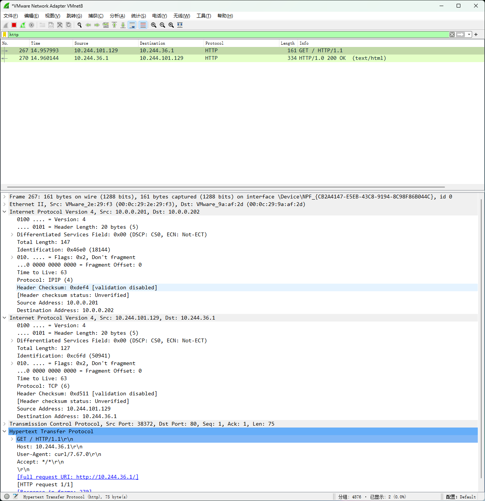

### 3.2.3 部署 Calico 案例:  修改默认配置使用指定Pod的网段

范例: 修改默认配置,指定Pod的网段为24位

```text
[root@master1 ~]# vim calico.yaml
4223             - name: CALICO_IPV4POOL_CIDR #取消两行注释,可以覆盖安装k8s时的--pod-
network-cidr选项
```

```text
4224               value: "192.168.0.0/16"   #默认值为value: "192.168.0.0/16"
#手动加下面两行,调大单个节点上的Pod所在网段,默认是/26,即每个节点只有62个Pod的地址
4225             - name: CALICO_IPV4POOL_BLOCK_SIZE
4226               value: "24"
```

```text
#应用calico插件
[root@master1 ~]# kubectl apply -f calico.yaml
```

```text
#查看master和worker节点的镜像有三个
[root@master1 ~]#docker images  |grep calico|awk '{print $1,$2,$NF}'
calico/cni v3.22.0 236MB
calico/pod2daemon-flexvol v3.22.0 21.4MB
calico/node v3.22.0 213MB
```

```text
#只有一个节点有kube-controllers镜像,其它节点都只有三个
[root@node1 ~]#docker images  |grep calico|awk '{print $1,$2,$NF}'
calico/kube-controllers v3.22.0 132MB
calico/cni v3.22.0 236MB
calico/pod2daemon-flexvol v3.22.0 21.4MB
calico/node v3.22.0 213MB
```

```text
#环境部署完毕后，查看效果
[root@master1 ~]#kubectl get pod -n kube-system | egrep 'NAME|calico'
NAME                                         READY   STATUS    RESTARTS
AGE
calico-kube-controllers-6fd7b9848d-7wtvh     1/1     Running   0
11m
calico-node-5rfrl                            1/1     Running   0
11m
calico-node-8624w                            1/1     Running   0
11m
calico-node-g4tcn                            1/1     Running   0
11m
calico-node-hgwd9                            1/1     Running   0
11m
calico-node-msjqp                            1/1     Running   0
11m
calico-node-tbh9k                            1/1     Running   0
11m
```

```text
#查看路由表,注意接口为tunl0
[root@master1 ~]#route -n
内核 IP 路由表
目标            网关            子网掩码        标志  跃点   引用  使用 接口
0.0.0.0         10.0.0.2        0.0.0.0         UG    0      0        0 eth0
10.0.0.0        0.0.0.0         255.255.255.0   U     0      0        0 eth0
172.17.0.0      0.0.0.0         255.255.0.0     U     0      0        0 docker0
192.168.23.0    10.0.0.104      255.255.255.0   UG    0      0        0 tunl0
192.168.25.0    10.0.0.102      255.255.255.0   UG    0      0        0 tunl0
192.168.144.0   10.0.0.105      255.255.255.0   UG    0      0        0 tunl0
192.168.163.0   10.0.0.106      255.255.255.0   UG    0      0        0 tunl0
192.168.213.0   0.0.0.0         255.255.255.0   U     0      0        0 *
192.168.216.0   10.0.0.103      255.255.255.0   UG    0      0        0 tunl0
```

```text
[root@master1 ~]#ip a
1: lo: <LOOPBACK,UP,LOWER_UP> mtu 65536 qdisc noqueue state UNKNOWN group
default qlen 1000
```

```text
link/loopback 00:00:00:00:00:00 brd 00:00:00:00:00:00
inet 127.0.0.1/8 scope host lo
valid_lft forever preferred_lft forever
inet6 ::1/128 scope host
valid_lft forever preferred_lft forever
2: eth0: <BROADCAST,MULTICAST,UP,LOWER_UP> mtu 1500 qdisc fq_codel state UP
group default qlen 1000
link/ether 00:0c:29:56:15:a2 brd ff:ff:ff:ff:ff:ff
inet 10.0.0.101/24 brd 10.0.0.255 scope global eth0
valid_lft forever preferred_lft forever
inet6 fe80::20c:29ff:fe56:15a2/64 scope link
valid_lft forever preferred_lft forever
3: docker0: <NO-CARRIER,BROADCAST,MULTICAST,UP> mtu 1500 qdisc noqueue state
DOWN group default
link/ether 02:42:c9:85:b5:f6 brd ff:ff:ff:ff:ff:ff
inet 172.17.0.1/16 brd 172.17.255.255 scope global docker0
valid_lft forever preferred_lft forever
4: tunl0@NONE: <NOARP,UP,LOWER_UP> mtu 1480 qdisc noqueue state UNKNOWN group
default qlen 1000
link/ipip 0.0.0.0 brd 0.0.0.0
inet 192.168.213.0/32 scope global tunl0
valid_lft forever preferred_lft forever
```

```text
[root@master1 ~]# kubectl get crd
```

```text
#CRD中的ippools 里面包含了calico相关的网络属性信息
[root@master1 ~]# kubectl get ippools
NAME                  AGE
default-ipv4-ippool   18m
```

```text
#查看这里配置的calico相关的信息
[root@master1 ~]#kubectl get ippools  default-ipv4-ippool -o yaml
apiVersion: crd.projectcalico.org/v1
kind: IPPool
metadata:
annotations:
projectcalico.org/metadata: '{"uid":"e498638c-b5b7-42ad-9458-
a33f99943f95","creationTimestamp":"2021-03-29T08:23:11Z"}'
creationTimestamp: "2021-03-29T08:23:11Z"
generation: 1
name: default-ipv4-ippool
resourceVersion: "1640"
uid: ca9a6b92-5ab4-429f-8c55-cbebbe56538b
spec:
allowedUses:
- Workload
- Tunnel
blockSize: 24             #修改为24位
cidr: 192.168.0.0/16      #指定Pod使用网段,覆盖集群初始化时--pod-network-cidr选项指定
的网段
ipipMode: Always
natOutgoing: true
nodeSelector: all()
vxlanMode: Never
```

```text
#结果显示：calico采用的模型就是 ipip模型，分配的网段是使定制的 cidr网段，而且子网段也是定制的
24位掩码。
```

### 3.2.4 部署 Calico 案例: 使用 IPIP Cross-Subnet 配置实现IPIP with BGP模式

默认总是使用IPIP叠加网络,性能不佳,可修改为Cross-Subnet ,实现Pod通信时节点间在同一网段用BGP,不同网段才使用IPIP。

```text
#方法1
#删除原有的网络
[root@master1 ~]# kubectl delete -f calico.yaml
#修改配置
[root@master1 ~]# vim calico.yaml
# Enable IPIP
- name: CALICO_IPV4POOL_IPIP
#value: "Always"
value: "Cross-Subnet"  #此项修改为Cross-Subnet或者CrossSubnet,表示Pod在同一网段
使用BGP,跨网段时才启用IPIP,但不能VxLAN同时启用
# Enable or Disable VXLAN on the default IP pool.
- name: CALICO_IPV4POOL_VXLAN
value: "Never"        #此项修改为"Cross-Subnet",表示Pod在同一网段使用BGP,跨网段时
才启用VXLAN,但不能IPIP同时启用
```

```text
#应用配置
[root@master1 ~]#kubectl apply -f calico.yaml
#查看可能没有成功
[root@master1 ~]#kubectl get ippools  default-ipv4-ippool -o yaml
```

```text
#方法2
[root@master1 ~]#kubectl edit ippools.crd.projectcalico.org default-ipv4-ippool
#ipipMode: Always
ipipMode: CrossSubnet   # Always修改为CrossSubnet
```

```text
#方法3:如果第1种方式有问题,可以使用此方式
#查看配置生成配置文件
[root@master1 ~]#kubectl get ippools  default-ipv4-ippool.yaml-o yaml > default-
ipv4-ippool.yaml
```

```text
#修改
[root@master1 ~]#vim default-ipv4-ippool.yaml
#删除timestamp,generation,uid信息
#修改ipipMode:
ipipMode: CrossSubnet #支持Always|CrossSubnet|Never三个值
```

```text
#应用配置生效
[root@master1 ~]#kubectl apply -f default-ipv4-ippool.yaml
```

```text
#查看路由表,注意接口为eth0,说明直接路由
[root@master1 ~]#route -n
内核 IP 路由表
目标            网关            子网掩码        标志  跃点   引用  使用 接口
0.0.0.0         10.0.0.2        0.0.0.0         UG    0      0        0 eth0
10.0.0.0        0.0.0.0         255.255.255.0   U     0      0        0 eth0
172.17.0.0      0.0.0.0         255.255.0.0     U     0      0        0 docker0
192.168.23.0    10.0.0.104      255.255.255.0   UG    0      0        0 eth0
192.168.25.0    10.0.0.102      255.255.255.0   UG    0      0        0 eth0
192.168.144.0   10.0.0.105      255.255.255.0   UG    0      0        0 eth0
192.168.163.0   10.0.0.106      255.255.255.0   UG    0      0        0 eth0
```

```text
192.168.213.0   0.0.0.0         255.255.255.0   U     0      0        0 *
192.168.216.0   10.0.0.103      255.255.255.0   UG    0      0        0 eth0
```

```text
[root@master1 ~]#kubectl delete deployments.apps myapp
[root@master1 ~]#kubectl create deployment myapp --image registry.cn-
beijing.aliyuncs.com/wangxiaochun/pod-test:v0.1 --replicas=3
```

```text
[root@master1 ~]#kubectl get pod  -o wide
NAME                              READY   STATUS    RESTARTS   AGE   IP
NODE             NOMINATED NODE   READINESS GATES
myapp-7c47997446-jrbwl   1/1     Running   0          32s   192.168.23.1
node1.wang.org   <none>           <none>
myapp-7c47997446-vq6vt   1/1     Running   0          32s   192.168.163.1
node3.wang.org   <none>           <none>
myapp-7c47997446-wmj6h   1/1     Running   0          32s   192.168.144.2
node2.wang.org   <none>           <none>
[root@master1 ~]#kubectl exec -it myapp-7c47997446-jrbwl -- sh
[root@myapp-7c47997446-jrbwl /]# ping 192.168.163.1
PING 192.168.163.1 (192.168.163.1): 56 data bytes
64 bytes from 192.168.163.1: seq=0 ttl=62 time=0.480 ms
[root@myapp-7c47997446-jrbwl /]# curl 192.168.163.1
```

```text
#抓包观察
[root@node2 ~]#tcpdump  -i eth0 -nn icmp
tcpdump: verbose output suppressed, use -v or -vv for full protocol decode
listening on eth0, link-type EN10MB (Ethernet), capture size 262144 bytes
12:25:53.953736 IP 192.168.23.1 > 192.168.163.1: ICMP echo request, id 3072, seq
26, length 64
12:25:53.953888 IP 192.168.163.1 > 192.168.23.1: ICMP echo reply, id 3072, seq
26, length 64
12:25:54.954269 IP 192.168.23.1 > 192.168.163.1: ICMP echo request, id 3072, seq
27, length 64
```

```text
[root@node2 ~]#tcpdump  -i eth0 -nn -vvv tcp port 80
tcpdump: listening on eth0, link-type EN10MB (Ethernet), snapshot length 262144
bytes
15:07:39.634858 IP (tos 0x0, ttl 63, id 6063, offset 0, flags [DF], proto TCP
(6), length 60)
192.168.23.1.52476 > 192.168.163.1.80: Flags [S], cksum 0x2885 (incorrect ->
0xc61b), seq 822640604, win 64800, options [mss 1440,sackOK,TS val 3754294921
ecr 0,nop,wscale 7], length 0
15:07:39.635665 IP (tos 0x0, ttl 63, id 0, offset 0, flags [DF], proto TCP (6),
length 60)
192.168.163.1.80 > 192.168.23.12.52476: Flags [S.], cksum 0x535d (correct),
seq 3257646885, ack 822640605, win 64260, options [mss 1440,sackOK,TS val
1307682182 ecr 3754294921,nop,wscale 7], length 0
15:07:39.635732 IP (tos 0x0, ttl 63, id 6064, offset 0, flags [DF], proto TCP
(6), length 52)
192.168.23.1.52476 > 192.168.163.1.80: Flags [.], cksum 0x287d (incorrect ->
0x7b1e), seq 1, ack 1, win 507, options [nop,nop,TS val 3754294922 ecr
1307682182], length 0
15:07:39.635815 IP (tos 0x0, ttl 63, id 6065, offset 0, flags [DF], proto TCP
(6), length 129)
```

```text
192.168.23.1.52476 > 192.168.163.1.80: Flags [P.], cksum 0x28ca (incorrect -
> 0xe0af), seq 1:78, ack 1, win 507, options [nop,nop,TS val 3754294922 ecr
1307682182], length 77: HTTP, length: 77
GET / HTTP/1.1
Host: 192.168.163.1
User-Agent: curl/7.67.0
Accept: */*
```

```text
#在worker节点查看路由表
[root@node1 ~]#route -n
内核 IP 路由表
目标            网关            子网掩码        标志  跃点   引用  使用 接口
0.0.0.0         10.0.0.2        0.0.0.0         UG    0      0        0 eth0
10.0.0.0        0.0.0.0         255.255.255.0   U     0      0        0 eth0
172.17.0.0      0.0.0.0         255.255.0.0     U     0      0        0 docker0
192.168.23.0    0.0.0.0         255.255.255.0   U     0      0        0 *
192.168.23.1    0.0.0.0         255.255.255.255 UH    0      0        0
cali01aad30a3bf
192.168.23.2    0.0.0.0         255.255.255.255 UH    0      0        0
cali545684cf79f
192.168.25.0    10.0.0.102      255.255.255.0   UG    0      0        0 eth0
192.168.144.0   10.0.0.105      255.255.255.0   UG    0      0        0 eth0
192.168.163.0   10.0.0.106      255.255.255.0   UG    0      0        0 eth0
192.168.213.0   10.0.0.101      255.255.255.0   UG    0      0        0 eth0
192.168.216.0   10.0.0.103      255.255.255.0   UG    0      0        0 eth0
```

```text
[root@node2 ~]#route -n
内核 IP 路由表
目标            网关            子网掩码        标志  跃点   引用  使用 接口
0.0.0.0         10.0.0.2        0.0.0.0         UG    0      0        0 eth0
10.0.0.0        0.0.0.0         255.255.255.0   U     0      0        0 eth0
172.17.0.0      0.0.0.0         255.255.0.0     U     0      0        0 docker0
192.168.23.0    10.0.0.104      255.255.255.0   UG    0      0        0 eth0
192.168.25.0    10.0.0.102      255.255.255.0   UG    0      0        0 eth0
192.168.144.0   0.0.0.0         255.255.255.0   U     0      0        0 *
192.168.144.1   0.0.0.0         255.255.255.255 UH    0      0        0
cali426e6b2189e
192.168.144.2   0.0.0.0         255.255.255.255 UH    0      0        0
cali9babb2670bc
192.168.144.3   0.0.0.0         255.255.255.255 UH    0      0        0
cali6bbe530865b
192.168.163.0   10.0.0.106      255.255.255.0   UG    0      0        0 eth0
192.168.213.0   10.0.0.101      255.255.255.0   UG    0      0        0 eth0
192.168.216.0   10.0.0.103      255.255.255.0   UG    0      0        0 eth0
```

```text
[root@node3 ~]#route -n
内核 IP 路由表
目标            网关            子网掩码        标志  跃点   引用  使用 接口
0.0.0.0         10.0.0.2        0.0.0.0         UG    0      0        0 eth0
10.0.0.0        0.0.0.0         255.255.255.0   U     0      0        0 eth0
172.17.0.0      0.0.0.0         255.255.0.0     U     0      0        0 docker0
192.168.23.0    10.0.0.104      255.255.255.0   UG    0      0        0 eth0
192.168.25.0    10.0.0.102      255.255.255.0   UG    0      0        0 eth0
192.168.144.0   10.0.0.105      255.255.255.0   UG    0      0        0 eth0
192.168.163.0   0.0.0.0         255.255.255.0   U     0      0        0 *
192.168.163.1   0.0.0.0         255.255.255.255 UH    0      0        0
cali069d8d6d6ad
```

```text
192.168.163.2   0.0.0.0         255.255.255.255 UH    0      0        0
calia9c36a0c90e
192.168.213.0   10.0.0.101      255.255.255.0   UG    0      0        0 eth0
192.168.216.0   10.0.0.103      255.255.255.0   UG    0      0        0 eth0
```

```text
#注意:Node1上的两个Pod对应上面的两个calixxx接口
[root@master1 ~]#kubectl get pod -A -o wide |grep node1
default       myapp-7c47997446-jrbwl            1/1     Running            0
7m29s   192.168.23.1    node1.wang.org     <none>           <none>
kube-system   coredns-8468f7cd6-bdpf7                    1/1     Running
1 (23m ago)     20d     192.168.23.2    node1.wang.org     <none>
<none>
```

### 3.2.5 部署 Calico 案例: 使用 BGP 配置BGP Native Routing模式

```text
#在线修改为BGP模式
[root@master1 ~]#kubectl edit ippools.crd.projectcalico.org default-ipv4-ippool
apiVersion: crd.projectcalico.org/v1
kind: IPPool
metadata:
annotations:
generation: 3
name: default-ipv4-ippool
resourceVersion: "2428730"
uid: 304c761c-d33e-4c22-a2f1-60fd629943a8
spec:
allowedUses:
- Workload
- Tunnel
blockSize: 24
cidr: 10.244.0.0/16
#ipipMode: Always
ipipMode: Never     #修改此行
natOutgoing: true
nodeSelector: all()
vxlanMode: Never
```

```text
#查看路由表已经生效
[root@node1 ~]#route -n
Kernel IP routing table
Destination     Gateway         Genmask         Flags Metric Ref    Use Iface
0.0.0.0         10.0.0.2        0.0.0.0         UG    0      0        0 eth0
10.0.0.0        0.0.0.0         255.255.255.0   U     0      0        0 eth0
10.244.23.0     0.0.0.0         255.255.255.0   U     0      0        0 *
10.244.23.90    0.0.0.0         255.255.255.255 UH    0      0        0
cali3d321aef9c7
10.244.23.91    0.0.0.0         255.255.255.255 UH    0      0        0
cali0e6b75291c2
10.244.23.92    0.0.0.0         255.255.255.255 UH    0      0        0
cali7f22771d9d2
10.244.23.93    0.0.0.0         255.255.255.255 UH    0      0        0
cali7f09440efda
10.244.23.94    0.0.0.0         255.255.255.255 UH    0      0        0
calid568e889c3c
10.244.23.95    0.0.0.0         255.255.255.255 UH    0      0        0
cali13251176854
```

```text
10.244.23.101   0.0.0.0         255.255.255.255 UH    0      0        0
cali25e96b97a8c
10.244.23.102   0.0.0.0         255.255.255.255 UH    0      0        0
cali8e36c4d65e6
10.244.23.103   0.0.0.0         255.255.255.255 UH    0      0        0
calid034cb34a92
10.244.144.0    10.0.0.202      255.255.255.0   UG    0      0        0 eth0
10.244.163.0    10.0.0.203      255.255.255.0   UG    0      0        0 eth0
10.244.213.0    10.0.0.200      255.255.255.0   UG    0      0        0 eth0
172.17.0.0      0.0.0.0         255.255.0.0     U     0      0        0 docker0
```

```text
#查看Pod
[root@master1 ~]#kubectl get pod -o wide
NAME                     READY   STATUS    RESTARTS   AGE   IP              NODE
NOMINATED NODE   READINESS GATES
myapp-547df679bb-2rtx6   1/1     Running   0          17m   10.244.163.26
node3.wang.org   <none>           <none>
myapp-547df679bb-kvjlt   1/1     Running   0          17m   10.244.144.1
node2.wang.org   <none>           <none>
myapp-547df679bb-phftk   1/1     Running   0          17m   10.244.23.103
node1.wang.org   <none>           <none>
```

```text
#跨主机通信
[root@master1 ~]#kubectl exec -it myapp-547df679bb-phftk -- sh
[root@myapp-547df679bb-phftk /]# curl 10.244.144.1
kubernetes pod-test v0.1!! ClientIP: 10.244.23.103, ServerName: myapp-
547df679bb-kvjlt, ServerIP: 10.244.144.1!
[root@myapp-547df679bb-phftk /]#
```

```text
#抓包分析,可以看到直接的路由通信
[root@node1 ~]#tcpdump -i eth0 -nn port 80
tcpdump: verbose output suppressed, use -v[v]... for full protocol decode
listening on eth0, link-type EN10MB (Ethernet), snapshot length 262144 bytes
17:43:42.252593 IP 10.244.23.103.49260 > 10.244.144.1.80: Flags [S], seq
2963939714, win 64800, options [mss 1440,sackOK,TS val 2172510891 ecr
0,nop,wscale 7], length 0
17:43:42.253024 IP 10.244.144.1.80 > 10.244.23.103.49260: Flags [S.], seq
114478910, ack 2963939715, win 64260, options [mss 1440,sackOK,TS val 3762915002
ecr 2172510891,nop,wscale 7], length 0
17:43:42.253102 IP 10.244.23.103.49260 > 10.244.144.1.80: Flags [.], ack 1, win
507, options [nop,nop,TS val 2172510892 ecr 3762915002], length 0
17:43:42.254686 IP 10.244.23.103.49260 > 10.244.144.1.80: Flags [P.], seq 1:77,
ack 1, win 507, options [nop,nop,TS val 2172510893 ecr 3762915002], length 76:
HTTP: GET / HTTP/1.1
17:43:42.255457 IP 10.244.144.1.80 > 10.244.23.103.49260: Flags [.], ack 77, win
502, options [nop,nop,TS val 3762915005 ecr 2172510893], length 0
17:43:42.256642 IP 10.244.144.1.80 > 10.244.23.103.49260: Flags [P.], seq 1:18,
ack 77, win 502, options [nop,nop,TS val 3762915006 ecr 2172510893], length 17:
HTTP: HTTP/1.0 200 OK
17:43:42.256746 IP 10.244.23.103.49260 > 10.244.144.1.80: Flags [.], ack 18, win
507, options [nop,nop,TS val 2172510896 ecr 3762915006], length 0
17:43:42.256968 IP 10.244.144.1.80 > 10.244.23.103.49260: Flags [FP.], seq
18:267, ack 77, win 502, options [nop,nop,TS val 3762915006 ecr 2172510893],
length 249: HTTP
17:43:42.257094 IP 10.244.23.103.49260 > 10.244.144.1.80: Flags [F.], seq 77,
ack 268, win 506, options [nop,nop,TS val 2172510896 ecr 3762915006], length 0
```

```text
17:43:42.257337 IP 10.244.144.1.80 > 10.244.23.103.49260: Flags [.], ack 78, win
502, options [nop,nop,TS val 3762915007 ecr 2172510896], length 0
```

### 3.2.6 部署 Calico 案例: 使用 VXLAN 模式

```text
#方法1
[root@master1 ~]#kubectl edit ippools.crd.projectcalico.org default-ipv4-ippool
.......
spec:
allowedUses:
- Workload
- Tunnel
blockSize: 24
cidr: 192.168.0.0/16
ipipMode: Never  #此处改为Never
natOutgoing: true
nodeSelector: all()
#vxlanMode: Never
vxlanMode: Always  #此处的Never改为Always,表示总是使用VXLAN,也可以为Cross-Subnet ,实
现Pod通信时同一网段用BGP,不同网段才使用VXLAN， 支持Always|CrossSubnet|Never三个值
```

```text
#方法2
[root@master1 ~]# vim calico.yaml
# Enable IPIP
- name: CALICO_IPV4POOL_IPIP
value: "Never"  #此项修改为Never,表示Pod启用VXLAN
# Enable or Disable VXLAN on the default IP pool.
- name: CALICO_IPV4POOL_VXLAN
value: "Always"        #此项修改为"Always",表示Pod启用VXLAN
#应用calico插件
[root@master1 ~]# kubectl apply -f calico.yaml
```

```text
#修改后立即生效,查看路由表如下
```

```text
[root@node1 ~]#ip a
1: lo: <LOOPBACK,UP,LOWER_UP> mtu 65536 qdisc noqueue state UNKNOWN group
default qlen 1000
link/loopback 00:00:00:00:00:00 brd 00:00:00:00:00:00
inet 127.0.0.1/8 scope host lo
valid_lft forever preferred_lft forever
inet6 ::1/128 scope host
valid_lft forever preferred_lft forever
2: eth0: <BROADCAST,MULTICAST,UP,LOWER_UP> mtu 1500 qdisc fq_codel state UP
group default qlen 1000
link/ether 00:0c:29:a3:42:3c brd ff:ff:ff:ff:ff:ff
altname enp2s1
altname ens33
inet 10.0.0.201/24 brd 10.0.0.255 scope global eth0
valid_lft forever preferred_lft forever
inet6 fe80::20c:29ff:fea3:423c/64 scope link
valid_lft forever preferred_lft forever
3: docker0: <NO-CARRIER,BROADCAST,MULTICAST,UP> mtu 1500 qdisc noqueue state
DOWN group default
link/ether 02:42:20:dd:f9:35 brd ff:ff:ff:ff:ff:ff
inet 172.17.0.1/16 brd 172.17.255.255 scope global docker0
valid_lft forever preferred_lft forever
```

```text
4: cali25e96b97a8c@if2: <BROADCAST,MULTICAST,UP,LOWER_UP> mtu 1450 qdisc noqueue
state UP group default qlen 1000
link/ether ee:ee:ee:ee:ee:ee brd ff:ff:ff:ff:ff:ff link-netnsid 0
inet6 fe80::ecee:eeff:feee:eeee/64 scope link
valid_lft forever preferred_lft forever
5: cali7f09440efda@if2: <BROADCAST,MULTICAST,UP,LOWER_UP> mtu 1450 qdisc noqueue
state UP group default qlen 1000
link/ether ee:ee:ee:ee:ee:ee brd ff:ff:ff:ff:ff:ff link-netnsid 1
inet6 fe80::ecee:eeff:feee:eeee/64 scope link
valid_lft forever preferred_lft forever
6: calid568e889c3c@if2: <BROADCAST,MULTICAST,UP,LOWER_UP> mtu 1450 qdisc noqueue
state UP group default qlen 1000
link/ether ee:ee:ee:ee:ee:ee brd ff:ff:ff:ff:ff:ff link-netnsid 2
inet6 fe80::ecee:eeff:feee:eeee/64 scope link
valid_lft forever preferred_lft forever
7: cali7f22771d9d2@if2: <BROADCAST,MULTICAST,UP,LOWER_UP> mtu 1450 qdisc noqueue
state UP group default qlen 1000
link/ether ee:ee:ee:ee:ee:ee brd ff:ff:ff:ff:ff:ff link-netnsid 3
inet6 fe80::ecee:eeff:feee:eeee/64 scope link
valid_lft forever preferred_lft forever
8: cali3d321aef9c7@if2: <BROADCAST,MULTICAST,UP,LOWER_UP> mtu 1450 qdisc noqueue
state UP group default qlen 1000
link/ether ee:ee:ee:ee:ee:ee brd ff:ff:ff:ff:ff:ff link-netnsid 4
inet6 fe80::ecee:eeff:feee:eeee/64 scope link
valid_lft forever preferred_lft forever
9: vxlan.calico: <BROADCAST,MULTICAST,UP,LOWER_UP> mtu 1450 qdisc noqueue state
UNKNOWN group default qlen 1000
link/ether 66:69:94:f0:87:f7 brd ff:ff:ff:ff:ff:ff
inet 10.244.23.66/32 scope global vxlan.calico
valid_lft forever preferred_lft forever
inet6 fe80::6469:94ff:fef0:87f7/64 scope link
valid_lft forever preferred_lft forever
```

```text
#隧道接口
[root@node1 ~]#ethtool -i vxlan.calico
driver: vxlan
version: 0.1
firmware-version:
expansion-rom-version:
bus-info:
supports-statistics: no
supports-test: no
supports-eeprom-access: no
supports-register-dump: no
supports-priv-flags: no
```

```text
[root@master1 ~]#route -n
内核 IP 路由表
目标            网关            子网掩码        标志  跃点   引用  使用 接口
0.0.0.0         10.0.0.2        0.0.0.0         UG    0      0        0 eth0
10.0.0.0        0.0.0.0         255.255.255.0   U     0      0        0 eth0
172.17.0.0      0.0.0.0         255.255.0.0     U     0      0        0 docker0
192.168.23.0    192.168.23.3    255.255.255.0   UG    0      0        0
vxlan.calico
192.168.144.0   192.168.144.4   255.255.255.0   UG    0      0        0
vxlan.calico
192.168.163.0   192.168.163.4   255.255.255.0   UG    0      0        0
vxlan.calico
```

```text
192.168.213.0   0.0.0.0         255.255.255.0   U     0      0        0 *
```

```text
[root@node1 ~]#route -n
内核 IP 路由表
目标            网关            子网掩码        标志  跃点   引用  使用 接口
0.0.0.0         10.0.0.2        0.0.0.0         UG    0      0        0 eth0
10.0.0.0        0.0.0.0         255.255.255.0   U     0      0        0 eth0
172.17.0.0      0.0.0.0         255.255.0.0     U     0      0        0 docker0
192.168.23.0    0.0.0.0         255.255.255.0   U     0      0        0 *
192.168.23.2    0.0.0.0         255.255.255.255 UH    0      0        0
calia6b94e324d6
192.168.144.0   192.168.144.4   255.255.255.0   UG    0      0        0
vxlan.calico
192.168.163.0   192.168.163.4   255.255.255.0   UG    0      0        0
vxlan.calico
192.168.213.0   192.168.213.1   255.255.255.0   UG    0      0        0
vxlan.calico
```

```text
#创建Pod,相互通信
[root@master1 ~]#kubectl create deployment myapp --image registry.cn-
beijing.aliyuncs.com/wangxiaochun/pod-test:v0.1 --replicas 3
```

```text
[root@master1 ~]#kubectl get pod -o wide
NAME                     READY   STATUS    RESTARTS   AGE   IP              NODE
NOMINATED NODE   READINESS GATES
myapp-7dbd45d496-gcmzt   1/1     Running   0          81m   192.168.23.2
node1.wang.org   <none>           <none>
myapp-7dbd45d496-jbwfb   1/1     Running   0          81m   192.168.144.3
node2.wang.org   <none>           <none>
myapp-7dbd45d496-twzbl   1/1     Running   0          81m   192.168.163.3
node3.wang.org   <none>           <none>
[root@master1 ~]#kubectl exec -it myapp-7dbd45d496-gcmzt -- sh
[root@myapp-7dbd45d496-gcmzt /]# curl 192.168.144.3
kubernetes pod-test v0.1!! ClientIP: 192.168.23.2, ServerName: myapp-7dbd45d496-
jbwfb, ServerIP: 192.168.144.3!
```

```text
#抓包分析
[root@node1 ~]#tcpdump  -i eth0  -nn host 10.0.0.201 and host 10.0.0.202 and udp
port 4789
tcpdump: verbose output suppressed, use -v[v]... for full protocol decode
listening on eth0, link-type EN10MB (Ethernet), snapshot length 262144 bytes
16:36:13.529708 IP 10.0.0.201.55745 > 10.0.0.202.4789: VXLAN, flags [I] (0x08),
vni 4096
IP 192.168.23.2.45814 > 192.168.144.3.80: Flags [S], seq 3332184155, win 64800,
options [mss 1440,sackOK,TS val 3759608816 ecr 0,nop,wscale 7], length 0
16:36:13.530431 IP 10.0.0.202.33406 > 10.0.0.201.4789: VXLAN, flags [I] (0x08),
vni 4096
IP 192.168.144.3.80 > 192.168.23.2.45814: Flags [S.], seq 2718718049, ack
3332184156, win 64260, options [mss 1440,sackOK,TS val 1312996078 ecr
3759608816,nop,wscale 7], length 0
16:36:13.530493 IP 10.0.0.201.55745 > 10.0.0.202.4789: VXLAN, flags [I] (0x08),
vni 4096
IP 192.168.23.2.45814 > 192.168.144.3.80: Flags [.], ack 1, win 507, options
[nop,nop,TS val 3759608817 ecr 1312996078], length 0
16:36:13.530566 IP 10.0.0.201.55745 > 10.0.0.202.4789: VXLAN, flags [I] (0x08),
vni 4096
```

```text
IP 192.168.23.2.45814 > 192.168.144.3.80: Flags [P.], seq 1:78, ack 1, win 507,
options [nop,nop,TS val 3759608817 ecr 1312996078], length 77: HTTP: GET /
HTTP/1.1
```

```text
#通过wireshark抓包可以看到如下显示,过滤VXLAN协议
```

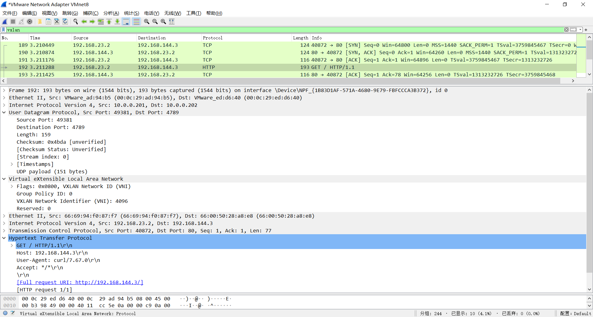

### 3.3.7 部署 Calico 案例: 使用 VXLAN Cross-Subnet 配置VXLAN With BGP模式

对于现有的calico环境，如果需要使用BGP环境，可以直接使用一个配置清单来进行修改calico环境即可。这里先来使用calicoctl修改配置属性。

```text
#获取当前的配置属性
[root@master1 ~]#kubectl calico get ipPools
NAME                  CIDR            SELECTOR
default-ipv4-ippool   10.244.0.0/16   all()
```

```text
#当前路由表
[root@master1 ~]#route -n
Kernel IP routing table
Destination     Gateway         Genmask         Flags Metric Ref    Use Iface
0.0.0.0         10.0.0.2        0.0.0.0         UG    0      0        0 eth0
10.0.0.0        0.0.0.0         255.255.255.0   U     0      0        0 eth0
10.244.36.0     10.0.0.202      255.255.255.192 UG    0      0        0 tunl0
10.244.53.64    0.0.0.0         255.255.255.192 U     0      0        0 *
10.244.101.128  10.0.0.201      255.255.255.192 UG    0      0        0 tunl0
10.244.168.192  10.0.0.203      255.255.255.192 UG    0      0        0 tunl0
172.17.0.0      0.0.0.0         255.255.0.0     U     0      0        0 docker0
```

```text
[root@node1 ~]#route -n
Kernel IP routing table
Destination     Gateway         Genmask         Flags Metric Ref    Use Iface
0.0.0.0         10.0.0.2        0.0.0.0         UG    0      0        0 eth0
10.0.0.0        0.0.0.0         255.255.255.0   U     0      0        0 eth0
10.244.36.0     10.0.0.202      255.255.255.192 UG    0      0        0 tunl0
10.244.53.64    10.0.0.200      255.255.255.192 UG    0      0        0 tunl0
```

```text
10.244.101.128  0.0.0.0         255.255.255.192 U     0      0        0 *
10.244.101.129  0.0.0.0         255.255.255.255 UH    0      0        0
cali2ad752e56a1
10.244.101.130  0.0.0.0         255.255.255.255 UH    0      0        0
cali47ddc65abff
10.244.168.192  10.0.0.203      255.255.255.192 UG    0      0        0 tunl0
172.17.0.0      0.0.0.0         255.255.0.0     U     0      0        0 docker0
```

```text
#查看配置
[root@master1 ~]#kubectl get ipPools default-ipv4-ippool  -o yaml
apiVersion: crd.projectcalico.org/v1
kind: IPPool
metadata:
annotations:
projectcalico.org/metadata: '{"uid":"36bea103-3b2a-4c98-a7f7-
16d8705c3ea1","creationTimestamp":"2023-07-16T00:16:43Z"}'
creationTimestamp: "2021-03-29T01:56:56Z"
generation: 3
name: default-ipv4-ippool
resourceVersion: "66588"
uid: b65e5f4f-cba5-4d55-b16a-d2084257c500
spec:
allowedUses:
- Workload
- Tunnel
blockSize: 26
cidr: 10.244.0.0/16
ipipMode: Always
natOutgoing: true
nodeSelector: all()
vxlanMode: Never
```

```text
#查看配置，此方式需要提前安装caliactl工具
[root@master1 ~]#kubectl calico get ipPools default-ipv4-ippool  -o yaml
apiVersion: projectcalico.org/v3
kind: IPPool
metadata:
creationTimestamp: "2021-03-29T01:56:56Z"
name: default-ipv4-ippool
resourceVersion: "675278"
uid: 494e0fd3-1704-4cbf-bd77-36c2b675e7ca
spec:
blockSize: 24
cidr: 10.244.0.0/16
ipipMode: Always
natOutgoing: true
nodeSelector: all()
vxlanMode: Never
```

```text
#修改配置实现VXLAN with BGP
#方法1: 直接修改ipPool配置
[root@master1 ~]#kubectl  edit  ipPools default-ipv4-ippool
.......
spec:
allowedUses:
- Workload
- Tunnel
blockSize: 26
```

```text
cidr: 10.244.0.0/16
ipipMode: Never       #修改此行为Never
natOutgoing: true
nodeSelector: all()
vxlanMode: CrossSubnet  #修改此行
```

```text
#方法2:定制资源配置文件，注意：此方式需要安装calicactl工具
[root@master1 ~]#kubectl calico get ipPools default-ipv4-ippool  -o yaml >
default-ipv4-ippool.yaml
#修改配置文件
[root@master1 ~]#vim default-ipv4-ippool.yaml
[root@master1 ~]#cat default-ipv4-ippool.yaml
apiVersion: projectcalico.org/v3
kind: IPPool
metadata:
name: default-ipv4-ippool
spec:
blockSize: 26
cidr: 10.244.0.0/16
#ipipMode: Always
ipipMode: Never   #修改此行Never，禁用IPIP
natOutgoing: true
nodeSelector: all()
#vxlanMode: Never
vxlanMode: Cross-Subnet #修改此行为Cross-Subnet或者CrosSubnet
#配置说明：
#禁用IPIP，将原来的Always改为Never
#vxlanMode 将原来的Never更改成 Cross-Subnet(节点间跨网段) 模式，即可以实现vxlan with BGP
的效果
```

```text
#应用资源配置文件
[root@master1 ~]#kubectl calico apply  -f default-ipv4-ippool.yaml
Successfully applied 1 'IPPool' resource(s)
```

```text
#查看节点的IP信息，tunl0网卡没有IP
[root@node1 ~]#ip a
1: lo: <LOOPBACK,UP,LOWER_UP> mtu 65536 qdisc noqueue state UNKNOWN group
default qlen 1000
link/loopback 00:00:00:00:00:00 brd 00:00:00:00:00:00
inet 127.0.0.1/8 scope host lo
valid_lft forever preferred_lft forever
inet6 ::1/128 scope host
valid_lft forever preferred_lft forever
2: eth0: <BROADCAST,MULTICAST,UP,LOWER_UP> mtu 1500 qdisc fq_codel state UP
group default qlen 1000
link/ether 00:0c:29:2e:29:f3 brd ff:ff:ff:ff:ff:ff
altname enp2s1
altname ens33
inet 10.0.0.201/24 brd 10.0.0.255 scope global eth0
valid_lft forever preferred_lft forever
inet6 fe80::20c:29ff:fe2e:29f3/64 scope link
valid_lft forever preferred_lft forever
3: docker0: <NO-CARRIER,BROADCAST,MULTICAST,UP> mtu 1500 qdisc noqueue state
DOWN group default
link/ether 02:42:6e:5b:1d:3e brd ff:ff:ff:ff:ff:ff
inet 172.17.0.1/16 brd 172.17.255.255 scope global docker0
valid_lft forever preferred_lft forever
```

```text
4: tunl0@NONE: <NOARP,UP,LOWER_UP> mtu 1480 qdisc noqueue state UNKNOWN group
default qlen 1000
link/ipip 0.0.0.0 brd 0.0.0.0
7: cali2ad752e56a1@if4: <BROADCAST,MULTICAST,UP,LOWER_UP> mtu 1480 qdisc noqueue
state UP group default qlen 1000
link/ether ee:ee:ee:ee:ee:ee brd ff:ff:ff:ff:ff:ff link-netnsid 0
inet6 fe80::ecee:eeff:feee:eeee/64 scope link
valid_lft forever preferred_lft forever
8: cali47ddc65abff@if4: <BROADCAST,MULTICAST,UP,LOWER_UP> mtu 1480 qdisc noqueue
state UP group default qlen 1000
link/ether ee:ee:ee:ee:ee:ee brd ff:ff:ff:ff:ff:ff link-netnsid 1
inet6 fe80::ecee:eeff:feee:eeee/64 scope link
valid_lft forever preferred_lft forever
11: vxlan.calico: <BROADCAST,MULTICAST,UP,LOWER_UP> mtu 1450 qdisc noqueue state
UNKNOWN group default qlen 1000
link/ether 66:69:94:f0:87:f7 brd ff:ff:ff:ff:ff:ff
inet 10.244.101.131/32 scope global vxlan.calico
valid_lft forever preferred_lft forever
inet6 fe80::6469:94ff:fef0:87f7/64 scope link
valid_lft forever preferred_lft forever
```

```text
#验证路由表，不再显示tunl0路由信息
[root@node1 ~]#route -n
Kernel IP routing table
Destination     Gateway         Genmask         Flags Metric Ref    Use Iface
0.0.0.0         10.0.0.2        0.0.0.0         UG    0      0        0 eth0
10.0.0.0        0.0.0.0         255.255.255.0   U     0      0        0 eth0
10.244.36.0     10.0.0.202      255.255.255.192 UG    0      0        0 eth0
10.244.53.64    10.0.0.200      255.255.255.192 UG    0      0        0 eth0
10.244.101.128  0.0.0.0         255.255.255.192 U     0      0        0 *
10.244.101.129  0.0.0.0         255.255.255.255 UH    0      0        0
cali2ad752e56a1
10.244.101.130  0.0.0.0         255.255.255.255 UH    0      0        0
cali47ddc65abff
10.244.168.192  10.0.0.203      255.255.255.192 UG    0      0        0 eth0
172.17.0.0      0.0.0.0         255.255.0.0     U     0      0        0 docker0
```

```text
#再次进行Pod跨节点网络通信
[root@master1 ~]#kubectl get pod -o wide |awk '{print $1,$2,$6,$7}'
NAME READY IP NODE
myapp-6b59f8f86-2t2bn 1/1 10.244.36.1 node2.wang.org
myapp-6b59f8f86-7q7k4 1/1 10.244.168.197 node3.wang.org
myapp-6b59f8f86-dtcql 1/1 10.244.36.2 node2.wang.org
myapp-6b59f8f86-lvsx9 1/1 10.244.168.196 node3.wang.org
myapp-6b59f8f86-mfdn8 1/1 10.244.101.129 node1.wang.org
myapp-6b59f8f86-w6gll 1/1 10.244.101.130 node1.wang.org
```

```text
#从Node1节点的Pod访问Node2节点的Pod
[root@master1 ~]#kubectl exec -it myapp-6b59f8f86-mfdn8 -- sh
[root@myapp-6b59f8f86-mfdn8 /]# curl 10.244.36.1
kubernetes pod-test v0.1!! ClientIP: 10.244.101.129, ServerName: myapp-
6b59f8f86-2t2bn, ServerIP: 10.244.36.1!
```

```text
#在node1节点抓包，由于这次直接通过节点的BGP路由进行转发，所以在抓包时，直接通过Pod的IP抓取即
可。\
[root@node1 ~]#tcpdump  -i eth0  -vv -nn tcp port 80
[root@node1 ~]#tcpdump  -i eth0  -vv -nn ip host 10.244.36.1
```

```text
09:49:24.430615 IP (tos 0x0, ttl 63, id 36548, offset 0, flags [DF], proto TCP
(6), length 60)
10.244.101.129.50984 > 10.244.36.1.80: Flags [S], cksum 0x9f98 (incorrect ->
0x57c5), seq 119959596, win 64800, options [mss 1440,sackOK,TS val 2736419294
ecr 0,nop,wscale 7], length 0
09:49:24.431332 IP (tos 0x0, ttl 63, id 0, offset 0, flags [DF], proto TCP (6),
length 60)
10.244.36.1.80 > 10.244.101.129.50984: Flags [S.], cksum 0x763f (correct),
seq 1816929306, ack 119959597, win 64260, options [mss 1440,sackOK,TS val
3272380445 ecr 2736419294,nop,wscale 7], length 0
09:49:24.431400 IP (tos 0x0, ttl 63, id 36549, offset 0, flags [DF], proto TCP
(6), length 52)
10.244.101.129.50984 > 10.244.36.1.80: Flags [.], cksum 0x9f90 (incorrect ->
0x9e00), seq 1, ack 1, win 507, options [nop,nop,TS val 2736419295 ecr
3272380445], length 0
09:49:24.431480 IP (tos 0x0, ttl 63, id 36550, offset 0, flags [DF], proto TCP
(6), length 127)
10.244.101.129.50984 > 10.244.36.1.80: Flags [P.], cksum 0x9fdb (incorrect -
> 0x3fca), seq 1:76, ack 1, win 507, options [nop,nop,TS val 2736419295 ecr
3272380445], length 75: HTTP, length: 75
GET / HTTP/1.1
Host: 10.244.36.1
User-Agent: curl/7.67.0
Accept: */*
```

```text
#同时用wireshark抓包，显示如下
```

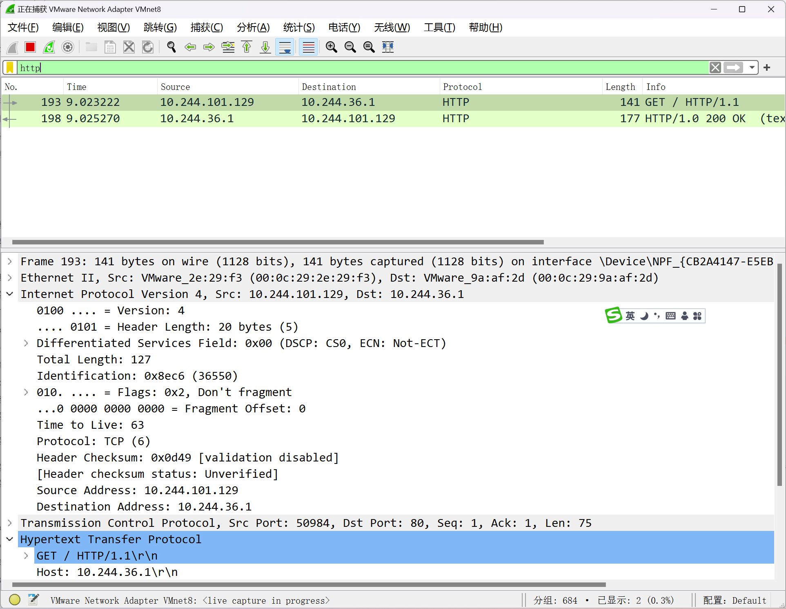

### 3.2.8  部署 Calico 案例: 使用 usePodCidr 配置使用k8s初始化时的Pod网段

如果提前定义CALICO_IPV4POOL_CIDR变量,Calico默认会优先使用此变量指定的网段,而不会从Node.Spec.PodCIDR中分配地址。即优先使用自已CALICO_IPV4POOL_CIDR变量指定网段,而非使用初始化k8s时 --pod-network-cidr选项时指定的网段。但可通过USE_POD_CIDR变量并结合host-local这一IPAM插件可以强制使用安装k8s时的--pod-network-cidr选项指定的网段。

```text
#先清除原有配置,注意:清除网络calico前需要先清除所有Pod资源
[root@master1 ~]#kubectl delete -f  calico.yaml
```

```text
#定制pod的manifest文件分配网络配置,直接让calico使用kube-controller-manager为节点分配的网
段信息
[root@master1 ~]#vim calico.yaml
---- 修改原来下面的内容
34           "ipam": {
35               "type": "calico-ipam"
36           },
---- 修改后的内容
34           "ipam": {
35               "type": "host-local",
36               "subnet": "usePodCidr"
37           },
---- 定制calico使用k8s集群节点的地址(默认值,可选)
4227             - name: USE_POD_CIDR
4228               value: "true"
```

```text
#应用清单文件
[root@master1 ~]#kubectl apply -f  calico.yaml
```

```text
#查看结果
[root@master1 ~]#kubectl get node node1.wang.org -o yaml|grep CIDR
podCIDR: 10.244.1.0/24
podCIDRs:
[root@master1 ~]#kubectl get node node1.wang.org -o yaml|grep podCIDR
podCIDR: 10.244.1.0/24
podCIDRs:
[root@master1 ~]#kubectl get node node2.wang.org -o yaml|grep podCIDR
podCIDR: 10.244.2.0/24
podCIDRs:
[root@master1 ~]#kubectl get node node3.wang.org -o yaml|grep podCIDR
podCIDR: 10.244.3.0/24
podCIDRs:
```

```text
[root@master1 ~]#kubectl create deployment myapp --image registry.cn-
beijing.aliyuncs.com/wangxiaochun/pod-test:v0.1 --replicas 2
```

```text
#验证Pod地址
[root@master1 ~]#kubectl get pod -o wide
NAME                     READY   STATUS    RESTARTS   AGE   IP           NODE
NOMINATED NODE   READINESS GATES
myapp-7dbd45d496-lwcgl   1/1     Running   0          11m   10.244.2.2
node2.wang.org   <none>           <none>
```

```text
myapp-7dbd45d496-xf8nc   1/1     Running   0          11m   10.244.1.2
node1.wang.org   <none>           <none>
```

```text
[root@master1 ~]#kubectl exec  myapp-7dbd45d496-xf8nc  -- ip a show eth0
4: eth0@if11: <BROADCAST,MULTICAST,UP,LOWER_UP> mtu 1480 qdisc noqueue state UP
group default qlen 1000
link/ether 82:e7:c8:b7:99:4a brd ff:ff:ff:ff:ff:ff link-netnsid 0
inet 10.244.1.2/32 scope global eth0
valid_lft forever preferred_lft forever
```

```text
[root@node1 ~]#ip a
1: lo: <LOOPBACK,UP,LOWER_UP> mtu 65536 qdisc noqueue state UNKNOWN group
default qlen 1000
link/loopback 00:00:00:00:00:00 brd 00:00:00:00:00:00
inet 127.0.0.1/8 scope host lo
valid_lft forever preferred_lft forever
inet6 ::1/128 scope host
valid_lft forever preferred_lft forever
2: eth0: <BROADCAST,MULTICAST,UP,LOWER_UP> mtu 1500 qdisc fq_codel state UP
group default qlen 1000
link/ether 00:0c:29:ad:94:b5 brd ff:ff:ff:ff:ff:ff
altname enp2s1
altname ens33
inet 10.0.0.201/24 brd 10.0.0.255 scope global eth0
valid_lft forever preferred_lft forever
inet6 fe80::20c:29ff:fead:94b5/64 scope link
valid_lft forever preferred_lft forever
3: docker0: <NO-CARRIER,BROADCAST,MULTICAST,UP> mtu 1500 qdisc noqueue state
DOWN group default
link/ether 02:42:52:39:35:49 brd ff:ff:ff:ff:ff:ff
inet 172.17.0.1/16 brd 172.17.255.255 scope global docker0
valid_lft forever preferred_lft forever
4: cali5a3d3dcd97e@if3: <BROADCAST,MULTICAST,UP,LOWER_UP> mtu 1480 qdisc noqueue
state UP group default qlen 1000
link/ether ee:ee:ee:ee:ee:ee brd ff:ff:ff:ff:ff:ff link-netnsid 0
inet6 fe80::ecee:eeff:feee:eeee/64 scope link
valid_lft forever preferred_lft forever
5: tunl0@NONE: <NOARP,UP,LOWER_UP> mtu 1480 qdisc noqueue state UNKNOWN group
default qlen 1000
link/ipip 0.0.0.0 brd 0.0.0.0
inet 192.168.23.0/32 scope global tunl0
valid_lft forever preferred_lft forever
8: cali8079f99d3d5@if4: <BROADCAST,MULTICAST,UP,LOWER_UP> mtu 1480 qdisc noqueue
state UP group default qlen 1000
link/ether ee:ee:ee:ee:ee:ee brd ff:ff:ff:ff:ff:ff link-netnsid 1
inet6 fe80::ecee:eeff:feee:eeee/64 scope link
valid_lft forever preferred_lft forever
```

## 3.3 calicoctl 工具管理 BGP 网络

### 3.3.1 Calico 工具 calicoctl 说明

calico本身提供一个Restful接口，结合calicoctl命令可以管理自身的相关属性信息。

calicoctl可以直接与etcd进行操作，也可以通过kube-apiserver的方式与etcd来进行操作。默认它与kube-apiserver通信的认证方式与kubectl的命令使用相同的context。安全原因，可以手工定制的一个kubeconfig配置文件。calicoctl 是运行在集群之外的，用于管理集群功能的一个重要的组件。

calicoctl 的安装方式很多，常见的方式有：

单主机方式kubectl命令插件方式pod方式主机容器方式

### 3.3.2 安装和使用 calicoctl

#### 3.3.2.1 安装  calicoctl

参考资料：

```text
https://projectcalico.docs.tigera.io/maintenance/clis/calicoctl/install
```

范例:  在所有节点上安装  calicoctl

```text
#采用单主机命令的方式
CALICO_VERSION=v3.31.0
#CALICO_VERSION=v3.29.1
#CALICO_VERSION=v3.24.1
#CALICO_VERSION=v3.22.0
```

```text
#加速下载
[root@master1 ~]#wget
https://githubfast.com/projectcalico/calico/releases/download/${CALICO_VERSION}/
calicoctl-linux-amd64
[root@master1 ~]#curl -L
https://mirror.ghproxy.com/https://github.com/projectcalico/calico/releases/down
load/${CALICO_VERSION}/calicoctl-linux-amd64 -o /usr/local/bin/calicoctl
```

```text
[root@master1 ~]#curl -L
https://github.com/projectcalico/calico/releases/download/${CALICO_VERSION}/cali
coctl-linux-amd64 -o /usr/local/bin/calicoctl
```

```text
[root@master1 ~]#chmod +x /usr/local/bin/calicoctl
```

```text
#在其它节点也安装此工具方便观察
[root@master1 ~]#scp  /usr/local/bin/calicoctl
node1..node3:/usr/local/bin/calicoctl
```

```text
#查看效果
[root@master1 ~]#calicoctl version
Client Version:    v3.22.0
Git commit:        a86e41d02
Cluster Version:   v3.22.0
Cluster Type:      k8s,bgp,kubeadm,kdd
```

```text
#如果calicoctl和calico版本不同会如下显示
[root@master1 ~]#calicoctl version
Client Version:    v3.20.2
Git commit:        dcb4b76a
```

```text
Cluster Version:   v3.22.0
Cluster Type:      k8s,bgp,kubeadm,kdd
```

```text
[root@master1 ~]#calicoctl --help
Usage:
calicoctl [options] <command> [<args>...]
......
```

#### 3.3.2.2 使用 calicoctl

```text
#显示节点信息
[root@master1 ~]#calicoctl get node
NAME
master1.wang.org
master2.wang.org
master3.wang.org
node1.wang.org
node2.wang.org
node3.wang.org
```

```text
[root@master1 ~]#calicoctl get node -o wide
NAME                  ASN      IPV4         IPV6
master1.wang.org     (64512)   10.0.0.101
master2.wang.org     (64512)   10.0.0.102
master3.wang.org     (64512)   10.0.0.103
node1.wang.org       (64512)   10.0.0.104
node2.wang.org       (64512)   10.0.0.105
node3.wang.org       (64512)   10.0.0.106
```

```text
#如果calicoctl和calico版本不一致会出现下面提示
[root@master1 ~]#calicoctl get node
Failed to get resources: Version mismatch.
Client Version:   v3.20.2
Cluster Version:  v3.22.0
Use --allow-version-mismatch to override.
```

```text
#利用--allow-version-mismatch选项可以解决上面问题
[root@master1 ~]#calicoctl get node --allow-version-mismatch
NAME
master1.wang.org
master2.wang.org
master3.wang.org
node1.wang.org
node2.wang.org
node3.wang.org
```

```text
#查看各个节点状态
[root@master1 ~]#calicoctl node status
Calico process is running.
```

```text
IPv4 BGP status
+--------------+-------------------+-------+----------+-------------+
| PEER ADDRESS |     PEER TYPE     | STATE |  SINCE   |    INFO     |
+--------------+-------------------+-------+----------+-------------+
| 10.0.0.102   | node-to-node mesh | up    | 01:57:39 | Established |
| 10.0.0.105   | node-to-node mesh | up    | 01:57:39 | Established |
| 10.0.0.106   | node-to-node mesh | up    | 01:57:39 | Established |
```

```text
| 10.0.0.104   | node-to-node mesh | up    | 01:57:51 | Established |
| 10.0.0.103   | node-to-node mesh | up    | 01:58:19 | Established |
+--------------+-------------------+-------+----------+-------------+
```

```text
IPv6 BGP status
No IPv6 peers found.
#查看所有节点
[root@master1 ~]#calicoctl get node -o yaml
apiVersion: projectcalico.org/v3
items:
- apiVersion: projectcalico.org/v3
kind: Node
metadata:
annotations:
.....
```

```text
#查看指定节点
[root@master1 ~]#calicoctl get node node1.wang.org -o yaml
apiVersion: projectcalico.org/v3
kind: Node
metadata:
annotations:
projectcalico.org/kube-labels:
'{"beta.kubernetes.io/arch":"amd64","beta.kubernetes.io/os":"linux","kubernetes.
io/arch":"amd64","kubernetes.io/hostname":"node1.wang.org","kubernetes.io/os":"l
inux"}'
creationTimestamp: "2025-05-26T07:16:26Z"
labels:
beta.kubernetes.io/arch: amd64
beta.kubernetes.io/os: linux
kubernetes.io/arch: amd64
kubernetes.io/hostname: node1.wang.org
kubernetes.io/os: linux
name: node1.wang.org
resourceVersion: "514593"
uid: cc16fe81-5660-43a5-b352-afb47fad4f90
spec:
addresses:
- address: 10.0.0.101/24
type: CalicoNodeIP
- address: 10.0.0.101
type: InternalIP
bgp:
ipv4Address: 10.0.0.101/24
ipv4VXLANTunnelAddr: 192.168.23.14
orchRefs:
- nodeName: node1.wang.org
orchestrator: k8s
status:
podCIDRs:
- 10.244.1.0/24
```

```text
#查看ip的信息
[root@master1 ~]#calicoctl get ipPool
NAME                  CIDR             SELECTOR
default-ipv4-ippool   192.168.0.0/16   all()
```

```text
#显示详细信息
```

```text
[root@master1 ~]#calicoctl get ipPool default-ipv4-ippool -o yaml
[root@master1 ~]#calicoctl get ippools -o wide
NAME                  CIDR            NAT    IPIPMODE   VXLANMODE   DISABLED
DISABLEBGPEXPORT   SELECTOR
default-ipv4-ippool   10.244.0.0/16   true   Never      Always      false
false              all()
```

```text
#查看ip的管理
[root@master1 ~]#calicoctl ipam --help
```

```text
#查看ip的信息
[root@master1 ~]#calicoctl  ipam show
+----------+----------------+-----------+------------+--------------+
| GROUPING |      CIDR      | IPS TOTAL | IPS IN USE |   IPS FREE   |
+----------+----------------+-----------+------------+--------------+
| IP Pool  | 192.168.0.0/16 |     65536 | 10 (0%)    | 65526 (100%) |
+----------+----------------+-----------+------------+--------------+
```

```text
#查看信息的显示效果
[root@master1 ~]#calicoctl ipam show --help
```

```text
#显示相关的配置属性
[root@master1 ~]#calicoctl  ipam show --show-configuration
+--------------------+-------+
|      PROPERTY      | VALUE |
+--------------------+-------+
| StrictAffinity     | false |
| AutoAllocateBlocks | true  |
| MaxBlocksPerHost   |     0 |
+--------------------+-------+
```

范例:  calicoctl 使用指定的kubconfig文件

```text
#默认情况下，calicoctl 将尝试使用位于`$(HOME)/.kube/config`.
#如果默认 kubeconfig 不存在，或者想指定替代 API 访问信息，您可以使用以下配置选项来执行此操
作。
#手工定制的一个配置文件
[root@master1 ~]#mkdir /etc/calico
[root@master1 ~]#vim /etc/calico/calicoctl.cfg
apiVersion: projectcalico.org/v3
kind: CalicoAPIConfig
metadata:
spec:
datastoreType: "kubernetes"
kubeconfig: "/etc/kubernetes/admin.conf"
```

```text
#文件编辑完毕后，就可以直接来测试效果
[root@master1 ~]#mv .kube/config  /tmp
#无法执行kubectl
[root@master1 ~]#kubectl get nodes
E0711 15:21:59.284255   72110 memcache.go:238] couldn't get current server API
group list: Get "http://localhost:8080/api?timeout=32s": dial tcp 127.0.0.1:8080:
connect: connection refused
```

```text
#仍可以执行calicoctl
[root@master1 ~]#calicoctl get nodes
NAME
```

```text
master1
master2
master3
node1
node2
[root@master1 ~]#calicoctl get nodes node1 -o yaml
apiVersion: projectcalico.org/v3
kind: Node
metadata:
...
#结果显示：可以通过 calicoctl 来操作kubectl操作的资源了，只不过显示的格式稍微有一点点的区别
```

```text
#参考资料：https://docs.projectcalico.org/getting-
started/clis/calicoctl/configure/kdd
```

```text
#还原kubeconfig
[root@master1 ~]#mv /tmp/config .kube/
```

#### 3.3.2.3 calicoctl 集成 kubectl 命令

可以将calicoctl 整合到 kubectl 为子命令，只需要将calicoctl 程序文件更改名字即可实现。

```text
#默认kubectl不支持calico子命令
[root@master1 ~]#kubectl calico
error: unknown command "calico" for "kubectl"
```

```text
#定制kubectl 插件子命令,可以使用软链接或改文件名称，形式为kubectl-<calico的子命令>
[root@master1 ~]#ln -s  calicoctl  /usr/local/bin/kubectl-calico
[root@master1 ~]#ll /usr/local/bin/kubectl-calico
lrwxrwxrwx 1 root root 9 Mar 29 14:21 /usr/local/bin/kubectl-calico ->
calicoctl*
```

```text
#测试效果
[root@master1 ~]#kubectl calico
Usage:
kubectl-calico [options] <command> [<args>...]
```

```text
#获取网络节点信息
[root@master1 ~]#kubectl calico node status
Calico process is running.
```

```text
IPv4 BGP status
+--------------+-------------------+-------+----------+-------------+
| PEER ADDRESS |     PEER TYPE     | STATE |  SINCE   |    INFO     |
+--------------+-------------------+-------+----------+-------------+
| 10.0.0.102   | node-to-node mesh | up    | 01:57:39 | Established |
| 10.0.0.105   | node-to-node mesh | up    | 01:57:39 | Established |
| 10.0.0.106   | node-to-node mesh | up    | 01:57:39 | Established |
| 10.0.0.104   | node-to-node mesh | up    | 01:57:51 | Established |
| 10.0.0.103   | node-to-node mesh | up    | 01:58:19 | Established |
+--------------+-------------------+-------+----------+-------------+
```

```text
IPv6 BGP status
No IPv6 peers found.
```

```text
[root@master1 ~]#kubectl  get ipPools
```

```text
NAME                  AGE
default-ipv4-ippool   99m
```

```text
[root@master1 ~]#kubectl calico get ipPools
NAME                  CIDR            SELECTOR
default-ipv4-ippool   10.244.0.0/16   all()
```

```text
[root@master1 ~]#kubectl calico get ipPools default-ipv4-ippool -o yaml
apiVersion: projectcalico.org/v3
kind: IPPool
metadata:
creationTimestamp: "2021-03-29T01:56:56Z"
name: default-ipv4-ippool
resourceVersion: "66588"
uid: b65e5f4f-cba5-4d55-b16a-d2084257c500
spec:
allowedUses:
- Workload
- Tunnel
blockSize: 26
cidr: 10.244.0.0/16
ipipMode: Always
natOutgoing: true
nodeSelector: all()
vxlanMode: Never
```

### 3.3.3 实战案例: BGP  Route Reflecter

#### 3.3.3.1 BGP Route Reflecter 说明

默认当前的calico节点的网络状态是 BGP peer 的模型，即每个节点上都要维护本节点和其它节点 n-1 个路由配置信息。整个集群中需要维护 n*(n-1) 个路由信息，这在节点量非常多的场景中，比如节点数超过50个节点，性能是比较差的。可以实现一种 BGP reflecter 的模式解决以上问题。

**反射器方案说明**

一个集群中，至少需要一个反射器角色只需要维护  n * m 个路由信息,n为节点数,m为反射器数量生产中基于高可用性,需要对反射器角色做冗余如果是一个多主节点的集群，可以将集群的master节点作为bgp的reflecter角色，从而实现反射器的冗余。

实现反射器的步骤

创建反射器角色并指定节点标签后端节点使用反射器关闭默认的网格full-mesh。

#### 3.3.3.2 BGP reflecter  案例

范例: 查看当前节点的网络效果

```text
#如果看不到结果,可以reboot所有节点
#所有节点都可以执行
```

```text
[root@master1 ~]#calicoctl node status
```

```text
#此命令只能在Master执行
[root@master1 ~]#kubectl calico node status
Calico process is running.
```

```text
IPv4 BGP status
+--------------+-------------------+-------+----------+-------------+
| PEER ADDRESS |     PEER TYPE     | STATE |  SINCE   |    INFO     |
+--------------+-------------------+-------+----------+-------------+
| 10.0.0.102   | node-to-node mesh | up    | 01:57:39 | Established |
| 10.0.0.105   | node-to-node mesh | up    | 01:57:39 | Established |
| 10.0.0.106   | node-to-node mesh | up    | 01:57:39 | Established |
| 10.0.0.104   | node-to-node mesh | up    | 01:57:51 | Established |
| 10.0.0.103   | node-to-node mesh | up    | 01:58:19 | Established |
+--------------+-------------------+-------+----------+-------------+
```

```text
IPv6 BGP status
No IPv6 peers found.
```

范例:  使用kubectl calico 子命令实现 BGP reflecter  案例

```text
#1)选择一个节点上创建反射器角色并指定节点标签
#方法1
[root@master1 ~]#calicoctl get node master1.wang.org  --export -o yaml > calico-
reflector-master.yaml
[root@master1 ~]#vim calico-reflector-master.yaml
apiVersion: projectcalico.org/v3
kind: Node
metadata:
labels:
route-reflector: true  #添加标签，和后面配置要一致
name: master1.wang.org
spec:
bgp:
ipv4Address: 10.0.0.101/16        #反射器角色节点的ip地址，默认值不做修改
routeReflectorClusterID: 1.1.1.1  #加一行，指定ID，可以是唯一的任意字符串，可选
ipv4IPIPTunnelAddr: 10.244.0.1      #默认值不做修改
```

```text
#属性解析；
metadata.labels #必选项，它需要被后面的节点来进行获取
metadata.name #节点属性，必须是通过 calicoctl get nodes 获取到的节点名称。
spec.bgp.ipv4Address #须是指定充当反射器角色节点的ip地址
spec.bgp.ipv4IPIPTunnelAddr #须是指定充当反射器角色节点上tunl0的地址
spec.bgp.routeReflectorClusterID #是BGP网络中的唯一标识IP，所以这里的集群标识只要唯一并没
有被使用就可以，此项可选
```

```text
#应用资源配置文件,注意:使用 kubectl calico 子命令
[root@master1 ~]#kubectl calico apply -f calico-reflector-master.yaml
Successfully applied 1 'Node' resource(s)
```

```text
#方法2
[root@master1 ~]#kubectl label node master1.wang.org route-reflector='true'
[root@master1 ~]#kubectl annotate node master1.wang.org
projectcalico.org/routeReflectorClusterID=1.1.1.1 #可选
```

```text
#2)创建清单文件，更改所有节点的网络模型为 reflecter模型
```

```text
[root@master1 ~]#vim calico-reflector-bgppeer.yaml
kind: BGPPeer
apiVersion: projectcalico.org/v3
metadata:
name: bgppeer-demo
spec:
nodeSelector: all()                     #节点选择器指定所有节点都要配置
peerSelector: route-reflector=="true"   #定义使用前面匹配的标签选择器，定义配置应用到
目标节点
```

```text
#属性解析；
spec.nodeSelector #指定的所有后端节点
spec.peerSelector #指定的是反射器的标签，标识所有的后端节点与这个反射器进行数据交流，要和前面
定义的保持一致
```

```text
#应用资源配置文件
#方法1：使用 kubectl calico 子命令
[root@master1 ~]#kubectl calico apply -f calico-reflector-bgppeer.yaml
Successfully applied 1 'BGPPeer' resource(s)
#方法2
[root@master1 ~]#kubectl  apply -f calico-reflector-bgppeer.yaml
```

```text
#查看效果
[root@master1 ~]#calicoctl get bgppeer
[root@master1 ~]#kubectl get bgppeer
NAME                 AGE
bgppeer-demo         5s
```

```text
#在当前Master查看到
[root@master1 ~]#calicoctl node status
[root@master1 ~]#kubectl calico node status
#当前节点已经清空
Calico process is running.
```

```text
IPv4 BGP status
+--------------+---------------+-------+----------+-------------+
| PEER ADDRESS |   PEER TYPE   | STATE |  SINCE   |    INFO     |
+--------------+---------------+-------+----------+-------------+
| 10.0.0.102   | node specific | start | 08:25:43 | Active      |
| 10.0.0.103   | node specific | start | 08:25:43 | Active      |
| 10.0.0.104   | node specific | start | 08:25:43 | Active      |
| 10.0.0.105   | node specific | start | 08:25:43 | OpenConfirm |
| 10.0.0.106   | node specific | start | 08:25:43 | Active      |
+--------------+---------------+-------+----------+-------------+
```

```text
IPv6 BGP status
No IPv6 peers found.
```

```text
#其它节点可看，当前还没有清空
[root@master2 ~]#calicoctl node status
[root@master2 ~]#kubectl calico node status
Calico process is running.
```

```text
IPv4 BGP status
+--------------+-------------------+-------+----------+-------------+
| PEER ADDRESS |     PEER TYPE     | STATE |  SINCE   |    INFO     |
+--------------+-------------------+-------+----------+-------------+
| 10.0.0.103   | node-to-node mesh | up    | 08:23:17 | Established |
```

```text
| 10.0.0.104   | node-to-node mesh | up    | 08:23:15 | Established |
| 10.0.0.105   | node-to-node mesh | up    | 08:23:16 | Established |
| 10.0.0.106   | node-to-node mesh | up    | 08:23:16 | Established |
| 10.0.0.101   | node specific     | up    | 08:25:45 | Established |
+--------------+-------------------+-------+----------+-------------+
```

```text
IPv6 BGP status
No IPv6 peers found.
```

```text
#3)创建新的清单文件，关闭其它节点的默认的网格mesh
[root@master1 ~]#calicoctl get node -o wide
```

```text
[root@master1 ~]#vim calico-reflector-defaultconfig.yaml
apiVersion: projectcalico.org/v3
kind: BGPConfiguration
metadata:
name: default
spec:
logSeverityScreen: Info
nodeToNodeMeshEnabled: false  #默认为true,表示启用节点间的iBGP全网格（full mesh）模
式,false关闭full-mesh
asNumber: 63400               #默认的AS为 64512，此项可选
```

```text
#属性解析；
metadata.name #在这里是default，因为要对BGP默认的网络效果进行关闭
spec.nodeToNodeMeshEnabled #关闭后端节点的BGP peer默认状态 -- 即点对点通信关闭
spec.asNumber #指定的是后端节点间使用反射器的时候对应一个AS的标志号
```

```text
#应用资源配置文件
[root@master1 ~]#calicoctl apply  -f calico-reflector-defaultconfig.yaml
[root@master1 ~]#kubectl calico apply  -f calico-reflector-defaultconfig.yaml
```

```text
#在RR节点上查看效果
[root@master1 ~]#calicoctl get bgpconfiguration default -o yaml
[root@master1 ~]#calicoctl node status
[root@master1 ~]#kubectl calico node status
Calico process is running.
```

```text
IPv4 BGP status
+--------------+---------------+-------+----------+-------------+
| PEER ADDRESS |   PEER TYPE   | STATE |  SINCE   |    INFO     |
+--------------+---------------+-------+----------+-------------+
| 10.0.0.102   | node specific | up    | 06:52:35 | Established |
| 10.0.0.103   | node specific | up    | 06:52:37 | Established |
| 10.0.0.104   | node specific | up    | 06:52:35 | Established |
| 10.0.0.105   | node specific | up    | 06:52:35 | Established |
| 10.0.0.106   | node specific | up    | 06:52:35 | Established |
+--------------+---------------+-------+----------+-------------+
```

```text
IPv6 BGP status
No IPv6 peers found.
```

```text
#在其它的非RR节点只能看到一个节点信息
[root@master2 ~]#calicoctl node status
[root@master2 ~]#kubectl calico node status
Calico process is running.
```

```text
IPv4 BGP status
```

```text
+--------------+---------------+-------+----------+-------------+
| PEER ADDRESS |   PEER TYPE   | STATE |  SINCE   |    INFO     |
+--------------+---------------+-------+----------+-------------+
| 10.0.0.101   | node specific | up    | 06:54:34 | Established |
+--------------+---------------+-------+----------+-------------+
```

```text
IPv6 BGP status
No IPv6 peers found.
```

```text
#4)为了RR高可用，还需要配置冗余的另一个RR，针对另一个指定的节点执行1）步即可
[root@master1 ~]#kubectl annotate node master2.wang.org
projectcalico.org/routeReflectorClusterID=1.1.1.1
[root@master1 ~]#kubectl label node master2.wang.org route-reflector='true'
```

```text
#5)验证：
#在第一个RR节点上查看效果
[root@master1 ~]#calicoctl node status
[root@master1 ~]#kubectl calico node status
Calico process is running.
```

```text
IPv4 BGP status
+--------------+---------------+-------+----------+-------------+
| PEER ADDRESS |   PEER TYPE   | STATE |  SINCE   |    INFO     |
+--------------+---------------+-------+----------+-------------+
| 10.0.0.102   | node specific | up    | 06:52:35 | Established |
| 10.0.0.103   | node specific | up    | 06:52:37 | Established |
| 10.0.0.104   | node specific | up    | 06:52:35 | Established |
| 10.0.0.105   | node specific | up    | 06:52:35 | Established |
| 10.0.0.106   | node specific | up    | 06:52:35 | Established |
+--------------+---------------+-------+----------+-------------+
```

```text
IPv6 BGP status
No IPv6 peers found.
```

```text
#在第二个RR节点上查看效果
[root@master2 ~]#calicoctl node status
[root@master2 ~]#kubectl calico node status
Calico process is running.
```

```text
IPv4 BGP status
+--------------+---------------+-------+----------+-------------+
| PEER ADDRESS |   PEER TYPE   | STATE |  SINCE   |    INFO     |
+--------------+---------------+-------+----------+-------------+
| 10.0.0.101   | node specific | up    | 07:01:16 | Established |
| 10.0.0.103   | node specific | up    | 07:01:18 | Established |
| 10.0.0.104   | node specific | up    | 07:01:19 | Established |
| 10.0.0.105   | node specific | up    | 07:01:20 | Established |
| 10.0.0.106   | node specific | up    | 07:01:17 | Established |
+--------------+---------------+-------+----------+-------------+
```

```text
IPv6 BGP status
No IPv6 peers found.
```

```text
#在其它的非RR节点看到两个RR节点信息
[root@node1 ~]#calicoctl node status
[root@node1 ~]#kubectl calico node status
Calico process is running.
```

```text
IPv4 BGP status
+--------------+---------------+-------+----------+-------------+
| PEER ADDRESS |   PEER TYPE   | STATE |  SINCE   |    INFO     |
+--------------+---------------+-------+----------+-------------+
| 10.0.0.101   | node specific | up    | 06:54:34 | Established |
| 10.0.0.102   | node specific | up    | 07:01:16 | Established |
+--------------+---------------+-------+----------+-------------+
```



<nav class="article-end" aria-label="章节导航">
  <a href="{{ '/subjects/Kubernetes/15-network-flannel.html' | relative_url }}">← 上一章：网络基础与 Flannel</a>
  <a href="{{ '/subjects/Kubernetes/' | relative_url }}">返回 Kubernetes 目录</a>
  <a href="{{ '/subjects/Kubernetes/17-network-policy.html' | relative_url }}">下一章：网络策略 →</a>
</nav>
