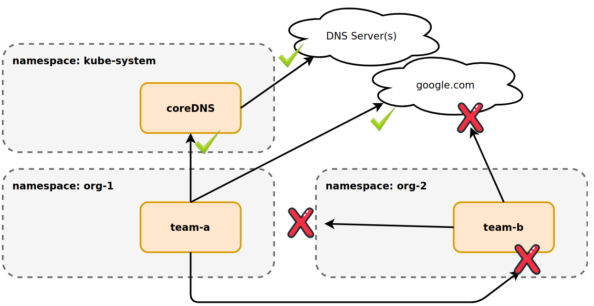
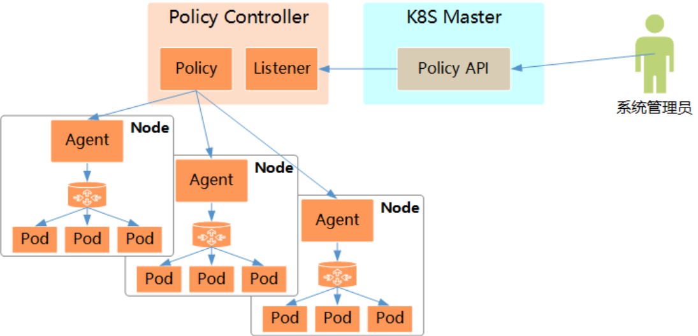
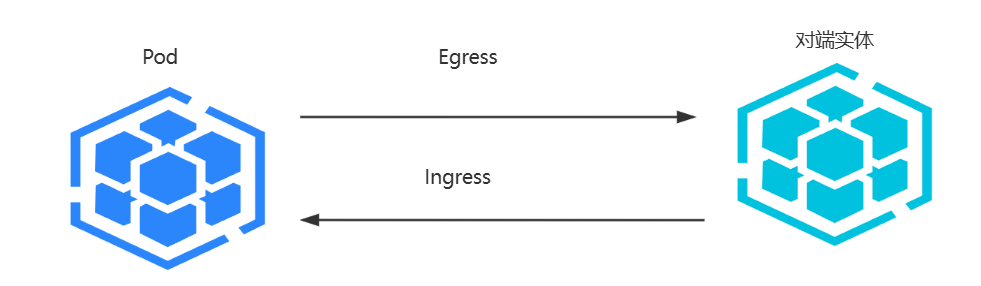

[← 返回 Kubernetes 目录]({{ '/subjects/Kubernetes/' | relative_url }})



# 17 网络策略

## 3.4 网络策略

### 3.4.1 网络策略说明


- <https://kubernetes.io/zh-cn/docs/concepts/services-networking/network-policies/>
- <https://kubernetes.io/docs/concepts/services-networking/network-policies/>


#### 3.4.1.1 网络策略介绍

在kubernetes的策略体系中，最主要有四个方面：

Kubernetes 资源管理涉及以下策略：

- **LimitRange**：资源的使用限制。
- **ResourceQuota**：资源的应用配额。
- **PodSecurityPolicy**：资源的安全控制。
- **NetworkPolicy**：资源的网络策略，主要管控资源间的通信流量。

**Kubernetes的网络策略 Network Policy**



为实现细粒度的容器间网络访问隔离策略，Kubernetes发布Network Policy，目前已升级为networking.k8s.io/v1稳定版本。为了使用Network Policy，Kubernetes引入了一个新的资源对象Network Policy，供用户设置Pod间网络访问的策略。networkpolicy是kubernetes API中标准的资源类型，是定义在一组Pod资源上的控制进（Ingress）和出（Egress）Pod流量的规则。

但仅定义一个网络策略是无法完成实际的网络隔离的，还需要一个策略控制器(Policy Controller)进行策略的实现。网络策略功能由网络插件实现，支持网络策略的插件有 Calico、Canal、kube-router等，注意: Flannel不支持。

在kubernetes环境中，专门基于这些策略管理软件的操作对象叫策略控制器,最常见的是networkpolicies。策略控制器用于监控指定区域创建对象(pod)时所生成的新API端点，并按需为其附加网络策略。对于Pod对象来说，网络流量分为流入(Ingress)和流出(Egress)两个方向，每个方向包含允许和禁止两种控制策略，默认情况下，所有的策略都是允许的，应用策略后，所有未经明确允许的流量都将拒绝。



Network Policy会被kubernetes集群中的网络插件控制器转换成内核的iptables的规则，只不过与service转换的规则不同。service会被转换成iptables的nat 或 mangle 表的规则Network Policy策略中的规则会被转换成 iptables的 filter表上的规则。

Network Policy 相关术语：

**Ingress**：进入Pod的流量策略，自已为服务器端，对端为客户端，可以定义源端点（spec.ingress.from）和目标（服务器）端口(spec.ingress.ports),即控制从哪里来Egress: 定义出Pod的流量策略,自已为客户端，对端为服务器端，可以定义目标端点（spec.egress.to）和目标（服务器）端口(spec.egress.ports),即控制到哪里去Pod组: podSelector通过matchLabel或者matchExpression的标签选择器选择的Pod集合，即策略将在哪些Pod上生效Selector: 选择Pod对象的一种机制：基于命名空间选择pod、基于网段来选择pod、基于Pod标签来选择pod端点(to,from)： 可以通过nameSpace或者ipBlock 来定义。

**Network Policy的功能**

针对一组Pod，定义其同对端实体通信时，在入向Ingress或/和出向Egress流量上的控制规则Network Policy的具体实现依赖于Network Plugin。



描述对端实体的方法有如下几种

一组Pod对象，通常基于标签选择器定义筛选条件单个或一组名称空间IP地址块(但Pod与其所运行的节点之间的通信不受限制)。

**使用方式**

Network Policy的主要功能是对Pod间的网络通信进行限制和准入控制支持针对Pod和名称空间级别进行控制支持将Pod的Label作为查询条件，设置允许访问或禁止访问的客户端Pod列表也支持针对Pod所在网段和IP设置策略支持针对四层TCP/UDP协议和端口进行控制不同的策略可以叠加相同的策略,新的规则会覆盖旧的规则。

**Network Policy的生效机制**：默认情况下，一组Pod上的出向和入向流量均被允许。

同一方向上，适用于一组Pod的多个规则的生效遵循累加法机制。一组Pod上，多个Ingress策略相累加所生成的集合(并集，即或关系)是为最终生效的结果。一组Pod上，多个Egress策略相累加所生成的集合(并集，即或关系)是为最终生效的结果策略。若同时定义了Ingress和Egress规则，针对一个对端，双向策略都为显式允许时，通信才能真正实现。

#### 3.4.1.2 网络策略资源对象属性


```yaml
#kubectl explain NetworkPolicy.spec

apiVersion: networking.k8s.io/v1    # 资源隶属的API群组及版本号
kind: NetworkPolicy                 # 资源类型的名称，名称空间级别的资源；
metadata:                           # 资源元数据
name <string>                   # 资源名称标识
namespace <string>              # NetworkPolicy是名称空间级别的资源
spec:                               # 期望的状态
podSelector <Object>            # 当前规则生效的一组目标Pod对象，必选字段；{}表示
NetworkPolicy名称空间的所有Pod
policyTypes <[]string>      # 支持Ingress和Egress，Ingress表示生效ingress，
Egress表示生效egress，默认都有效
ingress <[]Object>              # 入站流量规则，白名单，{}表示“所有”，默认允许所有
- from <[]Object>               # 具体的端点对象列表，{}表示所有合法端点，多个from
表示或者的关系
- ipBlock  <Object>       # IP地址范围，和namespaceSelector和podSelector字段不
能同时生效,同时存在为或关系
cidr  <string>            # CIDR格式的网段
except <[]string>         # 要排除的IP表钱，支持CIDR格式
- namespaceSelector <Object>  # 匹配的名称空间内的端点，如果不配置，表示
NetworkPolicy 所有名称空间的Pod
- podSelector <Object>        # 由Pod标签选择器匹配到的端点，和
namespaceSelector同时使用时，为与关系，即交集
ports <[]Object>              # 入向流量要访问的目标端口对象列表，{}表示所有合法端
口，
- protocol: <string>          # 指定协议，支持TCP，UDP，SCTP，默认TCP
port: <string>              # 端口，和endPort同时使用，表示端口范围的起始端口
endPort:  <integer>         # 必须和port同时使用，表示端口范围的结束端口
egress <[]Object>               # 出站流量目规则，白名单，{}表示“所有”，默认允许所有
- to <[]Object>                 # 具体的端点对象列表，{}表示所有合法端点，格式同
ingress.from
ports <[]Object>              # 出向流量要访问的目标端口对象列表，{}表示所有合法端
口

#注意：
#入栈和出栈哪个策略生效，由 policyTypes 来决定
#如果仅配置了podSelector，表示当前限制仅限于当前的命名空间
```

范例：
```yaml
#允许所有
apiVersion: networking.k8s.io/v1
kind: NetworkPolicy
metadata:
name: allow-all-ingress
namespace: default
spec:
podSelector: {}   #表示所有Pod
ingress:
- {}          #配置了ingress字段，且添加了一个列表元素，表示仅允许匹配到的流量源;而一个为
空的元素则表示匹配所有流量源
policyTypes:
- Ingress

#ingress拒绝所有
apiVersion: networking.k8s.io/v1
kind: NetworkPolicy
metadata:
name: deny-all-ingresS

namespace: default
spec:
podSelector: {}  #表示所有Pod
ingress: [] #不配置ingress字段，或者ingress:  或者ingress: []  都表示不匹配所有流量源
policyTypes:
- Ingress

#ingress和egress拒绝所有
---
apiVersion: networking.k8s.io/v1
kind: NetworkPolicy
metadata:
name: default-deny-both-all
spec:
podSelector: {}
ingress: []
egress: []
policyTypes:
- Ingress
- Egress
```

**配置示例**


- <https://kubernetes.io/docs/concepts/services-networking/network-policies/>

```yaml
apiVersion: networking.k8s.io/v1
kind: NetworkPolicy
metadata:
name: test-network-policy
namespace: default
spec:
podSelector:
matchLabels:
role: db
policyTypes:
- Ingress
- Egress
ingress:
- from:
- ipBlock:
cidr: 172.17.0.0/16
except:
- 172.17.1.0/24
- namespaceSelector:
matchLabels:
project: myproject
- podSelector:
matchLabels:
role: frontend
ports:
- protocol: TCP
port: 6379
egress:
- to:
- ipBlock:
cidr: 10.0.0.0/24

ports:
- protocol: TCP
port: 5978
```

**配置示例**
```yaml
apiVersion:  networking.k8s.io/v1
kind: NetworkPolicy
metadata:
name: test-network-policy
namespace: default
spec:
podSelector:
matchLabels:
role: db
policyTypes:
- Ingress
- Egress
ingress:
- from:
- ipBlock:
cidr: 10.244.0.0/16
except:
- 10.244.1.0/24
- namespacesSelector:
matchLabels:
project: develop
- podSelector:
matchLabels:
arch: frontend
ports:
- protocol: TCP
port: 6379
egress:
- to:
- ipBlock:
cidr: 10.244.0.0/24
ports:
- protocol: TCP
port: 3306
```

范例：networkpolicies 资源
```bash
[root@master1 ~]#kubectl api-resources --api-group networking.k8s.io
NAME              SHORTNAMES   APIVERSION             NAMESPACED   KIND
ingressclasses                 networking.k8s.io/v1   false        IngressClass
ingresses         ing          networking.k8s.io/v1   true         Ingress
networkpolicies   netpol       networking.k8s.io/v1   true         NetworkPolicy

[root@master1 ~]#kubectl explain  NetworkPolicies
KIND:     NetworkPolicy
VERSION:  networking.k8s.io/v1

DESCRIPTION:
NetworkPolicy describes what network traffic is allowed for a set of Pods
```


FIELDS: apiVersion   <string>APIVersion defines the versioned schema of this representation of an object. Servers should convert recognized schemas to the latest internal value, and may reject unrecognized values. More info:

<https://git.k8s.io/community/contributors/devel/sig-architecture/api->

conventions.md#resources


kind <string>Kind is a string value representing the REST resource this object represents. Servers may infer this from the endpoint the client submits requests to. Cannot be updated. In CamelCase. More info:

<https://git.k8s.io/community/contributors/devel/sig-architecture/api->

conventions.md#types-kinds

```text
metadata <Object>
Standard object's metadata. More info:
https://git.k8s.io/community/contributors/devel/sig-architecture/api-
conventions.md#metadata

spec <Object>
Specification of the desired behavior for this NetworkPolicy.
```


status   <Object>Status is the current state of the NetworkPolicy. More info:

<https://git.k8s.io/community/contributors/devel/sig-architecture/api->

conventions.md#spec-and-status

```bash
[root@master1 ~]#kubectl explain  NetworkPolicies.spec
KIND:     NetworkPolicy
VERSION:  networking.k8s.io/v1

RESOURCE: spec <Object>

DESCRIPTION:
Specification of the desired behavior for this NetworkPolicy.

NetworkPolicySpec provides the specification of a NetworkPolicy
```


FIELDS: egress   <[]Object>List of egress rules to be applied to the selected pods. Outgoing traffic is allowed if there are no NetworkPolicies selecting the pod (and cluster policy otherwise allows the traffic), OR if the traffic matches at least one egress rule across all of the NetworkPolicy objects whose podSelector matches the pod. If this field is empty then this NetworkPolicy limits all outgoing traffic (and serves solely to ensure that the pods it selects are isolated by default). This field is beta-level in 1.8


ingress  <[]Object>List of ingress rules to be applied to the selected pods. Traffic is allowed to a pod if there are no NetworkPolicies selecting the pod (and cluster policy otherwise allows the traffic), OR if the traffic source is the pod's local node, OR if the traffic matches at least one ingress rule across all of the NetworkPolicy objects whose podSelector matches the pod. If this field is empty then this NetworkPolicy does not allow any traffic(and serves solely to ensure that the pods it selects are isolated by default)


podSelector  <Object> -required-Selects the pods to which this NetworkPolicy object applies. The array of ingress rules is applied to any pods selected by this field. Multiple network policies can select the same set of pods. In this case, the ingress rules for each are combined additively. This field is NOT optional and follows standard label selector semantics. An empty podSelector matches all pods in this namespace.

```text
policyTypes  <[]string>
List of rule types that the NetworkPolicy relates to. Valid options are
["Ingress"], ["Egress"], or ["Ingress", "Egress"]. If this field is not
specified, it will default based on the existence of Ingress or Egress
rules; policies that contain an Egress section are assumed to affect
Egress, and all policies (whether or not they contain an Ingress section)
are assumed to affect Ingress. If you want to write an egress-only policy,
you must explicitly specify policyTypes [ "Egress" ]. Likewise, if you want
to write a policy that specifies that no egress is allowed, you must
specify a policyTypes value that include "Egress" (since such a policy
would not include an Egress section and would otherwise default to just [
"Ingress" ]). This field is beta-level in 1.8
```

### 3.4.2 网络策略案例


- <https://faun.pub/a-deep-dive-into-kubernetes-network-policy-2c9cda156436>


#### 3.4.2.1 准备环境
```yaml
#清单文件
[root@master1 ~]#vim calico-deployment-myapp.yaml
apiVersion: v1
kind: Namespace
metadata:
name: develop
labels:
kubernetes.io/metadata.name: develop  #后续需要使用此注释

---
apiVersion: apps/v1
kind: Deployment
metadata:
labels:
app: myapp
name: myapp
namespace: develop
spec:
replicas: 3
selector:
matchLabels:
app: myapp
template:
metadata:
labels:
app: myapp
spec:
containers:

- image: registry.cn-beijing.aliyuncs.com/bowen/pod-test:v0.1
name: pod-test
---
apiVersion: v1
kind: Service
metadata:
labels:
app: myapp
name: myapp
namespace: develop
spec:
ports:
- port: 80
protocol: TCP
targetPort: 80
selector:
app: myapp
type: ClusterIP

#应用清单
[root@master1 ~]#kubectl apply  -f  calico-deployment-myapp.yaml

[root@master1 ~]#kubectl get ns
NAME                   STATUS   AGE
default                Active   34d
develop                Active   3s
kube-node-lease        Active   34d
kube-public            Active   34d
kube-system            Active   34d
kubernetes-dashboard   Active   28d

[root@master1 ~]#kubectl get svc -n develop
NAME              TYPE        CLUSTER-IP      EXTERNAL-IP   PORT(S)   AGE
myapp   ClusterIP   10.109.231.31   <none>        80/TCP    85s

[root@master1 ~]#kubectl get pod  -o wide  -n develop
NAME                               READY   STATUS    RESTARTS   AGE     IP
NODE               NOMINATED NODE   READINESS GATES
myapp-775b8ff746-h49wg   1/1     Running   0          2m42s   10.244.5.4
node3.bowen.org   <none>           <none>
myapp-775b8ff746-qv9p8   1/1     Running   0          2m41s   10.244.5.5
node3.bowen.org   <none>           <none>
myapp-775b8ff746-vg56z   1/1     Running   0          2m41s   10.244.4.4
node2.bowen.org   <none>           <none>
[root@master1 ~]#

[root@master1 ~]#kubectl get pod -o wide  -n develop
NAME                               READY   STATUS    RESTARTS   AGE     IP
NODE               NOMINATED NODE   READINESS GATES
myapp-689d76c74d-cxqf7   1/1     Running   0          2m36s  10.244.4.12
node2.bowen.org   <none>           <none>
myapp-689d76c74d-lfmkt   1/1     Running   0          2m36s  10.244.3.6
node1.bowen.org   <none>           <none>
myapp-689d76c74d-skv2c   1/1     Running   0          2m36s  10.244.7.5
node3.bowen.org   <none>           <none>

#测试访问

[root@master1 ~]#kubectl run pod-client --image=registry.cn-
beijing.aliyuncs.com/bowen/pod-test:v0.1 -it --rm --command -- /bin/sh
If you don't see a command prompt, try pressing enter.
root@pod-client /# ping myapp
ping: bad address 'myapp'
root@pod-client /# ping myapp.develop
PING myapp.develop (10.109.231.31): 56 data bytes
^C
--- myapp.develop ping statistics ---
5 packets transmitted, 0 packets received, 100% packet loss
root@pod-client /# curl myapp.develop
kubernetes pod-test v0.1!! ClientIP: 10.244.4.5, ServerName: myapp-775b8ff746-
h49wg, ServerIP: 10.244.5.4!
root@pod-client /# curl myapp.develop
kubernetes pod-test v0.1!! ClientIP: 10.244.4.5, ServerName: myapp-775b8ff746-
qv9p8, ServerIP: 10.244.5.5!
root@pod-client /# curl myapp.develop
kubernetes pod-test v0.1!! ClientIP: 10.244.4.5, ServerName: myapp-775b8ff746-
vg56z, ServerIP: 10.244.4.4!
#结果显示：可以正常的访问
```

#### 3.4.2.2  设置默认的拒绝 Pod 策略

范例: 实现所有的pod都无法正常的访问
```yaml
[root@master1 ~]#cat calico-networkpolicy-denyall.yaml
apiVersion: networking.k8s.io/v1
kind: NetworkPolicy
metadata:
name: deny-all-ingress
namespace: develop
spec:
podSelector: {}   #podSelector 值为空，表示当前命名空间中所有的pod
policyTypes: ["Ingress", "Egress"] #policyType中指明了 Ingress 和 Egress。但是没有
定义任何ingress和egress字段，默认表示不允许所有pod进出的流量通过

#应用资源配置文件
[root@master1 ~]#kubectl apply  -f  calico-networkpolicy-denyall.yaml

[root@master1 ~]#kubectl get networkpolicies -n develop
NAME               POD-SELECTOR   AGE
deny-all-ingress   <none>         26m

[root@master1 ~]#kubectl describe  networkpolicies  -n develop
Name:         deny-all-ingress
Namespace:    develop
Created on:   2021-03-29 17:08:20 +0800 CST
Labels:       <none>
Annotations:  <none>
Spec:
PodSelector:     <none> (Allowing the specific traffic to all pods in this
namespace)
Allowing ingress traffic:
<none> (Selected pods are isolated for ingress connectivity)
Allowing egress traffic:

<none> (Selected pods are isolated for egress connectivity)
Policy Types: Ingress, Egress

#查看效果
[root@master1 ~]#kubectl run pod-client --image=registry.cn-
beijing.aliyuncs.com/bowen/pod-test:v0.1 -it --rm --command -- /bin/bash
If you don't see a command prompt, try pressing enter.
root@pod-client /# curl 10.244.5.5
curl: (28) Failed to connect to 10.244.5.5 port 80: Operation timed out

#结果显示：所有的流量都被拒绝了

#清除环境
[root@master1 ~]#kubectl delete  -f calico-networkpolicy-denyall.yaml
```

#### 3.4.2.3 设置默认的允许 Pod 策略

范例: 定制所有的pod都正常的访问
```yaml
#清单文件
[root@master1 ~]#cat calico-networkpolicy-allowall.yaml
apiVersion: networking.k8s.io/v1
kind: NetworkPolicy
metadata:
name: allow-all-ingress    #如果和其它的NetworkPolicy同名,将覆盖
namespace: develop
spec:
podSelector: {}
policyTypes: ["Ingress", "Egress"]
egress:
- {}
ingress:
- {}

#配置解析：分别指定了egress和ingress，但没有做配置，默认表示所有的pod全部允许请求

#应用资源配置文件
[root@master1 ~]#kubectl apply  -f  calico-networkpolicy-allowall.yaml

#查看
[root@master1 ~]#kubectl describe  networkpolicies allow-all-ingress  -n develop

Name:         allow-all-ingress
Namespace:    develop
Created on:   2021-03-29 17:39:01 +0800 CST
Labels:       <none>
Annotations:  <none>
Spec:
PodSelector:     <none> (Allowing the specific traffic to all pods in this
namespace)
Allowing ingress traffic:
To Port: <any> (traffic allowed to all ports)
From: <any> (traffic not restricted by source)
Allowing egress traffic:
To Port: <any> (traffic allowed to all ports)
To: <any> (traffic not restricted by destination)
Policy Types: Ingress, Egress
```


#访问查看效果 root@pod-client /# curl myapp.develop kubernetes pod-test v0.1!! ClientIP: 10.244.4.5, ServerName: myapp-775b8ff746-h49wg, ServerIP: 10.244.5.4! root@pod-client /# curl myapp.develop kubernetes pod-test v0.1!! ClientIP: 10.244.4.5, ServerName: myapp-775b8ff746-vg56z, ServerIP: 10.244.4.4! root@pod-client /# curl myapp.develop kubernetes pod-test v0.1!! ClientIP: 10.244.4.5, ServerName: myapp-775b8ff746-qv9p8, ServerIP: 10.244.5.5!

```bash
root@pod-client /# curl 10.244.5.5
kubernetes pod-test v0.1!! ClientIP: 10.244.4.5, ServerName: myapp-775b8ff746-
qv9p8, ServerIP: 10.244.5.5!
#结果显示：所有的pod都可以正常访问了

#删除
[root@master1 ~]#kubectl delete  -f calico-networkpolicy-allowall.yaml
```

#### 3.4.2.4 仅允许当前命名空间内Pod间所有流量允许访问

范例: 仅允许当前命名空间所有流量允许访问
```yaml
#清单文件
[root@master1 ~]#cat calico-networkpolicy-allow-namespace.yaml
apiVersion: networking.k8s.io/v1
kind: NetworkPolicy
metadata:
name: allow-namespace-ingress
namespace: develop
spec:
podSelector: {}
policyTypes: ["Ingress", "Egress"]
egress:
- to:
- podSelector: {}     #表示当前命名空间所有Pod允许出栈访问本名称空间的所有Pod
ingress:
- from:
- podSelector: {}     #表示当前命名空间所有Pod允许入栈访问本名称空间的所有Pod
#配置解析：虽然设置了egress和ingress属性，但是下面的podSelector没有选择节点，表示只有当前命
名空间所有Pod不受限制

#应用资源配置文件
[root@master1 ~]#kubectl apply -f calico-networkpolicy-allow-namespace.yaml

#查看
[root@master1 ~]#kubectl describe  networkpolicies -n develop
Name:         allow-namespace-ingress
Namespace:    develop
Created on:   2021-03-29 17:52:55 +0800 CST
Labels:       <none>
Annotations:  <none>
Spec:
PodSelector:     <none> (Allowing the specific traffic to all pods in this
namespace)

Allowing ingress traffic:
To Port: <any> (traffic allowed to all ports)
From:
PodSelector: <none>
Allowing egress traffic:
To Port: <any> (traffic allowed to all ports)
To:
PodSelector: <none>
Policy Types: Ingress, Egress

#不同namespace的pod访问不成功
[root@master1 ~]#kubectl run pod-client --image=registry.cn-
beijing.aliyuncs.com/bowen/pod-test:v0.1 -it --rm --command -- /bin/bash
root@pod-client /# curl 10.244.5.5
curl: (28) Failed to connect to 10.244.5.5 port 80: Operation timed out

#同一个namespace的pod访问测试
[root@master1 ~]#kubectl run pod-client --image=registry.cn-
beijing.aliyuncs.com/bowen/pod-test:v0.1 -n develop -it --rm --command --
/bin/bash
If you don't see a command prompt, try pressing enter.
#在同一个NS中IP访问不成功
root@pod-client /# curl 10.244.5.5
kubernetes pod-test v0.1!! ClientIP: 10.244.3.5, ServerName: myapp-775b8ff746-
qv9p8, ServerIP: 10.244.5.5!

#在同一个NS中域名访问不成功
root@pod-client /# curl myapp
curl: (6) Could not resolve host: myapp

#结果显示：只有同一名称空间的资源可以正常访问，而跨名称空间的资源是无法被访问

#删除资源配置文件
[root@master1 ~]#kubectl delete -f calico-networkpolicy-allow-namespace.yaml
```

#### 3.4.2.5 限制Pod入栈访问的端口和来源网段策略

范例:
```yaml
#提前准备三个测试的pod
#终端1
[root@master1 ~]#kubectl run pod-client1 --image=registry.cn-
beijing.aliyuncs.com/bowen/pod-test:v0.1 -n develop

#终端2
[root@master1 ~]#kubectl run pod-client2 --image=registry.cn-
beijing.aliyuncs.com/bowen/pod-test:v0.1 -n develop

#终端3: 不同NS
[root@master1 ~]#kubectl run pod-client --image=registry.cn-
beijing.aliyuncs.com/bowen/pod-test:v0.1

#确认结果
[root@master1 ~]#kubectl get pod -n develop -o wide --show-labels | egrep
'NAME|client'
NAME            READY   STATUS    IP           NODE               LABELS
pod-client1     1/1     Running   10.244.3.6   node1.bowen.org   run=pod-client1

pod-client2     1/1     Running   10.244.4.7   node2.bowen.org   run=pod-client2

[root@master1 ~]#kubectl get pod  -o wide --show-labels | egrep 'NAME|client'
NAME         READY    IP           NODE                 LABELS
pod-client   1/1      10.244.5.6   node3.bowen.org     run=pod-client

#清单文件，限制只有从指定网段和Label的Pod才能访问名称空间的Pod
[root@master1 ~]#cat calico-networkpolicy-deny-pod.yaml
apiVersion: networking.k8s.io/v1
kind: NetworkPolicy
metadata:
name: deny-pod-ingress
namespace: develop
spec:
podSelector: {}
policyTypes: ["Ingress", "Egress"]
egress:
- to:
- podSelector: {}
ingress:
- from:
- ipBlock:
cidr: 10.244.0.0/16 #白名单,此网段的Pod可以入栈访问，注意：ingress的cidr只支持
Pod所在的网段，不支持外部网络,但egress中cidr 支持外部网络地址
except:
- 10.244.3.6/32     #排除pod-client1的Pod对应的IP,禁止此IP不能入栈访问Pod
# - podSelector:
#     matchLabels:
#       run: pod-test1   #白名单,此label的Pod可以入栈访问，如果存在多个matchLabel条
件,是and关系,即都要同时满足

ports:
- protocol: TCP     #限制只能访问目标HTTP服务，支持TCP，UDP和SCTP，注意：ports不论在
ingress和egress都表示目标端口
port: 80
# 配置解析：设置了egress和ingress属性，允许10.244.0.0/16网段的Pod,但排除10.244.3.6/32对
应的单个Pod

#应用清单
[root@master1 ~]#kubectl apply -f calico-networkpolicy-deny-pod.yaml

#查看
[root@master1 ~]#kubectl describe  networkpolicies -n develop
Name:         deny-pod-ingress
Namespace:    develop
Created on:   2021-03-29 18:32:06 +0800 CST
Labels:       <none>
Annotations:  <none>
Spec:
PodSelector:     <none> (Allowing the specific traffic to all pods in this
namespace)
Allowing ingress traffic:
To Port: 80/TCP
From:
IPBlock:
CIDR: 10.244.0.0/16
Except: 10.244.3.6/32
Allowing egress traffic:

To Port: <any> (traffic allowed to all ports)
To:
PodSelector: <none>
Policy Types: Ingress, Egress

#查看SVC
[root@master1 ~]#kubectl get svc -n develop
NAME              TYPE        CLUSTER-IP      EXTERNAL-IP   PORT(S)   AGE
myapp   ClusterIP   10.109.231.31   <none>        80/TCP    102m

#访问测试
#从pod-client1对应10.244.3.6的Pod无法访问其它Pod,但此pod可以被其它Pod访问
[root@master1 ~]#kubectl run pod-client1 --image=registry.cn-
beijing.aliyuncs.com/bowen/pod-test:v0.1 -n develop -it --rm --command --
/bin/sh
root@pod-client1 /# hostname -i
10.244.3.6
root@pod-client1 /# curl 10.244.5.5
curl: (28) Failed to connect to 10.244.5.5 port 80: Operation timed out
root@pod-client1 /# curl 10.109.231.31
curl: (28) Failed to connect to 10.109.231.31 port 80: Operation timed out

#同一个NS的其它pod都可以访问ip,但域名无法访问
```
```yaml
[root@master1 ~]#kubectl run pod-client2 --image=registry.cn-
beijing.aliyuncs.com/bowen/pod-test:v0.1 -n develop -it --rm --command --
/bin/sh
root@pod-client2 /# hostname -i
10.244.4.7
root@pod-client2 /# curl 10.244.5.5
kubernetes pod-test v0.1!! ClientIP: 10.244.4.7, ServerName: myapp-775b8ff746-
qv9p8, ServerIP: 10.244.5.5!
root@pod-client2 /# curl  myapp
curl: (6) Could not resolve host: myapp
root@pod-client2 /# curl  myapp.develop
curl: (6) Could not resolve host: myapp.develop
root@pod-client2 /# curl 10.109.231.31
kubernetes pod-test v0.1!! ClientIP: 10.244.4.7, ServerName: myapp-775b8ff746-
vg56z, ServerIP: 10.244.4.4!

#不同NS也可以访问IP和域名
[root@master1 ~]#kubectl run pod-client --image=registry.cn-
beijing.aliyuncs.com/bowen/pod-test:v0.1 -it --rm --command -- /bin/sh
root@pod-client /# hostname -i
10.244.5.6
root@pod-client /# curl 10.244.5.5
kubernetes pod-test v0.1!! ClientIP: 10.244.5.6, ServerName: myapp-775b8ff746-
qv9p8, ServerIP: 10.244.5.5!
root@pod-client /# curl  myapp
curl: (6) Could not resolve host: myapp
root@pod-client /# curl  myapp.develop
kubernetes pod-test v0.1!! ClientIP: 10.244.5.6, ServerName: myapp-775b8ff746-
h49wg, ServerIP: 10.244.5.4!
root@pod-client /# curl 10.109.231.31
kubernetes pod-test v0.1!! ClientIP: 10.244.5.6, ServerName: myapp-775b8ff746-
h49wg, ServerIP: 10.244.5.4!

#修改清单文件
[root@master1 ~]#cat calico-networkpolicy-deny-pod.yaml
apiVersion: networking.k8s.io/v1
kind: NetworkPolicy
metadata:
name: deny-pod-ingress
namespace: develop
spec:
podSelector: {}
policyTypes: ["Ingress", "Egress"]
egress:
- to:
- podSelector: {}
ingress:
- from:
- ipBlock:
cidr: 10.244.0.0/16
except:
- 10.244.3.6/32
- podSelector:          #添加下面三行,覆盖上面的拒绝策略,允许pod-client1访问其它Pod
matchLabels:
run: pod-client1
ports:
- protocol: TCP
port: 80
- protocol: TCP
port: 8080

#应用清单文件
[root@master1 ~]#kubectl apply -f calico-networkpolicy-deny-pod.yaml

[root@master1 ~]#kubectl describe  networkpolicies -n develop
Name:         deny-pod-ingress
Namespace:    develop
Created on:   2021-03-29 18:32:06 +0800 CST
Labels:       <none>
Annotations:  <none>
Spec:
PodSelector:     <none> (Allowing the specific traffic to all pods in this
namespace)
Allowing ingress traffic:
To Port: 80/TCP
From:
IPBlock:
CIDR: 10.244.0.0/16
Except: 10.244.3.6/32
From:
PodSelector: run=pod-client1
Allowing egress traffic:
To Port: <any> (traffic allowed to all ports)
To:
PodSelector: <none>
Policy Types: Ingress, Egress

#再次测试使用pod-client1访问成功
root@pod-client1 /# hostname -i

10.244.3.6
root@pod-client1 /# curl 10.244.5.5
kubernetes pod-test v0.1!! ClientIP: 10.244.3.6, ServerName: myapp-775b8ff746-
qv9p8, ServerIP: 10.244.5.5!
root@pod-client1 /# curl 10.109.231.31
kubernetes pod-test v0.1!! ClientIP: 10.244.3.6, ServerName: myapp-775b8ff746-
h49wg, ServerIP: 10.244.5.4!
root@pod-client1 /# curl  myapp
curl: (6) Could not resolve host: myapp

#其它pod也可以访问

#注意:先不要清理环境,后续使用
```

#### 3.4.2.6 针对指定Pod限制开放出栈的DNS和HTTP请求

范例
```yaml
#重新创建pod-client2
[root@master1 ~]#kubectl delete pod pod-client2
[root@master1 ~]#kubectl run pod-client2 --image=registry.cn-
beijing.aliyuncs.com/bowen/pod-test:v0.1 -n develop

#定制资源配置文件
[root@master1 ~]#cat calico-networkpolicy-egress-dns.yaml
apiVersion: networking.k8s.io/v1
kind: NetworkPolicy
metadata:
name: egress-controller
namespace: develop
spec:
podSelector:
matchLabels:
run: pod-client1      #只针对pod-test1实施如下策略,开放DNS服务，其它Pod不受影响，
可以直接访问
policyTypes: ["Egress"]
egress:
- to:
ports:
- protocol: UDP
port: 53
- to:
- podSelector:
matchLabels:
run: pod-client2  #只允许访问此Pod
ports:
- protocol: TCP
port: 80
- protocol: TCP
port: 443
#- to:
#  - ipBlock:
#      cidr: 10.244.0.0/16 #白名单,可以访问此网段的Pod，注意：但egress中cidr 支持外部
网络地址
#  - ipBlock:
#      cidr: 10.0.0.0/24   #白名单,可以访问此网段的Pod，注意：但egress中cidr 支持外部
网络地址

#应用清单
[root@master1 ~]#kubectl apply  -f calico-networkpolicy-deny-pod.yaml
[root@master1 ~]#kubectl apply  -f calico-networkpolicy-egress-dns.yaml

#查看策略
[root@master1 ~]#kubectl describe  networkpolicies -n develop
Name:         deny-pod-ingress
Namespace:    develop
Created on:   2021-03-29 18:32:06 +0800 CST
Labels:       <none>
Annotations:  <none>
Spec:
PodSelector:     <none> (Allowing the specific traffic to all pods in this
namespace)
Allowing ingress traffic:
To Port: 80/TCP
From:
IPBlock:
CIDR: 10.244.0.0/16
Except: 10.244.3.6/32
From:
PodSelector: run=pod-client1
Allowing egress traffic:
To Port: <any> (traffic allowed to all ports)
To:
PodSelector: <none>
Policy Types: Ingress, Egress

Name:         egress-controller
Namespace:    develop
Created on:   2021-03-29 18:56:17 +0800 CST
Labels:       <none>
Annotations:  <none>
Spec:
PodSelector:     run=pod-client1
Not affecting ingress traffic
Allowing egress traffic:
To Port: 53/UDP
To: <any> (traffic not restricted by destination)
----------
To Port: 80/TCP
To:
PodSelector: run=pod-client1
Policy Types: Egress
```


#访问测试#pod-client1成功访问DNS root@pod-client1 /# curl  myapp kubernetes pod-test v0.1!! ClientIP: 10.244.3.6, ServerName: myapp-775b8ff746-qv9p8, ServerIP: 10.244.5.5! root@pod-client1 /# curl 10.109.231.31 kubernetes pod-test v0.1!! ClientIP: 10.244.3.6, ServerName: myapp-775b8ff746-h49wg, ServerIP: 10.244.5.4! root@pod-client1 /# curl 10.244.5.5

```bash
kubernetes pod-test v0.1!! ClientIP: 10.244.3.6, ServerName: myapp-775b8ff746-
qv9p8, ServerIP: 10.244.5.5!

#同一个NS其它pod访问DNS不成功
root@pod-client2 /# curl  myapp
curl: (6) Could not resolve host: myapp
root@pod-client2 /# curl 10.244.5.5
kubernetes pod-test v0.1!! ClientIP: 10.244.4.7, ServerName: myapp-775b8ff746-
qv9p8, ServerIP: 10.244.5.5!
root@pod-client2 /# curl 10.109.231.31
kubernetes pod-test v0.1!! ClientIP: 10.244.4.7, ServerName: myapp-775b8ff746-
vg56z, ServerIP: 10.244.4.4!

#不同NS其它pod访问DNS不成功
root@pod-client /# curl myapp.develop
curl: (6) Could not resolve host: myapp.develop
root@pod-client /# curl 10.109.231.31
kubernetes pod-test v0.1!! ClientIP: 10.244.5.6, ServerName: myapp-775b8ff746-
h49wg, ServerIP: 10.244.5.4!
root@pod-client /# curl 10.244.5.5
kubernetes pod-test v0.1!! ClientIP: 10.244.5.6, ServerName: myapp-775b8ff746-
qv9p8, ServerIP: 10.244.5.5!

#结果显示：现在的pod不仅仅可以正常的进行服务访问，还可以对外发起域名解析

#清理所有的空间限制
[root@master1 ~]#kubectl delete  -f  calico-networkpolicy-egress-dns.yaml
[root@master1 ~]#kubectl delete  -f  calico-networkpolicy-deny-pod.yaml
```

#### 3.4.2.7 基于命名空间的网络策略

如果定义了大量的规则，可能会导致管理困难。多个规则可能导致冲突、重复多个规则的先后执行顺序导致结果不一样。所以定制规则的时候，最好放到一个配置文件中。或者所有的规则都是经过精心管理和模块化管理的时候。而基于名称空间的控制就属于一种模块化管理方式,推存使用。

范例: 只允许指定的命名空间的pod才可以发出访问
```yaml
#定制资源配置文件
[root@master1 ~]#cat calico-networkpolicy-ingress-namespace.yaml
apiVersion: networking.k8s.io/v1
kind: NetworkPolicy
metadata:
name: ingress-controller
namespace: develop
spec:
podSelector: {}                       #如下策略针对develop名称空间的所有Pod有效
policyTypes: ["Ingress"]
ingress:
- from:
- namespaceSelector:                #限制从哪些指定的名称空间的Pod发起请求访问

matchExpressions:
- key: kubernetes.io/metadata.name
operator: In
values: [develop, kube-system, logs]  #指定允许从哪些名称空间的Pod发起访问,
白名单
#matchLabels:                           #指定允许从哪些名称空间的标签
#  nsname: devops
#- from:
#  - namespaceSelector:
#      matchExpressions:
#      - {key: kubernetes.io/metadata.name, operator: NotIn, values:
["develop"]}#禁止访问的源名称空间,黑名单

#配置解析：不允许default命名空间的pod访问，其他的NS允许访问

#应用资源配置文件
[root@master1 ~]#kubectl apply -f calico-networkpolicy-ingress-namespace.yaml

#查看
[root@master1 ~]#kubectl describe  networkpolicies -n develop
Name:         ingress-controller
Namespace:    develop
Created on:   2021-03-29 19:16:17 +0800 CST
Labels:       <none>
Annotations:  <none>
Spec:
PodSelector:     <none> (Allowing the specific traffic to all pods in this
namespace)
Allowing ingress traffic:
To Port: <any> (traffic allowed to all ports)
From:
NamespaceSelector: kubernetes.io/metadata.name in (develop,kube-
system,logs)
Not affecting egress traffic
Policy Types: Ingress

#测试
#develop, kube-system, logs名称空间的Pod,不在default空间可以访问
root@pod-client1 /# curl 10.244.5.5
kubernetes pod-test v0.1!! ClientIP: 10.244.3.6, ServerName: myapp-775b8ff746-
qv9p8, ServerIP: 10.244.5.5!

#develop, kube-system, logs名称空间的Pod,不在default空间可以访问
root@pod-client2 /# curl 10.244.5.5
kubernetes pod-test v0.1!! ClientIP: 10.244.4.7, ServerName: myapp-775b8ff746-
qv9p8, ServerIP: 10.244.5.5!

#在default空间不能访问
root@pod-client /# curl 10.244.5.5

#结果显示：只有允许指定的命名空间的pod才可以发出访问，其他的都不允许

#删除
[root@master1 ~]#kubectl delete  -f calico-networkpolicy-ingress-namespace.yaml
```

#### 3.4.2.8 GlobalNetworkPolicy

尽管kubernetes的NetworkPolicy功能上比较丰富，但是当前NetworkPolicy资源仍然具有相当的局限性，例如它没有明确的拒绝规则、缺乏对选择器高级表达式的支持、不支持应用层规则，以及没有集群范围的网络策略等。每个networkpolicy都是以当前命名空间为中心，进行的网络策略控制。如果命名空间很多时，同样也会导致很难管理。

当安装完毕calico之后，会自动生成一些自定义的资源对象，这些资源对象包括NetworkPolicy和GlobalNetworkPolicy等.
```bash
[root@master1 ~]#kubectl api-resources | grep crd.pro
bgpconfigurations                              crd.projectcalico.org/v1
false        BGPConfiguration
bgppeers                                       crd.projectcalico.org/v1
false        BGPPeer
blockaffinities                                crd.projectcalico.org/v1
false        BlockAffinity
caliconodestatuses                             crd.projectcalico.org/v1
false        CalicoNodeStatus
clusterinformations                            crd.projectcalico.org/v1
false        ClusterInformation
felixconfigurations                            crd.projectcalico.org/v1
false        FelixConfiguration
globalnetworkpolicies                          crd.projectcalico.org/v1
false        GlobalNetworkPolicy
globalnetworksets                              crd.projectcalico.org/v1
false        GlobalNetworkSet
hostendpoints                                  crd.projectcalico.org/v1
false        HostEndpoint
ipamblocks                                     crd.projectcalico.org/v1
false        IPAMBlock
ipamconfigs                                    crd.projectcalico.org/v1
false        IPAMConfig
ipamhandles                                    crd.projectcalico.org/v1
false        IPAMHandle
ippools                                        crd.projectcalico.org/v1
false        IPPool
ipreservations                                 crd.projectcalico.org/v1
false        IPReservation
kubecontrollersconfigurations                  crd.projectcalico.org/v1
false        KubeControllersConfiguration
networkpolicies                                crd.projectcalico.org/v1
true         NetworkPolicy
networksets                                    crd.projectcalico.org/v1
true         NetworkSet
```

其中的NetworkPolicy CRD比Kubernetes NetworkPolicy API提供了更大的功能集，包括支持拒绝规则、规则解析级别以及应用层规则等，但相关的规则需要由calicoctl创建。以GlobalNetworkPolicy为例，它支持使用selector、serviceAccountSelector或namespaceSelector来选定网络策略的生效范围，默认为all()，即集群上的所有端点。

高级场景：转发流量、防御DOS

资源解析

NetworkPolicy（简称 np）是命名空间级资源；规则应用于与标签选择器匹配的 Endpoint 集合。

GlobalNetworkPolicy简称 gnp / gnps ，是整个集群级别的资源，但与NetworkPolicy 功能。

是一样的

范例
```yaml
#定制资源配置文件
[root@master1 ~]#cat calico-networkpolicy-global.yaml
apiVersion: crd.projectcalico.org/v1
kind: GlobalNetworkPolicy
metadata:
name: namespaces-default
spec:
order: 0.0
namespaceSelector: name not in {"kube-system","kubernetes-
dashboard","logs","monitoring"}
types: ["Ingress", "Egress"]
ingress:
- action: Allow
source:
namespaceSelector: name in {"kube-system","kubernetes-
dashboard","logs","monitoring"}
egress:
- action: Allow

#在默认规则的基础上，添加了order这个优先级的属性，所以多个同类型的规则同时存在的时候，会根据优先
级的方式，进行优先级进行使用。

#应用配置文件
[root@master1 ~]#kubectl apply -f calico-networkpolicy-global.yaml

#检查效果
[root@master1 ~]#kubectl get globalnetworkpolicy
NAME                 AGE
namespaces-default   48s

[root@master1 ~]#kubectl describe globalnetworkpolicy namespaces-default
Name:         namespaces-default
Namespace:
Labels:       <none>
Annotations:  <none>
API Version:  crd.projectcalico.org/v1
Kind:         GlobalNetworkPolicy
Metadata:
Creation Timestamp:  2021-03-29T11:35:26Z
Generation:          1
Managed Fields:
API Version:  crd.projectcalico.org/v1
Fields Type:  FieldsV1
fieldsV1:
f:metadata:

f:annotations:
.:
f:kubectl.kubernetes.io/last-applied-configuration:
f:spec:
.:
f:egress:
f:ingress:
f:namespaceSelector:
f:order:
f:types:
Manager:         kubectl-client-side-apply
Operation:       Update
Time:            2021-03-29T11:35:26Z
Resource Version:  24011
UID:               75c7e14f-2def-43df-a490-bd0fe804bb0c
Spec:
Egress:
Action:  Allow
Ingress:
Action:  Allow
Source:
Namespace Selector:  name in {"kube-system","kubernetes-
dashboard","logs","monitoring"}
Namespace Selector:      name not in {"kube-system","kubernetes-
dashboard","logs","monitoring"}
Order:                   0
Types:
Ingress
Egress
Events:  <none>

#测试效果
#在default名称空间创建Pod
[root@master1 ~]#kubectl run pod-test --image=registry.cn-
beijing.aliyuncs.com/bowen/pod-test:v0.1

[root@master1 ~]#kubectl get pod -o wide
NAME       READY   STATUS    RESTARTS   AGE   IP           NODE
NOMINATED NODE   READINESS GATES
pod-test   1/1     Running   0          17s   10.244.5.7   node3.bowen.org
<none>           <none>

#default空间测试
[root@master1 ~]## kubectl run admin-box-default --image=registry.cn-
beijing.aliyuncs.com/bowen/admin-box:v0.1 --rm -it --command -- /bin/sh
If you don't see a command prompt, try pressing enter.
root@admin-box-default # curl 10.244.5.7
curl: (28) Failed to connect to 10.244.5.7 port 80: Operation timed out
#长时间无法查看，超时退出

#清除所有的策略
[root@master1 ~]#kubectl delete -f calico-networkpolicy-global.yaml
```



<nav class="article-end" aria-label="章节导航">
  <a href="{{ '/subjects/Kubernetes/16-calico-network.html' | relative_url }}">← 上一章：Calico 网络部署与管理</a>
  <a href="{{ '/subjects/Kubernetes/' | relative_url }}">返回 Kubernetes 目录</a>
  <a href="{{ '/subjects/Kubernetes/18-service-access.html' | relative_url }}">下一章：Service 访问与负载分发 →</a>
</nav>
