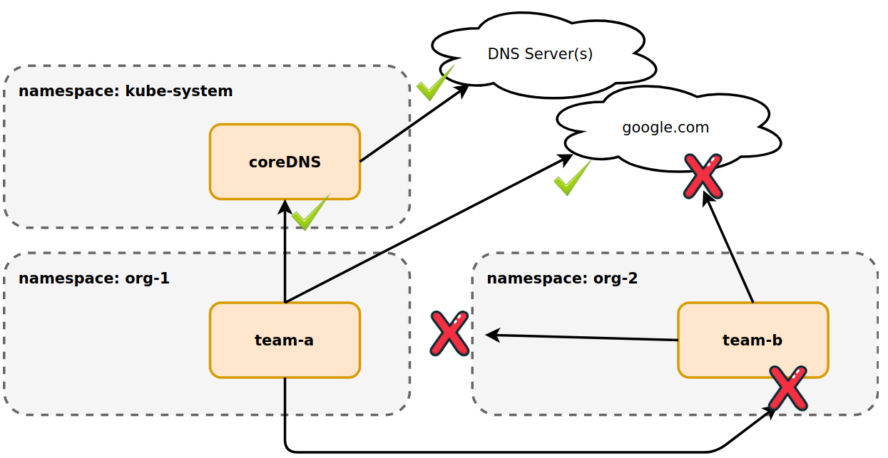
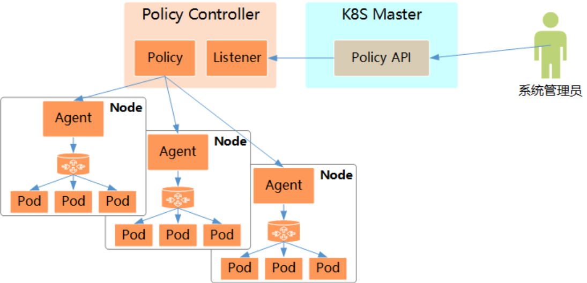
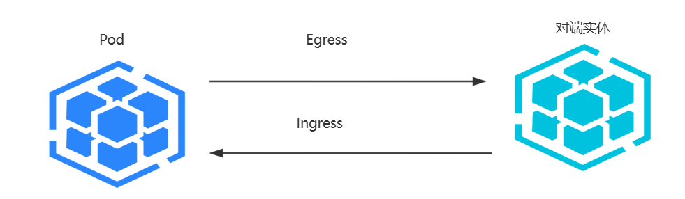
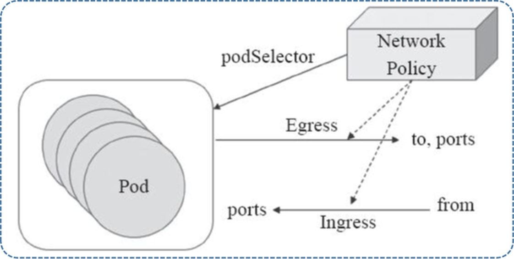

[← 返回 Kubernetes 目录]({{ '/subjects/Kubernetes/' | relative_url }})



# 17 网络策略

## 3.4 NetworkPolicy 的作用边界

[官方文档](https://kubernetes.io/zh-cn/docs/concepts/services-networking/network-policies/)将 NetworkPolicy 定义为命名空间级资源，用来描述一组 Pod 允许接收哪些入站（Ingress）流量、允许发出哪些出站（Egress）流量。它与 LimitRange、ResourceQuota 解决的问题不同；PodSecurityPolicy 已从 Kubernetes 移除，不应再作为新集群的安全控制方案。



**先确认 CNI 支持策略。** Kubernetes API 只保存 NetworkPolicy 对象，真正执行规则的是网络插件。Calico、Cilium 等可实现标准策略；单独使用 Flannel 通常不会执行 NetworkPolicy。实现方式也不必然是 iptables，可能是 eBPF 等；因此不能把某张内核规则表当成跨插件的标准行为。

默认情况下，未被任何相应方向的策略选中的 Pod 允许该方向的流量。一旦 Pod 被某条 Ingress 策略选中，其入站流量只允许匹配**所有适用策略中任意一条**的规则；Egress 方向同理。策略是允许规则的并集，不存在标准 NetworkPolicy 的规则优先级或“后写覆盖前写”。一次连接还必须同时满足源 Pod 的出站允许和目标 Pod 的入站允许；节点、Service 转发与 CNI 细节可能影响具体观测结果。

| 字段 | 含义 |
| --- | --- |
| `spec.podSelector` | 必填，选中**本策略所在命名空间**内的目标 Pod；`{}` 选中该命名空间全部 Pod。 |
| `policyTypes` | 指明策略作用于 `Ingress`、`Egress` 或两者。建议显式填写，避免依赖默认推断。 |
| `ingress[].from` / `egress[].to` | 允许的来源或目的，可使用 Pod 选择器、命名空间选择器、IP 地址段。 |
| `ports` | 限制目标端口和协议；未指定时，规则不按端口筛选。 |

同一个 `from`/`to` 条目内同时写 `namespaceSelector` 和 `podSelector`，两者为**交集**；写成两个 `-` 列表条目则为**并集**。单独的 `podSelector` 只匹配策略所在命名空间的 Pod。`ipBlock` 适合描述集群外部网段；拿 Pod IP 段做精确访问控制可能受 CNI 和 Service 地址转换影响，应优先使用标签选择器并做实测。



### 3.4.1 默认拒绝与默认允许

以下三个清单应按场景**择一或有意识地组合**，不是按顺序全部应用。`ingress: []` 与 `egress: []` 表示该方向没有允许规则；`- {}` 则表示该方向允许所有来源或目的。这是两者最重要的区别。

```yaml
# develop 命名空间中默认拒绝所有入站和出站
apiVersion: networking.k8s.io/v1
kind: NetworkPolicy
metadata:
  name: default-deny-both
  namespace: develop
spec:
  podSelector: {}
  policyTypes: [Ingress, Egress]
  ingress: []
  egress: []
```

```yaml
# 仅默认拒绝入站；不改变出站默认行为
apiVersion: networking.k8s.io/v1
kind: NetworkPolicy
metadata:
  name: default-deny-ingress
  namespace: develop
spec:
  podSelector: {}
  policyTypes: [Ingress]
  ingress: []
```

```yaml
# 在两个方向显式允许全部流量；会与其他策略做并集
apiVersion: networking.k8s.io/v1
kind: NetworkPolicy
metadata:
  name: allow-all
  namespace: develop
spec:
  podSelector: {}
  policyTypes: [Ingress, Egress]
  ingress:
    - {}
  egress:
    - {}
```

例如已经有 `default-deny-both` 时，再创建 `allow-all` 并不会被前者“覆盖”：两个对象对相同 Pod 的允许规则相加，最终仍允许全部流量。要撤销这份放行，须删除或修改 `allow-all`。

### 3.4.2 按命名空间及端口控制

下面的策略仅允许 `develop` 命名空间内的 Pod 互相访问 TCP 80。它也隔离了被选中 Pod 的出站流量，因此未单独放行 DNS；Pod 通过 Service 域名访问时可能解析失败，即使 Pod IP 直连成功。

```yaml
apiVersion: networking.k8s.io/v1
kind: NetworkPolicy
metadata:
  name: same-namespace-http
  namespace: develop
spec:
  podSelector: {}
  policyTypes: [Ingress, Egress]
  ingress:
    - from:
        - podSelector: {}
      ports:
        - protocol: TCP
          port: 80
  egress:
    - to:
        - podSelector: {}
      ports:
        - protocol: TCP
          port: 80
```

若希望 `kube-system` 和 `logs` 命名空间的客户端也访问 `develop` 中的 HTTP 服务，可增加一条入站规则。`kubernetes.io/metadata.name` 是命名空间名称标签；应先用 `kubectl get ns --show-labels` 确认集群实际标签。

```yaml
apiVersion: networking.k8s.io/v1
kind: NetworkPolicy
metadata:
  name: allow-selected-namespaces
  namespace: develop
spec:
  podSelector:
    matchLabels:
      app: myapp
  policyTypes: [Ingress]
  ingress:
    - from:
        - namespaceSelector:
            matchExpressions:
              - key: kubernetes.io/metadata.name
                operator: In
                values: [develop, kube-system, logs]
      ports:
        - protocol: TCP
          port: 80
```

这个策略只定义入站。源 Pod 若已经被出站策略隔离，还需在**源所在命名空间**另行允许出站；目标 Pod 若另有入站策略，所有允许规则仍按并集合并。

### 3.4.3 为受限 Pod 放行 DNS 与 HTTP

原示例把 `podSelector: {}`、Pod IP 段和 DNS 放行写在同一长段终端输出里，容易误以为只开 UDP 53 就能访问服务。以下示例专门选中 `develop` 中带 `role=client` 的 Pod，并只允许到 `kube-system` 中带 `k8s-app=kube-dns` 标签的 DNS Pod 的 TCP/UDP 53，以及到本命名空间带 `app=myapp` 标签的 Pod 的 TCP 80。CoreDNS 的实际标签与端口应先核实。

```yaml
apiVersion: networking.k8s.io/v1
kind: NetworkPolicy
metadata:
  name: client-egress
  namespace: develop
spec:
  podSelector:
    matchLabels:
      role: client
  policyTypes: [Egress]
  egress:
    - to:
        - namespaceSelector:
            matchLabels:
              kubernetes.io/metadata.name: kube-system
          podSelector:
            matchLabels:
              k8s-app: kube-dns
      ports:
        - protocol: UDP
          port: 53
        - protocol: TCP
          port: 53
    - to:
        - podSelector:
            matchLabels:
              app: myapp
      ports:
        - protocol: TCP
          port: 80
```

Service 虚拟 IP 的流量可能在 NetworkPolicy 评估之前或之后转换地址，不同插件对通过 Service 的出站匹配行为可能不同。测试时同时检查 Pod IP 与 Service 域名，记录 CNI 版本；不要仅凭一个 `curl` 结果推断所有路径均已放行。

### 3.4.4 实验与验证顺序

以 `develop` 中的 `app=myapp` Deployment 与 Service 为例，先确认服务本身健康，再逐条应用策略。测试客户端分别放在 `develop` 和 `default`；不要只用 `ping` 判断策略是否有效，因为标准 NetworkPolicy 主要描述 TCP、UDP、SCTP 连接，ICMP 行为因插件而异。

```bash
kubectl get pods,svc -n develop -o wide
kubectl get ns --show-labels
kubectl get networkpolicy -n develop
kubectl describe networkpolicy same-namespace-http -n develop
# 从测试 Pod 内分别尝试：
# curl --max-time 3 http://myapp.develop.svc.cluster.local
# curl --max-time 3 http://<后端PodIP>:80
```

预期判读应区分：**域名解析失败**通常指向 DNS 出站规则或 CoreDNS 状态；**连接超时**可能是入站/出站规则、路由或服务端故障；**HTTP 错误码**说明连接已建立，需检查应用。短暂策略传播延迟也可能使刚应用后的第一次测试与稳定状态不同。

### 3.4.5 Calico GlobalNetworkPolicy

标准 NetworkPolicy 是命名空间级、只有允许规则。Calico 的 `GlobalNetworkPolicy` 是厂商扩展，可提供集群范围的策略、显式动作及顺序控制；它不是 `networking.k8s.io/v1` 的一部分。仅在安装了支持该 CRD 的 Calico 版本后使用，并先查阅该版本的 Calico 文档确认 `apiVersion`、选择器语法、策略层级和默认动作。

原示例试图让部分系统命名空间访问其他命名空间，但它用 `name` 选择器、`order: 0.0` 和兜底行为组合起来，可能意外隔离业务或系统流量；尤其全局策略会扩大影响范围。这里保留其**概念关系**而不提供可直接应用的全局阻断清单：先用 `kubectl api-resources | findstr globalnetworkpolicies` 确认 CRD，再在独立测试命名空间验证规则范围、优先级和回滚方式，最后才考虑生产环境。验证时同时测试允许与预期阻断路径，并保存应用前的策略清单以便回退。

<details class="historical-figures" markdown="1">
<summary>查看原始讲义中的其余配图与历史操作截图（2 张）</summary>





</details>



<nav class="article-end" aria-label="章节导航">
  <a href="{{ '/subjects/Kubernetes/16-calico-network.html' | relative_url }}">← 上一章：Calico 网络部署与管理</a>
  <a href="{{ '/subjects/Kubernetes/' | relative_url }}">返回 Kubernetes 目录</a>
  <a href="{{ '/subjects/Kubernetes/18-service-access.html' | relative_url }}">下一章：Service 访问与负载分发 →</a>
</nav>
