[← 返回 Kubernetes 目录]({{ '/subjects/Kubernetes/' | relative_url }})



# 18 Service 访问与负载分发

# 1 服务访问

## 1.1 Service 介绍

### 1.1.1 Service 说明


- <https://kubernetes.io/zh-cn/docs/concepts/services-networking/service/>


说到外部用户来访问集群内部的场景，肯定能想到传统的负载均衡的案例：

比如：nginx的upstream,Haproxy的Backend 或者 LVS的RS 功能。

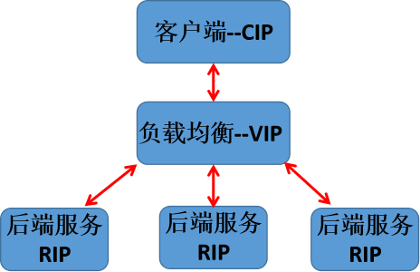

通过对Pod及其工作负载的控制资源RC和Deployment的学习，所有的应用服务都是工作在pod资源中，由于每个Pod都有独立的ip地址，而随着Pod的大量的动态创建和销毁操作后，会导致Pod的名称和IP很有可能发生了变化。假设有前端应用的pod和后端应用的pod，那么在频繁变动的场景中，集群中的应用之间该如何相互通信呢？难道是让我们以类似nginx负载均衡的方式手工定制pod ip然后进行一一管理么？显然这是很难做到的。Kubernetes集群提供了这样的一个资源对象Service，它定义了一组Pod的逻辑集合和一个用于访问它们的入口策略。Service 可以基于标签的方式自动找到对应的pod应用，而无需关心pod的ip地址变化与否，从而实现了类似负载均衡的效果。

Service 本质上就是一个四层的反向代理，集群内和外的客户端可以通过如下流程最终实现访问Pod应用。
```text
集群内部Client --> service网络 -->Pod网络 -->容器应用
集群外部Client --> 主机节点网络--> service网络 -->Pod网络 -->容器应用
```

Service 资源在master端的Controller组件中，由 Service Controller 来进行统一管理。service是Kubernetes里最核心的API资源对象之一，它是由coredns或者kube-dns组件提供的功能。每一个Service通常都是对应一个完整的业务服务，之前的Pod、RC、Deployment等资源对象都是为Service服务的。

Service 是基于名称空间的资源

**Service 和Pod 之间的关系**

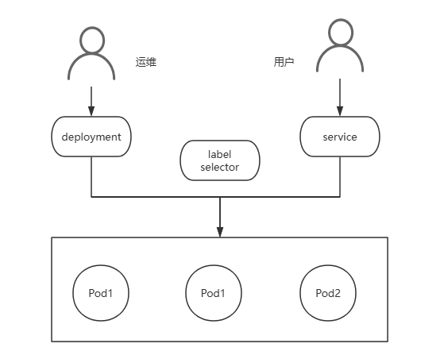

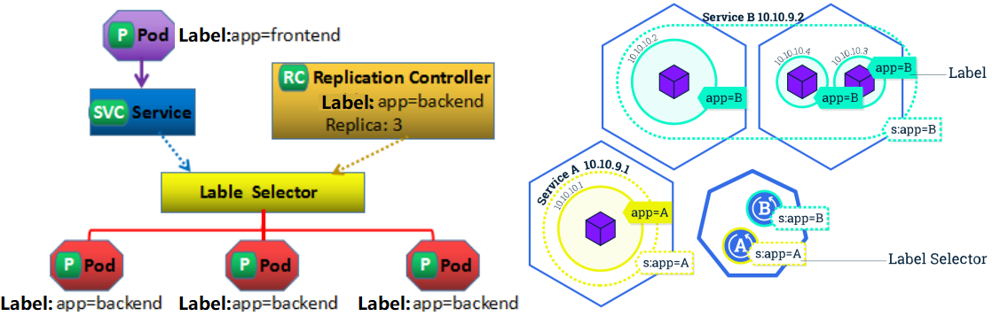

Kubernetes 的 Service定义了一个服务的访问入口地址，前端的应用Pod通过Service访问其背后一组有Pod副本组成的集群实例，Service通过Label Selector访问指定的后端Pod，RC保证Service的服务能力和服务质量处于预期状态。Service是Kubernetes中最高一级的抽象资源对象，每个Service提供一个独立的服务，集群Service彼此间使用TCP/IP进行通信，将不同的服务组合在一起运行起来，就形成了所谓的"系统"，效果如下图。

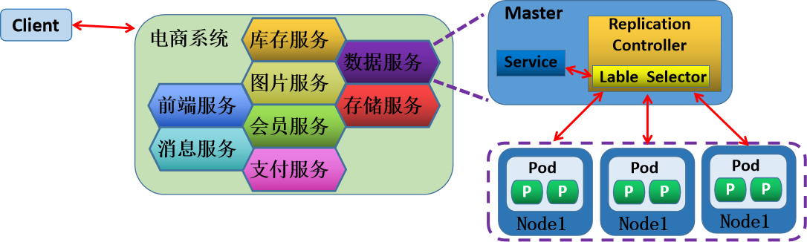

每个Pod都有一个专用的IP地址，加上Pod内部容器的Port端口，就组成了一个访问Pod专用的EndPoint(Pod IP+Container Port)，从而实现了用户外部资源访问Pod内部应用的效果。这个EndPoint资源在master端的Controller组件中，由EndPoint Controller 来进行统一管理。当多个Pod组成了一个业务集群来提供外部服务，那么外部客户端怎么才能访问业务集群服务呢？

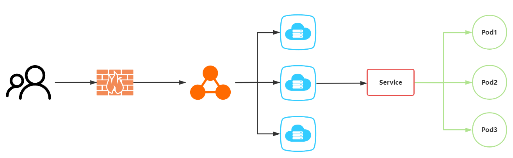

所有的Pod都有专用的Pod IP，多个Pod副本就组成了一个Kubernetes集群的后端服务，需要配置一个vip。当客户端访问的请求过来后，Master节点通过VIP把客户端的请求，负载均衡到后端的Pod副本即可。Pod是工作在不同的Node节点上，而Node节点上有一个kube-proxy组件，它就是一个软件负载均衡器，在内部有一套专有的负载均衡与会话保持机制，可以达到接收到所有对Service请求，进而通过RANDOM算法调度转发到后端的某个具体的Pod实例上来处理该请求。kube-proxy 本质就是 Service Controller位于各节点上的agent。

根据Pod所处的Node场景，有两种情况：

所有Pod副本都在同一Node节点上：对于这种情况，将Node物理节点专用的IP，作为负载均衡器的VIP，即可实现负载均衡后端服务的效果。所有Pod副本不在同一Node节点上：Node节点的物理ip就没有办法作为负载均衡器的VIP了，这也是更为常见的情况。而Kubernetes是一个分布式的资源管理平台，所以Kubernetes集群资源对象肯定不能保证在同一台Node节点，所以就不能使用Node节点的物理ip地址作为负载均衡器VIP地址了。

那么应该怎么解决这种问题呢？

Kubernetes发明了一种设计，给Service分配一个全局唯一的虚拟ip地址--cluster IP，它不存在任何网络设备上，Service通过内部的标签选择器，指定相应该Service的Pod资源，当请求发给cluster IP，后端的Pod资源收到请求后，就会响应请求。这种情况下，每个Service都有一个全局唯一通信地址，整个系统的内部服务间调用就变成了最基础的TCP/IP网络通信问题。

Service 核心功能

**服务发现**：利用标签选择器，在同一个namespace中筛选符合条件的Pod, 从面实现发现一组提供了相同服务的Pod，可以结合readiness探针实现健康性检查负载均衡: Service作为流量入口和负载均衡器，其入口为ClusterIP, 这组筛选出的Pod的IP地址，将作为该Service的后端服务器名称解析: 利用Cluster DNS，为该组Pod所代表的服务提供一个名称, 在DNS中 对于每个Service，自动生成一个A、PTR和SRV记录。

范例: 查看Kubernetes 内置的Service
```yaml
[root@master1 ~]#kubectl get svc
NAME         TYPE           CLUSTER-IP    EXTERNAL-IP   PORT(S)        AGE
kubernetes   ClusterIP      10.96.0.1     <none>        443/TCP        72d

[root@master1 ~]#kubectl get svc kubernetes -o yaml
apiVersion: v1
kind: Service
metadata:
creationTimestamp: ""
labels:
component: apiserver
provider: kubernetes
name: kubernetes
namespace: default
resourceVersion: "193"
uid: 6f24f80c-9ccc-4102-8ab8-0667fee18edd
spec:
clusterIP: 10.96.0.1
clusterIPs:
- 10.96.0.1
internalTrafficPolicy: Cluster
ipFamilies:
- IPv4
ipFamilyPolicy: SingleStack
ports:
- name: https
port: 443
protocol: TCP
targetPort: 6443
sessionAffinity: None
type: ClusterIP
status:
loadBalancer: {}

#对应同名的Endpoint
[root@master1 ~]#kubectl describe  ep kubernetes
Name:         kubernetes
Namespace:    default
Labels:       endpointslice.kubernetes.io/skip-mirror=true
Annotations:  <none>
Subsets:
Addresses:          10.0.0.200
NotReadyAddresses:  <none>
Ports:
Name   Port  Protocol
----   ----  --------
https  6443  TCP
```

### 1.1.2 Endpoints

当创建 Service资源的时候，最重要的就是为Service指定能够提供服务的标签选择器。Service Controller就会根据标签选择器会自动创建一个同名的Endpoint资源对象，Kubernetes新版中还增加了endpointslices资源。

Endpoint Controller使用Endpoint的标签选择器(继承自Service标签选择器)，筛选符合条件(包括符合标签选择器条件和处于Ready 状态)的pod资源Endpoint Controller 将符合要求的pod资源绑定到Endpoint上，并告知给Service资源谁可以正常提供服务Service 会自动获取一个固定的 cluster IP向外提供由Endpoint提供的服务资源Service 其实就是为动态的一组 pod 资源对象提供一个固定的访问入口。即 Service实现了后端Pod应用服务的发现功能。

Endpoints

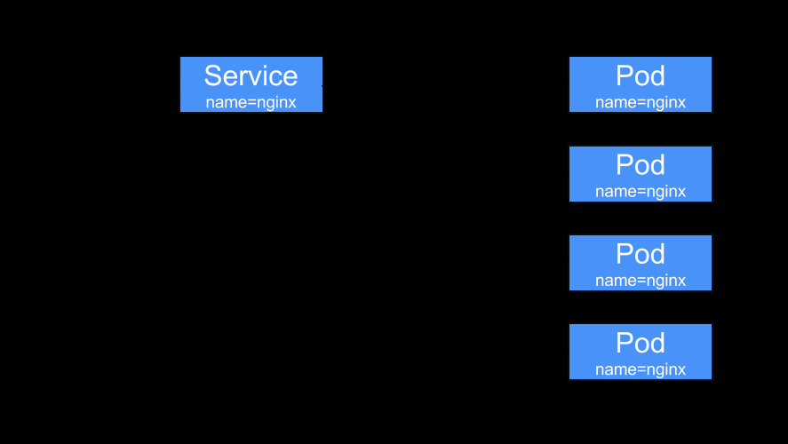

每创建一个Service ,自动创建一个和之同名的API 资源类型 Endpoints Endpoints负责维护由相关Service标签选择器匹配的Pod对象Endpoints对象上保存Service匹配到的所有Pod的IP和Port信息,称之为端点ETCD是K/V数据库, 而一个Endpoints对象对应一个Key,所有后端Pod端点信息为其Value当一个Endpoints对象对应后端每个Pod的每次变动，都需更新整个Endpoints对象，并将新的Endpoints对象重新保存至API Server和ETCD此外还需要将该对象同步至每个节点的kube-proxy在ETCD中的对象默认最大为1.5MB,一个Endpoints对象至多可以存储5000个左右的端点信息,这意味着平均每端点占300KB。

### 1.1.3 EndpointSlice

新版Kubernetes为什么需要引用EndpointSlice呢?

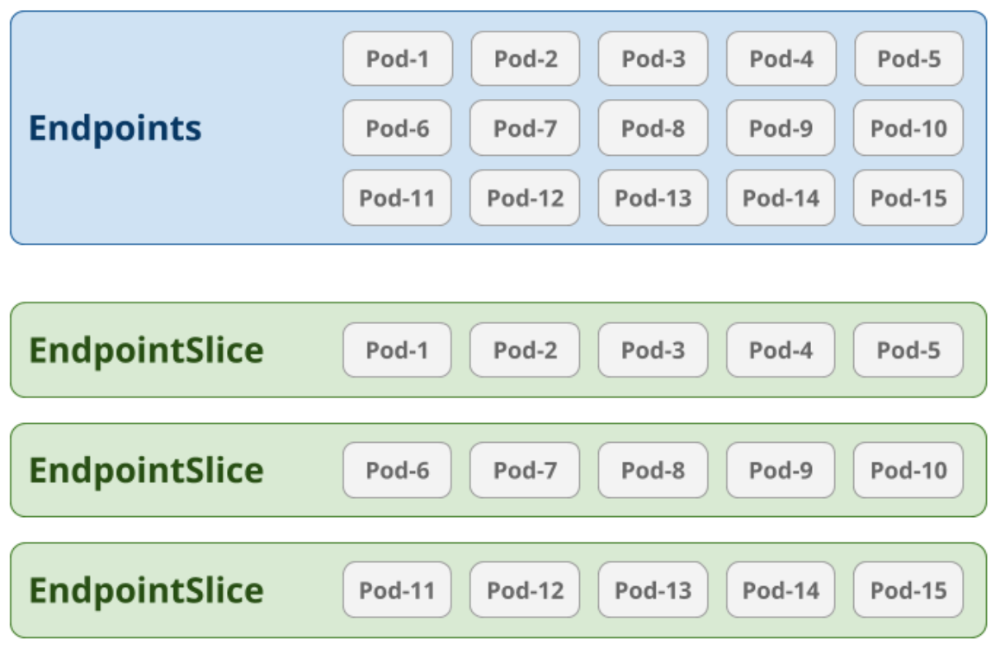

基于Endpoints机制，即便只有一个Pod的IP等信息发生变动，就需要向集群中的每个节点上的kube-proxy发送整个endpoints对象。

比如: 一个由2000个节点组成的集群中，更新一个有5000个Pod IP占用1.5MB空间的Endpoints 对象，就需要发送3GB的数据。

若以滚动更新机制，一次只升级更新一个Pod的信息，这将导致更新这个Endpoints对象需要发送15T的数据。EndpointSlice资源通过将Endpoints切分为多片来解决上述问题。

自Kubernetes v1.16引入EndpointSlice

每个端点信息的变动，仅需要更新和发送一个EndpontSlice对象,而非整个Endpoints对象。每个EndpointSlice默认存储100个端点信息，不会超过 etcd对单个对象的存储限制。可在kube-controller-manager程序上使用 --max-endpoints-per-slice 选项进行配置。

EndpointSlice并未取代Endpoints，二者同时存在

范例: 查看 Service, Endpoints 和 EndpointSlices
```bash
[root@master1 ~]#kubectl get svc,ep,endpointslices -n demo
NAME                 TYPE        CLUSTER-IP      EXTERNAL-IP   PORT(S)
AGE
service/nfs-server   ClusterIP   10.99.201.239   <none>        2049/TCP,111/UDP
2d2h

NAME                   ENDPOINTS                        AGE
endpoints/nfs-server   10.244.1.3:2049,10.244.1.3:111   2d2h

NAME                                              ADDRESSTYPE   PORTS
ENDPOINTS    AGE
endpointslice.discovery.k8s.io/nfs-server-mtzqk   IPv4          111,2049
10.244.1.3   2d2h
```

### 1.1.4 Service 的访问流程

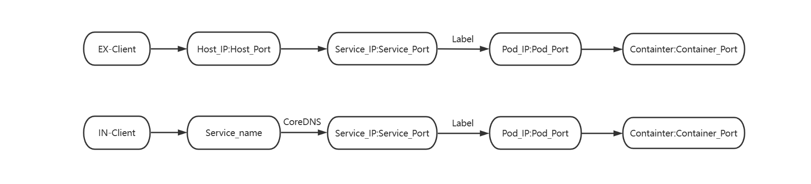

## 1.2 Service 工作模型

### 1.2.1 代理模型

一个Service对象最终体现为工作节点上的一些iptables或ipvs规则，这些规则是由kube-proxy进行实时生成和维护。

针对某一特定服务，如何将集群中的每个节点都变成其均衡器：

在每个节点上运行一个kube-proxy，由kube-proxy注册监视API Server的Service资源的创建、修改和删除将Service的定义，转为本地负载均衡功能的落地实现。

kube-proxy 将请求代理至相应端点的实现方式有五种：

userspace 早期k8s实现iptables：较旧的内核，iptables工具nftables:  依赖较新的内核，从kubernetes-v1.29.0 之后版本支持，nft 工具ipvs kernelspace: 仅Windows使用。

这些方法的目的是：kube-proxy如何确保service能在每个节点实现并正常工作。

注意: 一个集群只能选择使用一种Mode，即集群中所有节点要使用相同的方式。

#### 1.2.1.1 Userspace

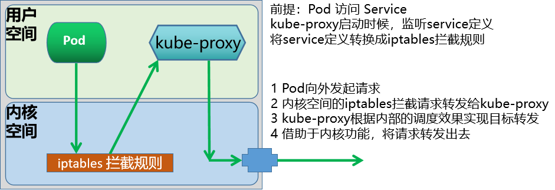

userspace模型是Kubernetes最早的一种工作模型，从kubernetes v1.1版本之前使用,在kubernetes v1.2以后淘汰。

userspace模式早由 Kube-proxy 自已来负责将service 策略转换成iptables规则。

这些iptables规则仅做请求的拦截，而不对请求进行调度处理。

**流量处理过程**

Pod向外的请求流量先到达内核空间后，经过Iptables的规则后，再由套接字送往用户空间的kube-proxy之后由kube-proxy将流量送回内核空间，并调度至后端Pod。因为涉及到来回转发，效率低下。

#### 1.2.1.2 Iptables

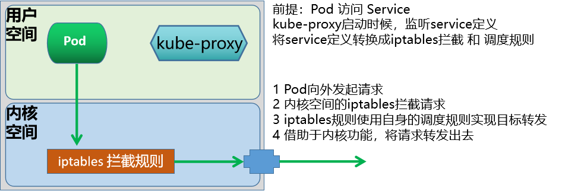

Iptables模式在kubernetes v1.1版本开始使用。 kubernetes v1.2 版本 iptables 成为默认代理模式。

Kube-proxy 自动为Service创建iptables规则

将由iptables规则直接捕获Pod向外发往ClusterIP和Port的请求流量，并重定向至当前Service的后端。对每个Endpoints对象，Service资源会为其创建iptables规则并关联至挑选的后端Pod资源。

优点：性能比userspace更加高效和可靠。

缺点：

不会在后端Pod无响应时自动重定向，而userspace可以一个service一般对应生成20条左右iptables规则中等规模的Kubernetes集群(几百个service)能够承受，但是大规模的Kubernetes集群(几千个service)可达几万条规则，性能较差集群节点数少于50个,服务数量少于2000个,可以使用此模式,否则使用IPVS模式性能更好iptables 默认基于random算法调度kube-proxy在 iptables模式下的复杂度程度为O(n)，即规模越大，性能越差。

#### 1.2.1.3 IPVS

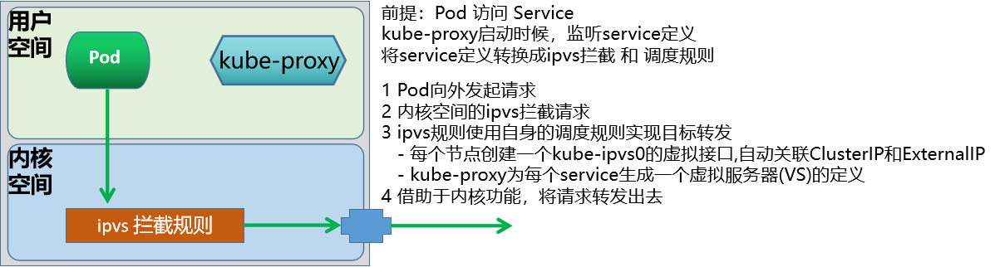

kubernetes v1.8 引入 ipvs 代理模块

kubernetes v1.9 ipvs 代理模块成为 beta 版本。kubernetes v1.11 ipvs 代理模式 GA，成为默认设置。请求流量的调度功能由ipvs实现，余下的其他功能仍由iptables完成。ipvs流量转发速度快，规则同步性能好。IPVS默认基于rr算法调度，同时也支持众多调度算法，如rr/lc/dh/sh/sed/nq等。

二进制Kubernetes的安装方式修改模式：
```bash
echo 'KUBE_PROXY_MODE=ipvs' >> /etc/sysconfig/kubelet
```

优点：

每条ipvs规则包含了两个功能：转发功能和调度功能kube-proxy在IPVS模式下是使用hash表作为底层数据结构，复杂度程度为O(1)，所以当服务很多时，性能更优据测试，当后端服务达到5000以上且不使用保持连接keepalive时的往返响应时间，和iptables模式性能相对已经有较大优势，当达到服务达到10000时，甚至可以达到iptables模式的性能两倍，此外iptables模式的CPU也会消耗更多。

注意：对于kubeadm方式安装Kubernetes集群来说，它会首先检测当前主机上是否已经包含了ipvs模块，如果加载了，就直接用ipvs中NAT模式，如果没有加载ipvs模块的话，会自动使用iptables模式。

范例: kubeadm方式将默认的iptables模式修改为IPVS模式
```bash
#查看当前模式,默认为iptables
[root@master1 ~]#curl 127.0.0.1:10249/proxyMode
iptables

[root@master1 ~]#apt install ipvsadm
[root@master1 ~]#ipvsadm -Ln
IP Virtual Server version 1.2.1 (size=4096)
Prot LocalAddress:Port Scheduler Flags
-> RemoteAddress:Port           Forward Weight ActiveConn InActConn

[root@master1 ~]#kubectl edit configmap kube-proxy -n kube-system
mode: "ipvs"   #修改此行,默认为""

#删除所有kube-proxy对应的Pod,建议reboot生效
[root@master1 ~]#kubectl delete pod -n kube-system -l   k8s-app=kube-proxy

#查看Pod 自动创建
[root@master1 ~]#kubectl get pod -n kube-system -l k8s-app=kube-proxy
NAME               READY   STATUS    RESTARTS   AGE
kube-proxy-6jrp9   1/1     Running   0          42s
kube-proxy-fr9q4   1/1     Running   0          42s
kube-proxy-g6svk   1/1     Running   0          42s
kube-proxy-lzlbn   1/1     Running   0          43s
kube-proxy-m55ts   1/1     Running   0          43s
kube-proxy-t94ff   1/1     Running   0          43s

#验证结果
[root@master1 ~]#curl 127.0.0.1:10249/proxyMode
ipvs

#每个节点都生成kube-ipvs0的虚拟网卡
[root@master1 ~]#ip a show kube-ipvs0
7: kube-ipvs0: <BROADCAST,NOARP> mtu 1500 qdisc noop state DOWN group default
link/ether 02:01:44:76:7b:65 brd ff:ff:ff:ff:ff:ff
inet 10.96.0.10/32 scope global kube-ipvs0
valid_lft forever preferred_lft forever
inet 10.106.205.83/32 scope global kube-ipvs0
valid_lft forever preferred_lft forever

inet 10.0.0.11/32 scope global kube-ipvs0
valid_lft forever preferred_lft forever
inet 10.107.246.153/32 scope global kube-ipvs0
valid_lft forever preferred_lft forever
inet 10.0.0.99/32 scope global kube-ipvs0
valid_lft forever preferred_lft forever
inet 10.109.41.99/32 scope global kube-ipvs0
valid_lft forever preferred_lft forever
inet 10.96.0.1/32 scope global kube-ipvs0
valid_lft forever preferred_lft forever
inet 10.110.50.151/32 scope global kube-ipvs0
valid_lft forever preferred_lft forever
inet 10.0.0.10/32 scope global kube-ipvs0
valid_lft forever preferred_lft forever
inet 10.105.92.154/32 scope global kube-ipvs0
valid_lft forever preferred_lft forever

#再次查看出现IPVS规则
[root@master1 ~]#ipvsadm -Ln
IP Virtual Server version 1.2.1 (size=4096)
Prot LocalAddress:Port Scheduler Flags
-> RemoteAddress:Port           Forward Weight ActiveConn InActConn
TCP  10.96.0.1:443 rr
-> 10.0.0.101:6443              Masq    1      0          0
-> 10.0.0.102:6443              Masq    1      0          0
-> 10.0.0.103:6443              Masq    1      0          0
TCP  10.96.0.10:53 rr
-> 10.244.0.4:53                Masq    1      0          0
-> 10.244.0.5:53                Masq    1      0          0
TCP  10.96.0.10:9153 rr
-> 10.244.0.4:9153              Masq    1      0          0
-> 10.244.0.5:9153              Masq    1      0          0
UDP  10.96.0.10:53 rr
-> 10.244.0.4:53                Masq    1      0          0
-> 10.244.0.5:53                Masq    1      0          0
```

范例: 二进制安装Kubernetes修改默认的iptables模式修改为IPVS模式
```bash
#修改文件路径
[root@node1 ~]#vim /var/lib/kube-proxy/kube-proxy-config.yaml
.....
mode: "ipvs"
ipvs:
scheduler: sh
```

### 1.2.2 Service 和 kube-proxy 关联关系

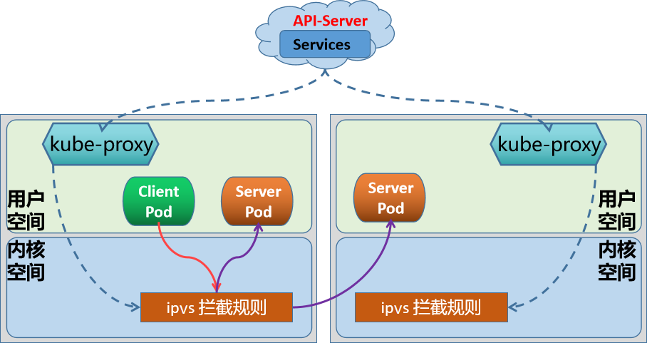

Service作为一个独立的API资源对象，它会在在API Service服务中定义出来的

在创建任何存在标签选择器的Service时，都会被自动创建一个同名的Endpoints资源，Endpoints对象会使用Label Selector自动发现后端端点，并各端点的IP配置为可用地址列表的元素。Service Controller 触发每个节点上的kube-proxy，由kube-proxy实时的转换为本地节点上面的ipvs/iptables规则。默认情况下，内核中的ipvs或iptables规则，仅仅是负责本地节点用户空间pod客户端发出请求时的拦截或者转发规则。如果Pod客户端向Service发出请求,客户端向内核发出请求，根据ipvs或iptables规则，匹配目标service。

如果service匹配，会返回当前service随对应的后端endpoint有哪些。

iptables或ipvs会根据情况挑选一个合适的endpoint地址。

如果endpoint是本机上的，则会转发给本机的endpoint如果endpoint是其他主机上的，则转发给其他主机上的endpoint。

### 1.2.3 Service 类型

对于Kubernetes 可以实现内部服务的自由通信,也可以将平台内部的服务发布到外部环境。Service主要有四种类型，实现不同的网络通信功能。
```text
https://kubernetes.io/docs/concepts/services-networking/service/#publishing-
services-service-types
```

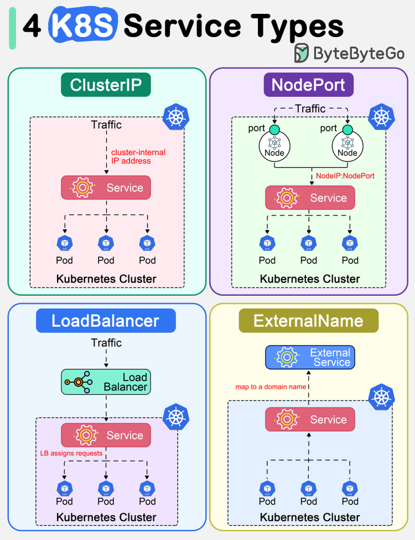

类型解析

此为Service的默认类型

ClusterIP

为集群内部的客户端访问,包括节点和Pod等，外部网络无法访问In client --> clusterIP: ServicePort (Service) --> PodIP: PodPort

本质上在ClusterIP模式基础上,再多加了一层端口映射的封装,相当于增强版的ClusterIP通过NodeIP:NodePort对外部网络提供服务，默认随机端口范围30000~32767, 可指定为固定端口NodePort是一个随机的端口，以防止端口冲突,在所有安装kube-proxy的节点。

NodePort

上都会打开此相同的端口可通过访问ClusterIP实现集群内部访问,也可以通过NodeIP:NortPort的方式实现从集群外部至内部的访问Ex Client --> NodeIP:NodePort (Service) --> PodIP:PodPort

基于NodePort基础之上，使用集群外部的运营商负载均衡器方式实现对外提供服务,增强版的NodePort基于云运营商IaaS云创建一个Kubernetes云，云平台也支持LBaaS(Load Balance as a Service)产品服务Master 借助cloud-manager向LBaaS的API请求动态创建软件LB,即支持和

LoadBalancer

Kubernetes API Server 进行交互如果没有云服务,将无法获取EXTERNAL-IP,显示Pending状态,则降级为NodePort类型Ex Client --> LB_IP:LB_PORT --> NodeIP:NodePort(Service)-->PodIP:PodPort

当Kubernetes集群需要访问集群外部服务时，需要通过externalName将外部主机引入到集群内部外部主机名以 DNS方式解析为一个 CNAME记录给Kubernetes集群的其他主机来使用这种Service既没有ClusterIP，也没有NodePort.而且依赖于内部的CoreDNS功能。

ExternalName

**ExternalName Service 的解析过程**：集群内客户端访问 Service 名称，经 CNAME 解析到外部服务名称：

`In client → Cluster ServiceName → CName → External Service Name`

这种 Service 没有 selector，因此不会创建同名的 Endpoints 资源对象。例如，MySQL Service 的集群内部域名为 `mysql.default.svc.cluster.local`，外部域名为 `mysql.bowen.org`；访问路径为 `In Client → mysql.default.svc.cluster.local → mysql.bowen.org → 集群外的 MySQL IP`。

### 1.2.4 ExternalIP
```text
https://kubernetes.io/docs/concepts/services-networking/service/#external-ips
https://kubernetes.io/zh-cn/docs/concepts/services-networking/service/#external-
ips
```

从外部访问 Kubernetes的Pod,除了使用 NodePort 和  LoadBalancer 的Service 类型,也可以使用ExternalIP 实现。如果有外部 IP 能够路由到一个或多个集群节点上，则 Kubernetes 可以通过 externalIPs 将Service公开出去。当网络流量进入集群时，如果externalIPs 作为目的 IP 地址和端口都与该 Service 匹配， Kubernetes所配置的规则和路由会确保流量被路由到该 Service 的端点之一。Service可通过使用节点上配置的辅助IP地址接入集群外部客户端流量。流量入口仅能是配置有该IP地址的节点，其它节点无效，因而此时在节点间无负载均衡的效果。

external IP所在的节点故障后，该流量入口失效，除非将该IP地址转移配置到其它节点。external IP是除了LoadBalancer和NodePort外，接入外部流量的又一种方式。定义 Service 时，你可以为任何服务类型externalIPs。由于 externalIPs 是绑定在某一个节点上,而此节点存在单点问题,可以通过Keepalived等方式实现高可用。

在下面的例子中，名为 my-service 的服务可以在 " 198.51.100.32:80 " （根据.spec.externalIPs[] 和 .spec.ports[].port 得出）上被客户端使用 TCP 协议访问。还需要在某个节点绑定此IP 1.2.3.4 到网卡上。
```yaml
apiVersion: v1
kind: Service
metadata:
name: my-service
spec:
selector:
app.kubernetes.io/name: MyApp
ports:
- name: http
protocol: TCP
port: 80
targetPort: 49152
externalIPs:
- 1.2.3.4
```

## 1.3 Service 管理

### 1.3.1 创建 Service 方式说明


- <https://kubernetes.io/zh-cn/docs/concepts/services-networking/service/>


对于Service的创建有两种方法：

命令行方法YAML 文件方法

#### 1.3.1.1 命令行方法


- <http://docs.kubernetes.org.cn/564.html>


**基础语法**
```text
#创建命令1：
kubectl create service [flags] NAME [--tcp=port:targetPort] [--dry-run]

#作用：单独创建一个service服务
flags 参数详解：
```


clusterip       Create a ClusterIP service.将集群专用服务接口 nodeport        创建一个 NodePort service.将集群内部服务以端口形式对外提供 loadbalancer    创建一个 LoadBalancer service.主要针对公有云服务 externalname    Create an ExternalName service.将集群外部服务引入集群内部

```bash
#创建命令2：
kubectl expose (-f FILENAME | TYPE NAME) [--port=port] [--protocol=TCP|UDP|SCTP]
[--target-port=number-or-name] [--name=name] [--external-ip=external-ip-of-
service] [--type=type] [options]
#作用：针对一个已存在的deployment、pod、ReplicaSet等创建一个service
#参数详解：
--port=''            #设定service对外的端口信息
--target-port=''     #设定容器的端口,默认和service的端口相同
--type=''            #设定类型，支持四种：ClusterIP(默认), NodePort,
LoadBalancer,ExternalName
--cluster-ip=''      #设定对外的ClusterIP地址
--name=''            #创建service对外的svc名称

#创建命令3：创建自主式Pod时动创建Service
kubectl run  <Pod_name> --image 镜像 --expose --port <容器端口>

#查看命令：
kubectl get svc

#查看更多信息的命令是一个通用的命令，一般常用两种方法显示更多的内容：yaml和json
#语法：
kubectl get 资源类型 [类型名称] -o yaml
kubectl get 资源类型 [类型名称] -o json
#yaml格式查看更多Service的信息
kubectl get svc <service-name> -o yaml
#注意：
在spec.ports的定义中，targetPort属性就是用来确定提供该服务的容器所暴露(EXPORT)的端口号，即
通过targetPort端口来访问业务进程在容器。
默认情况下targetPort跟我们容器定义的port一致。

#删除 service
kubectl delete svc <svc_name> [ -n <namespace>[] [--all]
```

范例：基于自主式Pod自动创建Service
```bash
[root@master1 ~]#kubectl run myapp --image registry.cn-
beijing.aliyuncs.com/bowen/pod-test:v0.1 --expose --port 80
service/myapp created
pod/myapp created

[root@master1 ~]#kubectl get svc,pod
NAME                                 TYPE           CLUSTER-IP       EXTERNAL-IP
PORT(S)             AGE
service/myapp                        ClusterIP      10.109.23.81     <none>
80/TCP              99s

NAME                                          READY   STATUS    RESTARTS
AGE
pod/myapp                                     1/1     Running   0
99s

[root@master1 ~]#kubectl get ep myapp
NAME    ENDPOINTS         AGE
myapp   10.244.1.114:80   3m8s

[root@master1 ~]#curl 10.109.23.81
kubernetes pod-test v0.1!! ClientIP: 10.244.0.0, ServerName: myapp, ServerIP:
10.244.1.114!
```

范例: kubectl create 创建 service
```bash
#简单示例
[root@master1 ~]#kubectl create service clusterip my-service1 --tcp=5678:80
[root@master1 ~]#kubectl create service clusterip my-service2 --clusterip="None"
[root@master1 ~]#kubectl create service clusterip my-service3 --
clusterip="192.168.100.100" --tcp="999"

#查看效果
[root@master1 ~]#kubectl get svc
NAME          TYPE        CLUSTER-IP        EXTERNAL-IP   PORT(S)    AGE
kubernetes    ClusterIP   192.168.0.1       <none>        443/TCP    21h
my-service1   ClusterIP   192.168.146.176   <none>        5678/TCP   94s
my-service2   ClusterIP   None              <none>        <none>     58s
my-service3   ClusterIP   192.168.100.100   <none>        999/TCP    2s
```


#结果显示：cluster-ip是自动生成的，如果不需要，值指定为None 如果要自定义cluster-ip，必须是集群初始化指定的IP范围，默认是 10.96.0.0/12


范例：kubectl expose 创建 service
```bash
#对已存在Deployment创建service
[root@master1 ~]#kubectl create deployment myweb01 --image registry.cn-
beijing.aliyuncs.com/bowen/pod-test:v0.1 --replicas 3

[root@master1 ~]#kubectl create deployment myweb02 --image registry.cn-
beijing.aliyuncs.com/bowen/pod-test:v0.2 --replicas 3

[root@master1 ~]#kubectl expose deployment myweb01 --port=81 --target-port=80
[root@master1 ~]#kubectl create svc clusterip myweb01 --tcp=81:80
[root@master1 ~]#kubectl expose deployment myweb02 --port=82 --target-port=80 --
type=NodePort

[root@master1 ~]#kubectl get svc
NAME         TYPE        CLUSTER-IP     EXTERNAL-IP   PORT(S)        AGE
kubernetes   ClusterIP   10.96.0.1      <none>        443/TCP        4m22s
myweb01     ClusterIP   10.98.236.20   <none>        81/TCP         11s
myweb02     NodePort    10.99.187.62   <none>        82:30084/TCP   3s

#自动生成同名的Endpoint
[root@master1 ~]#kubectl get endpoints
NAME         ENDPOINTS                                      AGE
kubernetes   10.0.0.200:6443                                5m54s
myweb01     10.244.1.92:81,10.244.2.63:81,10.244.3.31:81   103s
myweb02     10.244.1.93:82,10.244.2.64:82,10.244.3.32:82   95s

[root@master1 ~]#kubectl describe service myweb01
Name:              myweb01
Namespace:         default
Labels:            app=myweb01
Annotations:       <none>
Selector:          app=myweb01
Type:              ClusterIP
IP Family Policy:  SingleStack
IP Families:       IPv4
IP:                10.98.236.20
IPs:               10.98.236.20
Port:              <unset>  81/TCP
TargetPort:        81/TCP
Endpoints:         10.244.1.92:81,10.244.2.63:81,10.244.3.31:81
Session Affinity:  None
Events:            <none>

[root@master1 ~]#kubectl describe service myweb02
Name:                     myweb02
Namespace:                default
Labels:                   app=myweb02
Annotations:              <none>
Selector:                 app=myweb02
Type:                     NodePort
IP Family Policy:         SingleStack
IP Families:              IPv4
IP:                       10.99.187.62
IPs:                      10.99.187.62
Port:                     <unset>  82/TCP
TargetPort:               82/TCP
NodePort:                 <unset>  30084/TCP
Endpoints:                10.244.1.93:82,10.244.2.64:82,10.244.3.32:82
Session Affinity:         None
External Traffic Policy:  Cluster
Events:                   <none>

#清理环境
[root@master1 ~]#kubectl delete deployments.apps myweb0{1,2}
[root@master1 ~]#kubectl delete svc myweb0{1,2}
```

范例:
```bash
#一步实现创建所有pod和相应的service
[root@master1 ~]#kubectl run pod-test --image=registry.cn-
beijing.aliyuncs.com/bowen/pod-test:v0.1 --expose=true --port=80
service/pod-test created
pod/pod-test created

[root@master1 ~]#kubectl get all
NAME           READY   STATUS    RESTARTS   AGE
pod/pod-test   1/1     Running   0          7s

NAME                 TYPE        CLUSTER-IP      EXTERNAL-IP   PORT(S)   AGE
service/kubernetes   ClusterIP   192.168.0.1     <none>        443/TCP   21h
service/pod-test     ClusterIP   192.168.76.54   <none>        80/TCP    7s

[root@master1 ~]#kubectl get pod --show-labels  -o wide
NAME       READY   STATUS    RESTARTS   AGE   IP            NODE
NOMINATED NODE   READINESS GATES   LABELS
pod-test   1/1     Running   0          73s   172.16.2.90   node3.bowen.org
<none>           <none>            run=pod-test

[root@master1 ~]#curl 192.168.76.54
kubernetes pod-test v0.1!! ClientIP: 172.16.0.0, ServerName: pod-test, ServerIP:
172.16.2.90!
```

范例:
```bash
#两步实现
[root@master1 ~]#kubectl create deployment web --image=registry.cn-
beijing.aliyuncs.com/bowen/pod-test:v0.1
[root@master1 ~]#kubectl expose deployment web --name=web-service --port=80
[root@master1 ~]#kubectl expose deployment web --name=web-nodeport --port=999 --
target-port='80' --type='NodePort'

[root@master1 ~]#kubectl get all
NAME                      READY   STATUS    RESTARTS   AGE
pod/web-65655fc68-cr2z7   1/1     Running   0          116s

NAME                   TYPE        CLUSTER-IP        EXTERNAL-IP   PORT(S)
AGE
service/kubernetes     ClusterIP   192.168.0.1       <none>        443/TCP
21h
service/web-nodeport   NodePort    192.168.86.207    <none>        999:30959/TCP
3s
service/web-service    ClusterIP   192.168.108.144   <none>        80/TCP
62s

NAME                  READY   UP-TO-DATE   AVAILABLE   AGE
deployment.apps/web   1/1     1            1           116s

NAME                            DESIRED   CURRENT   READY   AGE
replicaset.apps/web-65655fc68   1         1         1       116s

[root@master1 ~]#curl 192.168.108.144
kubernetes pod-test v0.1!! ClientIP: 172.16.0.0, ServerName: web-65655fc68-
cr2z7, ServerIP: 172.16.2.91!

#注意：NodePort类型的Service会在当前集群的所有主机上开放一个服务端口，这个服务端口是随机的
[root@master1 ~]#curl 192.168.86.207:999
kubernetes pod-test v0.1!! ClientIP: 172.16.0.0, ServerName: web-65655fc68-
cr2z7, ServerIP: 172.16.2.91!
[root@master1 ~]#curl 10.0.0.101:30959
kubernetes pod-test v0.1!! ClientIP: 172.16.0.0, ServerName: web-65655fc68-
cr2z7, ServerIP: 172.16.2.91!
[root@master1 ~]#curl 10.0.0.106:30959
kubernetes pod-test v0.1!! ClientIP: 172.16.2.1, ServerName: web-65655fc68-
cr2z7, ServerIP: 172.16.2.91!

#清理还原环境
[root@master1 ~]#kubectl delete deployments.apps web
[root@master1 ~]#kubectl delete svc web-nodeport web-service
```

范例:
```bash
[root@master1 ~]#kubectl create deployment deployment-test --image registry.cn-
beijing.aliyuncs.com/bowen/pod-test:v0.1 --replicas 2

#查看pod信息
[root@master1 ~]#kubectl get pod -o wide
NAME                             READY   STATUS    RESTARTS       AGE     IP
NODE             NOMINATED NODE   READINESS GATES
deployment-test-f96bdbc9-cxbm5   1/1     Running   0              57s
10.244.2.86   node2.bowen.org   <none>           <none>
deployment-test-f96bdbc9-rhwrc   1/1     Running   0              57s
10.244.3.62   node3.bowen.org   <none>           <none>

#对已有的Deployment创建对应的service
[root@master1 ~]#kubectl expose deployment deployment-test --port 80

#查看service
[root@master1 ~]#kubectl get svc
NAME              TYPE        CLUSTER-IP      EXTERNAL-IP   PORT(S)   AGE
deployment-test   ClusterIP   10.111.116.76   <none>        80/TCP    4s
kubernetes        ClusterIP   10.96.0.1       <none>        443/TCP   22d

#可以看到后端的两个Pod的IP地址
[root@master1 ~]#kubectl get ep
NAME              ENDPOINTS                       AGE
deployment-test   10.244.2.86:80,10.244.3.62:80   9s
kubernetes        10.0.0.200:6443                 22d

#测试名称解析，10.96.0.10为coredns服务器地址
[root@master1 ~]#dig -t A deployment-test.default.svc.cluster.local @10.96.0.10
+short
10.97.30.140

#通过service的IP访问后端的Pod
[root@master1 ~]#curl 10.111.116.76
kubernetes pod-test v0.1!! ClientIP: 10.244.0.0, ServerName: deployment-test-
f96bdbc9-rhwrc, ServerIP: 10.244.3.62!
[root@master1 ~]#curl 10.111.116.76
kubernetes pod-test v0.1!! ClientIP: 10.244.0.0, ServerName: deployment-test-
f96bdbc9-cxbm5, ServerIP: 10.244.2.86!

#创建测试的Pod
[root@master1 ~]#kubectl run busybox --image busybox:1.30.0  -- sleep 3600

#测试访问service
[root@master1 ~]#kubectl exec -it busybox -- sh
#无法ping通
/ # ping -c1 deployment-test
PING deployment-test (10.111.116.76): 56 data bytes

--- deployment-test ping statistics ---
1 packets transmitted, 0 packets received, 100% packet loss

#可以通过sevice名称访问http服务
/ # wget -qO - deployment-test
```


kubernetes pod-test v0.1!! ClientIP: 10.244.3.59, ServerName: deployment-test-f96bdbc9-cxbm5, ServerIP: 10.244.2.86!/ # wget -qO - deployment-test kubernetes pod-test v0.1!! ClientIP: 10.244.3.59, ServerName: deployment-test-f96bdbc9-rhwrc, ServerIP: 10.244.3.62!


#### 1.3.1.2 文件方式


- <https://kubernetes.io/docs/concepts/services-networking/service/>


**语法解析**
```yaml
apiVersion: v1
kind: Service
metadata:
name: …
namespace: …
labels:
key1: value1
key2: value2
spec:
type: <string>                    # Service类型，默认为ClusterIP
selector: <map[string]string>     # 指定用于过滤出servic所代理的后端Pod的标签,只支持
等值类型的标签选择器，多个条件内含“与”逻辑
ports:                            # Service的端口对象列表
- name: <string>                  # 端口名称,需要保证唯一性
protocol: <string>              # 协议，目前仅支持TCP、UDP和SCTP，默认为TCP
port: <integer>                 # Service的端口号
targetPort:  <string>           # 后端Pod的端口号或名称，名称需由Pod中的规范定义
nodePort: <integer>             #节点端口号，仅适用NodePort和LoadBalancer类型,范
围：30000-32768，建议不指定而由系统自动分配
- name: <string>
.......
clusterIP:  <string>              # 指定Service的集群IP，建议不指定而由系统自动分配
internalTrafficPolicy: <string>   # 内部流量策略处理方式，Local表示由当前节点处理，
Cluster表示向集群范围调度，默认值为Cluster
externalTrafficPolicy:  <string>  # 外部流量策略处理方式，默认为Cluster，当为Local
时，表示由当前节点处理，性能较好，但无负载均衡功能，且可以看到真实客户端IP，Cluster表示向集群范
围调度，和Local相反，基于性能原因，生产更建议Local，此方式只支持type是NodePort和
LoadBlancer类型或者ExternalIPs
loadBalancerIP:  <string>         # 外部负载均衡器使用的IP地址，仅适用于LoadBlancer,
此字段未来可能被删除
externalName: <string>            # 外部服务名称，该名称将作为Service的DNS CNAME值
externalIPs   <[]string>          # 群集中的节点将接受此服务的流量的 IP 地址列表。这些
IP不由 Kubernetes管理。用户负责确保流量到达具有此 IP 的节点。常见的是不属于 Kubernetes 系统
的外部负载均衡器，注意：此IP和Type类型无关
```

### 1.3.2 ClusterIP Service 实现

范例：查看集群内默认 Service
```bash
#在集群内kubeapi对应的SVC默认占用Service 网络的第一个IP
[root@master1 ~]#kubectl get svc kubernetes
NAME         TYPE        CLUSTER-IP   EXTERNAL-IP   PORT(S)   AGE
kubernetes   ClusterIP   10.96.0.1    <none>        443/TCP   410d

#DNS对应的SVc，默认占用Service网络的第10个IP
[root@master1 ~]#kubectl get svc -n kube-system
NAME       TYPE        CLUSTER-IP   EXTERNAL-IP   PORT(S)                  AGE
kube-dns   ClusterIP   10.96.0.10   <none>        53/UDP,53/TCP,9153/TCP   410d
```

范例:  单端口应用
```yaml
#如果基于资源配置文件创建资源，依赖于后端pod的标签，才可以关联后端的资源
#准备多个后端pod对象
[root@master1 ~]#kubectl create deployment myweb --image=registry.cn-
beijing.aliyuncs.com/bowen/pod-test:v0.1 --replicas=3

#检查效果
[root@master1 ~]#kubectl get pod --show-labels -o wide
NAME                     READY   STATUS    RESTARTS   AGE   IP             NODE
NOMINATED NODE   READINESS GATES   LABELS
myweb-5df49fdd5-cd8b4   1/1     Running   0          18s   172.16.1.56
node2.bowen.org   <none>           <none>            app=myweb,pod-template-
hash=5df49fdd5
myweb-5df49fdd5-mvmrt   1/1     Running   0          18s   172.16.3.106
node1.bowen.org   <none>           <none>            app=myweb,pod-template-
hash=5df49fdd5
myweb-5df49fdd5-s2k5w   1/1     Running   0          18s   172.16.2.93
node3.bowen.org   <none>           <none>            app=myweb,pod-template-
hash=5df49fdd5

#创建service对象
[root@master1 ~]#cat  service-clusterip-test.yaml
kind: Service
apiVersion: v1
metadata:
name: service-clusterip-test
spec:
#type: ClusterIP           #默认即为ClusterIP，此行可省略
#clusterIP: 192.168.64.100 #可以手动指定IP，但一般都是系统自动指定而无需添加此行
selector:
app: myweb          #引用上面deloyment的名称，同时也是Pod的Label中app的值,实现
service代理指定Pod的功能
#version: v1.0      #可以添加多个label与关系，即只过滤出有此处label匹配的pod，而非
deployment的名称
ports:
- name: http
protocol: TCP
port: 80             #Service的端口
targetPort: 80       #后端Pod对应的端口

[root@master1 ~]#kubectl apply -f service-clusterip-test.yaml

#查看
[root@master1 ~]#kubectl get all

NAME                         READY   STATUS    RESTARTS   AGE
pod/myweb-5df49fdd5-cd8b4   1/1     Running   0          2m16s
pod/myweb-5df49fdd5-mvmrt   1/1     Running   0          2m16s
pod/myweb-5df49fdd5-s2k5w   1/1     Running   0          2m16s

NAME                             TYPE        CLUSTER-IP       EXTERNAL-IP
PORT(S)   AGE
service/kubernetes               ClusterIP   192.168.0.1      <none>
443/TCP   21h
service/service-clusterip-test   ClusterIP   192.168.64.158   <none>
80/TCP    2s

NAME                     READY   UP-TO-DATE   AVAILABLE   AGE
deployment.apps/myweb   3/3     3            3           2m16s

NAME                               DESIRED   CURRENT   READY   AGE
replicaset.apps/myweb-5df49fdd5   3         3         3       2m16s

[root@master1 ~]#kubectl get svc
NAME                   TYPE        CLUSTER-IP       EXTERNAL-IP   PORT(S)   AGE
kubernetes             ClusterIP   192.168.0.1      <none>        443/TCP   21h
service-cluster-test   ClusterIP   192.168.64.158   <none>        80/TCP    75s

#自动创建同名的endpoint
[root@master1 ~]#kubectl get ep
NAME                     ENDPOINTS                                     AGE
kubernetes               10.0.0.200:6443                               9d
service-clusterip-test   172.16.1.56:80,172.16.2.93:80,172.16.3.106:80 5s

#查看service信息
[root@master1 ~]#kubectl describe svc service-clusterip-test
Name:              service-clusterip-test
Namespace:         default
Labels:            <none>
Annotations:       <none>
Selector:          app=myweb
Type:              ClusterIP
IP Family Policy:  SingleStack
IP Families:       IPv4
IP:                192.168.64.158    #对应的ClusterIP
IPs:               192.168.64.158
Port:              http  80/TCP
TargetPort:        80/TCP
Endpoints:         172.16.1.56:80,172.16.2.93:80,172.16.3.106:80  #对应后端Pod的地
址
Session Affinity:  None
Events:            <none>
#结果显示：service 自动关联了四个Endpoints

#访问验证
[root@master1 ~]#curl 192.168.64.158
kubernetes pod-test v0.1!! ClientIP: 172.16.0.0, ServerName: myweb-5df49fdd5-
cd8b4, ServerIP: 172.16.1.56!
[root@master1 ~]#curl 192.168.64.158
kubernetes pod-test v0.1!! ClientIP: 172.16.0.0, ServerName: myweb-5df49fdd5-
mvmrt, ServerIP: 172.16.3.106!
```
```bash
[root@master1 ~]#curl 192.168.64.158

kubernetes pod-test v0.1!! ClientIP: 172.16.0.0, ServerName: myweb-5df49fdd5-
s2k5w, ServerIP: 172.16.2.93!
#结果显示：后端随机代理到不同的pod应用了

#在测试从其它Pod通过service名称访问,内部通过修改目标IP的DNAT实现,但源地址不变
[root@master1 ~]#kubectl run client-test-$RANDOM --image registry.cn-
beijing.aliyuncs.com/bowen/admin-box:v0.1 --restart=Never --rm -it --
command -- /bin/bash
root@client-test-12345~# curl  service-clusterip-test
kubernetes pod-test v0.1!! ClientIP: 172.16.0.0, ServerName: myweb-5df49fdd5-
cd8b4, ServerIP: 172.16.1.56!

#测试从Service的自身的Pod访问Service
#注意:当访问Pod访问自已所对应的Service时,恰恰被调度到自身Pod时会修改源IP为其它IP(相当于
FULLNAT),而被调度到其它的Pod时则保留其源IP,相当于只DNAT
#Pod自身发起访问最终至自身的流量称为发夹流量
[root@master1 ~]#kubectl exec -it myweb-5df49fdd5-cd8b4 --command -- /bin/bash
root@myweb-5df49fdd5-cd8b4~# curl  service-clusterip-test
kubernetes pod-test v0.1!! ClientIP: 172.16.1.1, ServerName: myweb-5df49fdd5-
cd8b4, ServerIP: 172.16.1.56!
kubernetes pod-test v0.1!! ClientIP: 172.16.1.56, ServerName: myweb-5df49fdd5-
mvmrt, ServerIP: 172.16.3.106!
kubernetes pod-test v0.1!! ClientIP: 172.16.1.56, ServerName: myweb-5df49fdd5-
s2k5w, ServerIP: 172.16.2.93!

#如果跨namespace,可以用<service>.<namespace>格式访问,一般用于公共的基础服务,比如:数据
库,MQ服务等
root@client-test-12345~# curl  service-clusterip-test.default
kubernetes pod-test v0.1!! ClientIP: 172.16.0.0, ServerName: myweb-5df49fdd5-
mvmrt, ServerIP: 172.16.3.106!

#删除并重建Pod
[root@master1 ~]#kubectl delete myweb-5df49fdd5-cd8b4 myweb-5df49fdd5-mvmrt
myweb-5df49fdd5-s2k5w

#通过原来的service名称和IP都还可访问,说明service比Pod地址更加稳定,可以用于Pod之间的访问
root@client-test-12345~# / # wget -qO - http://service-test
kubernetes pod-test v0.1!! ClientIP: 10.244.3.11, ServerName: myweb-f95974cf4-
zqbzd, ServerIP: 10.244.3.12!

#kubernetes-v1.29版之后，采用nftable方式查看各种规则
[root@node1 ~]#nft  list ruleset|head
table ip nat {
chain DOCKER {
iifname "docker0" counter packets 0 bytes 0 return
}

chain POSTROUTING {
type nat hook postrouting priority srcnat; policy accept;
counter packets 66 bytes 5249 jump KUBE-POSTROUTING
oifname != "docker0" ip saddr 172.17.0.0/16 counter packets 0 bytes 0
masquerade
counter packets 56 bytes 4649 jump FLANNEL-POSTRTG

#查看Pod的调度算法RANDOM和DNAT的策略
[root@master1 ~]#iptables -vnL -t nat |grep random
0     0 MASQUERADE  all  --  *      *       10.244.0.0/16       !224.0.0.0/4
/* flanneld masq */ random-fully

0     0 MASQUERADE  all  --  *      *      !10.244.0.0/16
10.244.0.0/16        /* flanneld masq */ random-fully
0     0 MASQUERADE  all  --  *      *       0.0.0.0/0            0.0.0.0/0
/* kubernetes service traffic requiring SNAT */ random-fully
0     0 KUBE-SEP-LM3EPTFUMTUQ2AGO  all  --  *      *       0.0.0.0/0
0.0.0.0/0            /* default/service-nodeport:http -> 10.244.1.76:80 */
statistic mode random probability 0.33333333349
0     0 KUBE-SEP-W56VQGQCLB74M2RA  all  --  *      *       0.0.0.0/0
0.0.0.0/0            /* default/service-nodeport:http -> 10.244.1.77:80 */
statistic mode random probability 0.50000000000
0     0 KUBE-SEP-ZJFRUAU4WMFGDV6X  all  --  *      *       0.0.0.0/0
0.0.0.0/0            /* kube-system/kube-dns:dns-tcp -> 10.244.1.74:53 */
statistic mode random probability 0.50000000000
0     0 KUBE-SEP-MQJLPRJYFMDPYHQF  all  --  *      *       0.0.0.0/0
0.0.0.0/0            /* kube-system/kube-dns:metrics -> 10.244.1.74:9153 */
statistic mode random probability 0.50000000000
0     0 KUBE-SEP-W3WEMR74BBVQWX4B  all  --  *      *       0.0.0.0/0
0.0.0.0/0            /* kube-system/kube-dns:dns -> 10.244.1.74:53 */
statistic mode random probability 0.50000000000

#清理环境
[root@master1 ~]#kubectl delete -f  service-clusterip-test.yaml
```

范例: 多端口实现

有很多服务都会同时开启多个端口，典型的比如：tomcat三个端口，接下来实现创建多端口的Service。
```yaml
#资源定义文件
[root@master1 ~]#cat service-clusterip-multi-port.yaml
kind: Service
apiVersion: v1
metadata:
name: service-clusterip-multi-port
spec:
selector:
app: myweb
ports:
- name: http
protocol: TCP
port: 80
targetPort: 80
- name: https
protocol: TCP
port: 443
targetPort: 443
#关键点：只能有一个ports属性，多了会覆盖,每一个子port必须有一个name属性,由于service是基于标
签的方式来管理pod的，所以必须有标签选择器

#创建服务service
[root@master1 ~]#kubectl apply -f service-clusterip-multi-port.yaml

[root@master1 ~]#kubectl get svc
NAME                 TYPE        CLUSTER-IP        EXTERNAL-IP   PORT(S)
AGE
kubernetes           ClusterIP   192.168.0.1       <none>        443/TCP
21h

service-clusterip-multi-port   ClusterIP   192.168.134.142   <none>
80/TCP,443/TCP   3s
```

范例: ClusterIP 类型同时指定externalIPs

ClusterIP 类型只能支持集群内容访问，如何想从集群外部访问，可以使用 externalIPs实现。

注意：externalIPs 可以应用在所有的service模式下的
```yaml
#在集群中的某个节点添加一个公网ip
[root@node3 ~]#ip a a 10.0.0.66/24 dev eth0 label eth0:1
#注意：这里的模拟外网ip，必须被宿主机能够访问，而且与Kubernetes的集群Pod网段不一样

#配置清单文件
[root@master1 ~]#cat service-clusterip-externalip.yaml
apiVersion: v1
kind: Service
metadata:
name: service-clusterip-externalip
spec:
type: ClusterIP
selector:
app: myweb
ports:
- name: http
protocol: TCP
port: 80
targetPort: 80
externalIPs:
- 10.0.0.66
#注意：这里的externalIPs对于使用哪种Service类型，其实关联度不大。

#创建
[root@master1 ~]#kubectl apply -f service-clusterip-externalip.yaml

#查看
[root@master1 ~]#kubectl get svc service-test-externalip
NAME                        TYPE             CLUSTER-IP        EXTERNAL-IP
PORT(S)     AGE
service-clusterip-externalip     ClusterIP   192.168.213.247   10.0.0.66
80:32267/TCP   9s
#结果显示：EXTERNAL-IP 已经指定了公网能够正常访问的ip地址

#使用externalIPs和标准端口即可访问
[root@master1 ~]#curl 10.0.0.66
kubernetes pod-test v0.1!! ClientIP: 172.16.0.0, ServerName: myweb-5df49fdd5-
mvmrt, ServerIP: 172.16.3.106!
[root@master1 ~]#curl 10.0.0.66
kubernetes pod-test v0.1!! ClientIP: 172.16.0.0, ServerName: myweb-5df49fdd5-
s2k5w, ServerIP: 172.16.2.93!
[root@master1 ~]#curl 10.0.0.66
kubernetes pod-test v0.1!! ClientIP: 172.16.0.0, ServerName: myweb-5df49fdd5-
cd8b4, ServerIP: 172.16.1.56!
#结果显示：对于EXTERNAL-IP来说，可以直接通过该ip和容器端口来进行服务访问，而无需通过其他端口

#清理环境
[root@master1 ~]#kubectl delete -f service-clusterip-externalip.yaml
```

### 1.3.3 NodePort Service 实现

NodePort会在所有节点主机上，向外暴露一个指定或者随机的端口，供集群外部的应用能够访问Kubernetes集群内部的Pod资源。

注意：nodePort 属性范围为 30000-32767，且type 类型只支持 NodePort或LoadBalancer。

注意: 此方式有安全风险，端口为非标端口,而且性能一般,生产一般较少使用。

生产中建议使用Ingress方式向外暴露集群内的服务。

范例：修改NodePort端口范围
```bash
[root@master1 ~]#kubectl exec -it -n kube-system  kube-apiserver-master1.bowen.org
-- kube-apiserver --help |grep port-range
--service-node-port-range portRange         A port range to reserve for
services with NodePort visibility.  This must not overlap with the ephemeral port
range on nodes.  Example: '30000-32767'. Inclusive at both ends of the range.
(default 30000-32767)

[root@master1 ~]#cp /etc/kubernetes/manifests/kube-apiserver.yaml .
[root@master1 ~]#vim /etc/kubernetes/manifests/kube-apiserver.yaml
......
- --tls-private-key-file=/etc/kubernetes/pki/apiserver.key
- --service-node-port-range=40000-42767
image: registry.aliyuncs.com/google_containers/kube-apiserver:v1.32.0
.......
[root@master1 ~]#reboot

[root@master1 ~]#kubectl create svc nodeport myweb --tcp=80:80
service/myweb created
[root@master1 ~]#kubectl get svc myweb
NAME    TYPE       CLUSTER-IP       EXTERNAL-IP   PORT(S)        AGE
myweb   NodePort   10.100.140.127   <none>        80:41044/TCP   7s
```

**externaltrafficpolicy 有两种策略**

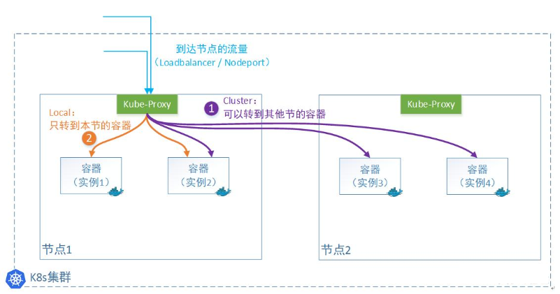

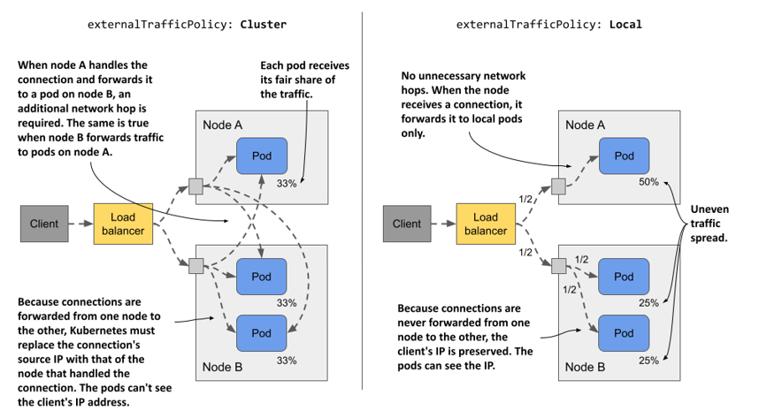

cluster 模式

此为默认模式

集群外的请求报文从某节点的NodePort进入,该节点的Service 可以将请求流量调度到其他节点上的Pod,无需关心Pod在哪个节点上。Kube-proxy转发外部请求时会替换掉报文的源IP和目标IP,相当于FULLNAT。

返回时需要从原路返回,可能会产生跨节点的跃点转发流量。此模式负载均衡效果好，因为无论容器实例怎么分布在多个节点上，它都会转发过去。但是由于多了一次转发，性能会损失。如果是NodePort类型,Pod无法获取外部客户端真实客户端IP。如果从集群内的Pod访问SVC,可以看到Pod源地址，但本Pod访问SVC调度至到自身时例外。

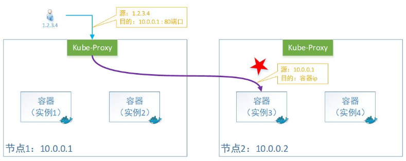

**local 模式**

集群外的请求报文从某节点的NodePort进入,该节点的Service 只会将请求流量调度到当前节点上的Pod。

外部请求流量只发给本机的Pod, Kube-proxy转发时只会替换掉报文的目标IP,即只实现DNAT例外：当从Pod所在集群节点访问时，也是通过FULLNAT来实现的

即：容器收到的报文，看到源IP地址还是用户的原有 IP。

如果从集群内的Pod访问SVC,可以看到Pod源地址，但本Pod访问SVC调度至到自身时例外。此模式的负载均衡效果不是很好，因为一旦容器实例分布在多个节点上，它只转发给本机，不产生跨节点的跃点转发流量。但是少了一次转发，性能会相对好。由于本机不会跨节点转发报文，所以要想对所有节点上的容器实现负载均衡，就需要借助外部的Loadbalancer来实现。因此使用Local 模式,一般会使用 LoadBalancer Service 类型结合 Loadbalancer 实现。

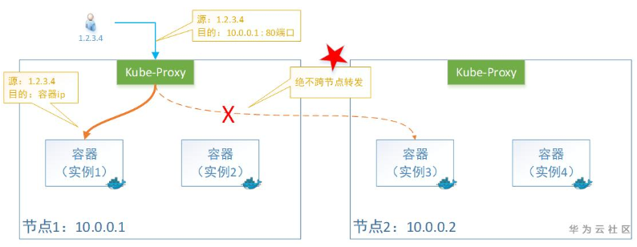

如果使用Local模式，仍然转发至其它节点的Pod，因为是DNAT，会导致如下图示的通信异常。

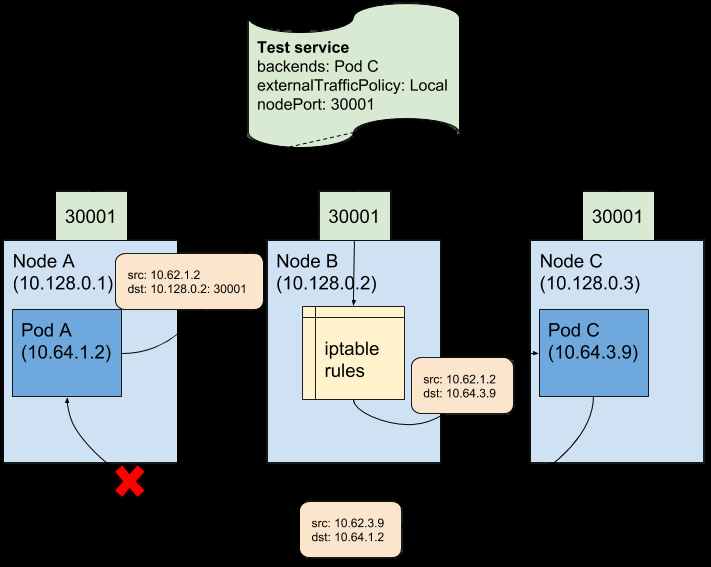

范例:  nodePort 类型
```yaml
[root@master1 ~]#cat service-nodeport.yaml
kind: Service
apiVersion: v1
metadata:
name: service-nodeport
spec:
type: NodePort   #指定service的类型,默认值为ClusterIP

#externalTrafficPolicy: Local #默认值为Cluster,如果是Local只能被当前运行Pod的节点处理
流量.并且可以获取客户端真实IP
selector:
app: myweb
ports:
- name: http
protocol: TCP
port: 80
targetPort: 80
nodePort: 30066  #指定固定端口（30000-32767）,使用NodePort类型且不指定nodeport，会
自动分配随机端口向外暴露

#应用
[root@master1 ~]#kubectl apply  -f service-nodeport.yaml

#查看有两个端口,集群内访问192.168.91.192:80,集群外访问任意节点的30066
[root@master1 ~]#kubectl get svc
NAME            TYPE        CLUSTER-IP       EXTERNAL-IP      PORT(S)        AGE
service-nodeport   NodePort    192.168.91.192   <none>        80:30066/TCP   9s

#访问service的地址
[root@master1 ~]#curl 192.168.91.192
kubernetes pod-test v0.1!! ClientIP: 172.16.0.0, ServerName: myweb-5df49fdd5-
mvmrt, ServerIP: 172.16.3.106!

#默认externalTrafficPolicy: Cluster，所以使用访问集群中任意一个物理节点的地址都可以
[root@master1 ~]#curl 10.0.0.101:30066
kubernetes pod-test v0.1!! ClientIP: 172.16.0.0, ServerName: myweb-5df49fdd5-
mvmrt, ServerIP: 172.16.3.106!
[root@master1 ~]#curl 10.0.0.102:30066
kubernetes pod-test v0.1!! ClientIP: 172.16.4.0, ServerName: myweb-5df49fdd5-
s2k5w, ServerIP: 172.16.2.93!
[root@master1 ~]#curl 10.0.0.106:30066
kubernetes pod-test v0.1!! ClientIP: 172.16.2.1, ServerName: myweb-5df49fdd5-
s2k5w, ServerIP: 172.16.2.93!
#访问指定主机的指定端口，还会跳转到其他主机

externalTrafficPolicy  <string> #外部流量策略处理方式，Local表示由当前节点处理，Cluster
表示向集群范围调度，默认的外部流量调度策略是 cluster
#限制：Local 将外网访问的请求都转发到当前主机节点上，但是依赖于当前主机必须有对应的pod资源，否
则会出现问题
#注意:如果当前节点有多个pod,仍然还会负载均衡

#从集群外访问，如果是externalTrafficPolicy为cluster，则Pod不能看到真实客户端IP
[root@master1 ~]#kubectl logs -f myweb-5d78b4dcbd-6rgv4
* Running on http://0.0.0.0:80/ (Press CTRL+C to quit)
10.244.1.0 - - [08/Apr/2023 03:55:57] "GET / HTTP/1.1" 200 -
10.244.2.1 - - [08/Apr/2023 03:56:42] "GET / HTTP/1.1" 200 -

#新版使用nft規則
[root@master1 ~]#nft list ruleset |grep 66
meta l4proto tcp ip daddr 127.0.0.0/8  tcp dport 30066 # nfacct-name
localhost_nps_accepted_pkts counter packets 0 bytes 0 jump KUBE-EXT-
75TCIBBYN24S2RET
meta l4proto tcp  tcp dport 30066 counter packets 1 bytes 60 jump KUBE-
EXT-75TCIBBYN24S2RET
ct state new  counter packets 90567 bytes 6601175 jump KUBE-PROXY-
FIREWALL

ct state new  counter packets 90567 bytes 6601175 jump KUBE-SERVICES

#查看生成的iptables规则，旧版
[root@master1 ~]#echo 'obase=16;30066'|bc
7572
[root@master1 ~]#iptables -vnL -t nat | grep -iE "30066|7572"

#环境清理
[root@master1 ~]#kubectl delete -f service-nodeport.yaml
```

范例:  流量调度策略 Local
```yaml
[root@master1 ~]#kubectl get svc service-nodeport  -o yaml | grep TrafficPolicy
externalTrafficPolicy: Cluster
internalTrafficPolicy: Cluster

#创建配置,指定流量调度策略是Local
[root@master1 ~]#cat service-nodeport-local.yaml
apiVersion: v1
kind: Service
metadata:
name: service-nodeport-local
spec:
type: NodePort
externalTrafficPolicy: Local  #指定Local
ports:
- port: 80
nodePort: 30099
selector:
app: myweb

[root@master1 ~]#kubectl apply -f service-nodeport-local.yaml

[root@master1 ~]#kubectl get svc
NAME                     TYPE        CLUSTER-IP      EXTERNAL-IP   PORT(S)
AGE
kubernetes               ClusterIP   192.168.0.1     <none>        443/TCP
22h
service-nodeport-local   NodePort    192.168.1.192   <none>        80:30099/TCP
6s

[root@master1 ~]#curl 10.0.0.101:30099
kubernetes pod-test v0.1!! ClientIP: 172.16.0.0, ServerName: myweb-5df49fdd5-
mvmrt, ServerIP: 172.16.3.106!

[root@master1 ~]#kubectl get pod -o wide
NAME                     READY   STATUS    RESTARTS   AGE   IP             NODE
NOMINATED NODE   READINESS GATES
myweb-5df49fdd5-cd8b4   1/1     Running   0          39m   172.16.1.56
node2.bowen.org   <none>           <none>
myweb-5df49fdd5-mvmrt   1/1     Running   0          39m   172.16.3.106
node1.bowen.org   <none>           <none>
myweb-5df49fdd5-s2k5w   1/1     Running   0          39m   172.16.2.93
node3.bowen.org   <none>           <none>

#多次访问返回当前主机的一个pod

[root@master1 ~]#curl 10.0.0.106:30099
kubernetes pod-test v0.1!! ClientIP: 10.0.0.101, ServerName: myweb-5df49fdd5-
s2k5w, ServerIP: 172.16.2.93!
[root@master1 ~]#curl 10.0.0.106:30099
kubernetes pod-test v0.1!! ClientIP: 10.0.0.101, ServerName: myweb-5df49fdd5-
s2k5w, ServerIP: 172.16.2.93!
[root@master1 ~]#curl 10.0.0.106:30099
kubernetes pod-test v0.1!! ClientIP: 10.0.0.101, ServerName: myweb-5df49fdd5-
s2k5w, ServerIP: 172.16.2.93!

#发现master2，3节点无法访问
[root@master1 ~]#curl 10.0.0.102:30099
^C
[root@master1 ~]#curl 10.0.0.101:30099
kubernetes pod-test v0.1!! ClientIP: 172.16.0.0, ServerName: myweb-5df49fdd5-
s2k5w, ServerIP: 172.16.2.93!
[root@master1 ~]#curl 10.0.0.103:30099
^C

#访问其它节点,则
[root@master1 ~]#curl 10.0.0.104:30099
kubernetes pod-test v0.1!! ClientIP: 10.0.0.101, ServerName: myweb-5df49fdd5-
mvmrt, ServerIP: 172.16.3.106!
[root@master1 ~]#curl 10.0.0.105:30099
kubernetes pod-test v0.1!! ClientIP: 10.0.0.101, ServerName: myweb-5df49fdd5-
cd8b4, ServerIP: 172.16.1.56!
[root@master1 ~]#curl 10.0.0.106:30099
kubernetes pod-test v0.1!! ClientIP: 10.0.0.101, ServerName: myweb-5df49fdd5-
s2k5w, ServerIP: 172.16.2.93!
#结果显示：外部流量定向到当前主机，而且不影响当前主机级别的负载均衡策略

#缩减Pod数
[root@master1 ~]#kubectl scale deployment myweb --replicas 1

#查看Pod所在的节点,此有Pod的节点可以访问,其它无Pod的节点,将无法访问
[root@master1 ~]#kubectl get pod -o wide
[root@master1 services]#kubectl get pod -o wide
NAME                     READY   STATUS             RESTARTS        AGE     IP
NODE             NOMINATED NODE   myweb-5d775c669c-q6kq8   1/1
Running            0               20m     10.244.1.121   node1.bowen.org
<none>           <none>

C:\Users\Bowen>curl 10.0.0.104:30099
kubernetes pod-test v0.1!! ClientIP: 10.0.0.1, ServerName: myweb-5d775c669c-
q6kq8, ServerIP: 10.244.1.121!
C:\Users\Bowen>curl 10.0.0.105:30099
^C
C:\Users\Bowen>curl 10.0.0.106:30099
^C

#从集群外访问，如果是externalTrafficPolicy为Local，则Pod可以看到真实客户端IP
C:\Users\lbtoo>curl 10.0.0.104:30066
kubernetes pod-test v0.1!! ClientIP: 10.0.0.1, ServerName: myweb-5d78b4dcbd-
96r94, ServerIP: 10.244.1.85!

#访问日志显示真实客户端IP
[root@master1 ~]#kubectl logs -f myweb-5df49fdd5-mvmrt
* Running on http://0.0.0.0:80/ (Press CTRL+C to quit)

10.0.0.204 - - [08/Apr/2023 03:50:47] "GET / HTTP/1.1" 200 -
10.0.0.1 - - [08/Apr/2023 03:51:44] "GET / HTTP/1.1" 200 -

#环境清理
[root@master1 ~]#kubectl delete -f service-nodeport-local.yaml
```

### 1.3.4 LoadBalancer Service 实现

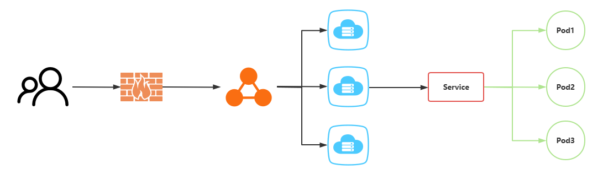

只有Kubernetes集群是部署在一个LBaaS平台上且指供有一个集群外部的LB才适合使用LoadBalancer。一般的公有云都提供了此功能,但可能会有费用产生。如果在一个非公用云的普通的Kubernetes集群上，创建了一个LoadBalancer类型的Service，一般情况默认环境中是没有LBaaS的，所以会导致由于找不到指定的服务，状态会一直处于 Pending 状态。如果在私有云环境中使用 LoadBalancer Service，可以使用云原生的开源项目实现负载均衡器，比如OpenELB, MetalLB 实现。

Loadbalancer 可以获取用户访问的Service对应的Pod在哪个节点上,因此支持externaltrafficpolicy为Local模式的流量转发。

#### 1.3.4.1 LoadBalancer 类型但没有 loadBalancerIP

范例:  LoadBalancer 类型默认无法获取loadBalancerIP
```yaml
#清单文件
[root@master1 ~]#cat service-loadbalancer.yaml
apiVersion: v1
kind: Service
metadata:
name: service-loadbalancer
spec:
type: LoadBalancer
externalTrafficPolicy: Local
selector:
app: myweb
ports:
- name: http
protocol: TCP
port: 80
targetPort: 80
#loadBalancerIP: 6.6.6.6  #指定地址后，还需要连接云服务商的LBaaS服务才能真正获得此地
址，否则为pending状态

[root@master1 ~]#kubectl apply -f service-loadbalancer.yaml

#结果显示：svc的外网负载EXTERNAL-IP一直在pending状态

[root@master1 ~]#kubectl get svc service-loadbalancer
NAME                   TYPE           CLUSTER-IP       EXTERNAL-IP   PORT(S)
AGE
service-loadbalancer   LoadBalancer   192.168.180.31   <pending>
80:31677/TCP   11s
#注意：LoadBalancer 本身是一个增强的NodePort类型的Service。

#注意：虽然EXTERNAL-IP处理Pending状态，但是CLUSTER-IP：31677端口仍然可以访问
C:\Users\Bowen>curl 10.0.0.201:31677
kubernetes pod-test v0.1!! ClientIP: 10.244.2.0, ServerName: myweb-5d775c669c-
q6kq8, ServerIP: 10.244.1.121!

C:\Users\Bowen>curl 10.0.0.202:31677
kubernetes pod-test v0.1!! ClientIP: 10.244.2.0, ServerName: myweb-5d775c669c-
q6kq8, ServerIP: 10.244.1.121!

C:\Users\Bowen>curl 10.0.0.203:31677
kubernetes pod-test v0.1!! ClientIP: 10.244.2.0, ServerName: myweb-5d775c669c-
q6kq8, ServerIP: 10.244.1.121!

#环境清理
[root@master1 ~]#kubectl delete -f service-loadbalancer.yaml
```

#### 1.3.4.2  externalIPs

如果当前底层没有Iaas服务，也没有LBaaS服务，但是想直接通过众所周知的服务端口地址来进行访问，可以通过 externalIPs 实现。

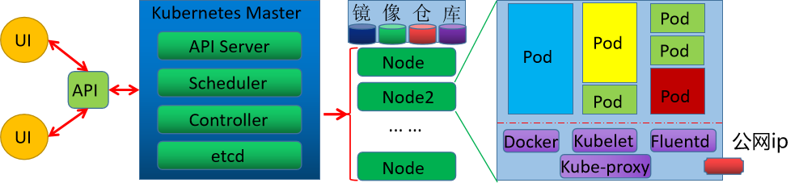

当前的Kubernetes集群，假如只有某个节点上绑定了一个对外的公网ip，其他主机则没有，那么我们可以通过指定的此主机上的公网ip使用标准端口来接入外部流量。可以借助于 externalIPs 属性来为当前的service指定公网ip地址即可。

范例: LoadBalancer 类型同时指定externalIPs
```yaml
#为局域网内的某台主机添加一个公网ip
[root@node3 ~]#ip a a 10.0.0.66/24 dev eth0 label eth0:1
#注意：这里的模拟的外网ip，必须被宿主机能够访问，而且与Kubernetes的集群Pod网段不一样

#配置清单文件
[root@master1 ~]#cat service-loadbalancer-externalip.yml
apiVersion: v1
kind: Service
metadata:
name: service-loadbalancer-externalip
spec:
type: LoadBalancer
ports:
- port: 80
selector:

app: myweb
externalIPs:
- 10.0.0.66
#注意：这里的externalIPs对于使用哪种Service类型无关

#创建
[root@master1 ~]#kubectl apply -f service-loadbalancer-externalip.yml

#查看
[root@master1 ~]#kubectl get svc service-loadbalancer-externalip
NAME                              TYPE           CLUSTER-IP        EXTERNAL-IP
PORT(S)        AGE
service-loadbalancer-externalip   LoadBalancer   192.168.213.247   10.0.0.66
80:32267/TCP   9s
#结果显示：EXTERNAL-IP 已经指定了公网能够正常访问的ip地址

#使用externalIPs和标准端口即可访问
[root@master1 ~]#curl 10.0.0.66
kubernetes pod-test v0.1!! ClientIP: 172.16.0.0, ServerName: myweb-5df49fdd5-
mvmrt, ServerIP: 172.16.3.106!
[root@master1 ~]#curl 10.0.0.66
kubernetes pod-test v0.1!! ClientIP: 172.16.0.0, ServerName: myweb-5df49fdd5-
s2k5w, ServerIP: 172.16.2.93!
[root@master1 ~]#curl 10.0.0.66
kubernetes pod-test v0.1!! ClientIP: 172.16.0.0, ServerName: myweb-5df49fdd5-
cd8b4, ServerIP: 172.16.1.56!
#结果显示：对于EXTERNAL-IP来说，可以直接通过该ip和容器端口来进行服务访问，而无需通过其他端口

#环境清理
[root@master1 ~]#kubectl delete -f service-loadbalancer-externalip.yml
```

#### 1.3.4.3 OpenELB 实现 LBaaS 服务

##### 1.3.4.3.1 OpenELB 介绍

OpenELB 是一个开源的云原生负载均衡器实现。可以在基于裸金属服务器、边缘以及虚拟化的 Kubernetes 环境中使用 LoadBalancer 类型的 Service 对外暴露服务。OpenELB 项目最初由国内青云的 KubeSphere 社区发起。目前已作为 CNCF 沙箱项目加入 CNCF 基金会，由 OpenELB 开源社区维护与支持。

官网:


- <https://openelb.io/>
- <https://github.com/openelb/openelb>


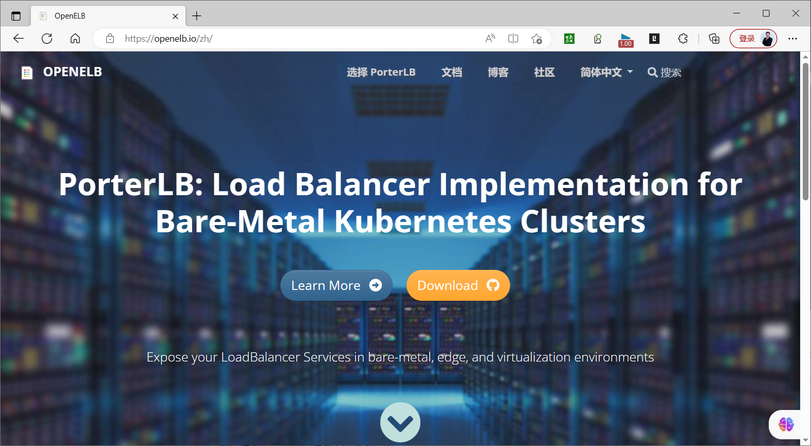

OpenELB 也拥有两种主要工作模式：Layer2 模式和 BGP 模式(需要硬件支持)。OpenELB 的 BGP 模式目前暂不支持 IPv6。无论是 Layer2 模式还是 BGP 模式，核心思路都是通过某种方式将特定 VIP 的流量引到 k8s 集群中，然后再通过 kube-proxy 将流量转发到后面的特定服务。Layer2 模式需要 k8s 集群基础环境支持发送 anonymous ARP/NDP packets。因为 OpenELB 是针对裸金属服务器设计的，因此如果是在云环境中部署，需要注意是否满足条件。

**核心功能**

BGP模式和二层网络模式下的负载均衡ECMP路由和负载均衡IP地址池管理基于CRD来管理BGP配置。

注意: 此应用可能不支持 Openstack 等云环境。

##### 1.3.4.3.2 OpenELB 实现

**安装说明**
```text
https://openelb.github.io/docs/getting-started/installation/install-openelb-on-
kubernetes/
```

范例: 部署和使用 OpenELB
```yaml
#使用kubectl部署OpenELB至Kubernetes集群
[root@master1 ~]#wget
https://raw.githubusercontent.com/openelb/openelb/master/deploy/openelb.yaml

#查看创建的资源类型
[root@master1 ~]#grep ^kind openelb.yaml
kind: Namespace
kind: CustomResourceDefinition
kind: CustomResourceDefinition
kind: CustomResourceDefinition
kind: ServiceAccount
kind: ServiceAccount

kind: Role
kind: Role
kind: ClusterRole
kind: ClusterRole
kind: ClusterRole
kind: RoleBinding
kind: RoleBinding
kind: ClusterRoleBinding
kind: ClusterRoleBinding
kind: ClusterRoleBinding
kind: Service
kind: Deployment
kind: Job
kind: Job
kind: MutatingWebhookConfiguration
kind: ValidatingWebhookConfiguration

#查看镜像地址,有些镜像国内可能无法下载，可以通过代理服务https://dockerproxy.com/下载镜像
[root@master1 ~]#grep image: openelb.yaml
image: kubesphere/openelb:v0.5.1
image: registry.k8s.io/ingress-nginx/kube-webhook-certgen:v1.1.1
image: registry.k8s.io/ingress-nginx/kube-webhook-certgen:v1.1.1

#镜像如果无法下载,修改镜像地址
[root@master1 ~]#vim openelb.yaml
#image: kubesphere/openelb:v0.5.1
registry.cn-beijing.aliyuncs.com/bowen/kubesphere/openelb:v0.5.1
#image: bowen/ingress-nginx-kube-webhook-certgen:v1.1.1
#image: registry.k8s.io/ingress-nginx/kube-webhook-certgen:v1.1.1
image: registry.cn-beijing.aliyuncs.com/bowen/ingress-nginx-kube-
webhook-certgen:v1.1.1

[root@master1 ~]#kubectl apply -f openelb.yaml

#查看创建的CRD自定义资源类型
[root@master1 ~]#kubectl get crd
NAME                             CREATED AT
bgpconfs.network.kubesphere.io   2022-11-23T01:57:23Z
bgppeers.network.kubesphere.io   2022-11-23T01:57:23Z
eips.network.kubesphere.io       2022-11-23T01:57:23Z

#确认openelb-manager Pod已经处于Running状态，且容器已经Ready。
[root@master1 ~]#kubectl get pods -n openelb-system
NAME                              READY   STATUS      RESTARTS   AGE
openelb-admission-create-p5h2p    0/1     Completed   0          5m33s
openelb-admission-patch-mxhm9     0/1     Completed   0          5m33s
openelb-keepalive-vip-5gmp2       1/1     Running     0          4m38s
openelb-keepalive-vip-bv8z9       1/1     Running     0          4m38s
openelb-keepalive-vip-s7vlp       1/1     Running     0          4m38s
openelb-manager-d6df4dfc4-tpwz9   1/1     Running     0          5m33s

#创建了一个Eip资源对象，它提供了一个地址池给LoadBalancer Service使用。
[root@master1 ~]#cat service-loadbalancer-eip-pool.yaml
apiVersion: network.kubesphere.io/v1alpha2
kind: Eip
metadata:

name: eip-pool
annotations:
eip.openelb.kubesphere.io/is-default-eip: "true" # 指定当前Eip作为向
LoadBalancer Server分配地址时使用默认的eip对象
spec:
address: 10.0.0.10-10.0.0.50 #指定排除了主机节点之外的地址范围，可以使用单个IP或者带有掩
码长度的网络地址
protocol: layer2             #指定OpenELB模式，支持bgp(需要硬件支持)、layer2和vip三
种，默认为bgp
interface: eth0              # OpenELB侦听ARP或NDP请求时使用的网络接口名称，仅layer2
模式下有效
disable: false

#创建资源
[root@master1 ~]#kubectl apply -f service-loadbalancer-eip-pool.yaml

#查看结果
[root@master1 ~]#kubectl get  eip
NAME       CIDR                  USAGE   TOTAL
eip-pool   10.0.0.10-10.0.0.50           41

[root@master1 ~]#kubectl describe  eip eip-pool
Name:         eip-pool
Namespace:
Labels:       <none>
Annotations:  eip.openelb.kubesphere.io/is-default-eip: true
API Version:  network.kubesphere.io/v1alpha2
Kind:         Eip
Metadata:
Creation Timestamp:
Finalizers:
finalizer.ipam.kubesphere.io/v1alpha1
Generation:  2
Managed Fields:
API Version:  network.kubesphere.io/v1alpha2
Fields Type:  FieldsV1
fieldsV1:
f:metadata:
f:annotations:
.:
f:eip.openelb.kubesphere.io/is-default-eip:
f:kubectl.kubernetes.io/last-applied-configuration:
f:spec:
.:
f:address:
f:interface:
f:protocol:
Manager:      kubectl-client-side-apply
Operation:    Update
Time:
API Version:  network.kubesphere.io/v1alpha2
Fields Type:  FieldsV1
fieldsV1:
f:metadata:
f:finalizers:
.:
v:"finalizer.ipam.kubesphere.io/v1alpha1":
Manager:      openelb-manager

Operation:    Update
Time:
API Version:  network.kubesphere.io/v1alpha2
Fields Type:  FieldsV1
fieldsV1:
f:status:
.:
f:firstIP:
f:lastIP:
f:poolSize:
f:ready:
f:v4:
Manager:         openelb-manager
Operation:       Update
Subresource:     status
Time:
Resource Version:  1118656
UID:               c2da88da-e114-4203-8c96-e056b6bf79e5
Spec:
Address:    10.0.0.10-10.0.0.50
Interface:  eth0
Protocol:   layer2
Status:
First IP:   10.0.0.10
Last IP:    10.0.0.50
Pool Size:  41
Ready:      true
v4:         true
Events:       <none>
```
```yaml
[root@master1 ~]#kubectl get eip eip-pool -o yaml
apiVersion: network.kubesphere.io/v1alpha2
kind: Eip
metadata:
annotations:
eip.openelb.kubesphere.io/is-default-eip: "true"
kubectl.kubernetes.io/last-applied-configuration: |
{"apiVersion":"network.kubesphere.io/v1alpha2","kind":"Eip","metadata":
{"annotations":{"eip.openelb.kubesphere.io/is-default-eip":"true"},"name":"eip-
pool"},"spec":{"address":"10.0.0.50-
10.0.0.60","disable":false,"interface":"eth0","protocol":"layer2"}}
creationTimestamp: ""
finalizers:
- finalizer.ipam.kubesphere.io/v1alpha1
generation: 2
name: eip-pool
resourceVersion: "986554"
uid: 590addaa-9a57-4d85-a066-f0c263d5fb50
spec:
address: 10.0.0.10-10.0.0.50
interface: eth0
protocol: layer2
status:
firstIP: 10.0.0.10
lastIP: 10.0.0.50
poolSize: 11
ready: true
v4: true

#创建Deployment和LoadBalancer类型的Service，测试地址池是否能给Service分配LoadBalancer
IP
[root@master1 ~]#kubectl create deployment myapp --image=registry.cn-
beijing.aliyuncs.com/bowen/pod-test:v0.1 --replicas=3

#方法1
#清单文件
[root@master1 ~]#cat service-loadbalancer-lbaas.yaml
apiVersion: v1
kind: Service
metadata:
name: service-loadbalancer-lbaas
spec:
type: LoadBalancer
externalTrafficPolicy: Local
selector:
app: myapp
ports:
- name: http
protocol: TCP
port: 80
targetPort: 80

[root@master1 ~]#kubectl apply -f service-loadbalancer-lbaas.yaml

#方法2
[root@master1 ~]#kubectl create service loadbalancer myapp --tcp=80:80

#查看service资源对象myapp是否自动获得了External IP。
[root@master1 ~]#kubectl get svc myapp
NAME    TYPE           CLUSTER-IP      EXTERNAL-IP   PORT(S)        AGE
myapp   LoadBalancer   10.110.50.151   10.0.0.10     80:31491/TCP   36s

[root@master1 ~]#kubectl get svc myapp -o yaml
apiVersion: v1
kind: Service
metadata:
annotations:
eip.openelb.kubesphere.io/v1alpha2: eip-pool
layer2.openelb.kubesphere.io/v1alpha1: master1.bowen.org
lb.kubesphere.io/v1alpha1: openelb
protocol.openelb.kubesphere.io/v1alpha1: layer2
creationTimestamp: ""
finalizers:
- finalizer.lb.kubesphere.io/v1alpha1
labels:
app: myapp
eip.openelb.kubesphere.io/v1alpha2: eip-pool
name: myapp
namespace: default
resourceVersion: "986749"
uid: 347c510c-84c0-4d97-b766-aa874cce8cb2
spec:
allocateLoadBalancerNodePorts: true
clusterIP: 10.97.180.0
clusterIPs:
- 10.97.180.0

externalTrafficPolicy: Cluster
internalTrafficPolicy: Cluster
ipFamilies:
- IPv4
ipFamilyPolicy: SingleStack
ports:
- name: 80-80
nodePort: 31464
port: 80
protocol: TCP
targetPort: 80
selector:
app: myapp
sessionAffinity: None
type: LoadBalancer
status:
loadBalancer:
ingress:
- ip: 10.0.0.10

#查看Service对应后端Pod的地址
```
```bash
[root@master1 ~]#kubectl get ep
NAME         ENDPOINTS                                      AGE
kubernetes   10.0.0.200:6443                                76d
myapp        10.244.1.79:80,10.244.2.85:80,10.244.3.75:80   3m28s

#从集群外部的客户端上通过Service对应EXTERNAL-IPIP地址10.0.0.10对myapp服务发起访问
C:\Users\Bowen>curl 10.0.0.10
kubernetes pod-test v0.1!! ClientIP: 10.244.0.0, ServerName: myapp-7dbd45d496-
qffnr, ServerIP: 10.244.1.79!

C:\Users\Bowen>curl 10.0.0.10
kubernetes pod-test v0.1!! ClientIP: 10.244.0.0, ServerName: myapp-7dbd45d496-
f7fbk, ServerIP: 10.244.2.85!

C:\Users\Bowen>curl 10.0.0.10
kubernetes pod-test v0.1!! ClientIP: 10.244.0.0, ServerName: myapp-7dbd45d496-
vmdb2, ServerIP: 10.244.3.75!

#缩减Pod
[root@master1 ~]#kubectl scale deployment myapp --replicas 1

[root@master1 ~]#kubectl get pod -o wide
NAME                     READY   STATUS        RESTARTS   AGE     IP
NODE             NOMINATED NODE   READINESS GATES
myapp-7dbd45d496-kvvjk   1/1     Running       0          6m12s   10.244.3.96
node3.bowen.org   <none>           <none>

#所有节点的NodePOrt都可以访问
C:\Windows\System32>curl 10.0.0.201:31491
kubernetes pod-test v0.1!! ClientIP: 10.0.0.1, ServerName: myapp-7dbd45d496-
kvvjk, ServerIP: 10.244.3.96!
C:\Windows\System32>curl 10.0.0.202:31491
kubernetes pod-test v0.1!! ClientIP: 10.0.0.1, ServerName: myapp-7dbd45d496-
kvvjk, ServerIP: 10.244.3.96!
C:\Windows\System32>curl 10.0.0.203:31491
kubernetes pod-test v0.1!! ClientIP: 10.0.0.1, ServerName: myapp-7dbd45d496-
kvvjk, ServerIP: 10.244.3.96!

#修改配置externalTrafficPolicy为Local
[root@master1 ~]#kubectl edit svc service-loadbalancer
externalTrafficPolicy: Local

#集群内所有节点访问都可以
[root@master1 ~]#curl 10.0.0.10

#集群外访问失败
C:\Users\lbtoo>curl 10.0.0.10
curl: (28) Failed to connect to 10.0.0.10 port 80 after 21043 ms: Couldn't
connect to server
```

#### 1.3.4.4 MetalLB 实现 LBaaS 服务

##### 1.3.4.4.1 MetalLB 介绍


- <https://github.com/metallb/metallb>
- <https://metallb.universe.tf/>


A network load-balancer implementation for Kubernetes using standard routing protocols

MetalLB  是由 Google 开源提供, 当前属于 CNCF的 sandbox 项目。

**MetalLB 功能实现依赖于两种机制**：Address Allocation 地址分配：基于用户配置的地址池，为用户创建的LoadBalancer分配IP地址,并配置在节点上External Announcement 对外公告：让集群外部的网络了解新分配的P地址，MetalLB使用ARP、NDP或BGP实现。

MetallB 可配置为在二层模式或BGP模式下运行。

**二层模式(ARP/NDP)**

LoadBalancer IP地址配置在某一个节点上，并使用ARP(IPv4)或NDP(IPv6)对外公告。拥有LoadBalancer IP 地址的节点将成为Service流量的惟一入口，并在节点故障时自动进行故障转移。并未真正实现负载均衡，存在性能瓶颈，且故障转移存在秒级的延迟。

**BGP模式**

集群中的所有节点与本地网络中的BGP Router建立BGP对等会话，通告LoadBalancer IP，从而告知Router如何进行流量路由。可以实现跨多个节点的真正意义上的负载均衡。

注意: 此应用可能不支持 Openstack 等云环境。

##### 1.3.4.4.2 MetalLB 实现

**安装说明**


- <https://metallb.universe.tf/installation/>
- <https://metallb.io/installation/>


**部署MetalLB 前准备**

如果 kube-proxy工作于ipvs模式，必须使用严格ARP（StrictARP）模式，因此若有必要，先运行如下命令，配置kube-proxy。
```bash
kubectl get configmap kube-proxy -n kube-system -o yaml | \
sed -e "s/strictARP: false/strictARP: true/" | \
kubectl apply -f - -n kube-system
```

**部署MetalLB至Kubernetes集群**
```bash
METALLB_VERSION='v0.14.9'
METALLB_VERSION='v0.14.4'
kubectl apply -f
https://raw.githubusercontent.com/metallb/metallb/${METALLB_VERSION}/config/mani
fests/metallb-native.yaml
```

创建地址池

注意: IPAddressPool 必须使用Kuberetes集群节点的IP地址段。
```yaml
apiVersion: metallb.io/v1beta1
kind: IPAddressPool
metadata:
name: localip-pool
namespace: metallb-system
spec:
addresses:
- 10.0.0.10-10.0.0.50
autoAssign: true
avoidBuggyIPs: true
```

**创建二层公告机制**
```yaml
apiVersion: metallb.io/v1beta1
kind: L2Advertisement
metadata:
name: localip-pool-l2a
namespace: metallb-system
spec:
ipAddressPools:
- localip-pool
interfaces:
- eth0  #用于发送免费ARP公告
```

**创建 Service 和 Deployment**

创建Deployment和LoadBalancer类型的Service，测试地址池是否能给Service分配LoadBalancer IP。

范例：
```yaml
#下载最新版
[root@master1 ~]#wget
https://raw.githubusercontent.com/metallb/metallb/main/config/manifests/metallb-
native.yaml
#加速
[root@master1 ~]#wget
https://mirror.ghproxy.com/https://raw.githubusercontent.com/metallb/metallb/mai
n/config/manifests/metallb-native.yaml

#指定版本
[root@master1 ~]#METALLB_VERSION='v0.15.2'
[root@master1 ~]#METALLB_VERSION='v0.14.9'
[root@master1 ~]#METALLB_VERSION='v0.14.8'
[root@master1 ~]#METALLB_VERSION='v0.14.4'
[root@master1 ~]#kubectl apply -f
https://raw.githubusercontent.com/metallb/metallb/${METALLB_VERSION}/config/mani
fests/metallb-native.yaml
namespace/metallb-system created
customresourcedefinition.apiextensions.k8s.io/bfdprofiles.metallb.io created
customresourcedefinition.apiextensions.k8s.io/bgpadvertisements.metallb.io
created
customresourcedefinition.apiextensions.k8s.io/bgppeers.metallb.io created
customresourcedefinition.apiextensions.k8s.io/communities.metallb.io created
customresourcedefinition.apiextensions.k8s.io/ipaddresspools.metallb.io created
customresourcedefinition.apiextensions.k8s.io/l2advertisements.metallb.io
created
customresourcedefinition.apiextensions.k8s.io/servicel2statuses.metallb.io
created
serviceaccount/controller created
serviceaccount/speaker created
role.rbac.authorization.k8s.io/controller created
role.rbac.authorization.k8s.io/pod-lister created
clusterrole.rbac.authorization.k8s.io/metallb-system:controller created
clusterrole.rbac.authorization.k8s.io/metallb-system:speaker created
rolebinding.rbac.authorization.k8s.io/controller created
rolebinding.rbac.authorization.k8s.io/pod-lister created
clusterrolebinding.rbac.authorization.k8s.io/metallb-system:controller created
clusterrolebinding.rbac.authorization.k8s.io/metallb-system:speaker created
configmap/metallb-excludel2 created
secret/metallb-webhook-cert created
service/metallb-webhook-service created
deployment.apps/controller created
daemonset.apps/speaker created
validatingwebhookconfiguration.admissionregistration.k8s.io/metallb-webhook-
configuration created

#创建CRD
[root@master1 ~]#kubectl get crd
NAME                                       CREATED AT
bfdprofiles.metallb.io                     2024-04-18T12:25:37Z
bgpadvertisements.metallb.io               2024-04-18T12:25:37Z
bgppeers.metallb.io                        2024-04-18T12:25:37Z

communities.metallb.io                     2024-04-18T12:25:37Z
ipaddresspools.metallb.io                  2024-04-18T12:25:37Z
l2advertisements.metallb.io                2024-04-18T12:25:37Z
servicel2statuses.metallb.io               2024-04-18T12:25:37Z

#指定IP地址池
[root@master1 ~]#cat service-metallb-IPAddressPool.yaml
apiVersion: metallb.io/v1beta1
kind: IPAddressPool
metadata:
name: localip-pool
namespace: metallb-system
spec:
addresses:
- 10.0.0.10-10.0.0.50
autoAssign: true
avoidBuggyIPs: true

[root@master1 ~]#cat service-metallb-L2Advertisement.yaml
apiVersion: metallb.io/v1beta1
kind: L2Advertisement
metadata:
name: localip-pool-l2a
namespace: metallb-system
spec:
ipAddressPools:
- localip-pool
interfaces:
- eth0

[root@master1 ~]#kubectl apply -f service-metallb-IPAddressPool.yaml  -f service-
metallb-L2Advertisement.yaml

[root@master1 ~]#kubectl get all -n metallb-system
NAME                              READY   STATUS    RESTARTS   AGE
pod/controller-5bcdb8f48c-6t8zr   1/1     Running   0          6m59s
pod/speaker-2slfb                 1/1     Running   0          6m59s
pod/speaker-7q5zd                 1/1     Running   0          6m59s
pod/speaker-fzvdk                 1/1     Running   0          11s
pod/speaker-k7tnm                 1/1     Running   0          6m59s

NAME                              TYPE        CLUSTER-IP      EXTERNAL-IP
PORT(S)   AGE
service/metallb-webhook-service   ClusterIP   10.104.137.39   <none>
443/TCP   6m59s

NAME                     DESIRED   CURRENT   READY   UP-TO-DATE   AVAILABLE
NODE SELECTOR            AGE
daemonset.apps/speaker   4         4         4       4            4
kubernetes.io/os=linux   6m59s

NAME                         READY   UP-TO-DATE   AVAILABLE   AGE
deployment.apps/controller   1/1     1            1           6m59s

NAME                                    DESIRED   CURRENT   READY   AGE
replicaset.apps/controller-5bcdb8f48c   1         1         1       6m59s
```
```yaml
[root@master1 ~]#kubectl get IPAddressPool -n metallb-system

NAME           AUTO ASSIGN   AVOID BUGGY IPS   ADDRESSES
localip-pool   true          true              ["10.0.0.10-10.0.0.50"]

#创建Deployment和LoadBalancer类型的Service，测试地址池是否能给Service分配LoadBalancer
IP
[root@master1 ~]#kubectl create deployment myapp --image=registry.cn-
beijing.aliyuncs.com/bowen/pod-test:v0.1 --replicas=3

[root@master1 ~]#cat service-loadbalancer-lbaas.yaml
apiVersion: v1
kind: Service
metadata:
name: service-loadbalancer-lbaas
spec:
type: LoadBalancer
externalTrafficPolicy: Local
selector:
app: myapp
ports:
- name: http
protocol: TCP
port: 80
targetPort: 80

[root@master1 ~]#kubectl apply -f service-loadbalancer-lbaas.yaml

[root@master1 ~]#kubectl get ep
NAME                         ENDPOINTS                                      AGE
service-loadbalancer-lbaas   10.244.1.43:80,10.244.2.41:80,10.244.3.31:80   6m8s

#查看到分配了外部IP：10.0.0.11
[root@master1 ~]#kubectl get svc
NAME                         TYPE           CLUSTER-IP       EXTERNAL-IP
PORT(S)             AGE
service-loadbalancer-lbaas   LoadBalancer   10.108.1.1       10.0.0.11
80:30729/TCP        5s

#生成iptables规则
[root@master1 ~]#iptables -vnL -t nat |grep 30729
0     0 KUBE-EXT-RAUC225Z5NF5JX4F  tcp  --  *      *       0.0.0.0/0
0.0.0.0/0            /* default/service-loadbalancer-lbaas:http */ tcp
dpt:30729

#从集群外可以访问
C:\Users\lbtoo>curl 10.0.0.11
kubernetes pod-test v0.1!! ClientIP: 10.0.0.1, ServerName: myapp-7dbd45d496-
8d6nx, ServerIP: 10.244.3.31!

C:\Users\lbtoo>curl 10.0.0.11
kubernetes pod-test v0.1!! ClientIP: 10.0.0.1, ServerName: myapp-7dbd45d496-
8d6nx, ServerIP: 10.244.3.31!

C:\Users\lbtoo>curl 10.0.0.11
kubernetes pod-test v0.1!! ClientIP: 10.0.0.1, ServerName: myapp-7dbd45d496-
8d6nx, ServerIP: 10.244.3.31!
```

### 1.3.5 ExternalName Service 实现

Service 不仅可以实现Kubernetes集群内Pod应用之间的相互访问以及从集群外部访问集群中的Pod。ExternalName Service 可以支持做为外部服务的代理实现集群中Pod访问集群外的服务或者另一个集群内的Service。

因此也可以称为其它服务的“别名”服务。


**Service代理Kubernetes外部应用的使用场景**

在生产环境中Pod 希望使用某个固定的名称而非IP地址进行访问集群外部的服务使用Service指向另一个Namespace中或其它Kubernetes集群中的服务某个项目正在迁移至Kubernetes集群，但是一部分服务仍然在集群外部，此时可以使用service代理至k8s集群外部的服务。

范例：使用 ExternalName Service 实现代理外部服务
```html
#创建文件
[root@master1 ~]#cat service-externalname-web.yaml
kind: Service
apiVersion: v1
metadata:
name: svc-externalname-web
namespace: default
spec:
type: ExternalName
externalName: www.bowen.com   #外部服务的FQDN,不支持IP
#externalName: myapp.demo.svc.cluster.local   #也可以是另一个Service的名称
ports:                               #以下行都可选
- protocol: TCP
port: 80
targetPort: 80                    #外部服务端口
nodePort: 0
selector: {}                         #没有标签选择器，表示不关联任何Pod

#应用
[root@master1 ~]#kubectl apply -f service-externalname-web.yaml

#注意: service没有Cluster-IP,即为无头服务Headless Service
[root@master1 ~]#kubectl get svc
NAME                  TYPE           CLUSTER-IP EXTERNAL-IP          PORT(S) AGE
svc-externalname-web  ExternalName   <none>     www.bowen.com 80/TCP  10s

#注意：ExternalName没有对应同名的Endpoints
[root@master1 ~]#kubectl get endpoints
NAME         ENDPOINTS         AGE
kubernetes   10.0.0.200:6443   34d

#解析
[root@master1 ~]#kubectl run pod-$RANDOM --image=registry.cn-
beijing.aliyuncs.com/bowen/admin-box:v0.1 -it --rm --command -- /bin/bash
root@pod-12181 /# host svc-externalname-web
svc-externalname-web.default.svc.cluster.local is an alias for
www.bowen.com.

www.bowen.com has address 123.56.174.200

root@pod-12181 /# nslookup svc-externalname-web
Server:     10.96.0.10
Address:    10.96.0.10#53

svc-externalname-web.default.svc.cluster.local  canonical name =
www.bowen.com.
Name:   www.bowen.com
Address: 123.56.174.200

root@pod-12181 /# ping -c1 svc-externalname-web
PING svc-externalname-web (123.56.174.200): 56 data bytes
64 bytes from 123.56.174.200: seq=0 ttl=127 time=11.929 ms

--- svc-externalname-web ping statistics ---
1 packets transmitted, 1 packets received, 0% packet loss
round-trip min/avg/max = 11.929/11.929/11.929 ms

/ # ping -c1 svc-externalname-web
PING svc-externalname-web (123.56.174.200): 56 data bytes
64 bytes from 123.56.174.200: seq=0 ttl=127 time=10.082 ms

--- svc-externalname-web ping statistics ---
1 packets transmitted, 1 packets received, 0% packet loss
round-trip min/avg/max = 10.082/10.082/10.082 ms

root@pod-12181 /# curl svc-externalname-web
<html>
<head><title>302 Found</title></head>
<body>
<center><h1>302 Found</h1></center>
<hr><center>nginx</center>
</body>
</html>

#环境清理
[root@master1 ~]#kubectl delete -f service-externalname-web.yaml
```

范例:  使用自建的Endpoint实现基于ClusterIP类型的Service代理集群外部服务

手动创建一个Endpoints资源对象，直接把外部端点的IP地址，放入可用地址列表额外创建一个不带selector的同名的Service对象。
```yaml
#在K8s集群外安装redis
[root@master1 ~]#apt update && apt -y install redis
[root@master1 ~]#vim /etc/redis/redis.conf
bind 0.0.0.0
requirepass 123456 #因为保护模式，需要设置密码

[root@master1 ~]#systemctl restart redis

[root@master1 ~]#cat service-endpoints.yaml
---
kind: Endpoints
apiVersion: v1

metadata:
name: service-redis   #和下面的service必须同名
namespace: default
subsets:
- addresses:
- ip: 10.0.0.101  #外部服务的FQDN或IP
#- ip: 10.0.0.102  #可以有多个外部主机
ports:
- name: redis
port: 6379
protocol: TCP
---
apiVersion: v1
kind: Service
metadata:
name: service-redis  #和上面的endpoints必须同名
namespace: default
spec:                  #注意：没有selector
type: ClusterIP
#clusterIP: "None"   #可以指定为无头服务
ports:
- name: redis
port: 6379
protocol: TCP
targetPort: 6379

[root@master1 ~]#kubectl apply -f service-endpoints.yaml

[root@master1 ~]#kubectl get svc
NAME            TYPE        CLUSTER-IP    EXTERNAL-IP   PORT(S)        AGE
kubernetes      ClusterIP   10.96.0.1     <none>        443/TCP        46d
service-redis   ClusterIP   10.103.7.0    <none>        6379/TCP       45m

[root@master1 ~]#kubectl get ep
NAME                                          ENDPOINTS
AGE
service-redis                                 10.0.0.101:6379
46m

[root@master1 ~]#kubectl describe svc service-redis
Name:              service-redis
Namespace:         default
Labels:            <none>
Annotations:       <none>
Selector:          <none>
Type:              ClusterIP
IP Family Policy:  SingleStack
IP Families:       IPv4
IP:                10.103.7.0
IPs:               10.103.7.0
Port:              redis  6379/TCP
TargetPort:        6379/TCP
Endpoints:         10.0.0.101:6379
Session Affinity:  None
Events:            <none>

#测试访问

[root@master1 ~]#kubectl run pod-$RANDOM --image=registry.cn-
beijing.aliyuncs.com/bowen/admin-box:v0.1 -it --rm --command -- /bin/bash
If you don't see a command prompt, try pressing enter.
root@pod-4372 /# host service-redis              #将service解析为Cluster-IP
service-redis.default.svc.cluster.local has address 10.103.7.0
root@pod-4372 /# nc service-redis 6379           #访问外部服务
auth 123456
info
$3251
# Server
redis_version:5.0.7
redis_git_sha1:00000000
redis_git_dirty:0
redis_build_id:66bd629f924ac924
redis_mode:standalone
os:Linux 5.4.0-131-generic x86_64
.....

#环境清理
[root@master1 ~]#kubectl delete -f service-endpoints.yaml
```

范例：使用ClusterIP Service基于Headless Service 的自建的Endpoint代理外部服务
```yaml
[root@master1 ~]#cat service-endpoints-headless.yaml
kind: Endpoints
apiVersion: v1
metadata:
name: service-redis
namespace: default
subsets:
- addresses:
- ip: 10.0.0.101
ports:
- name: redis
port: 6379
protocol: TCP
---
apiVersion: v1
kind: Service
metadata:
name: service-redis
namespace: default
spec:
type: ClusterIP
clusterIP: "None"           #添加此行，实现无头服务Headless Service 实现
ports:
- name: redis
port: 6379
protocol: TCP
targetPort: 6379

[root@master1 ~]#kubectl apply -f service-endpoints-headless.yaml

#注意:CLUSTER-IP为None
[root@master1 ~]#kubectl get svc

NAME                   TYPE           CLUSTER-IP   EXTERNAL-IP            PORT(S)
AGE
kubernetes             ClusterIP      10.96.0.1    <none>
443/TCP    34d
service-redis          ClusterIP      None         <none>
6379/TCP   7s

[root@master1 ~]#kubectl describe svc service-redis
Name:              service-redis
Namespace:         default
Labels:            <none>
Annotations:       <none>
Selector:          <none>
Type:              ClusterIP
IP Family Policy:  RequireDualStack
IP Families:       IPv4,IPv6
IP:                None
IPs:               None
Port:              redis  6379/TCP
TargetPort:        6379/TCP
Endpoints:         10.0.0.101:6379
Session Affinity:  None
Events:            <none>

[root@master1 ~]#kubectl get endpoints
NAME            ENDPOINTS         AGE
kubernetes      10.0.0.200:6443   34d
service-redis   10.0.0.101:6379   15s

#测试访问
[root@master1 ~]#kubectl run pod-$RANDOM --image=registry.cn-
beijing.aliyuncs.com/bowen/admin-box:v0.1 -it --rm --command -- /bin/bash
If you don't see a command prompt, try pressing enter.
root@pod-4321 /# host service-redis
service-redis.default.svc.cluster.local has address 10.0.0.101
root@pod-4321 /# nc service-redis 6379
info
$3253
# Server
redis_version:5.0.7
redis_git_sha1:00000000
redis_git_dirty:0
redis_build_id:66bd629f924ac924
redis_mode:standalone
os:Linux 5.4.0-131-generic x86_64
arch_bits:64
....

#环境清理
[root@master1 ~]#kubectl delete -f service-endpoints-headless.yaml
```

### 1.3.6 会话粘滞

kubernetes的Service默认是按照轮询机制进行转发至后端的多个pod。

如果用户请求有一定的会话要求，即希望同一个客户每次总是能访问同一个pod的时候，可以使用service的affinity机制来实现。它能将同一个客户端的请求始终转发至同一个后端Pod对象，它是由kube-proxy的ipvs机制来实现的。默认情况下，service所提供的会话粘性效果默认在10800s(3小时)后会重新调度,而且仅能基于客户端IP进行识别，调度粒度较粗。

**属性解析**


#属性信息 service.spec.sessionAffinity，#定义粘性会话的类型，可为 None 和 ClientIP,默认值为None即不开启会话沾滞 service.spec.sessionAffinityConfig.clientIP.timeoutSeconds #配置会话保持时长，默认 10800s即3小时，范围 1-86400

```text
#配置格式
sessionAffinity: ClientIP
sessionAffinityConfig:
clientIP:
timeoutSeconds: 10800
```

范例：默认没有开启会话粘滞
```yaml
#准备效果
[root@master1 ~]#kubectl create deployment myweb --image=registry.cn-
beijing.aliyuncs.com/bowen/pod-test:v0.1 --replicas=3

[root@master1 ~]#cat service-test.yaml
kind: Service
apiVersion: v1
metadata:
name: service-test
spec:
selector:
app: myweb
ports:
- name: http
protocol: TCP
port: 80
targetPort: 80

[root@master1 ~]#kubectl apply -f service-test.yaml

#默认效果
[root@master1 ~]#kubectl get svc service-test
NAME           TYPE        CLUSTER-IP        EXTERNAL-IP   PORT(S)   AGE
service-test   ClusterIP   192.168.193.236   <none>        80/TCP    23h

[root@master1 ~]#kubectl get pod
NAME                     READY   STATUS    RESTARTS      AGE
myweb-5df49fdd5-brxcp   1/1     Running   1 (84m ago)   23h
myweb-5df49fdd5-xnrt4   1/1     Running   1 (84m ago)   23h

myweb-5df49fdd5-z7d67   1/1     Running   1 (84m ago)   23h

#结果显示：每次访问的都不一样
[root@master1 ~]#for i in {1..3};do curl 192.168.193.236;done
kubernetes pod-test v0.1!! ClientIP: 172.16.0.0, ServerName: myweb-5df49fdd5-
brxcp, ServerIP: 172.16.1.59!
kubernetes pod-test v0.1!! ClientIP: 172.16.0.0, ServerName: myweb-5df49fdd5-
xnrt4, ServerIP: 172.16.3.108!
kubernetes pod-test v0.1!! ClientIP: 172.16.0.0, ServerName: myweb-5df49fdd5-
z7d67, ServerIP: 172.16.2.95!
```

范例: 实现会话粘滞
```yaml
#修改service对象的会话配置
[root@master1 ~]#cat service-session.yaml
apiVersion: v1
kind: Service
metadata:
name: service-session
spec:
type: LoadBalancer
ports:
- port: 80
selector:
app: myweb
sessionAffinity: ClientIP  #客户端IP的亲缘性,实现1800s内的会话保持
sessionAffinityConfig:
clientIP:
timeoutSeconds: 1800  #默认值为10800，即3小时

#应用资源效果
[root@master1 ~]#kubectl apply  -f service-session.yaml
service/service-session created
[root@master1 ~]#kubectl get svc service-session
NAME              TYPE           CLUSTER-IP       EXTERNAL-IP   PORT(S)
AGE
service-session   LoadBalancer   192.168.122.22   <pending>     80:30380/TCP
8s

#查看效果,每次访问是同一个pod
[root@master1 ~]#for i in {1..5};do curl  192.168.122.22;done
kubernetes pod-test v0.1!! ClientIP: 172.16.0.0, ServerName: myweb-5df49fdd5-
xnrt4, ServerIP: 172.16.3.108!
kubernetes pod-test v0.1!! ClientIP: 172.16.0.0, ServerName: myweb-5df49fdd5-
xnrt4, ServerIP: 172.16.3.108!
kubernetes pod-test v0.1!! ClientIP: 172.16.0.0, ServerName: myweb-5df49fdd5-
xnrt4, ServerIP: 172.16.3.108!
kubernetes pod-test v0.1!! ClientIP: 172.16.0.0, ServerName: myweb-5df49fdd5-
xnrt4, ServerIP: 172.16.3.108!
kubernetes pod-test v0.1!! ClientIP: 172.16.0.0, ServerName: myweb-5df49fdd5-
xnrt4, ServerIP: 172.16.3.108!

#清理环境
[root@master1 ~]#kubectl delete  -f service-session.yaml
```

### 1.3.7 IPVS 模式


ipvs会在每个节点上创建一个名为kube-ipvs0的虚拟接口，并将集群所有Service对象的ClusterIP和ExternalIP都配置在该接口；  所以每增加一个ClusterIP 或者ExternalIP，就相当于为 kube-ipvs0 关联了一个地址罢了。kube-proxy为每个service生成一个虚拟服务器( IPVS Virtual Server)的定义。

基本流程：

当前节点接收到外部流量后，如果该数据包是交给当前节点上的clusterIP，则会直接将数据包交给kube-ipvs0，而这个接口是内核虚拟出来的，而kube-proxy定义的VS直接关联到kube-ipvs0上。如果是本地节点pod发送的请求，基本上属于本地通信，效率是非常高的。默认情况下，这里的ipvs使用的是nat转发模型，而且支持更多的后端调度算法。仅仅在涉及到源地址转换的场景中，会涉及到极少量的iptables规则(应该不会超过20条)。

对于Kubernetes来说，默认情况下，支持的规则是 iptables，可以通过多种方式对代理模式进行更改，因为这些规则都是基于kube-proxy来定制的，所以，如果要更改代理模式的话，就需要调整kube-proxy的属性。

注意：Kubernetes-v1.29版本后，不再使用iptables，而使用nftables framework，工具使用nft list ruleset 查看。

**更改kube-proxy为IPVS模式方法说明**
```yaml
#方法1： 在集群创建的时候，修改kubeadm-init.yml 添加如下配置，此方法是生产中推荐
[root@master1 ~]#kubeadm config print init-defaults > kubeadm-init.yaml

#在文件最后面添加以下几行
[root@master1 ~]#vim  kubeadm-init.yaml
---
apiVersion: kubeproxy.config.Kubernetes.io/v1alpha1
kind: KubeProxyConfiguration
featureGates:
SupportIPVSProxyMode: true
mode: ipvs

#方法2：在测试环境中，临时修改一下configmap中proxy的基本属性，此方式在测试环境中推荐使用
root@master1:~# kubectl edit configmap kube-proxy -n kube-system
...
mode: "ipvs"  #修改此行，默认为空”“表示iptables模式
...
```


#所有的规则都是 ipvs本身的调度规则，可以在node节点上查看效果(master也可以) ipvsadm -Ln nft list ruleset


范例：查看默认模式 Iptables
```bash
#查看所有节点的当前模式
[root@master1 ~]#curl 127.0.0.1:10249/proxyMode
iptables
[root@node1 ~]#curl 127.0.0.1:10249/proxyMode
iptables

[root@master1 ~]#kubectl get pod -n kube-system  -l k8s-app=kube-proxy
NAME               READY   STATUS    RESTARTS   AGE
kube-proxy-gh528   1/1     Running   0          2m28s
kube-proxy-hpl88   1/1     Running   0          2m28s
kube-proxy-nglzg   1/1     Running   0          2m27s
kube-proxy-tg4ss   1/1     Running   0          23s

#查看日志，可以看到默认使用iptables模式
[root@master1 ~]#kubectl logs kube-proxy-gh528 -n kube-system
I0409 03:29:31.160269       1 node.go:163] Successfully retrieved node IP:
10.0.0.202
I0409 03:29:31.160512       1 server_others.go:109] "Detected node IP"
address="10.0.0.202"
I0409 03:29:31.160583       1 server_others.go:535] "Using iptables proxy"
I0409 03:29:31.175304       1 server_others.go:176] "Using iptables Proxier"
I0409 03:29:31.175353       1 server_others.go:183] "kube-proxy running in dual-
stack mode" ipFamily=IPv4
I0409 03:29:31.175361       1 server_others.go:184] "Creating dualStackProxier
for iptables"
.....

#在Kubernetes集群中，关于kube-proxy的所有属性信息，可以通过 configmap 的资源对象实现
[root@master1 ~]#kubectl describe configmap kube-proxy -n kube-system

Name:         kube-proxy
Namespace:    kube-system
Labels:       app=kube-proxy
...
iptables:
masqueradeAll: false              # 这个属性打开，会对所有的请求都进行源地址转换
masqueradeBit: null
minSyncPeriod: 0s
syncPeriod: 0s
ipvs:
excludeCIDRs: null
minSyncPeriod: 0s
scheduler: ""                     # 调度算法，默认是random robin
strictARP: false
syncPeriod: 0s
tcpFinTimeout: 0s
tcpTimeout: 0s
udpTimeout: 0s
kind: KubeProxyConfiguration
metricsBindAddress: ""
mode: ""                            # 默认没有指定，就使用 iptables 规则
...
```

范例: 修改为IPVS模式
```bash
#查看当前模式
[root@master1 ~]#curl 127.0.0.1:10249/proxyMode
iptables
[root@node1 ~]#curl 127.0.0.1:10249/proxyMode
iptables

#所有节点查看，当前没有IPVS规则
[root@master1 ~]#apt update && apt -y install ipvsadm && ipvsadm -Ln
IP Virtual Server version 1.2.1 (size=4096)
Prot LocalAddress:Port Scheduler Flags
-> RemoteAddress:Port           Forward Weight ActiveConn InActConn
[root@master1 ~]#

#查看默认的configmap
[root@master1 ~]#kubectl get cm -n kube-system
NAME                                 DATA   AGE
coredns                              1      419d
extension-apiserver-authentication   6      419d
kube-proxy                           2      419d
kube-root-ca.crt                     1      419d
kubeadm-config                       1      419d
kubelet-config                       1      419d

#方法1：
[root@master1 ~]#kubectl get configmap kube-proxy -n kube-system -o yaml > kube-
proxy.yaml
[root@master1 ~]#vim kube-proxy.yaml
...
mode: "ipvs" #修改此行，默认为 “” 表示iptables
...
[root@master1 ~]#kubectl apply -f kube-proxy.yaml

#方法2：在线修改一下configmap中proxy的基本属性
[root@master1 ~]#kubectl edit configmap kube-proxy -n kube-system
...
ipvs:
excludeCIDRs: null
minSyncPeriod: 0s
scheduler: ""        #默认RR调度算法
strictARP: false
syncPeriod: 0s
tcpFinTimeout: 0s
tcpTimeout: 0s
udpTimeout: 0s
kind: KubeProxyConfiguration
metricsBindAddress: ""
mode: "ipvs"          #修改此行，默认为 “” 表示iptables
...

#查看kube-proxy对应Pod的标签
[root@master1 ~]#kubectl get  pod -n kube-system --show-labels  |grep kube-proxy
kube-proxy-7p8vr                           1/1     Running   5 (99m ago)    33d
controller-revision-hash=85648747bd,k8s-app=kube-proxy,pod-template-
generation=1
kube-proxy-fn6mt                           1/1     Running   8 (10h ago)    33d
controller-revision-hash=85648747bd,k8s-app=kube-proxy,pod-template-
generation=1

kube-proxy-tb7gh                           1/1     Running   9 (10h ago)    33d
controller-revision-hash=85648747bd,k8s-app=kube-proxy,pod-template-
generation=1
kube-proxy-xpxnt                           1/1     Running   9 (10h ago)    33d
controller-revision-hash=85648747bd,k8s-app=kube-proxy,pod-template-
generation=1

#需要稍等一会儿才能生效

#如果想立即生效可以重启所有的kube-proxy pod对象
#方法1：重启相关Pod
[root@master1 ~]#kubectl get ds -n kube-system
NAME         DESIRED   CURRENT   READY   UP-TO-DATE   AVAILABLE   NODE SELECTOR
AGE
kube-proxy   4         4         4       4            4
kubernetes.io/os=linux   412d
[root@master1 ~]#kubectl get pod -n kube-system -l k8s-app=kube-proxy
NAME               READY   STATUS    RESTARTS       AGE
kube-proxy-7p8vr   1/1     Running   8 (7h4m ago)   412d
kube-proxy-fn6mt   1/1     Running   8 (7h4m ago)   412d
kube-proxy-tb7gh   1/1     Running   8 (7h5m ago)   412d
kube-proxy-xpxnt   1/1     Running   7 (7h5m ago)   412d
、
[root@master1 ~]#kubectl rollout restart daemonset -n kube-system kube-proxy
daemonset.apps/kube-proxy restarted

#查看Pod重启
[root@master1 ~]#kubectl get pod -n kube-system -l k8s-app=kube-proxy
NAME               READY   STATUS    RESTARTS   AGE
kube-proxy-cl6zt   1/1     Running   0          1s
kube-proxy-km245   1/1     Running   0          5s
kube-proxy-lrdcv   1/1     Running   0          7s
kube-proxy-vm49z   1/1     Running   0          3s

#方法2：
#新版
[root@master1 ~]#kubectl delete pod -n kube-system -l k8s-app=kube-proxy
#旧版
[root@master1 ~]#kubectl delete pod -n kube-system -l kubernetes-app=kube-proxy

#检查效果
#新版
```
```yaml
[root@master1 ~]#kubectl get pod -n kube-system -l k8s-app=kube-proxy -o wide
#旧版
[root@master1 ~]#kubectl get pod -n kube-system -l kubernetes-app=kube-proxy -o
wide
NAME               READY   STATUS    RESTARTS   AGE   IP           NODE
NOMINATED NODE   READINESS GATES
kube-proxy-bflzm   1/1     Running   0          50s   10.0.0.106
node3.bowen.org     <none>           <none>
kube-proxy-czlg2   1/1     Running   0          50s   10.0.0.103
master3.cluster.local   <none>           <none>
kube-proxy-j7szq   1/1     Running   0          50s   10.0.0.104
node1.bowen.org     <none>           <none>
kube-proxy-mb2hn   1/1     Running   0          50s   10.0.0.105
node2.bowen.org     <none>           <none>
kube-proxy-rlwx9   1/1     Running   0          51s   10.0.0.102
master2.cluster.local   <none>           <none>

kube-proxy-w4swc   1/1     Running   0          50s   10.0.0.101
master1.cluster.local   <none>           <none>

#验证模式修改IPVS
[root@master1 ~]#curl 127.0.0.1:10249/proxyMode
ipvs
[root@node1 ~]#curl 127.0.0.1:10249/proxyMode
ipvs

#查看日志
[root@master1 ~]#kubectl logs  kube-proxy-bflzm   -n kube-system
I0320 13:57:28.952304       1 node.go:172] Successfully retrieved node IP:
10.0.0.106
I0320 13:57:28.952410       1 server_others.go:140] Detected node IP 10.0.0.106
I0320 13:57:28.970159       1 server_others.go:206] kube-proxy running in dual-
stack mode, IPv4-primary
I0320 13:57:28.970305       1 server_others.go:274] Using ipvs Proxier.
I0320 13:57:28.970394       1 server_others.go:276] creating dualStackProxier
for ipvs.
.......

#查看到默认为RR算法
[root@master1 ~]#ipvsadm -Ln
IP Virtual Server version 1.2.1 (size=4096)
Prot LocalAddress:Port Scheduler Flags
-> RemoteAddress:Port           Forward Weight ActiveConn InActConn
TCP  192.168.0.1:443 rr
-> 10.0.0.101:6443              Masq    1      0          0
-> 10.0.0.102:6443              Masq    1      0          0
-> 10.0.0.103:6443              Masq    1      0          0
TCP  192.168.0.10:53 rr
-> 172.16.1.27:53               Masq    1      0          0
-> 172.16.3.71:53               Masq    1      0          0
TCP  192.168.0.10:9153 rr
-> 172.16.1.27:9153             Masq    1      0          0
-> 172.16.3.71:9153             Masq    1      0          0
UDP  192.168.0.10:53 rr
-> 172.16.1.27:53               Masq    1      0          0
-> 172.16.3.71:53               Masq    1      0          0

#创建servcie观察结果
[root@master1 ~]#cat service-test.yaml
kind: Service
apiVersion: v1
metadata:
name: service-test
spec:
selector:
app: myweb
ports:
- name: http
protocol: TCP
port: 80
targetPort: 80

[root@master1 ~]#kubectl apply -f service-test.yaml

#查看IPVS规则

[root@master1 ~]#ipvsadm -Ln
IP Virtual Server version 1.2.1 (size=4096)
Prot LocalAddress:Port Scheduler Flags
-> RemoteAddress:Port           Forward Weight ActiveConn InActConn
TCP  192.168.0.1:443 rr
-> 10.0.0.101:6443              Masq    1      0          0
-> 10.0.0.102:6443              Masq    1      0          0
-> 10.0.0.103:6443              Masq    1      0          0
TCP  192.168.0.10:53 rr
-> 172.16.1.27:53               Masq    1      0          0
-> 172.16.3.71:53               Masq    1      0          0
TCP  192.168.0.10:9153 rr
-> 172.16.1.27:9153             Masq    1      0          0
-> 172.16.3.71:9153             Masq    1      0          0
TCP  192.168.68.146:80 rr
-> 172.16.1.56:80               Masq    1      0          0
-> 172.16.2.93:80               Masq    1      0          0
-> 172.16.3.106:80              Masq    1      0          0
UDP  192.168.0.10:53 rr
-> 172.16.1.27:53               Masq    1      0          0
-> 172.16.3.71:53               Masq    1      0          0

[root@master1 ~]#cat service-nodeport.yaml
kind: Service
apiVersion: v1
metadata:
name: service-nodeport
spec:
type: NodePort
selector:
app: myweb
ports:
- name: http
protocol: TCP
port: 80
targetPort: 80
nodePort: 30066
```
```bash
[root@master1 ~]#kubectl apply -f service-nodeport.yaml

#查看IPVS规则
[root@master1 ~]#ipvsadm -Ln
IP Virtual Server version 1.2.1 (size=4096)
Prot LocalAddress:Port Scheduler Flags
-> RemoteAddress:Port           Forward Weight ActiveConn InActConn
TCP  172.16.0.0:30066 rr
-> 172.16.1.56:80               Masq    1      0          0
-> 172.16.2.93:80               Masq    1      0          0
-> 172.16.3.106:80              Masq    1      0          0
TCP  172.17.0.1:30066 rr
-> 172.16.1.56:80               Masq    1      0          0
-> 172.16.2.93:80               Masq    1      0          0
-> 172.16.3.106:80              Masq    1      0          0
TCP  192.168.0.1:443 rr
-> 10.0.0.101:6443              Masq    1      0          0
-> 10.0.0.102:6443              Masq    1      0          0
-> 10.0.0.103:6443              Masq    1      0          0
TCP  192.168.0.10:53 rr

-> 172.16.1.27:53               Masq    1      0          0
-> 172.16.3.71:53               Masq    1      0          0
TCP  192.168.0.10:9153 rr
-> 172.16.1.27:9153             Masq    1      0          0
-> 172.16.3.71:9153             Masq    1      0          0
TCP  192.168.62.141:80 rr
-> 172.16.1.56:80               Masq    1      0          0
-> 172.16.2.93:80               Masq    1      0          0
-> 172.16.3.106:80              Masq    1      0          0
TCP  192.168.68.146:80 rr
-> 172.16.1.56:80               Masq    1      0          0
-> 172.16.2.93:80               Masq    1      0          0
-> 172.16.3.106:80              Masq    1      0          0
TCP  10.0.0.101:30066 rr
-> 172.16.1.56:80               Masq    1      0          0
-> 172.16.2.93:80               Masq    1      0          0
-> 172.16.3.106:80              Masq    1      0          0
UDP  192.168.0.10:53 rr
-> 172.16.1.27:53               Masq    1      0          0
-> 172.16.3.71:53               Masq    1      0          0
```

## 1.4 综合案例：wordpress
```yaml
[root@master1 ~]#cat wordpress-mysql-svc-deployment.yaml
apiVersion: v1
kind: Namespace
metadata:
name: demo

---
apiVersion: apps/v1
kind: Deployment
metadata:
name: mysql
namespace: demo
spec:
replicas: 1
selector:
matchLabels:
app: mysql
template:
metadata:
labels:
app: mysql
spec:
containers:
- image: registry.cn-beijing.aliyuncs.com/bowen/mysql:8.0.29-oracle
name: mysql
env:
- name: MYSQL_ROOT_PASSWORD
value: "123456"
- name: MYSQL_DATABASE
value: "wordpress"
- name: MYSQL_USER
value: wordpress
- name: MYSQL_PASSWORD
value: "123456"

---
apiVersion: v1
kind: Service
metadata:
name: mysql
namespace: demo
spec:
ports:
- port: 3306
protocol: TCP
targetPort: 3306
selector:
app: mysql

---
apiVersion: apps/v1
kind: Deployment
metadata:
name: wordpress
namespace: demo
spec:
replicas: 1
selector:
matchLabels:
app: wordpress
template:
metadata:
labels:
app: wordpress
spec:
containers:
- image: registry.cn-beijing.aliyuncs.com/bowen/wordpress:php8.2-
apache
name: wordpress
env:
- name: WORDPRESS_DB_HOST
#value: mysql.demo.svc.cluster.local.
value: mysql
- name: WORDPRESS_DB_USER
value: wordpress
- name: WORDPRESS_DB_PASSWORD
value: "123456"
- name: WORDPRESS_DB_NAME
value: wordpress

---
apiVersion: v1
kind: Service
metadata:
name: wordpress
namespace: demo
spec:
ports:
- port: 80
protocol: TCP
targetPort: 80
selector:

app: wordpress
#type: NodePort
type: LoadBalancer #有前提，需要部署LoadBalancer軟件
```



<nav class="article-end" aria-label="章节导航">
  <a href="{{ '/subjects/Kubernetes/17-network-policy.html' | relative_url }}">← 上一章：网络策略</a>
  <a href="{{ '/subjects/Kubernetes/' | relative_url }}">返回 Kubernetes 目录</a>
  <a href="{{ '/subjects/Kubernetes/19-dns-headless-service.html' | relative_url }}">下一章：服务发现、CoreDNS 与 Headless Service →</a>
</nav>
