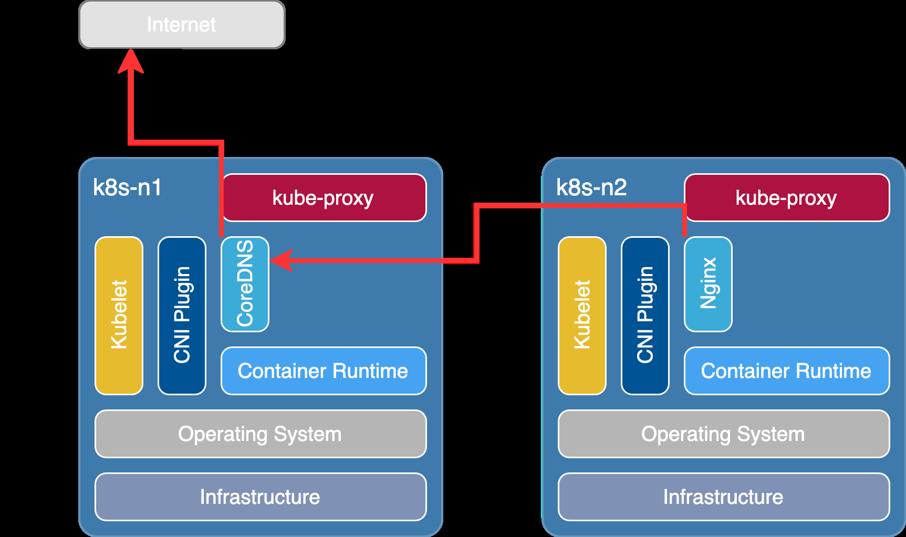
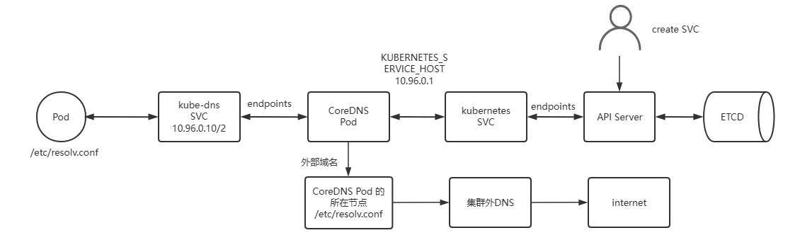
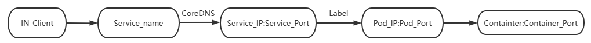
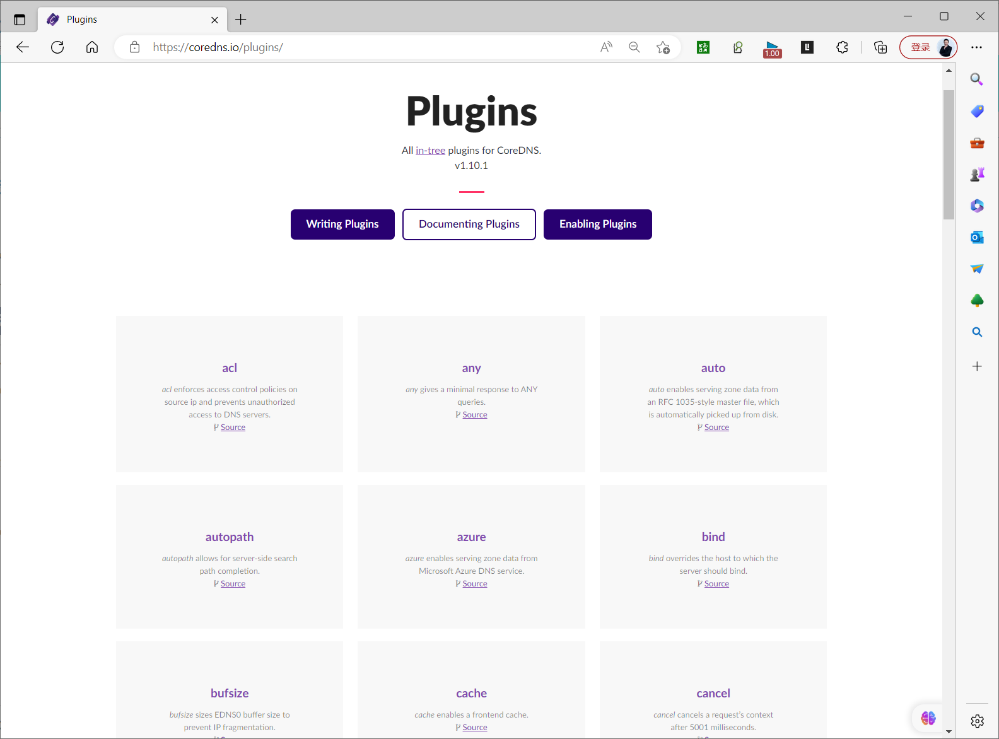
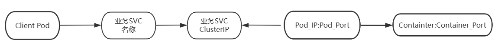
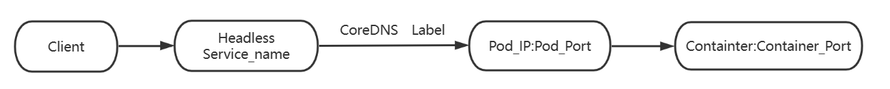

[← 返回 Kubernetes 目录]({{ '/subjects/Kubernetes/' | relative_url }})



# 19 服务发现、CoreDNS 与 Headless Service

# 2 域名解析

## 2.1 服务发现机制

在传统的系统部署中，服务运行在一个固定的已知的 IP 和端口上，如果一个服务需要调用另外一个服务，可以通过地址直接调用。在Kubernetes 集群中，基于clusterip地址来访问每service是很不方便的。虽然通过配置DNS可以实现名称解析来访问，但是在Kubernetes集群中，服务实例的启动和销毁是很频繁的，服务地址在动态的变化，所以传统的方式配置DNS解析记录就很不友好了。

将请求发送到动态变化的服务实例上，可以通过以下两个步骤来实现：

服务注册 — 创建服务实例后，主动将当前服务实例的信息，存储到一个集中式的服务管理中心。服务发现 — 当A服务需要找未知的B服务时，先去服务管理中心查找B服务地址，然后根据该地址找到B服务。对于docker本身来说，可以基于自定义网络，或者--link参数方式实现有限的发现功能。

Kubernetes主要有两种服务发现机制：

环境变量DNS解析

## 2.2 环境变量

环境变量主要有两种实现方式：

Kubernetes Service 环境变量

Kubernetes为每个Service资源生成包括以下形式的环境变量在内一系列环境变量。在同一名称空间中后续创建的Pod对象都会自动拥有这些变量。

注意：此方式不支持Service的动态变化，即在创建Pod对象以后，后续Service发生变化也不会更新已经生成相关的环境变量，生产此方式不太常见。

Service 相关的环境变量形式如下：
```text
{SVCNAME}_SERVICE_HOST、{SVCNAME}_PORT
```

示例：default名称空间创建名为test的Service，default名称空间下的每个Pod内部会被自动注入和service相关的变量
```bash
TEST_SERVICE_HOST=ClusterIP
TEST_PORT=tcp://ClusterIP:80
#注意：如果先创建pod然后关联到service是不生效的
```

Docker Link形式的环境变量

Docker使用--link选项实现容器连接时所设置的环境变量形式。在创建Pod对象时，kubernetes也会把与此形式兼容的一系列环境变量注入到Pod对象中。由于Kubernetes v1.24版本禁用dockershim，所以后续的Kubernetes环境中，可能不再支持这种方式。

范例:
```yaml
#先创建service环境
[root@master1 ~]#cat service-test.yaml
kind: Service
apiVersion: v1
metadata:
name: service-test
spec:
selector:
app: myweb
ports:
- name: http
protocol: TCP
port: 80
targetPort: 80

#先创建service环境
[root@master1 ~]#kubectl apply -f service-test.yaml

#查看service
[root@master1 ~]#kubectl get svc service-test
NAME           TYPE        CLUSTER-IP        EXTERNAL-IP   PORT(S)   AGE
service-test   ClusterIP   192.168.193.236   <none>        80/TCP    35m

#再创建pod对象，通过标签将其添加到service环境中
[root@master1 ~]#kubectl create deployment myweb --image=registry.cn-
beijing.aliyuncs.com/bowen/pod-test:v0.1 --replicas=3
#注意：必须先创建service，后创建deployment，否则的话，无法演示后面的效果

#确认效果
[root@master1 ~]#kubectl get pod
NAME                     READY   STATUS    RESTARTS   AGE
myweb-5df49fdd5-brxcp   1/1     Running   0          26m
myweb-5df49fdd5-xnrt4   1/1     Running   0          26m
myweb-5df49fdd5-z7d67   1/1     Running   0          26m

#注意：看到的KUBERNETES_<xxx> 都是默认coredns在pod中添加进去的环境变量信息，包括service信
息
[root@master1 ~]#kubectl exec myweb-5df49fdd5-brxcp  -- env
PATH=/usr/local/sbin:/usr/local/bin:/usr/sbin:/usr/bin:/sbin:/bin
HOSTNAME=myweb-5df49fdd5-brxcp
SERVICE_TEST_SERVICE_PORT=80                   #注意以下三行，自动生成service相关的环
境变量
SERVICE_TEST_PORT=tcp://192.168.193.236:80
SERVICE_TEST_PORT_80_TCP=tcp://192.168.193.236:80
KUBERNETES_SERVICE_HOST=192.168.0.1
KUBERNETES_SERVICE_PORT_HTTPS=443
KUBERNETES_PORT_443_TCP=tcp://192.168.0.1:443
KUBERNETES_PORT_443_TCP_PORT=443
SERVICE_TEST_SERVICE_PORT_HTTP=80
SERVICE_TEST_SERVICE_HOST=192.168.193.236
SERVICE_TEST_PORT_80_TCP_PROTO=tcp

SERVICE_TEST_PORT_80_TCP_PORT=80
SERVICE_TEST_PORT_80_TCP_ADDR=192.168.193.236
KUBERNETES_SERVICE_PORT=443
KUBERNETES_PORT=tcp://192.168.0.1:443
KUBERNETES_PORT_443_TCP_PROTO=tcp
KUBERNETES_PORT_443_TCP_ADDR=192.168.0.1
DEPLOYENV=Production
RELEASE=Stable
PS1=[\u@\h \w]\$
HOME=/root

#在容器内部，可以直接使用变量名来进行服务的访问
[root@master1 ~]#kubectl exec -it myweb-5df49fdd5-brxcp  -- sh

#访问环境变量
[root@myweb-5df49fdd5-brxcp /]# curl ${SERVICE_TEST_SERVICE_HOST}
kubernetes pod-test v0.1!! ClientIP: 172.16.1.57, ServerName: myweb-5df49fdd5-
xnrt4, ServerIP: 172.16.3.107!
[root@myweb-5df49fdd5-brxcp /]#  echo  ${SERVICE_TEST_SERVICE_HOST}
192.168.193.236
```

## 2.3 CoreDNS

### 2.3.1 CoreDNS 介绍和部署


专用于kubernetes集群中的服务注册和发现的解决方案就是KubeDNS。kubeDNS自从Kubernetes诞生以来，其方案的具体实现方案前后经历了三代，分别是 SkyDNS、KubeDNS、CoreDNS。Kubernetes-v1.3之前使用SkyDNS, 之后到Kubernetes-v1.13之前使用KubeDNS,当前默认使用CoreDNS。

2016年：CoreDNS 最初由 Miek Gieben 开发，旨在取代传统的 DNS 服务器（如 BIND），以满足更现代化、云原生的需求。

2017年：CoreDNS 被 Kubernetes 社区采纳并成为了 Kubernetes 的默认 DNS 服务器。Kubernetes中的服务发现依赖于 DNS，CoreDNS 作为 DNS 解决方案非常适合 Kubernetes 环境。

2018年：CoreDNS 成为 CNCF（Cloud Native Computing Foundation） 的一个托管项目，这标志着它作为开源项目的正式成熟，并且得到了社区和企业的广泛支持。CNCF 是负责推动云原生技术发展的基金会，CoreDNS 成为云原生基础设施的一部分。CoreDNS 是基于Go语言实现的一个DNS服务器，由于其灵活性，它可以在多种环境中使用。CoreDNS 是一种灵活且高性能的 DNS 服务器，在 Kubernetes 等云原生环境中被广泛应用来进行服务发现等相关功能实现。

CoreDNS 通过 Kubernetes 插件与 Kubernetes 集成，或者通过etcd插件与etcd 集成,实现服务发现。CoreDNS 在 Apache License Version 2下获得许可，并且完全开源。CoreDNS  是一个云原生计算基金会已毕业的项目。

**CoreDNS 官方网站**


- <https://coredns.io/>
- <https://github.com/coredns/coredns>


#### CoreDNS 解析流程



CoreDNS 通过访问名为 kubernetes 的 Service,找到 API  Server  进而连接到 ETCD，从而实现Kubernetess集群中的Service，Endpoint，Pod 等资源的查找。



Client Pod 查询自身的/etc/resolv.conf 文件中指向的DNS服务器地址,此地址为kube-dns service的地址,即将解析请求转发给名为 kube-dns的 service kube-dns service会将请求转发到后端CoreDNS Pod,为了DNS的高可用,通常有两个CoreDNS Pod,并位于kube-system名称空间Coredns Pod 根据Corefile的配置会连接到在default名称空间的名为kubernetes的service,而kubernetes service对应的Endpoints为所有kube-apiserver:6443的地址kubernetes service 监视service IP的变动，维护DNS解析记录,并将变化发送至ETCD实现DNS记录的存储CoreDNS查询到service name对应的IP后返回给客户端如果查询的是外部域名，CoreDNS无法解析，就转发给指定的域名服务器，一般是CoreDNS Pod所在宿主机节点上/etc/resolv.conf中的服务器解析。

范例: 基于二进制kubernetes集群中的 CoreDNS 部署

注意: 使用Kubeadm方式安装的Kubernetes集群默认已经安装CoreDNS无需再安装。
```yaml
[root@master1 ~]#wget -O coredns.yaml
https://raw.githubusercontent.com/coredns/deployment/master/kubernetes/coredns.y
aml.sed

#注意:文件中的大写字母的内容需要修改
[root@master1 ~]#cat coredns.yaml
apiVersion: v1
kind: ServiceAccount
metadata:
name: coredns
namespace: kube-system
```

```yaml
---
apiVersion: rbac.authorization.k8s.io/v1
kind: ClusterRole
metadata:
labels:
kubernetes.io/bootstrapping: rbac-defaults
name: system:coredns
rules:
- apiGroups:
- ""
resources:
- endpoints
- services
- pods
- namespaces
verbs:
- list
- watch
- apiGroups:
- discovery.k8s.io
resources:
- endpointslices
verbs:
- list
- watch
```

```yaml
---
apiVersion: rbac.authorization.k8s.io/v1
kind: ClusterRoleBinding
metadata:
annotations:
rbac.authorization.kubernetes.io/autoupdate: "true"
labels:
kubernetes.io/bootstrapping: rbac-defaults
name: system:coredns
roleRef:
apiGroup: rbac.authorization.k8s.io
kind: ClusterRole
name: system:coredns
subjects:
- kind: ServiceAccount
name: coredns
namespace: kube-system
```

```yaml
---
apiVersion: v1
kind: ConfigMap
metadata:
name: coredns

namespace: kube-system
data:
Corefile: |
.:53 {
errors
health {
lameduck 5s
}
ready
#此处CLUSTER_DOMAIN修改cluster.local,REVERSE_CIDRS 修改为 in-addr.arpa
ip6.arpa
kubernetes CLUSTER_DOMAIN REVERSE_CIDRS {
fallthrough in-addr.arpa ip6.arpa
}
prometheus :9153
forward . UPSTREAMNAMESERVER {     #此处UPSTREAMNAMESERVER修改为
/etc/resolv.conf
max_concurrent 1000
}
cache 30
loop
reload
loadbalance
}STUBDOMAINS
```

```yaml
---
apiVersion: apps/v1
kind: Deployment
metadata:
name: coredns
namespace: kube-system
labels:
k8s-app: kube-dns
kubernetes.io/name: "CoreDNS"
spec:
# replicas: not specified here:
# 1. Default is 1.
# 2. Will be tuned in real time if DNS horizontal auto-scaling is turned on.
replicas: 2                   #添加此行为多副本,默认为1
strategy:
type: RollingUpdate
rollingUpdate:
maxUnavailable: 1
selector:
matchLabels:
k8s-app: kube-dns
template:
metadata:
labels:
k8s-app: kube-dns
spec:
priorityClassName: system-cluster-critical
serviceAccountName: coredns
tolerations:
- key: "CriticalAddonsOnly"
operator: "Exists"
nodeSelector:
kubernetes.io/os: linux
affinity:

podAntiAffinity:
requiredDuringSchedulingIgnoredDuringExecution:
- labelSelector:
matchExpressions:
- key: k8s-app
operator: In
values: ["kube-dns"]
topologyKey: kubernetes.io/hostname
containers:
- name: coredns
image: coredns/coredns:1.9.4
imagePullPolicy: IfNotPresent
resources:
limits:
memory: 170Mi  #此处的资源限制修改为合适的值,比如:4096Mi
requests:
cpu: 100m      #此处的资源限制修改为合适的值
memory: 70Mi   #此处的资源限制修改为合适的值
args: [ "-conf", "/etc/coredns/Corefile" ]
volumeMounts:
- name: config-volume
mountPath: /etc/coredns
readOnly: true
ports:
- containerPort: 53
name: dns
protocol: UDP
- containerPort: 53
name: dns-tcp
protocol: TCP
- containerPort: 9153
name: metrics
protocol: TCP
securityContext:
allowPrivilegeEscalation: false
capabilities:
add:
- NET_BIND_SERVICE
drop:
- all
readOnlyRootFilesystem: true
livenessProbe:
httpGet:
path: /health
port: 8080
scheme: HTTP
initialDelaySeconds: 60
timeoutSeconds: 5
successThreshold: 1
failureThreshold: 5
readinessProbe:
httpGet:
path: /ready
port: 8181
scheme: HTTP
dnsPolicy: Default
volumes:
- name: config-volume

configMap:
name: coredns
items:
- key: Corefile
path: Corefile
```

```yaml
---
apiVersion: v1
kind: Service
metadata:
name: kube-dns
namespace: kube-system
annotations:
prometheus.io/port: "9153"
prometheus.io/scrape: "true"
labels:
k8s-app: kube-dns
kubernetes.io/cluster-service: "true"
kubernetes.io/name: "CoreDNS"
spec:
selector:
k8s-app: kube-dns
clusterIP: CLUSTER_DNS_IP  #修改此处为kube-dns SVC的地址,比如:10.96.0.10,可通过查看
Pod的/etc/resolv.conf 获取
ports:
- name: dns
port: 53
protocol: UDP
- name: dns-tcp
port: 53
protocol: TCP
- name: metrics
port: 9153
protocol: TCP

#修改上面文件内容汇总
```
```bash
[root@master1 ~]#vim coredns.yaml
CLUSTER_DOMAIN: cluster.local
REVERSE_CIDRS: in-addr.arpa ip6.arpa
UPSTREAMNAMESERVER: /etc/resolv.conf
CLUSTER_DNS_IP: 10.96.0.2

#应用创建coredns的Pod
[root@master1 ~]#kubectl apply -f coredns.yaml
```

### 2.3.2 CoreDNS 工作机制

#### 2.3.2.1 CoreDNS 域名解析



Cluster DNS（CoreDNS）是Kubernetes集群的必备附件，负责为Kubernetes提供名称解析和服务发现。每个Service资源对象，在CoreDNS上都会自动生成如下格式的名称，结合该名称会生成对应的一些不同类型的DNS资源记录。
```text
<service>.<ns>.svc.<zone>

<service>： #当前Service对象的名称
<ns>：      #当前Service对象所属的名称空间
<zone>：    #当前Kubernetes集群使用的域名后缀，默认为“cluster.local” ，用 kubeadm init
--service-dns-domain 指定
```

范例：kubeadm安装方式时查看默认Zone名称
```bash
[root@master1 ~]#kubeadm config print init-defaults |grep dns
dns: {}
dnsDomain: cluster.local
```

CoreDNS会持续监视API Server上的Service资源对象的变动，并实时反映到相关的DNS资源记录中。

Pod中各容器内部默认会在其 /etc/resolv.conf中，将nameserver指向CoreDNS相关的Service的ClusterIP，默认为service网段的第10个IP，比如：10.96.0.10，其后面的Endpoint是coredns对应的Pod的IP，此配置由kubelet创建Pod时根据指定的配置自动注入。

Kubelet会为创建的每一个容器于/etc/resolv.conf配置文件中生成DNS查询客户端依赖到的必要配置。

相关的配置信息源自于kubelet的配置参数，各容器的DNS服务器由clusterDNS参数的值设定，它的取值为kube-system名称空间中的Service对象kube-dns的ClusterIP，默认为10.96.0.10，而DNS搜索域的值由clusterDomain参数的值设定。

ClusterDNS服务的默认名称：kube-dns.kube-system.svc.cluster.local

ClusterDNS服务的默认地址：Cluster Network 网段的第10个IP，默认为：10.96.0.10。若部署Kubernetes集群时未特别指定，其值将为cluster.local、svc.cluster.local和NAMESPACENAME.svc.cluster.local。

范例：集群上的一个随机选择的Pod中的容器查看DNS客户端配置
```bash
[root@master1 ~]#kubectl run client-test-$RANDOM --image registry.cn-
beijing.aliyuncs.com/bowen/admin-box:v0.1 --restart=Never --rm -it --
command -- cat /etc/resolv.conf
nameserver 10.96.0.10
search default.svc.cluster.local svc.cluster.local cluster.local bowen.org
options ndots:5

#上述search参数中指定的DNS各搜索域，是以次序指定的几个域名后缀，它们各自的如下所示
#<ns>.svc.<zone>：附带有特定名称空间的域名，例如default.svc.cluster.local
#svc.<zone>：附带Kubernetes标识Service专用子域svc的域名，例如svc.cluster.local
#<zone>：集群本地域名，例如cluster.local

#ndots:5 表示如果手工查询时候给的域名包含的点“.” 当查询的域名包含的"."数量≥5时，会直接作为完
整域名查询
#小于5个，那么进行DNS查找时将使用非完全限定名称，即用search指定的域名补全
#即 <手工输入域名> 或者 <手工输入域名>.<search 部分给定的域名后缀>
#如果你查询的域名包含点数大于等于5，那么DNS查询，默认会使用绝对域名进行查询。即使用 <手工输入域
名>
#例如"a.b.c.d.com"(4个点)会触发搜索列表，而"a.b.c.d.e.com"(5个点)会直接查询
```

#### 2.3.2.2 Service 资源对应的DNS资源记录

基于DNS的服务发现，对于每个Service对象，都会具有以下3个类型的DNS资源记录A/AAAA，PTR和SRV。根据ClusterIP的地址类型，为IPv4生成固定格式的 A记录，为IPv6生成AAAA记录。
```text
<service>.<ns>.svc.<zone>. <ttl>  IN  A  <cluster-ip>
<service>.<ns>.svc.<zone>. <ttl> IN AAAA <cluster-ip>

#示例：
service-test.default.svc.cluster.local.

#注意：cluster.local 是默认zone名称，在初始化Kubernetes集群中，自己通过dnsDomain属性定制
的。
kubeadm init --service-dns-domain
```

对于每个给定的A记录或AAAA记录都要生成PTR记录，格式如下所示：
```text
<d>.<c>.<b>.<a>.in-addr.arpa.  <ttl>  IN  PTR <service>.<ns>.svc.<zone>.
h4.h3.h2.h1.g4.g3.g2.g1.f4.f3.f2.f1.e4.e3.e2.e1.d4.d3.d2.d1.c4.c3.c2.c1.b4.b3.b2
.b1.a4.a3.a2.a1.ip6.arpa <ttl> IN PTR <service>.<ns>.svc.<zone>.
```

为每个定义了名称的端口生成一个SRV记录，未命名的端口号则不具有该记录。
```text
_<port_name>._<proto>.<service>.<ns>.svc.<zone>. <ttl>  IN  SRV  <weight>
<priority>  <port-number>  <service>.<ns>.svc.<zone>.
```

例如：
在default名称空间中创建Service对象service-test的地址为10.97.72.1，且为TCP协议的80端口取名http，对于默认的cluster.local域名来说，此它会拥有如下3个DNS资源记录。


A记录：service-test.default.svc.cluster.local. 30 IN A  10.97.72.1；PTR记录：1.72.97.10.in-addr.arpa. 30     IN      PTR     service-test.default.svc.cluster.local. SRV记录：_http._tcp.service-test.default.svc.cluster.local. 30 IN SRV 0 100 80 service-test.default.svc.cluster.local.


范例: 查看 CoreDNS 默认配置
```yaml
[root@master1 ~]#kubectl get svc -A
NAMESPACE     NAME         TYPE        CLUSTER-IP      EXTERNAL-IP   PORT(S)
AGE
default       kubernetes   ClusterIP   10.96.0.1       <none>        443/TCP
35d
default       pod-test     NodePort    10.108.29.167   <none>
80:30383/TCP             17h
kube-system   kube-dns     ClusterIP   10.96.0.10      <none>
53/UDP,53/TCP,9153/TCP   35d

#查看kube-dns SVC
[root@master1 ~]#kubectl describe svc kube-dns -n kube-system
Name:              kube-dns
Namespace:         kube-system

Labels:            k8s-app=kube-dns
kubernetes.io/cluster-service=true
kubernetes.io/name=CoreDNS
Annotations:       prometheus.io/port: 9153
prometheus.io/scrape: true
Selector:          k8s-app=kube-dns
Type:              ClusterIP
IP Family Policy:  SingleStack
IP Families:       IPv4
IP:                10.96.0.10
IPs:               10.96.0.10
Port:              dns  53/UDP
TargetPort:        53/UDP
Endpoints:         10.244.1.78:53,10.244.1.79:53
Port:              dns-tcp  53/TCP
TargetPort:        53/TCP
Endpoints:         10.244.1.78:53,10.244.1.79:53
Port:              metrics  9153/TCP
TargetPort:        9153/TCP
Endpoints:         10.244.1.78:9153,10.244.1.79:9153
Session Affinity:  None
Events:            <none>

[root@master1 ~]#kubectl get svc -n kube-system kube-dns  -o yaml
apiVersion: v1
kind: Service
metadata:
annotations:
prometheus.io/port: "9153"
prometheus.io/scrape: "true"
creationTimestamp: ""
labels:
k8s-app: kube-dns
kubernetes.io/cluster-service: "true"
kubernetes.io/name: CoreDNS
name: kube-dns
namespace: kube-system
resourceVersion: "239"
uid: 84729fbb-2e5f-426d-aaf9-64c8b01cb762
spec:
clusterIP: 10.96.0.10
clusterIPs:
- 10.96.0.10
internalTrafficPolicy: Cluster
ipFamilies:
- IPv4
ipFamilyPolicy: SingleStack
ports:
- name: dns
port: 53
protocol: UDP
targetPort: 53
- name: dns-tcp
port: 53
protocol: TCP
targetPort: 53
- name: metrics
port: 9153

protocol: TCP
targetPort: 9153
selector:
k8s-app: kube-dns
sessionAffinity: None
type: ClusterIP
status:
loadBalancer: {}

#对应一个名称为coredns的deployment中两个副本的Pod
[root@master1 ~]#kubectl get deployments.apps -n kube-system coredns -o yaml
apiVersion: apps/v1
kind: Deployment
metadata:
annotations:
deployment.kubernetes.io/revision: "1"
creationTimestamp: "2021-03-04T15:36:36Z"
generation: 1
labels:
k8s-app: kube-dns
name: coredns
namespace: kube-system
resourceVersion: "493653"
uid: b215bd59-bf75-4693-9a9b-dfeadbd28c4f
spec:
progressDeadlineSeconds: 600
replicas: 2                      #两个副本Pod
revisionHistoryLimit: 10
selector:
matchLabels:
k8s-app: kube-dns
strategy:
rollingUpdate:
maxSurge: 25%
maxUnavailable: 1
type: RollingUpdate
template:
metadata:
creationTimestamp: null
labels:
k8s-app: kube-dns
spec:
affinity:
podAntiAffinity:
preferredDuringSchedulingIgnoredDuringExecution:
- podAffinityTerm:
labelSelector:
matchExpressions:
- key: k8s-app
operator: In
values:
- kube-dns
topologyKey: kubernetes.io/hostname
weight: 100
containers:
- args:
- -conf
- /etc/coredns/Corefile

image: registry.aliyuncs.com/google_containers/coredns:v1.9.3
imagePullPolicy: IfNotPresent
livenessProbe:
failureThreshold: 5
httpGet:
path: /health
port: 8080
scheme: HTTP
initialDelaySeconds: 60
periodSeconds: 10
successThreshold: 1
timeoutSeconds: 5
name: coredns
ports:
- containerPort: 53
name: dns
protocol: UDP
- containerPort: 53
name: dns-tcp
protocol: TCP
- containerPort: 9153
name: metrics
protocol: TCP
readinessProbe:
failureThreshold: 3
httpGet:
path: /ready
port: 8181
scheme: HTTP
periodSeconds: 10
successThreshold: 1
timeoutSeconds: 1
resources:
limits:
memory: 170Mi
requests:
cpu: 100m
memory: 70Mi
securityContext:
allowPrivilegeEscalation: false
capabilities:
add:
- NET_BIND_SERVICE
drop:
- all
readOnlyRootFilesystem: true
terminationMessagePath: /dev/termination-log
terminationMessagePolicy: File
volumeMounts:
- mountPath: /etc/coredns
name: config-volume
readOnly: true
dnsPolicy: Default
nodeSelector:
kubernetes.io/os: linux
priorityClassName: system-cluster-critical
restartPolicy: Always
schedulerName: default-scheduler

securityContext: {}
serviceAccount: coredns
serviceAccountName: coredns
terminationGracePeriodSeconds: 30
tolerations:
- key: CriticalAddonsOnly
operator: Exists
- effect: NoSchedule
key: node-role.kubernetes.io/control-plane
volumes:
- configMap:
defaultMode: 420
items:
- key: Corefile
path: Corefile
name: coredns
name: config-volume
status:
availableReplicas: 2
conditions:
- lastTransitionTime: "2021-03-04T16:18:38Z"
lastUpdateTime: "2021-03-04T16:18:39Z"
message: ReplicaSet "coredns-5bbd96d687" has successfully progressed.
reason: NewReplicaSetAvailable
status: "True"
type: Progressing
- lastTransitionTime: "2021-04-01T23:39:30Z"
lastUpdateTime: "2021-04-01T23:39:30Z"
message: Deployment has minimum availability.
reason: MinimumReplicasAvailable
status: "True"
type: Available
observedGeneration: 1
readyReplicas: 2
replicas: 2
updatedReplicas: 2

#查看SVC后面的Pod地址信息
```
```bash
[root@master1 ~]#kubectl get endpoints kube-dns -n kube-system
NAME       ENDPOINTS                                                  AGE
kube-dns   10.244.1.78:53,10.244.1.79:53,10.244.1.78:53 + 3 more...   34d

[root@master1 ~]#kubectl describe ep -n kube-system kube-dns
Name:         kube-dns
Namespace:    kube-system
Labels:       k8s-app=kube-dns
kubernetes.io/cluster-service=true
kubernetes.io/name=CoreDNS
Annotations:  endpoints.kubernetes.io/last-change-trigger-time:
Subsets:
Addresses:          10.244.1.78,10.244.1.79
NotReadyAddresses:  <none>
Ports:
Name     Port  Protocol
----     ----  --------
dns-tcp  53    TCP
dns      53    UDP
metrics  9153  TCP

Events:  <none>

[root@master1 ~]#kubectl get pod -n kube-system -l k8s-app=kube-dns
NAME                       READY   STATUS    RESTARTS       AGE
coredns-5bbd96d687-8bpgx   1/1     Running   10 (86m ago)   34d
coredns-5bbd96d687-l5k8l   1/1     Running   11 (86m ago)   34d

[root@master1 ~]#kubectl get pod  -o wide -A |grep coredns
kube-system            coredns-5bbd96d687-8bpgx                    1/1
Running     10 (83m ago)   34d     10.244.1.79   node1.bowen.org     <none>
<none>
kube-system            coredns-5bbd96d687-l5k8l                    1/1
Running     11 (83m ago)   34d     10.244.1.78   node1.bowen.org     <none>
<none>

#查看DNS名称
[root@master1 ~]#nslookup
> server 10.96.0.10
Default server: 10.96.0.10
Address: 10.96.0.10#53
> 10.96.0.10
10.0.96.10.in-addr.arpa name = kube-dns.kube-system.svc.cluster.local.

[root@node1 ~]#docker ps |grep coredns

[root@node1 ~]#docker inspect 5c445eaf80a4
......
{
"Type": "bind",
"Source": "/var/lib/kubelet/pods/50da8812-5573-4afb-9130-
e919bdb0fc35/volumes/kubernetes.io~configmap/config-volume",
"Destination": "/etc/coredns",
"Mode": "ro",
"RW": false,
"Propagation": "rprivate"
}
......

[root@node1 ~]#cat /var/lib/kubelet/pods/50da8812-5573-4afb-9130-
e919bdb0fc35/volumes/kubernetes.io~configmap/config-volume/Corefile.:53 {
errors
health {
lameduck 5s
}
ready
kubernetes cluster.local in-addr.arpa ip6.arpa {
pods insecure
fallthrough in-addr.arpa ip6.arpa
ttl 30
}
prometheus :9153
forward . /etc/resolv.conf {
max_concurrent 1000
}

cache 30
loop
reload
loadbalance
}
```

范例: 所有Pod指向DNS对应的svc 服务kube-dns的Cluster-IP地址
```bash
#查看集群默认的dns服务
[root@master1 ~]#kubectl get svc -n kube-system
NAME       TYPE        CLUSTER-IP     EXTERNAL-IP   PORT(S)                  AGE
kube-dns   ClusterIP   192.168.0.10   <none>        53/UDP,53/TCP,9153/TCP   27d

[root@master1 ~]#kubectl describe svc kube-dns -n kube-system
......
Endpoints:         172.16.1.58:53,172.16.3.109:53

[root@master1 ~]#kubectl get pod -o wide -l Kubernetes-app=kube-dns -n kube-
system
NAME                       READY   STATUS    RESTARTS      AGE   IP
NODE               NOMINATED NODE   READINESS GATES
coredns-7d89d9b6b8-6wzsl   1/1     Running   9 (43m ago)   22d   172.16.1.58
node2.bowen.org   <none>           <none>
coredns-7d89d9b6b8-kcltj   1/1     Running   2 (43m ago)   44h   172.16.3.109
node1.bowen.org   <none>           <none>

#这些dns的解析服务的地址是通过文件的方式注入到pod的环境中的
[root@master1 ~]#kubectl run pod-$RANDOM --image=registry.cn-
beijing.aliyuncs.com/bowen/admin-box:v0.1 -it --rm --command -- /bin/bash
If you don't see a command prompt, try pressing enter.
[root@pod-26908 /]$ cat /etc/resolv.conf
nameserver 192.168.0.10
search default.svc.cluster.local svc.cluster.local cluster.local bowen.org
options ndots:5

[root@pod-26908 /]$ cat /etc/hosts
# Kubernetes-managed hosts file.
127.0.0.1   localhost
::1 localhost ip6-localhost ip6-loopback
fe00::0 ip6-localnet
fe00::0 ip6-mcastprefix
fe00::1 ip6-allnodes
fe00::2 ip6-allrouters
172.16.2.96 pod-26908
[root@pod-26908 /]$ curl service-test
kubernetes pod-test v0.1!! ClientIP: 172.16.2.96, ServerName: myweb-5df49fdd5-
z7d67, ServerIP: 172.16.2.95!
[root@pod-26908 /]$ curl service-test.default.svc.cluster.local
kubernetes pod-test v0.1!! ClientIP: 172.16.2.96, ServerName: myweb-5df49fdd5-
z7d67, ServerIP: 172.16.2.95!
[root@pod-26908 /]$ curl service-test.default.svc.cluster.local.
kubernetes pod-test v0.1!! ClientIP: 172.16.2.96, ServerName: myweb-5df49fdd5-
xnrt4, ServerIP: 172.16.3.108!
```

范例: 记录解析
```bash
#记录解析
[root@master1 ~]#kubectl run pod-$RANDOM --image=registry.cn-
beijing.aliyuncs.com/bowen/admin-box:v0.1 -it --rm --command -- /bin/bash
[root@pod-26908 /]$ nslookup
> service-test.default.svc.cluster.local. #注意最后的.必须要添加
Server:     192.168.0.10
Address:    192.168.0.10#53

Name:   service-test.default.svc.cluster.local
Address: 192.168.193.236
> kube-dns.kube-system.svc.cluster.local.   #正向解析service名称的结果为ClusterIP
Server:     192.168.0.10
Address:    192.168.0.10#53

Name:   kube-dns.kube-system.svc.cluster.local
Address: 192.168.0.10
#反解析记录
> 172.16.2.95
95.2.16.172.in-addr.arpa    name = 172-16-2-95.service-
test.default.svc.cluster.local.
> 172.16.1.59
59.1.16.172.in-addr.arpa    name = 172-16-1-59.service-
test.default.svc.cluster.local.

#测试解析
[root@master1 ~]#kubectl run pod-$RANDOM --image=registry.cn-
beijing.aliyuncs.com/bowen/admin-box:v0.1 -it --rm --command -- /bin/bash
root@pod-24105 /# host service-test
service-test.default.svc.cluster.local has address 10.111.183.208
root@pod-24105 /# host -t PTR 10.111.183.208
208.183.111.10.in-addr.arpa domain name pointer service-
test.default.svc.cluster.local.
root@pod-24105 /# host -t A kube-dns
Host kube-dns.bowen.org not found: 2(SERVFAIL)
root@pod-24105 /# host -t A kube-dns.kube-system
kube-dns.kube-system.svc.cluster.local has address 10.96.0.10
root@pod-24105 /# host -t SRV _http._tcp.service-test.default.svc.cluster.local
_http._tcp.service-test.default.svc.cluster.local has SRV record 0 100 80
service-test.default.svc.cluster.local.

root@pod-24105 /# dig -t SRV _http._tcp.myapp.default.svc.cluster.local.

; <<>> DiG 9.14.12 <<>> -t SRV _http._tcp.myapp.default.svc.cluster.local.
;; global options: +cmd
;; Got answer:
;; WARNING: .local is reserved for Multicast DNS
;; You are currently testing what happens when an mDNS query is leaked to DNS
;; ->>HEADER<<- opcode: QUERY, status: NOERROR, id: 40397
;; flags: qr aa rd; QUERY: 1, ANSWER: 1, AUTHORITY: 0, ADDITIONAL: 2
;; WARNING: recursion requested but not available

;; OPT PSEUDOSECTION:
; EDNS: version: 0, flags:; udp: 4096
; COOKIE: 1cd2314ba79746b3 (echoed)
;; QUESTION SECTION:
;_http._tcp.myapp.default.svc.cluster.local. IN SRV

;; ANSWER SECTION:
_http._tcp.myapp.default.svc.cluster.local. 30 IN SRV 0 100 80
myapp.default.svc.cluster.local.

;; ADDITIONAL SECTION:
myapp.default.svc.cluster.local. 30 IN  A   10.107.129.47

root@pod-24084 /# dig -x 10.104.87.84

; <<>> DiG 9.14.12 <<>> -x 10.104.87.84
;; global options: +cmd
;; Got answer:
;; ->>HEADER<<- opcode: QUERY, status: NOERROR, id: 49821
;; flags: qr aa rd; QUERY: 1, ANSWER: 1, AUTHORITY: 0, ADDITIONAL: 1
;; WARNING: recursion requested but not available

;; OPT PSEUDOSECTION:
; EDNS: version: 0, flags:; udp: 4096
; COOKIE: a709af85c2271fe3 (echoed)
;; QUESTION SECTION:
;84.87.104.10.in-addr.arpa. IN  PTR

;; ANSWER SECTION:
84.87.104.10.in-addr.arpa. 30   IN  PTR metrics-server.kube-
system.svc.cluster.local.

;; Query time: 10 msec
;; SERVER: 10.96.0.10#53(10.96.0.10)
;; WHEN: Fri Mar 28 02:12:21 UTC 2025
;; MSG SIZE  rcvd: 149
```


root@pod-24084 /# host -t ptr 10.104.87.84 84.87.104.10.in-addr.arpa domain name pointer metrics-server.kube-system.svc.cluster.local. root@pod-24084 /# host  -t ptr 84.87.104.10.in-addr.arpa 84.87.104.10.in-addr.arpa domain name pointer metrics-server.kube-system.svc.cluster.local.

```text
root@pod-24084 /# dig -x 10.104.87.84
.......
84.87.104.10.in-addr.arpa. 30   IN  PTR metrics-server.kube-
system.svc.cluster.local.

root@pod-24084 /# dig -t ptr 84.87.104.10.in-addr.arpa
......
84.87.104.10.in-addr.arpa. 30   IN  PTR metrics-server.kube-
system.svc.cluster.local.

;; Query time: 6 msec
;; SERVER: 10.96.0.10#53(10.96.0.10)
;; WHEN: Fri Mar 28 02:13:01 UTC 2025
;; MSG SIZE  rcvd: 149
```

#### 2.3.2.3 Pod的 DNS 解析策略和配置

Kubernetes支持在单个Pod资源规范上自定义DNS解析策略和配置，并组合生效。

pod.spec.dnsPolicy：解析策略pod.spec.dnsConfig：名称解析机制

DNS解析策略：pod.spec.dnsPolicy

**Default**：从当前Pod运行的所在宿主机节点/etc/resolv.conf继承DNS名称解析相关的配置ClusterFirst：此为默认值，优先使用K8s集群内DNS服务上解析集群域内的名称，其他域名的解析则交由coreDNS的Pod所在宿主机节点/etc/resolv.conf的名称服务器即使用Default策略（注意：和Default不同在于，使用是CoreDNS的Pod的所在宿主机节点的/etc/resolv.conf文件）ClusterFirstWithHostNet：专用于在设置了hostNetwork（使用宿主机的网络）的Pod对象上并不会使用宿主机节点网络的DNS，仍然使用ClusterFirst策略None：用于忽略Kubernetes集群的默认设定，而仅使用由dnsConfig自定义的配置。

DNS解析机制：pod.spec.dnsConfig

nameservers <[]string>：DNS名称服务器列表，附加于由dnsPolicy生成的DNS名称服务器之后searches <[]string>：DNS名称解析时的搜索域，附加由于dnsPolicy生成的搜索域之后options <[]Object>：DNS解析选项列表，同dnsPolicy生成的解析选项合并成最终生效的定义

范例: 查看Pod的 DNS 解析策略和配置
```bash
[root@master1 ~]#kubectl explain pods.spec
......
dnsConfig    <Object>
Specifies the DNS parameters of a pod. Parameters specified here will be
merged to the generated DNS configuration based on DNSPolicy.
```


dnsPolicy    <string>Set DNS policy for the pod. Defaults to "ClusterFirst". Valid values are'ClusterFirstWithHostNet', 'ClusterFirst', 'Default' or 'None'. DNS parameters given in DNSConfig will be merged with the policy selected with DNSPolicy. To have DNS options set along with hostNetwork, you have to specify DNS policy explicitly to 'ClusterFirstWithHostNet'.


Possible enum values:- `"ClusterFirst"` indicates that the pod should use cluster DNS first unless hostNetwork is true, if it is available, then fall back on the default (as determined by kubelet) DNS settings.- `"ClusterFirstWithHostNet"` indicates that the pod should use cluster DNS first, if it is available, then fall back on the default (as determined by kubelet) DNS settings.- `"Default"` indicates that the pod should use the default (as determined by kubelet) DNS settings.- `"None"` indicates that the pod should use empty DNS settings. DNS parameters such as nameservers and search paths should be defined via DNSConfig......


范例：dnsPolicy 的ClusterFirst的解析策略
```yaml
#安装集群外的DNS服务
[root@ubuntu2404 ~]#bash install_dns.sh
[root@ubuntu2404 ~]#vim /etc/bind/bowen.org.zone

www     A    6.6.6.6

#指定节点使用批定的DNS地址
[root@node2 ~]#vim /etc/netplan/01-netcfg.yaml
network:
version: 2
renderer: networkd
ethernets:
eth0:
addresses:
- 10.0.0.103/24
gateway4: 10.0.0.2
nameservers:
#addresses: [180.76.76.76, 223.6.6.6]
addresses: [10.0.0.100] #指定DNS地址
[root@node2 ~]#netplan apply

#清单文件
[root@master1 service]#cat  service-pod-with-dnspolicy-clusterfirst.yaml
apiVersion: v1
kind: Pod
metadata:
name: service-pod-with-dnspolicy-clusterfirst
namespace: default
spec:
nodeName: node2.bowen.org #指定面上的节点地址
containers:
- name: demo
image: registry.cn-beijing.aliyuncs.com/bowen/pod-test:v0.1
imagePullPolicy: IfNotPresent
#dnsPolicy: ClusterFirst #使用默认的策略
[root@master1 service]#kubectl apply -f service-pod-with-dnspolicy-
clusterfirst.yaml

#确认
[root@master1 service]#kubectl get pod service-pod-with-dnspolicy-clusterfirst -
o yaml|grep dnsPolicy:
dnsPolicy: ClusterFirst

#测试访问，发现并没有使用Pod所在节点的DNS配置，而使用是的CoreDNS所在节点的DNS服务
[root@master1 service]#kubectl exec -it service-pod-with-dnspolicy-clusterfirst
-- sh
[root@service-pod-with-dnspolicy-clusterfirst /]# host www.bowen.org
www.bowen.org has address 205.178.189.129
```

范例：dnsPolicy 的 default 的解析策略
```yaml
#安装集群外的DNS服务
[root@ubuntu2404 ~]#bash install_dns.sh
[root@ubuntu2404 ~]#vim /etc/bind/bowen.org.zone
test     A    6.6.6.6

#修改指定节点的DNS配置指向上面的DNS服务器
[root@node2 ~]#cat /etc/netplan/01-netcfg.yaml
# This file describes the network interfaces available on your system
# For more information, see netplan(5).
network:

version: 2
renderer: networkd
ethernets:
eth0:
addresses:
- 10.0.0.102/24
gateway4: 10.0.0.2
nameservers:
addresses: [10.0.0.200]

[root@master1 service]#cat service-pod-with-dnspolicy-default.yaml
apiVersion: v1
kind: Pod
metadata:
name: service-pod-with-dnspolicy-default
namespace: default
spec:
nodeName: node2.bowen.org
containers:
- name: demo
image: registry.cn-beijing.aliyuncs.com/bowen/pod-test:v0.1
imagePullPolicy: IfNotPresent
dnsPolicy: Default  #指定dns策略，默认为ClusterFirst

[root@master1 service]#kubectl apply -f service-pod-with-dnspolicy-default.yaml

#发现Pod的DNS指定Pod所有宿主节点的DNS
[root@master1 ~]#kubectl exec -it service-pod-with-dnspolicy-default -- cat
/etc/resolv.conf
nameserver 10.0.0.200
[root@master1 ~]#kubectl exec -it service-pod-with-dnspolicy-default -- host
test.bowen.org
test.bowen.org has address 6.6.6.6

[root@master1 service]#kubectl delete -f service-pod-with-dnspolicy-default.yaml
```

范例：dnsPolicy 的 None 的解析策略
```yaml
[root@master1 ~]#cat service-pod-with-dnspolicy-none.yaml
apiVersion: v1
kind: Pod
metadata:
name: service-pod-with-dnspolicy
namespace: default
spec:
containers:
- name: demo
image: registry.cn-beijing.aliyuncs.com/bowen/pod-test:v0.1
imagePullPolicy: IfNotPresent
dnsPolicy: None
dnsConfig:
nameservers:
- 10.96.0.10
- 180.76.76.76
- 223.6.6.6
searches:
```


- svc.cluster.local- cluster.local- bowen.org options:- name: ndots value: "5"    #意味着如果域名中只有5个或更少的点，则系统会尝试在其末尾添加搜索域。

```bash
#应用
[root@master1 ~]#kubectl apply -f service-pod-with-dnspolicy-none.yaml

[root@master1 ~]#kubectl get pod  service-pod-with-dnspolicy
NAME                         READY   STATUS    RESTARTS   AGE
service-pod-with-dnspolicy   1/1     Running   0          78s

#查看Pod的DNS配置
[root@master1 ~]#kubectl exec service-pod-with-dnspolicy -- cat /etc/resolv.conf
nameserver 10.96.0.10
nameserver 180.76.76.76
nameserver 223.6.6.6
search svc.cluster.local cluster.local bowen.org
options ndots:5 #意味着如果域名中只有5个或更少的点，则系统会尝试在其末尾添加搜索域。

#清理环境
[root@master1 ~]#kubectl delete -f service-pod-with-dnspolicy-none.yaml
```

#### 2.3.3.4  Pod 的/etc/hosts 本地域名解析

在 Kubernetes 中，hostAliases 是 Pod 规格（spec ）中的一个字段，用于在 Pod 内部的/etc/hosts 文件中添加自定义的主机名与 IP 地址的映射关系。它允许你在不修改 DNS 配置的情况下，为 Pod 内的容器手动指定额外的域名解析规则。默认情况下，Pod 的 /etc/hosts 文件由 Kubernetes 自动管理，包含 Pod 自身的主机名和回环地址等条目。hostAliases 允许你：

为特定 IP 地址绑定自定义主机名（如将 192.168.1.100 映射到 internal-service ）临时覆盖某些域名的解析（绕过 DNS 服务器）在测试或特殊场景下，为容器提供额外的主机解析能力。

范例:
```yaml
[root@master1 ~]#cat hostalias-demo.yaml
apiVersion: v1
kind: Pod
metadata:
name: hostalias-demo
spec:
hostAliases:
- ip: "8.8.8.8"
hostnames:
- "myserver"
- "www.bowen.com" # 同一IP绑定两个主机名
- ip: "172.24.0.253"
hostnames:
- "harbor.bowen.org"     # 数据库主节点映射
containers:
- name: pod-test

image: registry.cn-beijing.aliyuncs.com/bowen/pod-test:v0.1

[root@master1 ~]#kubectl exec -it hostalias-demo -- sh
[root@hostalias-demo /]# cat /etc/hosts
# Kubernetes-managed hosts file.
127.0.0.1   localhost
::1 localhost ip6-localhost ip6-loopback
fe00::0 ip6-localnet
fe00::0 ip6-mcastprefix
fe00::1 ip6-allnodes
fe00::2 ip6-allrouters
10.244.3.71 hostalias-demo

# Entries added by HostAliases.
8.8.8.8 myserver    www.bowen.com
172.24.0.253    harbor.bowen.org

[root@hostalias-demo /]# ping -c1 myserver
PING myserver (8.8.8.8): 56 data bytes
64 bytes from 8.8.8.8: seq=0 ttl=127 time=83.581 ms

[root@hostalias-demo /]# ping -c1 www.bowen.com
PING www.bowen.com (8.8.8.8): 56 data bytes
64 bytes from 8.8.8.8: seq=0 ttl=127 time=83.581 ms

--- www.bowen.com ping statistics ---
1 packets transmitted, 1 packets received, 0% packet loss
round-trip min/avg/max = 83.581/83.581/83.581 ms

root@hostalias-demo /]# ping -c1 harbor.bowen.org
PING harbor.bowen.org (172.24.0.253): 56 data bytes
64 bytes from 172.24.0.253: seq=0 ttl=127 time=2.933 ms

--- harbor.bowen.org ping statistics ---
1 packets transmitted, 1 packets received, 0% packet loss
round-trip min/avg/max = 2.933/2.933/2.933 ms

#注意:不支持host,dig等DNS工具解析
[root@hostalias-demo /]# host myserver
Host myserver not found: 3(NXDOMAIN)
[root@hostalias-demo /]# host www.bowen.com
www.bowen.com has address 42.236.82.166
```

### 2.3.3 CoreDNS 配置

CoreDNS的配置都存储在名为coredns的ConfigMap对象中，该对象位于kube-system名称空间中。

服务器配置段(Server Blocks)，用于定义负责解析的权威区域，配置段放置于其后的花括号{}中

服务器配置段也可以指定要监听的端口号,端口号之前需要使用一个冒号，默认为53。

若在同一端口上配置了多个区域，CoreDNS将使用最长匹配机制来评估并挑出最适配的服务器配置段;

随后，请求将由该服务器配置段中的插件链按特定顺序（在构建CoreDNS程序时由plugin.cfg文件指定)进行路由;

针对一个DNS查询，相应配置段插件链中的每个插件都会检查并确定是否应该对其进行处理。

CoreDNS查询路由概述CoreDNS处理DNS查询的方式。

针对每个套接字，CoreDNS会生成一个服务器(dnsserver.Server)一个套接字上存在多个配置段(Server Block)时，CoreDNS将组合这些配置段生成单个服务器上的多个独立配置段，并将发往该套接字的DNS查询请求路由到最佳匹配的目标配置段若不存在匹配的服务器配置段，则返回SERVERFAIL。

CoreDNS的支持丰富的插件


- <https://coredns.io/plugins>




CoreDNS的插件可大致分为两类。

负责处理请求的常规插件(Normal Plugin)，这些插件才是插件链中的有效组成部分，例如:errors、kubernetes和forward等不处理请求的特殊插件，它们仅用来修改Server或Server Block中的配置，例如:health、tls、startup、 shutdown和root等插件，这类插件不会作为服务器配置段的插件链中的有效组成部署。

常规插件可再划分为两种类型

负责以某种方式处理请求的插件

这类插件不是区域数据源，它们的运行方式是在自身处理完成后，会将查询传递给下一个插件。

后端插件

用于配置区域数据的来源，例如etcd、file和kubernetes等。这类插件通常要为其负责的区域生成最终结果，它要么能正常响应查询，要么返回NXDOMAIN。

但也可以使用fallthrough改变这种响应行为:未发现查询的目标资源记录时，将DNS查询请求转交给插件链中的下一个插件，随后终结于另一个后端插件，或再次由fallthrought改变这种行为

**配置解析**
```yaml
#coredns的配置是存放在 configmap中
[root@master1 ~]#kubectl get cm  -n kube-system
NAME                                 DATA   AGE
coredns                              1      27d
.....

#查看配置内容
[root@master1 ~]#kubectl get cm coredns -n kube-system -o yaml
apiVersion: v1
data:
Corefile: |
.:53 {
errors
health {
lameduck 5s
}
ready
kubernetes cluster.local in-addr.arpa ip6.arpa {
pods insecure
fallthrough in-addr.arpa ip6.arpa
ttl 30
}
prometheus :9153
forward . /etc/resolv.conf {
max_concurrent 1000
}
cache 30
loop
reload
loadbalance
}
kind: ConfigMap
metadata:
creationTimestamp: "2021-03-04T15:36:36Z"
name: coredns
namespace: kube-system
resourceVersion: "219"
uid: d6307d21-8c84-4302-9b95-a8058188333e

[root@master1 ~]# kubectl describe cm coredns -n kube-system
...
Data
====
Corefile:
----
.:53 {                              #包括根区域的所有区域对应的监听端口进行解析
errors                          #将错误信息进行输出
health {                        #livenessProbe检
测,http://localhost:8080/health 实现
lameduck 5s
}
ready                #readinessProbe检测,http://localhost:8181/ready coredns就
绪返回200
kubernetes cluster.local in-addr.arpa ip6.arpa { #基于kubernetes的service名称进
行查询并返回查询结果
pods insecure
```


fallthrough in-addr.arpa ip6.arpa #如果in-addr.arpa ip6.arpa区域解析失败，交由后续的插件进行解析 ttl 30}prometheus :9153                 #配置访问端口给prometheus实现监控,URL：

<http://10.96.0.10:9153/metrics>

forward . /etc/resolv.conf {     #forward 转发配置，如果集群内部无法解析，交由 coreDNS的Pod所在宿主机的DNS解析,也可为IP地址 max_concurrent 1000           #最大连接性,提高此值可以提高并发性}cache 30                          #启用缓存,单位s loop        #检测发现环路时会重建coredns对应的Pod显示CrashLoopBackOff状态而停止查询,比如CoreDNS直接将请求转发给上游服务器，后者再将请求转发回CoreDNS reload                                      # 检测corefile是否变化,修改 configmap后默认2M后会自动加载 loadbalance                                 # 基于随机算法实现DNS查询记录负载均衡}...

```text
#对于企业内的dns解决方案，可以通过 forward 来实现，格式如下
forward <域名> <转发至外部DNS的地址> {    #转发配置，如果集群内部无法解析,交由宿主机文
件或外部DNS的IP解析
max_concurrent 最大连接配置
except 排除的域名
}
#示例：转发域名解析至集群外的DNS服务器
forward . 10.0.0.10 10.0.0.20 {
prefer_udp    #优先使用UDP
}
forward bowen.org 10.0.0.200 {
prefer_udp    #优先使用UDP，多个forward谁在前谁优先生效
}

#注意：如果仅仅对某个域名进行转发的话，只需要将 <域名> 部分设置为指定的域名即可。
#生产中不推荐直接将 "." 的转发地址使用公网的dns地址，推荐在当前主机的/etc/resolv.conf中配置
外网，实现间接的效果
```


# 添加特定主机的正向解析记录，类似于/etc/hosts文件功能，此优先级比上面的forward高 hosts {192.168.10.100 www.example.com 10.0.0.101  gitlab.bowen.org nfs.bowen.org 10.0.0.102  jenkins.bowen.org 10.0.0.100  harbor.bowen.org fallthrough}


范例：配置CoreDNS的域名解析转发至指定的DNS Server
```yaml
#创建集群外的DNS
[root@ubuntu2404 ~]#bash install_dns.sh
[root@ubuntu2404 ~]#cat /etc/bind/bowen.org.zone
$TTL 1D
@   IN SOA  master admin (
1   ; serial
1D  ; refresh
1H  ; retry
1W  ; expire

3H )    ; minimum
NS       master
master  A        10.0.0.200
www     A    10.0.0.200
harbor  A    10.0.0.100
test    A    6.6.6.6
a       A    1.1.1.1
b       A    2.2.2.2

[root@ubuntu2404 ~]#rndc reload

[root@master1 ~]#kubectl edit -n kube-system cm  coredns
apiVersion: v1
data:
Corefile: |
.:53 {
errors
health {
lameduck 5s
}
ready
kubernetes cluster.local in-addr.arpa ip6.arpa {
pods insecure
fallthrough in-addr.arpa ip6.arpa
ttl 30
}
prometheus :9153
forward bowen.org 10.0.0.200 {  #添加三行，放在 forward . /etc/resolv.conf
前面
prefer_udp
}
forward . /etc/resolv.conf {  #两个forward谁在前谁优先生效
max_concurrent 1000
}

cache 30 {
disable success cluster.local
disable denial cluster.local
}
loop
reload
loadbalance
}

#重新创建coredns的Pod生效
[root@master1 ~]#kubectl rollout restart deployment -n kube-system coredns
deployment.apps/coredns restarted

[root@master1 service]#kubectl run client-test-$RANDOM --image registry.cn-
beijing.aliyuncs.com/bowen/admin-box:v0.1 --restart=Never --rm -it --
command -- /bin/bash
If you don't see a command prompt, try pressing enter.
root@client-test-908 /# host a.bowen.org
a.bowen.org has address 1.1.1.1
Host a.bowen.org not found: 3(NXDOMAIN)

root@client-test-908 /# host b.bowen.org
b.bowen.org has address 2.2.2.2
Host b.bowen.org not found: 3(NXDOMAIN)
```

范例: 不使用默认的转发策略，使用自定义的转发策略
```bash
#修改配置文件
root@master1:~# kubectl edit cm coredns -n kube-system
...
rewrite name myapp.bowen.org myapp.default.svc.cluster.local #将集群外的域名
重写为集群内的域名再进行解析
kubernetes cluster.local in-addr.arpa ip6.arpa
forward bowen.org 10.0.0.200 {  #添加三行，多个forward谁在前谁优先生效
prefer_udp
}
forward . /etc/resolv.conf {
max_concurrent 1000
except www.baidu.com.                    #排除www.baidu.com，不进行解析，
注意：最后面的点
}
hosts {                                     #添加三行，实现指定域名的解析,此优
先级比上面的forward高
10.0.0.100 harbor.cluster.local harbor.bowen.org
10.0.0.101 nfs.bowen.org
fallthrough
}
...
#注意：多个dns地址间用空格隔开,排除的域名最好在末尾添加 “.”，对于之前的旧版本来说可能会出现无法
查询的现象

#重建CoreDNS，加快DNS配置信息生效
#方法1：重新创建coredns的Pod生效
[root@master1 ~]#kubectl rollout restart deployment -n kube-system coredns
deployment.apps/coredns restarted
#方法2：
#新版
[root@master1 ~]#kubectl delete pod -l k8s-app=kube-dns -n kube-system
#旧版
[root@master1 ~]#kubectl delete pod -l kubernetes-app=kube-dns -n kube-system

#pod中测试效果
[root@master1 ~]#kubectl run pod-$RANDOM --image=registry.cn-
beijing.aliyuncs.com/bowen/admin-box:v0.1 -it --rm --command -- /bin/bash
If you don't see a command prompt, try pressing enter.
[root@pod-16460 /]$ host myapp.bowen.org
myapp.bowen.org has address 10.111.183.208
[root@pod-16460 /]$ host www.baidu.com
Host  www.baidu.com not found: 3(NXDOMAIN)
[root@pod-16460 /ping -c 1 harbor.bowen.org
PING harbor.bowen.org (harbor.cluster.local): 56 data bytes
64 bytes from harbor.cluster.local: seq=0 ttl=63 time=1.085 ms
```

# 3 Headless Service

## 3.1 无头服务机制

用户访问service资源对象的流程如下：



kube-proxy其实是将用户访问的域名解析给了service对象所对应的ClusterIP然后再由ClusterIP根据Label 选择器将请求转发给后端的pod然后在交给pod内部的容器。

Client --> ServiceName --> ClusterIP -->  所有Pod的IP地址,这样一个请求经过了两层转发才到容器里面的服务，流程有些繁琐。

Service中 ClusterIP、NodePort和LoadBalancer 三种类型都为其Service配置一个ClusterIP。在CoreDNS上将这些Service对象的A记录最终解析为对应的ClusterIP,此CLusterIP 称为头Head。目前集群的资源调度主要是针对的是无状态的服务，但是对于一些特定场景的状态服务，虽然可以基于会话粘滞来实现，但是毕竟需要经过两层跳转，如果转发量太大，性能不太好。

可以使用如下方式可以减少中间的流程

Client --> ServiceName -->  所有Pod的IP地址

在有状态的Pod都有专有的名称,那么可以无需经过ClusterIP，直接利用Pod名称解析到Pod_ip即可，那么和普通Service相比，这种没有配置ClusterIP项的Service，称之为Headless Service。



无头服务场景下，Kubernetes会将一个集群内部的所有Pod成员提供唯一的DNS域名来作为每个成员的网络标识，集群内部成员之间使用域名通信，这个时候，就特别依赖service的selector属性配置了。广义上Headless Service，它们又可以为分两种情形。有标签选择器，或者没有标签选择器,但有着与Service对象同名的Endpoint资源。Service的DNS名称直接解析为后端各就绪状态的Pod的IP地址。

调度功能也将由DNS完成

各Pod IP相关PTR记录将解析至Pod名称，假设Pod IP为a.b.c.d，则其Pod名称为a-b-c-d...SVC.

这种类型也就是狭义上的Headless Service。主要应用于有状态服务的statefulSet资源对象。无标签选择器且也没有与Service对象同名的Endpoint资源。用于集群外部 ExternalName 类型的Service。

Service的DNS名称将会生成一条CNAME记录，对应值由Service对象上的spec.externalName字段指定。

注意: headless service是一个四层调度，因为iptatbles/ipvs都是四层的，所以如果要建立一个https服务的话，每一个服务都必须配置一个https的主机，因为四层调度是无法卸载https会话的。

**主要的应用场景**

ServiceName --> (label Selector，Pod) --> 所有Pod的IP地址，此方式又称为狭义的Headless Service，主要应用在 StatefulSet ServiceName --> CName （ExternalServiceName） --> ExternalService IP，此方式称为狭义的External Service

无头服务管理的域名是如下的格式：
```text
$(service_name).$(Kubernetes_namespace).svc.cluster.local
```

**DNS 解析记录**
```text
#A记录
<a>-<b>-<c>-<d>.<service>.<ns>.svc.<zone>  A  PodIP

#PodIP的PTR反解析记录
<d>.<c>.<b>.<a>.in-addr.arpa IN PTR  <用横线分隔的PodIP>.<service>.<ns>.svc.<zone>

#关键点：
正向解析:svc_name的解析结果从常规Service的ClusterIP，转为解析成各个Pod的IP地址
反向解析:从常规的clusterip解析为service name，转为从podip到hostname, <a>-<b>-<c>-<d>.
<service>.<ns>.svc.<zone>
<hostname>指的是a-b-c-d格式，而非Pod自己的主机名；
```

## 3.2 案例

范例: Headless Service
```yaml
#命令行方式
[root@master1 ~]#kubectl create service clusterip service-headless-cmd --
clusterip="None"

#创建文件
[root@master1 ~]#cat service-headless.yaml
apiVersion: v1
kind: Service
metadata:
name: service-headless
spec:
selector:
app: myweb
clusterIP: "None"  #无头服务

#应用文件
[root@master1 ~]#kubectl apply -f service-headless.yaml

#查看两个service，Cluster-IP显示为None,注意和ExternalName Service的<none>不同
[root@master1 ~]#kubectl get svc
NAME                   TYPE        CLUSTER-IP    EXTERNAL-IP   PORT(S)   AGE
kubernetes             ClusterIP   192.168.0.1   <none>        443/TCP   46h
service-headless       ClusterIP   None          <none>        <none>    79s
service-headless-cmd   ClusterIP   None          <none>        <none>    2s

[root@master1 ~]#kubectl describe service  service-headless
Name:              service-headless
Namespace:         default
Labels:            <none>
Annotations:       <none>
Selector:          app=myweb
Type:              ClusterIP
IP Family Policy:  SingleStack
IP Families:       IPv4

IP:                None   #注意：没有CLusterIP
IPs:               None
Session Affinity:  None
Events:            <none>

#注意：因为dns的原因，这里的无头服务可能无法显示对应的subnets相关的信息，但是不影响无头服务的正
常使用

#重新创建deployment
[root@master1 ~]#kubectl delete deployment myweb
[root@master1 ~]#kubectl create deployment myweb --image=registry.cn-
beijing.aliyuncs.com/bowen/pod-test:v0.1 --replicas=3

[root@master1 ~]#kubectl get pod -o wide
NAME                    READY   STATUS    RESTARTS   AGE   IP             NODE
NOMINATED NODE   READINESS GATES
myweb-5df49fdd5-fwc82   1/1     Running   0          63s   172.16.2.98
node3.bowen.org   <none>           <none>
myweb-5df49fdd5-rfsth   1/1     Running   0          63s   172.16.3.111
node1.bowen.org   <none>           <none>
myweb-5df49fdd5-wh86t   1/1     Running   0          63s   172.16.1.61
node2.bowen.org   <none>           <none>

#进入新pod中测试效果
[root@master1 ~]#kubectl run pod-$RANDOM --image=registry.cn-
beijing.aliyuncs.com/bowen/admin-box:v0.1 -it --rm --command -- /bin/bash
root@pod-8431 /# host service-headless
#无头服务的正向解析结果直接为后端Pod的地址,不再解析为service的IP，导致Service的负载均衡功能失
效，但可以利用DNS实现
service-headless.default.svc.cluster.local has address 10.244.2.55
service-headless.default.svc.cluster.local has address 10.244.1.83
service-headless.default.svc.cluster.local has address 10.244.1.85

root@pod-8431 /# host -t A service-headless
service-headless.default.svc.cluster.local has address 10.244.2.55
service-headless.default.svc.cluster.local has address 10.244.1.85
service-headless.default.svc.cluster.local has address 10.244.1.83

root@pod-8431 /# host -t PTR 10.244.1.85
85.1.244.10.in-addr.arpa domain name pointer 10-244-1-85.service-
headless.default.svc.cluster.local.

root@pod-8431 /# host 10-244-1-85.service-headless.default.svc.cluster.local.
10-244-1-85.service-headless.default.svc.cluster.local has address 10.244.1.85
```


root@pod-8431 /# curl service-headless kubernetes pod-test v0.1!! ClientIP: 10.244.3.20, ServerName: myweb-5d78b4dcbd-9kfth, ServerIP: 10.244.1.83! root@pod-8431 /# curl service-headless kubernetes pod-test v0.1!! ClientIP: 10.244.3.20, ServerName: myweb-5d78b4dcbd-96r94, ServerIP: 10.244.1.85! root@pod-8431 /# curl service-headless kubernetes pod-test v0.1!! ClientIP: 10.244.3.20, ServerName: myweb-5d78b4dcbd-9kfth, ServerIP: 10.244.1.83! root@pod-8431 /# curl service-headless kubernetes pod-test v0.1!! ClientIP: 10.244.3.20, ServerName: myweb-5d78b4dcbd-6rgv4, ServerIP: 10.244.2.55!

```bash
root@pod-8431 /# nslookup
#正向解析
> service-headless
Server:     10.96.0.10
Address:    10.96.0.10#53

Name:   service-headless.default.svc.cluster.local
Address: 10.244.1.83
Name:   service-headless.default.svc.cluster.local
Address: 10.244.1.85
Name:   service-headless.default.svc.cluster.local
Address: 10.244.2.55

> service-headless.default.svc.cluster.local #注意最后的面没有一个点. ，结果解析错误
Server:     10.96.0.10
Address:    10.96.0.10#53

Non-authoritative answer:
Name:   service-headless.default.svc.cluster.local.bowen.org
Address: 205.178.189.129
> service-headless.default.svc.cluster.local.
Server:     10.96.0.10
Address:    10.96.0.10#53

Name:   service-headless.default.svc.cluster.local
Address: 10.244.1.83
Name:   service-headless.default.svc.cluster.local
Address: 10.244.2.55
Name:   service-headless.default.svc.cluster.local
Address: 10.244.1.85

> service-headless.default.svc.cluster.local.  #注意最后的面有一个点. ，结果解析错误
Server:     10.96.0.10
Address:    10.96.0.10#53

Name:   service-headless.default.svc.cluster.local
Address: 10.244.2.55
Name:   service-headless.default.svc.cluster.local
Address: 10.244.1.85
Name:   service-headless.default.svc.cluster.local
Address: 10.244.1.83

#反向解析
> 10.244.2.55
55.2.244.10.in-addr.arpa    name = 10-244-2-55.service-
headless.default.svc.cluster.local.

#结果显示：由于没有对域名做定向解析，那么找请求的时候，就像无头苍蝇似的，到处乱串
#注意：也可以为 nslookup 添加 -query=A 方式

#清理环境
[root@master1 ~]#kubectl delete -f service-headless.yaml
```

范例：通过ExternalName 和无头服务结合CoreDNS及外部DNS实现集群内访问集群外的服务
```yaml
#集群外安装Redis

[root@ubuntu2404 ~]#apt install redis
[root@ubuntu2404 ~]#vi /etc/redis/redis.conf
bind 0.0.0.0
requirepass 123456
[root@ubuntu2404 ~]#systemctl restart redis

[root@master1 service]#cat  service-externalname-redis.yaml
kind: Service
apiVersion: v1
metadata:
name: svc-externalname-redis
namespace: default
spec:
type: ExternalName
externalName: redis.bowen.org
ports:
- protocol: TCP
port: 6379
targetPort: 6379
nodePort: 0
selector: {}

[root@master1 service]#kubectl apply -f service-externalname-redis.yaml

[root@master1 service]#kubectl get svc
NAME                     TYPE           CLUSTER-IP      EXTERNAL-IP      PORT(S)
AGE
svc-externalname-redis   ExternalName   <none>          redis.bowen.org
6379/TCP   10m

#配置coreDNS
[root@master1 ~]#kubectl edit cm  -n kube-system coredns
。。。。。
prometheus :9153
#方法1：添加外部的域名解析转发至外部DNS，需要提前集群外创建DNS服务和域名解析
forward bowen.org 10.0.0.200 {
prefer_udp
}
forward . /etc/resolv.conf {
max_concurrent 1000
}
#方法2：或者在coreDNS中直接解析外部域名
hosts {
10.0.0.200 redis.bowen.org
fallthrough
}
[root@master1 ~]#kubectl rollout restart deployment -n kube-system coredns

#测试访问
[root@master1 ~]#kubectl run client-test-$RANDOM --image registry.cn-
beijing.aliyuncs.com/bowen/admin-box:v0.1 --restart=Never --rm -it --
command -- /bin/bash

#注意:需要写完整的域名
root@client-test-29726 /#dig svc-externalname-redis.default.svc.cluster.local

; <<>> DiG 9.14.12 <<>> svc-externalname-redis.default.svc.cluster.local

;; global options: +cmd
;; Got answer:
;; WARNING: .local is reserved for Multicast DNS
;; You are currently testing what happens when an mDNS query is leaked to DNS
;; ->>HEADER<<- opcode: QUERY, status: NOERROR, id: 25257
;; flags: qr aa rd; QUERY: 1, ANSWER: 2, AUTHORITY: 0, ADDITIONAL: 1
;; WARNING: recursion requested but not available

;; OPT PSEUDOSECTION:
; EDNS: version: 0, flags:; udp: 4096
; COOKIE: 08476118f87b652f (echoed)
;; QUESTION SECTION:
;svc-externalname-redis.default.svc.cluster.local. IN A

;; ANSWER SECTION:
svc-externalname-redis.default.svc.cluster.local. 30 IN CNAME redis.bowen.org.
redis.bowen.org.     30  IN  A   10.0.0.100

;; Query time: 1 msec
;; SERVER: 10.96.0.10#53(10.96.0.10)
;; WHEN: Tue Jun 03 04:01:33 UTC 2025
;; MSG SIZE  rcvd: 195
```


root@client-test-29726 /#host svc-externalname-redis.default.svc.cluster.local svc-externalname-redis.default.svc.cluster.local is an alias for redis.bowen.org. redis.bowen.org has address 10.0.0.100 root@pod-4486 /#

```text
root@client-test-29726 /# host redis.bowen.org
redis.bowen.org has address 10.0.0.200

root@client-test-29726 /# nc redis.bowen.org 6379
auth 123456
+OK
info
```



<nav class="article-end" aria-label="章节导航">
  <a href="{{ '/subjects/Kubernetes/18-service-access.html' | relative_url }}">← 上一章：Service 访问与负载分发</a>
  <a href="{{ '/subjects/Kubernetes/' | relative_url }}">返回 Kubernetes 目录</a>
  <a href="{{ '/subjects/Kubernetes/20-ingress.html' | relative_url }}">下一章：Ingress 流量治理与发布 →</a>
</nav>
