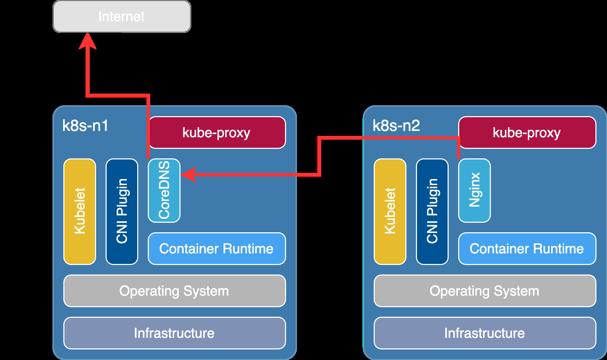
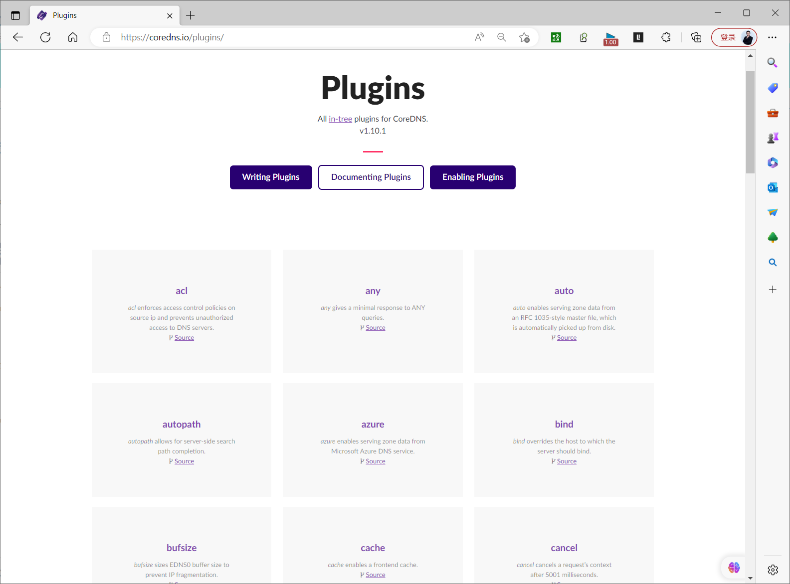
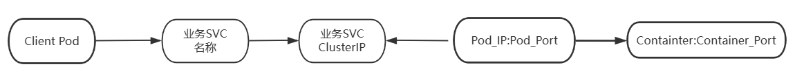
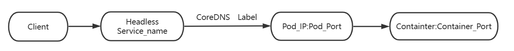

[← 返回 Kubernetes 目录]({{ '/subjects/Kubernetes/' | relative_url }})



# 19 服务发现、CoreDNS 与 Headless Service

## 2 服务发现与集群 DNS

在 Kubernetes 中，Pod 会被重建并获得新 IP，客户端不应长期保存单个 Pod 的地址。常规 Service 为一组后端提供相对稳定的名称和虚拟地址；CoreDNS 让客户端通过名称找到 Service。对需要直接识别每个副本的有状态应用，则可使用无头 Service（Headless Service）。

### 2.1 Service 环境变量与 DNS

Pod 创建时，kubelet 可把**此前已存在且位于同一命名空间的 Service** 信息注入环境变量，例如 `SERVICE_TEST_SERVICE_HOST` 和 `SERVICE_TEST_SERVICE_PORT`。这些值是创建时的快照：后续创建或修改 Service，不会自动更新已经运行的 Pod。环境变量注入由 kubelet 完成，与 CoreDNS、Docker 的 `--link` 或是否使用 dockershim 无关。可通过 Pod 的 `enableServiceLinks: false` 关闭此类注入。

```bash
kubectl get service service-test
kubectl exec <Pod名称> -- printenv SERVICE_TEST_SERVICE_HOST
kubectl exec <Pod名称> -- printenv SERVICE_TEST_SERVICE_PORT
```

环境变量适合查看或少量兼容场景；日常服务发现更推荐 DNS，因为 Service 或后端变化时无需重建客户端 Pod。Service 的 DNS 名称通常是 `<service>.<namespace>.svc.<cluster-domain>`，例如 `service-test.default.svc.cluster.local`。在同一命名空间的 Pod 中，通常可直接使用短名称 `service-test`。

### 2.2 CoreDNS 如何回答查询


Kubernetes 常以 CoreDNS 提供集群 DNS。Pod 的 `/etc/resolv.conf` 通常指向 `kube-system` 中名为 `kube-dns` 的 **Service** 地址；这个兼容名称并不表示当前后端一定运行旧版 kube-dns。查询经过该 Service 到达 CoreDNS Pod，CoreDNS 的 `kubernetes` 插件通过 API Server 观察 Service、EndpointSlice 等资源并生成应答；它**不需要直接读取 etcd**。集群域名以外的查询可交给 Corefile 配置的上游 DNS。



```bash
kubectl get deployment,pod,service -n kube-system -l k8s-app=kube-dns
kubectl get service kube-dns -n kube-system
kubectl get endpointslice -n kube-system -l kubernetes.io/service-name=kube-dns
kubectl get configmap coredns -n kube-system -o yaml
```

`kube-dns` 的 ClusterIP、CoreDNS 副本数和集群域名由实际安装配置决定，不能把旧截图中的 `10.96.0.10`、两个副本或 `cluster.local` 当作所有集群的固定值。kubeadm 通常自动部署 CoreDNS；二进制部署若尚未安装，应使用与集群版本匹配的官方清单，并按实际 Service CIDR、集群域名、上游 DNS 和 RBAC 修改，不能把原文中未经渲染的模板直接 `kubectl apply`。

### 2.3 Service DNS 记录与搜索域

常规 ClusterIP Service 的 A/AAAA 记录指向 Service 虚拟 IP；命名端口可获得 SRV 记录。IP 地址类型决定 A（IPv4）或 AAAA（IPv6），并非每个 Service 都同时拥有两种。反向 PTR 记录是否出现、具体指向如何，取决于 CoreDNS 配置和记录类型，不应把旧终端输出泛化为每个 Service 的强制保证。

```text
service-test.default.svc.cluster.local.          A     <Service IPv4>
_http._tcp.service-test.default.svc.cluster.local. SRV  0 100 80 service-test.default.svc.cluster.local.
```

SRV 查询的前提是 Service 端口命名为 `http` 且协议为 TCP；其中 `80` 是端口，`service-test.default.svc.cluster.local.` 是目标域名。可在测试 Pod 中运行以下命令核实，域名和地址以实际集群为准：

```bash
cat /etc/resolv.conf
nslookup service-test.default.svc.cluster.local
nslookup kube-dns.kube-system.svc.cluster.local
# 如镜像中有 dig：
dig SRV _http._tcp.service-test.default.svc.cluster.local.
```

默认 `dnsPolicy: ClusterFirst` 的 Pod 往往有 `search` 列表，如 `<本命名空间>.svc.cluster.local`、`svc.cluster.local`、`cluster.local`，并可能带 `options ndots:5`。不带尾随点的名字可能先尝试搜索后缀；以 `.` 结尾明确表示绝对域名。`ndots:5` 是达到五个点时优先尝试绝对名称，并不表示较短名字永远不会作为绝对名称查询。搜索域过多可能增加 DNS 请求，应结合实际解析链排障。

### 2.4 Pod 的 DNS 策略

| `dnsPolicy` | 主要行为 |
| --- | --- |
| `ClusterFirst` | 普通 Pod 的默认选择，优先使用集群 DNS；非集群域名按 CoreDNS 的上游配置转发。 |
| `Default` | 继承节点侧由 kubelet 选定的 DNS 配置，不自动使用集群 DNS。 |
| `ClusterFirstWithHostNet` | 使用 `hostNetwork: true` 时仍优先使用集群 DNS。 |
| `None` | 不使用自动生成的 DNS 设置，必须通过 `dnsConfig` 提供所需名称服务器等参数。 |

`dnsConfig.nameservers`、`searches` 和 `options` 可与选定策略产生的配置合并；采用 `None` 时，应给出至少一个可用 nameserver。下例仅演示自定义配置，不代表此地址适合其他集群：

```yaml
apiVersion: v1
kind: Pod
metadata:
  name: dns-demo
spec:
  dnsPolicy: None
  dnsConfig:
    nameservers:
      - 10.96.0.10
    searches:
      - default.svc.cluster.local
      - svc.cluster.local
    options:
      - name: ndots
        value: "5"
  containers:
    - name: client
      image: registry.cn-beijing.aliyuncs.com/bowen/admin-box:v0.1
      command: ["sh", "-c", "sleep 3600"]
```

如果 `dnsPolicy: Default` 的 Pod 在节点 A 上运行，它依据节点 A 的 DNS 设置；`ClusterFirst` 的外部查询则经 CoreDNS 转发，其上游可能来自 **CoreDNS 所在节点** 的 `/etc/resolv.conf` 或显式配置。两条路径不同。修改节点 DNS 或 Corefile 前，应先确认所有控制平面与工作节点的解析链，避免循环转发。

### 2.5 `hostAliases` 与 `/etc/hosts`

`hostAliases` 让 kubelet 为指定 Pod 写入 `/etc/hosts`，适合局部测试或少量静态映射，不会在 CoreDNS 中创建记录。使用系统名称解析的程序（如 `getent hosts`、某些应用库）可能看到别名；直接发 DNS 请求的 `dig`、`host` 通常不会读取 `/etc/hosts`。

```yaml
apiVersion: v1
kind: Pod
metadata:
  name: hostalias-demo
spec:
  hostAliases:
    - ip: "192.0.2.10"
      hostnames: ["internal-service.example", "internal-service"]
  containers:
    - name: client
      image: registry.cn-beijing.aliyuncs.com/bowen/admin-box:v0.1
      command: ["sh", "-c", "sleep 3600"]
```

```bash
kubectl exec hostalias-demo -- cat /etc/hosts
kubectl exec hostalias-demo -- getent hosts internal-service
```

## 2.6 阅读与修改 Corefile

CoreDNS 的集群配置通常保存在 `kube-system/coredns` ConfigMap 的 `Corefile` 中。一个服务器块定义要处理的区域与端口；`kubernetes` 插件处理集群域名，`forward` 转发外部域名，`cache` 缓存结果，`health`/`ready` 提供探针，`reload` 检测配置变化。插件的运行顺序由 CoreDNS 构建时的插件链决定，**不能仅凭 Corefile 中文本出现的先后断言转发优先级**。



```text
.:53 {
    errors
    health
    ready
    kubernetes cluster.local in-addr.arpa ip6.arpa {
        pods insecure
        fallthrough in-addr.arpa ip6.arpa
        ttl 30
    }
    prometheus :9153
    forward . /etc/resolv.conf
    cache 30
    loop
    reload
    loadbalance
}
```

这只是典型结构，不能覆盖实际集群 Corefile。要把内部域 `corp.example` 定向转发到企业 DNS，可另设明确的服务器块；上线前先备份原 ConfigMap 并在测试集群验证该域、集群域和公网域均能解析。

```text
corp.example:53 {
    errors
    cache 30
    forward . 192.0.2.53
}
```

```bash
kubectl get configmap coredns -n kube-system -o yaml > coredns-before.yaml
kubectl get configmap coredns -n kube-system -o jsonpath='{.data.Corefile}'
# 修改后观察 CoreDNS 就绪和日志；如配置未自动重载，再按部署方式滚动重启。
kubectl rollout status deployment/coredns -n kube-system
kubectl logs -n kube-system deployment/coredns --tail=100
```

Corefile 写错会影响整个集群的名称解析。回滚时恢复先前备份的 Corefile 并确认 CoreDNS 副本就绪；不要把仅供演示的上游地址或静态 `hosts` 项直接写进生产配置。

# 3 Headless Service 与 ExternalName

## 3.1 无头服务如何工作



常规 Service 名称解析到 ClusterIP，客户端连接后由集群的数据平面把流量转发到后端。无头 Service 设置 `spec.clusterIP: None`，不分配这个虚拟 IP；它的名称通常解析到**就绪后端端点**的 Pod IP。客户端收到多个地址后如何选择、重试或负载均衡，取决于自身 DNS 客户端和应用逻辑，不是“DNS 自动完成与 kube-proxy 同样的调度”。



```yaml
apiVersion: v1
kind: Service
metadata:
  name: service-headless
  namespace: default
spec:
  clusterIP: None
  selector:
    app: myweb
  ports:
    - name: http
      port: 80
      targetPort: 80
      protocol: TCP
```

```bash
kubectl apply -f service-headless.yaml
kubectl get service service-headless
kubectl get endpointslice -l kubernetes.io/service-name=service-headless
# 在同一命名空间的测试 Pod 中：
# nslookup service-headless.default.svc.cluster.local.
```

先确认存在带 `app=myweb` 标签且通过就绪检查的 Pod。若没有就绪端点，查询不一定返回 Pod IP；`publishNotReadyAddresses: true` 可在特定初始化场景发布未就绪端点，须谨慎使用。StatefulSet 经常配合无头 Service：若其 `serviceName` 指向该 Service，副本可获得稳定的 `<Pod名>.<Service名>.<命名空间>.svc.<集群域>` 名称。普通 Deployment 的 Pod 名称与 IP 不具备同样的稳定性。无头 Service 也可不设选择器，此时需由其他机制管理相应 EndpointSlice；这与 ExternalName 是两种不同资源行为。

## 3.2 ExternalName：返回外部别名，不是无头服务

`ExternalName` Service 为集群内名称返回一个指向外部域名的 **CNAME**。它不通过选择器选 Pod，不分配 ClusterIP，也不代理流量；后续能否连接，仍取决于外部域名解析、网络、端口和目标服务鉴权。

```yaml
apiVersion: v1
kind: Service
metadata:
  name: external-redis
  namespace: default
spec:
  type: ExternalName
  externalName: redis.example.net
  ports:
    - name: redis
      port: 6379
      protocol: TCP
```

```bash
kubectl apply -f external-redis.yaml
kubectl get service external-redis
# 在集群内测试 Pod 中查询：
# dig CNAME external-redis.default.svc.cluster.local.
# dig A redis.example.net.
```

原文把 `nodePort: 0`、空 `selector` 放进 ExternalName 清单，并把它称为“无头服务结合外部 DNS”，容易误导：ExternalName 无需这些字段。外部域名必须由当前 DNS 解析链可解析；若企业域名需特殊转发，应单独配置 CoreDNS 上游。连接数据库还需检查端口、TLS 和凭据，DNS 解析成功不等于服务访问成功。


<nav class="article-end" aria-label="章节导航">
  <a href="{{ '/subjects/Kubernetes/18-service-access.html' | relative_url }}">← 上一章：Service 访问与负载分发</a>
  <a href="{{ '/subjects/Kubernetes/' | relative_url }}">返回 Kubernetes 目录</a>
  <a href="{{ '/subjects/Kubernetes/20-ingress.html' | relative_url }}">下一章：Ingress 流量治理与发布 →</a>
</nav>
