[← 返回 Kubernetes 目录]({{ '/subjects/Kubernetes/' | relative_url }})



# 20 Ingress 流量治理与发布

集群内 Pod 和 Service 之间的通信通常称为东西向流量；客户端进出集群是南北向流量。Ingress 解决的是 **HTTP/HTTPS 入站路由**：它按域名和路径将请求指向同一名称空间中的 Service。Ingress 对象本身不是代理进程，真正接收和转发流量的是与其匹配的 Ingress Controller；控制器还需通过 LoadBalancer、NodePort 或主机网络对外暴露。


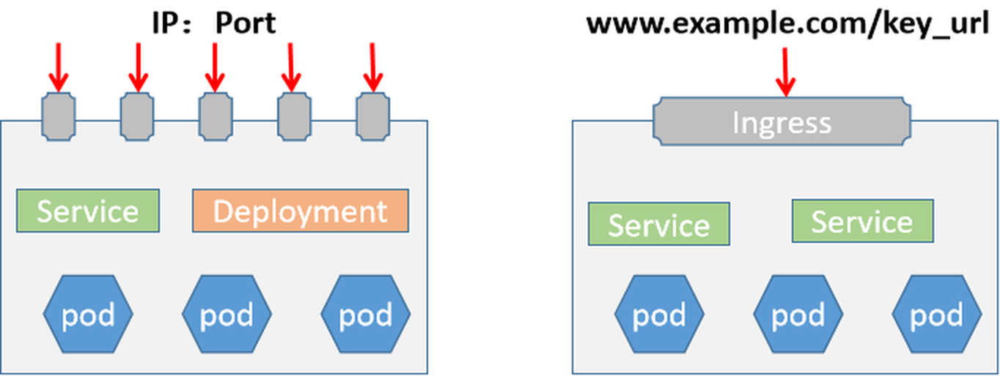

## 20.1 请求路径与控制器选择

一个典型请求沿“客户端 → 控制器入口 Service → Ingress Controller → 后端 Service 的就绪端点”前进。控制器监听 Ingress、Service 和 EndpointSlice 的变化并更新代理配置。它可能直接转发到 Pod IP，流量不一定实际经过 Service 的 ClusterIP，但 Service 仍是 Ingress 规则的后端对象。Ingress 不管理任意 TCP/UDP 协议；这些协议应使用相应的 Service 或控制器扩展。

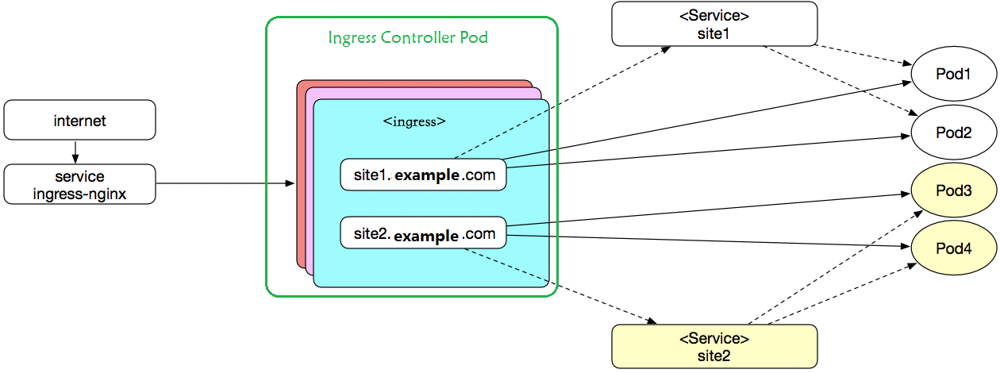

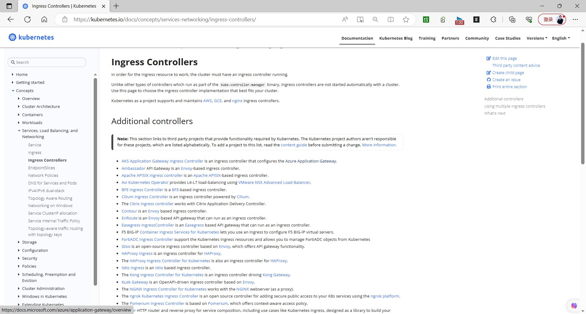

常见实现包括 NGINX、Traefik、HAProxy 和 Kong 等，各自的注解、灰度能力与维护状态不同。`networking.k8s.io/v1` Ingress 是通用 API，`nginx.ingress.kubernetes.io/*` 等注解则是特定控制器扩展。新项目也可评估 Gateway API；不要把一种控制器的注解直接复制给另一种。

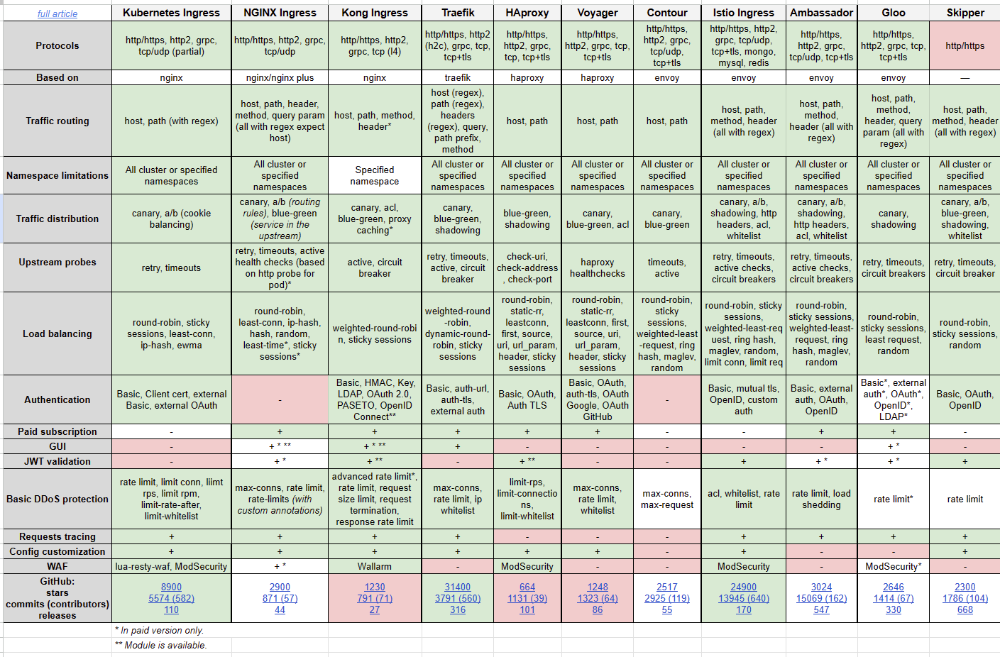

## 20.2 安装并确认入口

以下以 ingress-nginx 的 Helm Chart 演示。先检查目标 Kubernetes 版本和 Chart/Controller 版本的兼容性，再选择 Service 类型。`LoadBalancer` 需要云平台或 MetalLB 等实现提供外部 IP；裸机环境也可选 NodePort。生产部署还要规划副本数、节点分布、TLS 证书、控制器权限和监控。

```bash
helm repo add ingress-nginx https://kubernetes.github.io/ingress-nginx
helm repo update
helm search repo ingress-nginx/ingress-nginx --versions
helm upgrade --install ingress-nginx ingress-nginx/ingress-nginx \
  --namespace ingress-nginx --create-namespace \
  --set controller.service.type=LoadBalancer --wait
kubectl -n ingress-nginx get deployment,service,pod
kubectl get ingressclass
```

`kubectl get ingressclass` 应能看到与清单中 `ingressClassName` 一致的名称；如果没有，先核对 Chart 值和控制器日志。创建了 Ingress 对象但没有对应控制器时，请求不会自动接入。

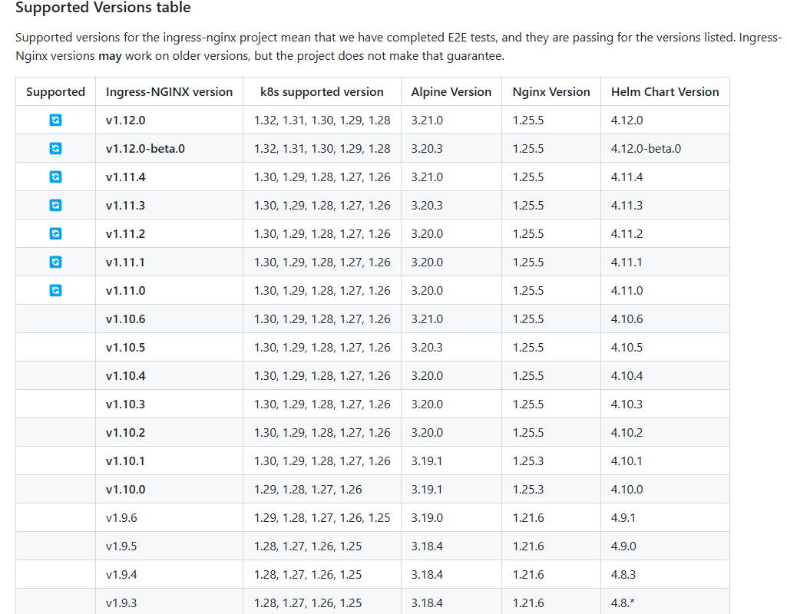

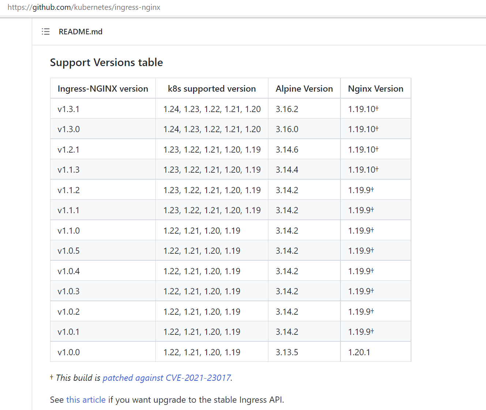

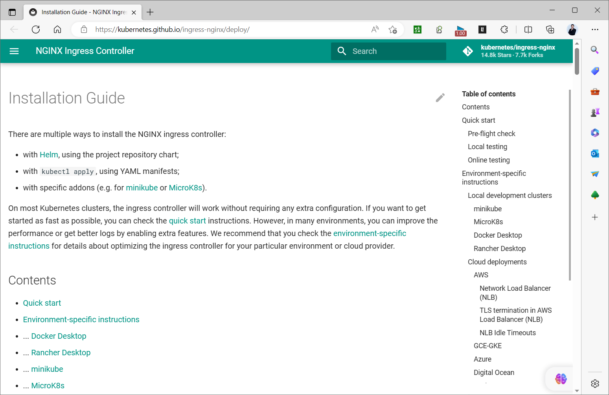

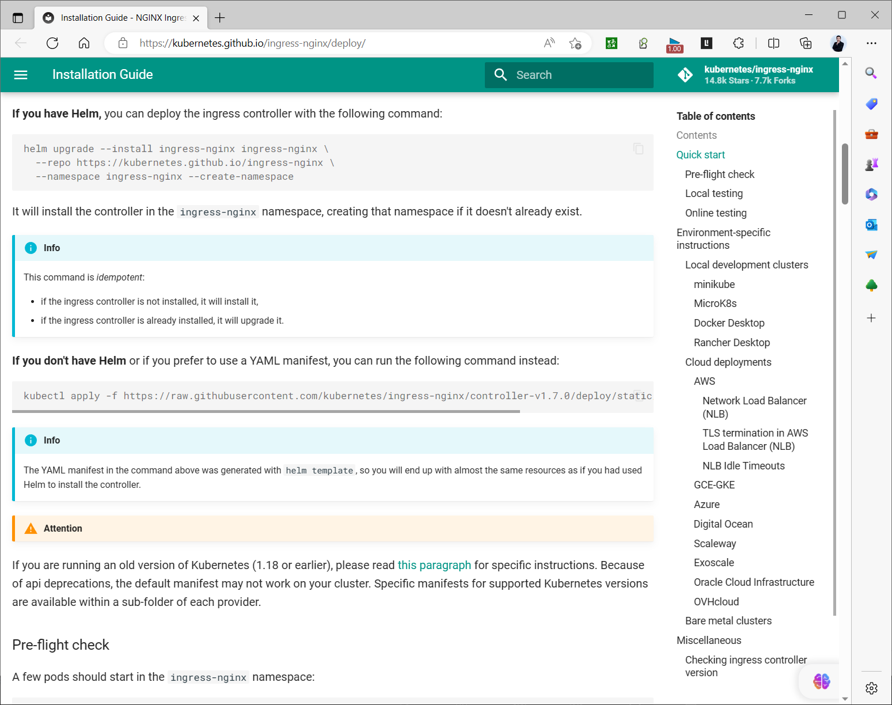

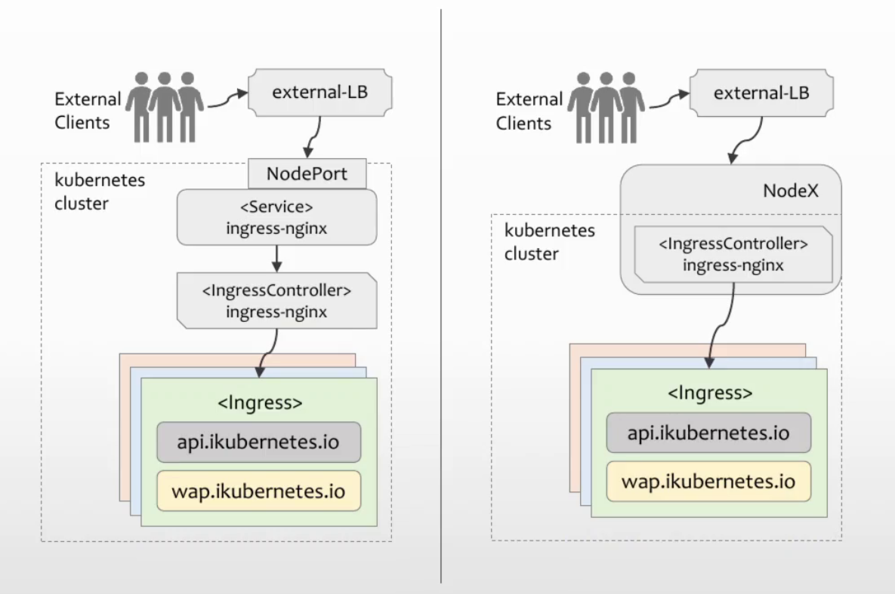

## 20.3 域名、路径与后端服务

命令式的 `kubectl create ingress` 适合快速试验；可维护的环境应将 Ingress 清单纳入版本管理。下例假设同一名称空间已有 `web` Service 的 80 端口，客户端访问 `www.example.test` 的 `/app` 路径时转发到该 Service。

```yaml
apiVersion: networking.k8s.io/v1
kind: Ingress
metadata:
  name: web
spec:
  ingressClassName: nginx
  rules:
    - host: www.example.test
      http:
        paths:
          - path: /app
            pathType: Prefix
            backend:
              service:
                name: web
                port:
                  number: 80
```

```bash
kubectl apply -f web-ingress.yaml
kubectl get ingress web
kubectl describe ingress web
kubectl get service web
kubectl get endpointslice -l kubernetes.io/service-name=web
```

`Prefix` 按路径段匹配而不是简单的字符串前缀：规则 `/app` 匹配 `/app` 和 `/app/docs`，不匹配 `/apple`。`Exact` 只匹配完整路径；多个规则命中时，先选择最长路径，长度相同则 `Exact` 优先。后端 Service 的端口可写数字或端口名，但必须与 Service 实际声明一致。

| 规则 | 请求 | 是否匹配 |
| --- | --- | --- |
| `Prefix /app` | `/app/docs` | 是 |
| `Prefix /app` | `/apple` | 否 |
| `Exact /app` | `/app` | 是 |
| `Exact /app` | `/app/` | 否 |
| `Prefix /` | 任意路径 | 是，可作兜底 |

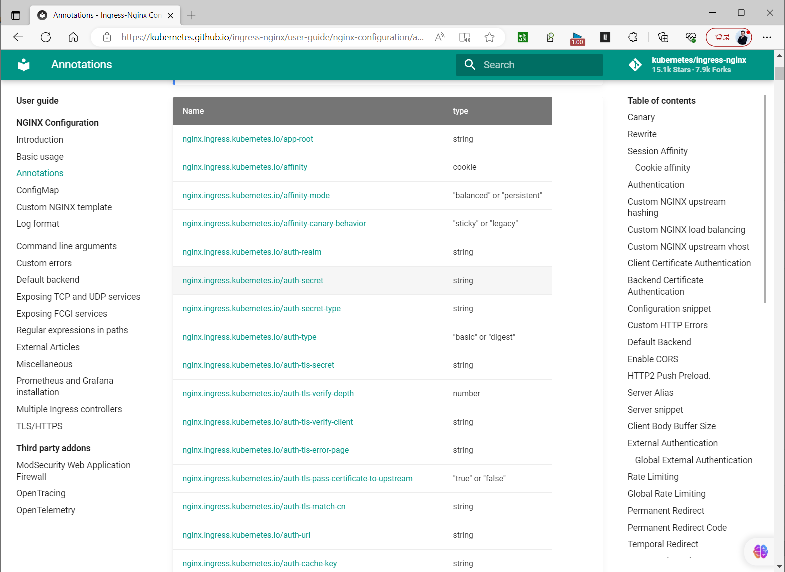

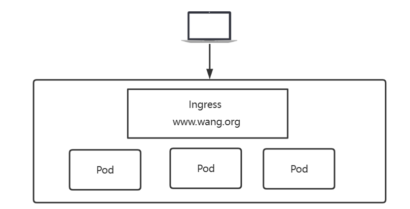

多个域名可在 `rules` 中各增加一个 `host`。使用 `curl --resolve www.example.test:80:<入口IP> http://www.example.test/app` 可以在 DNS 尚未切换时验证 Host 规则；不要只访问入口 IP，因为 Host 不匹配时可能进入默认后端。

## 20.4 HTTPS 与真实客户端地址

Ingress 的 TLS Secret 通常与 Ingress 位于同一名称空间。证书中的域名必须匹配 `rules.host`；实际 HTTP → HTTPS 重定向由控制器配置决定，不能只写 `tls` 字段就假定所有实现都会重定向。

```bash
kubectl create secret tls web-tls --cert=fullchain.pem --key=privkey.pem
```

```yaml
# 追加到上例的 spec 内
  tls:
    - hosts: [www.example.test]
      secretName: web-tls
```

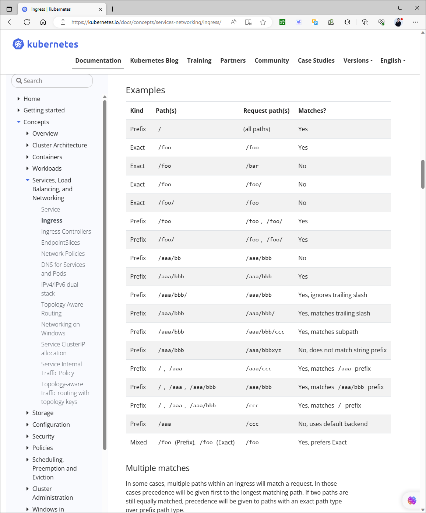

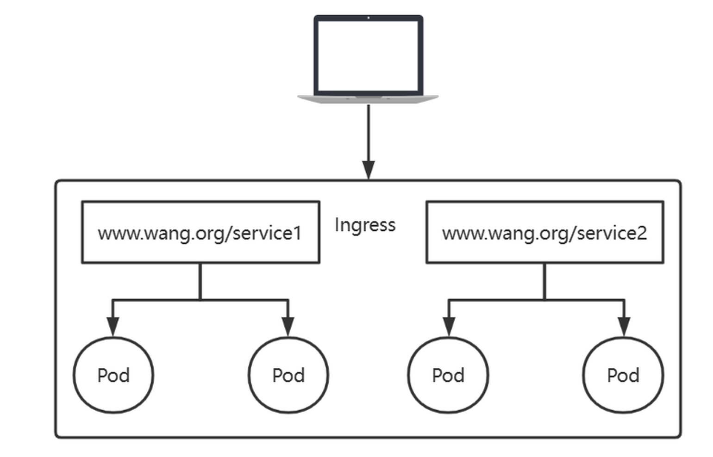

真实客户端 IP 取决于外部负载均衡器、Controller Service 的 `externalTrafficPolicy`、代理协议及受信任的转发头链路。`externalTrafficPolicy: Local` 可在某些 Service 链路保留源地址，但会改变流量分布和健康检查；不能无条件信任客户端提交的 `X-Forwarded-For`。逐层验证访问日志再决定配置。

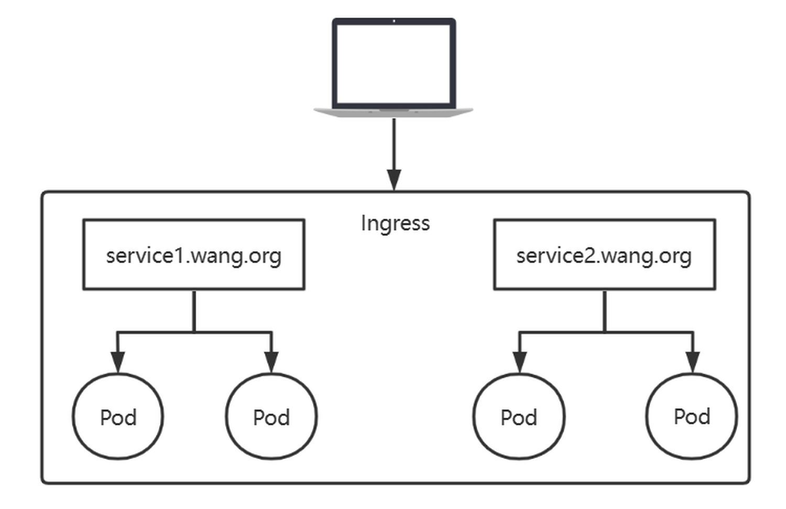

## 20.5 蓝绿与金丝雀发布

**蓝绿发布**准备 `web-v1` 与 `web-v2` 两套 Service，让基础 Ingress 的后端从 v1 切换到 v2；回退时切回 v1。发布前两套 Pod 都必须通过就绪探针，且数据库 schema 与两个版本兼容。修改 Ingress 只改变入口路由，不会自动回滚应用数据。

**金丝雀发布**在同一主机名、同一路径的基础 Ingress 旁创建控制器专用的 Canary Ingress，将部分请求送到新版本。下面例子用于 ingress-nginx，假设基础 Ingress 指向 `web-v1`，新服务为 `web-v2`。`canary-weight` 是近似流量权重，不保证在少量请求中严格达到百分比。

```yaml
apiVersion: networking.k8s.io/v1
kind: Ingress
metadata:
  name: web-canary
  annotations:
    nginx.ingress.kubernetes.io/canary: "true"
    nginx.ingress.kubernetes.io/canary-weight: "10"
spec:
  ingressClassName: nginx
  rules:
    - host: www.example.test
      http:
        paths:
          - path: /
            pathType: Prefix
            backend:
              service:
                name: web-v2
                port:
                  number: 80
```

创建 Canary 对象前，确认基础 Ingress **也是 `/` 路径**，两者规则必须对应。需要固定测试人群时，可改用 `canary-by-header` 与 `canary-by-header-value`，或 `canary-by-cookie`；需要模式匹配时使用 `canary-by-header-pattern`，并在非生产流量上先验证正则式。不要同时创建多个匹配同一主机和路径的 Canary Ingress 来“叠加”规则：控制器对冲突规则的处理可能不符合预期。一个 Canary 规则内，Header、Cookie 与权重的优先级应以所用控制器版本文档为准。

```bash
kubectl apply -f web-canary.yaml
kubectl describe ingress web-canary
# 用真实 Host、不同 Header/Cookie 及足够样本量验证新旧版本响应
kubectl delete ingress web-canary  # 停止金丝雀时先移除入口规则
```

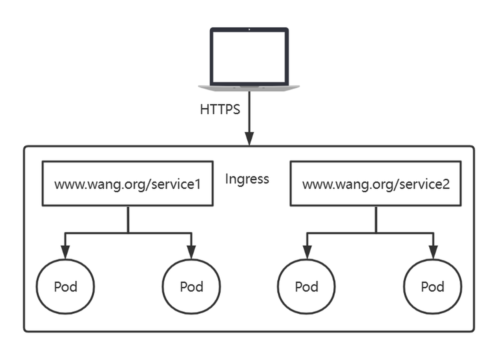

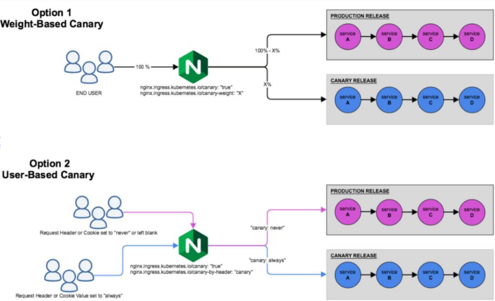



<nav class="article-end" aria-label="章节导航">
  <a href="{{ '/subjects/Kubernetes/19-dns-headless-service.html' | relative_url }}">← 上一章：服务发现、CoreDNS 与 Headless Service</a>
  <a href="{{ '/subjects/Kubernetes/' | relative_url }}">返回 Kubernetes 目录</a>
  <a href="{{ '/subjects/Kubernetes/21-storage-volumes-pv-pvc.html' | relative_url }}">下一章：存储卷、PV 与 PVC →</a>
</nav>
