[← 返回 Kubernetes 目录]({{ '/subjects/Kubernetes/' | relative_url }})



# 20 Ingress 流量治理与发布

# 1 Ingress 原理
```text
https://kubernetes.github.io/ingress-nginx/
https://kubernetes.io/zh-cn/docs/concepts/services-networking/ingress/
https://kubernetes.io/zh-cn/docs/concepts/services-networking/ingress-controllers/
```

## 1.1 Ingress 工作原理

Kubenetes集群中的通信的不仅有内部的流量，还有外部流量。

流量方向

将集群内部 pod之类对象之间的网络通信称为东西向流量。将集群外部应用和集群内部之间对象 之间的网络通信称为南北向流量。从北入南↓  -- ingress，从集群外到集群内从南出北↑  -- egress ，从集群内到集群外。可以基于四层的两种常用的方式实现将集群外部的流量引入到集群的内部中来，从而实现外部客户的正常访问。

集群外部流量可通过以下方式接入：

- **Service 方式**：使用 NodePort、LoadBalancer、ExternalIP 等 Service 对象，借助 namespace、iptables、IPVS 等机制实现四层转发。
- **Host 方式**：通过 Node 节点的 hostNetwork、hostPort 及配套端口映射，间接实现 Service 类似的效果。

**kubernetes网络**

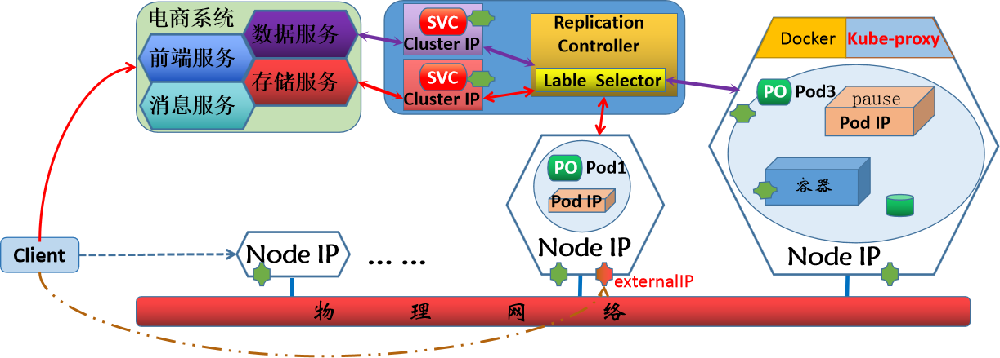

四层方式存在的问题

基于service或host等多种方式实现集群内外的网络通信都是基于四层协议来进行调度的，而且应用级别的健康检查功能很难实现。对于外部流量的接入，一般都是基于http(s)协议通信，四层协议无法实现基于应用层的代理,尤其是涉及到各种ssl会话的管理不支持基于FQDN的方式进行访问应用。不支持基于URL等机制对HTTP/HTTPS协议进行高级路由、超时/重试、基于流量的灰度等高级流量治理机制难以将多个Service流量统一管理,虽然service能够实现将外部流量引入到集群内部，但是其本质上，是通过网络规则方式来进行转发的，将集群内部的服务暴露到外部。这会造成对外过多的地址和端口暴露。

**解决方案**

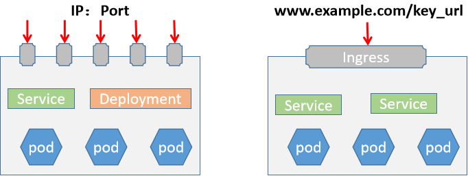

虽然可以自行通过部署七层代理解决上述问题,但配置繁琐以及无法和Kubernetes集群更好的结合联动.

因此Kubernetes 引入了一种新的资源 ingress，可以解决上面提出问题：

Ingress本质就是七层代理, 所以可以基于http/https的方式，将集群外部的流量统一的引入到集群内部通过一个统一的流量入口，避免将集群内部大量的端口直接暴露给外部。Ingress公开从集群外部到集群内服务 HTTP 和 HTTPS 路由。 流量路由由 Ingress 资源上定义的规则控制。

下面是一个将所有流量都发送到同一 Service 的简单 Ingress 示例：

集群

Pod

Ingress-管理的

Service

客户端

负载均衡器路由规则Ingress

Pod

]

Ingress 可为 Service 提供外部可访问的 URL、负载均衡流量、终止 SSL/TLS，以及基于名称的虚拟托管。 Ingress 控制器 通常负责通过负载均衡器来实现 Ingress，尽管它也可以配置边缘路由器或其他前端来帮助处理流量。Ingress 不会公开任意端口或协议。 将 HTTP 和 HTTPS 以外的服务公开到 Internet 时，通常使用Service.Type=NodePort 或 Service.Type=LoadBalancer 类型的 Service。

Ingress这种利用应用层协议来进行流量的负载均衡效果，它可以实现让用户通过域名来访问相应的service就可以了，无需关心Node IP及Port是什么，避免了信息的泄露。Ingress 是kubernetes上的一种标准化资源格式，它为了剥离与特定负载均衡功能实现软件的相关性，而抽象出来的一种公共的统一的声明式配置格式。然后借助于特定的ingress controller功能负责将其加载并转换成k8s集群内部的配置信息。

Ingress是授权入站连接到达集群服务的规则集合。

ingress 主要包含两个组件Ingress API和Ingress Controller。ingress 其具备了动态更新并加载新配置的特性。而且ingress本身是不具备实现集群内外流量通信的功能的，这个功能是通过 controller来实现的。Ingress Controller本身是运行于集群中的Pod资源对象。

**组件解析**

Kubernetes上的标准API资源类型之一仅定义了抽象路由配置信息，只是元数据，需要由相应的控制器动态加载。

Ingress

将代理配置抽象成一个Ingress对象，每个服务对应一个yaml配置文件。

API

负责以k8s标准的资源格式定义流量调度、路由等规则属于名称空间级资源,完成将同一个名空间的service资源进行暴露。七层反向代理服务程序需要监视（watch）API Server上 Ingress资源的变动，并生成具体应用的自身的配置文件格式，即将新加入的Ingress转化成反向代理的配置文件并动态加载使之生。

Ingress

效，最终并据此完成流量转发

Controller

Ingress Controller非为内置的控制器，需要额外自行部署通常以Pod形式运行于Kubernetes集群之上一般应该由专用的LB Service负责为其接入集群外部流量。因为ingress Controller是以pod的方式部署的,所以需要解决如下问题。

ingress的pod如何引入外部流量。

通过一个专用的service 即可实现。

如何实现ingress的Pod的流量负载均衡。关于pod负载均衡的流量，直接通过deployment/daemonset等controller转发给后端pod即可。后端应用的 Pod 很多，如何找到要转发的目标？通过k8s的service对所有的pod进行分组管理，再用controller内部的负载均衡配置，找到对应的目标。即后端应用的Pod对应的service 只是起到服务发现Pod的功能，而从外部访问应用的Pod的流量转发过程中不需要再经过此service。

**Ingress  访问过程**

从外部流量调度到kubernetes中Ingress service，有多种实现方案，比如使用节点网络中的EXTERNAL-IP或者NodePort方式从service调度到ingress-controller ingress-controller根据ingress Pod 中的定义，比如虚拟主机或者后端的url根据虚拟主机名直接调度到后端的一组应用pod中。

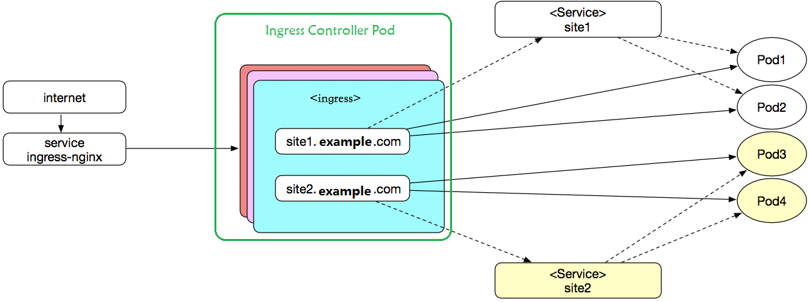

注意：

**Ingress 访问链路中的两个 Service**：

- `ingress-nginx` 对应的 Service 帮助 Ingress Controller Pod 接入外部流量。
- 后端应用对应的 Service 帮助 Ingress Controller Pod 找到具体的应用 Pod，主要用于服务发现；实际流量不经过后端 Service，而是从 Ingress Controller Pod 直接转发到目标 Pod。

图中的虚线表示 Service 对后端应用的分组，实线表示 Ingress 的实际访问流向。

## 1.2 Ingress controller 常见的解决方案

对于Ingress controller的软件实现，其实没有特殊的要求，只要能够实现七层的负载均衡功能即可。很多组织都提供了Ingress controller的软件实现, 对于Ingress的controller虽然实现方式不同，但是功能基本上一样。Ingress controller 支持由任何具有反向代理功能的程序实现，如Nginx、HAProxy、Traefik、Envoy、Vulcand等。Kubernetes支持同时部署二个或以上的数量的Ingress Controller。

**Ingress资源配置指定Ingress Controller类型的方法**

专用的annotation：kubernetes.io/ingress.class，老版本用法,v1.32.0淘汰此方式Ingress资源的spec的专有字段：ingressClassName，引用的IngressClass是一种特定的资源类型，此方式v1.18版本起使用，新版本推荐。

Ingress controller常见的实现方式有：


- <https://kubernetes.io/docs/concepts/services-networking/ingress-controllers/>


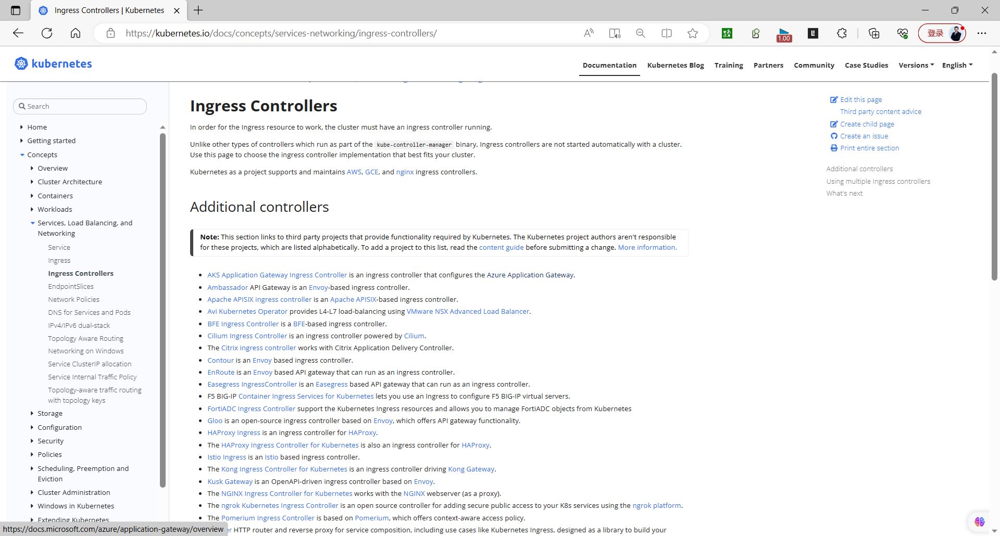

Kubernetes Ingress

Kubernetes官方发布, Ingress-Nginx 自从k8s-v1.6版本引入，在k8s-v1.19 正式进入了一个稳定版本状态。


- <http://github.com/kubernetes/ingress-nginx>


Nginx Ingress


- <http://github.com/nginxinc/kubernetes-ingress>
- <https://www.f5.com/products/nginx/nginx-ingress-controller>


Nginx Ingress是NGINX开发的官方版本，它基于NGINX Plus商业版本，NGINX控制器具有很高的稳定性，持续的向后兼容性，没有任何第三方模块，并且由于消除了Lua代码而保证了较高的速度（与官方控制器相比）。相比官方控制器，它支持TCP/UDP的流量转发，付费版有很广泛的附加功能，主要缺点就是缺失了鉴权方式、流量调度等其他功能。

Kong Ingress
```text
github.com/Kong/kubernetes-ingress-controller
```

Kong Ingress建立在NGINX之上，并增加了扩展其功能的Lua模块。kong在之前是专注于API网关，现在已经成为了成熟的Ingress控制器，相较于官方控制器，在路由匹配规则、upstream探针、鉴权上做了提升，并且支持大量的模块插件，并且便与配置。它提供了一些 API、服务的定义，可以抽象成 Kubernetes 的 CRD，通过Kubernetes Ingress 配置便可完成同步状态至 Kong 集群。

HAProxy  Ingress

性能相对于nginx来说，较稳定


- <http://github.com/jcmoraisjr/haproxy-ingress>


**Envoy**：基于C++语言开发，本身就为动态环境设计的，支持配置动态加载的XDS API。

不能像ingress-nginx一样，直接加载配置文件并动态加载转换成对应的应用配置，所以需要借助于其他控制平面工具来实现。

常见解决方案：Contour, Gloo

Traefik Ingress

Traefik的设计目标是成为一个现代化的云原生应用反向代理和负载均衡器。它专注于与容器化环境（如Docker、Kubernetes）集成，并具有自动发现和动态配置的能力。相比之下，Nginx是一个多用途的Web服务器和反向代理，旨在提供高性能和广泛的功能。

配置语言和方式：Traefik使用声明性的配置语言，通常基于YAML或TOML格式。它支持自动发现和动态配置，可以根据容器的状态和标签进行自动路由。Nginx使用基于文本文件的配置语言，通常使用Nginx专有的配置语法。

由于Traefik专注于容器环境，并提供自动配置功能，对于那些熟悉Docker和Kubernetes的用户来说，使用Traefik可能更加容易上手。当前使用得较多的是 traefik 和 nginx-controller，traefik 的性能较 nginx-controller 差，但是配置使用要简单许多。


- <https://traefik.io/>
- <https://github.com/containous/traefik>
- <https://github.com/traefik/traefik/releases>
- <https://github.com/traefik/traefik/tree/v1.7/examples/k8s>


**各种 Ingress Controller 比较**
```text
https://docs.google.com/spreadsheets/d/1DnsHtdHbxjvHmxvlu7VhzWcWgLAn_Mc5L1WlhLDA__k/edit?spm=a2c6h.12873639.article-detail.4.1eff3d8dO53Ifj#gid=0
```

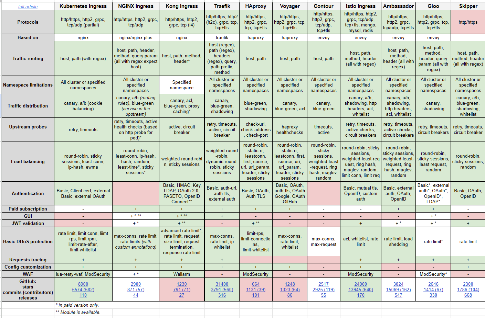

# 2 Ingress-nginx Controller 安装和配置

## 2.1 部署说明

注意:  Ingress-nginx 有两个项目,一个Kubernetes维护和Nginx官方维护,下面以Kubernetes官方维护的项目为例。
```text
#参考资料：
https://github.com/kubernetes/ingress-nginx
https://kubernetes.io/docs/concepts/services-networking/ingress/

#安装文档：
https://github.com/kubernetes/ingress-nginx/blob/main/docs/deploy/index.md
https://kubernetes.github.io/ingress-nginx/deploy/
```

**版本说明**


- <https://github.com/kubernetes/ingress-nginx/>


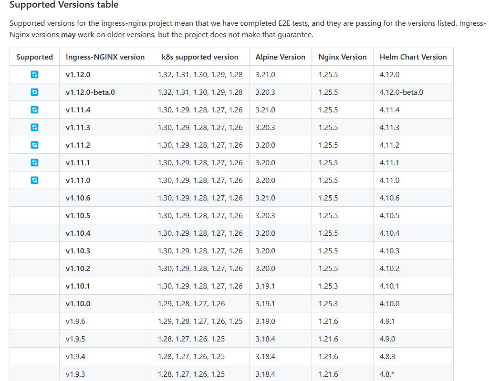

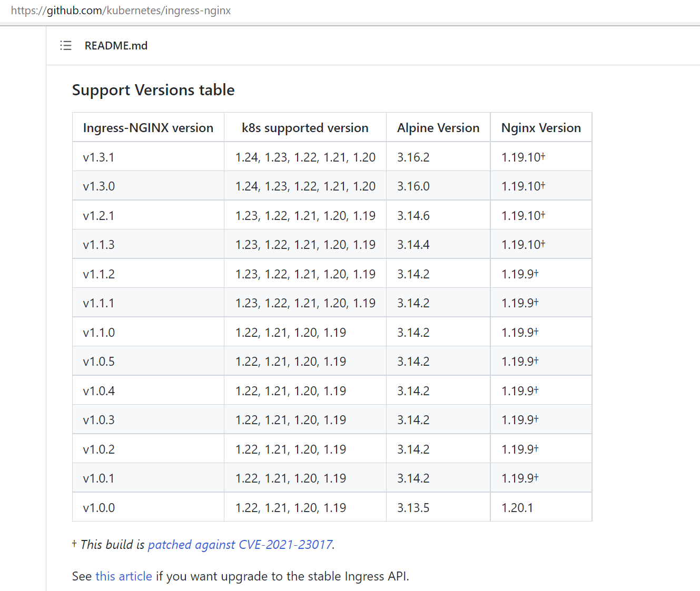

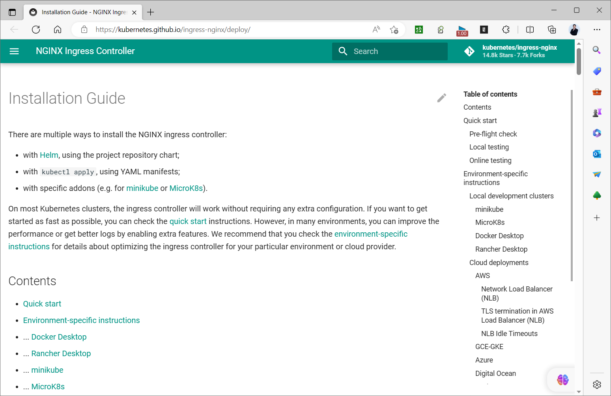

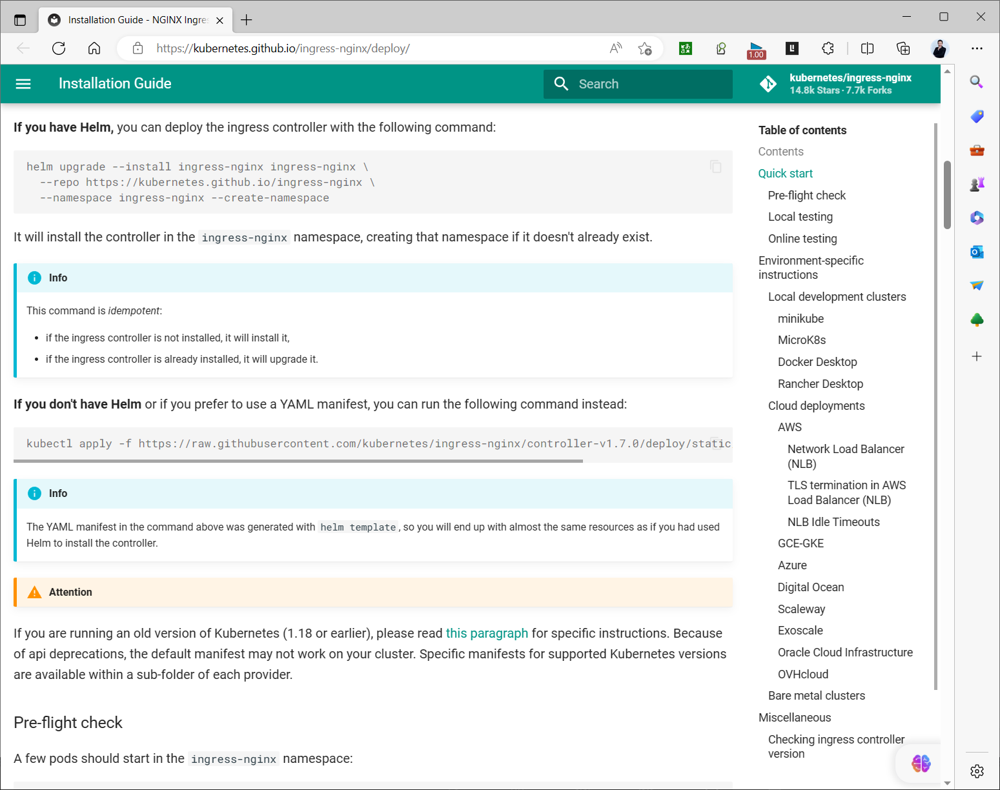

**ingress-nginx-controller 部署模式**

外部用户通过使用ingress-nginx-controller pod所在主机的物理网络访问,可以配置daemonset实现,此方式性能最好。外部用户通过ingress-nginx-controller的service对应的外部IP访问。

通过ingress-nginx-controller对应service中的externalIPs指定外部IP使用LB指定ingress-nginx-controller对应NodePort类型Service的节点IP:NodePort 实现使用ingress-nginx-controller对应LoadBalancer 类型Service的节点IP 实现。

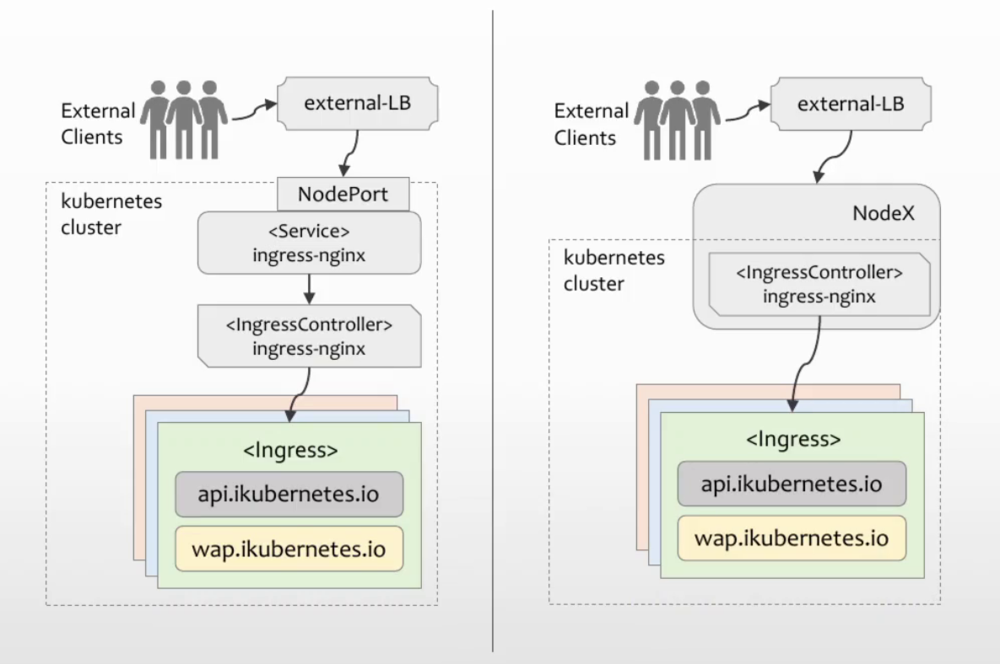

## 2.2 部署案例

**ingress-nginx 有两种主要的部署方式**

with kubectl apply , using YAML manifests with Helm, using the project repository chart

### 2.2.1 基于 YAML 部署

范例:  基于 kubectl apply 部署
```bash
#获取配置文件,可能需要科学上网才能下载
https://github.com/kubernetes/ingress-nginx/blob/main/docs/deploy/index.md
https://kubernetes.github.io/ingress-nginx/deploy/

#选择版本
https://github.com/kubernetes/ingress-nginx/

#新版
[root@master1 ~]#VERSION=1.13.3
[root@master1 ~]#VERSION=1.13.1
[root@master1 ~]#VERSION=1.12.3
[root@master1 ~]#VERSION=1.12.1
[root@master1 ~]#VERSION=1.12.0
[root@master1 ~]#VERSION=1.8.2
[root@master1 ~]#VERSION=1.8.0
[root@master1 ~]#VERSION=1.7.0
[root@master1 ~]#VERSION=1.4.0

[root@master1 ~]#wget https://raw.githubusercontent.com/kubernetes/ingress-
nginx/controller-v${VERSION}/deploy/static/provider/cloud/deploy.yaml

[root@master1 ~]#wget https://raw.githubusercontent.com/kubernetes/ingress-nginx/controller-v1.8.2/deploy/static/provider/cloud/deploy.yaml

[root@master1 ~]#wget https://raw.githubusercontent.com/kubernetes/ingress-nginx/controller-v1.8.0/deploy/static/provider/cloud/deploy.yaml

[root@master1 ~]#wget https://raw.githubusercontent.com/kubernetes/ingress-nginx/controller-v1.7.0/deploy/static/provider/cloud/deploy.yaml

#旧版
[root@master1 ~]#wget https://raw.githubusercontent.com/kubernetes/ingress-nginx/controller-v1.4.0/deploy/static/provider/cloud/deploy.yaml

#旧版
[root@master1 ~]#wget https://raw.githubusercontent.com/kubernetes/ingress-nginx/controller-v1.3.1/deploy/static/provider/cloud/deploy.yaml

#旧版
[root@master1 ~]#wget https://raw.githubusercontent.com/kubernetes/ingress-nginx/controller-v1.0.3/deploy/static/provider/baremetal/deploy.yaml

#查看资源
[root@master1 ~]#grep '^kind' deploy.yaml
kind: Namespace
kind: ServiceAccount
kind: ServiceAccount
kind: Role
kind: Role
kind: ClusterRole
kind: ClusterRole
kind: RoleBinding
kind: RoleBinding
kind: ClusterRoleBinding
kind: ClusterRoleBinding
kind: ConfigMap
kind: Service
kind: Service
kind: Deployment
kind: Job
kind: Job
kind: IngressClass
kind: ValidatingWebhookConfiguration

#1)默认的镜像可能无法下载,需要修改基础镜像
#可以通过配置代理下载
https://dockerproxy.com/

#版本:ingress-nginx-v1.12.3，修改三处image:地址
[root@master1 ~]#vim deploy.yaml
#image: registry.k8s.io/ingress-
nginx/controller:v1.12.3@sha256:ac444cd9515af325ba577b596fe4f27a34be1aa330538e8b
317ad9d6c8fb94ee
image: registry.cn-hangzhou.aliyuncs.com/google_containers/nginx-ingress-
controller:v1.12.3
#image: registry.k8s.io/ingress-nginx/kube-webhook-
certgen:v1.5.4@sha256:7a38cf0f8480775baaee71ab519c7465fd1dfeac66c421f28f087786e6
31456e
image: registry.cn-hangzhou.aliyuncs.com/google_containers/kube-webhook-
certgen:v1.5.4

#image: registry.k8s.io/ingress-nginx/kube-webhook-
certgen:v1.5.4@sha256:7a38cf0f8480775baaee71ab519c7465fd1dfeac66c421f28f087786e6
31456e
image: registry.cn-hangzhou.aliyuncs.com/google_containers/kube-webhook-
certgen:v1.5.4

#版本:ingress-nginx-v1.12.1，修改三处image:地址
[root@master1 ~]#vim deploy.yaml
image: registry.cn-hangzhou.aliyuncs.com/google_containers/nginx-ingress-
controller:v1.12.1
#image: registry.cn-hangzhou.aliyuncs.com/google_containers/nginx-
ingress-controller:v1.8.2
#image: k8s.dockerproxy.com/ingress-nginx/controller:v1.8.2
#image: registry.k8s.io/ingress-
nginx/controller:v1.8.2@sha256:74834d3d25b336b62cabeb8bf7f1d788706e2cf1cfd64022d
e4137ade8881ff2
#image: k8s.dockerproxy.com/ingress-nginx/kube-webhook-certgen:v20230407
#image: registry.k8s.io/ingress-nginx/kube-webhook-
certgen:v20230407@sha256:543c40fd093964bc9ab509d3e791f9989963021f1e9e4c9c7b6700b
02bfb227b
image: registry.cn-hangzhou.aliyuncs.com/google_containers/kube-webhook-
certgen:v1.5.2
image: registry.cn-hangzhou.aliyuncs.com/google_containers/kube-webhook-
certgen:v1.5.2
#image: registry.cn-hangzhou.aliyuncs.com/google_containers/kube-
webhook-certgen:v1.5.0
#image: registry.cn-hangzhou.aliyuncs.com/google_containers/kube-
webhook-certgen:v20230407

#版本:ingress-nginx-v1.12.0，修改三处image:地址
```
```yaml
[root@master1 ~]#vim deploy.yaml
image: registry.cn-hangzhou.aliyuncs.com/google_containers/nginx-ingress-
controller:v1.12.0
#image: registry.cn-hangzhou.aliyuncs.com/google_containers/nginx-
ingress-controller:v1.8.2
#image: k8s.dockerproxy.com/ingress-nginx/controller:v1.8.2
#image: registry.k8s.io/ingress-
nginx/controller:v1.8.2@sha256:74834d3d25b336b62cabeb8bf7f1d788706e2cf1cfd64022d
e4137ade8881ff2
#image: k8s.dockerproxy.com/ingress-nginx/kube-webhook-certgen:v20230407
#image: registry.k8s.io/ingress-nginx/kube-webhook-
certgen:v20230407@sha256:543c40fd093964bc9ab509d3e791f9989963021f1e9e4c9c7b6700b
02bfb227b
image: registry.cn-hangzhou.aliyuncs.com/google_containers/kube-webhook-
certgen:v1.5.0
image: registry.cn-hangzhou.aliyuncs.com/google_containers/kube-webhook-
certgen:v1.5.0
#image: registry.cn-hangzhou.aliyuncs.com/google_containers/kube-
webhook-certgen:v20230407

#旧版
[root@master1 ~]#vim deploy.yaml
[root@master1 ~]#grep image: deploy.yaml
image: registry.cn-beijing.aliyuncs.com/bowen/ingress-nginx-
controller:v1.8.0
#image: registry.cn-beijing.aliyuncs.com/bowen/ingress-nginx-
controller:v1.7.1

#image: registry.k8s.io/ingress-
nginx/controller:v1.7.1@sha256:7244b95ea47bddcb8267c1e625fb163fc183ef55448855e3a
c52a7b260a60407
imgae: bowen/ingress-nginx-kube-webhook-certgen:v20230407
#image: registry.cn-beijing.aliyuncs.com/bowen/kube-webhook-
certgen:v20230312-helm-chart-4.5.2-28-g66a760794
#image: registry.k8s.io/ingress-nginx/kube-webhook-certgen:v20230312-
helm-chart-4.5.2-28-
g66a760794@sha256:01d181618f270f2a96c04006f33b2699ad3ccb02da48d0f89b22abce084b29
2f
image: registry.cn-beijing.aliyuncs.com/bowen/kube-webhook-
certgen:v20230312-helm-chart-4.5.2-28-g66a760794
#image: registry.k8s.io/ingress-nginx/kube-webhook-certgen:v20230312-
helm-chart-4.5.2-28-
g66a760794@sha256:01d181618f270f2a96c04006f33b2699ad3ccb02da48d0f89b22abce084b29
2f

#旧版
[root@master1 ~]#vim deploy.yaml
[root@master1 ~]#grep image: deploy.yaml
image: registry.cn-beijing.aliyuncs.com/bowen/ingress-nginx-
controller:v1.8.0
image: registry.cn-beijing.aliyuncs.com/bowen/ingress-nginx-kube-webhook-
certgen:v20230407

#旧版
[root@master1 ~]#vim deploy.yaml
[root@master1 ~]#grep image: deploy.yaml
image: registry.cn-beijing.aliyuncs.com/bowen/ingress-nginx-
controller:v1.7.0
image: registry.cn-beijing.aliyuncs.com/bowen/kube-webhook-
certgen:v20230312-helm-chart-4.5.2-28-g66a760794

#旧版
[root@master1 ~]#vim deploy.yaml
[root@master1 ~]#grep image: deploy.yaml
image: registry.cn-hangzhou.aliyuncs.com/google_containers/nginx-ingress-
controller:v1.4.0
image: registry.cn-hangzhou.aliyuncs.com/google_containers/kube-webhook-
certgen:v20220916-gd32f8c343

#旧版
[root@master1 ~]#vim deploy.yaml
[root@master1 ~]#grep image: deploy.yaml
image: registry.cn-hangzhou.aliyuncs.com/google_containers/nginx-
ingress-
controller:v1.0.3@sha256:4ade87838eb8256b094fbb5272d7dda9b6c7fa8b759e6af5383c130
0996a7452
image: registry.cn-hangzhou.aliyuncs.com/google_containers/kube-
webhook-
certgen:v1.0@sha256:f3b6b39a6062328c095337b4cadcefd1612348fdd5190b1dcbcb9b9e90bd
8068
image: registry.cn-hangzhou.aliyuncs.com/google_containers/kube-
webhook-
certgen:v1.0@sha256:f3b6b39a6062328c095337b4cadcefd1612348fdd5190b1dcbcb9b9e90bd
8068

#2)开放外部访问入口地址,可选

[root@master1 ~]#vim deploy.yaml
......
apiVersion: v1
kind: Service
metadata:
.......
name: ingress-nginx-controller
namespace: ingress-nginx
annotations:                     #添加如下三行,用于支持prometheus监控,可选
prometheus.io/scrape: "true"
prometheus.io/port: "10254"
spec:
externalTrafficPolicy: Local #默认为Local,只能本机处理流量，即下面externalIPs所在主机
和Ingress-Controller Pod运行的主机必须是同一个节点，如果修改为Cluster，所有节点:3XXXX端口
都能处理流量实现负载均衡，如果type是LoadBalancer类型并且已配置openelb类似相关服务,则可以配置
为Local，避免跨主机的网络转发，从而有更好的性能，
.....
type: LoadBalancer         #默认值LoadBalancer可不做修改，即使没有配置Openelb也可以不
做修改，也支持其它类型，比如：NodePort，ClusterIP
externalIPs: ['10.0.0.99'] #如果type是LoadBalancer类型并且配置openelb则此项可选,增加
一个或多个外网访问的入口IP，如果externalTrafficPolicy为Local则此IP必须是正在运行Ingress-
Controller Pod的节点上面的可用IP,只有此IP能才处理流量,如果为Cluster则可以是任意集群节点的
IP，此项和type无关
ports:
- name: http
port: 80
.....

#3)默认ingress-nginx-controller只有一个Pod副本的,可选
#方法1: 指定2个副本实现高可用（此步可选）
spec:
replicas: 2

#方法2可以修改为DaemonSet提高性能（此步可选）
apiVersion: apps/v1
#kind: Deployment
kind: DaemonSet  #修改此行为 DaemonSet
.....
spec:
hostNetwork: true #使用宿主机的网络,直接使用宿主机的IP:80和宿主机的IP:443
hostPID: true #使用宿主机的Pid

#应用资源配置文件
```
```yaml
[root@master1 ~]#kubectl apply -f deploy.yaml
namespace/ingress-nginx created
serviceaccount/ingress-nginx created
serviceaccount/ingress-nginx-admission created
role.rbac.authorization.k8s.io/ingress-nginx created
role.rbac.authorization.k8s.io/ingress-nginx-admission created
clusterrole.rbac.authorization.k8s.io/ingress-nginx created
clusterrole.rbac.authorization.k8s.io/ingress-nginx-admission created
rolebinding.rbac.authorization.k8s.io/ingress-nginx created
rolebinding.rbac.authorization.k8s.io/ingress-nginx-admission created
clusterrolebinding.rbac.authorization.k8s.io/ingress-nginx created
clusterrolebinding.rbac.authorization.k8s.io/ingress-nginx-admission created
configmap/ingress-nginx-controller created
service/ingress-nginx-controller created
service/ingress-nginx-controller-admission created

deployment.apps/ingress-nginx-controller created
job.batch/ingress-nginx-admission-create created
job.batch/ingress-nginx-admission-patch created
ingressclass.networking.k8s.io/nginx created
validatingwebhookconfiguration.admissionregistration.k8s.io/ingress-nginx-
admission created

#查看ingress-nginx-controller的Pod运行在哪个节点上,注意:externalTrafficPolicy:
Cluster时无需此步
[root@master1 ~]#kubectl get pod -A -o wide |grep ingress-nginx-controller
ingress-nginx   ingress-nginx-controller-56f8b4f667-4rrm9   1/1     Running
0               73s     10.244.2.20   node2.bowen.org     <none>           <none>

#在k8s集群中的运行ingress-nginx-controller的Pod节点上添加externalIPs指定的IP地址
#注意:externalTrafficPolicy: Cluster时,10.0.0.99绑定在任意集群节点上都可以
#注意：此方式添加的IP不稳定，建议写入配置文件的静态IP，生产使用高可用的VIP
[root@node1 ~]#ip a a 10.0.0.99/24 dev eth0 label eth0:1

#确认效果
[root@master1 ~]#kubectl get ns
NAME                   STATUS   AGE
default                Active   5d19h
ingress-nginx          Active   2m41s
kube-node-lease        Active   5d19h
kube-public            Active   5d19h
kube-system            Active   5d19h
kubernetes-dashboard   Active   2d19h

[root@master1 ~]#kubectl get all  -n ingress-nginx
NAME                                            READY   STATUS      RESTARTS
AGE
pod/ingress-nginx-admission-create--1-c857d     0/1     Completed   0
24m
pod/ingress-nginx-admission-patch--1-gbxzg      0/1     Completed   1
24m
pod/ingress-nginx-controller-548b8cb9b8-tsxpl   1/1     Running     0
24m

NAME                                         TYPE        CLUSTER-IP
EXTERNAL-IP   PORT(S)                      AGE
service/ingress-nginx-controller             NodePort    10.101.159.100
10.0.0.99    80:32453/TCP,443:32699/TCP   24m
service/ingress-nginx-controller-admission   ClusterIP   10.105.95.216    <none>
443/TCP                      24m

NAME                                       READY   UP-TO-DATE   AVAILABLE   AGE
deployment.apps/ingress-nginx-controller   1/1     1            1           24m

NAME                                                  DESIRED   CURRENT   READY
AGE
replicaset.apps/ingress-nginx-controller-548b8cb9b8   1         1         1
24m

NAME                                       COMPLETIONS   DURATION   AGE
job.batch/ingress-nginx-admission-create   1/1           4s         24m
job.batch/ingress-nginx-admission-patch    1/1           5s         24m

#生成IngressClass

[root@master1 ~]#kubectl get ingressclass
NAME     CONTROLLER            PARAMETERS   AGE
nginx    k8s.io/ingress-nginx  <none>       50s

#查看configmap
[root@master1 ~]#kubectl get cm -n ingress-nginx ingress-nginx-controller  -o
yaml
apiVersion: v1
data:
allow-snippet-annotations: "true"
kind: ConfigMap
metadata:
annotations:
kubectl.kubernetes.io/last-applied-configuration: |
{"apiVersion":"v1","data":{"allow-snippet-
annotations":"true"},"kind":"ConfigMap","metadata":{"annotations":{},"labels":
{"app.kubernetes.io/component":"controller","app.kubernetes.io/instance":"ingres
s-nginx","app.kubernetes.io/name":"ingress-nginx","app.kubernetes.io/part-
of":"ingress-nginx","app.kubernetes.io/version":"1.7.0"},"name":"ingress-nginx-
controller","namespace":"ingress-nginx"}}
creationTimestamp: "2023-04-02T09:47:23Z"
labels:
app.kubernetes.io/component: controller
app.kubernetes.io/instance: ingress-nginx
app.kubernetes.io/name: ingress-nginx
app.kubernetes.io/part-of: ingress-nginx
app.kubernetes.io/version: 1.7.0
name: ingress-nginx-controller
namespace: ingress-nginx
resourceVersion: "253620"
uid: 3ae6b24d-a92e-4896-9937-e2bf7c1aebe2

#查看secret
```
```html
[root@master1 ~]#kubectl get secrets  -n ingress-nginx
NAME                      TYPE     DATA   AGE
ingress-nginx-admission   Opaque   3      18d

[root@master1 ~]#kubectl get secrets  -n ingress-nginx ingress-nginx-admission  -
o yaml
apiVersion: v1
data:
ca:
LS0tLS1CRUdJTiBDRVJUSUZJQ0FURS0tLS0tCk1JSUJkakNDQVJ1Z0F3SUJBZ0lRRFBBWnFvcWVycU9M
UmhuRXVkQUg3REFLQmdncWhrak9QUVFEQWpBUE1RMHcKQ3dZRFZRUUtFd1J1YVd3eE1DQVhEVEl6TURR
d01qQTVOREl5TkZvWUR6SXhNak13TXpBNU1EazBNakkwV2pBUApNUTB3Q3dZRFZRUUtFd1J1YVd3eE1G
a3dFd1lIS29aSXpqMENBUVlJS29aSXpqMERBUWNEUWdBRVlDMTNaSHMwClhyZkRuS3hhZklKb1VRSVpq
SDJHNjYycFNSc0svNHJoYjM2b1N5YmpEeTVMblJ4bnJwQ0xmMUZENXJBclBvZXUKV1JOWjRRdHFuM3F1
WUtOWE1GVXdEZ1lEVlIwUEFRSC9CQVFEQWdJRU1CTUdBMVVkSlFRTU1Bb0dDQ3NHQVFVRgpCd01CTUE4
R0ExVWRFd0VCL3dRRk1BTUJBZjh3SFFZRFZSME9CQllFRkF5WVRKbHJ6K1VkN1E2NUw1cld5V0lwCjdO
dzJNQW9HQ0NxR1NNNDlCQU1DQTBrQU1FWUNJUURRZ0p0dDRUalpndDhyMkw2MFY1Zk1aZXNpeHBFUCtM
bmcKL1NBUUFKNnFKd0loQU9qNEM0VUNGaEc2TzlqVERkcXZ0RmdlK1VXOWZDNVpwR3RoSFhpL3ArMzgK
LS0tLS1FTkQgQ0VSVElGSUNBVEUtLS0tLQo=

cert:
LS0tLS1CRUdJTiBDRVJUSUZJQ0FURS0tLS0tCk1JSUJ1ekNDQVdHZ0F3SUJBZ0lSQUxoK2JYR3hIdlZP
UENma0F6czVkR1l3Q2dZSUtvWkl6ajBFQXdJd0R6RU4KTUFzR0ExVUVDaE1FYm1sc01UQWdGdzB5TXpB
ME1ESXdPVFF5TWpSYUdBOHlNVEl6TURNd09UQTVOREl5TkZvdwpEekVOTUFzR0ExVUVDaE1FYm1sc01q
QlpNQk1HQnlxR1NNNDlBZ0VHQ0NxR1NNNDlBd0VIQTBJQUJIUHIwYXM3ClhlcGRQUFhrYkRUUGQ0Z1du
TmErZ0V5OFN0TjlXWWRCb3lFRExzR2ZNNzVaeGZiVUNaV2QzVGVaaktMYnVjOFAKbXpyUEpsU1VnTERF
WmF5amdac3dnWmd3RGdZRFZSMFBBUUgvQkFRREFnV2dNQk1HQTFVZEpRUU1NQW9HQ0NzRwpBUVVGQndN
Qk1Bd0dBMVVkRXdFQi93UUNNQUF3WXdZRFZSMFJCRnd3V29JaWFXNW5jbVZ6Y3kxdVoybHVlQzFqCmIy
NTBjbTlzYkdWeUxXRmtiV2x6YzJsdmJvSTBhVzVuY21WemN5MXVaMmx1ZUMxamIyNTBjbTlzYkdWeUxX
RmsKYldsemMybHZiaTVwYm1keVpYTnpMVzVuYVc1NExuTjJZekFLQmdncWhrak9QUVFEQWdOSUFEQkZB
aUVBeXJndgpoWEFIZ3JWM2R1VW1YNmZUYktOOFAvVXFTQ2RNZnErOW5qQkhkc1FDSUIzeWhYM1d5aHM1
cktRR0orTjVVdThlCi9RYVlyUGR3YXp5R2x0LzZ5NmxPCi0tLS0tRU5EIENFUlRJRklDQVRFLS0tLS0K
key:
LS0tLS1CRUdJTiBFQyBQUklWQVRFIEtFWS0tLS0tCk1IY0NBUUVFSUdON0xvc293S0Nsb2NDT0ZvWlp1
K1prRUNraTdpZ1gxRHUzVDRzZWdZM0JvQW9HQ0NxR1NNNDkKQXdFSG9VUURRZ0FFYyt2UnF6dGQ2bDA4
OWVSc05NOTNpQmFjMXI2QVRMeEswMzFaaDBHaklRTXV3Wjh6dmxuRgo5dFFKbFozZE41bU1vdHU1encr
Yk9zOG1WSlNBc01SbHJBPT0KLS0tLS1FTkQgRUMgUFJJVkFURSBLRVktLS0tLQo=
kind: Secret
metadata:
creationTimestamp: "2023-04-02T09:47:24Z"
name: ingress-nginx-admission
namespace: ingress-nginx
resourceVersion: "253670"
uid: ce0ecbe6-af86-4397-8217-169db6a1b38e
type: Opaque

#查看基于LoadBalancer的service
[root@master1 ~]#kubectl get svc -n ingress-nginx
NAME                                 TYPE           CLUSTER-IP       EXTERNAL-IP
PORT(S)                      AGE
ingress-nginx-controller             LoadBalancer   10.98.94.113     10.0.0.10
80:40090/TCP,443:42177/TCP   13m
ingress-nginx-controller-admission   ClusterIP      10.101.144.209   <none>
443/TCP                      13m
[root@master1 ~]#kubectl get ep -n ingress-nginx
NAME                                 ENDPOINTS                          AGE
ingress-nginx-controller             10.244.1.126:443,10.244.1.126:80   13m
ingress-nginx-controller-admission   10.244.1.126:8443                  13m

[root@master1 ~]#curl 10.0.0.10
<html>
<head><title>404 Not Found</title></head>
<body>
<center><h1>404 Not Found</h1></center>
<hr><center>nginx</center>
</body>
</html>

[root@master1 ~]#curl 10.0.0.101:40090
<html>
<head><title>404 Not Found</title></head>
<body>
<center><h1>404 Not Found</h1></center>
<hr><center>nginx</center>
</body>
</html>

#查看基于NodePort的service
[root@master1 ~]#kubectl get svc -n ingress-nginx
NAME                                 TYPE        CLUSTER-IP       EXTERNAL-IP
PORT(S)                      AGE
ingress-nginx-controller             NodePort    10.101.159.100   10.0.0.99
80:32453/TCP,443:32699/TCP   2m47s
ingress-nginx-controller-admission   ClusterIP   10.105.95.216    <none>
443/TCP                      2m47s

#注意：新版已经无法看到端口的监听
[root@master1 ~]#ss -ntl|grep -E "32453|32699"
LISTEN  0        4096             0.0.0.0:32699          0.0.0.0:*
LISTEN  0        4096             0.0.0.0:32453          0.0.0.0:*

#externalTrafficPolicy: local时，测试访问只有运行controller的节点的IP:32453才能访问，如
果为Cluster则支持任意节点
[root@master1 ~]#curl 10.0.0.101:32453
<html>
<head><title>404 Not Found</title></head>
<body>
<center><h1>404 Not Found</h1></center>
<hr><center>nginx</center>
</body>
</html>
```
```html
[root@master1 ~]#curl 10.0.0.101:32699
<html>
<head><title>400 The plain HTTP request was sent to HTTPS port</title></head>
<body>
<center><h1>400 Bad Request</h1></center>
<center>The plain HTTP request was sent to HTTPS port</center>
<hr><center>nginx</center>
</body>
</html>

#直接获取状态码
[root@master1 ~]#curl -I -o /dev/null -s -w %{http_code}"\n" 10.0.0.101:32453
404

#查看访问日志
[root@master1 ~]#kubectl logs -f -n  ingress-nginx ingress-nginx-controller-
548b8cb9b8-tsxpl
```

### 2.2.2 基于 Helm 部署

官方链接:


- <https://kubernetes.github.io/ingress-nginx/deploy/#quick-start>


范例: 通过Helm 安装 ingress-nginx
```bash
#先安装helm工具
略

#安装ingress-nginx

[root@master1 ~]#helm repo add ingress-nginx
https://kubernetes.github.io/ingress-nginx
"ingress-nginx" has been added to your repositories

[root@master1 ~]#helm repo list
NAME            URL
ingress-nginx   https://kubernetes.github.io/ingress-nginx

#搜索相关ingress-nginx包
[root@master1 ~]#helm search repo ingress-nginx
NAME                        CHART VERSION   APP VERSION DESCRIPTION

ingress-nginx/ingress-nginx 4.4.0           1.5.1       Ingress controller for
Kubernetes using NGINX a...

#下载包
[root@master1 ~]#helm pull ingress-nginx/ingress-nginx

#解压缩
[root@master1 ~]#tar xf ingress-nginx-4.4.0.tgz
[root@master1 ~]#ls ingress-nginx/
CHANGELOG.md  Chart.yaml  ci  OWNERS  README.md  README.md.gotmpl  templates
values.yaml

[root@master1 ~]#vim ingress-nginx/values.yaml
.....
image:
## Keep false as default for now!
chroot: false
#registry: registry.k8s.io
#image: ingress-nginx/controller
registry: registry.cn-hangzhou.aliyuncs.com      #添加下面两行
image: google_containers/nginx-ingress-controller
......
#dnsPolicy: ClusterFirst
dnsPolicy: ClusterFirstWithHostNet  #修改此行
......
hostNetwork: true #false修改此行为true
......
#kind: Deployment
kind: DaemonSet     #修改此行
......
nodeSelector:
kubernetes.io/os: linux
ingress: "true"   #添加此行
......
#type: LoadBalancer
type: ClusterIP    #修改此行

root@master1 ~]#cd ingress-nginx/
[root@master1 ingress-nginx]#kubectl create ns ingress-nginx

[root@master1 ingress-nginx]#kubectl label node  master1.bowen.org ingress=true

[root@master1 ingress-nginx]#helm install ingress-nginx -n ingress-nginx .

#或者通过下面实现安装
[root@master1 ~]#helm upgrade ingress-nginx ingress-nginx \

--install \
--repo https://kubernetes.github.io/ingress-nginx \
--namespace ingress-nginx \
--create-namespace \
--set controller.metrics.enabled=true \
--set-string controller.podAnnotations."prometheus\.io/scrape"="true" \
--set-string controller.podAnnotations."prometheus\.io/port"="10254"

#验证 kubectl get pod -n ingress-nginx -o wide 查看到的Pod,访问下面URL可以看到指标
[root@master1 ~]#curl http://<PodIP>:10254/metrics
```

# 3 Ingress 命令式实现

## 3.1 命令式实现说明
```text
#创建Ingress的命令：
kubectl create ingress NAME --rule=domain/url=service:port[,tls[=secret]]
[options]

#常用选项
--annotation=[]  #注解信息，格式“annotation=value”
--rule=[]        #代理规则，格式“host/path=service:port[,tls=secretname]”,注意:rule
中外部域名要在所有的名称空间唯一
--class=‘’       #此Ingress适配的Ingress Class Controller
-n 名称空间        #ingress的名称空间，需要和service在同一个名称空间
```


#基于URI方式代理不同应用的请求时，后端应用的URI若与代理时使用的URI不同，则需要启用URL Rewrite 完成URI的重写 Ingress-Nginx支持使用“annotation nginx.ingress.kubernetes.io/rewrite-target”注解进行


## 3.2 命令式实现案例

范例：准备环境实现两个service应用 pod-test1和pod-test2
```bash
#准备后端的应用pod-test v0.1和相应的service
[root@master1 ~]#kubectl create deployment pod-test1 --image=registry.cn-
beijing.aliyuncs.com/bowen/pod-test:v0.1 --replicas=3
[root@master1 ~]#kubectl create service clusterip pod-test1 --tcp=80:80

#准备后端的应用pod-test v0.2和相应的service
[root@master1 ~]#kubectl create deployment pod-test2 --image=registry.cn-
beijing.aliyuncs.com/bowen/pod-test:v0.2 --replicas=3
[root@master1 ~]#kubectl create service clusterip pod-test2 --tcp=80:80

[root@master1 ~]#kubectl get endpoints
NAME                 ENDPOINTS                                      AGE
pod-test1            10.244.1.60:80,10.244.1.64:80,10.244.1.69:80   21h
pod-test2            10.244.1.65:80,10.244.1.66:80,10.244.1.70:80   21h
```

### 3.2.1 单域名

#### 3.2.1.1 实现单域名不支持子URL

范例:  命令式实现单域名不支持子URL,子URL无法访问返回404
```html
#路径精确匹配,对于发往www.bowen.org的请求，代理至service/pod-test1，www.bowen.org其它的子
URL则无法代理
[root@master1 ~]#kubectl create ingress demo-ingress --rule="www.bowen.org/=pod-
test1:80" --class=nginx  -o yaml --dry-run=client
apiVersion: networking.k8s.io/v1
kind: Ingress
metadata:
creationTimestamp: null
name: demo-ingress
spec:
ingressClassName: nginx
rules:
- host: www.bowen.org
http:
paths:
- backend:
service:
name: pod-test1
port:
number: 80
path: /
pathType: Exact  #表示精确匹配，--rule="www.bowen.org/*=pod-test1:80",则为
prefix
status:
loadBalancer: {}

#创建
[root@master1 ~]#kubectl create ingress demo-ingress --rule="www.bowen.org/=pod-
test1:80" --class=nginx

#查看
[root@master1 ~]#kubectl get ingress demo-ingress -o yaml
apiVersion: networking.k8s.io/v1
kind: Ingress
metadata:
creationTimestamp: "2021-04-20T09:19:39Z"
generation: 1
name: demo-ingress
namespace: default
resourceVersion: "671603"
uid: 5223c7de-c032-45b5-b541-2cc8a136ac1f
spec:
ingressClassName: nginx
rules:
- host: www.bowen.org
http:
paths:
- backend:
service:
name: pod-test1
port:

number: 80
path: /
pathType: Exact    #类型为Exact
status:
loadBalancer:
ingress:
- ip: 10.0.0.99

[root@master1 ~]#kubectl get ingress
NAME           CLASS    HOSTS          ADDRESS     PORTS   AGE
demo-ingress   nginx    www.bowen.org   10.0.0.99   80      58s

#查看ingress-nginx-controller对应的Pod中Nginx配置文件的变化
[root@master1 ~]#kubectl exec ingress-nginx-controller-6fc8fc9c5b-f4bc6 -n
ingress-nginx -- nginx -T | grep bowen.org
## start server www.bowen.org
server_name www.bowen.org ;
## end server www.bowen.org

#集群外访问
C:\Users\Bowen>curl -H"host: www.bowen.org" http://10.0.0.99
kubernetes pod-test v0.1!! ClientIP: 10.244.2.31, ServerName: pod-test1-
5f8f7698d8-44vvk, ServerIP: 10.244.3.14!

C:\Users\Bowen>curl -H"host: www.bowen.org" http://10.0.0.99
kubernetes pod-test v0.1!! ClientIP: 10.244.2.31, ServerName: pod-test1-
5f8f7698d8-xzvdf, ServerIP: 10.244.2.32!

C:\Users\Bowen>curl -H"host: www.bowen.org" http://10.0.0.99
kubernetes pod-test v0.1!! ClientIP: 10.244.2.31, ServerName: pod-test1-
5f8f7698d8-jm4bq, ServerIP: 10.244.1.30!

#访问子URL失败，原因是只发布了www.bowen.org的根目录，其它URL没有发布
C:\Users\Bowen>curl -H"host: www.bowen.org" http://10.0.0.99/hostname
<html>
<head><title>404 Not Found</title></head>
<body>
<center><h1>404 Not Found</h1></center>
<hr><center>nginx</center>
</body>
</html>

#清理
[root@master1 ~]#kubectl delete ingress demo-ingress
```

#### 3.2.1.2 实现单域名支持子URL

范例：命令式实现单域名支持子URL
```yaml
#添加/*，支持子URL，如果有URL则转发至Pod对应相同的URL
[root@master1 ~]#kubectl create ingress demo-ingress --rule="www.bowen.org/*=pod-
test1:80" --class=nginx  -o yaml --dry-run=client

apiVersion: networking.k8s.io/v1

kind: Ingress
metadata:
creationTimestamp: null
name: demo-ingress
spec:
ingressClassName: nginx
rules:
- host: www.bowen.org
http:
paths:
- backend:
service:
name: pod-test1
port:
number: 80
path: /
pathType: Prefix  #注意此处
status:
loadBalancer: {}

#创建
[root@master1 ~]#kubectl create ingress demo-ingress --rule="www.bowen.org/*=pod-
test1:80" --class=nginx

[root@master1 ~]#kubectl get ingress
NAME           CLASS    HOSTS          ADDRESS     PORTS   AGE
demo-ingress   nginx    www.bowen.org   10.0.0.99   80      58s

#查看
[root@master1 ~]#kubectl get ingress demo-ingress -o yaml
apiVersion: networking.k8s.io/v1
kind: Ingress
metadata:
creationTimestamp: "2021-05-28T01:36:20Z"
generation: 1
name: demo-ingress
namespace: default
resourceVersion: "1502354"
uid: 0938aeda-0ea6-4235-a032-3a6adb0e2174
spec:
ingressClassName: nginx
rules:
- host: www.bowen.org
http:
paths:
- backend:
service:
name: pod-test1
port:
number: 80
path: /
pathType: Prefix
status:
loadBalancer: {}

#客户端访问测试
C:\Users\Bowen>curl -H"host: www.bowen.org" 10.0.0.99

kubernetes pod-test v0.1!! ClientIP: 10.244.1.182, ServerName: pod-test1-
5f8f7698d8-p2pst, ServerIP: 10.244.3.105!

#支持子URL
C:\Users\Bowen>curl -H"host: www.bowen.org" 10.0.0.99/hostname
ServerName: pod-test1-5f8f7698d8-p2pst

#清理
[root@master1 ~]#kubectl delete ingress demo-ingress
```

### 3.2.2 单域名多URL

cluster

Pod

/foo

Service service1:4200

Pod

Ingress-managed

client

Ingress, 178.91.123.132

load balancer

Pod

/bar

Service service2:8080

Pod

在同一个FQDN下通过不同的URL完成不同应用间的流量分发。

#### 3.2.2.1 单域名多URL不支持子URL

范例: 命令式实现单域名多URL，不支持子URL，如果子URL访问，也全部转发至后端Pod的根路径 /
```html
#路径精确匹配,对于发往www.bowen.org/v1和www.bowen.org/v2的请求，分别代理至service/pod-
test1和service/pod-test2的对应的子URL
[root@master1 ~]#kubectl create ingress demo-ingress1 --
rule="www.bowen.org/v1=pod-test1:80" --rule="www.bowen.org/v2=pod-test2:80" --
class=nginx

#集群外访问失败，原因是后端服务没有对应的/v1这样的子URL资源
C:\Users\Bowen>curl -H"host: www.bowen.org"  10.0.0.99/v1/
<html>
<head><title>404 Not Found</title></head>
<body>
<center><h1>404 Not Found</h1></center>
<hr><center>nginx</center>
</body>
</html>

C:\Users\Bowen>curl -H"host: www.bowen.org"  10.0.0.99/v2/
<html>
<head><title>404 Not Found</title></head>
<body>
<center><h1>404 Not Found</h1></center>
<hr><center>nginx</center>
</body>
</html>

#路径精确匹配,对于发往www.bowen.org/v1和/v2的请求，分别代理至service/pod-test1和
service/pod-test2的根
[root@master1 ~]#kubectl create ingress demo-ingress1 --
rule="www.bowen.org/v1=pod-test1:80" --rule="www.bowen.org/v2=pod-test2:80" --
class=nginx --annotation nginx.ingress.kubernetes.io/rewrite-target="/"
#说明：--annotation nginx.ingress.kubernetes.io/rewrite-target="/"表示代理至后端服务
的根/，而非默认代理至后端服务的子URL/v1和/v2

[root@master1 ~]#kubectl get ingress
NAME            CLASS   HOSTS          ADDRESS      PORTS   AGE
demo-ingress1   nginx   www.bowen.org   10.0.0.99   80      25m

[root@master1 ~]#kubectl get ingress demo-ingress1 -o yaml

apiVersion: networking.k8s.io/v1
kind: Ingress
metadata:
annotations:
nginx.ingress.kubernetes.io/rewrite-target: /
creationTimestamp: "2021-04-20T09:28:50Z"
generation: 1
name: demo-ingress1
namespace: default
resourceVersion: "672464"
uid: a4dc438d-d806-4a9b-87cd-cef06f5f2020
spec:
ingressClassName: nginx
rules:
- host: www.bowen.org
http:
paths:
- backend:
service:
name: pod-test1
port:
number: 80
path: /v1
pathType: Exact    #类型为Exact
- backend:
service:
name: pod-test2
port:
number: 80
path: /v2
pathType: Exact
status:
loadBalancer: {}

[root@master1 ~]#kubectl describe ingress demo-ingress1

Name:             demo-ingress1
Labels:           <none>
Namespace:        default
Address:          10.0.0.99
Ingress Class:    nginx
Default backend:  <default>
Rules:
Host          Path  Backends
----          ----  --------
www.bowen.org
/v1   pod-test1:80 (10.244.1.26:80,10.244.2.5:80,10.244.3.5:80)
/v2   pod-test2:80 (10.244.1.27:80,10.244.2.6:80,10.244.3.6:80)
Annotations:    nginx.ingress.kubernetes.io/rewrite-target: /
Events:
Type    Reason  Age                  From                      Message
----    ------  ----                 ----                      -------
Normal  Sync    2m56s (x4 over 26m)  nginx-ingress-controller  Scheduled for
sync
Normal  Sync    2m56s (x4 over 26m)  nginx-ingress-controller  Scheduled for
sync
Normal  Sync    2m56s (x4 over 26m)  nginx-ingress-controller  Scheduled for
sync
Normal  Sync    2m56s (x4 over 26m)  nginx-ingress-controller  Scheduled for
sync

#查看ingress-nginx controller对应Pod的地址
[root@master1 ~]#kubectl get pod -o wide  -n ingress-nginx
NAME                                        READY   STATUS      RESTARTS   AGE
IP            NODE             NOMINATED NODE   READINESS GATES
ingress-nginx-admission-create-hkg9q        0/1     Completed   0          14m
10.244.2.36   node2.bowen.org   <none>           <none>
ingress-nginx-admission-patch-9khhf         0/1     Completed   1          14m
10.244.2.35   node2.bowen.org   <none>           <none>
ingress-nginx-controller-56f8b4f667-kvrff   1/1     Running     0          14m
10.244.2.37   node2.bowen.org   <none>           <none>

#查看应用的Pod名称
[root@master1 ~]#kubectl get pod -o wide |grep pod-test1
pod-test1-5f8f7698d8-9vzgm          1/1     Running   2 (10h ago)   18h
10.244.1.60   node1.bowen.org   <none>           <none>
pod-test1-5f8f7698d8-jrg5x          1/1     Running   3 (10h ago)   22h
10.244.1.64   node1.bowen.org   <none>           <none>
pod-test1-5f8f7698d8-kgv6n          1/1     Running   2 (10h ago)   18h
10.244.1.69   node1.bowen.org   <none>           <none>
[root@master1 ~]#

#从集群外部测试访问
C:\Users\Bowen>curl -H"host:www.bowen.org" http://10.0.0.99/v1
kubernetes pod-test v0.1!! ClientIP: 10.244.2.26, ServerName: pod-test1-
5f8f7698d8-jrg5x, ServerIP: 10.244.1.64!
C:\Users\Bowen>curl -H"host:www.bowen.org" http://10.0.0.99/v2
kubernetes pod-test v0.2!! ClientIP: 10.244.2.26, ServerName: pod-test2-
f7d78c544-f4l5k, ServerIP: 10.244.1.70!

#如果有URL，则访问的资源仍然为根目录，不支持对应的子URL
C:\Users\Bowen>curl -H"host:www.bowen.org" http://10.0.0.99/v1/hostname
kubernetes pod-test v0.1!! ClientIP: 10.244.2.26, ServerName: pod-test1-
5f8f7698d8-jrg5x, ServerIP: 10.244.1.64!

C:\Users\Bowen>curl -H"host:www.bowen.org" http://10.0.0.99/v2/hostname
kubernetes pod-test v0.2!! ClientIP: 10.244.2.26, ServerName: pod-test2-
f7d78c544-f4l5k, ServerIP: 10.244.1.70!

#查看应用的Pod的日志，可以看到客户端来源为ingress-nginx controller对应Pod的地址
[root@master1 ~]#kubectl logs pod-test1-5f8f7698d8-9vzgm -f
* Running on http://0.0.0.0:80/ (Press CTRL+C to quit)
10.244.2.34 - - [02/Apr/2021 09:44:42] "GET / HTTP/1.1" 200 -

#清理环境
[root@master1 ~]#kubectl delete ingress demo-ingress1
```

#### 3.2.2.2 单域名多URL支持子URL(kubernetes-1.32.0版命令格式不支持，使用清单方式实现)

范例：命令式实现单域名多URL，支持子URL
```yaml
#使用URI的前缀匹配，而非精确匹配，且基于正则表达式模式进行url rewrite

#新版变化：kubernetes-1.32.0 使用指令式命令出错，无法实现
[root@master1 ~]#kubectl create ingress demo-ingress2 --
rule='www.bowen.org/v1(/|$)(.*)=pod-test1:80' --rule='www.bowen.org/v2(/|$)
(.*)=pod-test2:80' --class=nginx --annotation
nginx.ingress.kubernetes.io/rewrite-target='/$2'
Warning: path /v1(/|$)(.*) cannot be used with pathType Exact
Warning: path /v2(/|$)(.*) cannot be used with pathType Exact
error: failed to create ingress: admission webhook
"validate.nginx.ingress.kubernetes.io" denied the request: ingress contains
invalid paths: path /v1(/|$)(.*) cannot be used with pathType Exact
path /v2(/|$)(.*) cannot be used with pathType Exact

#使用清单文件实现
[root@master1 ~]#kubectl create ingress demo-ingress2 --
rule='www.bowen.org/v1(/|$)(.*)=pod-test1:80' --rule='www.bowen.org/v2(/|$)
(.*)=pod-test2:80' --class=nginx --annotation
nginx.ingress.kubernetes.io/rewrite-target='/$2'> demo-ingress2.yaml

[root@master1 ~]#vim demo-ingress2.yaml
apiVersion: networking.k8s.io/v1
kind: Ingress
metadata:
annotations:
nginx.ingress.kubernetes.io/rewrite-target: /$2
creationTimestamp: null
name: demo-ingress2
spec:
ingressClassName: nginx
rules:
- host: www.bowen.org
http:
paths:
- backend:
service:
name: pod-test1
port:
number: 80
path: /v1(/|$)(.*)

#pathType: Exact      #默认类型为Exact
pathType: ImplementationSpecific #修改为类型,不支持Prefix
- backend:
service:
name: pod-test2
port:
number: 80
path: /v2(/|$)(.*)
#pathType: Exact      #默认类型为Exact
pathType: ImplementationSpecific #修改为类型,不支持Prefix

[root@master1 ~]#kubectl apply -f  demo-ingress2.yaml

[root@master1 ~]#kubectl create ingress demo-ingress2 --
rule='www.bowen.org/v1(/|$)(.*)=pod-test1:80' --rule='www.bowen.org/v2(/|$)
(.*)=pod-test2:80' --class=nginx --annotation
nginx.ingress.kubernetes.io/rewrite-target='/$2'

#注意: '/$2'是单引号,不能为双引号

[root@master1 ~]#kubectl get ingress
NAME              CLASS    HOSTS             ADDRESS      PORTS   AGE
demo-ingress2     nginx    www.bowen.org      10.0.0.99   80      2m41s

[root@master1 ~]#kubectl get ingress demo-ingress2 -o yaml
apiVersion: networking.k8s.io/v1
kind: Ingress
metadata:
annotations:
nginx.ingress.kubernetes.io/rewrite-target: /$2
creationTimestamp: "2021-04-02T09:19:56Z"
generation: 1
name: demo-ingress2
namespace: default
resourceVersion: "251994"
uid: 1bb2c72d-d834-4bef-a0f7-69e00e97b5c1
spec:
ingressClassName: nginx
rules:
- host: www.bowen.org
http:
paths:
- backend:
service:
name: pod-test1
port:
number: 80
path: /v1(/|$)(.*)
pathType: Exact      #类型为Exact
- backend:
service:
name: pod-test2
port:
number: 80
path: /v2(/|$)(.*)
pathType: Exact
status:
loadBalancer:

ingress:
- ip: 10.0.0.99

[root@master1 ~]#kubectl get svc -n ingress-nginx
NAME                                 TYPE           CLUSTER-IP      EXTERNAL-IP
PORT(S)                      AGE
ingress-nginx-controller             LoadBalancer   10.104.190.93   10.0.0.99
80:30288/TCP,443:30485/TCP   2m55s
ingress-nginx-controller-admission   ClusterIP      10.101.94.203   <none>
443/TCP                      2m55s

#集群外测试访问
C:\Users\Bowen>curl -H"host:www.bowen.org" http://10.0.0.99/v1
kubernetes pod-test v0.1!! ClientIP: 10.244.2.26, ServerName: pod-test1-
5f8f7698d8-jrg5x, ServerIP: 10.244.1.64!
C:\Users\Bowen>curl -H"host:www.bowen.org" http://10.0.0.99/v2
kubernetes pod-test v0.2!! ClientIP: 10.244.2.26, ServerName: pod-test2-
f7d78c544-f4l5k, ServerIP: 10.244.1.70!

#如果externalTrafficPolicy为Cluster，可以访问任意集群节点的NodePort端口30288,如果
externalTrafficPolicy为Local，只能访问运行Controller的Pod所在节点的NodePort端口30288
C:\Users\Bowen>curl -H"host:www.bowen.org" http://10.0.0.201:30288/v1
kubernetes pod-test v0.2!! ClientIP: 10.244.2.31, ServerName: pod-test2-
f7d78c544-f4l5k, ServerIP: 10.244.1.70!
C:\Users\Bowen>curl -H"host:www.bowen.org" http://10.0.0.202:30288/v2
kubernetes pod-test v0.2!! ClientIP: 10.244.2.31, ServerName: pod-test2-
f7d78c544-fl892, ServerIP: 10.244.1.66!

#支持子URL
C:\Users\Bowen>curl -H"host:www.bowen.org" http://10.0.0.99/v1/hostname
ServerName: pod-test1-5f8f7698d8-9vzgm
C:\Users\Bowen>curl -H"host:www.bowen.org" http://10.0.0.99/v2/hostname
ServerName: pod-test2-f7d78c544-f4l5k

#清理环境
[root@master1 ~]#kubectl delete ingress demo-ingress2
```

### 3.2.3 多域名

cluster

Pod

**Host**：foo.bar.com

Service service1:80

Pod

Ingress-managed

client

Ingress, 178.91.123.132

load balancer

Pod

**Host**：bar.foo.com

Service service2:80

Pod

范例：命令式实现基于主机头的多虚拟主机
```yaml
#环境准备:
#基于FQDN名称代理不同应用的请求时，需要事先准备好多个域名，且确保对这些域名的解析能够到达
Ingress Controller

#对test1.bowen.org的请求代理至service/pod-test1，对test2.bowen.org请求代理至
service/pod-test2
[root@master1 ~]#kubectl create ingress demo-ingress3 --
rule="test1.bowen.org/*=pod-test1:80" --rule="test2.bowen.org/*=pod-test2:80" --
class=nginx

[root@master1 ~]#kubectl get ingress
NAME               CLASS   HOSTS                           ADDRESS   PORTS   AGE
demo-ingress3   nginx   test1.bowen.org,test2.bowen.org             80      5s
[root@master1 ~]#kubectl get ingress demo-ingress3 -o yaml
apiVersion: networking.k8s.io/v1
kind: Ingress
metadata:
creationTimestamp: "2021-04-02T10:41:03Z"
generation: 1
name: demo-ingress3
namespace: default
resourceVersion: "258984"
uid: 8a5cbd1d-dcd2-4f1f-9dc9-9a8025e38b3a
spec:
ingressClassName: nginx
rules:
- host: test1.bowen.org
http:
paths:
- backend:
service:
name: pod-test1

port:
number: 80
path: /
pathType: Prefix          #类型为Prefix,原因为test1.bowen.org/*有*号
- host: test2.bowen.org
http:
paths:
- backend:
service:
name: pod-test2
port:
number: 80
path: /
pathType: Prefix
status:
loadBalancer: {}

#测试访问
C:\Users\Bowen>curl -H"host:test1.bowen.org" http://10.0.0.99
kubernetes pod-test v0.1!! ClientIP: 10.244.2.37, ServerName: pod-test1-
5f8f7698d8-9vzgm, ServerIP: 10.244.1.60!
C:\Users\Bowen>curl -H"host:test2.bowen.org" http://10.0.0.99
kubernetes pod-test v0.2!! ClientIP: 10.244.2.37, ServerName: pod-test2-
f7d78c544-fl892, ServerIP: 10.244.1.66!

#支持子URL
C:\Users\Bowen>curl -H"host:test1.bowen.org" http://10.0.0.99/hostname
ServerName: pod-test1-5f8f7698d8-kgv6n
C:\Users\Bowen>curl -H"host:test2.bowen.org" http://10.0.0.99/hostname
ServerName: pod-test2-f7d78c544-f4l5k

#清理环境
[root@master1 ~]#kubectl delete ingress demo-ingress3
```

### 3.2.4  HTTPS

#### 3.2.4.1 命令式实现 HTTPS

范例: 命令式实现HTTPS
```html
#基于TLS的Ingress要求事先准备好专用的“kubernetes.io/tls”类型的Secret资源对象
[root@master1 ~]#(umask 077; openssl genrsa -out www.bowen.org.key 2048)

[root@master1 ~]#openssl req -new -x509 -key www.bowen.org.key -out
www.bowen.org.crt -subj /C=CN/ST=Beijing/L=Beijing/O=SRE/CN=www.bowen.org -days
365

#创建Secret
[root@master1 ~]#kubectl create secret tls tls-bowen --cert=./www.bowen.org.crt --
key=./www.bowen.org.key

[root@master1 ~]#kubectl get secrets
NAME       TYPE                DATA   AGE
tls-bowen   kubernetes.io/tls   2      15m

[root@master1 ~]#kubectl describe secrets tls-bowen
Name:         tls-bowen

Namespace:    default
Labels:       <none>
Annotations:  <none>

Type:  kubernetes.io/tls

Data
====
tls.crt:  1294 bytes
tls.key:  1700 bytes

#创建虚拟主机代理规则，同时将该主机定义为TLS类型，默认HTTP自动跳转至HTTPS
[root@master1 ~]#kubectl create ingress tls-demo-ingress --
rule='www.bowen.org/*=pod-test1:80,tls=tls-bowen' --class=nginx

#注意：启用tls后，该域名下的所有URI默认为强制将http请求利用308跳转至https，若不希望使用该跳转
功能，可以使用如下注解选项
#方法1
--annotation nginx.ingress.kubernetes.io/ssl-redirect=false，即如下形式
[root@master1 ~]#kubectl create ingress tls-demo-ingress --
rule='www.bowen.org/*=pod-test1:80,tls=tls-bowen' --class=nginx --annotation
nginx.ingress.kubernetes.io/ssl-redirect=false

#方法2
[root@master1 ~]#kubectl edit ingress tls-demo-ingress
metadata:
annotations: #添加两行
nginx.ingress.kubernetes.io/ssl-redirect: "false"

#查看
[root@master1 ~]#kubectl get ingress tls-demo-ingress -o yaml
apiVersion: networking.k8s.io/v1
kind: Ingress
metadata:
creationTimestamp: "2021-04-02T11:15:46Z"
generation: 1
name: tls-demo-ingress
namespace: default
resourceVersion: "262472"
uid: ecff3bd3-da04-4df0-8b79-7a8e23962ca2
spec:
ingressClassName: nginx
rules:
- host: www.bowen.org
http:
paths:
- backend:
service:
name: pod-test1
port:
number: 80
path: /
pathType: Prefix
tls:
- hosts:
- www.bowen.org
secretName: tls-bowen
status:

loadBalancer:
ingress:
- ip: 10.0.0.99

#集群外客户端测试访问
C:\Users\Bowen>curl -H"host: www.bowen.org" http://10.0.0.99/
<html>
<head><title>308 Permanent Redirect</title></head>
<body>
<center><h1>308 Permanent Redirect</h1></center>
<hr><center>nginx</center>
</body>
</html>

C:\Users\Bowen>curl -IH"host: www.bowen.org" http://10.0.0.99/
HTTP/1.1 308 Permanent Redirect
Date: Thu, 15 Jun 2022 03:11:04 GMT
Content-Type: text/html
Content-Length: 164
Connection: keep-alive
Location: https://www.bowen.org

#注意:修改为https方式访问
C:\Users\Bowen>curl -k -H"host: www.bowen.org" https://10.0.0.99/
kubernetes pod-test v0.1!! ClientIP: 10.244.2.37, ServerName: pod-test1-
5f8f7698d8-jrg5x, ServerIP: 10.244.1.64!

#查看证书有效期
#注意：Openssl命令的版本过低将无法看到过期时间，比如:CentOS8
```
```yaml
[root@ubuntu2204 ~]#openssl s_client www.bowen.org:443
CONNECTED(00000003)
depth=0 C = CN, ST = Beijing, L = Beijing, O = SRE, CN = www.bowen.org
verify error:num=18:self-signed certificate
verify return:1
depth=0 C = CN, ST = Beijing, L = Beijing, O = SRE, CN = www.bowen.org
verify return:1
---
Certificate chain
0 s:C = CN, ST = Beijing, L = Beijing, O = SRE, CN = www.bowen.org
i:C = CN, ST = Beijing, L = Beijing, O = SRE, CN = www.bowen.org
a:PKEY: rsaEncryption, 2048 (bit); sigalg: RSA-SHA256
v:NotBefore: Jan  9 04:01:09 2025 GMT; NotAfter: Jan  7 04:01:09 2035 GMT

#清理环境
[root@master1 ~]#kubectl delete  ingress tls-demo-ingress

#修改为不自动跳转https
[root@master1 ~]#kubectl create ingress tls-demo-ingress --
rule='www.bowen.org/*=pod-test1:80,tls=tls-bowen' --class=nginx --annotation
nginx.ingress.kubernetes.io/ssl-redirect=false

[root@master1 ~]#kubectl get ingress tls-demo-ingress
NAME               CLASS   HOSTS          ADDRESS     PORTS     AGE
tls-demo-ingress   nginx   www.bowen.org   10.0.0.99   80, 443   53s

[root@master1 ~]#kubectl get ingress tls-demo-ingress  -o yaml
apiVersion: networking.k8s.io/v1

kind: Ingress
metadata:
annotations:
nginx.ingress.kubernetes.io/ssl-redirect: "false"   #不自动跳转HTTPS
creationTimestamp: "2021-04-20T10:13:26Z"
generation: 1
name: tls-demo-ingress
namespace: default
resourceVersion: "677174"
uid: a2e8e19e-fc10-4e80-ad68-ac7c2ab038c6
spec:
ingressClassName: nginx
rules:
- host: www.bowen.org
http:
paths:
- backend:
service:
name: pod-test1
port:
number: 80
path: /
pathType: Prefix
tls:
- hosts:
- www.bowen.org
secretName: tls-bowen
status:
loadBalancer:
ingress:
- ip: 10.0.0.99

#测试从集群外访问,发现不再自动跳转HTTPS
C:\Users\Bowen>curl -H"host: www.bowen.org" http://10.0.0.99/
kubernetes pod-test v0.1!! ClientIP: 10.244.2.31, ServerName: pod-test1-
5f8f7698d8-xzvdf, ServerIP: 10.244.2.32!

C:\Users\Bowen>curl -kH"host: www.bowen.org" https://10.0.0.99/
kubernetes pod-test v0.1!! ClientIP: 10.244.2.31, ServerName: pod-test1-
5f8f7698d8-44vvk, ServerIP: 10.244.3.14!
```

#### 3.2.4.2 证书更新

HTTPS 的证书的有效期一般为1年,到期前需要提前更新证书。

范例: 证书更新
```bash
#重新颁发证书
[root@master1 ~]#(umask 077; openssl genrsa -out bowen.key 2048)
[root@master1 ~]#openssl req -new -x509 -key bowen.key -out bowen.crt -subj
/C=CN/ST=Beijing/L=Beijing/O=SRE/CN=www.bowen.org -days 3650

#方法1:此方法繁琐，不推荐
#在线修改证书配置,需要提前先将新证书文件用base64编码并删除换行符
[root@master1 ~]#cat bowen.crt |base64 | tr -d '\n'
[root@master1 ~]#cat bowen.key |base64 | tr -d '\n'
#上面生成的内容替换下面命令的内容,立即生效

[root@master1 ~]#kubectl edit secrets  tls-bowen

#方法2:此方法简单，推荐
#删除旧证书配置
[root@master1 ~]#kubectl delete secrets tls-bowen
#创建新证书配置
[root@master1 ~]#kubectl create secret tls tls-bowen --cert=./bowen.crt --
key=./bowen.key

#集群外验证证书是否生效
[root@ubuntu2204 ~]#echo 10.0.0.99 www.bowen.org >> /etc/hosts

#用Linux的curl，windows 的Curl不支持
[root@node3 ~]#curl https://www.bowen.org -vk
*   Trying 10.0.0.10:443...
* Connected to www.bowen.org (10.0.0.10) port 443 (#0)
* SSL connection using TLSv1.3 / TLS_AES_256_GCM_SHA384
* ALPN, server accepted to use h2
* Server certificate:
*  subject: C=CN; ST=Beijing; L=Beijing; O=SRE; CN=www.bowen.org
*  start date: Jun  6 07:53:35 2025 GMT
*  expire date: Jun  6 07:53:35 2026 GMT
*  issuer: C=CN; ST=Beijing; L=Beijing; O=SRE; CN=www.bowen.org

#注意：Openssl命令的版本过低将无法看到过期时间，比如:CentOS8
[root@ubuntu2204 ~]#openssl s_client www.bowen.org:443
CONNECTED(00000003)
depth=0 C = CN, ST = Beijing, L = Beijing, O = SRE, CN = www.bowen.org
verify error:num=18:self-signed certificate
verify return:1
depth=0 C = CN, ST = Beijing, L = Beijing, O = SRE, CN = www.bowen.org
verify return:1
---
Certificate chain
0 s:C = CN, ST = Beijing, L = Beijing, O = SRE, CN = www.bowen.org
i:C = CN, ST = Beijing, L = Beijing, O = SRE, CN = www.bowen.org
a:PKEY: rsaEncryption, 2048 (bit); sigalg: RSA-SHA256
v:NotBefore: Jun 15 03:18:44 2021 GMT; NotAfter: Jun 12 03:18:44 2031 GMT
......

#清理环境
[root@master1 ~]#kubectl delete ingress tls-demo-ingress
[root@master1 ~]#kubectl delete secrets tls-bowen
```

# 4 Ingress 声明式实现

## 4.1 声明式实现说明

基于命令方式格式功能有限，且不利于后续的重复使用，工作中更多的使用声明式实现Ingress。在实际的工作中，可能会基于域名访问,也可能会基于不同的功能服务以子路径的方式来进行访问，以及与https相关的访问。

注意: k8s-v1.22之前后版本的声明式的yaml格式有所不同。


- <https://kubernetes.io/docs/concepts/services-networking/ingress/>


**官方配置参考**
```text
https://kubernetes.github.io/ingress-nginx/user-guide/nginx-configuration/annotations/
```

**配置文件解析**
```yaml
apiVersion: networking.k8s.io/v1            # 资源所属的API群组和版本
kind: Ingress                               # 资源类型标识符
metadata:                                   # 元数据
name <string>                             # 资源名称
annotations:                              # 资源注解，v1beta1使用下面的注解来指定要
解析该资源的控制器类型
kubernetes.io/ingress.class: <string>   # 适配的Ingress控制器类别,便于多ingress组
件场景下，挑选针对的类型
namespace <string>                        # 名称空间
spec:
rules <[]Object>                          # Ingress规则列表，也就是http转发时候用到
的 url关键字
- host <string>                           # 虚拟主机的FQDN，支持“*”前缀通配，不支持
IP，不支持指定端口
http <Object>
paths <[]Object>                      # 虚拟主机PATH定义的列表，由path和backend
组成
- path <string>                       # 流量匹配的HTTP PATH，必须以/开头
pathType <string>                   # 支持Exact、Prefix和
ImplementationSpecific，必选
backend <Object>                    # 匹配到的流量转发到的目标后端
resource <Object>                 # 引用的同一名称空间下的资源，与下面两个字段
互斥
service <object>                  # 关联的后端Service对象
name <string>                   # 后端Service的名称
port <object>                   # 后端Service上的端口对象
name <string>                 # 端口名称
number <integer>              # 端口号
tls <[]Object>                    # TLS配置，用于指定上rules中定义的哪些host需要工作
HTTPS模式
- hosts <[]string>                # 使用同一组证书的主机名称列表
secretName <string>             # 保存于数字证书和私钥信息的secret资源名称，用于主机
认证
backend <Object>                  # 默认backend的定义，可嵌套字段及使用格式跟rules字
段中的相同
ingressClassName  <string>        # ingress类名称，用于指定适配的控制器，类似于注解的
功能，未来代替annotations
```

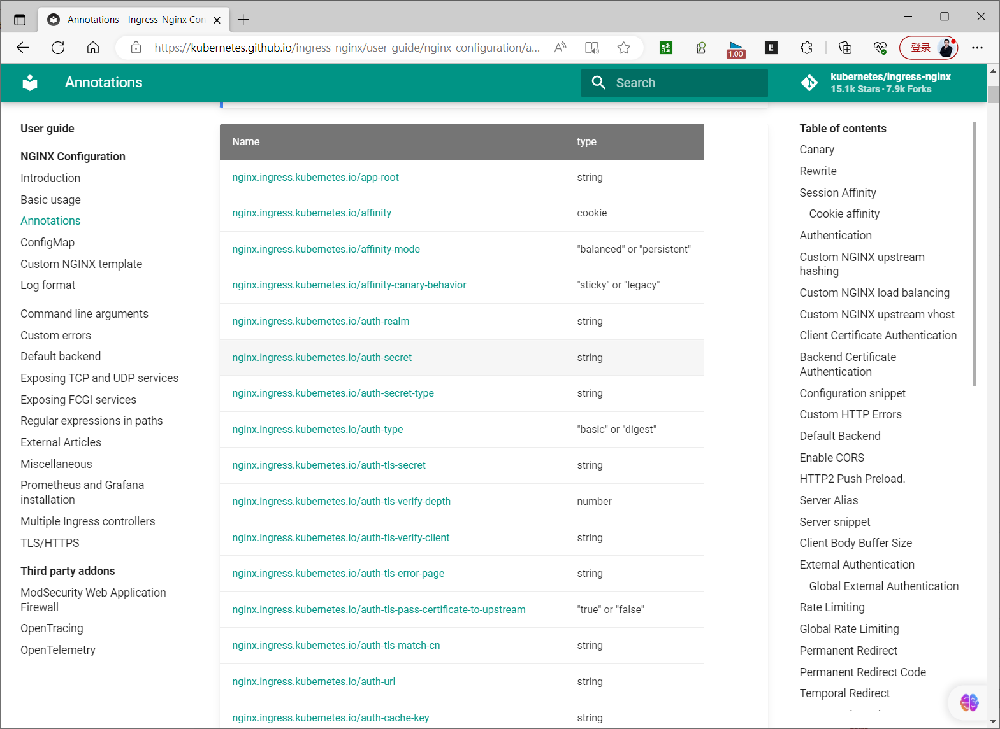
```text
https://kubernetes.io/zh-cn/docs/concepts/services-networking/ingress/#%E7%A4%BA%E4%BE%8B
```

示例

类型路径请求路径匹配与否？

Prefix/（所有路径）是

Exact/foo/foo是

Exact/foo/bar否

Exact/foo/foo/否

Exact/foo//foo否

Prefix/foo/foo , /foo/是

Prefix/foo//foo , /foo/是

Prefix/aaa/bb/aaa/bbb否

Prefix/aaa/bbb/aaa/bbb是

Prefix/aaa/bbb//aaa/bbb是，忽略尾部斜线

Prefix/aaa/bbb/aaa/bbb/是，匹配尾部斜线

Prefix/aaa/bbb/aaa/bbb/ccc是，匹配子路径

Prefix/aaa/bbb/aaa/bbbxyz否，字符串前缀不匹配。

Prefix/ , /aaa/aaa/ccc是，匹配 /aaa 前缀

Prefix/ , /aaa , /aaa/bbb/aaa/bbb是，匹配 /aaa/bbb 前缀

Prefix/ , /aaa , /aaa/bbb/ccc是，匹配 / 前缀

Prefix/aaa/ccc否，使用默认后端

混合/foo (Prefix), /foo (Exact)/foo是，优选 Exact 类型

## 4.2 声明式实现案例

### 4.2.1 单域名案例

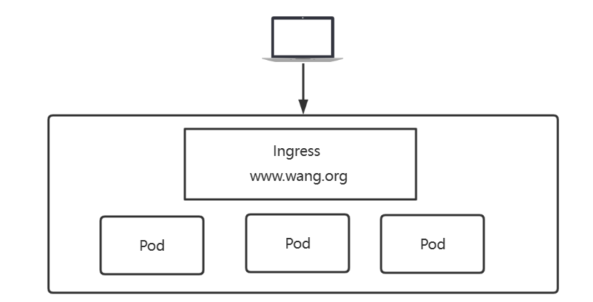

nginx controller 可以实现的基于域名的访问。

范例 : 单域名支持子URL
```yaml
#准备后端服务所需的资源
[root@master1 ~]#cat ingress-deployment-svc.yaml
apiVersion: apps/v1
kind: Deployment
metadata:
name: deployment-test
spec:
replicas: 3
selector:
matchLabels:
app: pod-test
template:
metadata:
labels:
app: pod-test
spec:
containers:
- name: pod-test
image: registry.cn-beijing.aliyuncs.com/bowen/pod-test:v0.1
imagePullPolicy: IfNotPresent
ports:
- containerPort: 80
name: http
---
apiVersion: v1
kind: Service
metadata:
name: deployment-service
spec:
selector:
app: pod-test
ports:
- name: http
port: 80
targetPort: 80

#应用资源文件
[root@master1 ~]#kubectl apply -f ingress-deployment-svc.yaml

#查看效果
[root@master1 ~]#kubectl get deployments,svc,po
NAME                              READY   UP-TO-DATE   AVAILABLE   AGE
deployment.apps/deployment-test   3/3     3            3           105s

NAME                         TYPE        CLUSTER-IP      EXTERNAL-IP   PORT(S)
AGE
service/deployment-service   ClusterIP   10.99.228.134   <none>        80/TCP
105s
service/kubernetes           ClusterIP   10.96.0.1       <none>        443/TCP
5d20h

NAME                                   READY   STATUS    RESTARTS   AGE
pod/deployment-test-555f594785-9mmbq   1/1     Running   0          105s

pod/deployment-test-555f594785-l6v98   1/1     Running   0          105s
pod/deployment-test-555f594785-rfhcz   1/1     Running   0          105s

[root@master1 ~]#kubectl get po -o wide
NAME                               READY   STATUS    RESTARTS   AGE     IP
NODE               NOMINATED NODE   READINESS GATES
deployment-test-555f594785-9mmbq   1/1     Running   0          6m32s
10.244.5.38   node3.bowen.org   <none>           <none>
deployment-test-555f594785-l6v98   1/1     Running   0          6m32s
10.244.3.66   node1.bowen.org   <none>           <none>
deployment-test-555f594785-rfhcz   1/1     Running   0          6m32s
10.244.3.67   node1.bowen.org   <none>           <none>

#定义创建ingress资源文件，和Controller无关，使用统一格式
[root@master1 ~]#cat  ingress-http-test.yaml
apiVersion: networking.k8s.io/v1       #v1.19版之前使用networking.k8s.io/v1beta1，
且下面内容格式也所有不同
kind: Ingress
metadata:
name: ingress-test
#annotations:
#  kubernetes.io/ingress.class: "nginx"  #旧版指定nginx做为ingress controller，支
持其它controller,如：traefik，k8s-v1.32.0不再支持
spec:
ingressClassName: nginx   #新版建议使用此项指定controller类型
rules:                     #可以配置多个rules
- host: www.bowen.org       #域名配置,如果不写相当于匹配 * ,支持格式:*.bowen.org
http:
paths:                 #相当于nginx的location配置块,同一个host可以配置多个path
- path: /              #将www.bowen.org的请求代理至后端的/
pathType: Prefix     #表示以 / 开始即可。如果Exact，不支持子URL
backend:
service:
name: deployment-service #service的名称
port:
number: 80     #service的Port

#属性解析：注释信息，对于不同的ingress的内容是不一样的,对于ingress来说，最重要的就是rules了，
这里的hosts是一个自定义的域名

#应用资源文件
[root@master1 ~]#kubectl apply -f ingress-http-test.yaml

#查看效果
[root@master1 ~]#kubectl get ingress
NAME           CLASS    HOSTS             ADDRESS      PORTS   AGE
ingress-test   <none>   www.bowen.org   10.0.0.104   80      32s
```
```html
[root@master1 ~]#kubectl describe ingress ingress-test
Name:             ingress-test
Namespace:        default
Address:          10.0.0.104
Default backend:  default-http-backend:80 (<error: endpoints "default-http-
backend" not found>)
Rules:
Host             Path  Backends
----             ----  --------
www.bowen.org

/   deployment-service:80
(10.244.3.66:80,10.244.3.67:80,10.244.5.38:80)
Annotations:       kubernetes.io/ingress.class: nginx
Events:
Type    Reason  Age                From                      Message
----    ------  ----               ----                      -------
Normal  Sync    45s (x2 over 55s)  nginx-ingress-controller  Scheduled for
sync

#结果显示：ingress 将后端的deployment-service:80 的样式自动与 ingress 的 url(/) 关联在
一起

#为externalIPs的ip地址做一个域名绑定
C:\Users\Bowen>echo '10.0.0.99 www.bowen.org' >> /etc/hosts

#访问效果,注意:需要提前做名称解析
C:\Users\Bowen>curl www.bowen.org
kubernetes pod-test v0.1!! ClientIP: 10.244.3.65, ServerName: deployment-test-
555f594785-l6v98, ServerIP: 10.244.3.66!
C:\Users\Bowen>curl www.bowen.org
kubernetes pod-test v0.1!! ClientIP: 10.244.3.65, ServerName: deployment-test-
555f594785-rfhcz, ServerIP: 10.244.3.67!
C:\Users\Bowen>curl www.bowen.org
kubernetes pod-test v0.1!! ClientIP: 10.244.3.65, ServerName: deployment-test-
555f594785-9mmbq, ServerIP: 10.244.5.38!

#非域名方式进行访问
C:\Users\Bowen>curl 10.0.0.99
<html>
<head><title>404 Not Found</title></head>
<body>
<center><h1>404 Not Found</h1></center>
<hr><center>nginx</center>
</body>
</html>

#结果显示：通过域名可以正常的访问后端的服务，而非域名访问方式受到了限制

C:\Users\Bowen>curl -H "Host:www.bowen.org" http://10.0.0.99
kubernetes pod-test v0.1!! ClientIP: 10.244.2.5, ServerName: deployment-test-
95c58b447-jg6gz, ServerIP: 10.244.2.6!
```


#如果type的值为LoadBalancer或者NodePort，也可直接访问运行Controller Pod的节点的IP:32453 也可以访问 C:\Users\Bowen>curl -H "Host:www.bowen.org" http://10.0.0.106:32453 kubernetes pod-test v0.1!! ClientIP: 10.244.3.65, ServerName: deployment-test-555f594785-l6v98, ServerIP: 10.244.3.66!#结果显示：通过自定义携带域名的方式可以正常访问。

```bash
#进入到ingress的控制器端，查看配置效果
[root@master1 ~]#kubectl -n ingress-nginx exec -it ingress-nginx-controller-
548b8cb9b8-tsxpl -- /bin/bash -c 'grep example nginx.conf'
## start server www.bowen.org
server_name www.bowen.org ;
## end server www.bowen.org

[root@master1 ~]#kubectl -n ingress-nginx exec -it ingress-nginx-controller-
548b8cb9b8-tsxpl -- cat nginx.conf

#结果显示：这里直接将我们提前定义的域名信息作为信息的入口了

#可以通过haproxy配置实现访问,先查看ingress-nginx-controller对应service的NodePort节点对
应的Port
[root@master1 ~]#kubectl get svc -n ingress-nginx
NAME                                 TYPE           CLUSTER-IP       EXTERNAL-IP
PORT(S)                      AGE
ingress-nginx-controller             LoadBalancer   10.98.85.194     10.0.0.99
80:32453/TCP,443:30251/TCP   16m
ingress-nginx-controller-admission   ClusterIP      10.106.123.179   <none>
443/TCP                      16m

#基于集群外的Haproxy和NodePort的SVC实现
[root@ha1 ~]#vim /etc/haproxy/haproxy.cfg
#添加下面行
listen www.bowen.org-80
bind 10.0.0.100:80
mode http
server node1 10.0.0.103:32453 check inter 3s fall 3 rise 3
server node2 10.0.0.104:32453 check inter 3s fall 3 rise 3
server node3 10.0.0.105:32453 check inter 3s fall 3 rise 3
[root@ha1 ~]#systemctl restart haproxy

#修改hosts
[root@master1 ~]#vim /etc/hosts
10.0.0.100 k8s k8s.bowen.org www.bowen.org

#再次访问
[root@master1 ~]#curl www.bowen.org
kubernetes pod-test v0.1!! ClientIP: 10.244.3.65, ServerName: deployment-test-
555f594785-9mmbq, ServerIP: 10.244.5.38!
[root@master1 ~]#curl www.bowen.org
kubernetes pod-test v0.1!! ClientIP: 10.244.3.65, ServerName: deployment-test-
555f594785-l6v98, ServerIP: 10.244.3.66!
[root@master1 ~]#curl www.bowen.org
kubernetes pod-test v0.1!! ClientIP: 10.244.3.65, ServerName: deployment-test-
555f594785-rfhcz, ServerIP: 10.244.3.67!

#清理环境
[root@master1 ~]#kubectl delete  -f  yaml/ingress-http-test.yaml
```

### 4.2.2 获取真实客户端IP

范例：获取真实客户端IP，需要通过loadBalancer的SVC实现才支持，ExternalIP不支持
```yaml
#准备环境
[root@master1 ~]#kubectl create deployment myapp --image registry.cn-
beijing.aliyuncs.com/bowen/nginx:1.20.0
[root@master1 ~]#kubectl create svc  clusterip myapp --tcp 80

#Ingress配置
[root@master1 ~]#cat ingress-http-real-ip.yaml
apiVersion: networking.k8s.io/v1
kind: Ingress
metadata:
generation: 1
name: ingress-myapp

namespace: default
#annotations:
#  nginx.ingress.kubernetes.io/enable-real-ip: "true" #允许IP透传,此为默认值,可以不
添加此行
spec:
ingressClassName: nginx
rules:
- host: www.bowen.org
http:
paths:
- backend:
service:
name: myapp
port:
number: 80
path: /
pathType: Prefix

#创建Ingress资源
[root@master1 ~]#kubectl apply -f ingress-http-real-ip.yaml

#查看Ingress资源
[root@master1 ~]#kubectl describe ingress ingress-myapp
Name:             ingress-myapp
Labels:           <none>
Namespace:        default
Address:          10.0.0.99
Ingress Class:    nginx
Default backend:  <default>
Rules:
Host          Path  Backends
----          ----  --------
www.bowen.org
/   myapp:80 (10.244.2.194:80)
Annotations:    nginx.ingress.kubernetes.io/enable-real-ip: true
Events:
Type    Reason  Age                    From                      Message
----    ------  ----                   ----                      -------
Normal  Sync    3m26s (x2 over 3m35s)  nginx-ingress-controller  Scheduled for
sync

#查看Ingress资源
[root@master1 ~]#kubectl get ingress ingress-myapp -o yaml
apiVersion: networking.k8s.io/v1
kind: Ingress
metadata:
annotations:
kubectl.kubernetes.io/last-applied-configuration: |
{"apiVersion":"networking.k8s.io/v1","kind":"Ingress","metadata":
{"annotations":{"nginx.ingress.kubernetes.io/enable-real-
ip":"true"},"generation":1,"name":"ingress-myapp","namespace":"default"},"spec":
{"ingressClassName":"nginx","rules":[{"host":"www.bowen.org","http":{"paths":
[{"backend":{"service":{"name":"myapp","port":
{"number":80}}},"path":"/","pathType":"Prefix"}]}}]}}
nginx.ingress.kubernetes.io/enable-real-ip: "true"
creationTimestamp: "2022-05-28T02:15:27Z"
generation: 1
name: ingress-myapp

namespace: default
resourceVersion: "1511049"
uid: ad8c3a43-e400-47dd-87da-2241ac5237a7
spec:
ingressClassName: nginx
rules:
- host: www.bowen.org
http:
paths:
- backend:
service:
name: myapp
port:
number: 80
path: /
pathType: Prefix
status:
loadBalancer:
ingress:
- ip: 10.0.0.99

#查看ingress nginx 配置
[root@master1 ~]#kubectl get pod -n ingress-nginx
NAME                                        READY   STATUS      RESTARTS
AGE
ingress-nginx-admission-patch-7k94z         0/1     Completed   0
16h
ingress-nginx-controller-6fc8fc9c5b-7tkzz   1/1     Running     1 (3h29m ago)
16h

[root@master1 ~]#kubectl exec  -n ingress-nginx  ingress-nginx-controller-
6fc8fc9c5b-7tkzz -- nginx -T |grep 'proxy_set_header X-Forwarded-For'
proxy_set_header X-Forwarded-For        $remote_addr;
[root@master1 ~]#kubectl exec  -n ingress-nginx  ingress-nginx-controller-
6fc8fc9c5b-7tkzz -- nginx -T |grep 'proxy_set_header X-Real-IP'
proxy_set_header X-Real-IP              $remote_addr;

#从集群内访问
[root@master1 ~]#curl -H"host: www.bowen.org" 10.0.0.99
Welcome to Nginx Web Site ! Nginx Version: 1.20.0

#集群外访问
C:\Users\Bowen>curl -H"host: www.bowen.org" 10.0.0.99
Welcome to Nginx Web Site ! Nginx Version: 1.20.0

[root@rocky8 ~]#curl -H"host: www.bowen.org" 10.0.0.99
Welcome to Nginx Web Site ! Nginx Version: 1.20.0

#查看Pod的名称
[root@master1 ~]#kubectl get pod
NAME                               READY   STATUS    RESTARTS      AGE
myapp-6c88c9948-v9htm              1/1     Running   0             20m

#查看Pod的访问日志格式
[root@master1 ~]#kubectl exec -it myapp-6c88c9948-v9htm -- nginx -T |grep -A3
log_format
log_format  main  '$remote_addr - $remote_user [$time_local] "$request" '

'$status $body_bytes_sent "$http_referer" '
'"$http_user_agent" "$http_x_forwarded_for"';

#查看ingress-controller的地址
[root@master1 ~]#kubectl get pod -n ingress-nginx ingress-nginx-controller-
6fc8fc9c5b-7tkzz -o wide
NAME                                        READY   STATUS    RESTARTS      AGE
IP             NODE             NOMINATED NODE   READINESS GATES
ingress-nginx-controller-6fc8fc9c5b-7tkzz   1/1     Running   1 (89m ago)   14h
10.244.1.182   node1.bowen.org   <none>           <none>

#查看访问日志可看到$http_x_forwarded_for字段记录集群外客户端的真实地址，$remote_addr字段记
录的是ingress-controller的地址
[root@master1 ~]#kubectl logs -f myapp-6c88c9948-v9htm
10.244.1.182 - - [28/May/2022:02:17:52 +0000] "GET / HTTP/1.1" 200 50 "-"
"curl/7.81.0" "10.244.0.0"
10.244.1.182 - - [28/May/2022:02:17:53 +0000] "GET / HTTP/1.1" 200 50 "-"
"curl/8.0.1" "10.0.0.1"
10.244.1.182 - - [28/May/2022:02:23:10 +0000] "GET / HTTP/1.1" 200 50 "-"
"curl/7.61.1" "10.0.0.8"
```

### 4.2.3 单域名多URL案例


- <https://kubernetes.io/docs/concepts/services-networking/ingress/>


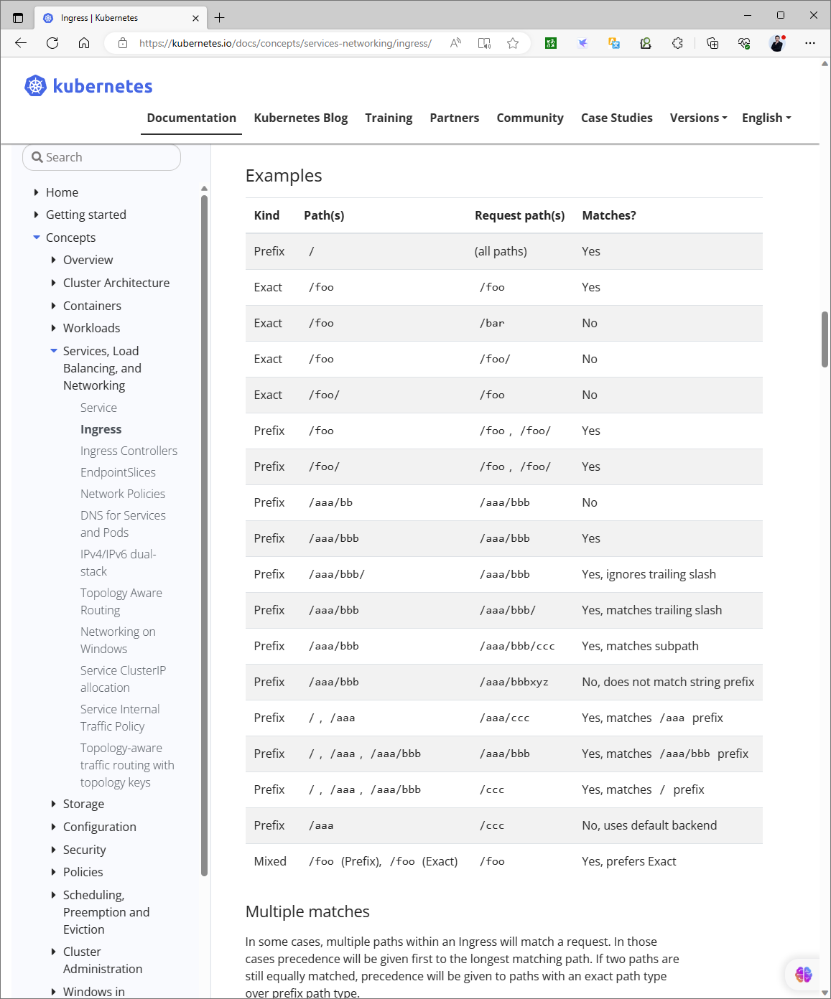

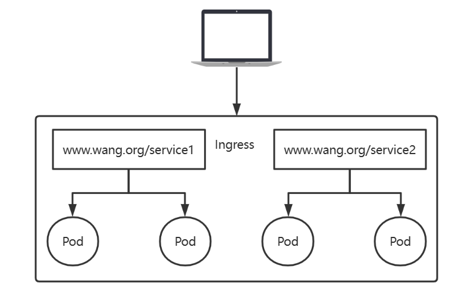

Simple fanout: 在同一个FQDN下通过不同的URI完成不同应用间的流量分发。

基于单个虚拟主机接收多个应用的流量常用于将流量分发至同一个应用下的多个不同子应用，同一个应用内的流量由调度算法分发至该应用的各后端端点不需要为每个应用配置专用的域名。

范例：环境准备两个HTTP应用
```yaml
#如果前面的资源已删除，重新应用上面小节的资源文件生成deployment和对应的SVC
#访问 www.bowen.org/flask的时候，返回flask的结果
#访问 www.bowen.org/nginx的时候，返回nginx的结果

[root@master1 ~]#cat ingress-deployment-svc.yaml
apiVersion: apps/v1
kind: Deployment
metadata:
name: deployment-test
spec:
replicas: 3
selector:
matchLabels:
app: pod-test
template:
metadata:
labels:
app: pod-test
spec:
containers:
- name: pod-test
image: registry.cn-beijing.aliyuncs.com/bowen/pod-test:v0.1
imagePullPolicy: IfNotPresent
ports:
- containerPort: 80

name: http
---
apiVersion: v1
kind: Service
metadata:
name: deployment-service
spec:
selector:
app: pod-test
ports:
- name: http
port: 80
targetPort: 80

[root@master1 ~]#kubectl apply  -f  yaml/ingress-deployment-svc.yaml

#再添加一个nginx的服务，定义资源文件
[root@master1 ~]#cat ingress-deployment-nginx.yaml
apiVersion: apps/v1
kind: Deployment
metadata:
name: deployment-nginx
spec:
replicas: 3
selector:
matchLabels:
app: nginx-test
template:
metadata:
labels:
app: nginx-test
spec:
containers:
- name: nginx-test
image: registry.cn-beijing.aliyuncs.com/bowen/nginx:1.20.0
imagePullPolicy: IfNotPresent
ports:
- containerPort: 80
name: nginx
---
apiVersion: v1
kind: Service
metadata:
name: nginx-service
spec:
selector:
app: nginx-test
ports:
- name: nginx
port: 80
targetPort: 80
#配置解析:为了避免多个service使用同一个后端端口，这里一定要为service的端口命名

#应用资源文件
[root@master1 ~]#kubectl apply  -f  ingress-deployment-nginx.yaml

#查看效果
[root@master1 ~]#kubectl get deployment,svc

NAME                               READY   UP-TO-DATE   AVAILABLE   AGE
deployment.apps/deployment-nginx   3/3     3            3           88s
deployment.apps/deployment-test    3/3     3            3           73m

NAME                         TYPE        CLUSTER-IP      EXTERNAL-IP   PORT(S)
AGE
service/deployment-service   ClusterIP   10.99.228.134   <none>        80/TCP
73m
service/kubernetes           ClusterIP   10.96.0.1       <none>        443/TCP
5d21h
service/nginx-service        ClusterIP   10.99.61.212    <none>        80/TCP
88s
```

#### 4.2.3.1 单域名多URL不支持子URL

范例:  单域名多URL，不支持子URL
```yaml
#清单文件
[root@master1 ~]#cat ingress-http-mul-url.yaml
apiVersion: networking.k8s.io/v1
kind: Ingress
metadata:
name: ingress-mul-url
annotations:
#kubernetes.io/ingress.class: "nginx"
nginx.ingress.kubernetes.io/rewrite-target: / #默认会转发给后端时会带有URL,添加此
行，表示转发时删除后面的URL
spec:
ingressClassName: nginx   #新版建议使用此项指定controller类型
rules:
- host: www.bowen.org
http:
paths:
- path: /flask                   #指定访问的URL
pathType: Prefix               #表示以/flask为开始即可
backend:
service:
name: deployment-service  #指定对应service的名称
port:
name: http     #匹配对应servcie中的端口name: http
#number: 80
- path: /nginx        #指定访问的URL
pathType: Prefix    #表示以/nginx为开始即可
backend:
service:
name: nginx-service   #指定对应service的名称
port:
name: nginx     #匹配对应servcie中的端口name: nginx
#number: 80

#注意事项：
#默认转给后端服务时会将url也同时转发，而后端服务有可能不存在此URL，所以需要在后端url转发的时
候，取消转发关键字。
#方法就是，在annotation中添加一个重写的规则nginx.ingress.kubernetes.io/rewrite-target:
/  即所有的请求把ingress匹配到的url关键字清除掉

#应用资源文件

[root@master1 ~]#kubectl apply -f ingress-http-mul-url.yaml

#查看效果
[root@master1 ~]#kubectl get ingress
NAME              CLASS    HOSTS             ADDRESS      PORTS   AGE
ingress-mul-url   <none>   www.bowen.org   10.0.0.104   80      68s

[root@master1 ~]#kubectl describe ingress
Name:             ingress-mul-url
Namespace:        default
Address:          10.0.0.104
Default backend:  default-http-backend:80 (<error: endpoints "default-http-
backend" not found>)
Rules:
Host             Path  Backends
----             ----  --------
www.bowen.org
/flask   deployment-service:http
(10.244.3.66:80,10.244.3.67:80,10.244.5.38:80)
/nginx   nginx-service:nginx
(10.244.3.68:80,10.244.4.51:80,10.244.5.39:80)
Annotations:       kubernetes.io/ingress.class: nginx
nginx.ingress.kubernetes.io/rewrite-target: /
Events:
Type    Reason  Age                From                      Message
----    ------  ----               ----                      -------
Normal  Sync    37s (x2 over 73s)  nginx-ingress-controller  Scheduled for
sync

#修改hosts文件(配合前面的hparoxy实现)
[root@master1 ~]#vim /etc/hosts
10.0.0.99 k8s k8s.bowen.org www.bowen.org

#浏览器访问效果
[root@master1 ~]#curl www.bowen.org/flask
kubernetes pod-test v0.1!! ClientIP: 10.244.3.65, ServerName: deployment-test-
555f594785-l6v98, ServerIP: 10.244.3.66!
[root@master1 ~]#curl www.bowen.org/nginx
Welcome to Nginx Web Site ! Nginx Version: 1.20.0

#清理环境
[root@master1 ~]#kubectl delete -f ingress-http-mul-url.yaml
```

#### 4.2.3.2 单域名多URL支持子URL

范例:  单域名多URL，支持子URL
```yaml
#环境准备
[root@master1 ~]#kubectl create deployment pod-test1 --image=registry.cn-
beijing.aliyuncs.com/bowen/pod-test:v0.1 --replicas=3
[root@master1 ~]#kubectl create service clusterip pod-test1 --tcp=80:80

[root@master1 ~]#kubectl create deployment pod-test2 --image=registry.cn-
beijing.aliyuncs.com/bowen/pod-test:v0.2 --replicas=3
[root@master1 ~]#kubectl create service clusterip pod-test2 --tcp=80:80

#资源文件
[root@master1 ~]#cat ingress-http-mul-suburl.yml
apiVersion: networking.k8s.io/v1
kind: Ingress
metadata:
annotations:
nginx.ingress.kubernetes.io/rewrite-target: /$2  #正则表达式
generation: 1
name: ingress-http-mul-suburl
spec:
ingressClassName: nginx
rules:
- host: www.bowen.org
http:
paths:
- backend:
service:
name: pod-test1
port:
number: 80
path: /v1(/|$)(.*)                            #正则表达式
#pathType: Exact
pathType: ImplementationSpecific             #k8s-v1.32.0不再支持Exact,需要
修改类型
- backend:
service:
name: pod-test2
port:
number: 80
path: /v2(/|$)(.*)                           #正则表达式
#pathType: Exact
pathType: ImplementationSpecific             #k8s-v1.32.0不再支持Exact,需要
修改类型

#应用
[root@master1 ~]#kubectl apply -f ingress-http-mul-suburl.yml

#查看
[root@master1 ~]#kubectl describe ingress ingress-http-mul-suburl
Name:             ingress-http-mul-suburl
Labels:           <none>
Namespace:        default
Address:          10.0.0.99
Ingress Class:    nginx
Default backend:  <default>
Rules:
Host          Path  Backends
----          ----  --------
www.bowen.org
/v1(/|$)(.*)   pod-test1:80 (10.244.3.105:80)
/v2(/|$)(.*)   pod-test2:80 (10.244.3.106:80)
Annotations:    nginx.ingress.kubernetes.io/rewrite-target: /$2
Events:
Type    Reason  Age                    From                      Message
----    ------  ----                   ----                      -------
Normal  Sync    6m24s (x2 over 6m57s)  nginx-ingress-controller  Scheduled for
sync

#集群外测试访问，支持子URL
C:\Users\Bowen>curl -H"host: www.bowen.org"  10.0.0.99/v1
kubernetes pod-test v0.1!! ClientIP: 10.244.1.182, ServerName: pod-test1-
5f8f7698d8-p2pst, ServerIP: 10.244.3.105!

C:\Users\Bowen>curl -H"host: www.bowen.org"  10.0.0.99/v1/hostname
ServerName: pod-test1-5f8f7698d8-p2pst

C:\Users\Bowen>curl -H"host: www.bowen.org"  10.0.0.99/v2
kubernetes pod-test v0.2!! ClientIP: 10.244.1.182, ServerName: pod-test2-
f7d78c544-n25xn, ServerIP: 10.244.3.106!

C:\Users\Bowen>curl -H"host: www.bowen.org"  10.0.0.99/v2/hostname
ServerName: pod-test2-f7d78c544-n25xn

#清理环境
[root@master1 ~]#kubectl delete -f yaml/ingress-http-mul-suburl.yml
```

### 4.2.4 多域名案例

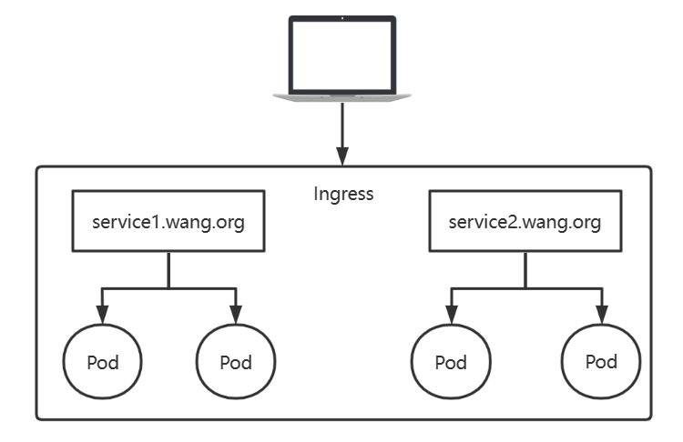

Name based virtual hosting 基于虚拟主机名实现，为每个应用使用一个专有的主机名，并基于这些名称完成不同应用间的流量转发。每个FQDN对应于Ingress Controller上的一个虚拟主机的定义同一组内的应用的流量，由Ingress Controller根据调度算法完成请求调度。

范例: 多域名主机访问的环境准备两个HTTP应用
```yaml
#访问 flask.bowen.org/的时候，返回flask的结果
#访问 nginx.bowen.org/的时候，返回nginx的结果
#如果前面的资源已删除，重新应用上面小节的资源文件生成deployment和对应的SVC
[root@master1 ~]#kubectl apply  -f ingress-deployment-svc.yaml

#再添加一个nginx的服务，定义资源文件

[root@master1 ~]#cat ingress-deployment-nginx.yaml
apiVersion: apps/v1
kind: Deployment
metadata:
name: deployment-nginx
spec:
replicas: 3
selector:
matchLabels:
app: nginx-test
template:
metadata:
labels:
app: nginx-test
spec:
containers:
- name: nginx-test
image: registry.cn-beijing.aliyuncs.com/bowen/nginx:1.20.0
imagePullPolicy: IfNotPresent
ports:
- containerPort: 80
name: nginx
---
apiVersion: v1
kind: Service
metadata:
name: nginx-service
spec:
selector:
app: nginx-test
ports:
- name: nginx
port: 80
targetPort: 80
#配置解析:为了避免多个service使用同一个后端端口，这里一定要为service的端口命名

#应用资源文件
[root@master1 ~]#kubectl apply  -f ingress-deployment-nginx.yaml

#查看效果
[root@master1 ~]#kubectl get deployment,svc
NAME                               READY   UP-TO-DATE   AVAILABLE   AGE
deployment.apps/deployment-nginx   3/3     3            3           88s
deployment.apps/deployment-test    3/3     3            3           73m

NAME                         TYPE        CLUSTER-IP      EXTERNAL-IP   PORT(S)
AGE
service/deployment-service   ClusterIP   10.99.228.134   <none>        80/TCP
73m
service/kubernetes           ClusterIP   10.96.0.1       <none>        443/TCP
5d21h
service/nginx-service        ClusterIP   10.99.61.212    <none>        80/TCP
88s
```

范例：多域名主机访问
```yaml
#编辑Ingress资源定义文件

[root@master1 ~]#cat ingress-http-mul-host.yaml
apiVersion: networking.k8s.io/v1
kind: Ingress
metadata:
name: ingress-mul-url
annotations:
#kubernetes.io/ingress.class: "nginx" #指定Ingress Controller的类型，k8s-
v1.32.0不再支持
nginx.ingress.kubernetes.io/use-regex: "true" #指定后面rules定义的path使用的正则
表达式
nginx.ingress.kubernetes.io/proxy-body-size: "100m"     #客户端上传文件最大值，默
认为1m
nginx.ingress.kubernetes.io/proxy-connect-timeout: "60" #后端服务器的连接超时的时
间,默认值为5s
nginx.ingress.kubernetes.io/proxy-send-timeout: "120" #后端服务器数据回传超时时
间,即规定时间之内后端服务器必须传完所有的数据,默认值为60s
nginx.ingress.kubernetes.io/proxy-read-timeout: "120" #后端服务器响应的超时时间,
默认值为60s
#nginx.ingress.kubernetes.io/app-root: /index.html  #指定默认页面文件
spec:
ingressClassName: nginx   #新版建议使用此项指定controller类型
rules:
- host: flask.bowen.org
http:
paths:
- path: /
pathType: Prefix          # Prefix  支持子URL
backend:
service:
name: deployment-service
port:
name: http         #匹配 servcie 中的端口 name: http
#number: 80
- host: nginx.bowen.org
http:
paths:
- path: /
pathType: Prefix
backend:
service:
name: nginx-service
port:
name: nginx      #匹配 servcie 中的端口 name: nginx

#配置解析：这里面有两个主机访问的地址是同一个后端端口，如果还用number的话，就无法正常的识别导致
同一个地址访问不同的后端效果

#应用资源文件
[root@master1 ~]#kubectl apply -f yaml/ingress-http-mul-host.yaml

#查看效果
[root@master1 ~]#kubectl get ingress
NAME              CLASS    HOSTS                                 ADDRESS
PORTS   AGE
ingress-mul-url   <none>   flask.bowen.org,nginx.bowen.org                80
40s

[root@master1 ~]#kubectl describe ingress ingress-mul-url

Name:             ingress-mul-url
Namespace:        default
Address:          10.0.0.104
Default backend:  default-http-backend:80 (<error: endpoints "default-http-
backend" not found>)
Rules:
Host               Path  Backends
----               ----  --------
flask.bowen.org
/   deployment-service:http
(10.244.3.66:80,10.244.3.67:80,10.244.5.38:80)
nginx.bowen.org
/   nginx-service:nginx
(10.244.3.68:80,10.244.4.51:80,10.244.5.39:80)
Annotations:         kubernetes.io/ingress.class: nginx
Events:
Type    Reason  Age                From                      Message
----    ------  ----               ----                      -------
Normal  Sync    17s (x2 over 65s)  nginx-ingress-controller  Scheduled for
sync

#提前准备多个后端主机的域名
[root@master1 ~]#vim /etc/hosts
10.0.0.101 master1 master1.bowen.org flask.bowen.org nginx.bowen.org

#访问效果
[root@master1 ~]#curl flask.bowen.org
kubernetes pod-test v0.1!! ClientIP: 10.244.3.65, ServerName: deployment-test-
555f594785-rfhcz, ServerIP: 10.244.3.67!
[root@master1 ~]#curl nginx.bowen.org
Welcome to Nginx Web Site ! Nginx Version: 1.20.0

#再次修改hosts(配合前面hparoxy实现)
[root@master1 ~]#vim /etc/hosts
10.0.0.99 k8s k8s.bowen.org www.bowen.org flask.bowen.org nginx.bowen.org

[root@master1 ~]#curl nginx.bowen.org
Welcome to Nginx Web Site ! Nginx Version: 1.20.0
[root@master1 ~]#curl flask.bowen.org
kubernetes pod-test v0.1!! ClientIP: 10.244.3.65, ServerName: deployment-test-
555f594785-l6v98, ServerIP: 10.244.3.66!

#清理环境
[root@master1 ~]#kubectl delete -f ingress-http-mul-host.yaml
```

### 4.2.5 HTTPS 案例


Ingress也可以提供TLS支持，但仅限于443/TCP端口。若TLS配置部分指定了不同的主机，则它们会根据通过SNI TLS扩展指定的主机名。

前提：Ingress控制器支持SNI在同一端口上复用。

TLS Secret必须包含名为tls.crt和 的密钥tls.key，它们分别含有TLS的证书和私钥。准备对基础的flask应用进行https方式来进行访问。利用ingress的tls规则就可以帮助我们实现对http应用进行https安全加固。

范例:  实现HTTP自动跳转至HTTPS
```html
#生成证书
[root@master1 ~]#mkdir tls && cd tls
[root@master1 tls]#(umask 077; openssl genrsa -out www.bowen.org.key 2048)

#生成自签名证书，文件名可自定义
[root@master1 tls]#openssl req -new -x509 -key www.bowen.org.key -out
www.bowen.org.crt -subj "/CN=www.bowen.org" -days 365

#创建对应的secret资源
[root@master1 tls]#kubectl create secret tls ingress-tls --
cert=./www.bowen.org.crt --key=./www.bowen.org.key

[root@master1 ~]#kubectl describe secrets ingress-tls
Name:         ingress-tls
Namespace:    default
Labels:       <none>
Annotations:  <none>

Type:  kubernetes.io/tls

Data
====

tls.crt:  1131 bytes
tls.key:  1679 bytes

#定义资源配置文件,实现HTTP自动跳转至HTTPS
[root@master1 ~]#cat ingress-http-tls-test.yaml
apiVersion: networking.k8s.io/v1
kind: Ingress
metadata:
name: ingress-test
#annotations:
#kubernetes.io/ingress.class: "nginx"
spec:
ingressClassName: nginx   #新版建议使用此项指定controller类型
rules:
- host: www.bowen.org
http:
paths:
- path: /
pathType: Prefix
backend:
service:
name: deployment-service
port:
number: 80
#- hosts: m.bowen.org
# ......
# https 证书配置
tls:
- hosts:
- www.bowen.org
secretName: ingress-tls
#- hosts:                         #多个域名分别对应不同的证书
#  - m.bowen.org
#  secretName: ingress-tls-m

#应用资源文件
[root@master1 ~]#kubectl apply -f ingress-http-tls-test.yaml

#查看效果
[root@master1 ~]#kubectl get ingress
NAME              CLASS    HOSTS             ADDRESS      PORTS     AGE
ingress-mul-url   <none>   www.bowen.org   10.0.0.104   80        25m

[root@master1 ~]#kubectl describe ingress ingress-test
Name:             ingress-test
Labels:           <none>
Namespace:        default
Address:
Ingress Class:    <none>
Default backend:  <default>
TLS:
ingress-tls terminates www.bowen.org
Rules:
Host             Path  Backends
----             ----  --------
www.bowen.org

/   deployment-service:80
(10.244.3.66:80,10.244.3.67:80,10.244.5.38:80)
Annotations:       kubernetes.io/ingress.class: nginx
Events:
Type    Reason  Age                From                      Message
----    ------  ----               ----                      -------
Normal  Sync    29s (x2 over 67s)  nginx-ingress-controller  Scheduled for
sync

[root@master1 ~]#vim /etc/hosts
10.0.0.101 master1 master1.bowen.org www.bowen.org

#测试效果
[root@master1 ~]#curl www.bowen.org
<html>
<head><title>308 Permanent Redirect</title></head>
<body>
<center><h1>308 Permanent Redirect</h1></center>
<hr><center>nginx</center>
</body>
</html>

#结果显示：所有访问http://www.bowen.org的请求重定向HTTPS

[root@master1 ~]#curl -kL http://www.bowen.org
kubernetes pod-test v0.1!! ClientIP: 10.244.3.65, ServerName: deployment-test-
555f594785-rfhcz, ServerIP: 10.244.3.67!

[root@master1 ~]#curl -k https://www.bowen.org
kubernetes pod-test v0.1!! ClientIP: 10.244.3.65, ServerName: deployment-test-
555f594785-rfhcz, ServerIP: 10.244.3.67!
[root@master1 ~]#curl -k https://www.bowen.org
kubernetes pod-test v0.1!! ClientIP: 10.244.3.65, ServerName: deployment-test-
555f594785-9mmbq, ServerIP: 10.244.5.38!
[root@master1 ~]#curl -k https://www.bowen.org
kubernetes pod-test v0.1!! ClientIP: 10.244.3.65, ServerName: deployment-test-
555f594785-l6v98, ServerIP: 10.244.3.66!

#查看证书有效期
#注意：Openssl命令的版本过低将无法看到过期时间，比如:CentOS8
[root@ubuntu2204 ~]#openssl s_client www.bowen.org:443
CONNECTED(00000003)
depth=0 C = CN, ST = Beijing, L = Beijing, O = SRE, CN = www.bowen.org
verify error:num=18:self-signed certificate
verify return:1
depth=0 C = CN, ST = Beijing, L = Beijing, O = SRE, CN = www.bowen.org
verify return:1
---
Certificate chain
0 s:C = CN, ST = Beijing, L = Beijing, O = SRE, CN = www.bowen.org
i:C = CN, ST = Beijing, L = Beijing, O = SRE, CN = www.bowen.org
a:PKEY: rsaEncryption, 2048 (bit); sigalg: RSA-SHA256
v:NotBefore: Jan  9 04:01:09 2025 GMT; NotAfter: Jan  7 04:01:09 2035 GMT

#清理环境
[root@master1 ~]#kubectl delete -f yaml/ingress-http-tls-test.yaml
```

# 5 Ingress Nginx 实现蓝绿 BlueGreen 和灰度Canary 发布

## 5.1 Ingress Nginx 进行BlueGreen 和 Canary 灰度发布说明

Service 虽然支持流量分配,但是只支持基于Pod的数量或比例实现,而不支持基于Header,cookie,权重等更为清确的流量发配策略。Ingress-Nginx支持配置Ingress Annotations来实现不同场景下的灰度发布和测试，它能够满足金丝雀发布、蓝绿部署与A/B测试等不同的业务场景。

注意：Ingress-Nginx 只能支持南北向的流量发布，而东西向流量的发布可以利用工作负载型如deployment的更新策略或者服务网格技术实现。

Ingress Nginx的流量发布机制：

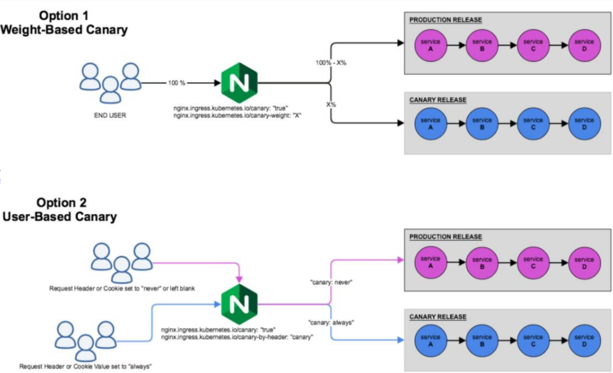

蓝绿：

production: 100%, canary: 0%

production: 0%, canary: 100%  --> Canary变成后面的Production

金丝雀 Canary：

流量比例化切分: weight 比例逐渐调整

流量识别，将特定的流量分发给Canary：

**By-Header**：基于特定的标头识别

Header 值默认：只有Always 或 Nerver 两种值。

**Header 值自定义**：Header 值可以基于正则表达式Pattern进行匹配。

**By-Cookie**：基于Cookie识别

**基于Ingress Nginx的Canary规则**

Ingress Nginx 的 Annotations支持的Canary规则， Annotations 和 Label 相似也是保存资源对象上的元数据，但不能被标签选择器选择，且没有Label的名称最长63个字符的限制。

nginx.ingress.kubernetes.io/canary-weight：

基于服务权重进行流量切分，适用于蓝绿或灰度发布，权重范围0 - 100按百分比将请求路由到Canary Ingress中指定的服务。权重为 0 意味着该金丝雀规则不会向Canary入口的服务发送任何请求。权重为100意味着所有请求都将被发送到 Canary 入口。

nginx.ingress.kubernetes.io/canary-by-cookie：

基于 cookie 的流量切分，适用于灰度发布与 A/B 测试。cookie 的值设置为 always 时，它将被路由到Canary入口。cookie 的值设置为 never 时，请求不会被发送到Canary入口。对于任何其他值，将忽略 cookie 并将请求与其他金丝雀规则进行优先级的比较，默认转发给旧版本。

nginx.ingress.kubernetes.io/canary-by-header：

基于该Annotation中指定Request Header进行流量切分，适用于灰度发布以及A/B测试。在请求报文中，若存在该Header且其值为always时，请求将会被发送到Canary版本，注意：always是大小敏感的。若存在该Header且其值为never，请求将不会被发送至Canary版本。若存在该Header且其值为任何其它值，将忽略该Annotation指定的Header，并按优先级将请求与其他金丝雀规则进行比较，默认转发给旧版本。

若不存在该Header时，请求将不会被发送至Canary版本。

nginx.ingress.kubernetes.io/canary-by-header-value：

基于该Annotation中指定的Request Header的值进行流量切分，Header名称则由前一个Annotation（nginx.ingress.kubernetes.io/canary-by-header）进行指定。请求报文中存在指定的Header，且其值与该Annotation的值匹配时，它将被路由到Canary版本。对于任何其它值，将忽略该Annotation，默认转发给旧版本。

nginx.ingress.kubernetes.io/canary-by-header-pattern

同canary-by-header-value的功能类似，但该Annotation基于正则表达式匹配Request Header的值。若该Annotation与canary-by-header-value同时存在，则该Annotation会被忽略，默认转发给旧版本。

**规则的应用次序**

Canary规则会按特定的次序进行评估优先级从低到高顺序： canary-weight-> canary-by-cookie -> canary-by-header

## 5.2 实战案例

### 5.2.1 范例：初始环境准备新旧两个版本应用和Ingress
```yaml
#准备新旧版本对应的各自独立的两套deployment和service
[root@master1 ~]#cat > deploy-pod-test-v1.yaml
apiVersion: apps/v1
kind: Deployment
metadata:
labels:
app: pod-test
name: pod-test-v1
spec:
replicas: 1
selector:
matchLabels:
app: pod-test
version: v0.1
strategy: {}
template:
metadata:
labels:
app: pod-test
version: v0.1
spec:
containers:
- image: registry.cn-beijing.aliyuncs.com/bowen/pod-test:v0.1
name: pod-test
---
apiVersion: v1
kind: Service
metadata:
labels:
app: pod-test
name: pod-test-v1
spec:
ports:
- name: http-80
port: 80
protocol: TCP
targetPort: 80
selector:
app: pod-test
version: v0.1
type: ClusterIP

[root@master1 ~]#cat > deploy-pod-test-v2.yaml
apiVersion: apps/v1
kind: Deployment
metadata:
labels:
app: pod-test
name: pod-test-v2
spec:
replicas: 1
selector:
matchLabels:
app: pod-test

version: v0.2
strategy: {}
template:
metadata:
labels:
app: pod-test
version: v0.2
spec:
containers:
- image: registry.cn-beijing.aliyuncs.com/bowen/pod-test:v0.2
name: pod-test

---
apiVersion: v1
kind: Service
metadata:
labels:
app: pod-test
name: pod-test-v2
spec:
ports:
- name: http-80
port: 80
protocol: TCP
targetPort: 80
selector:
app: pod-test
version: v0.2
type: ClusterIP

#部署新旧两个版本
[root@master1 ~]#kubectl apply -f deploy-pod-test-v1.yaml -f deploy-pod-test-
v2.yaml

[root@master1 ~]#kubectl get svc
NAME          TYPE        CLUSTER-IP       EXTERNAL-IP   PORT(S)   AGE
kubernetes    ClusterIP   10.96.0.1        <none>        443/TCP   28d
pod-test-v1   ClusterIP   10.111.30.185    <none>        80/TCP    78s
pod-test-v2   ClusterIP   10.107.142.163   <none>        80/TCP    75s

[root@master1 ~]#kubectl get deployments.apps
NAME          READY   UP-TO-DATE   AVAILABLE   AGE
pod-test-v1   1/1     1            1           95s
pod-test-v2   1/1     1            1           92s

#创建Ingress对应旧版本的应用
[root@master1 ~]#cat > ingress-pod-test.yaml
apiVersion: networking.k8s.io/v1
kind: Ingress
metadata:
name: pod-test
#annotationsingressClassName
#  kubernetes.io/ingress.class: nginx
spec:
ingressClassName: nginx
rules:
- host: www.bowen.org
http:

paths:
- backend:
service:
name: pod-test-v1
port:
number: 80
path: /
pathType: Prefix

#应用
[root@master1 ~]#kubectl apply  -f ingress-pod-test.yaml

#查看
[root@master1 ~]#kubectl get ingress
NAME       CLASS    HOSTS          ADDRESS   PORTS   AGE
pod-test   <none>   www.bowen.org             80      9s

#集群外客户端访问
[root@ubuntu2004 ~]#curl -H"host:www.bowen.org" http://10.0.0.99/
kubernetes pod-test v0.1!! ClientIP: 10.244.2.37, ServerName: pod-test-v1-
6ddc47c8cd-lmcmh, ServerIP: 10.244.2.38!

#持续执行观察
[root@ubuntu2004 ~]#while true;do curl -k -H"host:www.bowen.org"
https://10.0.0.99/;sleep 0.5;done
```

### 5.2.2 范例：蓝绿发布
```yaml
#方法1：在线编辑
[root@master1 ~]#kubectl edit ingress pod-test
.....
spec:
ingressClassName: nginx
rules:
- host: www.bowen.org
http:
paths:
- backend:
service:
#name: pod-test-v1
name: pod-test-v2         #修改此行，指向新版应用的SVC
.....

#修改上前的Ingress清单文件,对应使用新版本的应用
#方法2
[root@master1 ~]#vim ingress-pod-test.yaml
apiVersion: networking.k8s.io/v1
kind: Ingress
metadata:
name: pod-test
#annotations:
#  kubernetes.io/ingress.class: nginx
spec:
ingressClassName: nginx
rules:
- host: www.bowen.org
http:

paths:
- backend:
service:
#name: pod-test-v1
name: pod-test-v2         #修改此行，指向新版应用的SVC
port:
number: 80
path: /
pathType: Prefix

#应用
[root@master1 ~]#kubectl apply -f ingress-pod-test.yaml

#集群外客户端访问，观察全部都切换至新版本
[root@ubuntu2004 ~]#while true;do curl -H"host:www.bowen.org"
http://10.0.0.99/;sleep 0.5;done
kubernetes pod-test v0.2!! ClientIP: 10.244.2.37, ServerName: pod-test-v2-
cfc768546-89z2g, ServerIP: 10.244.2.39!
kubernetes pod-test v0.2!! ClientIP: 10.244.2.37, ServerName: pod-test-v2-
cfc768546-89z2g, ServerIP: 10.244.2.39!
kubernetes pod-test v0.2!! ClientIP: 10.244.2.37, ServerName: pod-test-v2-
cfc768546-89z2g, ServerIP: 10.244.2.39!
kubernetes pod-test v0.2!! ClientIP: 10.244.2.37, ServerName: pod-test-v2-
cfc768546-89z2g, ServerIP: 10.244.2.39!
kubernetes pod-test v0.2!! ClientIP: 10.244.2.37, ServerName: pod-test-v2-
cfc768546-89z2g, ServerIP: 10.244.2.39!
kubernetes pod-test v0.2!! ClientIP: 10.244.2.37, ServerName: pod-test-v2-
cfc768546-89z2g, ServerIP: 10.244.2.39!
kubernetes pod-test v0.2!! ClientIP: 10.244.2.37, ServerName: pod-test-v2-
cfc768546-89z2g, ServerIP: 10.244.2.39!
kubernetes pod-test v0.2!! ClientIP: 10.244.2.37, ServerName: pod-test-v2-
cfc768546-89z2g, ServerIP: 10.244.2.39!
kubernetes pod-test v0.2!! ClientIP: 10.244.2.37, ServerName: pod-test-v2-
cfc768546-89z2g, ServerIP: 10.244.2.39!

#回滚旧版本
[root@master1 ~]#vim ingress-pod-test.yaml
apiVersion: networking.k8s.io/v1
kind: Ingress
metadata:
name: pod-test
annotations:
kubernetes.io/ingress.class: nginx
spec:
rules:
- host: www.bowen.org
http:
paths:
- backend:
service:
#name: pod-test-v2
name: pod-test-v1         #指向旧版应用的SVC
port:
number: 80
path: /
pathType: Prefix

#应用
[root@master1 ~]#kubectl apply -f ingress-pod-test.yaml
```

### 5.2.3 范例：基于权重的金丝雀发布
```yaml
#旧版应用
[root@master1 ~]#kubectl apply -f ingress-pod-test.yaml

#新版的清单文件
[root@master1 ~]#cat > canary-by-weight.yaml
apiVersion: networking.k8s.io/v1
kind: Ingress
metadata:
annotations:
#kubernetes.io/ingress.class: nginx
nginx.ingress.kubernetes.io/canary: "true"
nginx.ingress.kubernetes.io/canary-weight: "10"       #指定使用金丝雀发布新版占用
的百分比10
name: pod-test-canary-by-weight
spec:
ingressClassName: nginx
rules:
- host: www.bowen.org
http:
paths:
- backend:
service:
name: pod-test-v2
port:
number: 80
path: /
pathType: Prefix

#应用
[root@master1 ~]#kubectl apply -f canary-by-weight.yaml

#集群外客户端访问，观察新旧版本的比例
[root@ubuntu2004 ~]#while true;do curl -H"host: www.bowen.org"
http://10.0.0.99/;sleep 0.5;done
kubernetes pod-test v0.1!! ClientIP: 10.244.2.37, ServerName: pod-test-v1-
6ddc47c8cd-lmcmh, ServerIP: 10.244.2.38!
kubernetes pod-test v0.1!! ClientIP: 10.244.2.37, ServerName: pod-test-v1-
6ddc47c8cd-lmcmh, ServerIP: 10.244.2.38!
kubernetes pod-test v0.1!! ClientIP: 10.244.2.37, ServerName: pod-test-v1-
6ddc47c8cd-lmcmh, ServerIP: 10.244.2.38!
kubernetes pod-test v0.1!! ClientIP: 10.244.2.37, ServerName: pod-test-v1-
6ddc47c8cd-lmcmh, ServerIP: 10.244.2.38!
kubernetes pod-test v0.1!! ClientIP: 10.244.2.37, ServerName: pod-test-v1-
6ddc47c8cd-lmcmh, ServerIP: 10.244.2.38!
kubernetes pod-test v0.1!! ClientIP: 10.244.2.37, ServerName: pod-test-v1-
6ddc47c8cd-lmcmh, ServerIP: 10.244.2.38!
kubernetes pod-test v0.1!! ClientIP: 10.244.2.37, ServerName: pod-test-v1-
6ddc47c8cd-lmcmh, ServerIP: 10.244.2.38!
kubernetes pod-test v0.1!! ClientIP: 10.244.2.37, ServerName: pod-test-v1-
6ddc47c8cd-lmcmh, ServerIP: 10.244.2.38!
```


kubernetes pod-test v0.1!! ClientIP: 10.244.2.37, ServerName: pod-test-v1-6ddc47c8cd-lmcmh, ServerIP: 10.244.2.38! kubernetes pod-test v0.1!! ClientIP: 10.244.2.37, ServerName: pod-test-v1-6ddc47c8cd-lmcmh, ServerIP: 10.244.2.38! kubernetes pod-test v0.2!! ClientIP: 10.244.2.37, ServerName: pod-test-v2-cfc768546-89z2g, ServerIP: 10.244.2.39! kubernetes pod-test v0.1!! ClientIP: 10.244.2.37, ServerName: pod-test-v1-6ddc47c8cd-lmcmh, ServerIP: 10.244.2.38! kubernetes pod-test v0.1!! ClientIP: 10.244.2.37, ServerName: pod-test-v1-6ddc47c8cd-lmcmh, ServerIP: 10.244.2.38! kubernetes pod-test v0.1!! ClientIP: 10.244.2.37, ServerName: pod-test-v1-6ddc47c8cd-lmcmh, ServerIP: 10.244.2.38! kubernetes pod-test v0.1!! ClientIP: 10.244.2.37, ServerName: pod-test-v1-6ddc47c8cd-lmcmh, ServerIP: 10.244.2.38! kubernetes pod-test v0.2!! ClientIP: 10.244.2.37, ServerName: pod-test-v2-cfc768546-89z2g, ServerIP: 10.244.2.39! kubernetes pod-test v0.1!! ClientIP: 10.244.2.37, ServerName: pod-test-v1-6ddc47c8cd-lmcmh, ServerIP: 10.244.2.38!

```bash
#调整weight权重为90
[root@master1 ~]#vim canary-by-weight.yaml
.....
nginx.ingress.kubernetes.io/canary-weight: "90"
.....

#再应用
[root@master1 ~]#kubectl apply -f canary-by-weight.yaml

#观察比例变化
[root@ubuntu2004 ~]#while true;do curl -H"host:www.bowen.org"
http://10.0.0.99/;sleep 0.5;done
kubernetes pod-test v0.2!! ClientIP: 10.244.2.37, ServerName: pod-test-v2-
cfc768546-89z2g, ServerIP: 10.244.2.39!
kubernetes pod-test v0.2!! ClientIP: 10.244.2.37, ServerName: pod-test-v2-
cfc768546-89z2g, ServerIP: 10.244.2.39!
kubernetes pod-test v0.2!! ClientIP: 10.244.2.37, ServerName: pod-test-v2-
cfc768546-89z2g, ServerIP: 10.244.2.39!
kubernetes pod-test v0.2!! ClientIP: 10.244.2.37, ServerName: pod-test-v2-
cfc768546-89z2g, ServerIP: 10.244.2.39!
kubernetes pod-test v0.2!! ClientIP: 10.244.2.37, ServerName: pod-test-v2-
cfc768546-89z2g, ServerIP: 10.244.2.39!
kubernetes pod-test v0.1!! ClientIP: 10.244.2.37, ServerName: pod-test-v1-
6ddc47c8cd-lmcmh, ServerIP: 10.244.2.38!
kubernetes pod-test v0.2!! ClientIP: 10.244.2.37, ServerName: pod-test-v2-
cfc768546-89z2g, ServerIP: 10.244.2.39!
kubernetes pod-test v0.1!! ClientIP: 10.244.2.37, ServerName: pod-test-v1-
6ddc47c8cd-lmcmh, ServerIP: 10.244.2.38!
kubernetes pod-test v0.2!! ClientIP: 10.244.2.37, ServerName: pod-test-v2-
cfc768546-89z2g, ServerIP: 10.244.2.39!
kubernetes pod-test v0.2!! ClientIP: 10.244.2.37, ServerName: pod-test-v2-
cfc768546-89z2g, ServerIP: 10.244.2.39!
kubernetes pod-test v0.2!! ClientIP: 10.244.2.37, ServerName: pod-test-v2-
cfc768546-89z2g, ServerIP: 10.244.2.39!
kubernetes pod-test v0.2!! ClientIP: 10.244.2.37, ServerName: pod-test-v2-
cfc768546-89z2g, ServerIP: 10.244.2.39!
kubernetes pod-test v0.2!! ClientIP: 10.244.2.37, ServerName: pod-test-v2-
cfc768546-89z2g, ServerIP: 10.244.2.39!

kubernetes pod-test v0.2!! ClientIP: 10.244.2.37, ServerName: pod-test-v2-
cfc768546-89z2g, ServerIP: 10.244.2.39!
kubernetes pod-test v0.1!! ClientIP: 10.244.2.37, ServerName: pod-test-v1-
6ddc47c8cd-lmcmh, ServerIP: 10.244.2.38!

#如果需要回滚
[root@master1 ~]#kubectl edit ingress pod-test-canary-by-weight
nginx.ingress.kubernetes.io/canary-weight: "0" #修改新版比例为0,完全回滚

#环境清理

[root@master1 ~]#kubectl delete -f canary-by-weight.yaml
```

### 5.2.4 范例：基于 Cookie 实现金丝雀发布
```yaml
#旧版应用
[root@master1 ~]#kubectl apply -f ingress-pod-test.yaml

#清单文件
[root@master1 ~]#cat > canary-by-cookie.yaml
apiVersion: networking.k8s.io/v1
kind: Ingress
metadata:
annotations:
#kubernetes.io/ingress.class: nginx
nginx.ingress.kubernetes.io/canary: "true"
nginx.ingress.kubernetes.io/canary-by-cookie: "vip_user" #cookie中
vip_user=always时才用金丝雀发布下面新版本
name: pod-test-canary-by-cookie
spec:
ingressClassName: nginx
rules:
- host: www.bowen.org
http:
paths:
- backend:
service:
name: pod-test-v2
port:
number: 80
path: /
pathType: Prefix

#应用
[root@master1 ~]#kubectl apply -f canary-by-cookie.yaml

#集群外客户端访问，当cookie中有vip_user=always时才用金丝雀发布新版
[root@ubuntu2004 ~]#curl  -H"host: www.bowen.org" -b "vip_user=always"
http://10.0.0.99
kubernetes pod-test v0.2!! ClientIP: 10.244.2.37, ServerName: pod-test-v2-
cfc768546-89z2g, ServerIP: 10.244.2.39!

#集群外客户端访问，当cookie中有vip_user!=always的其它值，或没有vip_user时则不使用金丝发布
[root@ubuntu2004 ~]#curl  -H"host: www.bowen.org" -b "vip_user=never"
http://10.0.0.99
kubernetes pod-test v0.1!! ClientIP: 10.244.2.37, ServerName: pod-test-v1-
6ddc47c8cd-lmcmh, ServerIP: 10.244.2.38!

[root@ubuntu2004 ~]#curl  -H"host: www.bowen.org" -b "vip_user=bowen"
http://10.0.0.99
kubernetes pod-test v0.1!! ClientIP: 10.244.2.37, ServerName: pod-test-v1-
6ddc47c8cd-lmcmh, ServerIP: 10.244.2.38!
[root@ubuntu2004 ~]#curl  -H"host: www.bowen.org"  http://10.0.0.99
kubernetes pod-test v0.1!! ClientIP: 10.244.2.37, ServerName: pod-test-v1-
6ddc47c8cd-lmcmh, ServerIP: 10.244.2.38!

#清理环境
[root@master1 ~]#kubectl delete -f canary-by-cookie.yaml
```

### 5.2.5 范例：基于请求 Header 固定值的金丝雀发布
```yaml
#旧版应用
[root@master1 ~]#kubectl apply -f ingress-pod-test.yaml

#清单文件
[root@master1 ~]#cat >  canary-by-header.yaml
apiVersion: networking.k8s.io/v1
kind: Ingress
metadata:
annotations:
#kubernetes.io/ingress.class: nginx
nginx.ingress.kubernetes.io/canary: "true"
nginx.ingress.kubernetes.io/canary-by-header: "X-Canary" #X-Canary自定义的首部
字段值为always时才使用金丝雀发布下面新版本,否则为旧版本
name: pod-test-canary-by-header
spec:
ingressClassName: nginx
rules:
- host: www.bowen.org
http:
paths:
- backend:
service:
name: pod-test-v2
port:
number: 80
path: /
pathType: Prefix

#应用
[root@master1 ~]#kubectl apply -f canary-by-header.yaml

#查看
[root@master1 ~]#kubectl get ingress
NAME                        CLASS    HOSTS          ADDRESS     PORTS   AGE
pod-test                    <none>   www.bowen.org   10.0.0.99   80      12m
pod-test-canary-by-header   <none>   www.bowen.org   10.0.0.99   80      53s

#集群外客户端访问，注意：always的小写的
#当X-Canary: always则访问v0.2新版
[root@ubuntu2004 ~]#curl -H"host:www.bowen.org" -H"X-Canary: always"
http://10.0.0.99/
kubernetes pod-test v0.2!! ClientIP: 10.244.2.37, ServerName: pod-test-v2-
cfc768546-89z2g, ServerIP: 10.244.2.39!

#当X-Canary: never则访问v0.1旧版
[root@ubuntu2004 ~]#curl  -H"host:www.bowen.org" -H"X-Canary: never"
http://10.0.0.99/
kubernetes pod-test v0.1!! ClientIP: 10.244.2.37, ServerName: pod-test-v1-
6ddc47c8cd-lmcmh, ServerIP: 10.244.2.38!

#当X-Canary 是其它值则访问v0.1旧版
[root@ubuntu2004 ~]#curl -H"host:www.bowen.org"  http://10.0.0.99/
kubernetes pod-test v0.1!! ClientIP: 10.244.2.37, ServerName: pod-test-v1-
6ddc47c8cd-lmcmh, ServerIP: 10.244.2.38!

#当没有首部字段X-Canary则访问v0.1旧版
[root@ubuntu2004 ~]#curl -H"host:www.bowen.org" -H"X-Canary: test"
http://10.0.0.99/
kubernetes pod-test v0.1!! ClientIP: 10.244.2.37, ServerName: pod-test-v1-
6ddc47c8cd-lmcmh, ServerIP: 10.244.2.38!

#清理环境
[root@master1 ~]#kubectl delete -f canary-by-header.yaml
```

### 5.2.6 范例：基于请求 Header 精确匹配指定值的金丝雀发布
```yaml
#旧版应用
[root@master1 ~]#kubectl apply -f ingress-pod-test.yaml

#清单文件
[root@master1 ~]#cat > canary-by-header-value.yaml
apiVersion: networking.k8s.io/v1
kind: Ingress
metadata:
annotations:
#kubernetes.io/ingress.class: nginx
nginx.ingress.kubernetes.io/canary: "true"
nginx.ingress.kubernetes.io/canary-by-header: "IsVIP"  #字段名大小写不敏感
nginx.ingress.kubernetes.io/canary-by-header-value: "true" #IsVIP首部字段的值为
true就使用金丝雀发布下面新版本,否则为旧版本，值大小写敏感
name: pod-test-canary-by-header-value
spec:
ingressClassName: nginx
rules:
- host: www.bowen.org
http:
paths:
- backend:
service:
name: pod-test-v2
port:
number: 80
path: /
pathType: Prefix

#应用
[root@master1 ~]#kubectl apply -f canary-by-header-value.yaml

#集群外客户端访问，注意：IsVIP字段名大小写不敏感,true值大小写敏感
#当IsVIP: true，则访问v0.2新版

[root@ubuntu2004 ~]#curl -H"host:www.bowen.org" -H"IsVIP: true" http://10.0.0.99/
kubernetes pod-test v0.2!! ClientIP: 10.244.2.37, ServerName: pod-test-v2-
cfc768546-89z2g, ServerIP: 10.244.2.39!

#当IsVIP: false，则访问v0.1旧版
[root@ubuntu2004 ~]#curl -k -H"host:www.bowen.org" -H"IsVIP: false"
https://10.0.0.99/
kubernetes pod-test v0.1!! ClientIP: 10.244.2.37, ServerName: pod-test-v1-
6ddc47c8cd-lmcmh, ServerIP: 10.244.2.38!

#当IsVIP: 其它值，则访问v0.1旧版
[root@ubuntu2004 ~]#curl -k -H"host:www.bowen.org" -H"IsVIP: test"
https://10.0.0.99/
kubernetes pod-test v0.1!! ClientIP: 10.244.2.37, ServerName: pod-test-v1-
6ddc47c8cd-lmcmh, ServerIP: 10.244.2.38!

#当没有首部字段IsVIP，则访问v0.1旧版
[root@ubuntu2004 ~]#curl -H"host:www.bowen.org" http://10.0.0.99/
kubernetes pod-test v0.1!! ClientIP: 10.244.2.37, ServerName: pod-test-v1-
6ddc47c8cd-lmcmh, ServerIP: 10.244.2.38!

#清理环境
[root@master1 ~]#kubectl delete -f canary-by-header-value.yaml
```

### 5.2.7 范例：基于请求 Header 正则表达式模式匹配的指定值的金丝雀发布
```yaml
#旧版应用
[root@master1 ~]#kubectl apply -f ingress-pod-test.yaml

#清单文件
[root@master1 ~]#cat > canary-by-header-pattern.yaml
apiVersion: networking.k8s.io/v1
kind: Ingress
metadata:
annotations:
#kubernetes.io/ingress.class: nginx
nginx.ingress.kubernetes.io/canary: "true"
nginx.ingress.kubernetes.io/canary-by-header: "Username" #字段名大小不敏感
nginx.ingress.kubernetes.io/canary-by-header-pattern: "^(vip|VIP)_.*" #首部字
段有Username且正则式匹配时使用新版,否则为旧版本
name: pod-test-canary-by-header-pattern
spec:
ingressClassName: nginx
rules:
- host: www.bowen.org
http:
paths:
- backend:
service:
name: pod-test-v2
port:
number: 80
path: /
pathType: Prefix
#应用

[root@master1 ~]#kubectl apply -f canary-by-header-pattern.yaml

#集群外客户端访问
#符合正则表达式访问，则访问v0.2新版,字段名Username大小
[root@ubuntu2004 ~]#curl -H"host:www.bowen.org" -H"Username: VIP_bowen"
http://10.0.0.99/
kubernetes pod-test v0.2!! ClientIP: 10.244.2.37, ServerName: pod-test-v2-
cfc768546-89z2g, ServerIP: 10.244.2.39!
[root@ubuntu2004 ~]#curl -H"host:www.bowen.org" -H"Username: VIP_test"
http://10.0.0.99/
kubernetes pod-test v0.2!! ClientIP: 10.244.2.37, ServerName: pod-test-v2-
cfc768546-89z2g, ServerIP: 10.244.2.39!
[root@ubuntu2004 ~]#curl -H"host:www.bowen.org" -H"Username: vip_bowen"
http://10.0.0.99/
kubernetes pod-test v0.2!! ClientIP: 10.244.2.37, ServerName: pod-test-v2-
cfc768546-89z2g, ServerIP: 10.244.2.39!

#不符合正则表达式访问，则访问v0.1旧版
[root@ubuntu2004 ~]#curl -H"host:www.bowen.org" -H"Username: bowen"
http://10.0.0.99/
kubernetes pod-test v0.1!! ClientIP: 10.244.2.37, ServerName: pod-test-v1-
6ddc47c8cd-lmcmh, ServerIP: 10.244.2.38!

#当没有首部字段Username，则访问v0.1旧版
[root@ubuntu2004 ~]#curl -H"host:www.bowen.org"  http://10.0.0.99/
kubernetes pod-test v0.1!! ClientIP: 10.244.2.37, ServerName: pod-test-v1-
6ddc47c8cd-lmcmh, ServerIP: 10.244.2.38!

#清理环境
[root@master1 ~]#kubectl delete -f canary-by-header-pattern.yaml
```

### 5.2.8 范例：基于cookie和Header 同时存在的金丝雀发布比较优先级
```bash
#旧版应用
[root@master1 ~]#kubectl apply -f ingress-pod-test.yaml

#同时应用两个ingress的清单文件
[root@master1 ~]#kubectl apply -f canary-by-cookie.yaml -f canary-by-header-
pattern.yaml

[root@master1 ~]#kubectl  get ingress
NAME                                CLASS   HOSTS          ADDRESS
PORTS   AGE
pod-test                            nginx   www.bowen.org   10.0.0.10,10.0.0.99
80      29m
pod-test-canary-by-cookie           nginx   www.bowen.org   10.0.0.10,10.0.0.99
80      66s
pod-test-canary-by-header-pattern   nginx   www.bowen.org   10.0.0.10,10.0.0.99
80      6m14s

#基于cookie访问，优先级低于header，所以不生效，访问旧版本
[root@ubuntu2404 ~]#curl -H"cookie: vip_user=always" www.bowen.org
kubernetes pod-test v0.1!! ClientIP: 10.244.1.126, ServerName: pod-test-v1-
644d84d5df-gv5x8, ServerIP: 10.244.4.141!

#基于header访问，优先级高于cookie，所以优先生效
[root@ubuntu2404 ~]#curl -H"username: VIP_" www.bowen.org
kubernetes pod-test v0.2!! ClientIP: 10.244.1.126, ServerName: pod-test-v2-
555cf59c67-9l5vx, ServerIP: 10.244.3.181!

#删除header的ingress
[root@master1 ~]#kubectl delete ingress  pod-test-canary-by-header-pattern

#再基于cookie访问，可以访问新版本
[root@ubuntu2404 ~]#curl -H"cookie: vip_user=always" www.bowen.org
kubernetes pod-test v0.2!! ClientIP: 10.244.1.126, ServerName: pod-test-v2-
555cf59c67-9l5vx, ServerIP: 10.244.3.181!
```



<nav class="article-end" aria-label="章节导航">
  <a href="{{ '/subjects/Kubernetes/19-dns-headless-service.html' | relative_url }}">← 上一章：服务发现、CoreDNS 与 Headless Service</a>
  <a href="{{ '/subjects/Kubernetes/' | relative_url }}">返回 Kubernetes 目录</a>
  <a href="{{ '/subjects/Kubernetes/21-storage-volumes-pv-pvc.html' | relative_url }}">下一章：存储卷、PV 与 PVC →</a>
</nav>
