[← 返回 Kubernetes 目录]({{ '/subjects/Kubernetes/' | relative_url }})



# 21 存储卷、PV 与 PVC

容器可写层随容器重建而变化，因此需要把“进程状态”和“需要保留的数据”分开考虑。本篇沿着 **Pod 卷 → 具体存储后端 → PV/PVC 抽象 → 故障排查** 的顺序展开；下一篇再讨论 StorageClass 如何按需创建卷。

## 1 为什么 Pod 需要卷

一个 Pod 可以包含多个容器，它们有时需要共享文件；应用也可能需要在容器重启后保留数据。Pod 的 `spec.volumes` 定义卷，容器的 `volumeMounts` 决定挂载位置。容器重启通常不会删除同一 Pod 的卷，但 **Pod 删除后数据是否保留，取决于卷类型和后端**：`emptyDir` 随 Pod 消失；`hostPath` 的文件仍在原节点；PV 背后的数据则由存储系统及回收策略决定。

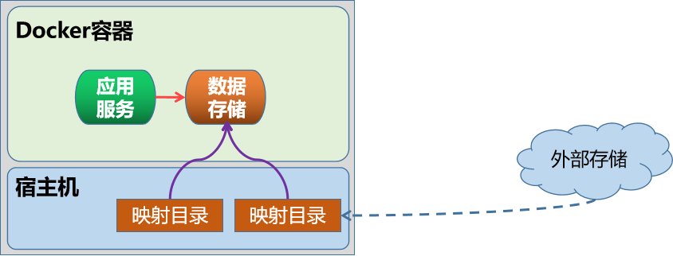


选择卷时先问四个问题：数据要保留多久、Pod 会不会跨节点迁移、是否需要多节点并发访问、谁负责备份及恢复。只凭“能挂载成功”不能判断它适合生产数据库。

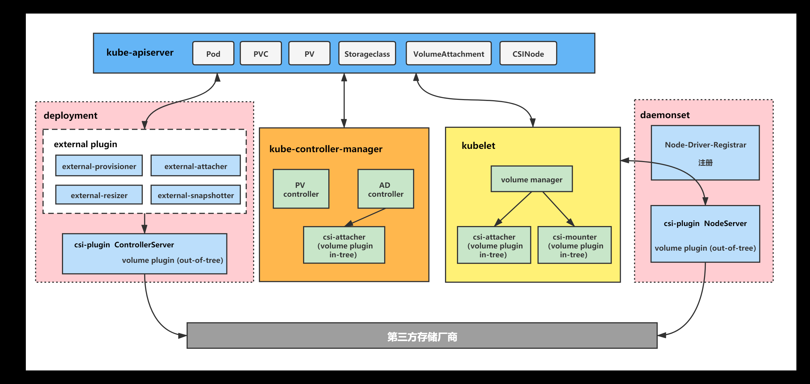


卷的创建、挂载和调度由多个组件协作完成：API Server 保存声明，控制器处理 PV/PVC 绑定及所需的附加操作，调度器考虑卷的节点约束，kubelet 与存储插件在目标节点执行挂载。CSI 驱动把厂商后端接入 Kubernetes；并非所有卷都是独立的 API 对象，`emptyDir` 等只写在 Pod 规格中。

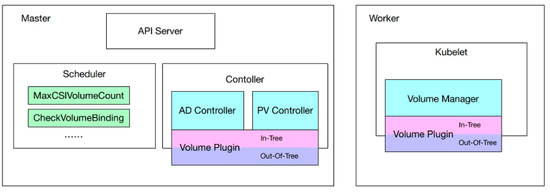

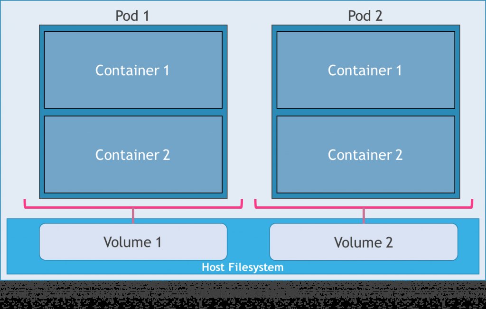

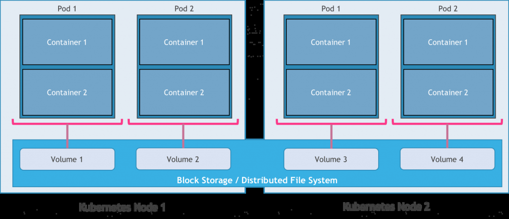

## 2 Pod 直接使用的卷

### 2.1 `emptyDir`：同一 Pod 内的临时共享空间

`emptyDir` 在 Pod 调度到节点时创建，初始为空。它适合缓存、临时工作目录，或同一 Pod 的两个容器交换文件；Pod 被删除或迁移后不能依赖其中的数据。默认使用节点可用的存储介质；设置 `medium: Memory` 后使用 tmpfs，速度较快，但占用内存，仍不是持久化方案。`sizeLimit` 可限制卷大小，实际效果仍受节点资源和容器限制影响。

```yaml
apiVersion: v1
kind: Pod
metadata:
  name: shared-cache
spec:
  containers:
    - name: app
      image: nginx:stable
      volumeMounts:
        - name: cache
          mountPath: /var/cache/shared
  volumes:
    - name: cache
      emptyDir:
        sizeLimit: 500Mi
```

查看 Pod 的 `describe` 输出和容器内挂载目录可以验证声明是否生效；不要依赖 kubelet 在宿主机上的内部目录作为稳定接口。

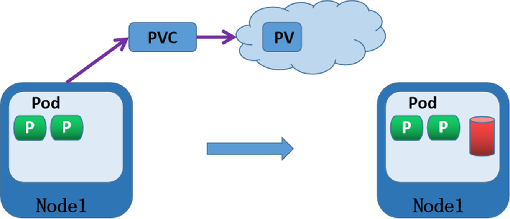

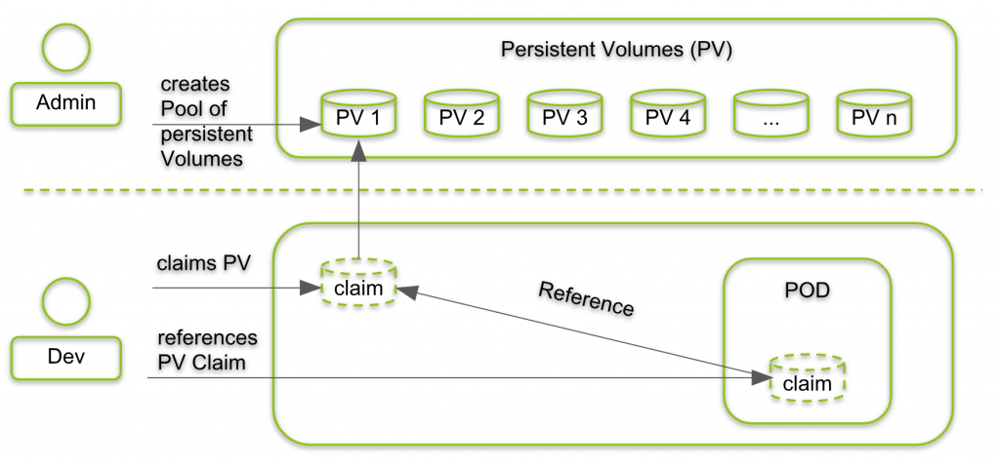


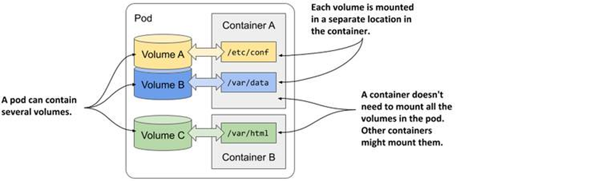

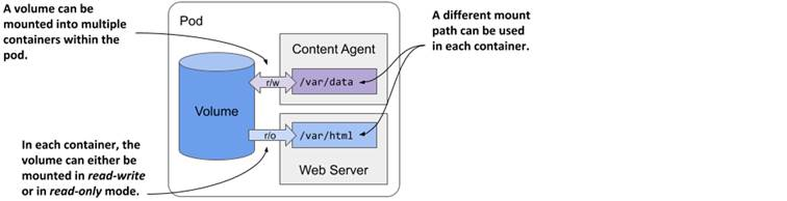

### 2.2 `hostPath`：绑定到特定节点

`hostPath` 把节点上的目录或文件直接映射到 Pod，常见于确实需要读取节点文件的 DaemonSet 或节点级组件。它不是通用的持久化方案：Pod 换到另一节点时，那里可能没有同名目录，或目录内容完全不同；它还会扩大容器接触宿主机文件系统的范围。

```yaml
volumes:
  - name: node-logs
    hostPath:
      path: /var/log
      type: Directory
containers:
  - name: reader
    image: busybox:stable
    command: ["sh", "-c", "sleep 3600"]
    volumeMounts:
      - name: node-logs
        mountPath: /host-logs
        readOnly: true
```

`type` 可以校验路径类型；`DirectoryOrCreate`、`FileOrCreate` 在不存在时创建路径，而 `Directory`、`File` 要求路径已存在。不要把自动创建误认为“所有节点都有同一份数据”。对有状态业务，优先使用满足所需访问模式的 PV/CSI 存储。

### 2.3 NFS 与其他共享后端

当 Pod 可能跨节点调度且需要共享文件时，可以使用 NFS 或其他支持相应访问模式的存储。NFS 服务器先导出目录，所有可能运行 Pod 的节点都需具备网络连通性和 NFS 客户端支持；还要独立规划服务器高可用、权限、备份和性能。直接在 Pod 写 `nfs` 卷虽然可用，但把服务器地址和共享路径耦合进每个工作负载，复用与治理较差。

```yaml
volumes:
  - name: shared
    nfs:
      server: 10.0.0.100
      path: /exports/app
      readOnly: false
```

CephFS、云块存储、Cinder 等后端的语义不同：文件共享与块设备不能简单互换，支持的 `ReadWriteOnce` / `ReadWriteMany` 等模式也取决于驱动和配置。旧资料里出现的某些内置卷插件已迁往 CSI 或不再是新集群推荐方案，部署时应核对当前 Kubernetes 版本与驱动文档，而不是直接套用过时的内置插件 YAML。


## 3 PV 与 PVC：把存储实现和业务需求分开

### 3.1 角色与绑定

**PersistentVolume（PV）** 是集群级存储资源，描述容量、访问模式、卷模式、存储类、回收策略和具体后端；它不属于某个命名空间。**PersistentVolumeClaim（PVC）** 属于命名空间，表达应用所需容量和访问方式；Pod 必须引用同命名空间的 PVC。绑定通常是一对一关系，但一个 PVC 可以被多个 Pod 引用，能否同时挂载仍取决于访问模式及后端能力。

静态供应由管理员先建 PV；动态供应由 PVC 请求 StorageClass，制备器按类创建 PV。PVC 并非“任何时候都能自动创建卷”，缺少合适的 PV 或制备器时会保持 `Pending`。PVC 的请求容量是筛选/供应依据，不等同于所有后端都会自动强制限制应用写入字节数。

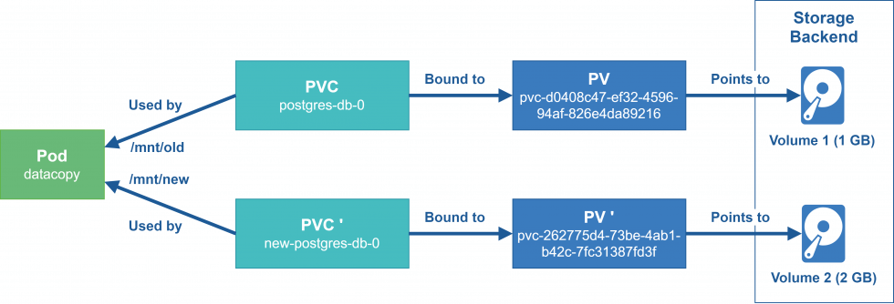

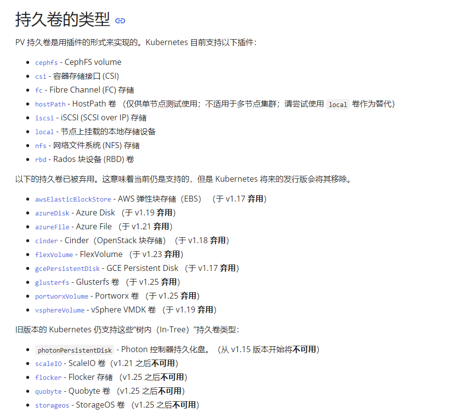

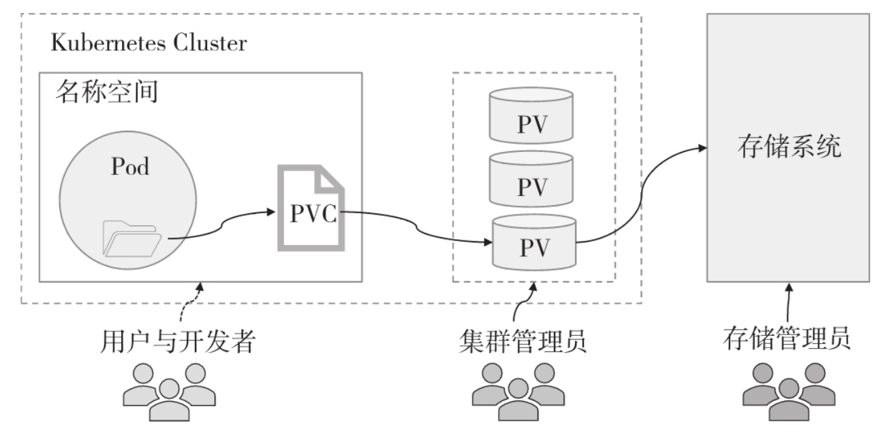

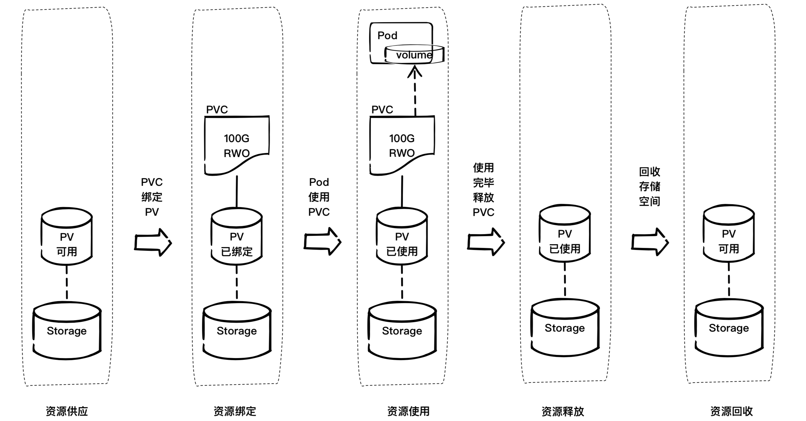

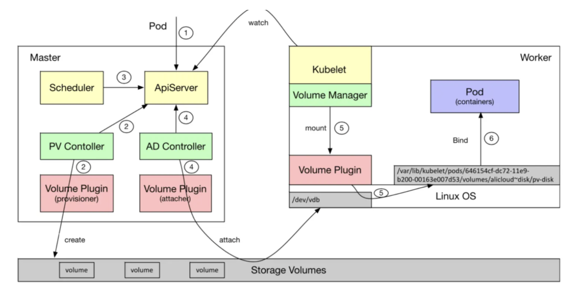

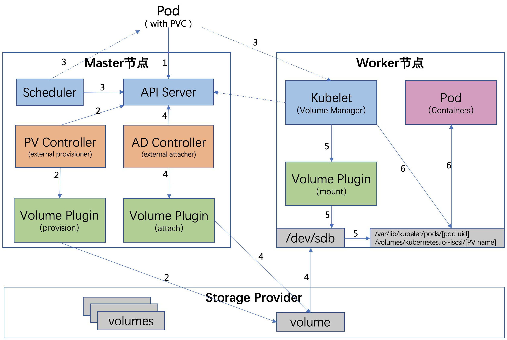

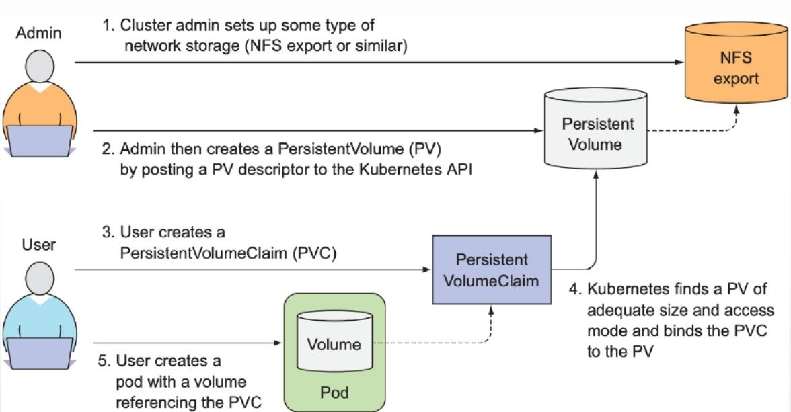

### 3.2 一个可核对的静态 NFS 示例

下例假设 NFS 服务端已导出 `/exports/app`，并且各工作节点可以挂载。PV 与 PVC 都设置 `storageClassName: ""`，明确不走默认 StorageClass；`Retain` 表示删除 PVC 后保留后端数据，管理员需要检查并手工处理后再复用。

```yaml
apiVersion: v1
kind: PersistentVolume
metadata:
  name: pv-nfs-app
spec:
  capacity:
    storage: 5Gi
  volumeMode: Filesystem
  accessModes: [ReadWriteMany]
  persistentVolumeReclaimPolicy: Retain
  storageClassName: ""
  nfs:
    server: 10.0.0.100
    path: /exports/app
---
apiVersion: v1
kind: PersistentVolumeClaim
metadata:
  name: app-data
  namespace: default
spec:
  accessModes: [ReadWriteMany]
  storageClassName: ""
  resources:
    requests:
      storage: 5Gi
```

在 Pod 中通过 `persistentVolumeClaim.claimName` 引用：

```yaml
spec:
  containers:
    - name: app
      image: nginx:stable
      volumeMounts:
        - name: data
          mountPath: /usr/share/nginx/html
  volumes:
    - name: data
      persistentVolumeClaim:
        claimName: app-data
```

先应用 PV/PVC，再运行 `kubectl get pv,pvc` 确认 `Bound`，最后检查 Pod 的事件与容器内文件。实际环境应给 NFS 导出目录设置合适的权限，不能为了让示例运行就开放任意主机写入或使用无约束的 root 权限。

### 3.3 访问模式、状态和回收

| 访问模式 | 含义 | 常见误解 |
| --- | --- | --- |
| `ReadWriteOnce`（RWO） | 一个节点以读写方式挂载 | 不等于整个集群只能有一个 Pod；同节点可能有多个 Pod 使用 |
| `ReadOnlyMany`（ROX） | 多节点只读 | 不能据此推断后端支持并发写 |
| `ReadWriteMany`（RWX） | 多节点读写 | 是否支持取决于驱动和后端 |
| `ReadWriteOncePod`（RWOP） | 整个集群单 Pod 读写 | 需符合版本及 CSI 驱动要求 |

PV 常见状态为 `Available`、`Bound`、`Released`、`Failed`。`Released` 只说明原 PVC 已删除，**并不意味着可以直接绑定给下一个 PVC**。对于 `Retain`，管理员应先检查、备份或清除旧数据，再按存储后端与集群要求回收或重建 PV。回收策略主要使用 `Retain` 或 `Delete`；旧的 `Recycle` 已弃用，不应作为新部署方案。删除 PVC 或 PV 前先检查工作负载与备份；不要靠移除 finalizer 强制删除来掩盖仍在使用的卷。

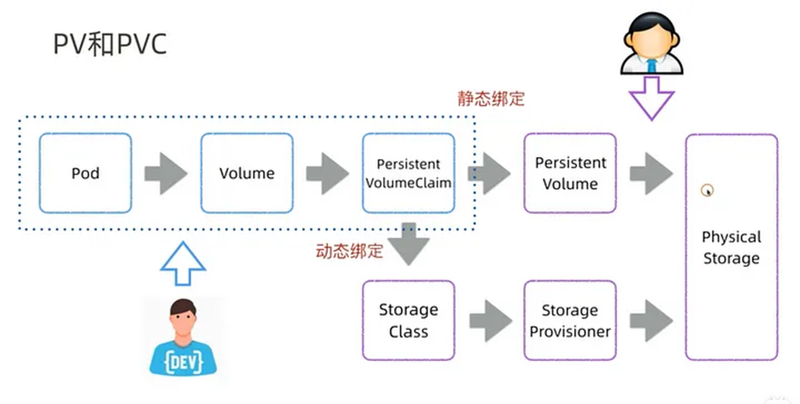

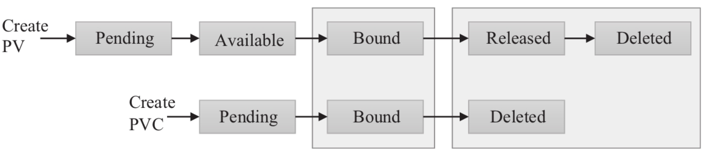


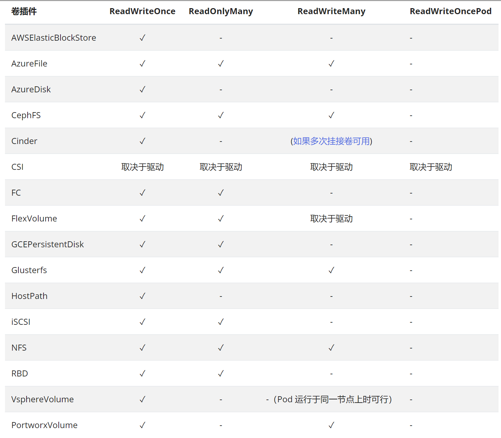

### 3.4 PVC Pending 与 Pod 挂载失败

定位 `Pending` 先看 `kubectl describe pvc <名称>` 的事件：请求容量是否大于可用 PV、访问模式和 `volumeMode` 是否兼容、`storageClassName` 是否匹配、选择器或拓扑约束是否阻止绑定。PVC 已 `Bound` 而 Pod 仍卡住时，再查 Pod 事件和节点 kubelet/CSI 日志，重点看同命名空间引用、节点亲和性、挂载权限、NFS 连通性与多重挂载限制。

```bash
kubectl get pv,pvc -A
kubectl describe pvc app-data -n default
kubectl describe pod <Pod名称> -n default
```

### 3.5 `subPath`：挂载卷内的子目录

一个共享卷可以存放多个应用目录，`volumeMounts.subPath` 让容器只挂载其中一部分。例如 `web1` 目录挂到 Nginx 文档根目录：

```yaml
volumeMounts:
  - name: data
    mountPath: /usr/share/nginx/html
    subPath: web1
```

这只改变容器内看到的路径，**不会**替不同应用建立访问隔离或配额。共享存储上的子目录、权限和备份仍需单独规划；数据库等状态服务也不应因为能用 `subPath` 挂载，就与无关应用共用同一个目录。

## 4 本篇检查清单

从需求倒推卷类型：临时共享用 `emptyDir`；节点级组件才考虑 `hostPath`；跨节点或长期数据走合适的 PV/PVC 与存储驱动。上线前验证 PVC 绑定、Pod 挂载、重调度后的数据可用性、权限、备份和恢复。下一篇的 StorageClass 解决“谁按什么规则创建 PV”，不能替代对后端故障域和数据保护的设计。



<nav class="article-end" aria-label="章节导航">
  <a href="{{ '/subjects/Kubernetes/20-ingress.html' | relative_url }}">← 上一篇：Ingress 流量治理与发布</a>
  <a href="{{ '/subjects/Kubernetes/' | relative_url }}">返回 Kubernetes 目录</a>
  <a href="{{ '/subjects/Kubernetes/22-storageclass-openebs.html' | relative_url }}">下一篇：StorageClass 与 OpenEBS →</a>
</nav>
