[← 返回 Kubernetes 目录]({{ '/subjects/Kubernetes/' | relative_url }})



# 21 存储卷、PV 与 PVC

# 1 数据存储

## 1.1 存储机制

### 1.1.1 Docker 存储

Docker的文件系统 与Docker容器具有相同的生命周期，但是Docker容器可能会遇到同时运行到多节点场景中，此时会因为节点崩溃、服务崩溃、网络原因，导致容器异常退出，所以一旦将数据存储到容器内部，会导致数据丢失。Docker镜像是只读的文件，Docker容器可读可写，但是不能够数据持久化。所以为了避免这种数据异常丢失的情况，一般会将容器的数据(程序状态数据、应用存储数据等)，存储在容器的文件系统之外。即通过引入外部的存储空间来实现 数据的可持久化效果。

Docker的两种文件存储机制：

**host机制**：通过数据卷或者数据卷容器，将当前宿主机上面的文件系统目录与容器里面的工作目录进行一一的关联。即使我们对本地是磁盘做 raid等冗余功能，但是这种等级的安全并不理想。

#### 网络存储机制

通过网络的方式，将外部的存储空间挂载到当前宿主机，然后借助于host机制实现容器数据的可持久化。

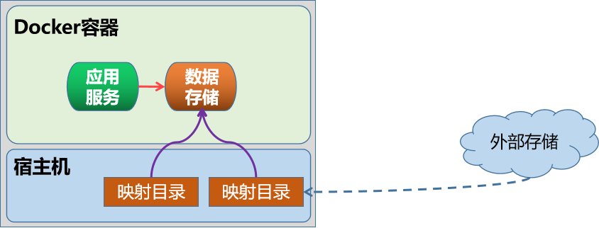

### 1.1.2 Kubernetes 存储机制

Container 中的文件在磁盘上是临时存放的，这给 Container 中运行的较重要的应用程序带来一些问题。当容器崩溃时。 kubelet 可能会重新创建容器，可能会导致容器漂移至新的宿主机，容器会以干净的状态重建。导致数据丢失在同一 Pod 中运行多个容器需要共享数据。Kubernetes 卷（Volume） 这一抽象概念能够解决这两个问题。


- <https://kubernetes.io/zh-cn/docs/concepts/storage/volumes/>


**Kubernetes 集群中的容器数据存储**

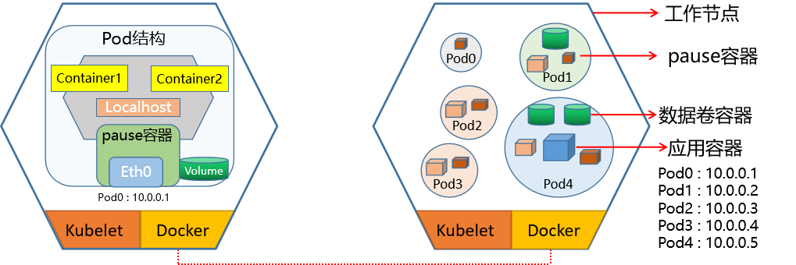

Kubernetes支持的存储类型


- <https://kubernetes.io/zh-cn/docs/concepts/storage/>


Kubernetes支持丰富的存储类型，可以分为树内和树外两种。

树内 In-Tree 存储卷插件

Kubernetes 内置的插件,可以直接支持,无需安装。

类型举例

临时存储卷emptyDir

本地数据卷hostPath、local

文件系统NFS、CephFS、GlusterFS、fastdfs、Cinder、gitRepo(DEPRECATED)

块设备iSCSI、FC、rdb(块设备)、vSphereVolume

存储平台Quobyte、PortworxVolume、StorageOS、ScaleIO

**云存储数据**

Aliyun OSS、Amazon S3、AWS Elastic Block Store、Google

卷

gcePersistentDisk等

特殊存储卷ConfigMap、Secret、DownwardAPI、Projectd、flocker

**树外 Out-of_Tree 存储卷插件**

经由容器存储接口CSI或FlexVolume接口扩展出的外部的存储系统称为Out-of-Trec类的存储插件。

以前，所有卷插件都是“树内（In-Tree）”的。 “树内”插件是与 Kubernetes 的核心组件一同构建、链接、编译和交付的。这意味着向 Kubernetes 添加新的存储系统（卷插件）需要将代码合并到 Kubernetes 核心代码库中。后来出现的 CSI 和 FlexVolume 都允许独立于 Kubernetes 代码库开发卷插件，并作为扩展部署（安装）在 Kubernetes 集群上。

Flexvolume

Kubernetes社区较早实现的存储卷扩展机制，当前已淘汰。Flexvolume运行在host空间，不能使用RBAC授权机制访问Kubernetes API,导致其功能极大的受限。Flexvolume 以脚本实现，性能不佳。

**CSI 插件**

Container Storage Interface 是当前Kubernetes社区推荐的插件实现方案。CSI 不仅支持Kubernetes平台存储插件接口，而且也作为云原生生态中容器存储接口的标准,公用云对其有更好的支持。Kubernetes 支持 CSI 的接口方式实现更大范围的存储功能扩展,更为推荐使用。


- <https://github.com/container-storage-interface/spec/blob/master/spec.md>


CSI 有多种实现,比如：

Rancher 是为使用容器的公司打造的容器管理平台。Rancher 简化了使用 Kubernetes 的流程，开发者可以随处运行 Kubernetes，满足 IT 需求规范，赋能 DevOps 团队。这个团队研发的Longhorn就是要给非常好的存储平台。Longhorn是一个轻量级且功能强大的云原生Kubernetes分布式存储平台，可以在任意基础设施上运行。Longhorn与Rancher结合使用，将帮助用户在Kubernetes环境中轻松、快速和可靠地部署高可用性持久化块存储。

CSI 主要包含两个部分：CSI Controller Server 与 CSI Node Server，分别对应Controller Server Pod和Node Server Pod。

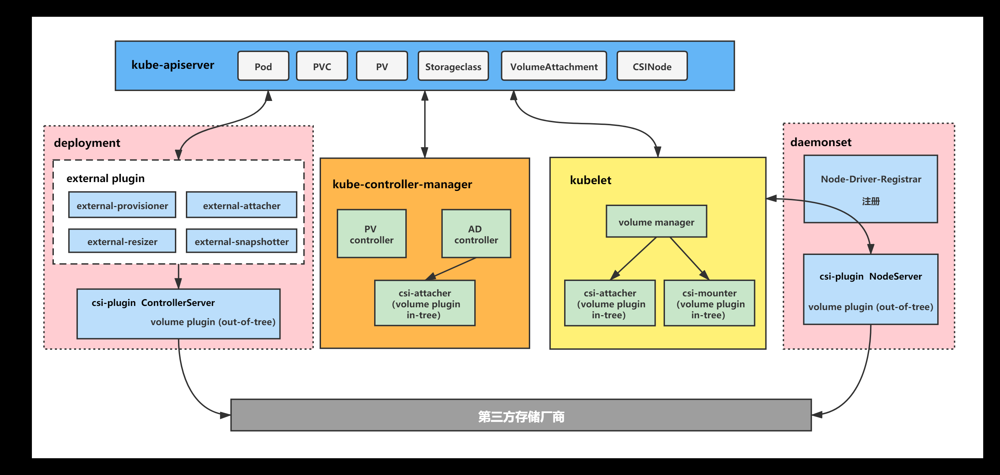

Controller Server

也称为CSI Controller

在集群中只需要部署一个 Controller Server，以 deployment 或者 StatefulSet 的形式运行。主要负责与存储服务API通信完成后端存储的管理操作，比如 provision 和 attach 工作。

Node Server

也称为CSI Node 或 Node Plugin

保证每一个节点会有一个 Pod 部署出来，负责在节点级别完成存储卷管理，和 CSI Controller 一起完成 volume 的 mount 操作。Node Server Pod 是个 DaemonSet，它会在每个节点上进行注册。Kubelet 会直接通过 Socket 的方式直接和 CSI Node Server 进行通信、调用Attach/Detach/Mount/Unmount 等。

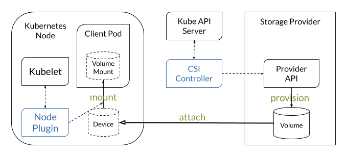

CSI 插件包括以下两部分:

**CSI-Plugin**：实现数据卷的挂载、卸载功能。CSI-Provisioner: 制备器（Provisioner）实现数据卷的自动创建管理能力，即驱动程序，比如: 支持云盘、NAS等存储卷创建能力。

#### Kubernetes 存储架构

**存储的组件主要有**：attach/detach controller、pv controller、volume manager、volume plugins、scheduler。

每个组件分工明确

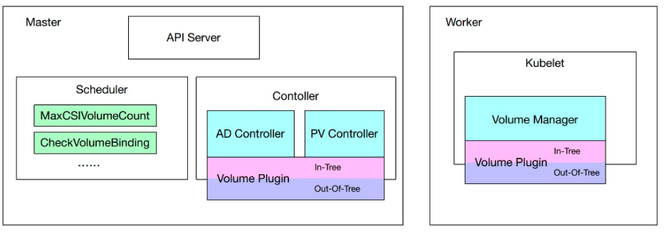

AD控制器：负责存储设备的Attach/Detach操作。

**Attach**：将设备附加到目标节点Detach：将设备从目标节点上卸载。

**Volume Manager**：存储卷管理器，负责完成卷的Mount/Umount操作，以及设备的格式化操作等。

**PV Controller**：负责PV/PVC的绑定、生命周期管理，以及存储卷的Provision/Delete操作。

volume plugins：包含k8s原生的和各厂商的的存储插件，扩展各种存储类型的卷管理能力。

原生的包括：emptydir、hostpath、csi等各厂商的包括：aws-ebs、azure等。

scheduler：实现Pod的调度，涉及到volume的调度。比如ebs、csi关于单node最大可attach磁盘数量的predicate策略，scheduler的调度至哪个指定目标节点也会受到存储插件的影响，

### 1.1.3 Pod的存储卷 volume

Kubernetes 支持在Pod上创建不同类型的任意数量的卷来实现不同数据的存储。

**单节点存储**

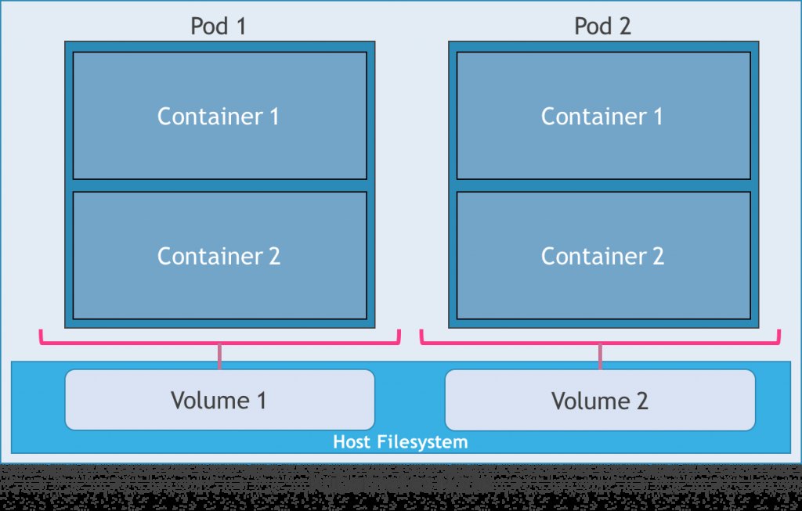

**多节点存储**

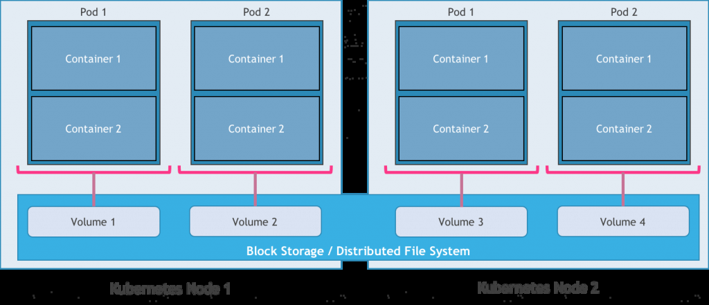

存储卷本质上表现为 Pod中所有容器共享访问的目录。而此目录的创建方式、使用的存储介质以及目录的初始内容是由Pod规范中声明的存储卷类型来源决定。kubelet内置支持多种存储卷插件，存储卷是由各种存储插件(存储驱动)来提供存储服务。存储卷插件(存储驱动)决定了支持的后端存储介质或存储服务，例如hostPath插件使用宿主机文件系统，而nfs插件则对接指定的NFS存储服务等。

Pod在规范中需要指定其包含的卷以及这些卷在容器中的挂载路径。存储卷对象并非都是 Kubernetes系统一等公民，即有些卷不是独立的资源类型api-resources。

存储卷需要定义在指定的Pod之上

有些卷本身的生命周期与Pod相同，但其后端的存储及相关数据的生命周期通常要取决于存储介质。

**存储卷可以分为**：临时卷和持久卷。

临时卷类型的生命周期与 Pod 相同， 当 Pod 不再存在时，Kubernetes 也会销毁临时卷持久卷可以比 Pod 的存活期长。当 Pod 不再存在时，Kubernetes 不会销毁持久卷。但对于给定 Pod 中任何类型的卷，在容器重启期间数据都不会丢失。

范例: 查看Pod 支持的卷
```bash
[root@master1 ~]#kubectl explain deployment.spec.template.spec.volumes
[root@master1 ~]#kubectl explain pod.spec.volumes
KIND:     Pod
VERSION:  v1

RESOURCE: volumes <[]Object>

DESCRIPTION:
List of volumes that can be mounted by containers belonging to the pod.
More info: https://kubernetes.io/docs/concepts/storage/volumes

Volume represents a named volume in a pod that may be accessed by any
container in the pod.
```


FIELDS: awsElasticBlockStore <Object>awsElasticBlockStore represents an AWS Disk resource that is attached to a kubelet's host machine and then exposed to the pod. More info:

<https://kubernetes.io/docs/concepts/storage/volumes#awselasticblockstore>

```text
azureDisk    <Object>
azureDisk represents an Azure Data Disk mount on the host and bind mount to
the pod.

azureFile    <Object>
azureFile represents an Azure File Service mount on the host and bind mount
to the pod.

cephfs   <Object>
cephFS represents a Ceph FS mount on the host that shares a pod's lifetime

cinder   <Object>
cinder represents a cinder volume attached and mounted on kubelets host
machine. More info: https://examples.Kubernetes.io/mysql-cinder-pd/README.md

configMap    <Object>
configMap represents a configMap that should populate this volume

csi  <Object>
csi (Container Storage Interface) represents ephemeral storage that is
handled by certain external CSI drivers (Beta feature).

downwardAPI  <Object>
downwardAPI represents downward API about the pod that should populate this
volume

emptyDir <Object>
emptyDir represents a temporary directory that shares a pod's lifetime.
More info: https://kubernetes.io/docs/concepts/storage/volumes#emptydir
```


ephemeral    <Object>ephemeral represents a volume that is handled by a cluster storage driver. The volume's lifecycle is tied to the pod that defines it - it will be created before the pod starts, and deleted when the pod is removed.


Use this if: a) the volume is only needed while the pod runs, b) features of normal volumes like restoring from snapshot or capacity tracking are needed, c) the storage driver is specified through a storage class, and d) the storage driver supports dynamic volume provisioning through a PersistentVolumeClaim (see EphemeralVolumeSource for more information on the connection between this volume type and PersistentVolumeClaim).

```text
Use PersistentVolumeClaim or one of the vendor-specific APIs for volumes
that persist for longer than the lifecycle of an individual pod.
```


Use CSI for light-weight local ephemeral volumes if the CSI driver is meant to be used that way - see the documentation of the driver for more information.

```text
A pod can use both types of ephemeral volumes and persistent volumes at the
same time.

fc   <Object>
fc represents a Fibre Channel resource that is attached to a kubelet's host
machine and then exposed to the pod.

flexVolume   <Object>
flexVolume represents a generic volume resource that is
provisioned/attached using an exec based plugin.

flocker  <Object>
flocker represents a Flocker volume attached to a kubelet's host machine.
This depends on the Flocker control service being running
```


gcePersistentDisk    <Object>gcePersistentDisk represents a GCE Disk resource that is attached to a kubelet's host machine and then exposed to the pod. More info:

<https://kubernetes.io/docs/concepts/storage/volumes#gcepersistentdisk>


gitRepo  <Object>gitRepo represents a git repository at a particular revision. DEPRECATED: GitRepo is deprecated. To provision a container with a git repo, mount an EmptyDir into an InitContainer that clones the repo using git, then mount the EmptyDir into the Pod's container.

```text
glusterfs    <Object>
glusterfs represents a Glusterfs mount on the host that shares a pod's
lifetime. More info:
https://examples.Kubernetes.io/volumes/glusterfs/README.md
```


hostPath <Object>hostPath represents a pre-existing file or directory on the host machine that is directly exposed to the container. This is generally used for system agents or other privileged things that are allowed to see the host machine. Most containers will NOT need this. More info:

<https://kubernetes.io/docs/concepts/storage/volumes#hostpath>


iscsi    <Object>iscsi represents an ISCSI Disk resource that is attached to a kubelet's host machine and then exposed to the pod. More info:

<https://examples.Kubernetes.io/volumes/iscsi/README.md>


name <string> -required-name of the volume. Must be a DNS_LABEL and unique within the pod. More info:

<https://kubernetes.io/docs/concepts/overview/working-with->

objects/names/#names

```text
nfs  <Object>
nfs represents an NFS mount on the host that shares a pod's lifetime More
info: https://kubernetes.io/docs/concepts/storage/volumes#nfs

persistentVolumeClaim    <Object>
persistentVolumeClaimVolumeSource represents a reference to a
PersistentVolumeClaim in the same namespace. More info:
https://kubernetes.io/docs/concepts/storage/persistent-volumes#persistentvolumeclaims

photonPersistentDisk <Object>
photonPersistentDisk represents a PhotonController persistent disk attached
and mounted on kubelets host machine

portworxVolume   <Object>
portworxVolume represents a portworx volume attached and mounted on
kubelets host machine

projected    <Object>
projected items for all in one resources secrets, configmaps, and downward
API

quobyte  <Object>
quobyte represents a Quobyte mount on the host that shares a pod's lifetime
```


rbd  <Object>rbd represents a Rados Block Device mount on the host that shares a pod's lifetime. More info: https://examples.Kubernetes.io/volumes/rbd/README.md

```text
scaleIO  <Object>
scaleIO represents a ScaleIO persistent volume attached and mounted on
Kubernetes nodes.

secret   <Object>
secret represents a secret that should populate this volume. More info:
https://kubernetes.io/docs/concepts/storage/volumes#secret

storageos    <Object>
storageOS represents a StorageOS volume attached and mounted on Kubernetes
nodes.

vsphereVolume    <Object>
vsphereVolume represents a vSphere volume attached and mounted on kubelets
host machine
```

**Pod中卷使用**

一个Pod可以添加任意个卷同一个Pod内每个容器可以在不同位置按需挂载Pod上的任意个卷，或者不挂载任何卷同一个Pod上的某个卷，也可以同时被该Pod内的多个容器同时挂载，以共享数据如果支持，多个Pod也可以通过卷接口访问同一个后端存储单元。


**存储卷的配置由两部分组成**：通过pod.spec.volumes字段定义在Pod之上的存储卷列表，它经由特定的存储卷插件并结合特定的存储供给方的访问接口进行定义嵌套定义在容器的pod.spec.containers.volumeMounts字段上的存储卷挂载列表，它只能挂载当前Pod对象中定义的存储卷。

Pod 内部容器使用存储卷有两步：

在Pod上定义存储卷，并关联至目标存储服务上。

volumes

kubectl explain pod.spec.volumes

在需要用到存储卷的容器上，挂载其所属的Pod中pause的存储卷。

volumesMount

kubectl explain pod.spec.containers.volumeMounts

容器引擎对共享式存储设备的支持类型：

单路读写 - 多个容器内可以通过同一个中间容器对同一个存储设备进行读写操作，比如： 本地磁盘文件多路并行读写 - 多个容器内可以同时对同一个存储设备进行读写操作，比如：NFS多路只读 - 多个容器内可以同时对同一个存储设备进行只读操作，比如：CDROM。

**Pod的卷资源对象属性**
```yaml
apiVersion: v1
kind: Pod
metadata:
name: <string>
namespace: <string>
spec:

volumes:                      # 定义卷
- name <string>               # 存储卷名称标识，仅可使用DNS标签格式的字符，在当前Pod中
必须唯一
VOL_TYPE <Object>           # 存储卷插件及具体的目标存储供给方的相关配置
containers:
- name: …
image: …
volumeMounts:               # 挂载卷
- name <string>             # 要挂载的存储卷的名称，必须匹配存储卷列表中某项的定义
mountPath <string>        # 容器文件系统上的挂载点路径
readOnly <boolean>        # 是否挂载为只读模式，默认为“否”，即可读可写
subPath <string>          # 挂载存储卷上的一个子目录至指定的挂载点
subPathExpr <string>      # 挂载由指定的模式匹配到的存储卷的文件或目录至挂载点
```

虽然这种借助于Kubernetes存储插件的方式，为pod应用引入各种存储机制直接挂载使用，但是这种方案有天然的劣势：

要保证所有的pod节点支持后端的指定类型的存储服务。所有的后端指定服务的配置都要在pod上自定义，不方便其它Pod复用这些卷插件将pod定制的配置属性传递给kubelet，然后实现对应的效果。以上说明，意味着一个开发者要开发一个pod对象，必须首先是一个存储专家，这使得Kubernetes的使用门槛过高。Kubernetes为了解决上述问题，引入了两个非常重要的存储资源类型: PV 和 PVC。

### 1.1.4 PV和PVC


由专业的存储管理员来管理所有的存储后端：

在专用的存储设备上，创建各种类型级别的PV(Persistent Volume)或者通过存储模板文件SC(storageclasses)来自动创建大量不同类型的PV对象。由开发人员定制需要的PVC(Persistent Volume Claim)，然后关联到pod上。Pod通过PVC到PV上请求一块独立大小的网络存储空间，然后直接使用。通过这种分层的管理机制，让开发人员和存储人员专人做专事，大大的减轻工作的负载。

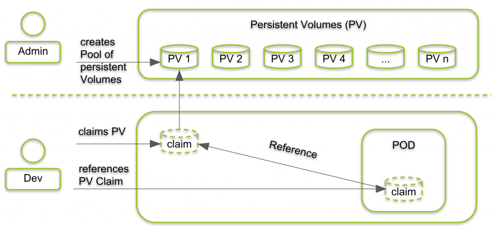

## 1.2 emptyDir


- <https://kubernetes.io/zh-cn/docs/concepts/storage/volumes/#emptydir>


一个emptyDir volume在pod被调度到某个Node时候自动创建的，无需指定宿主机上对应的目录。适用于在一个Pod中不同容器间的临时数据的共享。

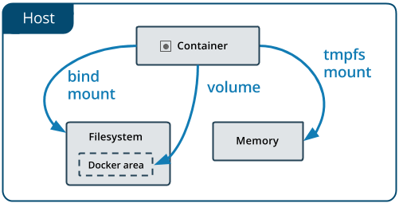

emptyDir  数据默认存放在宿主机的路径如下：
```text
/var/lib/kubelet/pods/<pod_id>/volumes/kubernetes.io~empty-
dir/<volume_name>/<FILE>

#注意：此目录随着Pod删除，也会随之删除，不能实现持久化
```

emptyDir  特点如下：

此为默认存储类型此方式只能临时存放数据，不能实现数据持久化跟随Pod初始化而来，开始是空数据卷Pod 被删除，emptyDir对应的宿主机目录也被删除，当然目录内的数据随之永久消除emptyDir 数据卷介质种类跟当前主机的磁盘一样。emptyDir 主机可以为同一个Pod内多个容器共享emptyDir 容器数据的临时存储目录主要用于数据缓存和同一个Pod内的多个容器共享使用。

**emptyDir  属性解析**
```bash
#定义卷
kubectl explain pod.spec.volumes.emptyDir
medium      #指定媒介类型，主要有 default(默认为宿主机的本地磁盘，The default is ""
which means to use the node's default medium)和Memory两种,默认情况下，emptyDir卷支持
节点上的任何介质，SSD、磁盘或网络存储，具体取决于自身的环境。也可以将emptyDir.medium,字段设置
为Memory，让 Kubernetes使用tmpfs(内存支持的文件系统)，虽然tmpfs非常快，但是tmpfs在节点重启
时，数据同样会被清除，并且设置的大小会被计入到Container的内存限制当中。
sizeLimit   #当前存储卷的空间限额，默认值为nil表示不限制

#使用卷
kubectl explain pod.spec.containers.volumeMounts
mountPath   #挂载到容器中的路径,此目录会自动生成
name        #指定挂载的volumes名称
readOnly    #是否只读挂载
subPath     #指定挂载卷的子目录路径,默认挂载卷的根目录
```

**配置示例**
```yaml
# volume配置格式
volumes:
- name: volume_name
emptyDir: {}

# volume使用格式
containers:
- volumeMounts:
- name: volume_name
mountPath: /path/to/container/  #容器内路径

#注意：关于volume和容器的关系，每个容器都可以单独挂载多个volume，每种volume都可以被多个容器挂
载

#示例1
apiVersion: v1
kind: Pod
metadata:
name: test-pod
spec:
containers:
- image: registry.k8s.io/test-webserver
name: test-container
volumeMounts:
- mountPath: /cache
name: cache-volume
volumes:
- name: cache-volume
emptyDir: {}

#示例2
apiVersion: v1
kind: Pod
metadata:
name: test-pd
spec:
containers:

- image: registry.k8s.io/test-webserver
name: test-container
volumeMounts:
- mountPath: /cache
name: cache-volume
volumes:
- name: cache-volume
emptyDir:
medium: Memory
sizeLimit: 500Mi
```

范例: emptydir 使用
```yaml
#清单文件
[root@master1 ~]#cat storage-emptydir-1.yaml
apiVersion: v1
kind: Pod
metadata:
name: storage-emptydir-1
labels:
name: storage-emptydir
spec:
volumes:
- name: empty-volume
emptyDir: {} #默认磁盘存储
#emptyDir:
#  medium: Memory
#  sizeLimit: 500Mi
containers:
- name: storage-emptydir-container
image: registry.cn-beijing.aliyuncs.com/bowen/nginx:1.20.0
volumeMounts:
- name: empty-volume
mountPath: /nginx/www/empty/

#创建资源
[root@master1 ~]#kubectl apply -f storage-emptydir-1.yaml

#查看资源性信息
[root@master1 ~]# kubectl describe pod
Name:         storage-emptydir
....
Mounts:
/nginx/www/empty/ from empty-volume (rw)
/var/run/secrets/kubernetes.io/serviceaccount from kube-api-access-sbgjs
(ro)
Conditions:
Type              Status
Initialized       True
Ready             True
ContainersReady   True
PodScheduled      True
Volumes:
empty-volume:
Type:       EmptyDir (a temporary directory that shares a pod's lifetime)
Medium:
SizeLimit:  <unset>

.....

#确认目录自动生成
[root@master1 ~]#kubectl exec volume-nginx -- ls -ld  /nginx/www/empty
drwxrwxrwx 2 root root 4096 Mar 22 06:33 /nginx/www/empty

#写文件
[root@master1 ~]#kubectl exec -it storage-emptydir -- sh
# echo empty-volume > /nginx/www/empty/test.txt
# cat /nginx/www/empty/test.txt
empty-volume

#确定pod所有在主机
[root@master1 ~]#kubectl get pod -o wide
NAME           READY   STATUS    RESTARTS   AGE     IP            NODE
NOMINATED NODE   READINESS GATES
volume-nginx   1/1     Running   0          3m14s   172.16.3.56   node1.bowen.org
<none>           <none>

#在pod所在主机上查找文件
[root@node1 ~]#find / -name test.txt
/var/lib/kubelet/pods/1888534d-074b-4644-9ad7-
96eba12883da/volumes/kubernetes.io~empty-dir/empty-volume/test.txt

[root@node1 ~]#find / -name test.txt | xargs cat
empty-volume

[root@node1 ~]#cd /var/lib/kubelet/pods/dfd8ef27-e3d9-486b-ad11-03f45a328f75/
[root@node1 dfd8ef27-e3d9-486b-ad11-03f45a328f75]#tree
.
├── containers
│   └── volume-nginx-container
│       └── 063a281e
├── etc-hosts
├── plugins
│   └── kubernetes.io~empty-dir
│       ├── empty-volume
│       │   └── ready
│       └── wrapped_kube-api-access-rbv6t
│           └── ready
└── volumes
├── kubernetes.io~empty-dir
│   └── empty-volume
└── kubernetes.io~projected
└── kube-api-access-rbv6t
├── ca.crt -> ..data/ca.crt
├── namespace -> ..data/namespace
└── token -> ..data/token

11 directories, 7 files

#删除pod
[root@master1 ~]#kubectl delete  -f storage-emptydir-1.yaml
pod "storage-emptydir" deleted

#pod对应的目录也被删除
[root@node1 ~]#ls /var/lib/kubelet/pods

413120f6-6f80-47dd-969f-0c6185b65423  5412e06e-78bd-457b-8da3-600f7371da9b
ff394444-be24-4ff8-b99e-10ba0deafdd2
```

范例: 在一个Pod中定义多个容器通过 emptyDir 共享数据
```yaml
[root@master1 ~]#cat storage-emptydir-2.yaml
apiVersion: v1
kind: Pod
metadata:
name: storage-emptydir-2
spec:
volumes:
- name: nginx-data
emptyDir: {}
containers:
- name: storage-emptydir-nginx
image: registry.cn-beijing.aliyuncs.com/bowen/nginx:1.20.0
volumeMounts:
- name: nginx-data
mountPath: /usr/share/nginx/html/
- name: storage-emptydir-busybox
image: registry.cn-beijing.aliyuncs.com/bowen/busybox:1.32.0
volumeMounts:
- name: nginx-data
mountPath: /data/
command:
- "/bin/sh"
- "-c"
- "while true; do date > /data/index.html; sleep 1; done"

#初始化对象
[root@master1 ~]#kubectl apply  -f storage-emptydir-2.yaml

#查看pod对象
[root@master1 ~]#kubectl get pod -o wide
NAME               READY   STATUS    RESTARTS   AGE   IP            NODE
NOMINATED NODE   READINESS GATES
storage-emptydir-2   2/2     Running   0          22s   10.244.3.6
node1.bowen.org   <none>           <none>

#查看两个容器内的数据
[root@master1 ~]#kubectl exec -it storage-emptydir  -c storage-emptydir-busybox -
- cat /data/index.html
Mon Sep 27 03:16:05 UTC 2021
[root@master1 ~]#kubectl exec -it storage-emptydir  -c storage-emptydir-nginx --
cat /usr/share/nginx/html/index.html
Mon Sep 27 03:16:05 UTC 2021

#测试pod的web效果
[root@master1 ~]#curl 10.244.3.6
Mon Sep 27 03:17:03 UTC 2021
[root@master1 ~]#curl 10.244.3.6
Mon Sep 27 03:17:04 UTC 2021
[root@master1 ~]#curl 10.244.3.6
Mon Sep 27 03:17:05 UTC 2021

#结果显示：两个容器间实现了数据卷的共享操作，在busybox中定制信息，然后在nginx容器中获取信息。
```

范例:  使用边车容器运行日志代理


- <https://kubernetes.io/docs/concepts/cluster-administration/logging>


可以通过以下方式之一使用边车（Sidecar）容器：

边车容器将应用程序日志传送到自己的标准输出。边车容器运行一个日志代理，配置该日志代理以便从应用容器收集日志。
```yaml
apiVersion: v1
kind: Pod
metadata:
name: counter
spec:
containers:
- name: count
image: busybox:1.28
args:
- /bin/sh
- -c
- >
i=0;
while true;
do
echo "$i: $(date)" >> /var/log/1.log;
echo "$(date) INFO $i" >> /var/log/2.log;
i=$((i+1));
sleep 1;
done
volumeMounts:
- name: varlog
mountPath: /var/log
- name: count-log-1
image: busybox:1.28
args: [/bin/sh, -c, 'tail -n+1 -F /var/log/1.log']
volumeMounts:
- name: varlog
mountPath: /var/log
- name: count-log-2
image: busybox:1.28
args: [/bin/sh, -c, 'tail -n+1 -F /var/log/2.log']
volumeMounts:
- name: varlog
mountPath: /var/log
volumes:
- name: varlog
emptyDir: {}
```

范例: 具有日志代理功能的边车容器
```text
https://kubernetes.io/docs/concepts/cluster-administration/logging/#sidecar-container-with-a-logging-agent
```

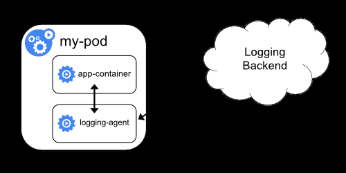

一个运行 fluentd 边车容器的 Pod。 该 Pod 挂载一个卷，fluentd 可以从这个卷上拣选其配置数据。
```yaml
#用来配置 fluentd 的 ConfigMap
---
apiVersion: v1
kind: ConfigMap
metadata:
name: fluentd-config
data:
fluentd.conf: |
<source>
type tail
format none
path /var/log/1.log
pos_file /var/log/1.log.pos
tag count.format1
</source>

<source>
type tail
format none
path /var/log/2.log
pos_file /var/log/2.log.pos
tag count.format2
</source>

<match **>
type google_cloud
</match>

#一个运行 fluentd 边车容器的 Pod
---
apiVersion: v1
kind: Pod
metadata:
name: counter
spec:
containers:
- name: count
image: busybox:1.28
args:
- /bin/sh
- -c

- >
i=0;
while true;
do
echo "$i: $(date)" >> /var/log/1.log;
echo "$(date) INFO $i" >> /var/log/2.log;
i=$((i+1));
sleep 1;
done
volumeMounts:
- name: varlog
mountPath: /var/log
- name: count-agent
image: registry.k8s.io/fluentd-gcp:1.30
env:
- name: FLUENTD_ARGS
value: -c /etc/fluentd-config/fluentd.conf
volumeMounts:
- name: varlog
mountPath: /var/log
- name: config-volume
mountPath: /etc/fluentd-config
volumes:
- name: varlog
emptyDir: {}
- name: config-volume
configMap:
name: fluentd-config
```

## 1.3 hostPath

参考资料：


- <https://kubernetes.io/zh-cn/docs/concepts/storage/volumes/#hostpath>


hostPath 可以将宿主机上的目录挂载到 Pod 中作为数据的存储目录。

hostPath  一般用在如下场景：

容器应用程序中某些文件需要永久保存Pod删除，hostPath数据对应在宿主机文件不受影响,即hostPath的生命周期和Pod不同,而和节点相同宿主机和容器的目录都会自动创建某些容器应用需要用到容器的自身的内部数据，可将宿主机的/var/lib/[docker|containerd]挂载到Pod中容器复用宿主机的文件。

hostPath 使用注意事项：

不支持数据的漫游，hostpath只有在其所在宿主机可用，其它节点不可用不同宿主机的目录和文件内容不一定完全相同，所以Pod迁移前后的访问效果不一样不适合Deployment这种分布式的资源，更适合于DaemonSet宿主机的目录不属于独立的资源对象的资源，所以对资源设置的资源配额限制对hostPath目录无效。

**配置属性**
```yaml
#配置属性

kubectl explain pod.spec.volumes.hostPath
path  #指定哪个宿主机的目录或文件将被共享给Pod使用
type  #指定路径的类型，一共有7种，默认的类型是没有指定
空字符串 #默认配置，在关联hostPath存储卷之前不进行任何检查,如果宿主机没有对应的目录，会自
动创建
DirectoryOrCreate  #宿主机上不存在path，就自动创建0755权限的空目录
Directory #path必须存在,挂载已存在的目录
FileOrCreate #宿主机上不存在挂载文件，就创建0644权限的空文件
File #必须存在的文件
Socket #事先必须存在的Socket文件路径
CharDevice #事先必须存在的字符设备文件路径
BlockDevice #事先必须存在的块设备文件路径

#配置格式：
volumes:
- name: volume_name
hostPath:
path: /path/to/host

#示例
apiVersion: v1
kind: Pod
metadata:
name: test-pod
spec:
containers:
- registry.cn-beijing.aliyuncs.com/bowen/pod-test:v0.1
#image: registry.k8s.io/test-webserver
name: test-container
volumeMounts:
- mountPath: /test-pod
name: test-volume
volumes:
- name: test-volume
hostPath:
# 宿主上目录位置
path: /data
# 此字段为可选
type: Directory
```

范例: 使用主机的时区配置
```yaml
[root@master1 ~]#cat storage-hostpath-timezone.yaml
apiVersion: v1
kind: Pod
metadata:
name: pod-hostpath-timezone
spec:
volumes:
#- name: timezone
#  hostPath:
#    path: /etc/timezone     #配置时区方法1: 此文件用于影响时区,可选
#    type: File
- name: localtime
hostPath:
#path: /etc/localtime   #此文件为软链接所以挂载失败，但不影响时区

path: /usr/share/zoneinfo/Asia/Shanghai #配置时区方法2: 此文件用于影响时区，必选
type: File
containers:
- name: c01
image: registry.cn-beijing.aliyuncs.com/bowen/nginx:1.20.0
#command: ["sh","-c","sleep 3600"]
- name: c02
image: registry.cn-beijing.aliyuncs.com/bowen/nginx:1.20.0
command: ["sh","-c","sleep 3600"]
volumeMounts:
#- name: timezone
#  mountPath: /etc/timezone  #容器此为文件是普通文件，挂载节点目录成功
- name: localtime
mountPath: /etc/localtime #容器此为文件是普通文件，挂载节点目录成功

[root@master1 ~]#kubectl apply -f  storage-hostpath-timezone.yaml

[root@master1 ~]#kubectl get pod -o wide
NAME    READY   STATUS    RESTARTS   AGE   IP         NODE     NOMINATED NODE
READINESS GATES
pod-hostpath-test   2/2     Running   0    3s    10.244.2.42   node2.bowen.org
<none>        <none>

#查看宿主机的配置
[root@node2 ~]#cat /etc/timezone
Asia/Shanghai

#查看结果
[root@master1 ~]#kubectl exec pod-hostpath-timezone -c c01 -- date
Wed May  8 03:22:53 UTC 2024
[root@master1 ~]#kubectl exec pod-hostpath-timezone -c c01 -- cat /etc/timezone
Etc/UTC

[root@master1 ~]#kubectl exec pod-hostpath-timezone -c c02 -- date
Wed May  8 11:23:55 CST 2024

#替换了原来的软链接文件指向的原文件
[root@master1 ~]#kubectl exec -it pod-hostpath-timezone -c c02 -- sh
# ls -l /etc/localtime
lrwxrwxrwx 1 root root 27 May 11  2021 /etc/localtime ->
/usr/share/zoneinfo/Etc/UTC
# ls -l /usr/share/zoneinfo/Etc/UTC
lrwxrwxrwx 1 root root 6 Jan 27  2021 /usr/share/zoneinfo/Etc/UTC -> ../UCT
# ls -l /usr/share/zoneinfo/UCT
-rw-r--r-- 1 root root 561 Apr 22 18:11 /usr/share/zoneinfo/UCT
```

范例: 实现 Redis 数据的持久化
```yaml
[root@master1 ~]#cat storage-hostpath-redis.yaml
apiVersion: v1
kind: Pod
metadata:
name: hostpath-redis
spec:
nodeName: node1.bowen.org      #指定运行在指定worker主机上
volumes:

- name: redis-backup
hostPath:
path: /backup/redis       #宿主机的目录会自动创建
containers:
- name: hostpath-redis
image: registry.cn-beijing.aliyuncs.com/bowen/redis:6.2.5
volumeMounts:
- name: redis-backup
mountPath: /data
#关键点：spec.containers.volumeMounts的name属性和spec.volumes的那么属性完全一致,因为他们
是基于name来关联的。
#注意：redis的镜像将数据保存到了容器的/data 目录下。

#创建资源对象
[root@master1 ~]#kubectl apply  -f storage-hostpath-redis.yaml

#查看Pod 状态
[root@master1 ~]#kubectl get pod -o wide
NAME             READY   STATUS    RESTARTS   AGE   IP            NODE
NOMINATED NODE   READINESS GATES
hostpath-redis   1/1     Running   0          4s    172.16.3.59   node1.bowen.org
<none>           <none>

#查看pod信息
[root@master1 ~]#kubectl describe pod hostpath-redis
Mounts:
/data from redis-backup (rw)
.....
Volumes:
redis-backup:
Type:          HostPath (bare host directory volume)
Path:          /backup/redis
HostPathType:

#生成数据
[root@master1 ~]#kubectl exec -it hostpath-redis -- bash
root@hostpath-redis:/data# pwd
/data
root@hostpath-redis:/data# redis-cli
127.0.0.1:6379> set name bowen
OK
127.0.0.1:6379> bgsave
Background saving started

#在对应的worker节点主机查看数据目录自动生成
[root@node1 ~]#tree /backup/
/backup/
└── redis
└── dump.rdb

1 directory, 1 file
[root@node1 ~]#ll /backup/redis/dump.rdb
-rw-r--r-- 1 systemd-coredump systemd-coredump 116 Mar 22 15:58
/backup/redis/dump.rdb

#删除pod,重新创建
[root@master1 ~]#kubectl delete  -f storage-hostpath-redis.yaml

#重新创建Pod,验证数据是否还在
[root@master1 ~]#kubectl apply  -f storage-hostpath-redis.yaml

#确认数据还存在
[root@master1 ~]#kubectl exec -it hostpath-redis -- redis-cli keys '*'
1) "name"
[root@master1 ~]#kubectl exec -it hostpath-redis -- redis-cli get name
"bowen"
```

范例: 实现 NFS 服务
```yaml
https://github.com/kubernetes-csi/csi-driver-nfs/blob/master/deploy/example/nfs-provisioner/README.md

[root@master1 ~]#cat storage-nfs-server.yaml
---
kind: Service
apiVersion: v1
metadata:
name: nfs-server
labels:
app: nfs-server
spec:
type: ClusterIP  # use "LoadBalancer" to get a public ip
selector:
app: nfs-server
ports:
- name: tcp-2049
port: 2049
protocol: TCP
- name: udp-111
port: 111
protocol: UDP
---
kind: Deployment
apiVersion: apps/v1
metadata:
name: nfs-server
spec:
replicas: 1
selector:
matchLabels:
app: nfs-server
template:
metadata:
name: nfs-server
labels:
app: nfs-server
spec:
nodeSelector:
"kubernetes.io/os": linux
"server": nfs
containers:
- name: nfs-server
#image: itsthenetwork/nfs-server-alpine:12

image: registry.cn-beijing.aliyuncs.com/bowen/nfs-server-
alpine:12
env:
- name: SHARED_DIRECTORY
value: "/exports"
volumeMounts:
- mountPath: /exports
name: nfs-vol
securityContext:
privileged: true
ports:
- name: tcp-2049
containerPort: 2049
protocol: TCP
- name: udp-111
containerPort: 111
protocol: UDP
volumes:
- name: nfs-vol
hostPath:
path: /nfs-vol  # modify this to specify another path to store nfs
share data
type: DirectoryOrCreate

[root@master1 ~]#kubectl create ns nfs

#给NFS运行的节点指定标签
[root@master1 ~]#kubectl label nodes node1.bowen.org server=nfs
node/node1.bowen.org labeled

[root@master1 ~]#kubectl apply -f storage-nfs-server.yaml -n nfs
service/nfs-server created
deployment.apps/nfs-server created

[root@master1 ~]#kubectl get -n nfs all
NAME                              READY   STATUS    RESTARTS   AGE
pod/nfs-server-857f859f57-hgf29   1/1     Running   0          12s

NAME                 TYPE        CLUSTER-IP      EXTERNAL-IP   PORT(S)
AGE
service/nfs-server   ClusterIP   10.99.201.239   <none>        2049/TCP,111/UDP
12s

NAME                         READY   UP-TO-DATE   AVAILABLE   AGE
deployment.apps/nfs-server   1/1     1            1           12s

NAME                                    DESIRED   CURRENT   READY   AGE
replicaset.apps/nfs-server-857f859f57   1         1         1       12s

#查看NFS服务的Pod所有的主机
[root@master1 ~]#kubectl get pod -n nfs -o wide
nfs-server-857f859f57-hgf29   1/1     Running       4 (122m ago)   22d
10.244.1.10   node1.bowen.org   <none>           <none>

#在NFS主机节点上自动生成在NFS共享目录
[root@node1 ~]#ll -d /nfs-vol/
drwxr-xr-x 2 root root 4096  5月  9 10:35 /nfs-vol//

#查看NFS共享配置
[root@master1 ~]#kubectl exec -n nfs nfs-server-857f859f57-hgf29 -- exportfs -v
/exports        <world>
(async,wdelay,hide,no_subtree_check,insecure_locks,fsid=0,sec=sys,rw,insecure,no
_root_squash,no_all_squash)

#NFS客户端安装包并挂载，注意：NFS-v4.0不支持showmount查看
[root@node3 ~]#apt update && apt -y install nfs-common
[root@node3 ~]#showmount -e 10.99.201.239

#但是支持挂载NFS服务的伪根

[root@node3 ~]#mount 10.99.201.239:/ /mnt

#查看挂载属性
[root@node3 ~]#grep nfs /proc/mounts |
10.99.201.239:/ /mnt nfs4
rw,relatime,vers=4.2,rsize=262144,wsize=262144,namlen=255,hard,proto=tcp,timeo=6
00,retrans=2,sec=sys,clientaddr=10.0.0.203,local_lock=none,addr=10.99.201.239 0
0

#创建文件
[root@node3 ~]#ls /mnt
[root@node3 ~]#touch /mnt/bowen.txt

#在NFS服务所在节点查看文件生成
[root@node1 ~]#ls /nfs-vol
bowen.txt
```

## 1.4 网络共享存储

虽然hostpath可以根据pod的配置自动创建关联的宿主机目录，但是因为pod通常会运行在不同的宿主机上，因此每个宿主机目录下面可能没有想需要的相同的数据文件。在集群场景中，想要实现比基于hostpath方式实现更强大所有的数据文件进行同步功能。基于此，需要一种可以实现网络共享的存储方式。

Kubernetes 支持多种网络共享的存储方法

### 1.4.1 实现NFS的网络共享存储

#### 1.4.1.1 NFS的网络共享存储配置说明


- <https://kubernetes.io/zh-cn/docs/concepts/storage/volumes/#nfs>
- <https://github.com/kubernetes/examples/tree/master/staging/volumes/nfs>


和传统的方式一样, 通过 NFS 网络文件系统可以实现Kubernetes数据的网络存储共享。使用NFS提供的共享目录存储数据时，需要在系统中部署一个NFS环境，通过volume的配置，实现pod内的容器间共享NFS目录。

**属性解析**
```yaml
#配置属性：
kubectl explain pod.spec.volumes.nfs
server      #指定nfs服务器的地址

path        #指定nfs服务器暴露的共享地址
readOnly    #是否只能读，默认false

#配置格式：
volumes:
- name: <卷名称>
nfs:
server: nfs_server_address  #指定NFS服务器地址,如果是域名,需要宿主机节点能解析此域名
path: "共享目录"             #指定NFS共享目录
readOnly: false             #指定权限

#注意事项：要求Kubernetes所有集群都必须支持nfs客户端命令，即所有节点都必须执行 apt -y
install nfs-common|nfs-client

#示例
apiVersion: v1
kind: Pod
metadata:
name: test-pd
spec:
containers:
- image: registry.k8s.io/test-webserver
name: test-container
volumeMounts:
- mountPath: /my-nfs-data
name: test-volume
volumes:
- name: test-volume
nfs:
server: my-nfs-server.example.com
path: /my-nfs-volume
readonly: true
```

#### 1.4.1.2 案例

范例: 使用集群外的NFS存储
```bash
#NFS服务器软件安装
[root@master1 ~]#apt update && apt install -y nfs-kernel-server 或者 nfs-server
[root@master1 ~]#systemctl enable --now  nfs-server.service

#配置共享目录
[root@master1 ~]#mkdir /nfsdata

#指定权限
#方式1
[root@master1 ~]#echo '/nfsdata *(rw,no_root_squash)' >> /etc/exports
#方式2
[root@master1 ~]#echo '/nfsdata *(rw,all_squash,anonuid=0,anongid=0)' >>
/etc/exports

#如果使用默认权限，会提示Pod下面错误
[root@master1 ~]#echo '/nfsdata *(rw)' >> /etc/exports
[root@master1 ~]#kubectl get pod
NAME          READY   STATUS             RESTARTS      AGE
volumes-nfs   0/1     CrashLoopBackOff   2 (14s ago)   30s
[root@master1 ~]#kubectl logs volumes-nfs

chown: changing ownership of '.': Operation not permitted
```


#说明：*：表示允许所有连接，该值可以是一个网段|IP|域名的形式 rw 表示读写共享权限 no_root_squash 表示root登录nfs资源的时候，不压缩其权限 sync    所有操作数据会同时写入硬盘和内存

```yaml
#重启服务
[root@master1 ~]#exportfs -r
[root@master1 ~]#exportfs -v
/nfsdata        <world>
(sync,wdelay,hide,no_subtree_check,anonuid=0,anongid=0,sec=sys,rw,secure,no_root
_squash,all_squash)

#在所有kubernetes的worker节点充当NFS客户端，都需要安装NFS客户端软件
[root@nodeX ~]#apt update && apt -y install nfs-common 或者 nfs-client

#测试访问
[root@node1 ~]#showmount -e 10.0.0.101
Export list for 10.0.0.101:
/nfsdata *

#注意：如果所有客户端想要使用nfs的功能，必须提前安装软件，否则会发生找不到资源的报错。

#编写资源配置文件
[root@master1 ~]#cat storage-nfs-1.yaml
apiVersion: v1
kind: Pod
metadata:
name: volumes-nfs
spec:
nodeName: node1.bowen.org #指定在node1节点运行pod,节点的/etc/hosts文件或DNS解析此域名
volumes:
- name: redisdatapath
nfs:
server: nfs.bowen.org    #注意:需要宿主机节点/etc/hosts文件或DNS解析此域名,而不是由
Pod通过coreDNS完成解析
path: /nfsdata
containers:
- name: redis
#image: redis:6.2.5
image: registry.cn-beijing.aliyuncs.com/bowen/redis:6.2.5
volumeMounts:
- name: redisdatapath
mountPath: /data

#在worker节点做域名解析nfs.bowen.org
[root@node1 ~]#vim /etc/hosts
10.0.0.200 nfs.bowen.org

#创建pod
[root@master1 ~]#kubectl apply  -f storage-nfs-1.yaml

#写入数据
[root@master1 ~]#kubectl exec  -it volumes-nfs -- bash
root@volumes-nfs:/data# redis-cli set name bowen
OK

root@volumes-nfs:/data# redis-cli get name
"bowen"
root@volumes-nfs:/data# redis-cli bgsave
Background saving started
root@volumes-nfs:/data#

#验证数据生成
[root@master1 ~]#ls /nfsdata/ -l
total 4
-rw-r--r-- 1 systemd-coredump systemd-coredump 116 Mar 23 22:05 dump.rdb

#创建另一个pod
[root@master1 ~]#cat storage-nfs-2.yaml
apiVersion: v1
kind: Pod
metadata:
name: volumes-nfs-2
spec:
nodeName: node2.bowen.org  #指定另一台主机
volumes:
- name: redisdatapath
nfs:
server: nfs.bowen.org    #注意:需要做名称解析
path: /nfsdata
containers:
- name: redis
image: redis:6.2.5
volumeMounts:
- name: redisdatapath
mountPath: /data

#再次创建pod
[root@master1 ~]#kubectl apply  -f storage-nfs-2.yaml

[root@master1 ~]#kubectl get pod
NAME            READY   STATUS    RESTARTS   AGE
volumes-nfs     1/1     Running   0          3m44s
volumes-nfs-2   1/1     Running   0          21s

#验证数据生成
[root@master1 ~]#kubectl exec  -it volumes-nfs-2 -- bash
root@volumes-nfs-2:/data# redis-cli get name
"bowen"
root@volumes-nfs-2:/data#

#结果显示：基于nfs网络文件存储实现了更强大的文件共享效果
```

范例: 利用NFS共享实现nginx页面同步
```yaml
[root@master1 ~]#mkdir -p /nfsdata/nginx
[root@master1 ~]#vim /etc/exports
/nfsdata                 10.0.0.0/24(rw,no_root_squash)
[root@master1 ~]#exportfs -r

[root@master1 ~]#cat storage-nfs-nginx.yaml
---
apiVersion: v1

kind: Namespace
metadata:
name: storage

---
apiVersion: apps/v1
kind: Deployment
metadata:
name : nginx-nfs
namespace: storage
labels:
app: nginx-nfs
spec:
replicas: 3
selector:
matchLabels:
app: nginx-nfs
template:
metadata:
labels :
app: nginx-nfs
spec:
volumes:
- name: html
nfs:
server: nfs.bowen.org    #注意:需要所有worker节点为做名称解析
path: /nfsdata/nginx
containers:
- image: registry.cn-beijing.aliyuncs.com/bowen/nginx:1.20.0
name: nginx
volumeMounts:
- name: html
mountPath: /usr/share/nginx/html
---
apiVersion: v1
kind: Service
metadata:
name: service-nginx-nfs
namespace: storage
spec:
ports:
- name: http
port: 80
protocol: TCP
targetPort: 80
selector:
app: nginx-nfs
type: LoadBalancer

[root@master1 ~]#kubectl apply -f storage-nfs-nginx.yaml

[root@master1 ~]#kubectl get all -n storage
NAME                             READY   STATUS    RESTARTS   AGE
pod/nginx-nfs-6f6cd9577b-m6zks   1/1     Running   0          2m39s
pod/nginx-nfs-6f6cd9577b-sh8wl   1/1     Running   0          2m39s
pod/nginx-nfs-6f6cd9577b-xbz9z   1/1     Running   0          2m39s

NAME                        READY   UP-TO-DATE   AVAILABLE   AGE

deployment.apps/nginx-nfs   3/3     3            3           2m39s

NAME                                   DESIRED   CURRENT   READY   AGE
replicaset.apps/nginx-nfs-6f6cd9577b   3         3         3       2m39s
```

### 1.4.2 实现其他的网络共享存储

#### 1.4.2.1 CephFS 配置
```yaml
apiVersion: v1
kind: Pod
metadata:
name: volumes-cephfs-demo
spec:
containers:
- name: redis
image: redis:alpine
volumeMounts:
- mountPath: "/data"
name: redis-cephfs-vol
volumes:
- name: redis-cephfs-vol
cephfs:
monitors:
- 10.0.0.201:6789
- 10.0.0.202:6789
- 10.0.0.203:6789
path: /kube/namespaces/default/redis1
user: fsclient
secretFile: "/etc/ceph/fsclient.key"
```

#### 1.4.2.2 GlusterFS 配置
```yaml
apiVersion: v1
kind: Pod
metadata:
name: volumes-glusterfs-demo
labels:
app: redis
spec:
containers:
- name: redis
image: redis:alpine
ports:
- containerPort: 6379
name: redisport
volumeMounts:
- mountPath: /data
name: redisdata
volumes:
- name: redisdata
glusterfs:
endpoints: glusterfs-endpoints
path: kube-redis
```

#### 1.4.2.3 Cinder 配置

2012年OpenStack Folsom的发布引入了Cinder，VM镜像是短暂的，它们的存储只维持在那台虚拟机的生命周期。Cinder提供对块存储的管理支持，通过使用iSCSI, 光纤通道或者NFS协议，以及若干私有协议提供后端连接，展现给计算层。Cinder接口提供了一些标准功能，允许创建和附加块设备到虚拟机，如“创建卷”，“删除卷”和“附加卷”。还有更多高级的功能，支持扩展容量的能力，快照和创建虚拟机镜像克隆。
```yaml
apiVersion: v1
kind: Pod
metadata:
name: volume-cinder-demo
spec:
containers:
- image: mysql
name: mysql
args:
- "--ignore-db-dir"
- "lost+found"
env:
- name: MYSQL_ROOT_PASSWORD
value: YOUR_PASS
ports:
- containerPort: 3306
name: mysqlport
volumeMounts:
- name: mysqldata
mountPath: /var/lib/mysql
volumes:
- name: mysqldata
cinder:
volumeID: e2b8d2f7-wece-90d1-a505-4acf607a90bc
fsType: ext4
```

## 1.5 PV 和 PVC

### 1.5.1 PV 和 PVC 说明


- <https://kubernetes.io/zh-cn/docs/concepts/storage/persistent-volumes/>
- <https://github.com/kubernetes/examples/tree/master/volumes/storageos>
- <https://github.com/kubernetes/examples/tree/master/staging/volumes/nfs>


之前提到的Volume可以提供多种类型的资源存储(可持久或不持久)，但是它定义在Pod上的，并不是一个独立的API资源类型，是隶属于"资源对象"的组成部分。这导致用户在创建Pod时还需要关注存储的具体实现,这种方式造成Pod和存储的耦合度很高,无疑是很不方便管理的。由于每个Pod对存储的要求不同,比如大小,读写权限等,所以还需要Pod用户提前自行准备存储,对用户有更高的存储方面技术的要求。此外Pod 使用的存储空间并没有加以限制,所以很可能会导致某个Pod占有过多的存储空间。

Kubernetes-v1.0开始即支持PV和PVC 来解决上述问题。

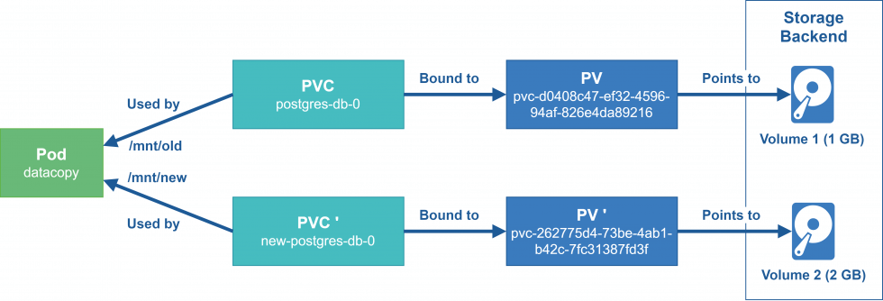

PV Persistent Volume

工作中的存储资源一般都是独立于Pod的，将之称为资源对象Persistent Volume(PV)，是由管理员设置的存储，它是kubernetes集群的一部分，PV 是 Volume 之类的卷插件，但具有独立于使用 PV 的 Pod的生命周期。

Persistent Volume 跟 Volume类似，区别就是：

PV 是集群级别的资源，负责将存储空间引入到集群中，通常由管理员定义PV 就是Kubernetes集群中的网络存储，不属于Namespace、Node、Pod等资源，但可以被它们访问PV 属于Kubernetes 整个集群,即可以被所有集群的Pod访问PV是独立的网络存储资源对象，有自己的生命周期PV 支持很多种volume类型,PV对象可以有很多常见的类型：本地磁盘、NFS、分布式文件系统...
```text
https://kubernetes.io/zh-cn/docs/concepts/storage/persistent-volumes/#persistent-volumes
```

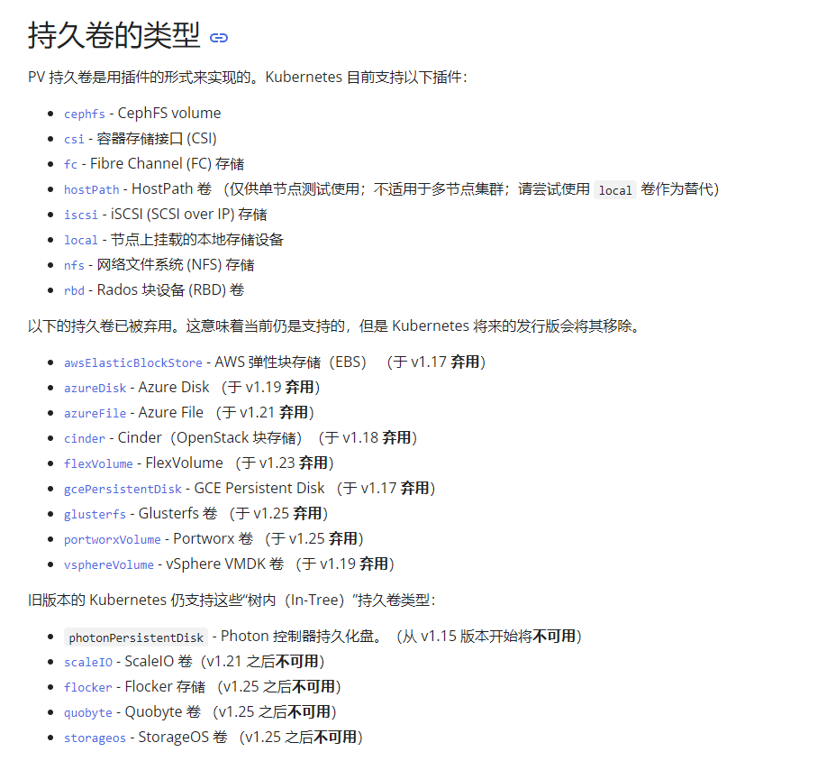

PVC Persistent Volume Claim

Persistent Volume Claim(PVC) 是一个网络存储服务的请求。PVC 属于名称空间级别的资源，只能被同一个名称空间的Pod引用。由用户定义，用于在空闲的PV中申请使用符合过滤条件的PV之一，与选定的PV是“一对一”的关系。用户在Pod上通过pvc插件请求绑定使用定义好的PVC资源。

Pod能够申请特定的CPU和MEM资源，但是Pod只能通过PVC到PV上请求一块独立大小的网络存储空间，而PVC 可以动态的根据用户请求去申请PV资源，不仅仅涉及到存储空间，还有对应资源的访问模式，对于真正使用存储的用户不需要关心底层的存储实现细节，只需要直接使用 PVC 即可。

**Pod、PV、PVC 关系**

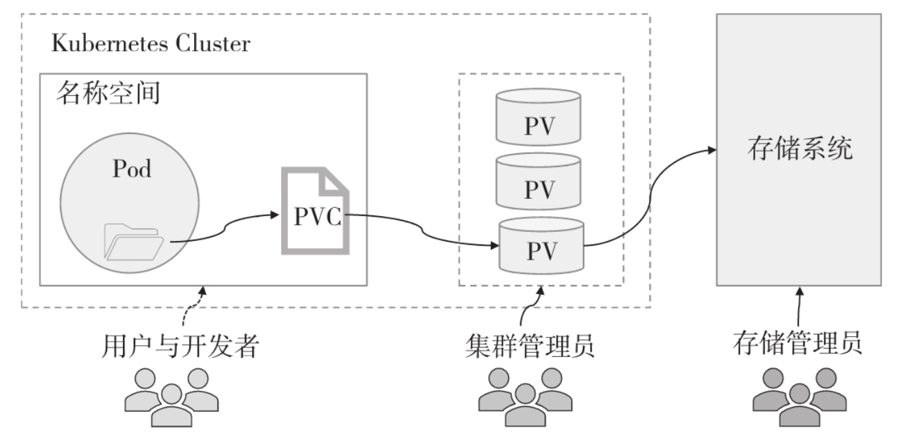

前提：

存储管理员配置各种类型的PV对象Pod、PVC 必须在同一个命名空间。

**用户需要存储资源的时候**：用户根据资源需求创建PVC，由PVC自动匹配(权限、容量)合适的PV对象。

PVC 允许用户按需指定期望的存储特性，并以之为条件，按特定的条件顺序进行PV的过滤。

VolumeMode → LabelSelector → StorageClassName → AccessMode → Size

在Pod内部通过 PVC 将 PV 绑定到当前的空间，进行使用。如果用户不再使用存储资源，解绑 PVC 和 Pod 即可。

**PV和PVC的生命周期**

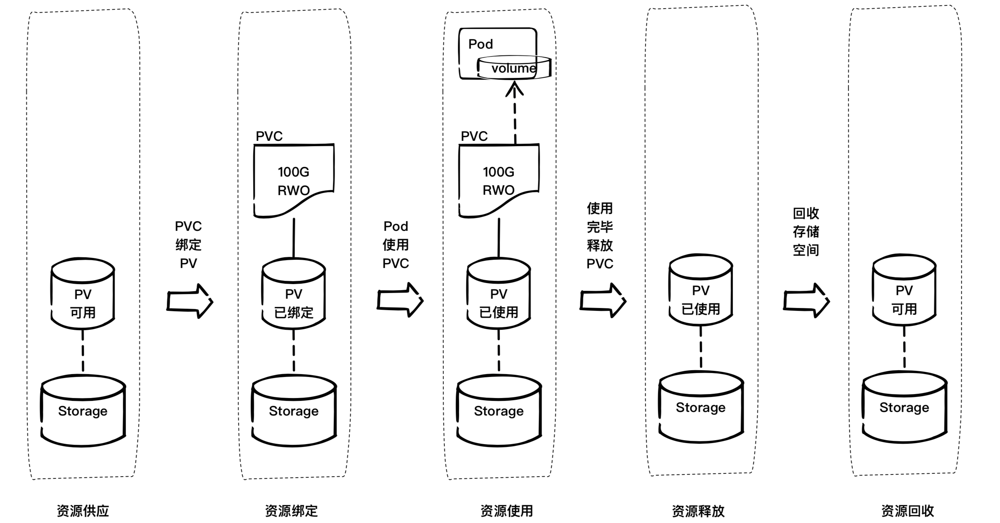

**PV和PVC的配置流程**

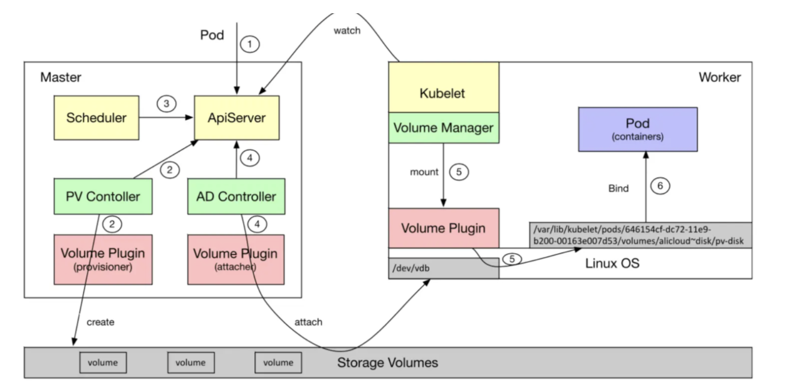

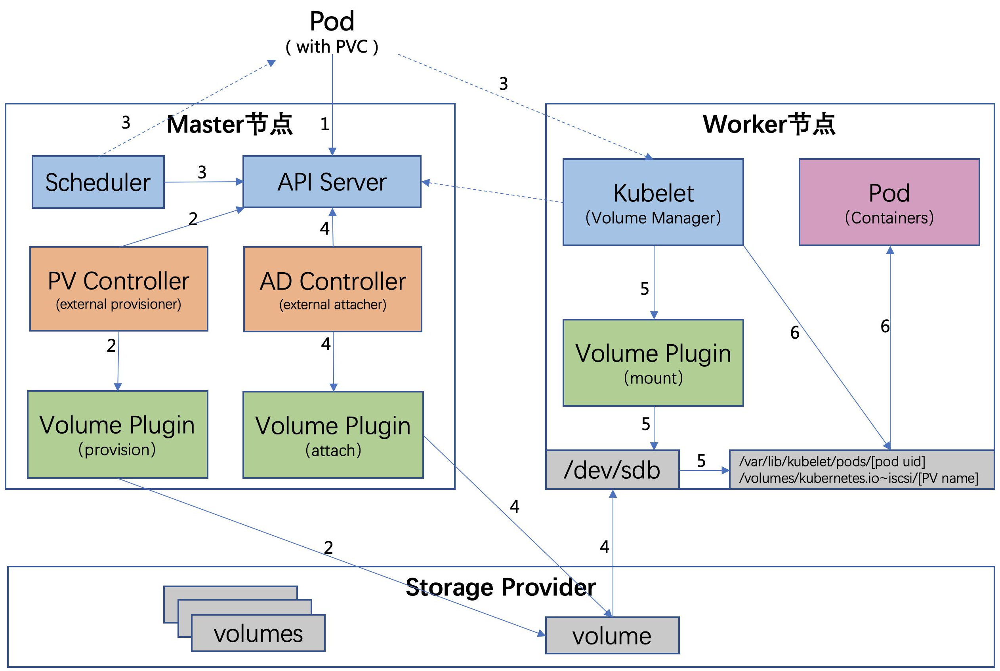

用户创建了一个包含 PVC 的 Pod，该 PVC 要求使用动态存储卷Scheduler 根据 Pod 配置、节点状态、PV 配置等信息，把 Pod 调度到一个合适的 Worker 节点上PV 控制器 watch 到该 Pod 使用的 PVC 处于 Pending 状态，于是调用 Volume Plugin(in-tree)创建存储卷，并创建 PV 对象(out-of-tree 由 External Provisioner 来处理)AD 控制器发现 Pod 和 PVC 处于待挂接状态，于是调用 Volume Plugin 挂接存储设备到目标Worker 节点上在 Worker 节点上，Kubelet 中的 Volume Manager 等待存储设备挂接完成，并通过 Volume Plugin 将设备挂载到全局目录：/var/lib/kubelet/pods/[pod uid]/volumes/kubernetes.io~iscsi/[PVname] (以iscsi为例)Kubelet 通过 Docker 启动 Pod 的 Containers，用 bind mount 方式将已挂载到本地全局目录的卷映射到容器中。

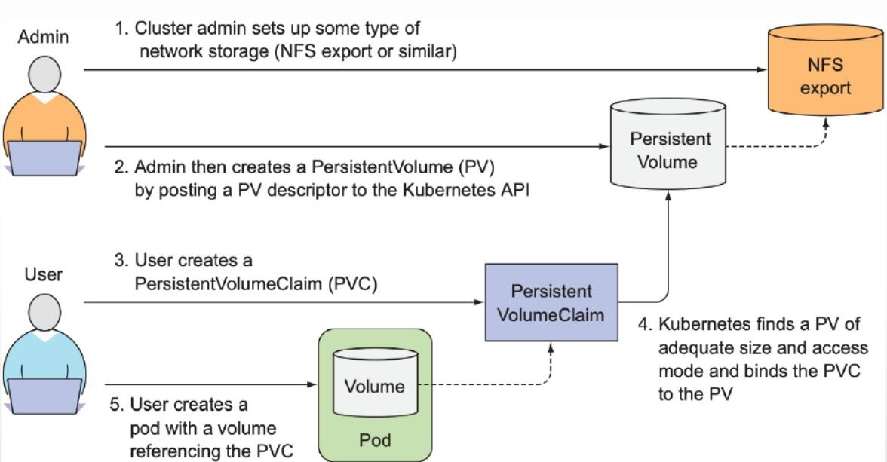

### 1.5.2 PV 和 PVC 管理

#### 1.5.2.1 基础属性

**PV的Provison 置备（创建）方法**

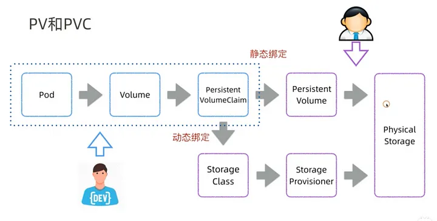

静态：集群管理员预先手动创建一些 PV。它们带有可供群集用户使用的实际存储的细节。动态：集群尝试根据用户请求动态地自动完成创建卷。此配置基于 StorageClasses：PVC 必须请求存储类，并且管理员必须预先创建并配置该 StorageClasses才能进行动态创建。声明该类为空字符串 ""， 可以有效地禁用其动态配置。

**PV 属性**
```text
#PV 作为存储资源，主要包括存储能力、访问模式、存储类型、回收策略等关键信息,注意:PV的名称不支持
大写
#https://kubernetes.io/zh-cn/docs/concepts/storage/persistent-volumes/#persistent-volumes
kubectl explain pv.spec
capacity      #定义pv使用多大空间资源，仅限于空间大小的设定
accessModes   #访问模式,支持单路读写，多路读写，多路只读，单Pod读写，可同时支持多种
模式
volumeMode    #文件系统或块设备,默认文件系统
```


mountOptions  #挂载选项,比如:["ro", "soft"] persistentVolumeReclaimPolicy   #资源回收策略，主要三种Retain、Delete、Recycle(废弃)存储类型       #每种存储类型的样式的属性名称都是专有的。storageClassName  #存储类的名称,如果配置必须和PVC的storageClassName相同才能绑定

```yaml
#注意:PersistentVolume 对象的名称必须是合法的 DNS 子域名.

#示例
apiVersion: v1
kind: PersistentVolume
metadata:
name: pv0003
labels:
release: "stable"  #便签可以支持匹配过滤PVC
spec:
capacity:
storage: 5Gi
volumeMode: Filesystem
accessModes:
- ReadWriteOnce
persistentVolumeReclaimPolicy: Recycle
storageClassName: slow   #必须和PVC相同
mountOptions:
- hard
- nfsvers=4.1
nfs:
path: /tmp
server: 172.17.0.2
```

**PVC 属性**
```text
#PVC属性信息,与所有空间都能使用的PV不一样，PVC是属于名称空间级别的资源对象，即只有特定的资源才
能使用
#https://kubernetes.io/zh-cn/docs/concepts/storage/persistent-volumes/#persistentvolumeclaims
#定义PVC
kubectl  explain pvc.spec
accessModes             #访问模式   *
resources               #资源大小等限制    *
volumeMode              #后端存储卷的模式,文件系统或块,默认为文件系统
volumeName              #指定绑定的卷(pv)的名称
```


#Pod引用PVC#kubectl explain deployment.spec.template.spec.volumes.persistentVolumeClaim#kubectl explain pods.spec.volumes.persistentVolumeClaim claimName   #定义pvc的名称,PersistentVolumeClaim 对象的名称必须是合法的 DNS 子域名. readOnly    #设定pvc是否只读 storageClassName        #存储类的名称,如果配置必须和PV的storageClassName相同才能绑定 selector               #标签选择器实现选择绑定PV#合法的 DNS 子域名.

<https://kubernetes.io/zh-cn/docs/concepts/overview/working-with->

objects/names/#dns-subdomain-names


#storageClassName类 PVC可以通过为 storageClassName 属性设置 StorageClass 的名称来请求特定的存储类。只有所请求的类的PV的storageClassName 值与 PVC 设置相同，才能绑定


#selector 选择算符 PVC可以设置标签选择算符,来进一步过滤卷集合。只有标签与选择算符相匹配的卷能够绑定到PVC上。选择算符包含两个字段：matchLabels - 卷必须包含带有此值的标签 matchExpressions - 通过设定键（key）、值列表和操作符（operator） 来构造的需求。合法的操作符有 In、NotIn、Exists 和 DoesNotExist。来自 matchLabels 和 matchExpressions 的所有需求都按逻辑与的方式组合在一起。 这些需求都必须被满足才被视为匹配。

```yaml
#示例
apiVersion: v1
kind: PersistentVolumeClaim
metadata:
name: myclaim
namespace: demo
spec:
accessModes:
- ReadWriteOnce
volumeMode: Filesystem
resources:
requests:
storage: 8Gi
storageClassName: slow  #必须和PV相同
selector:
matchLabels:
release: "stable"
matchExpressions:
- {key: environment, operator: In, values: [dev]}
```

#### 1.5.2.2 属性进阶

##### 1.5.2.2.1 PV 和 PVC 状态

PV 有生命周期,自然也有自己特定的状态

注意：这个过程是单向过程，不能逆向

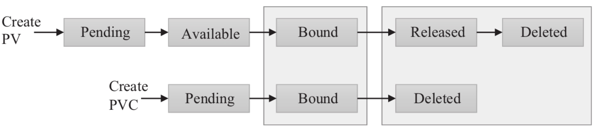

状态解析

Availabled空闲状态，表示PV没有被其他PVC对象使用。

Bound绑定状态，表示PV已经被其他PVC对象使用。

Released未回收状态，表示PVC已经被删除了，但是资源还没有被回收。

Faild资源回收失败

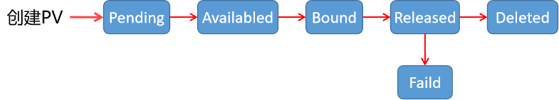

通过 kubectl patch 命令可以直接修改 PV 的状态，使其从 Released 状态变为 Available 状态。
```text
kubectl patch persistentvolume <pv-name> -p '{"spec":{"claimRef": null}}'
```

##### 1.5.2.2.2 AccessMode 访问模式

AccessModes 是用来对 PV 进行访问模式的设置，用于描述用户应用对存储资源的访问权限，访问权限包括：
```text
https://kubernetes.io/zh-cn/docs/concepts/storage/persistent-volumes/#access-modes
```

类型解析

单节点读写,卷可以被一个节点以读写方式挂载。

ReadWriteOnce（RWO）

ReadWriteOnce 访问模式仍然可以在同一节点上运行的多个 Pod访问该卷即不支持并行(非并发)写入。

ReadOnlyMany（ROX）多节点只读

ReadWriteMany（RWX）多节点读写

卷可以被单个 Pod 以读写方式挂载。 如果你想确保整个集群中只有一个 Pod 可以读取或写入该 PVC， 请使用。

ReadWriteOncePod(RWOP)

ReadWriteOncePod 访问模式。单Pod读写,v1.22版以后才支持,v1.29版stable可用。

注意：

不同的后端存储支持不同的访问模式，所以要根据后端存储类型来设置访问模式。一些 PV 可能支持多种访问模式，但是在挂载的时候只能使用一种访问模式，多种访问模式是不会生效的。

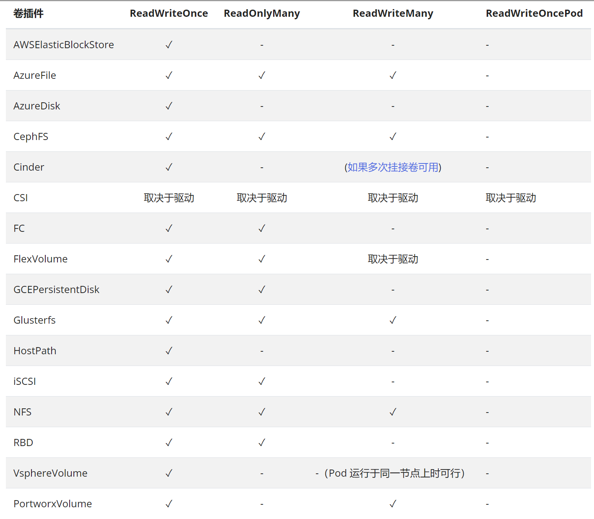

##### 1.5.2.2.3 PV 资源回收策略

**PV 三种资源回收策略**

当 Pod 结束 volume 后可以回收资源对象并删除PVC，而PVC和PV绑定关系就不存在了，当绑定关系不存在后对应的PV需要怎么处理，而PersistentVolume 的回收策略告诉集群在存储卷声明释放后应如何处理该PV卷。目前，volume 的处理策略有保留、回收或删除。

当PVC被删除后, Kubernetes 会自动生成一个recycler-for-<PV_NAME>的Pod实现回收工作,但Retain策略除外。

回收完成后,PV的状态变为Release,如果其它处于Pending状态的PVC和此PV条件匹配,则可以再次此PV进行绑定。

**类型解析**

**Retain**：删除 PVC 后，保留相应的 PV 和存储数据，后续需人工清理。手动创建的 PV 通常默认采用此策略，也一般推荐在需要保留数据时使用。

**Delete**：删除 PVC 时，同时删除相关 PV 和底层数据。存储系统须支持删除功能。该策略可自动、快速地回收资源，动态存储通常默认采用此方式。

**Recycle**：此策略已废弃。它保留 PV，但清空存储数据，原本仅支持 NFS 和 hostPath。

注意：目前只有 NFS 和 HostPath 支持 Recycle 策略，其他支持 Delete 策略。
```bash
[root@master1 ~]#kubectl explain pv.spec
```


.....#新版：提示已废弃 persistentVolumeReclaimPolicy <string>persistentVolumeReclaimPolicy defines what happens to a persistent volume when released from its claim. Valid options are Retain (default for manually created PersistentVolumes), Delete (default for dynamically provisioned PersistentVolumes), and Recycle (deprecated). Recycle must be supported by the volume plugin underlying this PersistentVolume. More info:

<https://kubernetes.io/docs/concepts/storage/persistent-volumes#reclaiming>


#旧版 persistentVolumeReclaimPolicy    <string>persistentVolumeReclaimPolicy defines what happens to a persistent volume when released from its claim. Valid options are Retain (default for manually created PersistentVolumes), Delete (default for dynamically provisioned PersistentVolumes), and Recycle (deprecated). Recycle must be supported by the volume plugin underlying this PersistentVolume. More info:

<https://kubernetes.io/docs/concepts/storage/persistent-volumes#reclaiming>


Possible enum values:- `"Delete"` means the volume will be deleted from Kubernetes on release from its claim. The volume plugin must support Deletion.- `"Recycle"` means the volume will be recycled back into the pool of unbound persistent volumes on release from its claim. The volume plugin must support Recycling.- `"Retain"` means the volume will be left in its current phase (Released) for manual reclamation by the administrator. The default policy is Retain.


#### 1.5.2.3 PV 和 PVC 使用流程

实现方法

准备存储

**基于存储创建PV**

根据业务需求创建PVC: PVC会根据capacity和accessModes及其它条件自动找到相匹配的PV进行绑定,一个PVC对应一个PV。

**创建Pod**

在Pod中的 volumes 指定调用上面创建的 PVC 名称在Pod中的容器中的volumeMounts指定PVC挂载容器内的目录路径。

#### 1.5.2.4 故障排错

创建PVC之后，一直绑定不上PV,导致PVC一直处于Pending状态,主要原因如下:

PVC 的空间申请大小大于 PV 的大小PVC 的 accessModes 和 PV 的不一致PVC 的 storageClassName 和 PV的不一致

创建挂载了PVC的Pod之后一直处于Pending状态主要原因如下：

PVC 没有创建PVC 创建失败PVC 和 Pod 不在同一个Namespace。

### 1.5.3 案例

#### 1.5.3.1 PV 和 PVC 使用

范例: 以NFS类型创建一个3G大小的存储资源对象PV
```yaml
#准备NFS共享存储
[root@master1 ~]#mkdir -p /nfsdata/www
[root@master1 ~]#apt update &&apt -y install nfs-server

[root@master1 ~]#echo "/nfsdata *(rw,no_root_squash)" >> /etc/exports
[root@master1 ~]#exportfs  -r
[root@master1 ~]#exportfs  -v
/nfsdata        <world>
(rw,wdelay,no_root_squash,no_subtree_check,sec=sys,rw,secure,no_root_squash,no_a
ll_squash)

#在所有worker节点安装nfs软件
[root@node1 ~]#apt -y install nfs-common

#准备PV,定制一个具体空间大小的存储对象
[root@master1 ~]#cat storage-pv.yaml
apiVersion: v1
kind: PersistentVolume
metadata:
name: pv-test   #注意:不支持大写字母
spec:
capacity:
storage: 3Gi
accessModes:
- ReadWriteOnce
- ReadWriteMany
- ReadOnlyMany
nfs:
path: /nfsdata/www
server: nfs.bowen.org #需要宿主机节点能解析此域名
```


#如果该pv的使用方式支持多个，可以使用格式：accessModes:["ReadWriteMany","ReadWriteOnce"]#如果nfs提供的目录空间个数多的话，可以同样的方式写多个。Pv的资源对象类型：PersistentVolume 存储空间大小设定：capacity 存储空间的访问模式：accessModes ReadWriteOnce     #该volume只能被单个节点以读写的方式映射 ReadOnlyMany      #该volume可以被多个节点以只读方式映射 ReadWriteMany     #该volume只能被多个节点以读写的方式映射#可以指定回收策略：persistentVolumeReclaimPolicy: Recycle

```html
[root@master1 ~]#kubectl apply  -f storage-pv.yaml
persistentvolume/pv-test created
[root@master1 ~]#kubectl get pv
NAME      CAPACITY   ACCESS MODES   RECLAIM POLICY   STATUS      CLAIM
STORAGECLASS   REASON   AGE
pv-test   3Gi        RWO,ROX,RWX    Retain           Available
7s
#结果显示：虽然我们在创建pv的时候没有指定回收策略，而其策略自动帮我们配置了Retain

#准备PVC,定义一个资源对象，请求空间1Gi
[root@master1 ~]#cat storage-pvc.yaml
apiVersion: v1
kind: PersistentVolumeClaim
metadata:
name: pvc-test
spec:
accessModes:
- ReadOnlyMany
resources:
requests:
storage: 1Gi
#注意：请求的资源大小必须在 pv资源的范围内。

[root@master1 ~]#kubectl apply  -f storage-pvc.yaml

#结果显示：一旦启动pvc会自动去搜寻合适的可用的pv，然后绑定在一起
#如果pvc找不到对应的pv资源，状态会一直处于pending
[root@master1 ~]#kubectl get pv
NAME      CAPACITY   ACCESS MODES   RECLAIM POLICY   STATUS   CLAIM
STORAGECLASS   REASON   AGE
pv-test   3Gi        RWO,ROX,RWX    Retain           Bound    default/pvc-test
28s

[root@master1 ~]#kubectl get pvc
NAME       STATUS   VOLUME    CAPACITY   ACCESS MODES   STORAGECLASS   AGE
pvc-test   Bound    pv-test   3Gi        RWO                           5s

#准备pod
[root@master1 ~]#cat storage-nginx-pvc.yaml
apiVersion: v1
kind: Pod
metadata:
name: pod-nginx
spec:
volumes:
- name: volume-nginx
persistentVolumeClaim:
claimName: pvc-test
containers:
- name: pvc-nginx-container
image: registry.cn-beijing.aliyuncs.com/bowen/nginx:1.20.0
volumeMounts:
- name: volume-nginx
mountPath: "/usr/share/nginx/html"
#属性解析：
#spec.volumes 是针对pod资源申请的存储资源来说的，这里使用的主要是pvc的方式。
#spec.containers.volumeMounts 是针对pod资源对申请的存储资源的信息。将pvc挂载的容器目录

[root@master1 ~]#kubectl apply  -f storage-nginx-pvc.yaml

[root@master1 ~]#kubectl get pod -o wide
NAME        READY   STATUS    RESTARTS   AGE   IP            NODE
NOMINATED NODE   READINESS GATES
pod-nginx   1/1     Running   0          20s   172.16.3.62   node1.bowen.org
<none>           <none>

#默认页面无法访问,如果不准备首页的话，会导致 403 报错
[root@master1 ~]#curl 172.16.3.62
<html>
<head><title>403 Forbidden</title></head>
<body>
<center><h1>403 Forbidden</h1></center>
<hr><center>nginx/1.20.0</center>
</body>
</html>

#添加网页文件
[root@master1 ~]#echo PV Page > /nfsdata/index.html
[root@master1 ~]#curl 172.16.3.62
PV Page

#注意:删除时,要按顺序删除,先删除应用pod,再删除pvc,最后删除pv,否则会出现卡死现象

#删除pod
[root@master1 ~]#kubectl delete -f storage-nginx-pvc.yaml
#删除PVC
[root@master1 ~]#kubectl delete -f storage-pvc.yaml

[root@master1 ~]#kubectl get pvc
No resources found in default namespace.

#显示PV状态Released
[root@master1 ~]#kubectl get pv
NAME      CAPACITY   ACCESS MODES   RECLAIM POLICY   STATUS     CLAIM
STORAGECLASS   REASON   AGE
pv-test   3Gi        RWO            Retain           Released   default/pvc-test
41s

#最后删除PV
[root@master1 ~]#kubectl delete -f storage-pv.yaml

[root@master1 ~]#kubectl get pv
No resources found
```

范例: 创建使用PVC的deployment实现多个Pod共享数据
```yaml
[root@master1 ~]#kubectl apply  -f storage-pv.yaml
[root@master1 ~]#kubectl apply  -f storage-pvc.yaml

[root@master1 ~]#kubectl get pv
NAME      CAPACITY   ACCESS MODES   RECLAIM POLICY   STATUS   CLAIM
STORAGECLASS   REASON   AGE
pv-test   3Gi        RWO            Retain           Bound    default/pvc-test
7m58s
[root@master1 ~]#kubectl get pvc
NAME       STATUS   VOLUME    CAPACITY   ACCESS MODES   STORAGECLASS   AGE
pvc-test   Bound    pv-test   3Gi        RWO                           7m58s

[root@master1 ~]#cat storage-deployment-nginx-pvc.yaml
apiVersion: apps/v1
kind: Deployment

metadata:
name: deployment-nginx-pvc
spec:
replicas: 3
selector:
matchLabels:
app: nginx-pvc
template:
metadata:
labels:
app: nginx-pvc
spec:
volumes:
- name: volume-nginx
persistentVolumeClaim:
claimName: pvc-test
containers:
- name: nginx-pvc
image: registry.cn-beijing.aliyuncs.com/bowen/nginx:1.20.0
volumeMounts:
- name: volume-nginx
mountPath: "/usr/share/nginx/html"

---
apiVersion: v1
kind: Service
metadata:
name: service-nginx-pvc
spec:
ports:
- name: http
port: 80
protocol: TCP
targetPort: 80
selector:
app: nginx-pvc
type: LoadBalancer

#创建deployment
[root@master1 ~]#kubectl apply  -f storage-deployment-nginx-pvc.yaml

[root@master1 ~]#kubectl get pod -o wide
NAME                                    READY   STATUS    RESTARTS   AGE   IP
NODE               NOMINATED NODE   READINESS GATES
deployment-nginx-pvc-777d57f5f4-n7hp4   1/1     Running   0          7s
172.16.4.54   node2.bowen.org   <none>           <none>
deployment-nginx-pvc-777d57f5f4-p7nb5   1/1     Running   0          7s
172.16.3.64   node1.bowen.org   <none>           <none>
deployment-nginx-pvc-777d57f5f4-pb9lt   1/1     Running   0          7s
172.16.3.65   node1.bowen.org   <none>           <none>

[root@master1 ~]#kubectl get svc
NAME                TYPE           CLUSTER-IP       EXTERNAL-IP   PORT(S)
AGE
service-nginx-pvc   LoadBalancer   10.101.174.54    10.0.0.10     80:32307/TCP
5m57s

#查看多个Pod资源实现共享
[root@master1 ~]#curl 172.16.4.54
PV Page
[root@master1 ~]#curl 172.16.3.64
PV Page
[root@master1 ~]#curl 172.16.3.65
PV Page
```

范例: PVC自动绑定相匹配的PV,PVC和 PV 是自动关联的，而且会匹配容量和权限
```yaml
[root@master1 ~]#mkdir -p /nfsdata/data{1..3}
[root@master1 ~]#cat /etc/exports
/nfsdata *(rw,no_root_squash)

#PV清单文件
[root@master1 ~]#cat storage-multi-pv.yaml
apiVersion: v1
kind: PersistentVolume
metadata:
name: pv-nfs-1
spec:
capacity:
storage: 5Gi
volumeMode: Filesystem
accessModes:
- ReadWriteMany
persistentVolumeReclaimPolicy: Retain
nfs:
path:  "/nfsdata/data1"
server: nfs.bowen.org
---
apiVersion: v1
kind: PersistentVolume
metadata:
name: pv-nfs-2
spec:
#storageClassName: manual  #用于分类
capacity:
storage: 5Gi
volumeMode: Filesystem
accessModes:
- ReadOnlyMany
persistentVolumeReclaimPolicy: Retain
nfs:
path:  "/nfsdata/data2"
server: nfs.bowen.org
---
apiVersion: v1
kind: PersistentVolume
metadata:
name: pv-nfs-3
spec:
capacity:
storage: 1Gi
volumeMode: Filesystem
accessModes:

- ReadWriteOnce
persistentVolumeReclaimPolicy: Retain
nfs:
path:  "/nfsdata/data3"
server: nfs.bowen.org

[root@master1 ~]#kubectl apply -f storage-multi-pv.yaml

[root@master1 ~]#kubectl get pv
NAME       CAPACITY   ACCESS MODES   RECLAIM POLICY   STATUS      CLAIM
STORAGECLASS   REASON   AGE
pv-nfs-1   5Gi        RWX            Retain           Available
3s
pv-nfs-2   5Gi        ROX            Retain           Available
3s
pv-nfs-3   1Gi        RWO            Retain           Available
3s

#PVC清单文件
[root@master1 ~]#cat storage-multi-pvc.yaml
apiVersion: v1
kind: PersistentVolumeClaim
metadata:
name: pvc-demo-1
namespace: default
spec:
#storageClassName: manual  #用于分类，PVC和PV必须相同才能绑定
accessModes: ["ReadWriteMany"]
volumeMode: Filesystem
resources:
requests:
storage: 3Gi
limits:
storage: 10Gi

[root@master1 ~]#kubectl  apply  -f storage-multi-pvc.yaml

[root@master1 ~]#kubectl get pvc
NAME         STATUS   VOLUME     CAPACITY   ACCESS MODES   STORAGECLASS   AGE
pvc-demo-1   Bound    pv-nfs-1   5Gi        RWX                           5m50s

#自动绑定PVC至容器和权限都匹配的PV
[root@master1 ~]#kubectl get pv
NAME       CAPACITY   ACCESS MODES   RECLAIM POLICY   STATUS      CLAIM
STORAGECLASS   REASON   AGE
pv-nfs-1   5Gi        RWX            Retain           Bound       default/pvc-
demo-1                           2m36s
pv-nfs-2   5Gi        ROX            Retain           Available
2m36s
pv-nfs-3   1Gi        RWO            Retain           Available
2m36s
```

案例: 运行一个单实例有状态应用MySQL
```yaml
https://kubernetes.io/zh-cn/docs/tasks/run-application/run-single-instance-stateful-application/

#准备NFS共享存储，此目录必须提前创建
[root@master1 ~]#mkdir -p /nfsdata/mysql
[root@master1 ~]#apt -y install nfs-server

[root@master1 ~]#echo "/nfsdata/mysql *(rw,no_root_squash)" >> /etc/exports
[root@master1 ~]#exportfs  -r
[root@master1 ~]#exportfs  -v
/nfsdata/mysql      <world>
(rw,wdelay,no_root_squash,no_subtree_check,sec=sys,rw,secure,no_root_squash,no_a
ll_squash)

#在所有worker节点安装nfs软件
[root@node1 ~]#apt -y install nfs-common

[root@master1 ~]#cat storage-mysql-pv-pvc.yaml
apiVersion: v1
kind: PersistentVolume
metadata:
name: mysql-pv-volume
labels:
type: local
spec:
storageClassName: manual  #用于分类
capacity:
storage: 20Gi
accessModes:
- ReadWriteOnce
nfs:
server: nfs.bowen.org    #注意:需要宿主机节点能解析此域名,而非Pod解析
path: /nfsdata/mysql
#hostPath:
#  path: "/mnt/data"      #所在主机是由Pod调度的目标节点决定

---
apiVersion: v1
kind: PersistentVolumeClaim
metadata:
name: mysql-pv-claim
spec:
storageClassName: manual #用于分类,必须和PV的属性相同才能绑定
accessModes:
- ReadWriteOnce
resources:
requests:
storage: 20Gi

---
apiVersion: v1
kind: Service
metadata:
name: mysql
spec:
ports:

- port: 3306
selector:
app: mysql
clusterIP: None
---
apiVersion: apps/v1
kind: Deployment
metadata:
name: mysql
spec:
selector:
matchLabels:
app: mysql
strategy:
type: Recreate
template:
metadata:
labels:
app: mysql
spec:
containers:
- image: registry.cn-beijing.aliyuncs.com/bowen/mysql:8.0.29-oracle
name: mysql
env:
# 在实际中使用 secret
- name: MYSQL_ROOT_PASSWORD
value: "123456"
ports:
- containerPort: 3306
name: mysql
volumeMounts:
- name: mysql-persistent-storage
mountPath: /var/lib/mysql
volumes:
- name: mysql-persistent-storage
persistentVolumeClaim:
claimName: mysql-pv-claim

#准备名称空间
[root@master1 ~]#kubectl create ns demo
namespace/demo created

[root@master1 ~]#kubectl apply -f storage-mysql-pv-pvc.yaml  -n demo
persistentvolume/mysql-pv-volume created
persistentvolumeclaim/mysql-pv-claim created
service/mysql created
deployment.apps/mysql created
```
```bash
[root@master1 ~]#kubectl get all -n demo
NAME                         READY   STATUS    RESTARTS   AGE
pod/mysql-55dd4c6c84-q5ktt   1/1     Running   0          47s

NAME            TYPE        CLUSTER-IP   EXTERNAL-IP   PORT(S)    AGE
service/mysql   ClusterIP   None         <none>        3306/TCP   47s

NAME                    READY   UP-TO-DATE   AVAILABLE   AGE
deployment.apps/mysql   1/1     1            1           47s

NAME                               DESIRED   CURRENT   READY   AGE
replicaset.apps/mysql-55dd4c6c84   1         1         1       47s

[root@master1 ~]#kubectl get pv,pvc -n demo
NAME                               CAPACITY   ACCESS MODES   RECLAIM POLICY
STATUS   CLAIM                 STORAGECLASS   REASON   AGE
persistentvolume/mysql-pv-volume   20Gi       RWO            Retain
Bound    demo/mysql-pv-claim   manual                  3m8s

NAME                                   STATUS   VOLUME            CAPACITY
ACCESS MODES   STORAGECLASS   AGE
persistentvolumeclaim/mysql-pv-claim   Bound    mysql-pv-volume   20Gi       RWO
manual         3m8s

#查看Pod运行在node2节点
[root@master1 ~]#kubectl get pod -n demo -o wide
NAME                     READY   STATUS    RESTARTS   AGE   IP            NODE
NOMINATED NODE   READINESS GATES
mysql-55dd4c6c84-q5ktt   1/1     Running   0          44s   10.244.2.59
node2.bowen.org   <none>           <none>

#在node2节点查看到目录和数据都会自动创建和生成
[root@node2 ~]#ls /mnt/data
auto.cnf        ca-key.pem       '#ib_16384_0.dblwr'   ib_logfile0     mysql
public_key.pem    undo_001
binlog.000001   ca.pem           '#ib_16384_1.dblwr'   ib_logfile1
mysql.ibd            server-cert.pem   undo_002
binlog.000002   client-cert.pem   ib_buffer_pool       ibtmp1
performance_schema   server-key.pem
binlog.index    client-key.pem    ibdata1             '#innodb_temp'
private_key.pem      sys

#测试访问
[root@master1 ~]#kubectl exec -n demo -it  mysql-55dd4c6c84-q5ktt -- mysql -
hmysql -uroot -p123456 -e "status"
mysql: [Warning] Using a password on the command line interface can be insecure.
--------------
mysql  Ver 8.0.27 for Linux on x86_64 (MySQL Community Server - GPL)
```


Connection id:      12 Current database: Current user:       root@localhost SSL:            Not in use Current pager:      stdout Using outfile:      ''Using delimiter:    ; Server version:     8.0.27 MySQL Community Server - GPL Protocol version:   10 Connection:     Localhost via UNIX socket Server characterset:    utf8mb4 Db     characterset:    utf8mb4 Client characterset:    latin1 Conn.  characterset:    latin1 UNIX socket:        /var/run/mysqld/mysqld.sock Binary data as:     Hexadecimal Uptime:         6 min 20 sec

```bash
Threads: 2  Questions: 10  Slow queries: 0  Opens: 134  Flush tables: 3  Open
tables: 53  Queries per second avg: 0.026
--------------

#清理环境
[root@master1 ~]#kubectl delete -f storage-mysql-pv-pvc.yaml -n demo
```

#### 1.5.3.2 强制删除

生产中，对于存储资源的释放，最好按照流程来，即先清空应用，然后再清空pvc，但是生产中，经常遇到应用资源意外终止或者其他情况，导致对应的pvc资源没有使用，而且也没有清空。有多种方式解决，最常用的一种方式就是，在所有的应用pod中增加一个prestop的钩子函数，从而让我们的应用资源合理的清空。而对于特殊的异常情况，还有另外一种策略，即强制清空,但是一般不推荐使用。

范例:
```bash
#在工作中，由于多方面的原因，会导致我们创建好的pv资源偶尔出现无法删除现象，异常效果：
[root@master1 ~]#kubectl get pv
NAME       CAPACITY   ACCESS MODES   RECLAIM POLICY   STATUS      CLAIM
STORAGECLASS   REASON   AGE
pv-nfs-1   5Gi        RWX            Retain           Bound       default/pvc-
demo-1                           2m36s
pv-nfs-2   5Gi        ROX            Retain           Available
2m36s
pv-nfs-3   1Gi        RWO            Retain           Available
2m36s

[root@master1 ~]#kubectl get pvc
NAME         STATUS   VOLUME     CAPACITY   ACCESS MODES   STORAGECLASS   AGE
pvc-demo-1   Bound    pv-nfs-1   5Gi        RWX                           5m50s

#正常删除
[root@master1 ~]#kubectl delete -f storage-multi-pv.yaml
persistentvolume "pv-nfs-1" deleted
persistentvolume "pv-nfs-2" deleted
persistentvolume "pv-nfs-3" deleted
#它会一直处于这种卡死状态

#显示正在使用PV无法删除
[root@master1 ~]#kubectl get pv
NAME       CAPACITY   ACCESS MODES   RECLAIM POLICY   STATUS        CLAIM
STORAGECLASS   REASON   AGE
pv-nfs-1   5Gi        RWX            Retain           Terminating   default/pvc-
demo-1                           8m31s

#新一个窗口执行强制删除
[root@master1 ~]#kubectl delete pv pv-nfs-1 --grace-period=0 --force=true
#仍然卡住不动

#对于这种无论何种方法都无法删除的时候，我们可以通过修改配置属性的方式，从记录中删除该信息
[root@master1 ~]#kubectl patch pv pv-nfs-1 -p '{"metadata":{"finalizers":null}}'

persistentvolume/pv-nfs-1 patched

#finalizers属性：
[root@master1 ~]#kubectl explain pv.metadata.finalizers
KIND:     PersistentVolume
VERSION:  v1

FIELD:    finalizers <[]string>
```


DESCRIPTION: Must be empty before the object is deleted from the registry. Each entry is an identifier for the responsible component that will remove the entry from the list. If the deletionTimestamp of the object is non-nil, entries in this list can only be removed. Finalizers may be processed and removed in any order. Order is NOT enforced because it introduces significant risk of stuck finalizers. finalizers is a shared field, any actor with permission can reorder it. If the finalizer list is processed in order, then this can lead to a situation in which the component responsible for the first finalizer in the list is waiting for a signal (field value, external system, or other) produced by a component responsible for a finalizer later in the list, resulting in a deadlock. Without enforced ordering finalizers are free to order amongst themselves and are not vulnerable to ordering changes in the list.

```bash
#该属性的含义就是，当确定一个pv资源无用且内容为空的时候，可以从注册表中删除该信息

#确认删除
[root@master1 ~]#kubectl get pv
No resources found

#PVC状态显示为Lost
[root@master1 ~]#kubectl get pvc
NAME         STATUS   VOLUME     CAPACITY   ACCESS MODES   STORAGECLASS   AGE
pvc-demo-1   Lost     pv-nfs-1   0                                     17m

#如果有Pod使用PVC,先删除Pod,再删除PVC,否则会卡住等待
[root@master1 ~]#kubectl delete pvc pvc-demo-1
```

#### 1.5.3.3 subPath


- <https://kubernetes.io/docs/concepts/storage/volumes/#using-subpath>
- <https://kubernetes.io/zh-cn/docs/concepts/storage/volumes/#using-subpath>


上面范例中的nginx首页存放在/nfsdata的一级目录中，但是生产中，一个NFS共享资源通常是给多个应用来使用的，比如需要定制每个app的分配单独的子目录存放首页资源，但是如果采用PV实现定制的方式，就需要多个PV,此方式有些太繁琐了。可以通过subPath实现针对不同的应用对应同一个PVC下不同子目录的挂载。volumeMounts.subPath 属性可用于指定所引用的卷内的子路径，而不是其根路径。

**属性解析**
```text
#可以直接在容器内部的属性直接实现，而无需对pv和pvc进行变动，这个属性如下：
kubectl explain deployment.spec.template.spec.containers.volumeMounts
subPath <string>  Path within the volume from which the container's volume should
be mounted. Defaults to "" (volume's root).
#属性解析：
#subPath的属性主要的目的是设置数据卷的源地址，如果不设置，表示是源地址的根目录,如果设置，则表示
是源地址的子目录
```

下面例子展示了如何配置某包含 LAMP 堆栈（Linux Apache MySQL PHP）的 Pod 使用同一共享卷。此示例中的 subPath 配置不建议在生产环境中使用。 PHP 应用的代码和相关数据映射到卷的 html 文件夹，MySQL 数据库存储在卷的 mysql 文件夹中：
```yaml
#https://kubernetes.io/zh-cn/docs/concepts/storage/volumes/#using-subpath
apiVersion: v1
kind: Pod
metadata:
name: my-lamp-site
spec:
containers:
- name: mysql
image: mysql
env:
- name: MYSQL_ROOT_PASSWORD
value: "rootpasswd"
volumeMounts:
- mountPath: /var/lib/mysql
name: site-data
subPath: mysql
- name: php
image: php:7.0-apache
volumeMounts:
- mountPath: /var/www/html
name: site-data
subPath: html
volumes:
- name: site-data
persistentVolumeClaim:
claimName: my-lamp-site-data
```

范例: 同一个PVC下基于不同的subpath子目录存储不同Pod数据
```yaml
#准备NFS共享存储
[root@master1 ~]#mkdir -p /nfsdata/www
[root@master1 ~]#apt update &&apt -y install nfs-server

[root@master1 ~]#echo "/nfsdata *(rw,no_root_squash)" >> /etc/exports
[root@master1 ~]#exportfs  -r
[root@master1 ~]#exportfs  -v
/nfsdata        <world>
(rw,wdelay,no_root_squash,no_subtree_check,sec=sys,rw,secure,no_root_squash,no_a
ll_squash)

#在所有worker节点安装nfs软件
[root@node1 ~]#apt -y install nfs-common

#准备PV,定制一个具体空间大小的存储对象
[root@master1 ~]#cat storage-pv.yaml
apiVersion: v1
kind: PersistentVolume
metadata:
name: pv-test   #注意:不支持大写字母
spec:
capacity:
storage: 3Gi
accessModes:
- ReadWriteOnce
- ReadWriteMany
- ReadOnlyMany
nfs:
path: /nfsdata/www
server: nfs.bowen.org #需要宿主机节点能解析此域名
```


#如果该pv的使用方式支持多个，可以使用格式：accessModes:["ReadWriteMany","ReadWriteOnce"]#如果nfs提供的目录空间个数多的话，可以同样的方式写多个。Pv的资源对象类型：PersistentVolume 存储空间大小设定：capacity 存储空间的访问模式：accessModes ReadWriteOnce     #该volume只能被单个节点以读写的方式映射 ReadOnlyMany      #该volume可以被多个节点以只读方式映射 ReadWriteMany     #该volume只能被多个节点以读写的方式映射#可以指定回收策略：persistentVolumeReclaimPolicy: Recycle

```html
#准备PVC,定义一个资源对象，请求空间1Gi
[root@master1 ~]#cat storage-pvc.yaml
apiVersion: v1
kind: PersistentVolumeClaim
metadata:
name: pvc-test
spec:
accessModes:
- ReadOnlyMany
resources:
requests:
storage: 1Gi
#注意：请求的资源大小必须在 pv资源的范围内。

[root@master1 ~]#kubectl apply -f storage-pv.yaml -f storage-pvc.yaml
#创建清单文件
[root@master1 ~]#cat storage-nginx-pvc-subdir.yaml
apiVersion: v1
kind: Pod
metadata:
name: pod-nginx-1
spec:
volumes:
- name: nginx-volume
persistentVolumeClaim:
claimName: pvc-test
containers:
- name: nginx-pv
image: registry.cn-beijing.aliyuncs.com/bowen/nginx:1.20.0

volumeMounts:
- name: nginx-volume
mountPath: "/usr/share/nginx/html"
subPath: web1
---
apiVersion: v1
kind: Pod
metadata:
name: pod-nginx-2
spec:
volumes:
- name: nginx-volume
persistentVolumeClaim:
claimName: pvc-test
containers:
- name: nginx-flask
image: registry.cn-beijing.aliyuncs.com/bowen/nginx:1.20.0
volumeMounts:
- name: nginx-volume
mountPath: "/usr/share/nginx/html"
subPath: web2

[root@master1 ~]#kubectl apply  -f storage-nginx-pvc-subdir.yaml

#在NFS服务器上自动生成子目录
[root@master1 ~]#tree /nfsdata/
/nfsdata/
├── index.html
├── web1
└── web2

2 directories, 1 file
[root@master1 ~]#kubectl get pod -o wide
NAME          READY   STATUS    RESTARTS   AGE   IP            NODE
NOMINATED NODE   READINESS GATES
pod-nginx-1   1/1     Running   0          20s   172.16.4.51   node2.bowen.org
<none>           <none>
pod-nginx-2   1/1     Running   0          20s   172.16.3.63   node1.bowen.org
<none>           <none>

#默认无法访问页面
[root@master1 ~]#curl 172.16.4.51
<html>
<head><title>403 Forbidden</title></head>
<body>
<center><h1>403 Forbidden</h1></center>
<hr><center>nginx/1.20.0</center>
</body>
</html>
[root@master1 ~]#curl 172.16.3.63
<html>
<head><title>403 Forbidden</title></head>
<body>
<center><h1>403 Forbidden</h1></center>
<hr><center>nginx/1.20.0</center>
</body>
</html>

#创建页面
[root@master1 ~]#echo /nfsdata/web1/index.html > /nfsdata/web1/index.html
[root@master1 ~]#echo /nfsdata/web2/index.html > /nfsdata/web2/index.html

#注意：需要稍等1分钟后，再访问成功
[root@master1 ~]#curl 172.16.4.51
/nfsdata/web1/index.html
[root@master1 ~]#curl 172.16.3.63
/nfsdata/web2/index.html
```



<nav class="article-end" aria-label="章节导航">
  <a href="{{ '/subjects/Kubernetes/20-ingress.html' | relative_url }}">← 上一章：Ingress 流量治理与发布</a>
  <a href="{{ '/subjects/Kubernetes/' | relative_url }}">返回 Kubernetes 目录</a>
  <a href="{{ '/subjects/Kubernetes/22-storageclass-openebs.html' | relative_url }}">下一章：StorageClass 与 OpenEBS →</a>
</nav>
