[← 返回 Kubernetes 目录]({{ '/subjects/Kubernetes/' | relative_url }})



# 22 StorageClass 与 OpenEBS

## 1.6 StorageClass

### 1.6.1 StorageClass

#### 1.6.1.1 说明


- <https://kubernetes.io/zh-cn/docs/concepts/storage/storage-classes/>


对于 PV 和 PVC 的使用过程是比较繁琐的，不仅需要自己定义PV和PVC还需要将其与Pod进行关联，而且对于PV和PVC的适配我们也要做好前提规划，而生产环境中，这种繁琐的事情是有悖于我们使用kubernetes的原则，而且这种方式在很大程度上并不能满足我们的需求，而且不同的应用程序对于存储性能的要求可能也不尽相同，比如读写速度、并发性能等，比如有一个应用需要对存储的并发度要求比较高，而另外一个应用对读写速度又要求比较高，特别是对于 StatefulSet 类型的应用简单的来使用静态的 PV 就很不合适了，这种情况下就需要用到动态 PV。

Kubernetes 引入了一个新的资源对象：StorageClass，通过 StorageClass 的定义，管理员可以将存储资源定义为某种类型的资源，比如存储质量、快速存储、慢速存储等，为了满足不同用户的多种多样的需求，用户根据 StorageClass 的描述就可以非常直观的知道各种存储资源的具体特性了，这样就可以根据应用的特性去申请合适的存储资源了。所以,StorageClass提供了一种资源使用的描述方式，使得管理员能够描述提供的存储的服务质量和等级，进而做出不同级别的存储服务和后端策略。

StorageClass 用于定义不同的存储配置和属性，以供 PersistentVolume（PV）的动态创建和管理。它为开发人员和管理员提供了一种在不同的存储提供商之间抽象出存储配置的方式。在 Kubernetes 中，StorageClass 是集群级别的资源，而不是名称空间级别。尽管 StorageClass 是集群级别的资源，但是可以在不同的命名空间中使用。这意味着可以在一个 Kubernetes 集群的不同命名空间中使用相同的 StorageClass 来创建PersistentVolumeClaim（PVC）并绑定到 PersistentVolume（PV）。

PVC和PV可以属于某个SC，也可以不属于任何SC,PVC只能够在同一个storageClass中过滤PV。

能建立绑定关系的PVC和PV一定满足如下条件：

二者隶属于同个SC二者都不属于任何SC

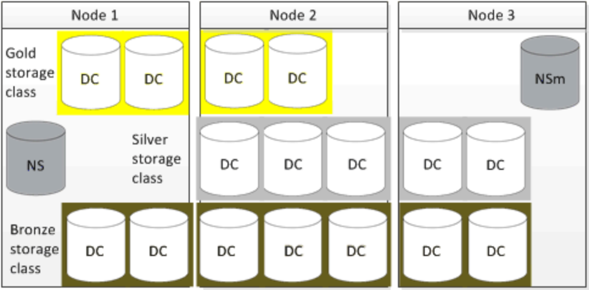

StorageClass这个API对象可以自动创建PV的机制,即:Dynamic Provisioning。

StorageClass对象会定义下面两部分内容:

PV的属性.比如,存储类型,Volume的大小等创建这种PV需要用到的存储插件。

提供以上两个信息,Kubernetes就能够根据用户提交的PVC,找到一个对应的StorageClass,之后Kubernetes就会调用该StorageClass声明的存储插件,进而创建出需要的PV.

要使用 StorageClass，就得安装对应的自动配置程序，比如存储后端使用的是 nfs，那么就需要使用到一个 nfs-client 的自动配置程序，也称为 Provisioner，这个程序使用已经配置好的 nfs 服务器，来自动创建持久卷 PV。

StorageClass API

每个 StorageClass 都包含 provisioner 、parameters 和 reclaimPolicy 字段， 这些字段会在StorageClass 需要动态制备 PersistentVolume 时会使用到。StorageClass 对象的命名很重要，用户使用这个命名来请求生成一个特定的类。 当创建 StorageClass对象时，管理员设置 StorageClass 对象的命名和其他参数。
```yaml
apiVersion: storage.k8s.io/v1
kind: StorageClass
metadata:
annotations:
storageclass.kubernetes.io/is-default-class: "true" #指定默认的SC
name: standard
provisioner: kubernetes.io/aws-ebs  #配备器的提供者
parameters:
type: gp2
reclaimPolicy: Retain
allowVolumeExpansion: true
mountOptions:
- debug
volumeBindingMode: Immediate | WaitForFirstConsumer #延迟绑定，只有Pod准备好，才进行
PV和PVC的绑定

#管理员可以为没有申请绑定到特定 StorageClass 的 PVC 指定一个默认的存储类
apiVersion: v1
kind: PersistentVolumeClaim
metadata:

name: myclaim
spec:
accessModes:
- ReadWriteOnce
volumeMode: Filesystem
resources:
requests:
storage: 8Gi
storageClassName: standard
selector:
matchLabels:
release: "stable"
matchExpressions:
- {key: environment, operator: In, values: [dev]}
```

**存储制备器**

每个 StorageClass 都有一个制备器（Provisioner），用于提供存储驱动，用来决定使用哪个卷插件制备 PV。 该字段必须指定。


- <https://kubernetes.io/zh-cn/docs/concepts/storage/storage-classes/>


卷插件内置制备器配置示例

AzureFile✓Azure File

CephFS--

FC--

FlexVolume--

iSCSI--

NFS-NFS

RBD✓Ceph RBD

VsphereVolume✓vSphere

PortworxVolume✓Portworx Volume

Local-Local

#### 1.6.1.2 案例

范例：基于 StorageClass  属性字段实现PV和PVC的绑定
```yaml
[root@master1 ~]#cat  storage-multi-pv.yaml
apiVersion: v1
kind: PersistentVolume
metadata:
name: pv-nfs-1
spec:
storageClassName: mystorage     #指定 StorageClass 的名称
capacity:
storage: 5Gi

volumeMode: Filesystem
accessModes:
- ReadWriteMany
persistentVolumeReclaimPolicy: Retain
nfs:
path:  "/nfsdata/data1"
server: nfs.bowen.org
---
apiVersion: v1
kind: PersistentVolume
metadata:
name: pv-nfs-2
spec:
capacity:
storage: 5Gi
volumeMode: Filesystem
accessModes:
- ReadWriteMany
persistentVolumeReclaimPolicy: Retain
nfs:
path:  "/nfsdata/data2"
server: nfs.bowen.org
---
apiVersion: v1
kind: PersistentVolume
metadata:
name: pv-nfs-3
spec:
capacity:
storage: 1Gi
volumeMode: Filesystem
accessModes:
- ReadWriteOnce
persistentVolumeReclaimPolicy: Retain
nfs:
path:  "/nfsdata/data3"
server: nfs.bowen.org

[root@master1 ~]#cat   storage-multi-pvc.yaml
apiVersion: v1
kind: PersistentVolumeClaim
metadata:
name: pvc-demo-1
namespace: default
spec:
storageClassName: mystorage                #指定 StorageClass 的名称，和上面的PV要
相同，才能绑定
accessModes: ["ReadWriteMany"]
volumeMode: Filesystem
resources:
requests:
storage: 3Gi
limits:
storage: 10Gi

[root@master1 ~]#kubectl apply -f storage-multi-pv.yaml -f storage-multi-
pvc.yaml

[root@master1 ~]#kubectl get pv,pvc
NAME                        CAPACITY   ACCESS MODES   RECLAIM POLICY   STATUS
CLAIM                STORAGECLASS   VOLUMEATTRIBUTESCLASS   REASON   AGE
persistentvolume/pv-nfs-1   5Gi        RWX            Retain           Bound
default/pvc-demo-1   mystorage           <unset>                          13m
persistentvolume/pv-nfs-2   5Gi        RWX            Retain           Available
<unset>                          13m
persistentvolume/pv-nfs-3   1Gi        RWO            Retain           Available
<unset>                          13m

NAME                               STATUS   VOLUME     CAPACITY   ACCESS MODES
STORAGECLASS   VOLUMEATTRIBUTESCLASS   AGE
persistentvolumeclaim/pvc-demo-1   Bound    pv-nfs-1   5Gi        RWX
mystorage       <unset>                 13m

#没有创建独立的StorageClass资源
[root@master1 storage]#kubectl get sc
No resources found
```

### 1.6.2 Local Volume


- <https://kubernetes.io/zh-cn/docs/concepts/storage/storage-classes/#local>
- <https://kubernetes.io/zh-cn/docs/concepts/storage/volumes/#local>


#### 1.6.2.1 hostPath 存在的问题

过去我们经常会通过hostPath volume让Pod能够使用本地存储，将Node文件系统中的文件或者目录挂载到容器内，但是hostPath volume的使用是很不方便的，并不适合在生产环境中使用。

由于集群内每个节点的差异化，要使用hostPath Volume，我们需要通过NodeSelector等方式进行精确调度，比较繁琐。注意DirectoryOrCreate和FileOrCreate两种类型的hostPath，当Node上没有对应的File/Directory时，你需要保证kubelet有在 Node上Create File/Directory的权限。另外，如果Node上的文件或目录是由root创建的，挂载到容器内之后，你通常还要保证容器内进程有权限对该文件或者目录进行写入，比如你需要以root用户启动进程并运行于privileged容器，或者你需要事先修改好Node上的文件权限配置。Scheduler并不会考虑hostPath volume的大小，hostPath也不能申明需要的storagesize，这样调度时存储的考虑，就需要人为检查并保证。

#### 1.6.2.2 Local Volume  使用场景

Local Persistent Volume 并不适用于所有应用。它的适用范围非常固定，比如：高优先级的系统应用，需要在多个不同节点上存储数据，而且对 I/O 要求较高。Kubernetes 直接使用宿主机的本地磁盘目录，来持久化存储容器的数据。它的读写性能相比于大多数远程存储来说，要好得多，尤其是 SSD 盘。

典型的应用包括：分布式数据存储比如 MongoDB，分布式文件系统比如 GlusterFS、Ceph 等，以及需要在本地磁盘上进行大量数据缓存的分布式应用，其次使用 Local Persistent Volume 的应用必须具备数据备份和恢复的能力，允许你把这些数据定时备份在其他位置。

#### 1.6.2.3 Local Volume  的实现

LocalPV 的实现可以理解为我们前面使用的hostpath 加上nodeAffinity ，比如：在宿主机 NodeA 上提前创建好目录 ，然后在定义 Pod 时添加nodeAffinity=NodeA ，指定 Pod 在我们提前创建好目录的主机上运行。但是我们绝不应该把一个宿主机上的目录当作 PV 使用，因为本地目录的磁盘随时都可能被应用写满，甚至造成整个宿主机宕机。而且，不同的本地目录之间也缺乏哪怕最基础的 I/O 隔离机制。所以，一个 Local Persistent Volume 对应的存储介质，一定是一块额外挂载在宿主机的磁盘或者块设备（“额外” 的意思是，它不应该是宿主机根目录所使用的主硬盘）。这个原则，我们可以称为 “一个PV 一块盘”。

#### 1.6.2.4 Local Volume PV 和常规 PV 的区别

对于常规的 PV，Kubernetes 都是先调度 Pod 到某个节点上，然后再持久化” 这台机器上的 Volume 目录。而 Local PV，则需要运维人员提前准备好节点的磁盘。它们在不同节点上的挂载情况可以完全不同，甚至有的节点可以没这种磁盘。所以调度器就必须能够知道所有节点与 Local Persistent Volume对应的磁盘的关联关系，然后根据这个信息来调度 Pod。也就是在调度的时候考虑 Volume 分布。

k8s v1.10+以上的版本中推出local pv方案。Local volume 允许用户通过标准 PVC 接口以简单且可移植的方式访问 node 节点的本地存储。 PV 的定义中需要包含描述节点亲和性的信息，k8s 系统则使用该信息将容器调度到正确的 node 节点。local Volume  所代表的是某个被挂载的本地存储设备，例如磁盘、分区或者目录。在 Kubernetes 中，HostPath 和 Local Volume 都可以用于将主机上的文件系统挂载到容器内部。虽然它们有一些相似之处，但是它们之间也有一些重要的区别。

HostPath卷类型会直接挂载主机的文件系统到Pod中，这个文件系统可以是一个文件或者是一个目录。当Pod被调度到一个节点上时，该节点上的文件系统就会被挂载到Pod中。这使得可以很容易地在容器内部访问主机上的文件，例如主机上的日志或配置文件。但是，使用 HostPath 卷类型可能会存在安全风险，因为容器可以访问主机上的所有文件和目录，包括其他容器的文件。

相比之下，Local Volume 卷类型只能将节点上的一个目录挂载到容器内部。当Pod被调度到一个节点上时，Kubernetes 会为该节点创建一个唯一的目录，并将该目录挂载到 Pod 中。因为每个 Pod 只能访问其本地的 Local Volume 目录，所以这种卷类型更加安全。但是，如果节点故障或被删除，Local Volume 中的数据将会丢失。因此，使用 Local Volume 卷类型需要谨慎，需要确保有备份机制或持久化存储。

local Volume 默认不支持动态配置，只能用作静态创建的持久卷。但可以采有第三方方案实现动态配置。

local 类型的PV是一种更高级的本地存储抽象，它可以允许通过StorageClass来进行管理。与 hostPath 卷相比，local 卷能够以持久和可移植的方式使用，而无需手动将 Pod 调度到节点。同样使用节点上的本地存储，但相比于hostPath ，local Volume可以声明为动态供应，并且可以利用节点亲和性标签（nodeAffinity）实现存储亲和性，确保Pod调度到包含所需数据的节点上。而hostPath卷在Pod重建后可能会调度至新的节点，而导致旧的数据无法使用。

可以通过查看 PersistentVolume 的节点亲和性配置，就能了解卷的节点约束。然而，local 卷仍然取决于底层节点的可用性，并不适合所有应用程序。 如果节点变得不健康，那么local 卷也将变得不可被 Pod 访问。使用它的 Pod 将不能运行。 使用 local 卷的应用程序必须能够容忍这种可用性的降低，以及因底层磁盘的耐用性特征而带来的潜在的数据丢失风险。

**Local Volume  PV 优势**：两者都是使用宿主机节点本地存储支持指定PV的存储大小，而HostPath不支持。

Pod调度至哪个节点由PV所在的节点决定，HostPath是由Pod决定HostPath所在节点由存储管理员指定PV所在的节点做为Pod运行的节点，而非由用户决定。

#### 1.6.2.5 创建 Local Volume PV

**使用 Local 卷流程**

创建PV，使用 nodeAffinity 指定绑定的节点提供存储创建 PVC，绑定PV的存储条件创建Pod，引用前面的PVC和PV实现Local 存储。

下面是一个使用 local 卷和 nodeAffinity 的持久卷示例：
```yaml
apiVersion: storage.k8s.io/v1
kind: StorageClass
metadata:
name: local-storage
provisioner: kubernetes.io/no-provisioner #表示该存储类不使用任何provisioner，即不支持
动态分配持久卷。这意味着管理员需要手动创建并管理持久卷
volumeBindingMode: WaitForFirstConsumer   #延迟绑定，只有Pod准备好才绑定PV至PVC，否则
PVC处于Pending状态

---
apiVersion: v1
kind: PersistentVolume
metadata:
name: example-pv
spec:
capacity:
storage: 100Gi
volumeMode: Filesystem
accessModes:
- ReadWriteOnce
persistentVolumeReclaimPolicy: Delete
storageClassName: local-storage
local:
path: /mnt/disks/ssd1 #宿主机节点的磁盘目录
nodeAffinity:           ##宿主机节点亲和性
required:
nodeSelectorTerms:
- matchExpressions:
- key: kubernetes.io/hostname
operator: In
values:
- example-node

---
kind: PersistentVolumeClaim
apiVersion: v1
metadata:
name: local-pvc
spec:
accessModes:
- ReadWriteOnce
resources:
requests:
storage: 10Gi
storageClassName: local-storage

#selector: # 支持使用指定的PV
#  matchLabels:
#    pv: example-pv
```

使用 local 卷时，你需要设置 PersistentVolume 对象的 nodeAffinity 字段。 Kubernetes 调度器使用 PersistentVolume 的 nodeAffinity 信息来将使用 local 卷的 Pod 调度到正确的节点。PersistentVolume 对象的 volumeMode 字段可被设置为 "Block" （而不是默认值 "Filesystem"），以将 local 卷作为原始块设备暴露出来。

使用 local 卷时，建议创建一个 StorageClass 并将其 volumeBindingMode 设置为WaitForFirstConsumer 。要了解更多详细信息，请参考 local StorageClass 示例。 延迟卷绑定的操作可以确保 Kubernetes 在为 PersistentVolumeClaim 作出绑定决策时，会评估 Pod 可能具有的其他节点约束，例如：如节点资源需求、节点选择器、Pod 亲和性和 Pod 反亲和性。

#### 1.6.2.6 案例

##### 1.6.2.6.1 范例：基于 StorageClass 实现 Local 卷

范例：
```yaml
#事先在PV所在的目标节点上准备目录，对于本地存储Kubernetes本身并不会自动创建路径，这是因为
Kubernetes不能控制节点上的本地存储，因此无法自动创建路径
[root@node2 ~]#mkdir -p /data/mysql

[root@master1 ~]#cat storage-sc-local-pv-pvc-mysql-pod.yaml
---
apiVersion: storage.k8s.io/v1
kind: StorageClass
metadata:
name: local-storage
provisioner: kubernetes.io/no-provisioner
volumeBindingMode: WaitForFirstConsumer  #延迟绑定，只有Pod启动后再绑定PV到Pod所在节
点，否则PVC处理Pending状态

---
apiVersion: v1
kind: PersistentVolume
metadata:
name: pv-sc-local
spec:
capacity:
storage: 100Gi
volumeMode: Filesystem
accessModes:
- ReadWriteOnce
persistentVolumeReclaimPolicy: Delete #因为静态置配，所以当PVC删除后，不会删除PV和数据
storageClassName: local-storage
local:
path: /data/mysql
nodeAffinity:
required:
nodeSelectorTerms:        #指定节点
- matchExpressions:
- key: kubernetes.io/hostname
operator: In
values:

- node2.bowen.org

---
apiVersion: v1
kind: PersistentVolumeClaim
metadata:
name: pvc-sc-local
spec:
storageClassName: local-storage
accessModes: ["ReadWriteOnce"]
resources:
requests:
storage: 100Gi

---
apiVersion: apps/v1
kind: Deployment
metadata:
name: mysql
spec:
selector:
matchLabels:
app: mysql
strategy:
type: Recreate
template:
metadata:
labels:
app: mysql
spec:
containers:
- image: registry.cn-beijing.aliyuncs.com/bowen/mysql:8.0.29-oracle
name: mysql
env:
# 在实际中使用 secret
- name: MYSQL_ROOT_PASSWORD
value: "123456"
ports:
- containerPort: 3306
name: mysql
volumeMounts:
- name: mysql-persistent-storage
mountPath: /var/lib/mysql
volumes:
- name: mysql-persistent-storage
persistentVolumeClaim:
claimName: pvc-sc-local

[root@master1 ~]#kubectl apply -f storage-sc-local-pv-pvc-mysql-pod.yaml

[root@master1 ~]#kubectl  get sc
NAME            PROVISIONER                    RECLAIMPOLICY   VOLUMEBINDINGMODE
ALLOWVOLUMEEXPANSION   AGE
local-storage   kubernetes.io/no-provisioner   Delete
WaitForFirstConsumer   false                  105s

[root@master1 ~]#kubectl  get pod,pvc,pv
NAME                         READY   STATUS    RESTARTS   AGE
pod/mysql-754f87ddfd-n46wc   1/1     Running   0          57s

NAME                                 STATUS   VOLUME        CAPACITY   ACCESS
MODES   STORAGECLASS    VOLUMEATTRIBUTESCLASS   AGE
persistentvolumeclaim/pvc-sc-local   Bound    pv-sc-local   100Gi      RWO
local-storage   <unset>                 57s

NAME                           CAPACITY   ACCESS MODES   RECLAIM POLICY   STATUS
CLAIM                  STORAGECLASS    VOLUMEATTRIBUTESCLASS   REASON   AGE
persistentvolume/pv-sc-local   100Gi      RWO            Delete           Bound
default/pvc-sc-local   local-storage   <unset>                          57s
```

范例
```html
#事先在PV所在的目标节点上准备目录，对于本地存储Kubernetes本身并不会自动创建路径，这是因为
Kubernetes不能控制节点上的本地存储，因此无法自动创建路径
[root@node2 ~]#mkdir -p /data/www

#如果没有准备目录，会出现下面提示错误
[root@master1 ~]#kubectl describe pod pod-sc-local-demo
Events:
Type     Reason            Age               From               Message
----     ------            ----              ----               -------
Warning  FailedScheduling  2m2s              default-scheduler  0/4 nodes are
available: pod has unbound immediate PersistentVolumeClaims. preemption: 0/4
nodes are available: 4 No preemption victims found for incoming pod..
Normal   Scheduled         2m1s              default-scheduler  Successfully
assigned default/pod-sc-local-demo to node2.bowen.org
Warning  FailedMount       56s (x8 over 2m)  kubelet
MountVolume.NewMounter initialization failed for volume "example-pv" : path
"/data/www" does not exist

#准备清单文件
[root@master1 ~]#cat storage-sc-local-pv-pvc-pod.yaml
#kubernetes内置了Local的置备器，所以下面StorageClass资源可以不创建
---
apiVersion: storage.k8s.io/v1
kind: StorageClass
metadata:
name: local-storage
provisioner: kubernetes.io/no-provisioner
volumeBindingMode: WaitForFirstConsumer  #延迟绑定，只有Pod启动后再绑定PV到Pod所在节
点，否则PVC处理Pending状态

---
apiVersion: v1
kind: PersistentVolume
metadata:
name: pv-sc-local
spec:
capacity:
storage: 100Gi
volumeMode: Filesystem
accessModes:

- ReadWriteOnce
persistentVolumeReclaimPolicy: Delete
storageClassName: local-storage
local:
path: /data/www/
nodeAffinity:
required:
nodeSelectorTerms:
- matchExpressions:
- key: kubernetes.io/hostname
operator: In
values:
- node2.bowen.org

---
apiVersion: v1
kind: PersistentVolumeClaim
metadata:
name: pvc-sc-local
spec:
storageClassName: local-storage
accessModes: ["ReadWriteOnce"]
resources:
requests:
storage: 100Mi

---
apiVersion: v1
kind: Pod
metadata:
name: pod-sc-local-demo
spec:
containers:
- name: pod-sc-local-demo
image: registry.cn-beijing.aliyuncs.com/bowen/nginx:1.20.0
volumeMounts:
- name: pvc-sc-local
mountPath: "/usr/share/nginx/html/"
restartPolicy: "Never"
volumes:
- name: pvc-sc-local
persistentVolumeClaim:
claimName: pvc-sc-local

#应用清单文件
[root@master1 ~]#kubectl apply -f storage-sc-local-pv-pvc-pod.yaml
persistentvolume/pv-sc-local created
persistentvolumeclaim/pvc-sc-local created
pod/pod-sc-local-demo created

#查看结果
[root@master1 ~]#kubectl get sc,pv,pvc,pod
NAME           PROVISIONER        RECLAIMPOLICY   VOLUMEBINDINGMODE
ALLOWVOLUMEEXPANSION   AGE
storageclass.storage.k8s.io/local-storage kubernetes.io/no-provisioner Delete
WaitForFirstConsumer false 14s

NAME   CAPACITY   ACCESS MODES   RECLAIM POLICY   STATUS   CLAIM
STORAGECLASS    REASON   AGE
persistentvolume/pv-sc-local  100Gi    RWO    Delete   Bound  default/pvc-sc-
local   local-storage     2m31s

NAME                                 STATUS    VOLUME        CAPACITY   ACCESS
MODES   STORAGECLASS    AGE
persistentvolumeclaim/pvc-sc-local    Bound     pv-sc-local   100Gi      RWO
local-storage   2m31s

NAME                                          READY   STATUS    RESTARTS
AGE
pod/pod-sc-local-demo                         1/1     Running   0
2m31s

[root@master1 ~]#kubectl get pod -o wide
NAME    READY   STATUS    RESTARTS       AGE    IP      NODE      NOMINATED NODE
READINESS GATES
pod-sc-local-demo  1/1    Running   0       117s   10.244.36.1    node2.bowen.org
<none>     <none>

#默认没有页面文件，提示如下
[root@master1 ~]#curl 10.244.36.1
<html>
<head><title>403 Forbidden</title></head>
<body>
<center><h1>403 Forbidden</h1></center>
<hr><center>nginx/1.20.0</center>
</body>
</html>

#在提供存储服务的节点准备页面文件
[root@node2 ~]#hostname > /data/www/index.html

#再次访问
[root@master1 ~]#curl 10.244.36.1
node2.bowen.org

#清理环境
[root@master1 ~]#kubectl delete -f storage-sc-local-pv-pvc-pod.yaml
storageclass.storage.k8s.io "local-storage" deleted
persistentvolume "pv-sc-local" deleted
persistentvolumeclaim "pvc-sc-local" deleted
pod "pod-sc-local-demo" deleted

[root@node2 ~]#rm -f /data/www/index.html
```

##### 1.6.2.6.2 案例2

**创建数据目录**

创建 Local PV 其实应该给宿主机挂载并格式化一个可用的磁盘，这里我们就在宿主机上挂载几个 RAM Disk（内存盘）来模拟本地磁盘。
```bash
$ mkdir /mnt/disks
```

如果希望其他节点也能支持 Local Persistent Volume 的话，那就需要为它们也执行上述操作，可以创建多个目录供pv挂载。

**创建StorageClass**
```yaml
kind: StorageClass
apiVersion: storage.k8s.io/v1
metadata:
name: local-storage
provisioner: kubernetes.io/no-provisioner
volumeBindingMode: WaitForFirstConsumer
```

provisioner 字段定义为 no-provisioner，这是因为 Local Persistent Volume 目前尚不支持 Dynamic Provisioning 动态生成 PV，所以我们需要提前手动创建 PV。volumeBindingMode 字段定义为 WaitForFirstConsumer，它是 Local Persistent Volume 里一个非常重要的特性，即：延迟绑定。延迟绑定就是在我们提交 PVC 文件时，StorageClass 为我们延迟绑定 PV与 PVC 的对应关系。这样做的原因是：比如我们在当前集群上有两个相同属性的 PV，它们分布在不同的节点 Node1 和Node2 上，而我们定义的 Pod 需要运行在 Node1 节点上 ，但是 StorageClass 已经为 Pod 声明的 PVC绑定了在 Node2 上的 PV，这样的话，Pod 调度就会失败，所以我们要延迟 StorageClass 的绑定操作。也就是延迟到到第一个声明使用该 PVC 的 Pod 出现在调度器之后，调度器再综合考虑所有的调度规则，当然也包括每个 PV 所在的节点位置，来统一决定，这个 Pod 声明的 PVC，到底应该跟哪个 PV 进行绑定。比如上面的 Pod 需要运行在 node1 节点上，StorageClass 发现可以绑定的 PV 后，先不为 Pod 中的PVC 绑定 PV，而是等到 Pod 调度到 node1 节点后，再为 PVC 绑定当前节点运行的 PV。所以，通过这个延迟绑定机制，原本实时发生的 PVC 和 PV 的绑定过程，就被延迟到了 Pod 第一次调度的时候在调度器中进行，从而保证了这个绑定结果不会影响 Pod 的正常调度。现在我们创建 StoragClass。
```bash
$ kubectl  create -f localpv-storageclass.yaml
storageclass.storage.k8s.io/local-storage created
```

创建PV资源

我们创建4个pv资源，位于work1和work2节点上各两个，pv分布详情如下：

pv名称所在主机大小路径

local-pv1 work1 10Gi/mnt/data1

local-pv2 work1 10Gi/mnt/data2

local-pv3 work2 50Gi/mnt/data1

local-pv4 work2 50Gi/mnt/data2
```yaml
apiVersion: v1
kind: PersistentVolume
metadata:
name: local-pv1
labels:
pv: local-pv1
spec:

capacity:
storage: 10Gi
volumeMode: Filesystem
accessModes:
- ReadWriteOnce
persistentVolumeReclaimPolicy: Delete
storageClassName: local-storage
local:
path: /mnt/data1
nodeAffinity:
required:
nodeSelectorTerms:
- matchExpressions:
- key: kubernetes.io/hostname
operator: In
values:
- work1
---
apiVersion: v1
kind: PersistentVolume
metadata:
name: local-pv2
labels:
pv: local-pv2
spec:
capacity:
storage: 50Gi
volumeMode: Filesystem
accessModes:
- ReadWriteOnce
persistentVolumeReclaimPolicy: Delete
storageClassName: local-storage
local:
path: /mnt/data2
nodeAffinity:
required:
nodeSelectorTerms:
- matchExpressions:
- key: kubernetes.io/hostname
operator: In
values:
- work1
---
apiVersion: v1
kind: PersistentVolume
metadata:
name: local-pv3
labels:
pv: local-pv3
spec:
capacity:
storage: 10Gi
volumeMode: Filesystem
accessModes:
- ReadWriteOnce
persistentVolumeReclaimPolicy: Delete
storageClassName: local-storage
local:

path: /mnt/data1
nodeAffinity:
required:
nodeSelectorTerms:
- matchExpressions:
- key: kubernetes.io/hostname
operator: In
values:
- work2
---
apiVersion: v1
kind: PersistentVolume
metadata:
name: local-pv4
labels:
pv: local-pv4
spec:
capacity:
storage: 50Gi
volumeMode: Filesystem
accessModes:
- ReadWriteOnce
persistentVolumeReclaimPolicy: Delete
storageClassName: local-storage
local:
path: /mnt/data2
nodeAffinity:
required:
nodeSelectorTerms:
- matchExpressions:
- key: kubernetes.io/hostname
operator: In
values:
- work2
```

上面定义的 local 字段，指定了它是一个 Local Persistent Volume；而 path 字段，指定的正是这个 PV对应的本地磁盘的路径，即：/mnt/data。而这个磁盘存在于指定的节点上，也就意味着 Pod 使用这个PV 就必须运行在指定的节点上。所以 nodeAffinity 字段就指定节点的名字，声明 PV 与节点的对应关系。这正是 Kubernetes 实现 “在调度的时候就考虑 Volume 分布” 的主要方法。

**创建PV**
```bash
[root@master1 test]# kubectl apply -f pv.yaml
persistentvolume/local-pv1 created
persistentvolume/local-pv2 created
persistentvolume/local-pv3 created
persistentvolume/local-pv4 created
[root@master1 ~]# kubectl get pv
NAME         CAPACITY   ACCESS MODES   RECLAIM POLICY   STATUS      CLAIM
STORAGECLASS          REASON   AGE
local-pv1    10Gi       RWO            Delete           Available
local-storage                  16s
local-pv2    50Gi       RWO            Delete           Available
local-storage                  16s
local-pv3    10Gi       RWO            Delete           Available
local-storage                  16s
local-pv4    50Gi       RWO            Delete           Available
local-storage                  16s
```

使用local pv

Pod通过pvc使用

**创建pvc**
```yaml
kind: PersistentVolumeClaim
apiVersion: v1
metadata:
name: local-pvc
spec:
accessModes:
- ReadWriteOnce
resources:
requests:
storage: 10Gi
storageClassName: local-storage
selector: # 指定使用local-pv3
matchLabels:
pv: local-pv3
```

**查看pvc**
```bash
[root@master1 ~]# kubectl apply -f pod-pvc.yaml
persistentvolumeclaim/local-pvc created
[root@master1 ~]# kubectl get pvc
NAME        STATUS    VOLUME   CAPACITY   ACCESS MODES   STORAGECLASS    AGE
local-pvc   Pending                                      local-storage   3s
[root@master1 ~]# kubectl get pv
NAME         CAPACITY   ACCESS MODES   RECLAIM POLICY   STATUS      CLAIM
STORAGECLASS          REASON   AGE
local-pv1    10Gi       RWO            Delete           Available
local-storage                  91s
local-pv2    50Gi       RWO            Delete           Available
local-storage                  91s
local-pv3    10Gi       RWO            Delete           Available
local-storage                  91s
local-pv4    50Gi       RWO            Delete           Available
local-storage                  91s
```

可以看到当前 PVC 的状态为 Pending，PV 与 PVC 也没有建立绑定关系。

**创建pod**
```yaml
apiVersion: v1
kind: Pod
metadata:
name: nginx
spec:
containers:
- name: nginx
image: nginx:1.22.0
resources:
limits:
memory: "128Mi"
cpu: "500m"
ports:
- containerPort: 80
volumeMounts:
- name: www
mountPath: /usr/share/nginx/html
volumes:
- name: www
persistentVolumeClaim:
claimName: local-pvc
```

**查看资源**
```bash
[root@master1 ~]# kubectl apply -f nginx-pod.yaml
pod/nginx created
[root@master1 ~]# kubectl get pod -o wide
NAME    READY   STATUS    RESTARTS   AGE   IP            NODE    NOMINATED NODE
READINESS GATES
nginx   1/1     Running   0          4s    10.244.4.73   work2   <none>
<none>
[root@master1 ~]# kubectl get pvc
NAME        STATUS   VOLUME      CAPACITY   ACCESS MODES   STORAGECLASS    AGE
local-pvc   Bound    local-pv3   10Gi       RWO            local-storage   108s
[root@master1 ~]# kubectl get pv
NAME         CAPACITY   ACCESS MODES   RECLAIM POLICY   STATUS      CLAIM
STORAGECLASS          REASON   AGE
local-pv1    10Gi       RWO            Delete           Available
local-storage                  3m15s
local-pv2    50Gi       RWO            Delete           Available
local-storage                  3m15s
local-pv3    10Gi       RWO            Delete           Bound
default/local-pvc    local-storage                  3m15s
local-pv4    50Gi       RWO            Delete           Available
local-storage                  3m15s
```

可以看到pod已成功调度至work2节点，因为指定使用local-pvc资源，而local-pvc资源绑定到了local-pv3，local-pv3就位于work2节点上。

StatefulSet通过pvc使用

**创建pvc**

创建的时候注意pvc的名字的构成：pvc的名字 = volume_name-statefulset_name-序号例如挂载名称为www，statefulset名称为nginx，副本数为2。创建的pvc资源名分别是www-nginx-0、www-nginx-1
```yaml
apiVersion: v1
kind: PersistentVolumeClaim
metadata:
name: www-nginx-0
spec:
accessModes:
- ReadWriteOnce
resources:
requests:
storage: 10Gi
storageClassName: local-storage
selector:
matchLabels:
pv: local-pv1
---
apiVersion: v1
kind: PersistentVolumeClaim
metadata:
name: www-nginx-1
spec:
accessModes:
- ReadWriteOnce
resources:
requests:
storage: 10Gi
storageClassName: local-storage
selector:
matchLabels:
pv: local-pv3
---
apiVersion: v1
kind: PersistentVolumeClaim
metadata:
name: log-nginx-0
spec:
accessModes:
- ReadWriteOnce
resources:
requests:
storage: 50Gi
storageClassName: local-storage
selector:
matchLabels:
pv: local-pv2
---
apiVersion: v1
kind: PersistentVolumeClaim
metadata:
name: log-nginx-1
spec:
accessModes:
- ReadWriteOnce
resources:

requests:
storage: 50Gi
storageClassName: local-storage
selector:
matchLabels:
pv: local-pv4
```

**创建资源**
```bash
[root@master1 ~]# kubectl apply -f pvc.yaml
persistentvolumeclaim/local-pvc-1 created
persistentvolumeclaim/local-pvc-2 created
persistentvolumeclaim/local-pvc-3 created
persistentvolumeclaim/local-pvc-4 created
[root@master1 ~]# kubectl get pvc
NAME          STATUS    VOLUME                                     CAPACITY
ACCESS MODES   STORAGECLASS    AGE
local-pvc-1   Pending
local-storage   13s
local-pvc-2   Pending
local-storage   13s
local-pvc-3   Pending
local-storage   13s
local-pvc-4   Pending
local-storage   13s
```

可以看到当前 PVC 的状态为 Pending，PV 与 PVC 也没有建立绑定关系。

**创建statefulset资源**
```yaml
apiVersion: v1
kind: Service
metadata:
name: nginx
labels:
app: nginx
spec:
ports:
- port: 80
name: web
clusterIP: None
selector:
app: nginx
---
apiVersion: apps/v1
kind: StatefulSet
metadata:
name: nginx
spec:
selector:
matchLabels:
app: myapp
serviceName: nginx
replicas: 2
template:
metadata:
labels:

app: myapp
spec:
containers:
- name: myapp
image: nginx:1.22.0
ports:
- containerPort: 80
name: web
volumeMounts:
- name: www
mountPath: /usr/share/nginx/html
- name: log
mountPath: /var/log/nginx
volumeClaimTemplates:
- metadata:
name: www
spec:
accessModes: [ "ReadWriteOnce" ]
storageClassName: "local-storage"
resources:
requests:
storage: 10Gi
- metadata:
name: log
spec:
accessModes: [ "ReadWriteOnce" ]
storageClassName: "local-storage"
resources:
requests:
storage: 50Gi
```

**创建并查看资源信息**
```bash
[root@master1 ~]# kubectl apply -f nginx.yaml
service/nginx created
statefulset.apps/nginx created
[root@master1 ~]# kubectl get pod -o wide
NAME      READY   STATUS    RESTARTS   AGE   IP            NODE    NOMINATED NODE
READINESS GATES
nginx-0   1/1     Running   0          6s    10.244.5.77   work1   <none>
<none>
nginx-1   1/1     Running   0          4s    10.244.4.74   work2   <none>
<none>
[root@master1 ~]# kubectl get pvc
NAME          STATUS   VOLUME      CAPACITY   ACCESS MODES   STORAGECLASS    AGE
log-nginx-0   Bound    local-pv2   50Gi       RWO            local-storage   27s
log-nginx-1   Bound    local-pv4   50Gi       RWO            local-storage   27s
www-nginx-0   Bound    local-pv1   10Gi       RWO            local-storage   27s
www-nginx-1   Bound    local-pv3   10Gi       RWO            local-storage   27s
[root@master1 ~]# kubectl get pv
NAME         CAPACITY   ACCESS MODES   RECLAIM POLICY   STATUS   CLAIM
STORAGECLASS          REASON   AGE
local-pv1    10Gi       RWO            Delete           Bound    default/www-
nginx-0   local-storage                  114s
local-pv2    50Gi       RWO            Delete           Bound    default/log-
nginx-0   local-storage                  114s

local-pv3    10Gi       RWO            Delete           Bound    default/www-
nginx-1   local-storage                  114s
local-pv4    50Gi       RWO            Delete           Bound    default/log-
nginx-1   local-storage                  114s
```

可以看到 Pod 分别调度在work1和work2节点并成功运行后，PVC 和 PV 的状态已经 Bound 绑定。

验证

验证pod与pv节点绑定

查看资源信息，nginx-0调度至work1节点，nginx-1调度至work2节点。
```bash
[root@master1 ~]# kubectl get pod -o wide
NAME      READY   STATUS    RESTARTS   AGE     IP            NODE    NOMINATED
NODE   READINESS GATES
nginx-0   1/1     Running   0          4m38s   10.244.5.77   work1   <none>
<none>
nginx-1   1/1     Running   0          4m36s   10.244.4.74   work2   <none>
<none>
[root@master1 ~]# kubectl get pvc
NAME          STATUS   VOLUME      CAPACITY   ACCESS MODES   STORAGECLASS    AGE
log-nginx-0   Bound    local-pv2   50Gi       RWO            local-storage
5m6s
log-nginx-1   Bound    local-pv4   50Gi       RWO            local-storage
5m6s
www-nginx-0   Bound    local-pv1   10Gi       RWO            local-storage
5m6s
www-nginx-1   Bound    local-pv3   10Gi       RWO            local-storage
5m6s
```

删除pod，让k8s重新调度，看是否能和之前一样调度至原来的节点。
```bash
[root@master1 ~]# kubectl delete pod `kubectl get pod | grep nginx | awk '{ print
$1 }'`
pod "nginx-0" deleted
pod "nginx-1" deleted
[root@master1 ~]# kubectl get pod -o wide
NAME      READY   STATUS    RESTARTS   AGE   IP            NODE    NOMINATED NODE
READINESS GATES
nginx-0   1/1     Running   0          4s    10.244.5.79   work1   <none>
<none>
nginx-1   1/1     Running   0          2s    10.244.4.76   work2   <none>
<none>
```

多次删除后发现pod依然可以调度至先前的节点。

验证文件持久化

现在验证文件是否可以持久化存储，进入当前这个 Pod 的挂载目录新建一个测试文件。
```bash
[root@master1 ~]# kubectl exec -it nginx-0 -- bash
root@nginx-0:/# cd /usr/share/nginx/html/
root@nginx-0:/usr/share/nginx/html# echo "hello" > test.html
root@nginx-0:/usr/share/nginx/html# cat test.html
hello
```

**在work1的挂载目录上查看是否创建**
```bash
[root@work1 ~]# cd /mnt/data1/
[root@work1 data1]# ls
test.html
[root@work1 data1]# cat test.html
hello
```

现在我们删除或者重建这个 Pod，进入容器验证文件是否存在。
```bash
[root@master1 ~]# kubectl delete pod nginx-0
pod "nginx-0" deleted
[root@master1 ~]# kubectl exec -it nginx-0 -- bash
root@nginx-0:/# cd /usr/share/nginx/html/
root@nginx-0:/usr/share/nginx/html# ls
test.html
root@nginx-0:/usr/share/nginx/html# cat test.html
hello
```

可以看到文件是依旧存在的，这也说明，像 Kubernetes 这样构建出来的、基于本地存储的 Volume，完全可以提供容器持久化存储的功能。所以，像 StatefulSet 这样的有状态编排工具，也完全可以通过声明 Local 类型的 PV 和 PVC，来管理应用的存储状态。

删除local PV

需要注意的是，我们上面手动创建 PV 的方式，在删除 PV 时需要按如下流程执行操作：

删除使用这个 PV 的 Pod从宿主机移除本地磁盘（比如，umount 它）删除 PVC删除 PV。如果不按照这个流程的话，这个 PV 的删除就会失败。

### 1.6.3 NFS StorageClass

#### 1.6.3.1 NFS的存储制备器方案

NFS 的自动配置程序 Provisioner 可以通过不同的项目实现,比如：


- <https://kubernetes.io/zh-cn/docs/concepts/storage/storage-classes/#nfs>


csi-driver-nfs


- <https://github.com/kubernetes-csi/csi-driver-nfs>


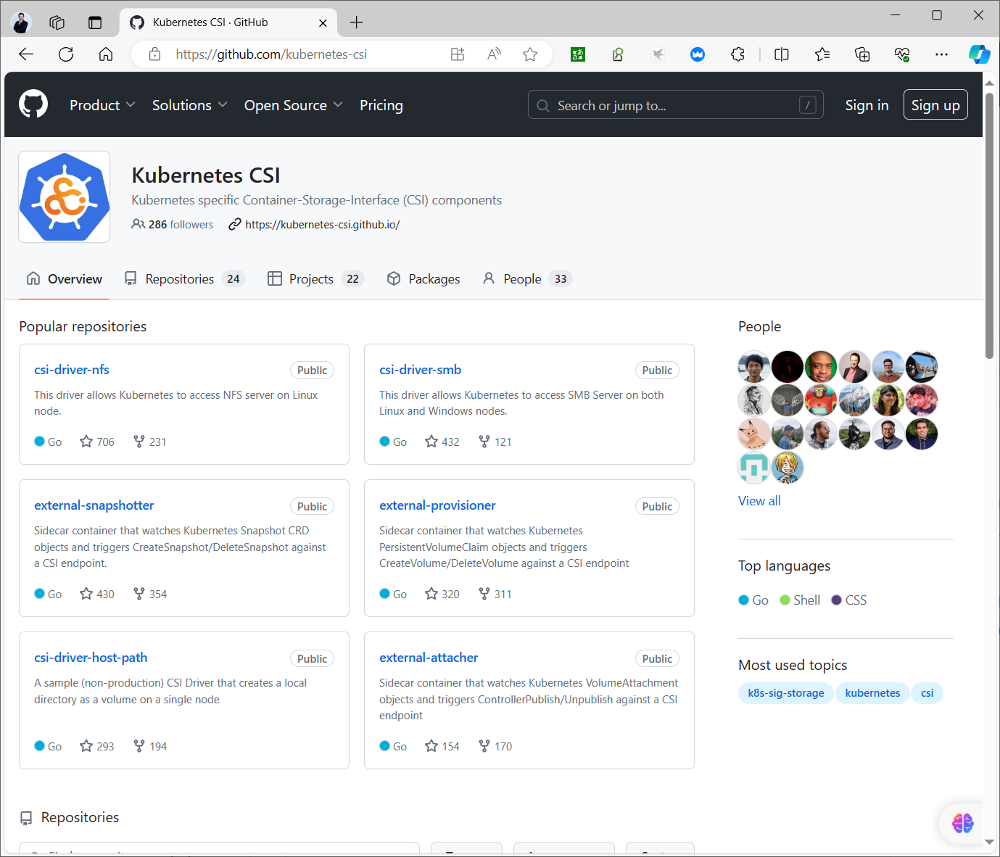

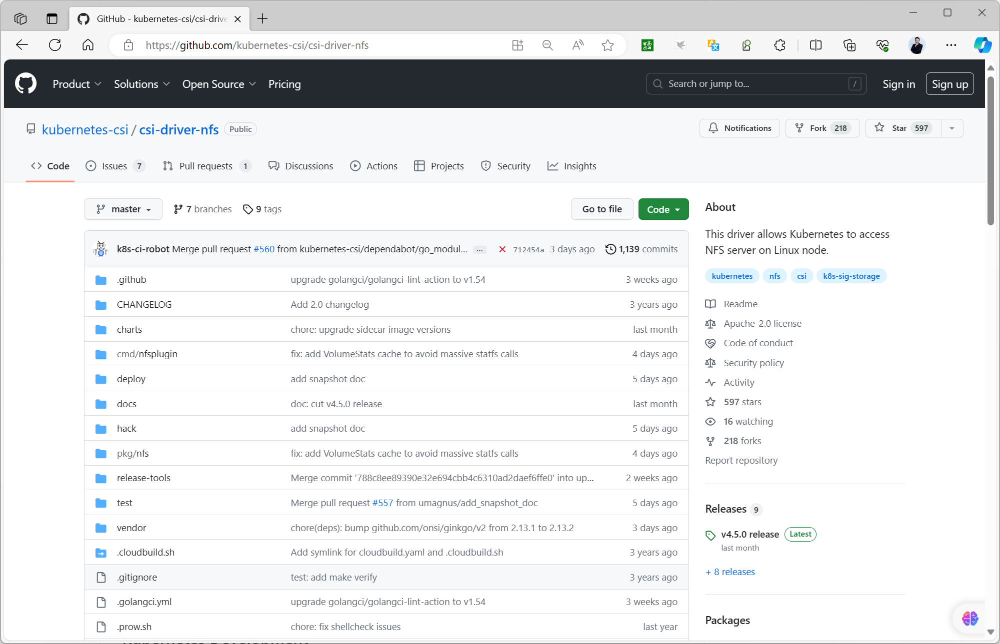

nfs-client-provisioner

nfs-client-provisioner 是一个自动配置卷程序，它使用现有的和已配置的 NFS 服务器来支持通过PVC动态配置 PV。nfs-client-provisioner 目前已经不提供更新，nfs-client-provisioner 的 Github 仓库当前已经迁移到 NFS-Subdir-External-Provisioner的仓库。
```text
https://github.com/kubernetes-retired/external-storage/tree/master/nfs-client
https://github.com/kubernetes-sigs/sig-storage-lib-external-provisioner
```

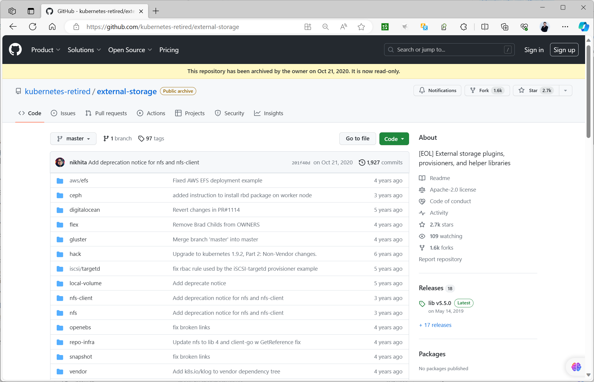

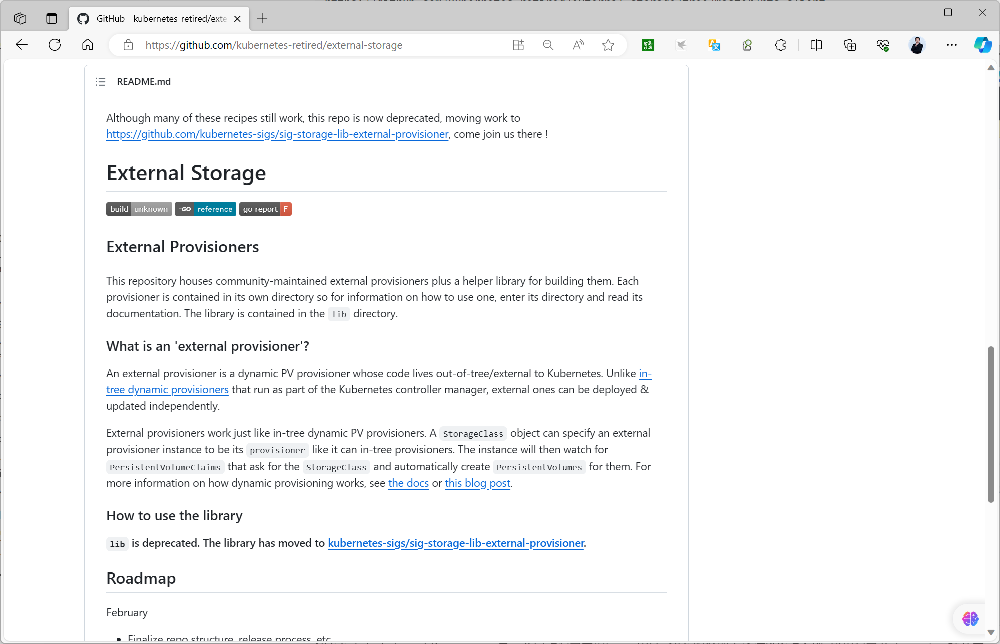

NFS-Subdir-External-Provisioner

此组件是由Kubernetes SIGs 社区开发,也是Kubernetes官方推荐实现。

是对 nfs-client-provisioner 组件的扩展


- <https://kubernetes.io/docs/concepts/storage/storage-classes/#nfs>


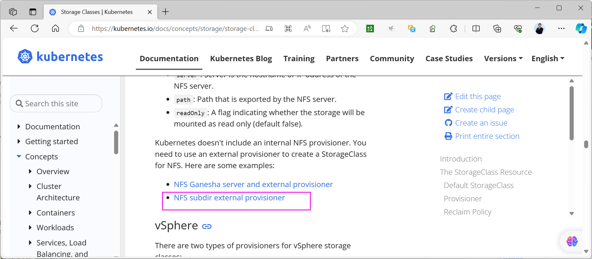


- <https://github.com/kubernetes-sigs/nfs-subdir-external-provisioner>
- <https://github.com/kubernetes-sigs/sig-storage-lib-external-provisioner>


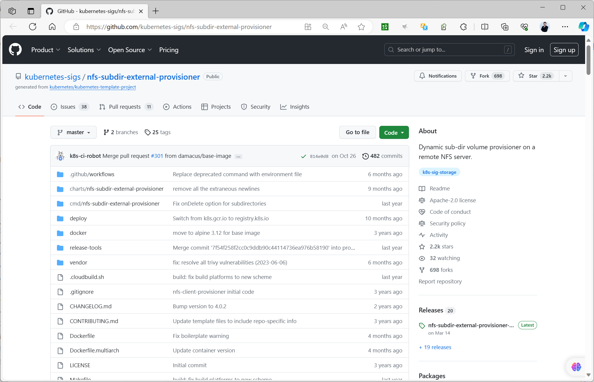

NFS-Subdir-External-Provisioner 是一个自动配置卷程序，可以在 NFS 服务器上通过PVC动态创建和配置 Kubernetes 持久卷。

PV命名规则如下：
```text
自动创建的 PV 以${namespace}-${pvcName}-${pvName} 命名格式创建在 NFS 服务器上的共享
数据目录中
当这个 PV 被回收后会以 archieved-${namespace}-${pvcName}-${pvName} 命名格式存在
NFS 服务器中
```

NFS Ganesha server and external provisioner
<https://github.com/kubernetes-sigs/nfs-ganesha-server-and-external-provisioner>

nfs-ganesha-server-and-external-provisioner 是 Kubernetes 1.14+ 的树外动态配置程序。您可以使用它快速轻松地部署几乎可以在任何地方使用的共享存储。

#### 1.6.3.2 案例:  基于 nfs-subdir-external-provisioner 创建 NFS 共享存储的 storageclass

**部署相关文件**
```text
https://github.com/kubernetes-sigs/nfs-subdir-external-provisioner
https://github.com/kubernetes-sigs/nfs-subdir-external-provisioner/tree/master/deploy
https://github.com/kubernetes-sigs/nfs-subdir-external-provisioner?tab=readme-ov-file#manually
```

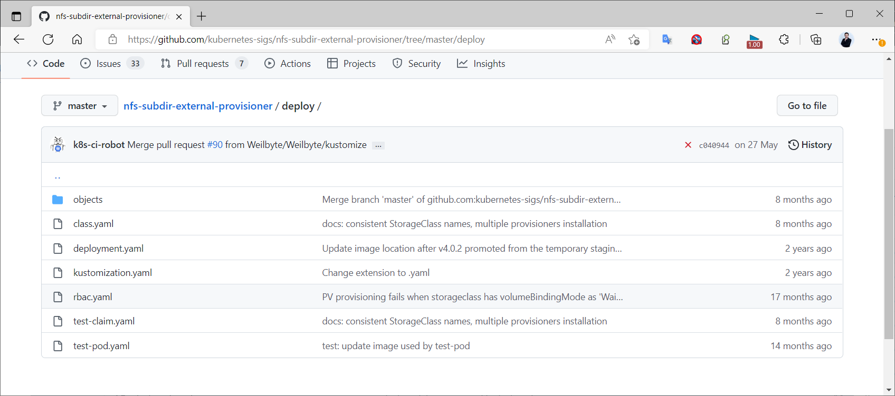

创建 NFS 共享存储的 storageclass步骤如下：

创建 NFS 共享创建 Service Account 并授予管控NFS provisioner在k8s集群中运行的权限部署 NFS-Subdir-External-Provisioner 对应的 Deployment创建 StorageClass 负责建立PVC并调用NFS provisioner进行预定的工作,并让PV与PVC建立联系创建 PVC 时自动调用SC创建PV创建Pod 使用 PVC。

##### 1.6.3.2.1 创建 NFS 服务
```bash
[root@master1 ~]#apt update && apt -y install nfs-server
[root@master1 ~]#systemctl status nfs-server.service
● nfs-server.service - NFS server and services
Loaded: loaded (/lib/systemd/system/nfs-server.service; enabled; vendor
preset: enabled)
Active: active (exited) since Thu 2021-09-29 09:28:41 CST; 5min ago
Main PID: 64029 (code=exited, status=0/SUCCESS)
Tasks: 0 (limit: 2236)
Memory: 0B
CGroup: /system.slice/nfs-server.service

9月 29 09:28:40 master1.bowen.org systemd[1]: Starting NFS server and services...
9月 29 09:28:41 master1.bowen.org systemd[1]: Finished NFS server and services.

[root@master1 ~]#mkdir -pv /data/sc-nfs/

[root@master1 ~]#vim /etc/exports
#授权worker节点的网段可以挂载
#/data/sc-nfs *(rw,no_root_squash,all_squash,anonuid=0,anongid=0)

/data/sc-nfs *(rw,no_root_squash)

[root@master1 ~]#exportfs -rv
/data/sc-nfs <world>
(sync,wdelay,hide,no_subtree_check,anonuid=0,anongid=0,sec=sys,rw,secure,no_root
_squash,all_squash)

#并在所有worker节点安装NFS客户端
[root@nodeX ~]#apt update && apt -y install nfs-common 或者 nfs-client
```

##### 1.6.3.2.2 创建 ServiceAccount 并授权
```yaml
[root@master1 ~]#ls
nfs-client-provisioner.yaml  nfs-StorageClass.yaml  pod-test.yaml  pvc.yaml
rbac.yaml

#建议创建独立的名称空间
[root@master1 ~]#kubectl create ns sc-nfs

#方式1:指定名称空间
[root@master1 ~]#cat rbac.yaml
apiVersion: v1
kind: ServiceAccount
metadata:
name: nfs-client-provisioner
# replace with namespace where provisioner is deployed
#namespace: default
namespace: sc-nfs
---
kind: ClusterRole
apiVersion: rbac.authorization.k8s.io/v1
metadata:
name: nfs-client-provisioner-runner
rules:
- apiGroups: [""]
resources: ["nodes"]
verbs: ["get", "list", "watch"]
- apiGroups: [""]
resources: ["persistentvolumes"]
verbs: ["get", "list", "watch", "create", "delete"]
- apiGroups: [""]
resources: ["persistentvolumeclaims"]
verbs: ["get", "list", "watch", "update"]
- apiGroups: ["storage.k8s.io"]
resources: ["storageclasses"]
verbs: ["get", "list", "watch"]
- apiGroups: [""]
resources: ["events"]
verbs: ["create", "update", "patch"]
---
kind: ClusterRoleBinding
apiVersion: rbac.authorization.k8s.io/v1
metadata:
name: run-nfs-client-provisioner
subjects:
- kind: ServiceAccount

name: nfs-client-provisioner
# replace with namespace where provisioner is deployed
#namespace: default
namespace: sc-nfs
roleRef:
kind: ClusterRole
name: nfs-client-provisioner-runner
apiGroup: rbac.authorization.k8s.io
---
kind: Role
apiVersion: rbac.authorization.k8s.io/v1
metadata:
name: leader-locking-nfs-client-provisioner
# replace with namespace where provisioner is deployed
#namespace: default
namespace: sc-nfs
rules:
- apiGroups: [""]
resources: ["endpoints"]
verbs: ["get", "list", "watch", "create", "update", "patch"]
---
kind: RoleBinding
apiVersion: rbac.authorization.k8s.io/v1
metadata:
name: leader-locking-nfs-client-provisioner
# replace with namespace where provisioner is deployed
#namespace: default
namespace: sc-nfs
subjects:
- kind: ServiceAccount
name: nfs-client-provisioner
# replace with namespace where provisioner is deployed
#namespace: default
namespace: sc-nfs
roleRef:
kind: Role
name: leader-locking-nfs-client-provisioner
apiGroup: rbac.authorization.k8s.io

#方式2:默认名称空间
[root@master1 ~]#cat rbac.yaml
apiVersion: v1
kind: ServiceAccount
metadata:
name: nfs-client-provisioner
# replace with namespace where provisioner is deployed 根据业务需要修改此处名称空间
namespace: default
---
kind: ClusterRole
apiVersion: rbac.authorization.k8s.io/v1
metadata:
name: nfs-client-provisioner-runner
rules:
- apiGroups: [""]
resources: ["nodes"]
verbs: ["get", "list", "watch"]
- apiGroups: [""]

resources: ["persistentvolumes"]
verbs: ["get", "list", "watch", "create", "delete"]
- apiGroups: [""]
resources: ["persistentvolumeclaims"]
verbs: ["get", "list", "watch", "update"]
- apiGroups: ["storage.k8s.io"]
resources: ["storageclasses"]
verbs: ["get", "list", "watch"]
- apiGroups: [""]
resources: ["events"]
verbs: ["create", "update", "patch"]
---
kind: ClusterRoleBinding
apiVersion: rbac.authorization.k8s.io/v1
metadata:
name: run-nfs-client-provisioner
subjects:
- kind: ServiceAccount
name: nfs-client-provisioner
# replace with namespace where provisioner is deployed
namespace: default
roleRef:
kind: ClusterRole
name: nfs-client-provisioner-runner
apiGroup: rbac.authorization.k8s.io
---
kind: Role
apiVersion: rbac.authorization.k8s.io/v1
metadata:
name: leader-locking-nfs-client-provisioner
# replace with namespace where provisioner is deployed
namespace: default
rules:
- apiGroups: [""]
resources: ["endpoints"]
verbs: ["get", "list", "watch", "create", "update", "patch"]
---
kind: RoleBinding
apiVersion: rbac.authorization.k8s.io/v1
metadata:
name: leader-locking-nfs-client-provisioner
# replace with namespace where provisioner is deployed
namespace: default
subjects:
- kind: ServiceAccount
name: nfs-client-provisioner
# replace with namespace where provisioner is deployed
namespace: default
roleRef:
kind: Role
name: leader-locking-nfs-client-provisioner
apiGroup: rbac.authorization.k8s.io
```
```bash
[root@master1 ~]#kubectl apply -f rbac.yaml
serviceaccount/nfs-client-provisioner created
clusterrole.rbac.authorization.k8s.io/nfs-client-provisioner-runner created
clusterrolebinding.rbac.authorization.k8s.io/run-nfs-client-provisioner created
role.rbac.authorization.k8s.io/leader-locking-nfs-client-provisioner created

rolebinding.rbac.authorization.k8s.io/leader-locking-nfs-client-provisioner
created

[root@master1 ~]#kubectl get sa
NAME                     SECRETS   AGE
default                  0         34d
nfs-client-provisioner   0         9s
```

##### 1.6.3.2.3 部署 NFS-Subdir-External-Provisioner 对应的 Deployment
```yaml
#方式1:指定名称空间
[root@master1 ~]#cat nfs-client-provisioner.yaml
apiVersion: apps/v1
kind: Deployment
metadata:
name: nfs-client-provisioner
labels:
app: nfs-client-provisioner
# replace with namespace where provisioner is deployed
#namespace: default
namespace: sc-nfs
spec:
replicas: 1
strategy:
type: Recreate
selector:
matchLabels:
app: nfs-client-provisioner
template:
metadata:
labels:
app: nfs-client-provisioner
spec:
serviceAccountName: nfs-client-provisioner
containers:
- name: nfs-client-provisioner
image: registry.cn-beijing.aliyuncs.com/bowen/nfs-subdir-
external-provisioner:v4.0.2
#image: registry.k8s.io/sig-storage/nfs-subdir-external-
provisioner:v4.0.2
#image: bowen/nfs-subdir-external-provisioner:v4.0.2
#image: k8s.gcr.io/sig-storage/nfs-subdir-external-provisioner:v4.0.2
imagePullPolicy: IfNotPresent
volumeMounts:
- name: nfs-client-root
mountPath: /persistentvolumes
env:
- name: PROVISIONER_NAME
value: k8s-sigs.io/nfs-subdir-external-provisioner #名称确保与 nfs-
StorageClass.yaml文件中的provisioner名称保持一致
- name: NFS_SERVER
value: nfs.bowen.org  #指定NFS服务器地址,如果是域名,需要宿主机节点能解析此域
名
- name: NFS_PATH
value: /data/sc-nfs  # NFS 共享目录
volumes:
- name: nfs-client-root
```


nfs: server: nfs.bowen.org  #指定NFS服务器地址,如果是域名,需要宿主机节点能解析此域名 path: /data/sc-nfs  # NFS 共享目录

```yaml
#方式2:使用默认名间空间
[root@master1 ~]#cat nfs-client-provisioner.yaml
apiVersion: apps/v1
kind: Deployment
metadata:
name: nfs-client-provisioner
labels:
app: nfs-client-provisioner
# replace with namespace where provisioner is deployed 根据业务需要修改此处名称空间
namespace: default
spec:
replicas: 1
strategy:
type: Recreate
selector:
matchLabels:
app: nfs-client-provisioner
template:
metadata:
labels:
app: nfs-client-provisioner
spec:
serviceAccountName: nfs-client-provisioner
containers:
- name: nfs-client-provisioner
image: registry.cn-beijing.aliyuncs.com/bowennfs-subdir-
external-provisioner:v4.0.2
#image: k8s.gcr.io/sig-storage/nfs-subdir-external-provisioner:v4.0.2 #
此镜像国内可能无法访问
imagePullPolicy: IfNotPresent
volumeMounts:
- name: nfs-client-root
mountPath: /persistentvolumes
env:
- name: PROVISIONER_NAME
value: k8s-sigs.io/nfs-subdir-external-provisioner #名称确保与 nfs-
StorageClass.yaml文件中的provisioner名称保持一致
- name: NFS_SERVER
value: nfs.bowen.org #指定NFS服务器地址,如果是域名,需要宿主机节点能解析此域
名
- name: NFS_PATH
value: /data/sc-nfs # NFS 共享目录
volumes:
- name: nfs-client-root
nfs:
server: nfs.bowen.org  #指定NFS服务器地址,如果是域名,需要宿主机节点能解析此域
名
path: /data/sc-nfs  # NFS 共享目录

[root@master1 ~]#kubectl apply -f nfs-client-provisioner.yaml

[root@master1 ~]#kubectl get deployments.apps

NAME                     READY   UP-TO-DATE   AVAILABLE   AGE
nfs-client-provisioner   1/1     1            1           5m26s

[root@master1 ~]#kubectl get pod
NAME                                      READY   STATUS    RESTARTS   AGE
nfs-client-provisioner-7468dcd749-24lpv   1/1     Running   0          5m34s

#注意:如果失败,检查是否worker节点安装了nfs-client
```

##### 1.6.3.2.4 创建 NFS 资源的 StorageClass
```yaml
[root@master1 ~]#cat nfs-StorageClass.yaml
apiVersion: storage.k8s.io/v1
kind: StorageClass
metadata:
name: sc-nfs
annotations:
storageclass.kubernetes.io/is-default-class: "false"  # 是否设置为默认的
storageclass
provisioner: k8s-sigs.io/nfs-subdir-external-provisioner # or choose another
name, must match deployment's env PROVISIONER_NAME
parameters:
archiveOnDelete: "true" # 设置为"false"时删除PVC不会保留数据,"true"则保留数据,基于安全
原因建议设为"true"

#应用
[root@master1 ~]#kubectl apply  -f nfs-StorageClass.yaml
storageclass.storage.k8s.io/sc-nfs created

#查看是否创建
[root@master1 ~]#kubectl get sc
NAME    PROVISIONER                                 RECLAIMPOLICY
VOLUMEBINDINGMODE   ALLOWVOLUMEEXPANSION   AGE
sc-nfs  k8s-sigs.io/nfs-subdir-external-provisioner Delete          Immediate
false                  6s
```

##### 1.6.3.2.5 创建 PVC

范例：
```yaml
[root@master1 ~]#cat pvc.yaml
apiVersion: v1
kind: PersistentVolumeClaim
metadata:
name: pvc-nfs-sc
spec:
storageClassName: sc-nfs  #需要和前面创建的storageClass名称相同
accessModes: ["ReadWriteMany","ReadOnlyMany"]
resources:
requests:
storage: 100Mi

#应用
[root@master1 ~]#kubectl apply -f pvc.yaml
persistentvolumeclaim/pvc-nfs-sc created

#验证

[root@master1 ~]#kubectl get pvc
NAME         STATUS   VOLUME                                     CAPACITY
ACCESS MODES   STORAGECLASS          AGE
pvc-nfs-sc   Bound    pvc-eae826dd-6270-445c-8d0f-e06fb0093773   100Mi
ROX,RWX        sc-nfs   2s

#自动创建PV并绑定PVC
[root@master1 ~]#kubectl get pv
NAME                                       CAPACITY   ACCESS MODES   RECLAIM
POLICY   STATUS   CLAIM                STORAGECLASS          REASON   AGE
pvc-9be97a7b-2d9c-4778-8c2a-519da3266ea4   100Mi      ROX,RWX        Delete
Bound    default/pvc-nfs-sc   sc-nfs            5s

#自动在NFS服务器共享目录创建目录
[root@master1 ~]#ls /data/sc-nfs/
default-pvc-nfs-sc-pvc-9be97a7b-2d9c-4778-8c2a-519da3266ea4

[root@master1 ~]#ls /data/sc-nfs/default-pvc-nfs-sc-pvc-9be97a7b-2d9c-4778-8c2a-
519da3266ea4/
```

##### 1.6.3.2.6 创建 Pod
```html
[root@master1 ~]#cat pod-test.yaml
apiVersion: v1
kind: Pod
metadata:
name: pod-nfs-sc-test
spec:
containers:
- name: pod-nfs-sc-test
image: registry.cn-beijing.aliyuncs.com/bowen/nginx:1.20.0
volumeMounts:
- name: nfs-pvc
mountPath: "/usr/share/nginx/html/"
restartPolicy: "Never"
volumes:
- name: nfs-pvc
persistentVolumeClaim:
claimName: pvc-nfs-sc  #指定前面创建的PVC名称

#应用
[root@master1 ~]#kubectl apply -f pod-test.yaml
pod/pod-nfs-sc-test created

#验证
[root@master1 ~]#kubectl get pod  -o wide
NAME                                      READY   STATUS    RESTARTS   AGE   IP
NODE             NOMINATED NODE   READINESS GATES
nfs-client-provisioner-7468dcd749-24lpv   1/1     Running   0          16m
10.244.3.9    node3.bowen.org   <none>           <none>
pod-nfs-sc-test                           1/1     Running   0          41s
10.244.1.14   node1.bowen.org   <none>           <none>

#查看Pod的挂载
[root@master1 ~]#kubectl exec -it pod-nfs-sc-test  -- sh
# df

Filesystem
1K-blocks    Used Available Use% Mounted on
overlay
101848040 6433408  90194896   7% /
tmpfs
65536       0     65536   0% /dev
tmpfs
999676       0    999676   0% /sys/fs/cgroup
/dev/mapper/ubuntu--vg-ubuntu--lv
101848040 6433408  90194896   7% /etc/hosts
shm
65536       0     65536   0% /dev/shm
10.0.0.101:/data/sc-nfs/default-pvc-nfs-sc-pvc-9be97a7b-2d9c-4778-8c2a-
519da3266ea4 101848064 7129856  89498624   8% /usr/share/nginx/html
tmpfs
1896952      12   1896940   1%
/run/secrets/kubernetes.io/serviceaccount
tmpfs
999676       0    999676   0% /proc/acpi
tmpfs
999676       0    999676   0% /proc/scsi
tmpfs
999676       0    999676   0% /sys/firmware

#在Pod运行的宿主机,可以看到NFS挂载
[root@node1 ~]#df |grep 10.0.0.101
10.0.0.101:/data/sc-nfs/default-pvc-nfs-sc-pvc-9be97a7b-2d9c-4778-8c2a-
519da3266ea4 101848064 7139328 89489152    8% /var/lib/kubelet/pods/eb7a4c14-
ba48-4bf3-87ee-eb8bd6dbae71/volumes/kubernetes.io~nfs/pvc-644ecc87-38f5-4959-
b100-f9a5ff803011

# 查看nginx的网页文件不存在
# ls /usr/share/nginx/html

#由于没有页面文件,访问Pod失败
[root@master1 ~]#curl 10.244.1.14
<html>
<head><title>403 Forbidden</title></head>
<body>
<center><h1>403 Forbidden</h1></center>
<hr><center>nginx/1.20.0</center>
</body>
</html>

#在NFS服务器创建页面文件
[root@master1 ~]#echo NFS-SC Website > /data/sc-nfs/default-pvc-nfs-sc-pvc-
9be97a7b-2d9c-4778-8c2a-519da3266ea4/index.html

#查看Pod内的文件
[root@master1 ~]#kubectl exec -it pod-nfs-sc-test  -- sh
# ls /usr/share/nginx/html
index.html

#访问Pod页面成功
[root@master1 ~]#curl 10.244.1.14
NFS-SC Website
```

##### 1.6.3.2.7 删除 Pod 和 PVC
```bash
#先删除Pod
[root@master1 ~]#kubectl delete -f pod-test.yaml

#再删除PVC
[root@master1 ~]#kubectl delete -f pvc.yaml

#自动删除对应的PV
[root@master1 ~]#kubectl get pv
No resources found

[root@master1 ~]#kubectl get pvc

#查看对应的数据不会删除,仍保留
[root@master1 ~]#ls /data/sc-nfs/archived-default-pvc-nfs-sc-pvc-9be97a7b-2d9c-
4778-8c2a-519da3266ea4
index.html
```

##### 1.6.3.2.8  基于sc-nfs 实现MySQL的动态置备
```yaml
[root@master1 ~]#cat  storage-mysql-storage-class-pvc.yaml
---
apiVersion: v1
kind: PersistentVolumeClaim
metadata:
name: mysql-pv-claim
spec:
storageClassName: sc-nfs
accessModes:
- ReadWriteOnce
resources:
requests:
storage: 20Gi
---
apiVersion: v1
kind: Service
metadata:
name: mysql
spec:
ports:
- port: 3306
selector:
app: mysql
clusterIP: None
---
apiVersion: apps/v1
kind: Deployment
metadata:
name: mysql
spec:
selector:
matchLabels:
app: mysql
strategy:
type: Recreate
template:

metadata:
labels:
app: mysql
spec:
containers:
- image: registry.cn-beijing.aliyuncs.com/bowen/mysql:8.0.29-oracle
name: mysql
env:
# 在实际中使用 secret
- name: MYSQL_ROOT_PASSWORD
value: "123456"
ports:
- containerPort: 3306
name: mysql
volumeMounts:
- name: mysql-persistent-storage
mountPath: /var/lib/mysql
volumes:
- name: mysql-persistent-storage
persistentVolumeClaim:
claimName: mysql-pv-claim
```

#### 1.6.3.3 案例：通过 Helm 部署 nfs-subdir-external-provisioner
```text
https://github.com/kubernetes-sigs/nfs-subdir-external-provisioner
https://github.com/kubernetes-sigs/nfs-subdir-external-provisioner/blob/master/charts/nfs-subdir-external-provisioner/README.md
```

##### 1.6.3.3.1 准备 NFS 服务器

Kubernetes 主节点（Ubuntu 22.04）上安装 NFS 服务器。登录主节点并运行以下命令：
```bash
$ sudo apt update
$ sudo apt -y install nfs-kernel-server
```

创建以下文件夹并使用 NFS 共享它：
```bash
$ sudo mkdir /data/sc-nfs
$ sudo chown -R nobody:nogroup /data/sc-nfs
$ sudo chmod 777 /data/sc-nfs
```

在 /etc/exports 文件中添加以下条目：
```bash
$ sudo vi /etc/exports
/data/sc-nfs 10.0.0.0/24(rw,sync,no_subtree_check)
```

保存并关闭文件。

注意：不要忘记更改导出文件中适合你的部署的网络。

要使上述更改生效，请运行：
```bash
$ sudo exportfs -a
$ sudo systemctl restart nfs-kernel-server
$ sudo systemctl status nfs-kernel-server

[root@master1 ~]#systemctl status nfs-kernel-server
● nfs-server.service - NFS server and services
Loaded: loaded (/lib/systemd/system/nfs-server.service; enabled; vendor
preset: enabled)
Active: active (exited) since Tue 2023-08-15 09:33:05 CST; 4min 0s ago
Main PID: 148304 (code=exited, status=0/SUCCESS)
CPU: 4ms
```


8月 15 09:33:05 master1.bowen.org systemd[1]: Starting NFS server and services... 8月 15 09:33:05 master1.bowen.org exportfs[148299]: exportfs: can't open/etc/exports for reading 8月 15 09:33:05 master1.bowen.org systemd[1]: Finished NFS server and services.


在所有工作节点上，使用以下 apt 命令安装nfs-common 包。
```bash
$ sudo apt install nfs-common -y
```

##### 1.6.3.3.2 安装和配置 NFS 客户端配置程序

NFS 子目录外部配置程序在 Kubernetes 集群中部署 NFS 客户端配置程序。配置程序负责动态创建和管理由 NFS 存储支持的持久卷（PV）和持久卷声明（PVC）。因此，要安装 NFS 子目录外部配置程序，首先使用以下命令集安装 helm ：
```bash
$ curl -fsSL -o get_helm.sh
https://raw.githubusercontent.com/helm/helm/main/scripts/get-helm-3
$ chmod 700 get_helm.sh
$ ./get_helm.sh
```

运行以下命令来启用 helm 仓库：
```bash
$ helm repo add nfs-subdir-external-provisioner https://kubernetes-sigs.github.io/nfs-subdir-external-provisioner
```

使用以下 helm 命令部署配置程序：
<https://github.com/kubernetes-sigs/nfs-subdir-external-provisioner/blob/master/charts/nfs-subdir-external-provisioner/README.md>

范例: 创建 SC
```bash
#默认创建SC名为nfs-client
$ helm install -n nfs-provisioning --create-namespace nfs-subdir-external-
provisioner nfs-subdir-external-provisioner/nfs-subdir-external-provisioner --set
nfs.server=10.0.0.200 --set nfs.path=/data/sc-nfs
#上面的 `helm`命令将自动创建`nfs-provisioning`命名空间，并安装 NFS 配置程序的pod和
deployment、名称为`nfs-client`的存储类，并将创建所需的rbac。
#删除SC
[root@master1 ~]#helm uninstall -n nfs-provisioning nfs-subdir-external-
provisioner

#指定创建SC名为sc-nfs,此步可能因为网络原因失败,可以多试几次

[root@master1 ~]#helm install -n nfs-provisioning --create-namespace nfs-subdir-
external-provisioner nfs-subdir-external-provisioner/nfs-subdir-external-
provisioner \
--set nfs.server=10.0.0.200 \
--set nfs.path=/data/sc-nfs \
--set storageClass.name=sc-nfs

NAME: nfs-subdir-external-provisioner
LAST DEPLOYED: Tue Aug 15 10:09:24 2023
NAMESPACE: nfs-provisioning
STATUS: deployed
REVISION: 1
TEST SUITE: None
```

查看
```bash
$ kubectl get all -n nfs-provisioning
$ kubectl get sc -n nfs-provisioning

[root@master1 ~]#kubectl get all -n nfs-provisioning
NAME                                                   READY   STATUS
RESTARTS   AGE
pod/nfs-subdir-external-provisioner-79756db4bc-qdcvv   0/1     ImagePullBackOff
0          54s

NAME                                              READY   UP-TO-DATE   AVAILABLE
AGE
deployment.apps/nfs-subdir-external-provisioner   0/1     1            0
54s

NAME                                                         DESIRED   CURRENT
READY   AGE
replicaset.apps/nfs-subdir-external-provisioner-79756db4bc   1         1
0       54s
[root@master1 ~]#kubectl get sc -n nfs-provisioning
NAME     PROVISIONER                                     RECLAIMPOLICY
VOLUMEBINDINGMODE   ALLOWVOLUMEEXPANSION   AGE
sc-nfs   cluster.local/nfs-subdir-external-provisioner   Delete
Immediate           true                   63s
```

上面的输出确认了配置程序容器荚和存储类已成功创建。

##### 1.6.3.3.3 创建持久卷声明（PVC）

让我们创建 PVC 来为你的容器荚或部署请求存储。PVC 将从存储类 sc-nfs 请求特定数量的存储：
```yaml
$ vi demo-pvc.yml
kind: PersistentVolumeClaim
apiVersion: v1
metadata:
name: demo-claim
namespace: nfs-provisioning
spec:
storageClassName: sc-nfs
accessModes:
- ReadWriteMany
resources:
requests:
storage: 10Mi
```

运行以下 kubectl 命令以使用上面创建的 YML 文件创建 PVC：
```bash
$ kubectl create -f demo-pvc.yml
```

验证 PVC 和 PV 是否创建：
```bash
$ kubectl get pv,pvc -n nfs-provisioning
```

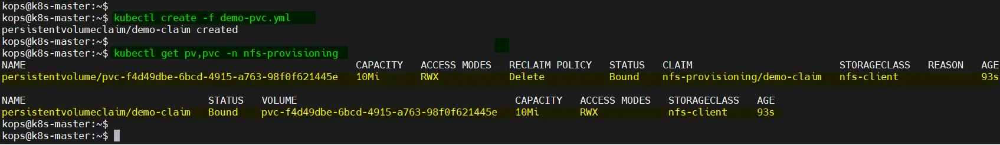

上面的输出表明 PV 和 PVC 创建成功。

##### 1.6.3.3.4 测试并验证动态 NFS 配置

为了测试和验证动态 NFS 配置，请使用以下 YML 文件启动测试容器荚：
```yaml
$ vi test-pod.yml
kind: Pod
apiVersion: v1
metadata:
name: test-pod
namespace: nfs-provisioning
spec:
containers:
- name: test-pod
image: busybox:latest
command:
- "/bin/sh"
args:
- "-c"
- "touch /mnt/SUCCESS && sleep 600"
volumeMounts:
- name: nfs-pvc
mountPath: "/mnt"
restartPolicy: "Never"
volumes:
- name: nfs-pvc
persistentVolumeClaim:

claimName: demo-claim
```

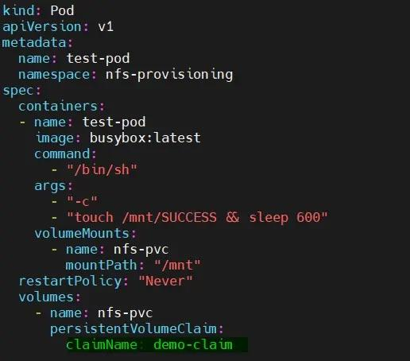

使用以下 kubectl 命令部署容器荚：
```bash
$ kubectl apply -f test-pod.yml
```

验证 test-pod 的状态：
```bash
$ kubectl get pods -n nfs-provisioning
```

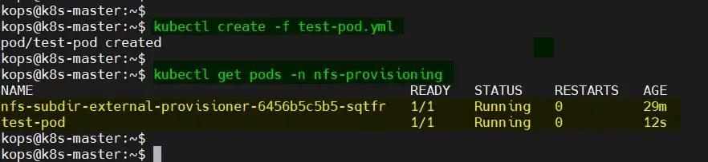

登录到容器荚并验证 NFS 卷是否已安装。
```bash
$ kubectl exec -it test-pod -n nfs-provisioning /bin/sh
```

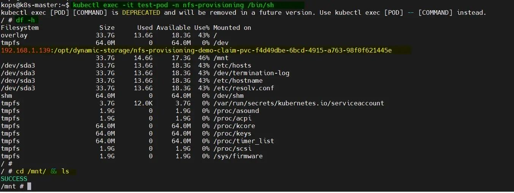

太棒了，上面容器荚的输出确认了动态 NFS 卷已安装且可访问。

最后删除Pod和 PVC，查看 PV 是否自动删除。
```bash
$ kubectl delete -f test-pod.yml
$ kubectl delete -f demo-pvc.yml
$ kubectl get pv,pvc -n  nfs-provisioning
```

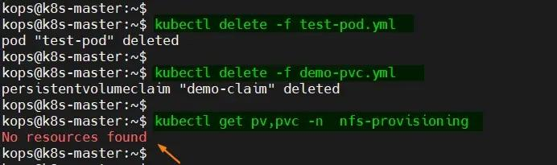

#### 1.6.3.4 案例: 基于 csi-driver-nfs 项目实现
```text
https://github.com/kubernetes-csi/csi-driver-nfs
#此项目中的镜像需要科学上网才能下载
```

##### 1.6.3.4.1 准备 NFS 服务
```bash
#方法1:部署至kubernetes
https://github.com/kubernetes-csi/csi-driver-nfs/blob/master/deploy/example/nfs-provisioner/README.md

#方法2:手动部署在集群外
[root@master1 ~]#apt update && apt -y install nfs-server
[root@master1 ~]#systemctl status nfs-server.service
● nfs-server.service - NFS server and services
Loaded: loaded (/lib/systemd/system/nfs-server.service; enabled; vendor
preset: enabled)
Active: active (exited) since Thu 2021-09-29 09:28:41 CST; 5min ago
Main PID: 64029 (code=exited, status=0/SUCCESS)
Tasks: 0 (limit: 2236)
Memory: 0B
CGroup: /system.slice/nfs-server.service

9月 29 09:28:40 master1.bowen.org systemd[1]: Starting NFS server and services...
9月 29 09:28:41 master1.bowen.org systemd[1]: Finished NFS server and services.

[root@master1 ~]#mkdir -pv /data/sc-nfs

[root@master1 ~]#vim /etc/exports
#授权worker节点的网段可以挂载
#/data/sc-nfs *(rw,no_root_squash,all_squash,anonuid=0,anongid=0)
/data/sc-nfs *(rw,no_root_squash)

[root@master1 ~]#exportfs -rv
/data/sc-nfs <world>
(sync,wdelay,hide,no_subtree_check,anonuid=0,anongid=0,sec=sys,rw,secure,no_root
_squash,all_squash)

#并在所有worker节点安装NFS客户端
[root@nodeX ~]#apt update && apt -y install nfs-common 或者 nfs-client
```

##### 1.6.3.4.2 Install NFS CSI driver  on a kubernetes cluster
<https://github.com/kubernetes-csi/csi-driver-nfs/blob/master/docs/install-csi-driver-v4.6.0.md>

Install with kubectl 可能需要科学上网下载相关镜像。

###### 1.6.3.4.2.1 方法1: local install
```bash
git clone https://github.com/kubernetes-csi/csi-driver-nfs.git
cd csi-driver-nfs
./deploy/install-driver.sh v4.6.0 local
```

范例:
```bash
[root@master1 ~]#git clone https://github.com/kubernetes-csi/csi-driver-nfs.git
Cloning into 'csi-driver-nfs'...

[root@master1 ~]#ls csi-driver-nfs/
CHANGELOG        cmd                 deploy      go.mod  LICENSE   OWNERS_ALIASES
RELEASE.md         test
charts           code-of-conduct.md  Dockerfile  go.sum  Makefile  pkg
release-tools      vendor
cloudbuild.yaml  CONTRIBUTING.md     docs        hack    OWNERS    README.md
SECURITY_CONTACTS

[root@master1 ~]#ls csi-driver-nfs/deploy/
crd-csi-snapshot.yaml    csi-nfs-node.yaml             install-driver.sh
uninstall-driver.sh  v4.0.0  v4.3.0  v4.6.0
csi-nfs-controller.yaml  csi-snapshot-controller.yaml  rbac-csi-nfs.yaml
v3.0.0               v4.1.0  v4.4.0
csi-nfs-driverinfo.yaml  example                       rbac-snapshot-
controller.yaml  v3.1.0               v4.2.0  v4.5.0
[root@master1 ~]#cd csi-driver-nfs/deploy/
[root@master1 deploy]#ls v4.6.0/
crd-csi-snapshot.yaml    csi-nfs-driverinfo.yaml  csi-snapshot-controller.yaml
rbac-snapshot-controller.yaml
csi-nfs-controller.yaml  csi-nfs-node.yaml        rbac-csi-nfs.yaml

#镜像需要科学上网才能下载
[root@master1 deploy]#grep -R  image: v4.6.0/
v4.6.0/csi-nfs-controller.yaml:          image: registry.k8s.io/sig-storage/csi-
provisioner:v4.0.0
v4.6.0/csi-nfs-controller.yaml:          image: registry.k8s.io/sig-storage/csi-
snapshotter:v6.3.3
v4.6.0/csi-nfs-controller.yaml:          image: registry.k8s.io/sig-
storage/livenessprobe:v2.12.0
v4.6.0/csi-nfs-controller.yaml:          image: registry.k8s.io/sig-
storage/nfsplugin:v4.6.0
v4.6.0/csi-snapshot-controller.yaml:     image: registry.k8s.io/sig-
storage/snapshot-controller:v6.3.3
v4.6.0/csi-nfs-node.yaml:          image: registry.k8s.io/sig-
storage/livenessprobe:v2.12.0
v4.6.0/csi-nfs-node.yaml:          image: registry.k8s.io/sig-storage/csi-node-
driver-registrar:v2.10.0
v4.6.0/csi-nfs-node.yaml:          image: registry.k8s.io/sig-
storage/nfsplugin:v4.6.0

[root@master1 deploy]#kubectl apply -f v4.6.0/

#自动生成相关CRD
[root@master1 ~]#kubectl  get crd
NAME                                             CREATED AT
volumesnapshotclasses.snapshot.storage.k8s.io    2024-12-19T09:43:11Z
volumesnapshotcontents.snapshot.storage.k8s.io   2024-12-19T09:43:11Z
volumesnapshots.snapshot.storage.k8s.io          2024-12-19T09:43:11Z

[root@master1 ~]#kubectl  api-resources --api-group storage.k8s.io
NAME                   SHORTNAMES   APIVERSION          NAMESPACED   KIND
csidrivers                          storage.k8s.io/v1   false        CSIDriver
csinodes                            storage.k8s.io/v1   false        CSINode
csistoragecapacities                storage.k8s.io/v1   true
CSIStorageCapacity
storageclasses         sc           storage.k8s.io/v1   false
StorageClass
volumeattachments                   storage.k8s.io/v1   false
VolumeAttachment

#确认相关Pod正常工作
[root@master1 ~]#kubectl  get pod -A |grep -E 'csi|snapshot'
kube-system    csi-nfs-controller-db9cf5df7-n28nx         4/4     Running   0
3m13s
kube-system    csi-nfs-node-8vsbv                         3/3     Running   0
4m11s
kube-system    csi-nfs-node-nljtc                         3/3     Running   0
4m10s
kube-system    csi-nfs-node-nnqfg                         3/3     Running   0
4m11s
kube-system    csi-nfs-node-wztkq                         3/3     Running   0
4m7s
kube-system    snapshot-controller-796bf74d5f-5fss8       1/1     Running   0
32m
kube-system    snapshot-controller-796bf74d5f-f2dp4       1/1     Running   0
32m

[root@master1 ~]#kubectl -n kube-system get pod -o wide -l app=csi-nfs-
controller
[root@master1 ~]#kubectl -n kube-system get pod -o wide -l app=csi-nfs-node
```

###### 1.6.3.4.2.2 方法2. remote install
```text
curl -skSL https://raw.githubusercontent.com/kubernetes-csi/csi-driver-nfs/v4.6.0/deploy/install-driver.sh | bash -s v4.6.0 --
```

范例:
```bash
[root@master1 ~]#curl -skSL https://raw.githubusercontent.com/kubernetes-csi/csi-driver-nfs/v4.6.0/deploy/install-driver.sh | bash -s v4.6.0 --

#新创建资源类型
[root@master1 ~]#kubectl api-resources  |grep storage.k8s.io
csidrivers                                     storage.k8s.io/v1
false        CSIDriver
csinodes                                       storage.k8s.io/v1
false        CSINode
csistoragecapacities                           storage.k8s.io/v1
true         CSIStorageCapacity
storageclasses                    sc           storage.k8s.io/v1
false        StorageClass
volumeattachments                              storage.k8s.io/v1
false        VolumeAttachment

#新创建的资源
[root@master1 ~]#kubectl get all -n kube-system  |grep csi
pod/csi-nfs-controller-57bb8fd754-j9xtb        0/4     ContainerCreating   0
76s
pod/csi-nfs-node-8bg8q                         0/3     ContainerCreating   0
68s
pod/csi-nfs-node-8r784                         0/3     ContainerCreating   0
68s
pod/csi-nfs-node-8wzxk                         0/3     ContainerCreating   0
68s
pod/csi-nfs-node-hvthk                         0/3     ContainerCreating   0
68s
daemonset.apps/csi-nfs-node   4         4         0       4            0
kubernetes.io/os=linux   68s
deployment.apps/csi-nfs-controller   0/1     1            0           76s
replicaset.apps/csi-nfs-controller-57bb8fd754   1         1         0       76s

#新建CRD
[root@master1 ~]#kubectl get crd
```

##### 1.6.3.4.3  创建 Storage Class
<https://github.com/kubernetes-csi/csi-driver-nfs/blob/master/deploy/example/README.md>

Create a storage class

change server , share with your existing NFS server address and share name
```yaml
#https://github.com/kubernetes-csi/csi-driver-nfs/blob/master/deploy/example/README.md#storage-class-usage-dynamic-provisioning

[root@master1 csi-driver-nfs]#cat storageclass-csi-nfs.yaml
---
apiVersion: storage.k8s.io/v1
kind: StorageClass
metadata:
name: sc-nfs
annotations:
storageclass.kubernetes.io/is-default-class: "true"
provisioner: nfs.csi.k8s.io
parameters:
server: nfs.bowen.org #指定NFS服务器地址,如果是域名,需要宿主机节点能解析此域名
share: /data/sc-nfs
reclaimPolicy: Delete
volumeBindingMode: Immediate
#mountOptions:
#  - hard
#  - nfsvers=4.1

[root@master1 csi-driver-nfs]#kubectl  apply -f storageclass-csi-nfs.yaml

[root@master1 ~]#kubectl  get sc
NAME               PROVISIONER      RECLAIMPOLICY   VOLUMEBINDINGMODE
ALLOWVOLUMEEXPANSION   AGE
sc-nfs (default)   nfs.csi.k8s.io   Delete          Immediate           false
73s
```

##### 1.6.3.4.4  PVC  (Dynamic Provisioning)
```yaml
wget https://raw.githubusercontent.com/kubernetes-csi/csi-driver-nfs/master/deploy/example/pvc-nfs-csi-dynamic.yaml

cat storage-pvc-nfs-csi-dynamic.yaml
---
apiVersion: v1
kind: PersistentVolumeClaim
metadata:
name: pvc-nfs-dynamic
spec:
accessModes:
- ReadWriteMany
resources:
requests:
storage: 10Gi
storageClassName: sc-nfs #指向前面创建的SC

#创建PVC,也会自动创建对应的PV
kubectl create -f pvc-nfs-csi-dynamic.yaml
```

##### 1.6.3.4.5 PV/PVC Usage (Static Provisioning)

Follow the following command to create PersistentVolume and PersistentVolumeClaim statically.
```yaml
# create PV
wget  https://raw.githubusercontent.com/kubernetes-csi/csi-driver-nfs/master/deploy/example/pv-nfs-csi.yaml

cat storage-pv-nfs-csi.yaml
---
apiVersion: v1
kind: PersistentVolume
metadata:
annotations:
pv.kubernetes.io/provisioned-by: nfs.csi.k8s.io
name: pv-nfs
spec:
capacity:
storage: 10Gi
accessModes:
- ReadWriteMany
persistentVolumeReclaimPolicy: Retain
storageClassName: sc-nfs
mountOptions:
- nfsvers=4.1
csi:
driver: nfs.csi.k8s.io
# volumeHandle format: {nfs-server-address}#{sub-dir-name}#{share-name}
# make sure this value is unique for every share in the cluster
volumeHandle: nfs-server.default.svc.cluster.local/share##
volumeAttributes:
server: nfs.bowen.org  #指定NFS服务器地址,如果是域名,需要宿主机节点能解析此域名
share: /data/sc-nfs

kubectl create -f storage-pv-nfs-csi.yaml

# create PVC
wget https://raw.githubusercontent.com/kubernetes-csi/csi-driver-nfs/master/deploy/example/pvc-nfs-csi-static.yaml

cat storage-pvc-nfs-csi-static.yaml
---
kind: PersistentVolumeClaim
apiVersion: v1
metadata:
name: pvc-nfs-static
spec:
accessModes:
- ReadWriteMany
resources:
requests:
storage: 10Gi
volumeName: pv-nfs
storageClassName: sc-nfs

kubectl create -f  storage-pvc-nfs-csi-static.yaml
```

##### 1.6.3.4.6  Create a deployment
```yaml
wget https://raw.githubusercontent.com/kubernetes-csi/csi-driver-nfs/master/deploy/example/deployment.yaml

cat storage-deployment.yaml
---
apiVersion: v1
kind: PersistentVolumeClaim
metadata:
name: pvc-deployment-nfs
spec:
accessModes:
- ReadWriteMany  # In this example, multiple Pods consume the same PVC.
resources:
requests:
storage: 10Gi
storageClassName: sc-nfs
---
apiVersion: apps/v1
kind: Deployment
metadata:
name: deployment-nfs
spec:
replicas: 1
selector:
matchLabels:
name: deployment-nfs
template:
metadata:
name: deployment-nfs
labels:
name: deployment-nfs
spec:
nodeSelector:
"kubernetes.io/os": linux
containers:
- name: deployment-nfs
image: mcr.microsoft.com/oss/nginx/nginx:1.19.5
command:
- "/bin/bash"
- "-c"
- set -euo pipefail; while true; do echo $(hostname) $(date) >>
/mnt/nfs/outfile; sleep 1; done
volumeMounts:
- name: nfs
mountPath: "/mnt/nfs"
readOnly: false
volumes:
- name: nfs
persistentVolumeClaim:
claimName: pvc-deployment-nfs

kubectl create -f deployment.yaml
```

##### 1.6.3.4.7 clean up NFS CSI driver
<https://github.com/kubernetes-csi/csi-driver-nfs/blob/master/docs/install-csi-driver-v4.9.0.md>

Option#1. remote uninstall
```text
curl -skSL https://raw.githubusercontent.com/kubernetes-csi/csi-driver-nfs/v4.9.0/deploy/uninstall-driver.sh | bash -s v4.9.0 --
```

Option#2. local uninstall
```bash
git clone https://github.com/kubernetes-csi/csi-driver-nfs.git
cd csi-driver-nfs
git checkout v4.9.0
./deploy/uninstall-driver.sh v4.9.0 local
```

### 1.6.4 改变默认存储类
```text
https://kubernetes.io/zh-cn/docs/tasks/administer-cluster/change-default-storage-class/
https://kubernetes.io/zh-cn/docs/concepts/storage/storage-classes/#default-storageclass
```

#### 1.6.4.1 为什么要改变默认存储类？

当一个 PVC 没有指定 storageClassName 时，会使用默认的 StorageClass。集群中只能有一个默认的 StorageClass。如果不小心设置了多个默认的 StorageClass， 在动态制备PVC 时将使用其中最新的默认设置的 StorageClass。

如果有多个存储类，需要指定你需要的存储类为默认的

取决于安装模式，你的 Kubernetes 集群可能和一个被标记为默认的已有 StorageClass 一起部署。 这个默认的 StorageClass 以后将被用于动态的为没有特定存储类需求的 PersistentVolumeClaims 配置存储。更多细节请查看 PersistentVolumeClaim 文档。预先安装的默认 StorageClass 可能不能很好的适应你期望的工作负载；例如，它配置的存储可能太过昂贵。 如果是这样的话，你可以改变默认 StorageClass，或者完全禁用它以防止动态配置存储。

删除默认 StorageClass 可能行不通，因为它可能会被你集群中的扩展管理器自动重建。 请查阅你的安装文档中关于扩展管理器的细节，以及如何禁用单个扩展。

#### 1.6.4.2 改变默认 StorageClass

1. 列出你的集群中的 StorageClasses：
```text
kubectl get storageclass
```

输出类似这样：
```text
NAME                 PROVISIONER               AGE
standard (default)   kubernetes.io/gce-pd      1d
gold                 kubernetes.io/gce-pd      1d
```

默认 StorageClass 以 (default) 标记。

2. 标记默认 StorageClass 非默认：

默认 StorageClass 的注解 storageclass.kubernetes.io/is-default-class 设置为 true 。注解的其它任意值或者缺省值将被解释为 false 。

要标记一个 StorageClass 为非默认的，你需要改变它的值为 false ：
```bash
#方法1:交互
kubectl edit storageclasses.storage.k8s.io <your-class-name>
metadata:
annotations:
......
storageclass.kubernetes.io/is-default-class: "false" #修改为false

#方法2
kubectl patch storageclass standard -p '{"metadata": {"annotations":
{"storageclass.kubernetes.io/is-default-class":"false"}}}'
```

这里的 standard 是你选择的 StorageClass 的名字。

3. 标记一个 StorageClass 为默认的：

和前面的步骤类似，你需要添加/设置注解 storageclass.kubernetes.io/is-default-class=true 。
```bash
#方法1:交互
kubectl edit storageclasses.storage.k8s.io <your-class-name>
metadata:
annotations:
......
storageclass.kubernetes.io/is-default-class: "true" #修改为true

#方法2
kubectl patch storageclass <your-class-name> -p '{"metadata":
{"annotations":{"storageclass.kubernetes.io/is-default-class":"true"}}}'
```

请注意，最多只能有一个 StorageClass 能够被标记为默认。 如果它们中有两个或多个被标记为默认，Kubernetes 将忽略这个注解， 也就是它将表现为没有默认 StorageClass。

4. 验证你选用的 StorageClass 为默认的：
```text
kubectl get storageclass
```

输出类似这样：
```text
NAME             PROVISIONER               AGE
standard         kubernetes.io/gce-pd      1d
gold (default)   kubernetes.io/gce-pd      1d
```

范例：指定sc-nfs storageClass 是默认的
```bash
[root@master1 ~]#kubectl  get sc
NAME     PROVISIONER                                   RECLAIMPOLICY
VOLUMEBINDINGMODE   ALLOWVOLUMEEXPANSION   AGE

sc-nfs   k8s-sigs.io/nfs-subdir-external-provisioner   Delete          Immediate
false                  17m

#指定sc-nfs storageClass 是默认的存储类
#方法1
[root@master1 ~]#kubectl edit storageclasses.storage.k8s.io sc-nfs
metadata:
annotations:
......
storageclass.kubernetes.io/is-default-class: "true" #修改为true

#方法2
[root@master1 ~]#kubectl patch storageclass sc-nfs -p '{"metadata":
{"annotations":{"storageclass.kubernetes.io/is-default-class":"true"}}}'
storageclass.storage.k8s.io/sc-nfs patched

#验证已经默认
[root@master1 ~]#kubectl  get sc
NAME               PROVISIONER                                   RECLAIMPOLICY
VOLUMEBINDINGMODE   ALLOWVOLUMEEXPANSION   AGE
sc-nfs (default)   k8s-sigs.io/nfs-subdir-external-provisioner   Delete
Immediate           false                  17m

#取消默认
#方法1
[root@master1 ~]#kubectl edit storageclasses.storage.k8s.io sc-nfs
metadata:
annotations:
......
storageclass.kubernetes.io/is-default-class: "false" #修改为false

#方法2
[root@master1 ~]#kubectl patch storageclass sc-nfs -p '{"metadata":
{"annotations":{"storageclass.kubernetes.io/is-default-class":"false"}}}'
storageclass.storage.k8s.io/sc-nfs patched

#验证取消默认
[root@master1 ~]#kubectl  get sc
NAME     PROVISIONER                                   RECLAIMPOLICY
VOLUMEBINDINGMODE   ALLOWVOLUMEEXPANSION   AGE
sc-nfs   k8s-sigs.io/nfs-subdir-external-provisioner   Delete          Immediate
false                  75d
```

## 1.7  CNS 的存储方案 OpenEBS（了解）

### 1.7.1 CNS Container Native Storage

CNS - Hyperconverged

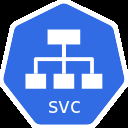

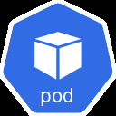


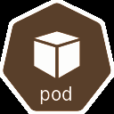

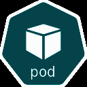

CNS


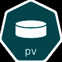


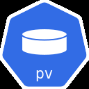


CNS

CNS

C

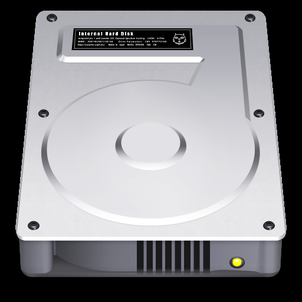


Kubernetes的卷通常是基于外部文件系统或块存储实现，这种存储方案称为共享存储Shared Storage。容器原生存储  CNS (Container Attached Storage，早期称为Container Attached Storage CAS) 则是将存储系统自身部署为Kubermetes集群上的一种较新的存储解决方案。存储系统自身(包括存储控制器)在Kubernetes上以容器化微服务的方式运行使得工作负载更易于移植，且更容易根据应用程序的需求改动使用的存储通常基于工作负载或者按集群部署，因此消除了共享存储的跨工作负载甚至是跨集群的爆炸半径存储在CAS中的数据可以直接从集群内的容器访问，从而能显著减少读/写时间。基于CNS的存储解决方案，通常包含两类组件。

控制平面

负责配置卷以及其他同存储相关任务

由存储控制器、存储策略以及如何配置数据平面的指令组成。

数据平面

接收并执行来自控制平面的有关如何保存和访问容器信息的指令。实现池化存储的存储引擎是数据平面的主要组件。存储引擎本质上负责输入/输出卷路径。

### 1.7.2  OpenEBS 介绍

#### 1.7.2.1 什么是 OpenEBS

OpenEBS是CNS存储机制的著名实现之一，由CNCF孵化。


- <https://openebs.io/>


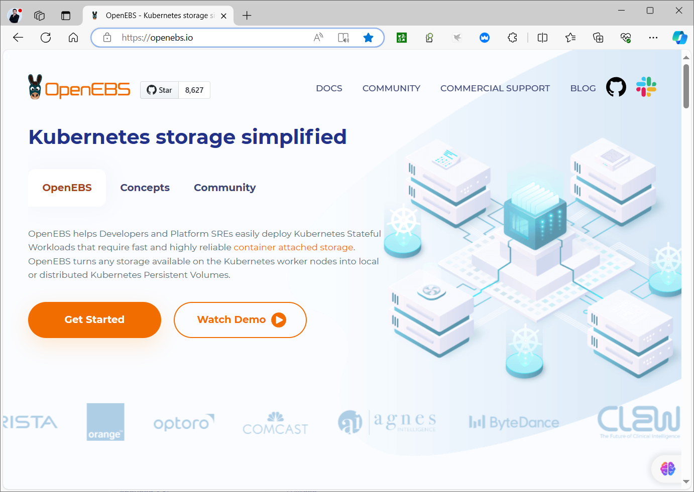


- <https://openebs.io/docs#what-is-openebs>


OpenEBS 将 Kubernetes 工作线程节点可用的任何存储转换为本地或复制的 Kubernetes 持久卷。OpenEBS 可帮助应用程序和平台团队轻松部署需要快速、高度持久、可靠且可扩展的容器原生存储的Kubernetes 有状态工作负载。OpenEBS 也是基于 NVMe 的存储部署的首选。OpenEBS 最初由 MayaData 构建并捐赠给云原生计算基金会，现在是 CNCF 沙盒项目。

#### 1.7.2.2 为什么用户更喜欢 OpenEBS


- <https://openebs.io/docs#why-do-users-prefer-openebs)>


OpenEBS 采用案例提到了推动用户转向 OpenEBS 的主要原因：

OpenEBS 在所有 Kubernetes 发行版（本地和云）之间提供一致性。OpenEBS with Kubernetes 提高了开发人员和平台 SRE 的工作效率。与其他解决方案相比，OpenEBS 在易用性方面得分很高。设置、安装和配置非常简单。OpenEBS 拥有出色的社区支持。OpenEBS 是完全开源和免费的。

#### 1.7.2.3 OpenEBS 是做什么的


- <https://openebs.io/docs#what-does-openebs-do)>


OpenEBS 管理每个 Kubernetes 节点上的可用存储，并使用该存储为有状态工作负载提供本地或复制的持久卷。

CNS - Hyperconverged


CNS CNS CNS


MongoDB

**对于本地卷**：OpenEBS 可以在 Hostpaths 上创建持久卷或使用子目录，或者使用本地附加的存储或稀疏文件，或者在现有的 LVM 或 ZFS 上。本地卷直接挂载到 Stateful Pod 中，不会增加数据路径中 OpenEBS 的任何开销，从而减少延迟。OpenEBS 为本地卷提供了额外的工具，用于监控、备份/恢复、灾难恢复、由 LVM 或 ZFS 堆栈支持的快照、基于容量的计划等。

**对于复制卷**：OpenEBS 复制存储为每个持久卷创建一个可通过 TCP 访问的 NVMe 目标。有状态 Pod 将数据写入 NVMe-TCP 目标，该目标将数据同步复制到集群中的多个节点。OpenEBS 引擎本身部署为 pod，并由 Kubernetes 编排。当运行有状态 Pod 的节点发生故障时，该 Pod 将被重新调度到集群中的另一个节点，OpenEBS 使用其他节点上的可用数据副本提供对数据的访问。OpenEBS Replicated Storage 的设计目标是以持久性和性能为目标。它可以有效地管理计算（大页面和内核）和存储（NVMe 驱动器），以提供快速块存储。

### 1.7.3 OpenEBS 安装和使用


- <https://openebs.io/docs/quickstart-guide/installation>


Installation via Helm


- <https://openebs.io/docs/quickstart-guide/installation#installation-via-helm>


1. Setup helm repository.
```bash
helm repo add openebs https://openebs.github.io/openebs
helm repo update

helm repo add openebs https://openebs.github.io/charts has changed to helm repo add
```

openebs https://openebs.github.io/openebs .

OpenEBS provides several options to customize during installation such as:

Specifying the directory where hostpath volume data is stored or Specifying the nodes on which OpenEBS components should be deployed and so forth.

2. Install the OpenEBS helm chart with default values.
```text
helm install openebs --namespace openebs openebs/openebs --create-namespace
```

The above commands will install OpenEBS Local PV Hostpath, OpenEBS Local PV LVM, OpenEBS Local PV ZFS, and OpenEBS Replicated Storage components in openebs namespace and chart name as openebs .

The default OpenEBS helm chart will install both Local Storage and Replicated Storage. If you do not want to install OpenEBS Replicated Storage, use the following command:
```text
helm install openebs --namespace openebs openebs/openebs --set
engines.replicated.mayastor.enabled=false --create-namespace
```

3. To view the chart and get the output, use the following commands:
```text
helm ls -n openebs

#Output
NAME     NAMESPACE   REVISION  UPDATED                          STATUS     CHART
APP VERSION
openebs  openebs     1         2024-03-25 09:13:00.903321318 +0000 UTC
deployed   openebs-4.0.1   4.0.1
```

4. Verifying OpenEBS Installation

Verify Pods

Default Installation

List the pods in <openebs> namespace
```text
kubectl get pods -n openebs

#In the successful installation of OpenEBS, you should see an example output like
below:
NAME                                              READY   STATUS    RESTARTS
AGE
openebs-agent-core-674f784df5-7szbm               2/2     Running   0
11m
openebs-agent-ha-node-nnkmv                       1/1     Running   0
11m
openebs-agent-ha-node-pvcrr                       1/1     Running   0
11m
openebs-agent-ha-node-rqkkk                       1/1     Running   0
11m
openebs-api-rest-79556897c8-b824j                 1/1     Running   0
11m
openebs-csi-controller-b5c47d49-5t5zd             6/6     Running   0
11m
openebs-csi-node-flq49                            2/2     Running   0
11m
openebs-csi-node-k8d7h                            2/2     Running   0
11m
openebs-csi-node-v7jfh                            2/2     Running   0
11m

openebs-etcd-0                                    1/1     Running   0
11m
openebs-etcd-1                                    1/1     Running   0
11m
openebs-etcd-2                                    1/1     Running   0
11m
openebs-io-engine-7t6tf                           2/2     Running   0
11m
openebs-io-engine-9df6r                           2/2     Running   0
11m
openebs-io-engine-rqph4                           2/2     Running   0
11m
openebs-localpv-provisioner-6ddf7c7978-4fkvs      1/1     Running   0
11m
openebs-loki-0                                    1/1     Running   0
11m
openebs-lvm-localpv-controller-7b6d6b4665-fk78q   5/5     Running   0
11m
openebs-lvm-localpv-node-mcch4                    2/2     Running   0
11m
openebs-lvm-localpv-node-pdt88                    2/2     Running   0
11m
openebs-lvm-localpv-node-r9jn2                    2/2     Running   0
11m
openebs-nats-0                                    3/3     Running   0
11m
openebs-nats-1                                    3/3     Running   0
11m
openebs-nats-2                                    3/3     Running   0
11m
openebs-obs-callhome-854bc967-5f879               2/2     Running   0
11m
openebs-operator-diskpool-5586b65c-cwpr8          1/1     Running   0
11m
openebs-promtail-2vrzk                            1/1     Running   0
11m
openebs-promtail-mwxk8                            1/1     Running   0
11m
openebs-promtail-w7b8k                            1/1     Running   0
11m
openebs-zfs-localpv-controller-f78f7467c-blr7q    5/5     Running   0
11m
openebs-zfs-localpv-node-h46m5                    2/2     Running   0
11m
openebs-zfs-localpv-node-svfgq                    2/2     Running   0
11m
openebs-zfs-localpv-node-wm9ks                    2/2     Running   0
11m
```

Installation with Replicated Storage Disabled

List the pods in <openebs> namespace
```text
kubectl get pods -n openebs

#In the successful installation of OpenEBS, you should see an example output like
below:
NAME                                              READY   STATUS    RESTARTS
AGE
openebs-localpv-provisioner-6ddf7c7978-jsstg      1/1     Running   0
3m9s
openebs-lvm-localpv-controller-7b6d6b4665-wfw64   5/5     Running   0
3m9s
openebs-lvm-localpv-node-62lnq                    2/2     Running   0
3m9s
openebs-lvm-localpv-node-lhndx                    2/2     Running   0
3m9s
openebs-lvm-localpv-node-tlcqv                    2/2     Running   0
3m9s
openebs-zfs-localpv-controller-f78f7467c-k7ldb    5/5     Running   0
3m9s
openebs-zfs-localpv-node-5mwbz                    2/2     Running   0
3m9s
openebs-zfs-localpv-node-g45ft                    2/2     Running   0
3m9s
openebs-zfs-localpv-node-g77g6                    2/2     Running   0
3m9s
```

Verify StorageClasses

List the storage classes to check if OpenEBS has been installed with default StorageClasses.
```text
kubectl get sc

#In the successful installation, you should have the following StorageClasses
created:
NAME                  PROVISIONER               RECLAIMPOLICY   VOLUMEBINDINGMODE
ALLOWVOLUMEEXPANSION
mayastor-etcd-localpv      openebs.io/local          Delete
WaitForFirstConsumer false
mayastor-loki-localpv      openebs.io/local          Delete
WaitForFirstConsumer false
openebs-hostpath           openebs.io/local          Delete
WaitForFirstConsumer false
openebs-single-replica     io.openebs.csi-mayastor   Delete          Immediate
true
```

5. PVC和Pod

Hostpath 会生成临时Pod，初始化目录结构，完成后会删除此Pod。默认会创建Pod所在节点的目录/var/openebs/local/pvc-下。
```yaml
---
kind: PersistentVolumeClaim
apiVersion: v1
metadata:
name: openebs-local-hostpath-pvc
spec:
storageClassName: openebs-hostpath

accessModes:
- ReadWriteOnce
resources:
requests:
storage: 1G

---
apiVersion: v1
kind: Pod
metadata:
name: redis-with-openebs-local-hostpath
spec:
containers:
- name: redis
image: redis:7-alpine
ports:
- containerPort: 6379
name: redis
volumeMounts:
- mountPath: /data
name: local-storage
volumes:
- name: local-storage
persistentVolumeClaim:
claimName: openebs-local-hostpath-pvc
```



<nav class="article-end" aria-label="章节导航">
  <a href="{{ '/subjects/Kubernetes/21-storage-volumes-pv-pvc.html' | relative_url }}">← 上一章：存储卷、PV 与 PVC</a>
  <a href="{{ '/subjects/Kubernetes/' | relative_url }}">返回 Kubernetes 目录</a>
  <a href="{{ '/subjects/Kubernetes/23-configmap-secret.html' | relative_url }}">下一章：ConfigMap、Secret 与配置注入 →</a>
</nav>
