[← 返回 Kubernetes 目录]({{ '/subjects/Kubernetes/' | relative_url }})



# 22 StorageClass 与 OpenEBS

上一篇通过静态 PV 理解了卷与声明的绑定。本篇进一步解决“PVC 提交后，由谁在什么后端创建卷”，并比较 Local PV、NFS 动态供应和 OpenEBS。它们同样通过 PVC 给工作负载提供存储，但在节点故障、并发挂载、性能和数据保护方面不能互相替代。

## 1 StorageClass：声明存储服务等级

StorageClass（SC）是集群级资源，描述制备器 `provisioner`、驱动参数、回收策略、绑定时机等。应用创建 PVC 并指定 `storageClassName` 后，控制器与对应制备器配合创建 PV，再完成绑定。**只有安装并正确配置了对应驱动/制备器，SC 才能真正动态供应卷**；创建一个 SC 对象本身不会产生存储空间。

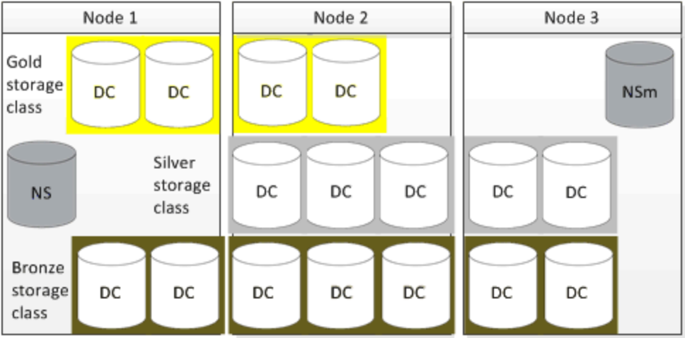

```yaml
apiVersion: storage.k8s.io/v1
kind: StorageClass
metadata:
  name: local-manual
provisioner: kubernetes.io/no-provisioner
reclaimPolicy: Retain
volumeBindingMode: WaitForFirstConsumer
```

上例是 **静态 Local PV** 使用的类，`no-provisioner` 明确表示不自动创建 PV。其他驱动使用各自的制备器名称和参数，不能把这个例子直接改名就当作 NFS 或云盘类。SC 的 `reclaimPolicy` 会影响由它动态创建的 PV；`allowVolumeExpansion` 只是允许符合条件的驱动处理扩容，不保证所有后端都支持在线扩容。

PVC 不写 `storageClassName` 时可能使用集群默认类；明确写 `storageClassName: ""` 才表示不请求默认类。绑定还需要容量、访问模式、`volumeMode` 等条件兼容。处理 `Pending` 时，先看 PVC 事件和对应制备器日志，而不是反复删除 PVC。

## 2 Local PV：利用节点本地盘

`hostPath` 直接暴露节点路径，调度器不了解其存储约束；Local PV 则是独立的 PV，带有 `nodeAffinity`，调度器会把使用该 PVC 的 Pod 安排到持有卷的节点。这仍是 **节点本地数据**：节点或磁盘故障不会自动把同一份数据搬到其他节点。适合能够自行复制、重建或从备份恢复的数据系统，以及对本地 I/O 敏感的工作负载；不适合误以为挂载本地卷就获得跨节点高可用的单副本数据库。

管理员应提前准备独立磁盘、分区或受控目录，明确容量、权限、监控和备份。一个 PV 独占一块盘有助于隔离，但并非 Kubernetes API 的强制规则；共享目录时仍要防止磁盘被其他目录写满。`WaitForFirstConsumer` 延迟绑定，让 PVC 的卷位置与 Pod 的资源需求、节点选择器和亲和性一起参与调度。

```yaml
apiVersion: v1
kind: PersistentVolume
metadata:
  name: local-pv-node-a
spec:
  capacity:
    storage: 100Gi
  volumeMode: Filesystem
  accessModes: [ReadWriteOnce]
  persistentVolumeReclaimPolicy: Retain
  storageClassName: local-manual
  local:
    path: /mnt/disks/ssd1
  nodeAffinity:
    required:
      nodeSelectorTerms:
        - matchExpressions:
            - key: kubernetes.io/hostname
              operator: In
              values: [node-a]
```

先确认 `node-a` 是实际节点的标签值，目录已挂载到预期磁盘，再创建同类 PVC。Pod 经 PVC 使用卷；若节点不可用，Pod 可能保持 `Pending`，这符合本地卷语义。需要自动发现本地盘或动态供给时，应选择经过验证的 Local PV CSI/制备器实现，而不是把静态 `local` PV 说成天生自动供应。

## 3 NFS 动态供应

### 3.1 两种常见方案

`nfs-subdir-external-provisioner` 在已有 NFS 共享目录中，为每个 PVC 建立子目录和 PV；它容易入门，但共享同一个 NFS 服务端，PVC 容量声明通常不等于服务器端硬性配额。删除 PVC 后目录如何保留、归档或删除取决于 StorageClass 与制备器配置，应先用测试卷确认。旧文档中的 `nfs-client-provisioner` 是历史名称。

`csi-driver-nfs` 是 CSI 路线，支持以驱动方式创建或挂载 NFS 卷。二者的 SC `provisioner` 名称和参数不同，不能复制一份 YAML 在两套驱动之间通用。无论采用哪一种，NFS 服务器故障域、导出权限、节点网络连通性、客户端版本、备份与性能都需要单独设计。

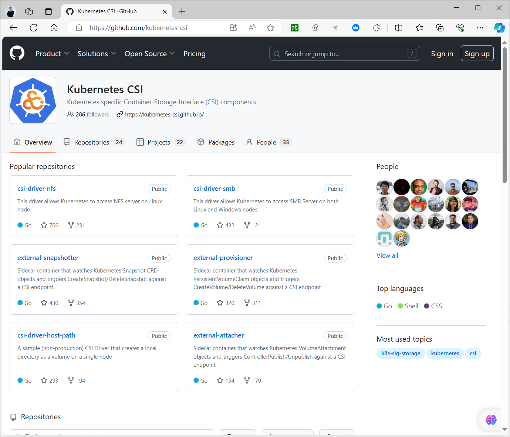

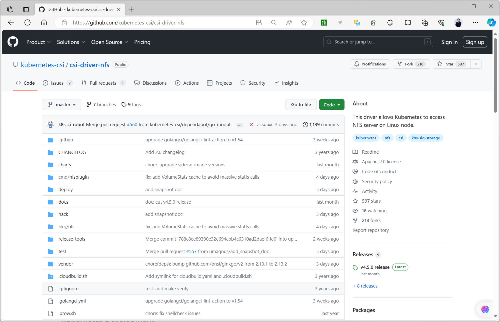

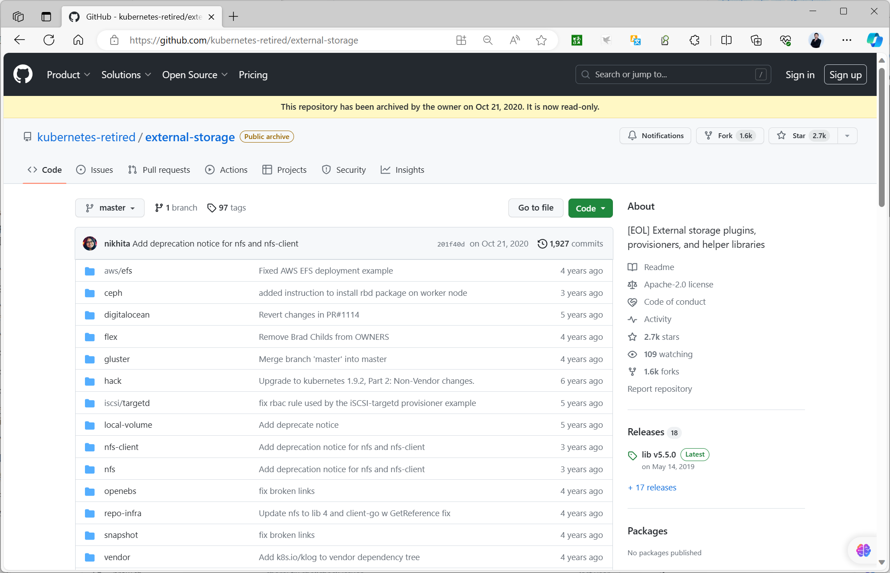

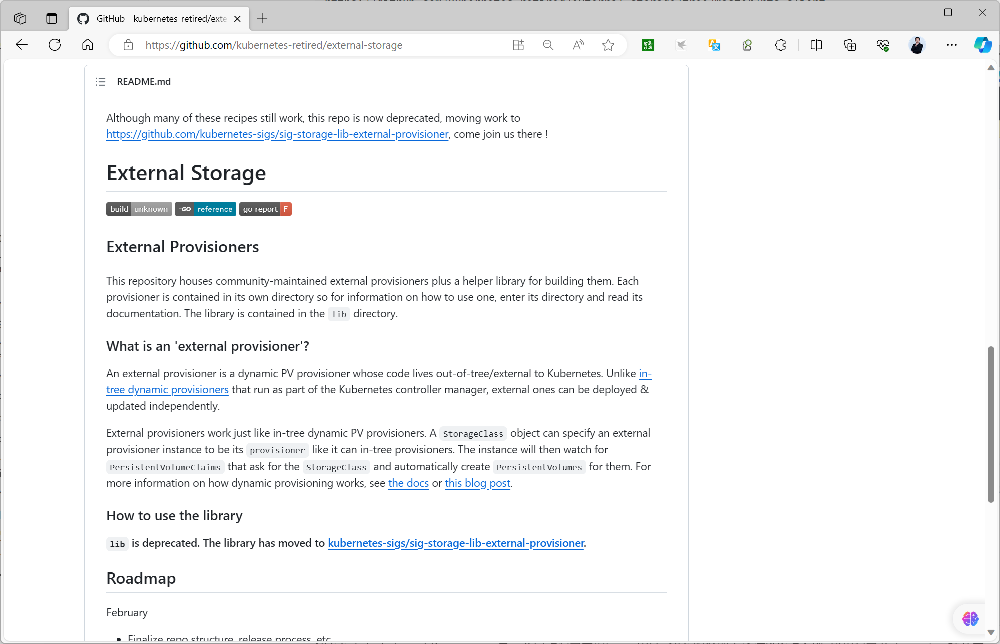

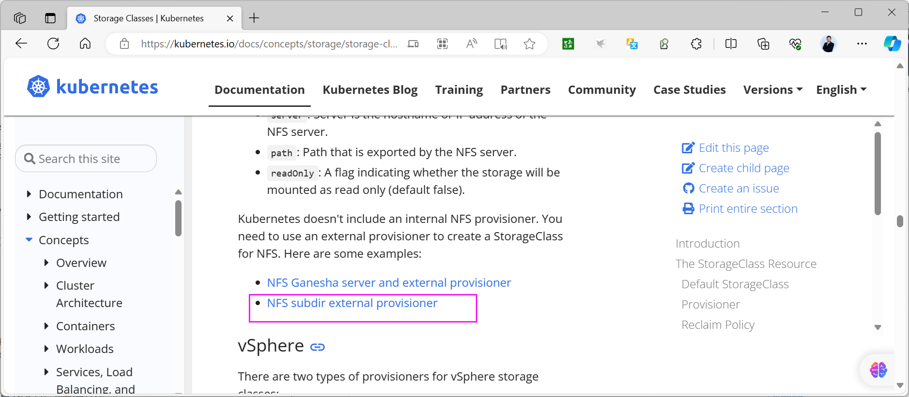

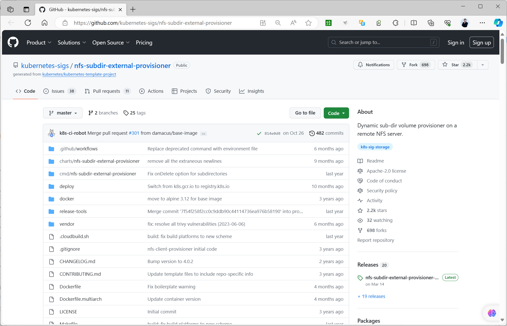

### 3.2 使用 Helm 安装子目录制备器

先在独立 NFS 服务器上准备导出目录，限制可访问网段，确认所有工作节点都能挂载。生产环境不要直接照搬原实验的全网段导出或 `no_root_squash`。安装时锁定 chart 版本，并按本集群的网络和权限配置修改：

```bash
helm repo add nfs-subdir-external-provisioner \
  https://kubernetes-sigs.github.io/nfs-subdir-external-provisioner/
helm repo update
helm install nfs-subdir nfs-subdir-external-provisioner/nfs-subdir-external-provisioner \
  --namespace storage --create-namespace \
  --set nfs.server=10.0.0.100 \
  --set nfs.path=/exports/k8s \
  --set storageClass.name=nfs-client
```

安装后检查制备器 Pod 与 StorageClass，再提交测试 PVC。不要只检查 `Bound`：还要在 NFS 服务端确认目录、从 Pod 写入和读取文件、删除 PVC 后检查数据去向。

```yaml
apiVersion: v1
kind: PersistentVolumeClaim
metadata:
  name: shared-demo
spec:
  storageClassName: nfs-client
  accessModes: [ReadWriteMany]
  resources:
    requests:
      storage: 2Gi
```

```bash
kubectl get pods -n storage
kubectl get sc
kubectl get pvc shared-demo
kubectl describe pvc shared-demo
```

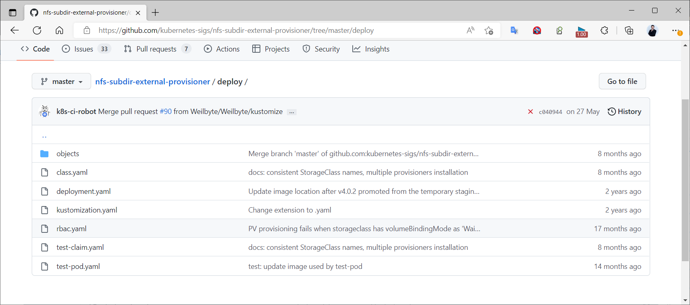

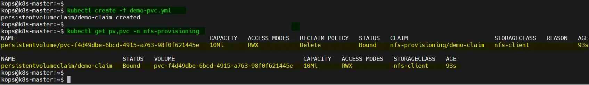


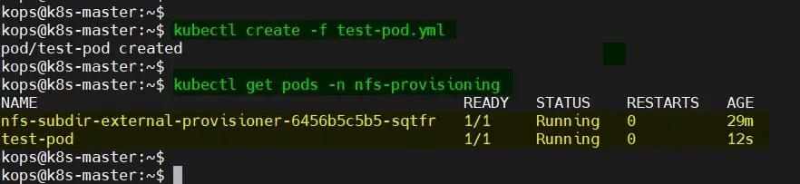

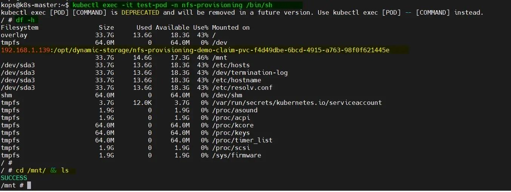

若改用 `csi-driver-nfs`，先按其官方文档安装与当前 Kubernetes 版本兼容的驱动，再使用驱动提供的 SC 或静态 PV。不要把旧笔记中某个版本的安装脚本、`volumeHandle` 示例和子目录制备器的参数拼成一套配置。

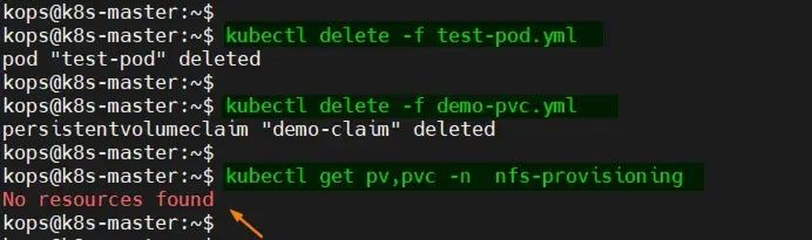

### 3.3 默认 StorageClass

默认类通过 `storageclass.kubernetes.io/is-default-class: "true"` 注解标记。切换前先列出所有类，核对现有 PVC 的来源与未来 PVC 的预期去向，再把旧类改为非默认、把新类设为默认，最后重新查询确认。最好保持 **一个**默认类；若意外存在多个，较新的 Kubernetes 行为可能选择最新创建的默认类，不能依赖这种隐含选择。

```bash
kubectl get storageclass
kubectl annotate storageclass old-class \
  storageclass.kubernetes.io/is-default-class="false" --overwrite
kubectl annotate storageclass nfs-client \
  storageclass.kubernetes.io/is-default-class="true" --overwrite
kubectl get storageclass
```

想让某个 PVC 不走默认类，应显式设置 `storageClassName: ""`；删除默认 SC 不一定有效，因为集群插件可能重新创建它。默认类的更换影响后续声明，不会自动把已绑定的数据迁到新后端。

## 4 OpenEBS：理解产品边界再选择引擎

OpenEBS 将本地存储或复制存储能力集成到 Kubernetes，提供不同引擎与 CSI/制备器。**Local PV Hostpath、LVM、ZFS 与复制卷不是同一种故障语义**：Local PV 依赖节点本地数据，复制引擎才可能通过多个节点保存副本，但需要足够的磁盘、网络与相应的故障域设计。图示展示的是产品架构与若干历史组件，实际可用引擎、Chart 参数和默认安装内容以所选版本文档为准。

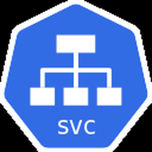

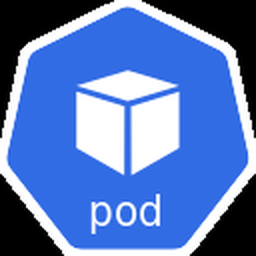

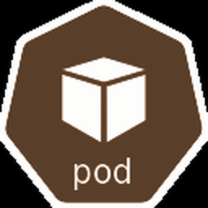

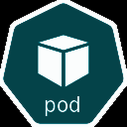

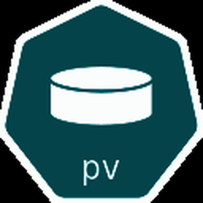


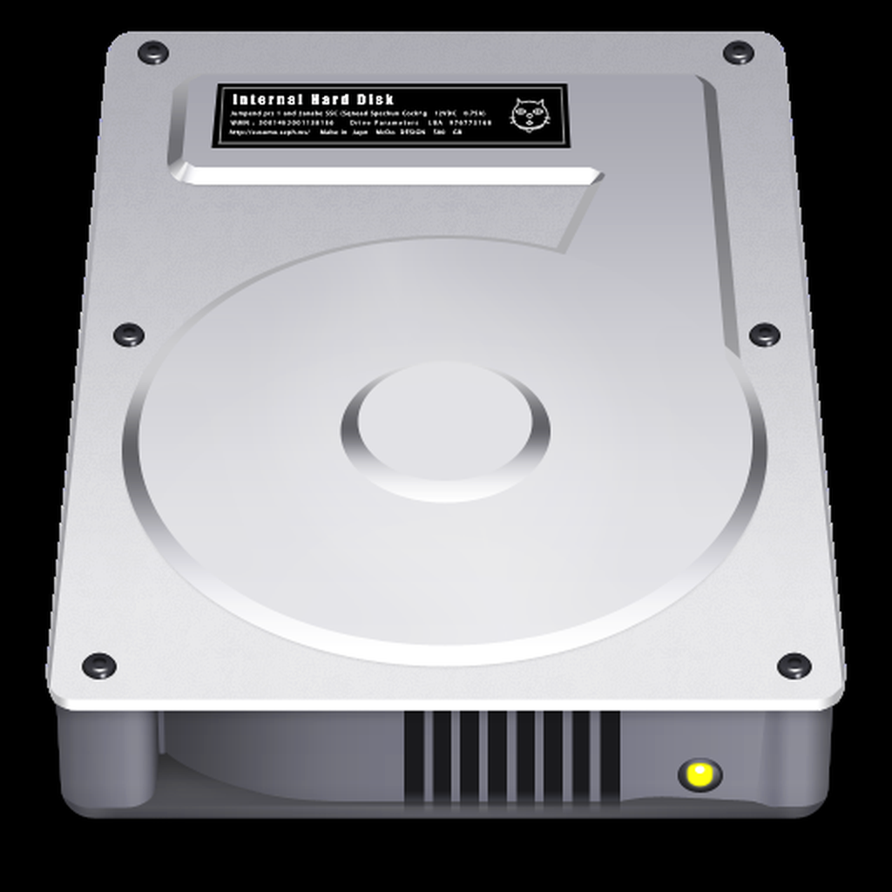

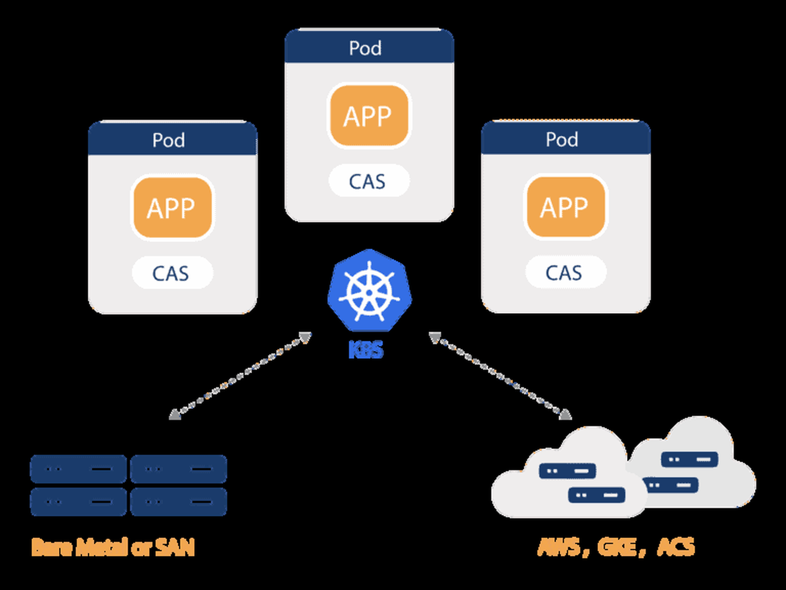

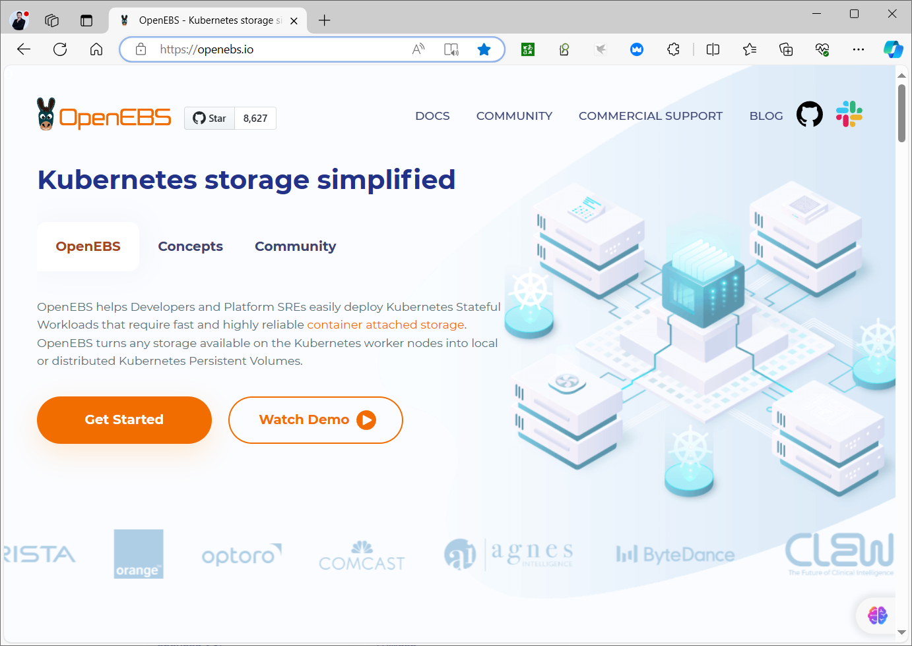

实验环境可先添加仓库、查看 chart 版本与 values，再根据希望使用的引擎决定安装参数。原笔记中的 OpenEBS 4.0.1 Pod 列表只是当时的示例，不能作为所有版本都应出现同名 Pod 的验收标准。

```bash
helm repo add openebs https://openebs.github.io/openebs
helm repo update
helm show chart openebs/openebs
helm show values openebs/openebs > openebs-values.yaml
helm install openebs openebs/openebs \
  --namespace openebs --create-namespace \
  --values openebs-values.yaml
kubectl get pods -n openebs
kubectl get storageclass
```

安装前核对 Kubernetes 版本、节点内核与磁盘要求，并先决定是本地卷还是复制卷；安装后用测试 PVC 做写入、Pod 重建与节点故障演练，检查数据是否符合预期。不要把“Helm Release 已部署”当作数据已经具备高可用。

## 5 选择与验证

静态 Local PV 适合有自主复制/恢复能力且追求本地性能的应用；NFS 动态供应适合共享文件场景，但要解决 NFS 服务端与网络故障；OpenEBS 需要根据具体引擎选择本地或复制语义。三者都应验证：`PVC Bound`、Pod 可挂载、实际读写、重调度后的数据、扩容与回收行为，以及备份恢复。接下来 ConfigMap/Secret 处理的是配置与凭据注入，不应拿它们替代业务数据卷。



<nav class="article-end" aria-label="章节导航">
  <a href="{{ '/subjects/Kubernetes/21-storage-volumes-pv-pvc.html' | relative_url }}">← 上一篇：存储卷、PV 与 PVC</a>
  <a href="{{ '/subjects/Kubernetes/' | relative_url }}">返回 Kubernetes 目录</a>
  <a href="{{ '/subjects/Kubernetes/23-configmap-secret.html' | relative_url }}">下一篇：ConfigMap、Secret 与配置注入 →</a>
</nav>
