[← 返回 Kubernetes 目录]({{ '/subjects/Kubernetes/' | relative_url }})



# 23 ConfigMap、Secret 与配置注入

程序镜像应尽量独立于部署环境：普通配置交给 ConfigMap，凭据交给 Secret；Pod 再以环境变量或文件挂载等方式读取。Downward API 提供 Pod 自身的元数据与资源信息，Projected 卷则能把几类来源组合到一个目录。本篇重点是创建、引用、更新后的行为和保护边界。


## 1 ConfigMap：普通配置

ConfigMap 是命名空间内的 API 对象，常用 `data` 保存 UTF-8 字符串，`binaryData` 保存需 Base64 表示的二进制数据。它适合应用参数、配置文件和非敏感开关，**不适合密码或密钥**。Pod 与 ConfigMap 必须在同一命名空间。配置对象与应用版本应一起管理，并避免单个对象过大。

```yaml
apiVersion: v1
kind: ConfigMap
metadata:
  name: web-config
data:
  MODE: production
  LOG_LEVEL: info
  app.conf: |
    server.port=8080
    feature.audit=true
```

`kubectl create configmap web-config --from-literal=MODE=production` 或 `--from-file=app.conf` 适合快速实验；长期维护建议使用版本化清单，但不要把 Secret 明文一同提交。若设置 `immutable: true`，数据不能原地修改，应新建对象并更新工作负载引用。

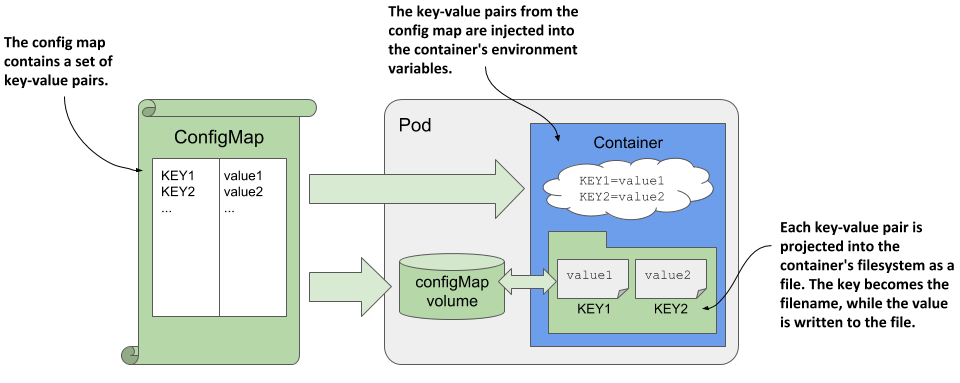

### 1.1 环境变量与文件挂载

环境变量适合少量标量值：`configMapKeyRef` 取单个键，`envFrom` 批量导入。**环境变量在容器启动时确定**，更新 ConfigMap 不会自动刷新已运行进程中的值，通常需要重建 Pod 或滚动发布。

```yaml
env:
  - name: APP_MODE
    valueFrom:
      configMapKeyRef:
        name: web-config
        key: MODE
```

配置文件可用 ConfigMap 卷挂载；每个键映射为目录里的文件，也可用 `items` 选择部分键并指定文件名。Kubelet 会在一段时间后更新普通 ConfigMap 卷，但这不是同步瞬时保证，应用还须支持重载或重启。用 `subPath` 只挂载单个文件时，后续更新**不会**自动投射到该挂载点。

```yaml
volumes:
  - name: config
    configMap:
      name: web-config
      items:
        - key: app.conf
          path: app.conf
containers:
  - name: web
    image: nginx:stable
    volumeMounts:
      - name: config
        mountPath: /etc/app-config
        readOnly: true
```

修改配置前先确定应用能否动态加载。若不能，采用新配置对象、滚动更新 Deployment 并验证就绪状态，比只编辑 ConfigMap 更可靠。排查时用 `kubectl describe pod` 看缺失键或挂载失败事件；`optional: true` 可以放宽对象不存在时的行为，但可能让程序在缺配置的状态下启动。

## 2 Secret：凭据与敏感配置

### 2.1 创建和保护边界

Secret 的 `data` 字段采用 Base64 编码，`stringData` 允许在清单中写可读字符串并由 API Server 转成 `data`。**Base64 不是加密**。应限制读取权限，按集群要求启用 etcd 静态加密，避免把明文放进 Git、终端历史、日志或不受控的备份。Secret 属于命名空间，Pod 引用时必须位于同一命名空间。

```yaml
apiVersion: v1
kind: Secret
metadata:
  name: db-credentials
type: Opaque
stringData:
  username: app_user
  password: 从受保护的部署流程注入
```

上面的值仅用于说明字段结构，不应把真实凭据写进示例文件。命令式创建可用 `kubectl create secret generic`，但参数、环境变量和 shell 历史也可能泄露内容。实际交付可结合秘密管理系统、外部 Secret 控制器或受控的部署管道。

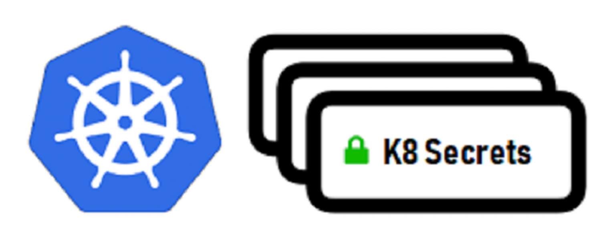

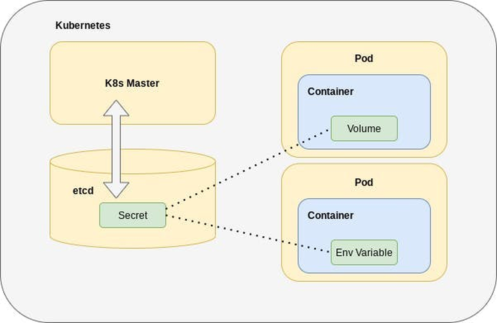

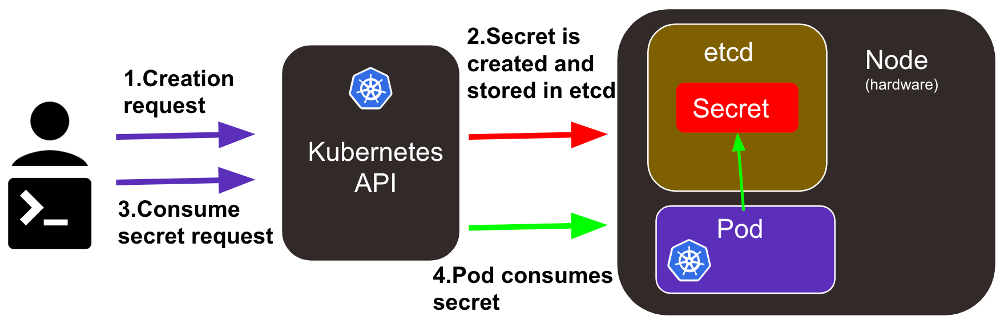

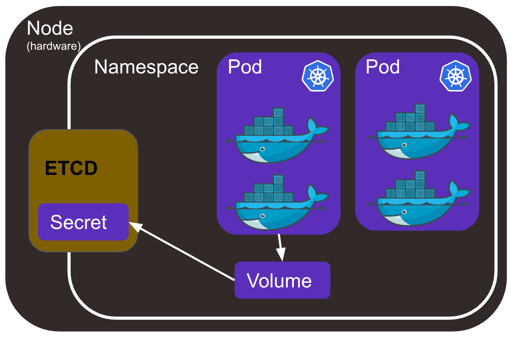

### 2.2 作为环境变量或卷使用

环境变量引用用 `secretKeyRef`，与 ConfigMap 一样，Secret 改动不会更新已启动进程的环境变量。Secret 卷会把键投射为文件，普通挂载可在 kubelet 更新后反映新内容，但应用必须重新读取；`subPath` 挂载不自动更新。不要在日志中打印 Secret，也不要因为容器里文件只读就认为有读取权限的主体无法取得它。

```yaml
env:
  - name: DB_USER
    valueFrom:
      secretKeyRef:
        name: db-credentials
        key: username
volumes:
  - name: db-secret
    secret:
      secretName: db-credentials
containers:
  - name: app
    image: busybox:stable
    command: ["sh", "-c", "sleep 3600"]
    volumeMounts:
      - name: db-secret
        mountPath: /run/secrets/db
        readOnly: true
```

上例同时展示两种引用方式，业务通常按程序接口选择其一。若用 Secret 初始化数据库密码，记住“容器重建时再次注入”不等于“修改 Secret 后数据库原有账号密码自动变化”；凭据轮换需协调服务端与客户端。

### 2.3 TLS、镜像仓库和服务账号

TLS 证书通常以 `kubernetes.io/tls` 类型保存，包含 `tls.crt` 和 `tls.key`。Ingress 引用它完成 HTTPS 终止，证书更新后应检查 Ingress Controller 是否重新加载，并验证实际握手证书、到期时间和域名匹配。

```bash
kubectl create secret tls web-tls --cert=./tls.crt --key=./tls.key
kubectl get secret web-tls
```


私有镜像仓库凭据使用 `kubernetes.io/dockerconfigjson` 类型，Pod 通过 `imagePullSecrets` 引用同命名空间的 Secret。它只参与拉取镜像，不会自动给运行中的应用提供仓库账号。

```yaml
spec:
  imagePullSecrets:
    - name: regcred
  containers:
    - name: app
      image: registry.example.com/team/app:1.0
```

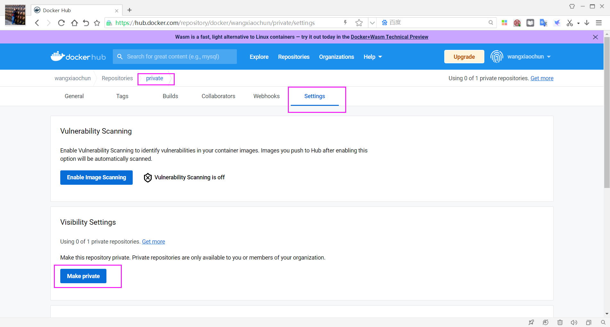

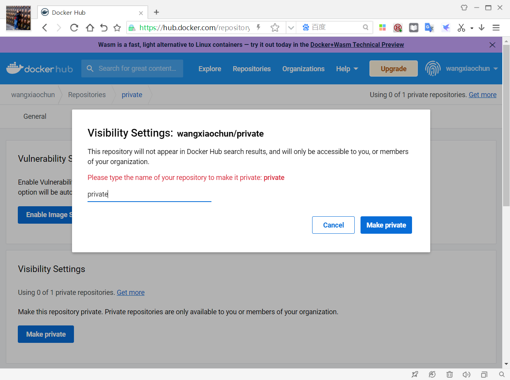

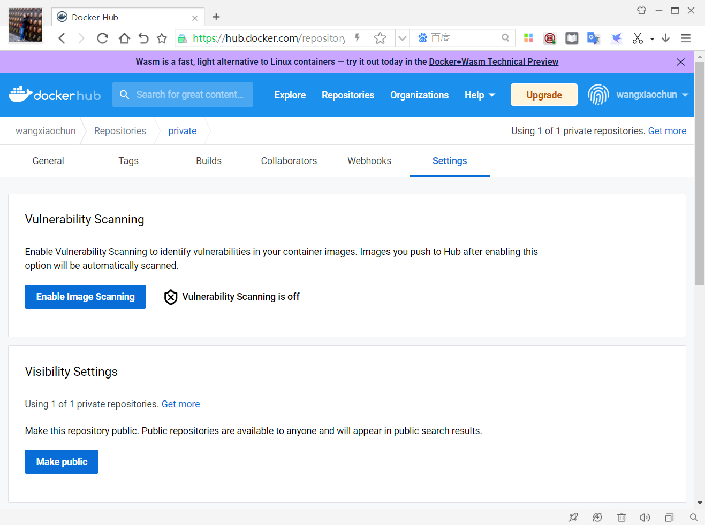

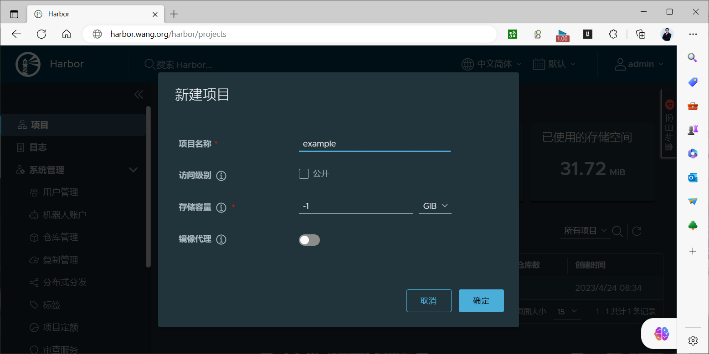

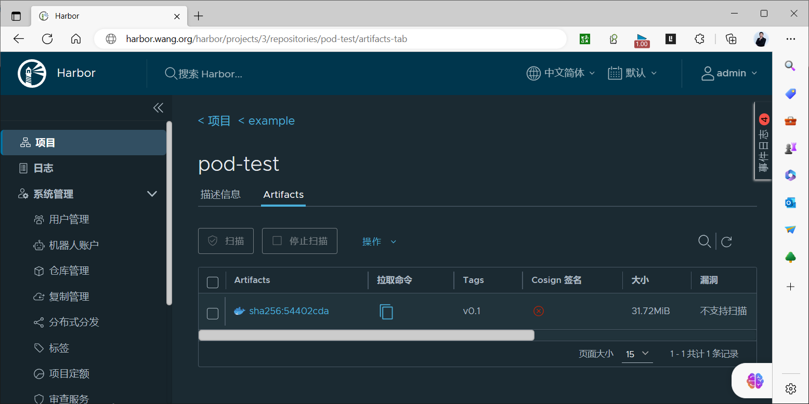

旧资料通过手工创建长期有效的 ServiceAccount Token Secret 演示认证；新集群通常使用 TokenRequest API 和自动投射的短期令牌。工作负载只应获得必要的 RBAC 权限，不要把服务账号令牌当成普通应用密码长期复制和分发。

## 3 Downward API：读取 Pod 自身信息

Downward API 把 Pod 的字段或容器资源请求/限制暴露给容器，不需要容器直接访问 Kubernetes API。`fieldRef` 可取 Pod 名称、命名空间、UID、标签/注解等支持的字段；`resourceFieldRef` 可取 CPU/内存请求或限制。环境变量在启动时固定，文件方式对部分字段可以更新，使用前应核对所需字段是否支持所选方式。

```yaml
env:
  - name: POD_NAME
    valueFrom:
      fieldRef:
        fieldPath: metadata.name
  - name: POD_NAMESPACE
    valueFrom:
      fieldRef:
        fieldPath: metadata.namespace
  - name: CPU_LIMIT
    valueFrom:
      resourceFieldRef:
        containerName: app
        resource: limits.cpu
```

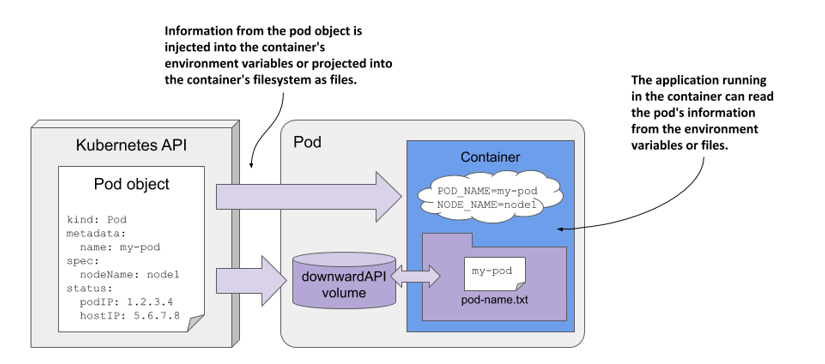

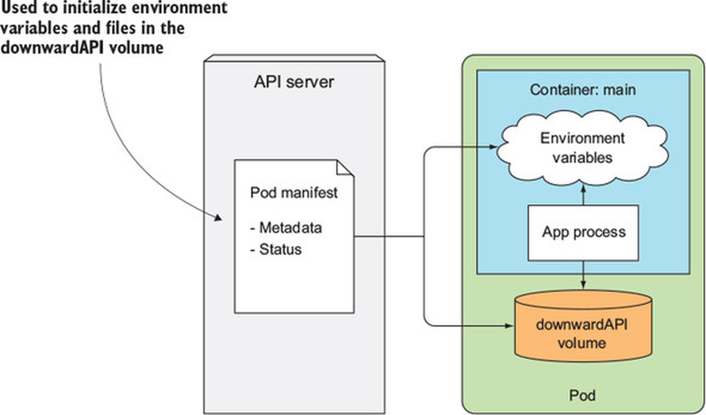

## 4 Projected 卷：组合多个配置源

一个 `projected` 卷可以把 Secret、ConfigMap、Downward API、ServiceAccount Token 等来源投射到同一个目录，适合应用集中读取多类配置。应给不同来源规划不冲突的文件名，并控制 Secret 文件权限。令牌投射可指定受众与有效期，由 kubelet 负责轮换；应用必须支持重新读取令牌。

```yaml
volumes:
  - name: app-context
    projected:
      defaultMode: 0440
      sources:
        - configMap:
            name: web-config
            items:
              - key: app.conf
                path: app.conf
        - secret:
            name: db-credentials
            items:
              - key: username
                path: db/username
        - downwardAPI:
            items:
              - path: pod-name
                fieldRef:
                  fieldPath: metadata.name
```

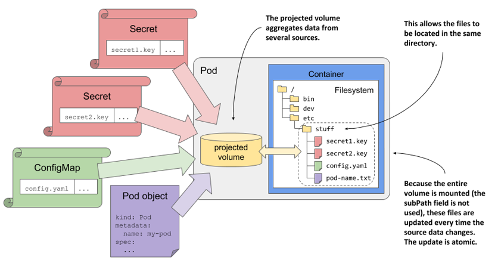

## 5 更新与验证

配置变更后不要只看 `kubectl apply` 的成功提示。检查对象、Pod 事件、容器里的实际环境变量或文件、应用是否重新加载，并用业务请求确认效果。环境变量变更需重建 Pod；普通投射卷有传播延迟；`subPath` 不自动更新。Secret 还需验证 RBAC、etcd 加密和凭据轮换流程。



<nav class="article-end" aria-label="章节导航">
  <a href="{{ '/subjects/Kubernetes/22-storageclass-openebs.html' | relative_url }}">← 上一篇：StorageClass 与 OpenEBS</a>
  <a href="{{ '/subjects/Kubernetes/' | relative_url }}">返回 Kubernetes 目录</a>
  <a href="{{ '/subjects/Kubernetes/24-storage-wordpress-mysql.html' | relative_url }}">下一篇：WordPress 与 MySQL 存储实践 →</a>
</nav>
