[← 返回 Kubernetes 目录]({{ '/subjects/Kubernetes/' | relative_url }})



# 23 ConfigMap、Secret 与配置注入

# 2 配置管理


## 2.1 配置说明

### 2.1.1 配置介绍

生产中的应用程序，一般都会涉及到配置文件，而配置文件经常会有变更，比如: 数据库连接,代码版本号,证书更新等。

典型场景：

项目经历开发环境、测试环境、预发布环境、线上环境才能完成发布，而每个环境都有定义其独立的各种配置，这些配置手工操作很繁杂，一些流行的开源项目,比如: Nacos,Consul,Apollo等可以实现配置管理,  还有大公司专门开发了专用配置管理中心，如百度的disconf等。但通常此方法需要开发者参与，通过开发者写代码实现调用，并且和某种开发语言深度绑定。

在容器化大行其道的当前，在为容器化应用提供配置信息方法一般有下面方法。

向容器提供配置信息有以下方式：

1. 制作镜像时，提前将配置文件复制到镜像中。
2. 制作镜像时内置环境变量，并在启动容器时通过环境变量传递配置数据；容器启动后无法再传递新的环境变量。
3. 启动容器时通过存储卷传递配置文件，但需提前准备外部存储。
4. 启动容器时传递自定义命令、选项和参数。

kubernetes作为分布式容器调度平台，同样会遇到配置变更的问题，如果将资源删除，重新修改配置再重新创建，这种方法太繁琐。

kubernetes提供了对 Pod 容器应用可以实现集中式的配置管理功能的相关资源：

ConfigMap Secret downwardAPI Projected

通过这些组件来实现向pod中的容器应用中注入配置信息的机制，从而避免了开发者参与。

注意：对于运行中容器的配置改变，还需要通过应用程序重载相关配置才能生效。

### 2.1.2 配置组件简介

```text
https://kubernetes.io/zh-cn/docs/concepts/configuration/
```

#### 2.1.2.1 Configmap

Configmap是Kubernetes集群中非常重要的一种配置管理资源对象。借助于ConfigMap API可以向pod中的容器中注入配置信息。ConfigMap不仅可以保存环境变量或命令行参数等属性，也可以用来保存整个配置文件或者JSON格式的文件。

各种配置属性和数据以 k/v或嵌套k/v 样式  存在到Configmap中。

注意：所有的配置信息都是以明文的方式来进行保存，实现资源配置的快速获取或者更新。

#### 2.1.2.2 Secret

Kubernetes集群中，有一些配置属性信息是非常敏感的，所以这些信息在传递的过程中，是不希望其他人能够看到的。Kubernetes提供了一种加密场景中的配置管理资源对象Secret。它在进行数据传输之前，会对数据进行编码，在数据获取的时候，会对数据进行解码。从而保证整个数据传输过程的安全。

注意：这些数据通常采用Base64机制保存，所以安全性一般。

#### 2.1.2.3 DownwardAPI

downwardAPI 为运行在pod中的应用容器提供了一种反向引用。让容器中的应用程序了解所处pod或Node的一些基础外部属性信息。从严格意义上来说，downwardAPI不是存储卷，它自身就存在。相较于configmap、secret等资源对象需要创建后才能使用，而downwardAPI引用的是Pod自身的运行环境信息，这些信息在Pod启动的时候就存在。

#### 2.1.2.4 Projected

一个 projected Volumes 投射卷可以将若干现有的卷源映射到容器内的同一个目录之上。

## 2.2  ConfigMap

### 2.2.1 ConfigMap 说明

```text
https://kubernetes.io/zh-cn/docs/concepts/configuration/configmap/
https://kubernetes.io/zh-cn/docs/tasks/configure-pod-container/configure-pod-
configmap/
```

Kubernetes提供了对pod中容器应用的集中配置管理组件：ConfigMap。通过ConfigMap来实现向pod中的容器中注入配置信息的机制。可以把configmap理解为Linux系统中的/etc目录，专门用来存储配置文件的目录。Kubernetes借助于ConfigMap对象实现了将配置信息从容器镜像中解耦，从而增强了工作负载的可移樟性、使其配置更易于更改和管理并避免了将配置数据硬编码到Pod配置清单中。

ConfigMap不仅仅可以保存单个属性，也可以用来保存整个配置文件。

虽然configmap可以对各种应用程序提供定制配置服务，但是一般不用它来替代专门的配置文件，

从Kubernetes v1.19版本开始，ConfigMap和Secret支持使用immutable字段创建不可变实例，实现不可变基础设施效果。

注意: Configmap 属于名称空间级别,只能被同一个名称空间的Pod引用。

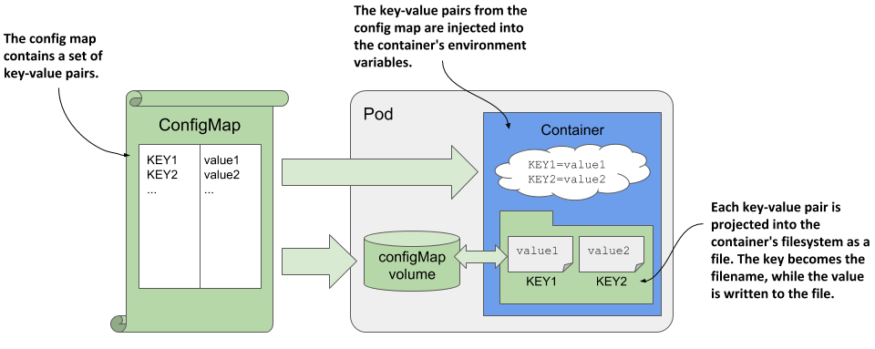

**基本属性**

```text
#kubectl explain cm
binaryData      #二进制数据
data            #文本数据，支持变量和文件
immutable <boolean>  #设为true，不能被修改只能删除，默认为nil可以随时被修改
#注意：基于data的方式传递信息的话，会在pod的容器内部生成一个单独的数据文件
```

**数据配置的格式**

```text
#单行配置数据格式
属性名称key: 属性值value   #单行配置内容，一般保存变量，参数等
文件名：单行内容            #配置文件如果只有一行，也使用此方式，key为文件名，value为文件内容
```

```text
#多行文件数据格式
文件名称1: |     #注意：| 是"多行键值"的标识符
文件内容行1    #内容大小不能超过1M
文件内容行2
......
文件名称2: |     #注意：| 是"多行键值"的标识符
文件内容行1    #内容大小不能超过1M
文件内容行2
......
```

configmap资源类型的创建，与Kubernetes的其他很多资源对象的创建方式一样，主要涉及到两种方式：

命令行工具：配置中有大量简单的键值对时建议使用资源定义文件：配置为大量文本内容时建议使用，此方式需要事先准备在资源清单元文件中加入配置文件内容。

虽然 configMap 支持动态更新，但仍可能出现对应的Pod无法自动加载已更新的配置信息而导致无法生效的情况。

注意:

如果Pod是以subPath 的形式挂载ConfigMap和Secret,那么Pod是不会自动感知到ConfigMap和Secret的更新如果Pod 的变量来自于ConfigMap和Secret中定义的内容,那么ConfigMap和Secret更新后，也不会更新Pod中的变量。通常为了避免配置更新后没有生效的问题，可以在更新 ConfigMap 之后，手动重创建相关的 Pod 或者Deployment。

运维方式：可以通过 重启 或 重建 的方式。

使用 kubectl rollout restart 命令来重启 Deployment使用 kubectl delete pod 命令来删除 Pod，从而触发 Pod 的重启。

应用程序方式：不断探测挂载后的 config 的内容变化， 程序自身支持进行热加载操作。

### 2.2.2 ConfigMap 创建和更新

#### 2.2.2.1 命令行创建方式

##### 2.2.2.1.1 命令行创建方式说明

**命令参数**

```text
#创建命令格式
kubectl create configmap NAME [--from-file=[key=]source] [--from-
literal=key1=value1] [--dry-run=server|client|none] [-n <namespace>] [options]
```

```text
#参数详解:
--from-literal=key1=value1          #以设置键值对的方式实现变量配置数据
--from-env-file=/PATH/TO/FILE       #以环境变量专用文件的方式实现配置数据
--from-file=[key=]/PATH/TO/FILE     #以配置文件的方式创建配置文件数据，如不指定key，FILE
名称为key名
--from-file=/PATH/TO/DIR            #以配置文件所在目录的方式创建配置文件数据
```

```text
--dry-run=client -o yaml            #测试运行并显示cm内容
```

```text
#查看configmap
kubectl create configmap <cm_name> -n <namespace> [-o yaml] --dry-run=client
kubectl get configmap <cm_name> -n <namespace>
kubectl describe configmap <cm_name> -n <namespace>
```

```text
#删除configmap
kubectl delete configmap <cm_name> [-n <namespace>]
```

##### 2.2.2.1.2 命令行创建方式案例

范例：命令行创建基于key/value形式的变量配置

```text
#在使用kubectl创建的时候，通过在命令行直接传递键值对创建
[root@master1 ~]#kubectl create configmap cm-test1 --from-literal=key1='value1' -
-from-literal=key2='value2'
```

```text
[root@master1 ~]#kubectl get cm
NAME               DATA   AGE
cm-test1           2      72s
kube-root-ca.crt   1      30d
```

```text
[root@master1 ~]#kubectl get cm cm-test1 -o yaml
apiVersion: v1
data:
key1: value1
key2: value2
kind: ConfigMap
metadata:
creationTimestamp: "2021-03-24T08:35:05Z"
name: cm-test1
namespace: default
resourceVersion: "651484"
uid: 0fae9ad6-7cf0-448b-a46f-3b4dffa91c23
```

```text
[root@master1 ~]#kubectl describe cm cm-test1
Name:         cm-test1
Namespace:    default
Labels:       <none>
Annotations:  <none>
```

```text
Data
====
key2:
----
value2
key1:
----
value1
```

```text
BinaryData
====
```

```text
Events:  <none>
```

```text
#删除CM
[root@master1 ~]#kubectl delete cm cm-test1
```

范例:  命令行创建基于key/value形式的变量配置

```text
#创建CM
[root@master1 ~]#kubectl create configmap pod-test-config  --from-
literal=host="127.0.0.1" --from-literal=port="8888"
configmap/pod-test-config created
```

```text
#验证创建成功
[root@master1 ~]#kubectl get cm
NAME               DATA   AGE
kube-root-ca.crt   1      107d
pod-test-config    2      5s
```

```text
#显示CM内容
[root@master1 ~]#kubectl get cm pod-test-config -o yaml
apiVersion: v1
data:
host: 127.0.0.1
port: "8888"
kind: ConfigMap
metadata:
creationTimestamp: "2021-02-02T08:23:36Z"
name: pod-test-config
namespace: default
resourceVersion: "46375"
uid: cef1aeb9-4b7d-4850-9b87-363c534f6e3a
```

```text
#删除CM
[root@master1 ~]#kubectl delete cm pod-test-config
```

范例: 命令行创建基于环境变量文件的变量配置

```text
#如果变量较多，使用上面方式一个个的设定环境变量太繁琐，可以全部添加到环境变量文件中然后基于它来创
建CM。
#定制环境变量文件
[root@master1 ~]#cat conf.d/env
key1=value1
key2=value2
#注意：env文件中所有的配置项以 "属性名=属性值" 格式定制
```

```text
#将所有环境变量添加到到configmap中
[root@master1 ~]#kubectl create configmap cm-test2 --from-env-file=conf.d/env
```

```text
[root@master1 ~]#kubectl get cm cm-test2 -o yaml
apiVersion: v1
data:
key1: value1
key2: value2
kind: ConfigMap
metadata:
creationTimestamp: "2021-03-24T08:49:42Z"
name: cm-test2
namespace: default
resourceVersion: "653157"
uid: 9ee7d00f-d2f6-4275-83d6-938bbc898ce5
```

```text
[root@master1 ~]#kubectl describe cm cm-test2
Name:         cm-test2
Namespace:    default
Labels:       <none>
Annotations:  <none>
```

```text
Data
====
key1:
----
value1
key2:
----
value2
```

```text
BinaryData
====
```

```text
Events:  <none>
```

```text
#删除CM
[root@master1 ~]#kubectl delete cm  cm-test2
```

范例：命令行创建基于配置文件的文件形式CM

```text
#直接将多个配置文件创建为一个ConfigMap
[root@master1 ~]#ls conf.d/
app1.conf  app2.conf  app3.conf
```

```text
[root@master1 ~]#cat conf.d/app1.conf
[app1]
config1
```

```text
[root@master1 ~]#cat conf.d/app2.conf
[app2]
config2
```

```text
#文件名自动成为key名
[root@master1 ~]#kubectl create configmap cm-test3 --from-file=./conf.d/app1.conf
--from-file=./conf.d/app2.conf
```

```text
[root@master1 ~]#kubectl get cm cm-test3 -o yaml
apiVersion: v1
data:
app1.conf: |
[app1]
config1
app2.conf: |
[app2]
config2
kind: ConfigMap
metadata:
creationTimestamp: "2021-03-24T08:39:16Z"
name: cm-test3
namespace: default
resourceVersion: "651963"
uid: 4b1b3836-183b-4648-9c3f-7335046e1d89
```

```text
[root@master1 ~]#kubectl describe cm cm-test2
Name:         cm-test3
Namespace:    default
Labels:       <none>
Annotations:  <none>
```

```text
Data
====
app1.conf:
----
[app1]
config1
```

```text
app2.conf:
----
[app2]
config2
```

```text
BinaryData
====
```

```text
Events:  <none>
```

```text
#删除CM
[root@master1 ~]#kubectl delete cm cm-test3
```

范例:  命令行创建基于目录的CM

```text
[root@master1 ~]#ls conf.d/
app1.conf  app2.conf  app3.conf
```

```text
[root@master1 ~]#cat conf.d/app1.conf
[app1]
config1
```

```text
[root@master1 ~]#cat conf.d/app2.conf
[app2]
config2
```

```text
[root@master1 ~]#cat conf.d/app3.conf
[app3]
config3
```

```text
#直接将一个目录下的所有配置文件创建为一个ConfigMap
[root@master1 ~]#kubectl create configmap cm-test4 --from-file=./conf.d/
```

```text
#结果显示：多个文件之间，属性名是文件名，属性值是文件内容
[root@master1 ~]#kubectl get cm cm-test4 -o yaml
apiVersion: v1
data:
app1.conf: |
[app1]
config1
app2.conf: |
[app2]
config2
app3.conf: |
[app3]
config3
kind: ConfigMap
metadata:
creationTimestamp: "2021-03-24T08:41:15Z"
name: cm-test3
namespace: default
resourceVersion: "652190"
uid: e5453f19-0947-4468-af29-11fb9e88567c
```

```text
#结果显示：多个文件之间，属性名是文件名，属性值是文件内容
[root@master1 ~]#kubectl describe cm cm-test4
Name:         cm-test4
Namespace:    default
Labels:       <none>
Annotations:  <none>
```

```text
Data
====
app1.conf:
----
[app1]
config1
```

```text
app2.conf:
----
[app2]
config2
```

```text
app3.conf:
----
[app3]
config3
```

```text
BinaryData
====
```

```text
Events:  <none>
```

```text
#删除CM
[root@master1 ~]#kubectl delete cm cm-test4
```

#### 2.2.2.2 资源清单文件创建方式

##### 2.2.2.2.1 资源清单文件格式说明

**资源清单文件命令格式**

```text
#清单文件格式
apiVersion: v1
kind: ConfigMap
metadata:
name: cm_name
namespace: default
data:
key: value   #配置信息如果只有一行，也使用此方式，使用卷挂载时，key即为文件名，value为文件
内容
文件名: |     #配置文件有多行使用此方式
文件内容行1
文件内容行2
.....
#注意：CM的清单文件没有spec信息，而是data
```

```text
#命令式:
kubectl create -f /path/file
#声明式
kubectl apply -f /path/file
```

注意：此方式需要事先将配置文件的内容全部写入清单文件，而且配置文件的格式需要调整才能匹配，所以很不方便，推荐如下方式解决。

先在命令行执行时指定配置文件的方式创建 CM通过 kubectl get cm  <CM_NAME> -o yaml  > cm.yaml 方式导出资源清单文件或者 kubectl create configmap NAME --dry-run=client -o yaml > cm.yaml 方式导出资源清单文件最后调整和修改上面生成的 yaml资源清单文件

##### 2.2.2.2.2 资源清单文件创建方式案例

范例

```text
#资源定义文件
[root@master1 ~]#cat storage-configmap-test.yaml
apiVersion: v1
kind: ConfigMap
metadata:
name: config-test
data:
author: wangxiaochun
file.conf: |
[class]
linux
go
java
```

```text
#注释：data：部分内容是真正的配置项，有两种格式：
#author: 是Key/value格式
#file.conf: | 是文件格式
```

```text
#创建资源对象
[root@master1 ~]#kubectl apply  -f storage-configmap-test.yaml
```

```text
#查看
[root@master1 ~]#kubectl get cm
NAME               DATA   AGE
config-test        2      3s
kube-root-ca.crt   1      30d
```

```text
[root@master1 ~]#kubectl describe cm config-test
Name:         config-test
Namespace:    default
Labels:       <none>
Annotations:  <none>
```

```text
Data
====
author:
----
wangxiaochun
file.conf:
----
[class]
linux
go
java
```

```text
BinaryData
====
```

```text
Events:  <none>
#结果显示：定义了两种类型的配置属性：文件样式和数据样式，都是以kv样式展示，属性名key和属性值
value中间使用 "----" 来隔开
```

```text
#可以在线修改
[root@master1 ~]#kubectl edit cm config-test
```

```text
#删除
[root@master1 ~]#kubectl delete cm config-test
```

范例:  只读的configmap

```text
[root@master1 ~]#cat storage-configmap-immutable-test.yaml
apiVersion: v1
kind: ConfigMap
metadata:
name: cm-immutable-test
data:
author: wangxiaochun
file.conf: |
[class]
```

```text
linux
go
java
immutable: true  #只读
```

```text
[root@master1 ~]#kubectl apply -f storage-configmap-immutable-test.yaml
```

```text
[root@master1 ~]#kubectl get cm cm-immutable-test
NAME                DATA   AGE
cm-immutable-test   2      3m2s
```

```text
#在线修改configmap提示出错
[root@master1 ~]#kubectl edit cm  cm-immutable-test
# * data: Forbidden: field is immutable when `immutable` is set
```

```text
#可以删除
[root@master1 ~]#kubectl delete cm cm-immutable-test
configmap "cm-immutable-test" deleted
```

```text
[root@master1 ~]#kubectl get cm
NAME               DATA   AGE
kube-root-ca.crt   1      17d
```

范例：生成redis配置文件对应的cm

```text
[root@master1 ~]#kubectl create cm cm-redis --from-file /tmp/redis.conf  --dry-
run=client -o yaml > cm-redis.yaml
```

```text
#查看生成的文件内容
[root@master1 config]#head cm-redis.yaml
apiVersion: v1
data:
redis.conf: "# Redis configuration file example.\n#\n# Note that in order to
read
the configuration file, Redis must be\n# started with the file path as first
argument:\n#\n#
./redis-server /path/to/redis.conf\n\n# Note on units: when memory size is
needed,
it is possible to specify\n# it in the usual form of 1k 5GB 4M and so
forth:\n#\n#
1k => 1000 bytes\n# 1kb => 1024 bytes\n# 1m => 1000000 bytes\n# 1mb =>
1024*1024
bytes\n# 1g => 1000000000 bytes\n# 1gb => 1024*1024*1024 bytes\n#\n# units
are
case insensitive so 1GB 1Gb 1gB are all the
same.\n\n##################################
INCLUDES ###################################\n\n# Include one or more other
config
......
```

#### 2.2.2.3 在线更新 configmap

注意：configmap虽然支持在线更新，但是configmap更新后可能不会对已有的Pod的应用生效，可能还需要重建Pod才能生效。

```text
#创建 configmap
```

```text
[root@master1 ~]#kubectl create cm cm-nginx-conf --from-file=nginx.conf
```

```text
#修改configmap
#方法1,旧版中如果配置内容如果不大,多行内容可以显示在一行,但此方式不方便修改,但如果过大,此方式只
能显示大小,而非内容,所以不能修改,新版无此问题
[root@master1 ~]#kubectl edit cm cm-nginx-conf
```

```text
#方法2
[root@master1 ~]#kubectl get cm cm-nginx-conf  -o yaml > cm-config-conf.yaml
[root@master1 ~]#cp cm-config-conf.yaml cm-config-conf.yaml.bak
[root@master1 ~]#vim cm-config-conf.yaml
[root@master1 ~]#kubectl apply -f cm-config-conf.yaml
```

```text
#方法3
#修改配置
[root@master1 ~]#vim nginx.conf
[root@master1 ~]#kubectl create cm cm-nginx-conf --from-file=nginx.conf --dry-
run=client -oyaml | kubectl apply -f -
```

### 2.2.3 ConfigMap 使用

使用ConfigMap主要有两种方式：

通过环境变量的方式直接传递pod使用volume的方式挂载入到pod内的文件中。

注意：

ConfigMap必须在Pod之前创建与ConfigMap在同一个namespace内的pod才能使用ConfigMap，即ConfigMap不能跨命名空间调用。ConfigMap通常存放的数据不要超过1M CM 可以支持实时更新，在原来的pod里面直接看到效果。

#### 2.2.3.1 通过环境变量的方式直接传递 Pod

引用ConfigMap对象上特定的key，以valueFrom赋值给Pod上指定的环境变量。也可以在Pod上使用envFrom一次性导入ConfigMap对象上的所有的key-value,key(可以统一附加特定前缀）即为环境变量,value自动成为相应的变量值。环境变量是容器启动时注入的，容器启动后变量的值不会随CM更改而发生变化,即一次性加载configmap,除非删除容器重建。通过环境变量脚本的方式，预处理这些配置信息。

注意：环境变量的名称如果要用横线的话，最好使用下划线 _。

环境变量格式

方式1：env 对指定的变量一个一个赋值

```text
kubectl explain pod.spec.containers.env
name            #手工定制环境变量时，设置环境变量的名称，必选字段
value           #手工定制环境变量时，直接设置环境变量的属性值，不通过CM获取配置，可选字
段
valueFrom       #手工定制环境变量时，设置环境变量的属性来源，可以支持从
CM,Secret,downwordAPI获取
```

```text
kubectl explain pod.spec.containers.env.valueFrom.configMapKeyRef
name            #引用指定的configmap
key             #引用指定的configmap中的具体哪个key
optional        #如果设置为false，标识该项是必选项，如果设置为true标识这个key是可选
的。默认false
```

```text
#此方式实现过程
1）容器中自定义环境变量名
2）根据CM的名称和Key名，找到对应的value
3) 再将value赋值给容器的环境变量
```

方式2：envFrom 使用CM的所有变量实现对变量的批量赋值，此方式生产更为推荐。

```text
kubectl explain pod.spec.containers.envFrom
configMapRef    #ConfigMap对象中的所有Key
secretKeyRef    #Secret对象中的所有Key
prefix          #为ConfigMap中的每个属性都添加前缀标识
```

```text
#此方实现过程
1）容器中自定义环境变量名，并且和CM的key同名
2）找到指定的CM中所有Key名，将值批量直接赋值给容器中相同名称的变量
```

#### 2.2.3.2 使用volume的方式挂载入到pod内的文件中

在Pod上将 configMap对象引用为存储卷，而后整体由容器mount至某个目录下，key转为文件名，value即为相应的文件内容。在Pod上定义configMap卷时，仅引用其中的部分key，而后由容器mount至目录下。

在容器上仅mount configMap卷上指定的key

容器中挂载的Volume数据可以根据时间戳机制和ConfigMap 同步更新，即configmap变更后会自动加载，但更新时间是不确定的，

而且旧式应用不支持热加载，因此可能不会自动加载更新的配置文件，从而导致配置无法生效。所以一般建议当更新configmap的配置后，可以通过重新Pod使之生效，符合不可变基础设施的理念。推荐滚动升级pod的方式来让ConfigMap内容变化生效。

**volume 格式**

```text
#指定卷信息，引用CM
kubectl explain pod.spec.volumes
name: volume_name  #指定volume名
configMap：
name: CM_name    #指定CM的名称
optional: true|false # 表示是否必须存在
items   <[]Object>
items if unspecified, each key-value pair in the Data field of the
referenced ConfigMap will be projected into the volume as a file whose name
is the key and content is the value. If specified, the listed keys will be
projected into the specified paths, and unlisted keys will not be present.
If a key is specified which is not present in the ConfigMap, the volume
setup will error unless it is marked optional. Paths must be relative and
may not contain the '..' path or start with '..'.
```

```text
#kubectl explain pod.spec.volumes.configMap.items
KIND:     Pod
VERSION:  v1
```

```text
RESOURCE: items <[]Object>
```

```text
DESCRIPTION:
items if unspecified, each key-value pair in the Data field of the
referenced ConfigMap will be projected into the volume as a file whose name
is the key and content is the value. If specified, the listed keys will be
projected into the specified paths, and unlisted keys will not be present.
If a key is specified which is not present in the ConfigMap, the volume
setup will error unless it is marked optional. Paths must be relative and
may not contain the '..' path or start with '..'.
```

```text
Maps a string key to a path within a volume.
```

```text
FIELDS:
key  <string> -required-
key is the key to project.
```

```text
mode <integer>
mode is Optional: mode bits used to set permissions on this file. Must be
an octal value between 0000 and 0777 or a decimal value between 0 and 511.
YAML accepts both octal and decimal values, JSON requires decimal values
for mode bits. If not specified, the volume defaultMode will be used. This
might be in conflict with other options that affect the file mode, like
fsGroup, and the result can be other mode bits set.
```

```text
path <string> -required-
path is the relative path of the file to map the key to. May not be an
absolute path. May not contain the path element '..'. May not start with
the string '..'.
```

```text
#挂载卷到容器内的目录
kubectl explain pod.spec.containers.volumeMounts
volumeMounts:
- name: CM_name    #指定CM的名称
mountPath; /path #容器内的挂载点
readOnly: true   #只读
subPath <string> #Path within the volume from which the container's volume
should be mounted.
Defaults to "" (volume's root).
```

为了实现不同环境使用不 的配置，可以通过下现方式实现。

在configmap 对应的配置文件中使用环境变量，格式：${VAR_NAME}，本质上configmap的成为了模板文件在deployment等通过env定义变量，并引用configmap实现变量替换

### 2.2.4 ConfigMap 实战案例

#### 2.2.4.1 范例：env 变量

```text
#资源清单文件
[root@master1 ~]#cat storage-configmap-simple-env.yaml
apiVersion: v1
kind: ConfigMap
metadata:
name: cm-nginx-config
data:
port: "10086"  #注意:只支持字符串,需要用引号引起来
user: "www"
---
apiVersion: v1
kind: Pod
metadata:
name: configmap-env-test
spec:
containers:
- name: configmap-env-test
image: registry.cn-beijing.aliyuncs.com/wangxiaochun/nginx:1.20.0
env:
- name: NGINX_HOST
value: "10.0.0.100" #直接变量赋值
- name: NGINX_PORT
valueFrom:
configMapKeyRef:
name: cm-nginx-config
key: port
optional: true
- name: NGINX_USER
valueFrom:
configMapKeyRef:
name: cm-nginx-config
key: user
optional: false
#配置解析：这里面我们可以使用两种方式在pod中传递变量
```

```text
#资源创建
[root@master1 ~]#kubectl apply -f storage-configmap-simple-env.yaml
```

```text
[root@master1 ~]#kubectl get cm
NAME               DATA   AGE
cm-nginx-config    2      8s
kube-root-ca.crt   1      30d
```

```text
[root@master1 ~]#kubectl get pod
NAME                 READY   STATUS    RESTARTS   AGE
configmap-env-test   1/1     Running   0          29s
```

```text
[root@master1 ~]#kubectl get cm cm-nginx-config  -o yaml
apiVersion: v1
data:
port: "10086"
user: www
kind: ConfigMap
metadata:
annotations:
```

```text
kubectl.kubernetes.io/last-applied-configuration: |
{"apiVersion":"v1","data":
{"port":"10086","user":"www"},"kind":"ConfigMap","metadata":{"annotations":
{},"name":"cm-nginx-config","namespace":"default"}}
creationTimestamp: "2021-03-24T09:24:43Z"
name: cm-nginx-config
namespace: default
resourceVersion: "657159"
uid: a446750a-2cd1-4d8b-a672-b83caa1808a7
```

```text
[root@master1 ~]#kubectl describe cm cm-nginx-config
Name:         cm-nginx-config
Namespace:    default
Labels:       <none>
Annotations:  <none>
```

```text
Data
====
port:
----
10086
user:
----
www
```

```text
BinaryData
====
```

```text
Events:  <none>
```

```text
#验证变量
[root@master1 ~]#kubectl describe pod configmap-env-test |grep -A 5 Environment
Environment:
NGINX_HOST:  10.0.0.100
NGINX_PORT:  <set to the key 'port' of config map 'cm-nginx-config'>
Optional: true
NGINX_USER:  <set to the key 'user' of config map 'cm-nginx-config'>
Optional: false
Mounts:
/var/run/secrets/kubernetes.io/serviceaccount from kube-api-access-s9hpp
(ro)
```

```text
[root@master1 ~]#kubectl exec -it configmap-env-test  -- env
PATH=/usr/local/sbin:/usr/local/bin:/usr/sbin:/usr/bin:/sbin:/bin
HOSTNAME=configmap-env-test
TERM=xterm
NGINX_HOST=10.0.0.100
NGINX_PORT=10086
NGINX_USER=www
KUBERNETES_PORT_443_TCP=tcp://192.168.0.1:443
KUBERNETES_PORT_443_TCP_PROTO=tcp
KUBERNETES_PORT_443_TCP_PORT=443
KUBERNETES_PORT_443_TCP_ADDR=192.168.0.1
KUBERNETES_SERVICE_HOST=192.168.0.1
KUBERNETES_SERVICE_PORT=443
KUBERNETES_SERVICE_PORT_HTTPS=443
KUBERNETES_PORT=tcp://192.168.0.1:443
NGINX_VERSION=1.20.0
```

```text
NJS_VERSION=0.5.3
PKG_RELEASE=1~buster
HOME=/root
```

```text
#资源删除
[root@master1 ~]#kubectl delete -f storage-configmap-simple-env.yaml
```

#### 2.2.4.2 范例：env 变量

```text
#查看Pod默认的变量
[root@master1 ~]#kubectl run pod-test --image registry.cn-
beijing.aliyuncs.com/wangxiaochun/pod-test:v0.1
[root@master1 ~]#kubectl exec -it pod-test -- env
PATH=/usr/local/sbin:/usr/local/bin:/usr/sbin:/usr/bin:/sbin:/bin
HOSTNAME=pod-test
TERM=xterm
KUBERNETES_PORT_443_TCP_PROTO=tcp
KUBERNETES_PORT_443_TCP_PORT=443
KUBERNETES_PORT_443_TCP_ADDR=10.96.0.1
KUBERNETES_SERVICE_HOST=10.96.0.1
KUBERNETES_SERVICE_PORT=443
KUBERNETES_SERVICE_PORT_HTTPS=443
KUBERNETES_PORT=tcp://10.96.0.1:443
KUBERNETES_PORT_443_TCP=tcp://10.96.0.1:443
DEPLOYENV=Production
RELEASE=Stable
PS1=[\u@\h \w]\$
HOME=/root
[root@master1 ~]#kubectl delete pod pod-test
```

```text
#创建配置文件
[root@master1 ~]#cat storage-configmap-valueFrom-env.yaml
apiVersion: v1
kind: ConfigMap
metadata:
name: cm-pod-test
namespace: default
data:
host: 0.0.0.0
port: "8888"
```

```text
---
apiVersion: v1
kind: Pod
metadata:
name: configmap-env-demo
spec:
containers:
- image: registry.cn-beijing.aliyuncs.com/wangxiaochun/pod-test:v0.1
name: pod-test
env:
- name: HOST
valueFrom:
configMapKeyRef:
name: cm-pod-test
key: host
```

```text
optional: true  #true时,如果configmap中的key即使不存在,也不会导致容器无法初始
化
- name: PORT
valueFrom:
configMapKeyRef:
name: cm-pod-test
key: port
optional: false #false时,如果configmap中的key不存在,会导致容器无法初始化
```

```text
#应用
[root@master1 ~]#kubectl apply -f storage-configmap-valueFrom-env.yaml
```

```text
[root@master1 ~]#kubectl get pod -o wide
NAME                 READY   STATUS    RESTARTS   AGE   IP           NODE
NOMINATED NODE   READINESS GATES
configmap-env-demo   1/1     Running   0          6s    10.244.3.4
node3.wang.org   <none>           <none>
```

```text
[root@master1 ~]#kubectl exec -it configmap-env-demo -- env
PATH=/usr/local/sbin:/usr/local/bin:/usr/sbin:/usr/bin:/sbin:/bin
HOSTNAME=configmap-env-demo
TERM=xterm
HOST=0.0.0.0
PORT=8888
KUBERNETES_PORT_443_TCP=tcp://10.96.0.1:443
KUBERNETES_PORT_443_TCP_PROTO=tcp
KUBERNETES_PORT_443_TCP_PORT=443
KUBERNETES_PORT_443_TCP_ADDR=10.96.0.1
KUBERNETES_SERVICE_HOST=10.96.0.1
KUBERNETES_SERVICE_PORT=443
KUBERNETES_SERVICE_PORT_HTTPS=443
KUBERNETES_PORT=tcp://10.96.0.1:443
DEPLOYENV=Production
RELEASE=Stable
PS1=[\u@\h \w]\$
HOME=/root
```

```text
[root@master1 ~]#kubectl exec -it configmap-env-demo --  ss -ntl
State          Recv-Q         Send-Q      Local Address:Port           Peer
Address:Port         Process
LISTEN         0              128         0.0.0.0:8888
0.0.0.0:*
```

```text
[root@master1 ~]#curl 10.244.3.4:8888
kubernetes pod-test v0.1!! ClientIP: 10.244.0.0, ServerName: configmap-env-demo,
ServerIP: 10.244.3.4!
```

```text
#资源删除
[root@master1 ~]#kubectl delete -f storage-configmap-valueFrom-env.yaml
```

#### 2.2.4.3 范例：env 变量

可以基于configmap给pod中的命令执行，以变量的方式，传递一些参数。

```text
#清单文件
[root@master1 ~]#cat storage-configmap-simple-envargs.yaml
apiVersion: v1
```

```text
kind: ConfigMap
metadata:
name: cm-command-arg
data:
time: "3600"
---
apiVersion: v1
kind: Pod
metadata:
name: pod-cm-command-arg
spec:
containers:
- name: pod-cm-command-arg-contrainer
image: busybox:1.32.0
command: [ "/bin/sh", "-c", "sleep ${SPECIAL_TIME}" ]
env:
- name: SPECIAL_TIME
valueFrom:
configMapKeyRef:
name: cm-command-arg              #引用configmap
key: time                         #指定CM中的key
- name: NAME                            #也可以直接对环境变量赋值
value: "wangxiaochun"
restartPolicy: Never
```

```text
#应用文件
[root@master1 ~]#kubectl apply  -f storage-configmap-simple-envargs.yaml
```

```text
[root@master1 ~]#kubectl get cm cm-command-arg -o yaml
apiVersion: v1
data:
time: "3600"
kind: ConfigMap
metadata:
annotations:
kubectl.kubernetes.io/last-applied-configuration: |
{"apiVersion":"v1","data":{"time":"3600"},"kind":"ConfigMap","metadata":
{"annotations":{},"name":"cm-command-arg","namespace":"default"}}
creationTimestamp: "2021-03-24T09:43:12Z"
name: cm-command-arg
namespace: default
resourceVersion: "659304"
uid: 670af079-d60f-4ae2-8a63-cee6775d4f61
```

```text
[root@master1 ~]#kubectl describe cm cm-command-arg
Name:         cm-command-arg
Namespace:    default
Labels:       <none>
Annotations:  <none>
```

```text
Data
====
time:
----
3600
```

```text
BinaryData
====
```

```text
Events:  <none>
```

```text
[root@master1 ~]#kubectl get pod
NAME                 READY   STATUS    RESTARTS   AGE
pod-cm-command-arg   1/1     Running   0          77s
```

```text
[root@master1 ~]#kubectl exec -it pod-cm-command-arg -- ps aux
PID   USER     TIME  COMMAND
1 root      0:00 sleep 3600
7 root      0:00 ps aux
```

```text
#删除
[root@master1 ~]#kubectl delete  -f storage-configmap-simple-envargs.yaml
```

#### 2.2.4.4 范例：envFrom 批量导入所有变量

```text
#配置文件资源定义文件
[root@master1 ~]#cat storage-configmap-simple-envfrom.yaml
apiVersion: v1
kind: ConfigMap
metadata:
name: cm-nginx
data:
NGINX_PORT: "10086"
NGINX_USER: "www"
---
apiVersion: v1
kind: Pod
metadata:
name: configmap-envfrom-test
spec:
containers:
- name: configmap-envfrom-test
image: registry.cn-beijing.aliyuncs.com/wangxiaochun/nginx:1.20.0
envFrom:           #指定cm
- configMapRef:
name: cm-nginx  #所有变量从cm中读取
```

```text
#配置解析：envFrom 方式使用cm里面所有的属性信息，而且变量名是默认的
```

```text
[root@master1 ~]#kubectl apply  -f storage-configmap-simple-envfrom.yaml
```

```text
[root@master1 ~]#kubectl get cm cm-nginx -o yaml
apiVersion: v1
data:
NGINX_PORT: "10086"
NGINX_USER: www
kind: ConfigMap
metadata:
annotations:
kubectl.kubernetes.io/last-applied-configuration: |
{"apiVersion":"v1","data":
{"NGINX_PORT":"10086","NGINX_USER":"www"},"kind":"ConfigMap","metadata":
{"annotations":{},"name":"cm-nginx","namespace":"default"}}
creationTimestamp: "2021-03-24T09:33:52Z"
name: cm-nginx
```

```text
namespace: default
resourceVersion: "658234"
uid: 452f388f-2462-485b-a45c-2d4373eef8f4
```

```text
[root@master1 ~]#kubectl describe cm cm-nginx
Name:         cm-nginx
Namespace:    default
Labels:       <none>
Annotations:  <none>
```

```text
Data
====
NGINX_PORT:
----
10086
NGINX_USER:
----
www
```

```text
BinaryData
====
```

```text
Events:  <none>
```

```text
#验证变量
[root@master1 ~]#kubectl exec -it configmap-envfrom-test -- env
PATH=/usr/local/sbin:/usr/local/bin:/usr/sbin:/usr/bin:/sbin:/bin
HOSTNAME=configmap-envfrom-test
TERM=xterm
NGINX_PORT=10086
NGINX_USER=www
KUBERNETES_PORT_443_TCP=tcp://192.168.0.1:443
KUBERNETES_PORT_443_TCP_PROTO=tcp
KUBERNETES_PORT_443_TCP_PORT=443
KUBERNETES_PORT_443_TCP_ADDR=192.168.0.1
KUBERNETES_SERVICE_HOST=192.168.0.1
KUBERNETES_SERVICE_PORT=443
KUBERNETES_SERVICE_PORT_HTTPS=443
KUBERNETES_PORT=tcp://192.168.0.1:443
NGINX_VERSION=1.20.0
NJS_VERSION=0.5.3
PKG_RELEASE=1~buster
HOME=/root
```

```text
#删除
[root@master1 ~]#kubectl delete  -f storage-configmap-simple-envfrom.yaml
```

#### 2.2.4.5 范例：volume 生成配置文件并更新生效

```text
#configmap资源定义
[root@master1 ~]#cat storage-configmap-simple-volume.yaml
apiVersion: v1
kind: ConfigMap
metadata:
name: cm-volume
data:
author.txt: wangxiaochun
```

```text
file.conf: |
[app]
config1
config2
---
apiVersion: v1
kind: Pod
metadata:
name: pod-volume-test
spec:
volumes:
- name: volume-config  #指定卷名
configMap:
name: cm-volume  #指定卷来自cm
containers:
- name: nginx
image: registry.cn-beijing.aliyuncs.com/wangxiaochun/nginx:1.20.0
volumeMounts:
- name: volume-config #调用前面定义的卷名
mountPath: /cmap/   #指定Pod中的挂载点目录
```

```text
#应用
[root@master1 ~]#kubectl apply  -f storage-configmap-simple-volume.yaml
```

```text
[root@master1 ~]#kubectl get cm cm-volume -o yaml
apiVersion: v1
data:
author.txt: wangxiaochun  #author成为文件名，wangxiaochun成为文件内容
file.conf: |
[app]
config1
config2
kind: ConfigMap
metadata:
annotations:
kubectl.kubernetes.io/last-applied-configuration: |
{"apiVersion":"v1","data":{"author":"wangxiaochun","file.conf":"
[app]\nconfig1\nconfig2\n"},"kind":"ConfigMap","metadata":{"annotations":
{},"name":"cm-volume","namespace":"default"}}
creationTimestamp: "2021-03-24T09:59:41Z"
name: cm-volume
namespace: default
resourceVersion: "661232"
uid: af5aece4-0eb3-46f9-abda-bb0b8441a8ee
```

```text
[root@master1 ~]#kubectl describe cm cm-volume
Name:         cm-volume
Namespace:    default
Labels:       <none>
Annotations:  <none>
```

```text
Data
====
file.conf:
----
[app]
config1
config2
```

```text
author.txt:
----
wangxiaochun
```

```text
BinaryData
====
```

```text
Events:  <none>
[root@master1 ~]#kubectl get pod
NAME              READY   STATUS    RESTARTS   AGE
pod-volume-test   1/1     Running   0          29s
```

```text
#验证配置文件
[root@master1 ~]#kubectl exec -it pod-volume-test -- sh
# ls /cmap
author.txt  file.conf
# cat /cmap/author.txt
wangxiaochun#
# cat /cmap/file.conf
[app]
config1
config2
```

```text
#查看一下文件的存储方式
# ls -la /cmap
total 12
drwxrwxrwx 3 root root 4096 Mar 24 10:00 .
drwxr-xr-x 1 root root 4096 Mar 24 10:00 ..
drwxr-xr-x 2 root root 4096 Mar 24 10:00 ..2021_03_24_10_00_38.3037173162
lrwxrwxrwx 1 root root   32 Mar 24 10:00 ..data ->
..2021_03_24_10_00_38.3037173162
lrwxrwxrwx 1 root root   13 Mar 24 10:00 author.txt -> ..data/author
lrwxrwxrwx 1 root root   16 Mar 24 10:00 file.conf -> ..data/file.conf
```

```text
#结果显示：
#这些文件虽然看起来是在挂载的目录下，实际上，它是经过了两层的软连接才能找到真正挂载的文件
容器内挂载目录的生成的文件file --> ..data/file -->
..YYYY_MM_DD_HH_MM_SS.XXXXXXXX/file
#通过这种双层软连接的方式，只要容器支持重载技术，那么只需要更改配置文件就可以实现容器应用的变动
```

```text
#在线更新配置文件中的内容
[root@master1 ~]#kubectl edit cm cm-volume
# Please edit the object below. Lines beginning with a '#' will be ignored,
# and an empty file will abort the edit. If an error occurs while saving this
file will be
# reopened with the relevant failures.
#
apiVersion: v1
data:
author.txt: wang  #修改此行
file.conf: |
[app]
config1
config2
config3  #加此行
kind: ConfigMap
.....
```

```text
configmap/cm-volume edited
```

```text
#等一会儿进入pod可以看到配置文件变化
# ls -la /cmap
total 12
drwxrwxrwx 3 root root 4096 Mar 24 10:04 .
drwxr-xr-x 1 root root 4096 Mar 24 10:00 ..
drwxr-xr-x 2 root root 4096 Mar 24 10:04 ..2021_03_24_10_04_27.3306965760
lrwxrwxrwx 1 root root   32 Mar 24 10:04 ..data ->
..2022_03_24_10_04_27.3306965760
lrwxrwxrwx 1 root root   13 Mar 24 10:00 author.txt -> ..data/author
lrwxrwxrwx 1 root root   16 Mar 24 10:00 file.conf -> ..data/file.conf
# cat /cmap/author.txt
wang# cat /cmap/file.conf
[app]
config1
config2
config3
#结果显示：无需重启pod对象，只要等待十几秒后，配置信息自动发生了变动
```

```text
#删除
[root@master1 ~]#kubectl delete  -f storage-configmap-simple-volume.yaml
```

#### 2.2.4.6 范例：volume 挂载CM中的全部内容

```text
#命令行创建CM,创建nginx的配置信息
[root@master1 ~]#cat nginx-conf.d/default.conf
server {
listen       8080;
server_name  localhost;
#access_log  /var/log/nginx/host.access.log  main;
location / {
root   /usr/share/nginx/html;
index  index.html index.htm;
}
error_page   500 502 503 504  /50x.html;
location = /50x.html {
root   /usr/share/nginx/html;
}
}
```

```text
#命令行创建CM
[root@master1 ~]#kubectl create configmap cm-nginx-conf-files --from-file=nginx-
conf.d/default.conf
```

```text
#清单文件
[root@master1 ~]#cat storage-configmap-nginx-file.yaml
apiVersion: v1
kind: ConfigMap
metadata:
name: cm-nginx-index
data:
index.html: "Nginx Configmap page!"  #单行内容的文件生成configmap
---
apiVersion: v1
kind: Pod
```

```text
metadata:
name: pod-nginx-conf-configmap
spec:
volumes:
- name: nginx-conf
configMap:
name: cm-nginx-conf-files
optional: false
- name: nginx-index
configMap:
name: cm-nginx-index
optional: false
containers:
- image: registry.cn-beijing.aliyuncs.com/wangxiaochun/nginx:1.20.0
name: nginx
volumeMounts:
- name: nginx-conf
mountPath: /etc/nginx/conf.d/
readOnly: true
- name: nginx-index
mountPath: /usr/share/nginx/html/
readOnly: true
```

```text
[root@master1 ~]#kubectl get cm
NAME                  DATA   AGE
cm-nginx-conf-files   1      10m
cm-nginx-index        1      10s
kube-root-ca.crt      1      47h
```

```text
#查看
[root@master1 ~]#kubectl get cm cm-nginx-index -o yaml
apiVersion: v1
data:
index.html: Nginx Configmap page!
kind: ConfigMap
metadata:
annotations:
kubectl.kubernetes.io/last-applied-configuration: |
{"apiVersion":"v1","data":{"index.html":"Nginx Configmap
page!"},"kind":"ConfigMap","metadata":{"annotations":{},"name":"cm-nginx-
index","namespace":"default"}}
creationTimestamp: "2021-03-24T11:56:27Z"
name: cm-nginx-index
namespace: default
resourceVersion: "39212"
uid: 3ec517a4-5bfa-4413-b897-fb735f4b3fe3
```

```text
[root@master1 ~]#kubectl get cm cm-nginx-conf-files -o yaml
apiVersion: v1
data:
default.conf: |+
server {
listen       8080;
server_name  localhost;
#access_log  /var/log/nginx/host.access.log  main;
location / {
```

```text
root   /usr/share/nginx/html;
index  index.html index.htm;
}
error_page   500 502 503 504  /50x.html;
location = /50x.html {
root   /usr/share/nginx/html;
}
}
```

```text
kind: ConfigMap
metadata:
creationTimestamp: "2021-03-24T12:00:32Z"
name: cm-nginx-conf-files
namespace: default
resourceVersion: "39713"
uid: 008efea1-aa21-49aa-9576-002a81237a3b
```

```text
[root@master1 ~]#kubectl get pod -o wide
NAME                       READY   STATUS    RESTARTS   AGE   IP           NODE
NOMINATED NODE   READINESS GATES
pod-nginx-conf-configmap   1/1     Running   0          65s   172.16.3.5
node3.wang.org   <none>           <none>
```

```text
#验证配置文件结果
[root@master1 ~]#curl  172.16.3.5:8080
Nginx Configmap page!
```

```text
#删除
[root@master1 ~]#kubectl delete -f storage-configmap-nginx-file.yaml
[root@master1 ~]#kubectl delete configmap cm-nginx-conf-files
```

#### 2.2.4.7 范例：volume 挂载 CM 中部分文件并支持动态更新

范例：下面方式指定configmap的指定key对应的文件挂载至Pod中，在Pod目录中只能看到前面特定的配置文件，pod中目录原有的配置文件将被隐藏，支持动态更新

```text
#准备配置文件
[root@master1 ~]#ls nginx-conf.d/
default.conf  myserver.conf  myserver-gzip.cfg  myserver-status.cfg
```

```text
#配置文件
[root@master1 ~]#cat nginx-conf.d/myserver.conf
server {
listen 8888;
server_name www.wang.org;
include /etc/nginx/conf.d/myserver-*.cfg;
location / {
root /usr/share/nginx/html;
}
}
```

```text
#子配置文件,注意:文件是以cfg为后缀,不能以conf文件后缀,会导致冲突
[root@master1 ~]#cat nginx-conf.d/myserver-gzip.cfg
gzip on;
gzip_comp_level 5;
gzip_proxied     expired no-cache no-store private auth;
```

```text
gzip_types text/plain text/css application/xml text/javascript;
```

```text
[root@master1 ~]#cat nginx-conf.d/myserver-status.cfg
location /nginx-status {
stub_status on;
access_log off;
}
```

```text
#创建cm
[root@master1 ~]#kubectl create cm cm-nginx-conf-files  --from-file=nginx-
conf.d/
```

```text
[root@master1 config]#kubectl  get cm cm-nginx-conf-files -o yaml
apiVersion: v1
data:
default.conf: |
server {
listen       8080;
server_name  localhost;
#access_log  /var/log/nginx/host.access.log  main;
location / {
root   /usr/share/nginx/html;
index  index.html index.htm;
}
error_page   500 502 503 504  /50x.html;
location = /50x.html {
root   /usr/share/nginx/html;
}
}
myserver-gzip.cfg: |
gzip on;
gzip_comp_level 5;
gzip_proxied     expired no-cache no-store private auth;
gzip_types text/plain text/css application/xml text/javascript;
myserver-status.cfg: |
location /nginx-status {
stub_status on;
access_log off;
}
myserver.conf: |
server {
listen 8888;
server_name www.wang.org;
include /etc/nginx/conf.d/myserver-*.cfg;
location / {
root /usr/share/nginx/html;
}
}
kind: ConfigMap
metadata:
creationTimestamp: "2024-09-30T06:41:55Z"
name: cm-nginx-conf-files
namespace: default
resourceVersion: "251337"
uid: 33c08e9b-3c51-4d9b-b02d-a377724d231d
```

```text
#清单文件
[root@master1 ~]#cat storage-configmap-nginx-subfile.yaml
apiVersion: v1
kind: ConfigMap
metadata:
name: cm-nginx-index
data:
index.html: "Nginx Sub Configmap Page!\n"
---
apiVersion: v1
kind: Pod
metadata:
name: pod-cm-nginx-conf
spec:
volumes:
- name: nginx-conf
configMap:
name: cm-nginx-conf-files
items:                         #指定cm中的key
- key: myserver.conf           #cm中key名称
path: myserver2.conf          #Pod中的文件名
mode: 0644                   #Pod中的文件权限
- key: myserver-status.cfg
path: myserver-status2.cfg
mode: 0644
- key: myserver-gzip.cfg
path: myserver-gzip2.cfg
mode: 0644
optional: false
- name: nginx-index
configMap:
name: cm-nginx-index
optional: false
containers:
- image: registry.cn-beijing.aliyuncs.com/wangxiaochun/nginx:1.20.0
name: pod-cm-nginx-conf-container
volumeMounts:
- name: nginx-conf
mountPath: /etc/nginx/conf.d/
readOnly: true
- name: nginx-index
mountPath: /usr/share/nginx/html/
readOnly: true
```

```text
#创建资源
[root@master1 ~]#kubectl  apply  -f storage-configmap-nginx-subfile.yaml
```

```text
[root@master1 ~]#kubectl  get cm
NAME                  DATA   AGE
cm-nginx-conf-files   4      49s
cm-nginx-index        1      47s
```

```text
[root@master1 ~]#kubectl get cm cm-nginx-index -o yaml
apiVersion: v1
data:
index.html: |
Nginx Sub Configmap Page!
kind: ConfigMap
```

```text
metadata:
annotations:
kubectl.kubernetes.io/last-applied-configuration: |
{"apiVersion":"v1","data":{"index.html":"Nginx Sub Configmap
Page!\n"},"kind":"ConfigMap","metadata":{"annotations":{},"name":"cm-nginx-
index","namespace":"default"}}
creationTimestamp: "2021-03-24T12:58:31Z"
name: cm-nginx-index
namespace: default
resourceVersion: "46606"
uid: 475da0b7-b672-4e7f-80d7-b92c89573d32
```

```text
#查看资源
[root@master1 ~]#kubectl get cm cm-nginx-conf-files -o yaml
apiVersion: v1
data:
default.conf: |
server {
listen       8080;
server_name  localhost;
#access_log  /var/log/nginx/host.access.log  main;
location / {
root   /usr/share/nginx/html;
index  index.html index.htm;
}
error_page   500 502 503 504  /50x.html;
location = /50x.html {
root   /usr/share/nginx/html;
}
}
myserver-gzip.cfg: |
gzip on;
gzip_comp_level 5;
gzip_proxied     expired no-cache no-store private auth;
gzip_types text/plain text/css application/xml text/javascript;
myserver-status.cfg: |
location /nginx-status {
stub_status on;
access_log off;
}
myserver.conf: |
server {
listen 8888;
server_name www.wang.org;
include /etc/nginx/conf.d/myserver-*.cfg;
location / {
root /usr/share/nginx/html;
}
}
kind: ConfigMap
metadata:
creationTimestamp: "2021-03-24T12:58:29Z"
name: cm-nginx-conf-files
namespace: default
resourceVersion: "46599"
uid: f748bda6-da72-42ba-9dc1-157c8d508b55
```

```text
#查看容器的文件
```

```text
[root@master1 ~]#kubectl exec -it pod-cm-nginx-conf -- ls -al /etc/nginx/conf.d/
total 12
drwxrwxrwx 3 root root 4096 Mar  9 03:49 .
drwxr-xr-x 1 root root 4096 May 12  2021 ..
drwxr-xr-x 2 root root 4096 Mar  9 03:49 ..2022_03_09_03_49_56.2172224076
lrwxrwxrwx 1 root root   32 Mar  9 03:49 ..data ->
..2022_03_09_03_49_56.2172224076
lrwxrwxrwx 1 root root   24 Mar  9 03:49 myserver-gzip.cfg -> ..data/myserver-
gzip2.cfg
lrwxrwxrwx 1 root root   26 Mar  9 03:49 myserver-status.cfg -> ..data/myserver-
status2.cfg
lrwxrwxrwx 1 root root   20 Mar  9 03:49 myserver.conf -> ..data/myserver2.conf
```

```text
[root@master1 ~]#kubectl get pod -o wide
NAME                READY   STATUS    RESTARTS   AGE   IP            NODE
NOMINATED NODE   READINESS GATES
pod-cm-nginx-conf   1/1     Running   0          7s    172.16.1.15
node1.wang.org   <none>           <none>
```

```text
#访问验证
[root@master1 ~]#kubectl exec -it  pod-cm-nginx-conf -- ls /etc/nginx/conf.d/
myserver-gzip.cfg  myserver-status.cfg  myserver.conf
```

```text
[root@master1 ~]#curl 172.16.1.15:8888
Nginx Sub Configmap Page!
```

```text
[root@master1 ~]#curl 172.16.1.15:8888/nginx-status
Active connections: 1
server accepts handled requests
2 2 2
Reading: 0 Writing: 1 Waiting: 0
```

```text
[root@master1 ~]#curl -I --compressed  172.16.1.15:8888
HTTP/1.1 200 OK
Server: nginx/1.20.0
Content-Type: text/html
Connection: keep-alive
ETag: W/"623c6c59-1a"
Content-Encoding: gzip
```

```text
#更新配置
[root@master1 ~]#kubectl edit cm cm-nginx-index
apiVersion: v1
data:
index.html: |
Nginx Sub Configmap Page changed! #修改此行
```

```text
#更新完配置立即生效
[root@master1 ~]#curl 172.16.1.15:8888
Nginx Sub Configmap Page changed!
```

```text
#更新配置
[root@master1 ~]#kubectl edit cm cm-nginx-conf-files
myserver.conf: |
server {
listen 9999;  #修改此行
```

```text
server_name www.wang.org;
```

```text
#在线更新完配置文件的时间戳没有变化，但文件内容变化了
[root@master1 ~]#kubectl exec -it pod-cm-nginx-conf -- ls -al /etc/nginx/conf.d/
```

```text
[root@master1 ~]#curl 172.16.1.15:9999
curl: (7) Failed to connect to 172.16.1.15 port 9999: Connection refused
[root@master1 ~]#kubectl exec -it pod-cm-nginx-conf  -- nginx -s reload
2022/03/24 13:17:56 [notice] 43#43: signal process started
[root@master1 ~]#curl 172.16.1.15:9999
Nginx Sub Configmap Page changed!
```

```text
#删除资源
[root@master1 ~]#kubectl delete -f storage-configmap-nginx-subfile.yaml
[root@master1 ~]#kubectl delete  cm cm-nginx-conf-files
```

## 2.3 Secret

### 2.3.1 Secret 介绍

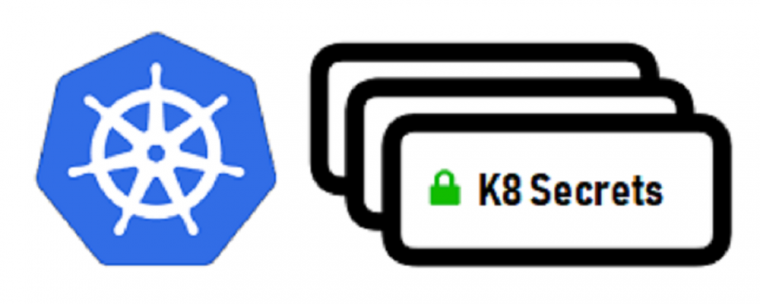

```text
https://kubernetes.io/zh-cn/docs/concepts/configuration/secret/
https://kubernetes.io/zh-cn/docs/tasks/configmap-secret/
```

Secret 和 Configmap 相似，也可以提供配置数据，但主要用于为Pod提供敏感需要加密的信息。Secret 主要用于存储密码、证书私钥，SSH 密钥，OAuth令牌等敏感信息，这些敏感信息采用base64编码保存，相对明文存储更安全。

相比于直接将敏感数据配置在Pod的定义或者镜像中，Secret提供了更加安全的机制，将需要共享的数据进行加密，防止数据泄露。Secret的对象需要单独定义并创建，通常以数据卷的形式挂载到Pod中，Secret的数据将以文件的形式保存，容器通过读取文件可以获取需要的数据。Secret volume是通过tmpfs（内存文件系统）实现的，所以这种类型的volume不是永久存储的。

每个Secret的数据不能超过1MB，支持通过资源限额控制每个名称空间的Secret的数量。

注意: Secret 属于名称空间级别，只能被同一个名称空间的Pod引用。

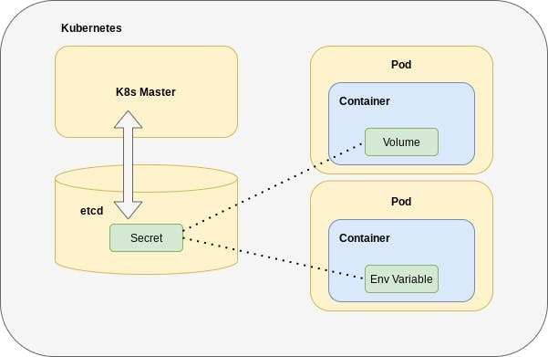

Secret 分成以下常见大的分类

类型解析

通用类型，基于base64编码用来存储密码，公钥等。常见的子类型有：

generic

Opaque,kubernetes.io/service-account-token,kubernetes.io/basic-auth,kubernetes.io/ssh-auth,bootstrap.kubernetes.io/token,kubernetes.io/rbd

tls专门用于保存tls/ssl用到证书和配对的私钥,常见的子类型:kubernetes.io/tls。

专用于让kubelet启动Pod时从私有镜像仓库pull镜像时，首先认证到仓库Registry时使。

docker-

用

registry

常见的子类型:kubernetes.io/dockercfg,kubernetes.io/dockerconfigjson

Secret 细化为的子类型(Type)

大类型Builtin Type说明

generic opaque,默认子类型arbitrary user-defined data

generic kubernetes.io/service-account-

token service account token

generic kubernetes.io/basic-auth credentials for basic authentication

generic kubernetes.io/ssh-auth credentials for SSH authentication

generic bootstrap.kubernetes.io/token bootstrap token data 初始化

tls kubernetes.io/tls data for a TLS client or server

docker-

新版

registry kubernetes.io/dockerconfigjson serialized ~/ .docker/config.json file

docker-registry kubernetes.io/dockercfg serialized -/ .dockercfg file 旧版

注意：

不同类型的Secret，在定义时支持使用的标准字段也有所不同。

例如: ssh-auth类型的Secret应该使用ssh-privatekey，而basic-auth类型的Secret则需要使用username和password等。

另外也可能存在一些特殊的类型, 用于支撑第三方需求，例如: ceph的keyring信息使用的kubernetes.io/rbd等。

**Secret 创建方式**

手动创建：用户自行创建的Secret 常用来存储用户私有的一些信息自动创建：集群自动创建的Secret 用来作为集群中各个组件之间通信的身份校验使用。

范例:  Secret 大的类别

```text
[root@master1 ~]#kubectl create secret -h
Create a secret using specified subcommand.
```

```text
Available Commands:
docker-registry   创建一个给 Docker registry 使用的 Secret
generic           Create a secret from a local file, directory, or literal
value
tls               创建一个 TLS secret
```

```text
Usage:
kubectl create secret [flags] [options]
```

```text
Use "kubectl <command> --help" for more information about a given command.
Use "kubectl options" for a list of global command-line options (applies to all
commands).
```

范例: 查看 Secret

```text
[root@master1 ~]#kubectl get secrets -A
```

```text
NAMESPACE       NAME                            TYPE
DATA   AGE
ingress-nginx   ingress-nginx-admission         Opaque
3      3d17h
kube-system     bootstrap-token-n44d75          bootstrap.kubernetes.io/token
6      47d
```

```text
[root@master1 ~]#kubectl get secrets -n ingress-nginx ingress-nginx-admission  -o
yaml
apiVersion: v1
data:
ca:
LS0tLS1CRUdJTiBDRVJUSUZJQ0FURS0tLS0tCk1JSUJkekNDQVJ5Z0F3SUJBZ0lSQU42d3dxOHowWXBQ
MjA1VkZyODlEMGt3Q2dZSUtvWkl6
......
cert:
LS0tLS1CRUdJTiBDRVJUSUZJQ0FURS0tLS0tCk1JSUJ1akNDQVdDZ0F3SUJBZ0lRYXI3ZDh3aTl4TXIw
cnVFVVVzVTZWVEFLQmdncWhrak9Q......
key:
LS0tLS1CRUdJTiBFQyBQUklWQVRFIEtFWS0tLS0tCk1IY0NBUUVFSU1aL0p2K3JuZlF1ZFc4WnVsMmI5
NGpoSUFFVkxTQUZMa0Q4UWl3aS9r......
kind: Secret
metadata:
creationTimestamp: "2021-04-20T09:14:08Z"
name: ingress-nginx-admission
namespace: ingress-nginx
resourceVersion: "670798"
uid: b371e542-44de-4343-893b-268697e1e13b
type: Opaque
```

```text
[root@master1 ~]#kubectl get secrets -n kube-system bootstrap-token-n44d75 -o
yaml
apiVersion: v1
data:
auth-extra-groups:
c3lzdGVtOmJvb3RzdHJhcHBlcnM6a3ViZWFkbTpkZWZhdWx0LW5vZGUtdG9rZW4=
description:
VGhlIGRlZmF1bHQgYm9vdHN0cmFwIHRva2VuIGdlbmVyYXRlZCBieSAna3ViZWFkbSBpbml0Jy4=
token-id: bjQ0ZDc1
token-secret: bGFxcmp4aTd6MW93NDZudQ==
usage-bootstrap-authentication: dHJ1ZQ==
usage-bootstrap-signing: dHJ1ZQ==
kind: Secret
metadata:
creationTimestamp: "2021-03-07T04:30:23Z"
name: bootstrap-token-n44d75
namespace: kube-system
resourceVersion: "222"
uid: 4f7f1030-a32e-42ad-a770-03fb6650e8d1
type: bootstrap.kubernetes.io/token
```

范例: 查看 Secret

```text
[root@master1 ~]#kubectl get secret
NAME                  TYPE                                  DATA   AGE
default-token-w2gph   kubernetes.io/service-account-token   3      4d13h
```

```text
[root@master1 ~]#kubectl get secrets  default-token-w2gph  -o yaml
apiVersion: v1
data:
ca.crt:
LS0tLS1CRUdJTiBDRVJUSUZJQ0FURS0tLS0tCk1JSUMvakNDQWVhZ0F3SUJBZ0lCQURBTkJna3Foa2lH
OXcwQkFRc0ZBREFWTVJNd0VRWURWUVFERXdwcmRXSmwKY201bGRHVnpNQjRYRFRJeU1ETXlNakV5TVRV
MU5Gb1hEVE15TURNeE9URXlNVFUxTkZvd0ZURVRNQkVHQTFVRQpBeE1L.......
namespace: ZGVmYXVsdA==
token:
ZXlKaGJHY2lPaUpTVXpJMU5pSXNJbXRwWkNJNkltSTNaa0UwUlZneWEzcE1jRlI2U1ZodGRrWnJhRjgy
TUZWNk5HTlNVMjVtTldwRFpuY3RNblE1YmswaWZRLmV5SnBjM01pT2lKcmRXSmxjbTVsZEdWekwzTmxj
blpwWTJWaFkyTnZkVzUwSWl3aWEzVmlaWEp1WlhSbGN5NXBieTl6WlhK.....
kind: Secret
metadata:
annotations:
kubernetes.io/service-account.name: default
kubernetes.io/service-account.uid: 6c962755-e74b-433c-b357-faa6376fce5f
creationTimestamp: "2021-03-22T12:16:16Z"
name: default-token-w2gph
namespace: default
resourceVersion: "408"
uid: b7a608c7-5fc5-4320-b75b-da203ee619e1
type: kubernetes.io/service-account-token
```

### 2.3.2 Secret 命令式创建

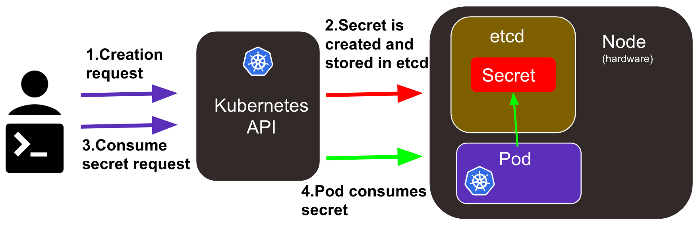

**官方说明**

```text
https://kubernetes.io/zh-cn/docs/tasks/configmap-secret/managing-secret-using-
kubectl/
```

格式

```text
kubectl create secret [flags] [options] [-n <namespace>]
```

**帮助信息**

```text
[root@master ~]# kubectl create secret -h
Create a secret using specified subcommand.
```

```text
Available Commands:
docker-registry #创建一个给 Docker registry 使用的 secret
generic         #从本地 file, directory 或者 literal value 创建一个 secret
tls             #创建一个 TLS secret
```

```text
Usage:
kubectl create secret [flags] [options]
```

**命令格式**

```text
#generic类型
kubectl create secret generic NAME [--type=string] [--from-file=[key=]source] [-
-from-literal=key1=value1]
```

```text
--from-literal=key1=value1      #以命令行设置键值对的环境变量方式配置数据
--from-env-file=/PATH/FILE      #以环境变量的专用文件的方式配置数据
--from-file=[key=]/PATH/FILE    #以配置文件的方式创建配置数据，如不指定key，FILE名称为
key名
--from-file=/PATH/DIR           #以配置文件所在目录的方式创建配置数据
```

```text
#该命令中的--type选项进行定义除了后面docker-registry和tls命令之外的其它子类型，有些类型有
key的特定要求
#注意: 如果vaule中有特殊字符,比如:$,\,*,=,!等,需要用\进行转义或用单引号''引起来
```

```text
#tls类型
kubectl create secret tls NAME --cert=/path/file --key=/path/file
#其保存cert文件内容的key名称不能指定自动为tls.crt，而保存private key的key不能指定自动为
tls.key
```

```text
#docker-registry类型
#方式1:基于用户名和密码方式实现
kubectl create secret docker-registry NAME --docker-username=user --docker-
password=password --docker-email=email [--docker-server=string] [--from-file=
[key=]source]
```

```text
#方式2:基于dockerconfig文件方式实现
kubectl create secret docker-registry  KEYNAME --from-
file=.dockerconfigjson=path/to/.docker/config.json
#从已有的json格式的文件加载生成的就是dockerconfigjson类型，命令行直接生成的也是该类型
```

范例:

```text
#创建generic类型
kubectl create secret generic my-secret-generic --from-file=/path/bar
kubectl create secret generic my-secret-generic --from-file=ssh-
privatekey=~/.ssh/id_rsa --from-file=ssh-publickey=~/.ssh/id_rsa.pub
kubectl create secret generic my-secret-generic --from-literal=username=admin --
from-literal=password=123456
kubectl create secret generic my-secret-generic --from-env-file=/path/to/bar.env
```

```text
#创建tls类型
kubectl create secret tls my-secret-tls --cert=certs/wang.org.cert --
key=certs/wang.org.key
```

```text
#创建docker-registry类型
#参考示例：https://Kubernetesmeetup.github.io/docs/tasks/configure-pod-
container/pull-image-private-registry/
#基于私有仓库的用户名和密码
kubectl create secret docker-registry my-secret-docker-registry --docker-
server=harbor.wang.org --docker-username=admin --docker-password=123456 --
docker-email=29308620@qq.com
```

```text
#先登录并认证到目标仓库server上，认证凭据自动保存在dockercfg文件中,基于dockerconfig文件实现
kubectl create secret docker-registry dockerharbor-auth --from-
file=.dockerconfigjson=/root/.docker/config.json
```

```text
kubectl create secret generic dockerharbor-auth --
type='kubernetes.io/dockerconfigjson' --from-
file=.dockerconfigjson=/root/.docker/config.json
```

### 2.3.3 Secret 声明式创建

Secret 数据存放在data或stringData字段,其中data字段中的Key/value必须使用base64编码存放,而stringData使用明文存放。

Secret 资源的元数据：除了name, namespace之外，常用的还有labels, annotations。

annotation的名称遵循类似于labels的名称命名格式，但其数据长度不受限制它不能用于被标签选择器作为筛选条件；但常用于为那些仍处于Beta阶段的应用程序提供临时的配置接口管理命令：kubectl annotate TYPE/NAME KEY=VALUE

范例: 查看 Secret 字段说明

```text
[root@master1 ~]#kubectl explain secret
KIND:     Secret
VERSION:  v1
```

```text
DESCRIPTION:
Secret holds secret data of a certain type. The total bytes of the values
in the Data field must be less than MaxSecretSize bytes.
```

```text
FIELDS:
apiVersion   <string>
APIVersion defines the versioned schema of this representation of an
object. Servers should convert recognized schemas to the latest internal
value, and may reject unrecognized values. More info:
https://git.k8s.io/community/contributors/devel/sig-architecture/api-
conventions.md#resources
```

```text
data <map[string]string>
Data contains the secret data. Each key must consist of alphanumeric
characters, '-', '_' or '.'. The serialized form of the secret data is a
base64 encoded string, representing the arbitrary (possibly non-string)
data value here. Described in https://tools.ietf.org/html/rfc4648#section-4
```

```text
immutable    <boolean>
Immutable, if set to true, ensures that data stored in the Secret cannot be
updated (only object metadata can be modified). If not set to true, the
field can be modified at any time. Defaulted to nil.
```

```text
kind <string>
Kind is a string value representing the REST resource this object
represents. Servers may infer this from the endpoint the client submits
requests to. Cannot be updated. In CamelCase. More info:
https://git.k8s.io/community/contributors/devel/sig-architecture/api-
conventions.md#types-kinds
```

```text
metadata <Object>
Standard object's metadata. More info:
https://git.k8s.io/community/contributors/devel/sig-architecture/api-
conventions.md#metadata
```

```text
stringData   <map[string]string>
stringData allows specifying non-binary secret data in string form. It is
provided as a write-only input field for convenience. All keys and values
are merged into the data field on write, overwriting any existing values.
The stringData field is never output when reading from the API.
```

```text
type <string>
Used to facilitate programmatic handling of secret data. More info:
https://kubernetes.io/docs/concepts/configuration/secret/#secret-types
```

### 2.3.4  Secret 引用

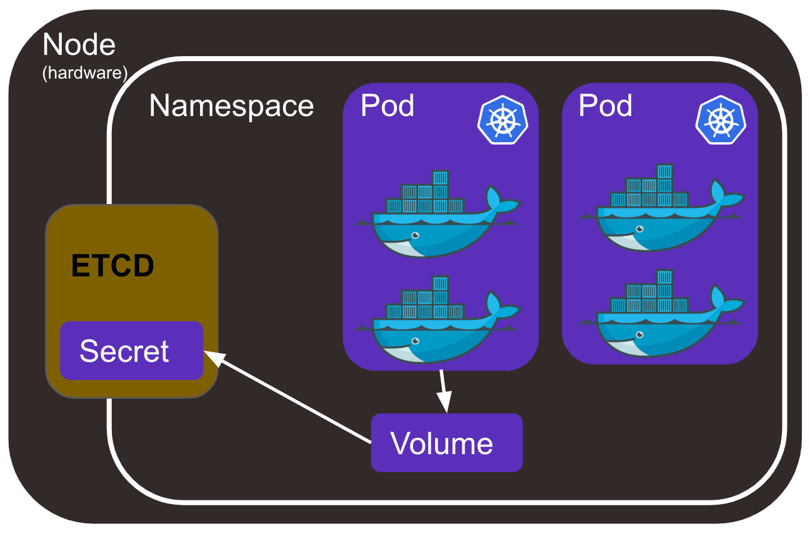

Secret资源在Pod中引用的方式有三种。

环境变量

引用Secret对象上特定的key，以valueFrom赋值给Pod上指定的环境变量。在Pod上使用envFrom一次性导入Secret对象上的所有key-value，key(也可以统一附加特定前缀）即为环境变量名,value自动成为相应的变量值。

注意：容器很可能会将环境变量打印到日志中,基于安全考虑不建议以环境变量方式引用Secret中的敏感数据。

**secret卷**

在Pod上将Secret对象引用为存储卷，而后整体由容器mount至某个目录下,其中key名称转为文件名，value的值转为相应的文件内容。在Pod上定义Secret卷时，也可以仅引用其中的指定的部分key，而后由容器mount至目录下。

拉取镜像

在Pod 上使用 imagePullSecrets 拉取私有仓库镜像使用。

Pod引用Secret的方式：pods.spec.imagePullSecrets

### 2.3.5 Generic 案例

**官方说明**

```text
https://kubernetes.io/zh-cn/docs/tasks/configmap-secret/managing-secret-using-
config-file/
```

generic 主要用于实现用户名和密码的加密保存。

注意: generic加密保存要注意换行问题  \n

```text
#generic类型
kubectl create secret generic NAME [--type=string] [--from-file=[key=]source] [-
-from-literal=key1=value1]
```

```text
--from-literal=key1=value1          #以命令行设置键值对的方式配置数据
--from-env-file=/PATH/TO/FILE       #以环境变量专用文件的方式配置数据
--from-file=[key=]/PATH/TO/FILE     #以配置文件的方式创建配置数据，如不指定key，FILE名称
为key名
--from-file=/PATH/TO/DIR            #以配置文件所在目录的方式创建配置数据
#该命令中的--type选项进行定义除了后面docker-registry和tls命令之外的其它子类型，有些类型有
key的特定要求
#注意: 如果vaule中有特殊字符,比如:$,\,*,=,!等,需要用\进行转义或用单引号''引起来
```

#### 2.3.5.1 范例：命令式创建 generic

```text
#命令式创建
[root@master1 ~]#kubectl create secret generic secret-mysql-root --from-
literal=username=root --from-literal=password=123456
```

```text
#确认创建成功
[root@master1 ~]#kubectl get secrets
NAME              TYPE     DATA   AGE
secret-mysql-root   Opaque   2      7s
```

```text
#查看Generic使用Base64编码
[root@master1 ~]#kubectl describe secrets secret-mysql-root
Name:         secret-mysql-root
Namespace:    default
Labels:       <none>
Annotations:  <none>
```

```text
Type:  Opaque
```

```text
Data
====
password:  6 bytes
username:  4 bytes
```

```text
[root@master1 ~]#kubectl get secrets secret-mysql-root  -o yaml
apiVersion: v1
data:
password: MTIzNDU2
username: cm9vdA==
kind: Secret
metadata:
creationTimestamp: "2021-03-02T14:00:31Z"
name: secret-mysql-root
namespace: default
resourceVersion: "20360"
uid: 5fa84616-997e-4c86-b4e5-b895516c4c12
type: Opaque
```

```text
#解码
[root@master1 ~]#echo -n cm9vdA== | base64 -d
root
[root@master1 ~]#echo -n MTIzNDU2 | base64 -d
123456
```

#### 2.3.5.2 范例: Base64 编码数据

```text
#将数据转换成base64编码,注意:需要加-n选项去掉换行符
[root@master1 ~]#echo -n 'admin' | base64
YWRtaW4=
[root@master1 ~]#echo -n  'password' | base64
cGFzc3dvcmQ=
```

```text
#清单文件
[root@master1 ~]#cat storage-secret-Opaque-data.yaml
apiVersion: v1
kind: Secret
metadata:
name: secret-data
namespace: default
type: Opaque
data:                         #data表示必须以base64编码存放,stringData表示明文存放数据
user: YWRtaW4=
password: cGFzc3dvcmQ=
```

```text
#应用
[root@master1 ~]#kubectl apply -f storage-secret-Opaque-data.yaml
```

```text
[root@master1 ~]#kubectl get secrets
NAME                TYPE     DATA   AGE
secret-data         Opaque   2      5m5s
```

```text
#查看
[root@master1 ~]#kubectl get secrets secret-data -o yaml
apiVersion: v1
data:
```

```text
password: cGFzc3dvcmQ=
user: YWRtaW4=
kind: Secret
metadata:
annotations:
kubectl.kubernetes.io/last-applied-configuration: |
{"apiVersion":"v1","data":
{"password":"cGFzc3dvcmQ=","user":"YWRtaW4="},"kind":"Secret","metadata":
{"annotations":{},"name":"secret-data","namespace":"default"},"type":"Opaque"}
creationTimestamp: "2021-09-27T10:19:27Z"
name: secret-data
namespace: default
resourceVersion: "545820"
uid: d99ced51-1b27-4fcd-ba06-e480f31287be
type: Opaque
```

```text
#如果安装etcdctl工具,可以看到secret实际保存在etcd中
[root@master1 ~]#etcdctl get / --keys-only --prefix |grep secret-data
/registry/secrets/default/secret-data
```

```text
#查看secret内容
[root@master1 ~]#etcdctl get /registry/secrets/default/secret-data
```

```text
#删除
[root@master1 ~]#kubectl delete secrets secret-data
```

#### 2.3.5.3 范例:  stringData 明文数据

```text
#清单文件
[root@master1 ~]#cat storage-secret-Opaque-stringData.yaml
apiVersion: v1
kind: Secret
metadata:
name: secret-stringdata
namespace: default
type: Opaque
stringData:                #stringData表示明文存放数据,data表示必须以base64编码存放
user: 'admin'
password: 'password'
```

```text
#应用文件
[root@master1 ~]#kubectl apply -f storage-secret-Opaque-stringData.yaml
```

```text
#查看
[root@master1 ~]#kubectl get secrets
NAME                TYPE     DATA   AGE
secret-stringdata   Opaque   2      2m3s
```

```text
#查看
[root@master1 ~]#kubectl get secrets secret-stringdata -o yaml
apiVersion: v1
data:
password: cGFzc3dvcmQ=  #此处显示base64编码形式
user: YWRtaW4=
kind: Secret
metadata:
annotations:
```

```text
kubectl.kubernetes.io/last-applied-configuration: |
{"apiVersion":"v1","kind":"Secret","metadata":{"annotations":
{},"name":"secret-stringdata","namespace":"default"},"stringData":
{"password":"password","user":"admin"},"type":"Opaque"}
creationTimestamp: "2021-09-27T10:22:29Z"
name: secret-stringdata
namespace: default
resourceVersion: "546179"
uid: 03b3e308-43ff-4f8f-9ac4-a41589272664
type: Opaque
```

```text
#删除
[root@master1 ~]#kubectl delete -f storage-secret-Opaque-stringData.yaml
```

#### 2.3.5.4 范例:  Secret 通过环境变量为提供MySQL环境初始化的密码信息

```text
#MySQL容器支持MYSQL_ROOT_PASSWORD变量存放密码,使用环境变量创建MySQL容器
[root@node1 ~]#docker run --name mysql_test -e MYSQL_ROOT_PASSWORD=123456 -d
registry.cn-beijing.aliyuncs.com/wangxiaochun/mysql:8.0.29-oracle
```

```text
#登录验证
[root@node1 ~]#docker exec  mysql_test mysql -uroot -h127.0.0.1 -p123456 -e
status
mysql: [Warning] Using a password on the command line interface can be insecure.
--------------
mysql  Ver 8.0.27 for Linux on x86_64 (MySQL Community Server - GPL)
```

```text
Connection id:      8
Current database:
Current user:       root@127.0.0.1
SSL:            Cipher in use is TLS_AES_256_GCM_SHA384
Current pager:      stdout
Using outfile:      ''
Using delimiter:    ;
Server version:     8.0.27 MySQL Community Server - GPL
Protocol version:   10
Connection:     127.0.0.1 via TCP/IP
Server characterset:    utf8mb4
Db     characterset:    utf8mb4
Client characterset:    latin1
Conn.  characterset:    latin1
TCP port:       3306
Uptime:         28 sec
```

```text
Threads: 2  Questions: 5  Slow queries: 0  Opens: 117  Flush tables: 3  Open
tables: 36  Queries per second avg: 0.178
```

```text
#生成密码的base64编码
[root@master1 ~]#echo -n root | base64
cm9vdA==
[root@master1 ~]#echo -n 123456 | base64
MTIzNDU2
```

```text
#清单文件，secret 通过环境为提供MySQL环境初始化的密码信息，但很不安全
[root@master1 ~]#cat  storage-secret-mysql-init.yaml
apiVersion: v1
kind: Secret
```

```text
metadata:
name: secret-mysql
type: kubernetes.io/basic-auth
#type: Opaque  #也可以用Opaque类型
data:
username: cm9vdAo=             #key名称:username：root
password: MTIzNDU2             #key名称:password: 123456
---
apiVersion: v1
kind: Pod
metadata:
name: pod-secret-mysql-init
spec:
containers:
- name: mysql
image: registry.cn-beijing.aliyuncs.com/wangxiaochun/mysql:8.0.29-oracle
env:
- name: MYSQL_ROOT_PASSWORD
valueFrom:
secretKeyRef:
name: secret-mysql      #引用指定的secret
key: password           #引用指定的secret中对应的key
optional: false         #必须存在
```

```text
#应用
[root@master1 ~]#kubectl  apply  -f storage-secret-mysql-init.yaml
```

```text
#查看结果
[root@master1 ~]#kubectl get secrets
NAME                            TYPE                             DATA   AGE
secret-mysql                    kubernetes.io/basic-auth         2      1m8s
```

```text
#可以看到base64编码的变量信息
[root@master1 ~]#kubectl get secrets secret-mysql -o yaml
apiVersion: v1
data:
password: MTIzNDU2
username: cm9vdAo=
kind: Secret
metadata:
annotations:
kubectl.kubernetes.io/last-applied-configuration: |
{"apiVersion":"v1","data":
{"password":"MTIzNDU2","username":"cm9vdAo="},"kind":"Secret","metadata":
{"annotations":{},"name":"secret-
mysql","namespace":"default"},"type":"kubernetes.io/basic-auth"}
name: secret-mysql
namespace: default
resourceVersion: "725930"
uid: 4089922b-3dc9-4b55-8eb5-61a2756c206a
type: kubernetes.io/basic-auth
```

```text
[root@master1 ~]#kubectl get pod
NAME                    READY   STATUS    RESTARTS   AGE
pod-secret-mysql-init   1/1     Running   0          3m30s
```

```text
#可以通过环境变量查看到密码，很不安全
```

```text
[root@master1 ~]#kubectl exec pod-secret-mysql-init -- env
PATH=/usr/local/sbin:/usr/local/bin:/usr/sbin:/usr/bin:/sbin:/bin
HOSTNAME=pod-secret-mysql-init
MYSQL_ROOT_PASSWORD=123456            #可以看到此处的环境变量
POD_TEST2_PORT_80_TCP_PROTO=tcp
KUBERNETES_PORT=tcp://10.96.0.1:443
KUBERNETES_PORT_443_TCP=tcp://10.96.0.1:443
POD_TEST1_SERVICE_HOST=10.101.84.206
POD_TEST2_SERVICE_PORT=80
POD_TEST2_PORT=tcp://10.96.109.255:80
KUBERNETES_SERVICE_HOST=10.96.0.1
KUBERNETES_SERVICE_PORT=443
POD_TEST1_SERVICE_PORT_80_80=80
POD_TEST2_PORT_80_TCP_PORT=80
POD_TEST2_PORT_80_TCP_ADDR=10.96.109.255
POD_TEST2_SERVICE_HOST=10.96.109.255
POD_TEST2_SERVICE_PORT_80_80=80
POD_TEST2_PORT_80_TCP=tcp://10.96.109.255:80
KUBERNETES_PORT_443_TCP_PROTO=tcp
KUBERNETES_PORT_443_TCP_PORT=443
KUBERNETES_PORT_443_TCP_ADDR=10.96.0.1
POD_TEST1_SERVICE_PORT=80
POD_TEST1_PORT_80_TCP_PROTO=tcp
KUBERNETES_SERVICE_PORT_HTTPS=443
POD_TEST1_PORT=tcp://10.101.84.206:80
POD_TEST1_PORT_80_TCP=tcp://10.101.84.206:80
POD_TEST1_PORT_80_TCP_PORT=80
POD_TEST1_PORT_80_TCP_ADDR=10.101.84.206
GOSU_VERSION=1.12
MYSQL_MAJOR=8.0
MYSQL_VERSION=8.0.27-1debian10
HOME=/root
```

```text
#验证密码登录MySQL
[root@master1 ~]#kubectl exec pod-secret-mysql-init -- mysql -uroot -p123456 -e
status
mysql: [Warning] Using a password on the command line interface can be insecure.
--------------
mysql  Ver 8.0.27 for Linux on x86_64 (MySQL Community Server - GPL)
```

```text
Connection id:      9
Current database:
Current user:       root@localhost
SSL:                Not in use
Current pager:      stdout
Using outfile:      ''
Using delimiter:    ;
Server version:     8.0.27 MySQL Community Server - GPL
Protocol version:   10
Connection:     Localhost via UNIX socket
Server characterset:    utf8mb4
Db     characterset:    utf8mb4
Client characterset:    latin1
Conn.  characterset:    latin1
UNIX socket:        /var/run/mysqld/mysqld.sock
Uptime:         33 sec
```

```text
Threads: 2  Questions: 5  Slow queries: 0  Opens: 118  Flush tables: 3  Open
tables: 37  Queries per second avg: 0.151
--------------
```

```text
[root@master1 ~]#echo -n 654321 | base64
NjU0MzIx
[root@master1 ~]#vim storage-secret-mysql-init.yaml
data:
username: cm9vdAo=
password: NjU0MzIx   #修改密码
```

```text
#重新应用
[root@master1 ~]#kubectl apply -f  storage-secret-mysql-init.yaml
```

```text
#查看是否变化
[root@master1 ~]#kubectl get secrets secret-mysql -o yaml
apiVersion: v1
data:
password: NjU0MzIx
username: cm9vdAo= #Secret更新
.....
```

```text
#Pod内的变量没有自动更新
[root@master1 ~]#kubectl exec pod-secret-mysql-init -- env|grep PASSWORD
MYSQL_ROOT_PASSWORD=123456
```

```text
#删除Pod重新创建
[root@master1 ~]#kubectl delete pod  pod-secret-mysql-init
```

```text
[root@master1 ~]#kubectl apply -f   storage-secret-mysql-init.yaml
```

```text
#Pod内变量更新成功
[root@master1 ~]#kubectl exec pod-secret-mysql-init -- env|grep PASSWORD
MYSQL_ROOT_PASSWORD=654321
```

```text
#清理环境
[root@master1 ~]#kubectl  delete -f storage-secret-mysql-init.yaml
```

#### 2.3.5.5 范例:  通过卷调用 secret

```text
#清单文件
[root@master1 ~]#cat storage-secret-test-pod.yaml
apiVersion: v1
kind: Secret
metadata:
name: secret-test
type: kubernetes.io/basic-auth
#type: Opaque  #也可以用Opaque类型
data:
#username: admin
username: YWRtaW4=
#password: password
password: cGFzc3dvcmQ=
```

```text
#说明：
#type类型指定为 Opaque 或者 kubernetes.io/basic-auth,username和password是加密的信息
```

```text
#资源定义文件时，与命令行创建secret的--from-literal=username=admin 效果是一样的,但命令行
的变量无需加密
---
#调用secret的清单文件
apiVersion: v1
kind: Pod
metadata:
name: pod-secret-volume
spec:
volumes:
- name: secret
secret:
secretName: secret-test       #指定secret的名称
containers:
- name: secret-test-container
image: registry.cn-beijing.aliyuncs.com/wangxiaochun/nginx:1.20.0
volumeMounts:                #卷引用secret
- name: secret
mountPath: /secret/
readOnly: true
```

```text
#创建资源
[root@master1 ~]#kubectl  apply -f storage-secret-test-pod.yaml
```

```text
#查看
[root@master1 ~]#kubectl get secrets
NAME                  TYPE                                  DATA   AGE
default-token-w2gph   kubernetes.io/service-account-token   3      4d13h
secret-test           kubernetes.io/basic-auth              2      3s
```

```text
[root@master1 ~]#kubectl get secrets secret-test -o yaml
apiVersion: v1
data:
password: cGFzc3dvcmQ=
username: YWRtaW4=
kind: Secret
metadata:
annotations:
kubectl.kubernetes.io/last-applied-configuration: |
{"apiVersion":"v1","data":
{"password":"cGFzc3dvcmQ=","username":"YWRtaW4="},"kind":"Secret","metadata":
{"annotations":{},"name":"secret-
test","namespace":"default"},"type":"kubernetes.io/basic-auth"}
creationTimestamp: "2021-03-27T02:07:21Z"
name: secret-test
namespace: default
resourceVersion: "81663"
uid: 7c643f0d-0eac-48b3-95d2-7b11fa374140
type: kubernetes.io/basic-auth
```

```text
#验证
[root@master1 ~]#kubectl get pod pod-secret-volume
NAME                READY   STATUS    RESTARTS   AGE
pod-secret-volume   1/1     Running   0          5s
```

```text
[root@master1 ~]#kubectl exec pod-secret-volume -- ls /secret
password
username
```

```text
#注意:文件内容不会随着Secret更新而自动更新,可以将Pod删除重建来实现更新
[root@master1 ~]#kubectl exec pod-secret-volume -- cat  /secret/username
admin
[root@master1 ~]#kubectl exec pod-secret-volume -- cat  /secret/password
password
```

```text
#通过两次软链接实现
[root@master1 ~]#kubectl  exec pod-secret-volume -- ls -l   /secret -a
total 4
drwxrwxrwt 3 root root  120 Sep 30 07:37 .
drwxr-xr-x 1 root root 4096 Sep 30 07:37 ..
drwxr-xr-x 2 root root   80 Sep 30 07:37 ..2024_09_30_07_37_50.1344469564
lrwxrwxrwx 1 root root   32 Sep 30 07:37 ..data ->
..2024_09_30_07_37_50.1344469564
lrwxrwxrwx 1 root root   15 Sep 30 07:37 password -> ..data/password
lrwxrwxrwx 1 root root   15 Sep 30 07:37 username -> ..data/username
```

```text
#在Pod运行的宿主机可以看到secret对应的文件
[root@node1 ~]#find /var/lib/kubelet -name password
/var/lib/kubelet/pods/41368cea-bd8e-4c7a-9803-
35659f1121e0/volumes/kubernetes.io~secret/secret/password
/var/lib/kubelet/pods/41368cea-bd8e-4c7a-9803-
35659f1121e0/volumes/kubernetes.io~secret/secret/..2021_04_24_07_22_12.187672675
8/password
```

```text
[root@node1 ~]#cat /var/lib/kubelet/pods/41368cea-bd8e-4c7a-9803-
35659f1121e0/volumes/kubernetes.io~secret/secret/password
password
```

```text
#清理环境
[root@master1 ~]#kubectl delete -f storage-secret-test-pod.yaml
```

#### 2.3.5.6 范例: 为 Service Account 创建 Secret

```text
#k8s-v1.24版本后,创建SA不会自动创建secret,需要手动创建secret
[root@master1 ~]#cat storage-secret-sa.yaml
apiVersion: v1
kind: ServiceAccount
metadata:
name: testsa
```

```text
---
apiVersion: v1
kind: Secret
type: kubernetes.io/service-account-token
metadata:
name: testsa-secret
namespace: default
annotations:
kubernetes.io/service-account.name: "testsa"
```

```text
[root@master1 ~]#kubectl apply -f storage-secret-sa.yaml
```

```text
[root@master1 ~]#kubectl get secrets,sa
NAME                   TYPE                                  DATA   AGE
```

```text
secret/testsa-secret   kubernetes.io/service-account-token   3      36m
```

```text
NAME                     SECRETS   AGE
serviceaccount/default   0         41d
serviceaccount/testsa    0         36m
```

```text
#查看对应的token
#方法1
[root@master1 ~]#kubectl get secrets testsa-secret -o yaml
apiVersion: v1
data:
ca.crt:
LS0tLS1CRUdJTiBDRVJUSUZJQ0FURS0tLS0tCk1JSUMvakNDQWVhZ0F3SUJBZ0lCQURBTkJna3Foa2lH
OXcwQkFRc0ZBREFWTVJNd0VRWURWUVFERXdwcmRXSmwKY201oclk1aTZRdUtuTkZQbVV5WEVTbGw5Qmt
VTFFxQjVUK3lyalJqNmRJR3ZITUo4OEJpcTl3bTdrdUhRTlkKRUNZPQotLS0tLUVORCBDRVJUSUZJQ0F
URS0tLS0tCg==
namespace: ZGVmYXVsdA==
token:
ZXlKaGJHY2lPaUpTVXpJMU5pSXNJbXRwWkNJNklrWkpTWEJSUzE5RVNuSlVRamxhVlhadmEzWnJha2c0
YjI5QmIwZ3RSalZrZDI0eWJXdHRVWGRGY0RBaWZRLmV5SnBjTFRwWFh6aEgxU3ZNaGRxOVJzWXBBSmdM
QQ==
kind: Secret
metadata:
annotations:
kubectl.kubernetes.io/last-applied-configuration: |
{"apiVersion":"v1","kind":"Secret","metadata":{"annotations":
{"kubernetes.io/service-account.name":"testsa"},"name":"testsa-
secret","namespace":"default"},"type":"kubernetes.io/service-account-token"}
kubernetes.io/service-account.name: testsa
kubernetes.io/service-account.uid: d2abc1df-9d0b-40e9-a592-78fe50b3c6ee
creationTimestamp: "2022-04-18T03:10:17Z"
name: testsa-secret
namespace: default
resourceVersion: "578846"
uid: c7efbc9d-de09-4442-a159-9ecd5933a890
type: kubernetes.io/service-account-token
```

```text
#获取上面的Token值并解码生成变量TOKEN
[root@master1 ~]#TOKEN=$(echo
ZXlKaGJHY2lPaUpTVXpJMU5pSXNJbXRwWkNJNklrWkpTWEJSUzE5RVNuSlVRamxhVlhadmEzWnJha2c0
YjI5QmIwZ3RSalZrZDI0eWJXdHRVWGRGY0RBaWZRLmV5SnBjTFRwWFh6aEgxU3ZNaGRxOVJzWXBBSmdM
QQ==|base64 -d)
```

```text
#使用上面TOKEN访问，验证用户身份，但权限不足
[root@master1 ~]#curl -s  --cacert /etc/kubernetes/pki/ca.crt -H "Authorization:
Bearer ${TOKEN}" https://kubeapi.wang.org:6443|head{
"kind": "Status",
"apiVersion": "v1",
"metadata": {},
"status": "Failure",
"message": "forbidden: User \"system:serviceaccount:default:testsa\" cannot
get path \"/\"",
"reason": "Forbidden",
"details": {},
"code": 403
}
```

```text
#方法2:此方式无需base64解码
```

```text
[root@master1 ~]#kubectl describe secrets testsa-secret
```

```text
#清理环境
[root@master1 ~]#kubectl delete -f storage-secret-sa.yaml
```

### 2.3.6 TLS  案例

TLS 类型的 Secret 主要用于对https场景的证书和密钥文件来进行加密传输。

```text
#tls类型格式
kubectl create secret tls NAME --cert=/path/file --key=/path/file
```

```text
#注意：
#保存cert文件内容的key名称不能指定，自动为tls.crt，卷挂载后生成的文件名也为tls.crt
#保存private key文件内容的key不能指定,自动为tls.key，卷挂载后生成的文件名也为tls.key
```

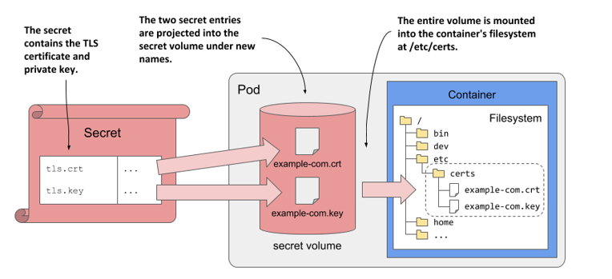

下面案例实现一个基于https 的nginx的web服务。

#### 2.3.6.1 创建 TLS 证书文件

```text
#生成私钥匙
[root@master1 ~]#mkdir nginx-certs
[root@master1 ~]#openssl  genrsa -out nginx-certs/www.wang.org.key 2048
```

```text
#生成自签名证书
[root@master1 ~]#openssl req  -new -x509 -key nginx-certs/www.wang.org.key -days
3650 -out nginx-certs/www.wang.org.crt -subj
/C=CN/ST=Beijing/L=Beijing/O=DevOps/CN=www.wang.org
#注意：CN指向的域名必须是nginx配置中使用的域名信息
```

```text
#查看文件
[root@master1 ~]#ls nginx-certs/
wang.org.crt  wang.org.key
```

#### 2.3.6.2  基于 TLS 证书文件创建对应的 Secret

```text
[root@master1 ~]#kubectl create secret tls secret-nginx-ssl  --cert=nginx-
certs/www.wang.org.crt --key=nginx-certs/www.wang.org.key
```

```text
#查看结果
[root@master1 ~]#kubectl get secrets
NAME                  TYPE                                  DATA   AGE
secret-nginx-ssl      kubernetes.io/tls                     2      2m53s
```

```text
#查看内容
[root@master1 ~]#kubectl get secrets secret-nginx-ssl -o yaml
apiVersion: v1
data:
tls.crt: #自动生成的名为tls.crt的key名称
LS0tLS1CRUdJTiBDRVJUSUZJQ0FURS0tLS0tCk1JSURrekNDQW51Z0F3SUJBZ0lVU2RkV09tczhwQWNC
Z3BRUmM1Rk9na1dGUVg0d0RRWUpL........
tls.key: #自动生成的名为tls.key的key名称
LS0tLS1CRUdJTiBQUklWQVRFIEtFWS0tLS0tCk1JSUV2UUlCQURBTkJna3Foa2lHOXcwQkFRRUZBQVND
Qktjd2dnU2pBZ0VBQW9JQkFRQzg2
.......
kind: Secret
metadata:
name: secret-nginx-ssl
namespace: default
resourceVersion: "717070"
uid: 5dde10b9-56ff-4136-b77e-a6eaabd9865d
type: kubernetes.io/tls
```

#### 2.3.6.3 准备 Nginx 配置文件

```text
#nginx主配置文件 myserver.conf
[root@master1 nginx-ssl-conf.d]#ls
myserver.conf  myserver-gzip.cfg  myserver-status.cfg
[root@master1 nginx-ssl-conf.d]#cat myserver.conf
server {
listen 80;
server_name www.wang.org;
return 301 https://$host$request_uri;
}
```

```text
server {
listen 443 ssl;
server_name www.wang.org;
```

```text
ssl_certificate /etc/nginx/certs/tls.crt;
ssl_certificate_key /etc/nginx/certs/tls.key;
```

```text
ssl_session_timeout 5m;
```

```text
ssl_protocols TLSv1 TLSv1.1 TLSv1.2;
```

```text
ssl_ciphers ECDHE-RSA-AES128-GCM-SHA256:HIGH:!aNULL:!MD5:!RC4:!DHE;
ssl_prefer_server_ciphers on;
```

```text
include /etc/nginx/conf.d/myserver-*.cfg;
```

```text
location / {
root /usr/share/nginx/html;
}
}
```

```text
#nginx的压缩配置文件:myserver-gzip.cfg
[root@master1 nginx-ssl-conf.d]#cat myserver-gzip.cfg
gzip on;
gzip_comp_level 5;
gzip_proxied     expired no-cache no-store private auth;
gzip_types text/plain text/css application/xml text/javascript;
```

```text
#nginx的状态页配置文件myserver-status.cfg
[root@master1 nginx-ssl-conf.d]#cat myserver-status.cfg
location /status {
stub_status on;
access_log off;
}
```

#### 2.3.6.4 创建配置文件对应的 Configmap

```text
[root@master1 ~]#kubectl create configmap cm-nginx-ssl-conf --from-file=nginx-
ssl-conf.d/
```

```text
[root@master1 ~]#kubectl get cm
NAME                DATA   AGE
cm-nginx-ssl-conf   3      15m
kube-root-ca.crt    1      4d15h
```

#### 2.3.6.5 创建引用Secret和configmap资源配置文件

```text
#创建资源配置文件
[root@master1 ~]#cat storage-secret-nginx-ssl.yaml
apiVersion: v1
kind: Pod
metadata:
name: pod-nginx-ssl
namespace: default
spec:
volumes:
- name: nginx-certs
secret:
secretName: secret-nginx-ssl
- name: nginx-confs
configMap:
name: cm-nginx-ssl-conf
optional: false
containers:
- image: registry.cn-beijing.aliyuncs.com/wangxiaochun/nginx:1.20.0
name: nginx-ssl-server
volumeMounts:
- name: nginx-certs
mountPath: /etc/nginx/certs/    #其保存cert文件自动命名为tls.crt，而保存private
key文件的自动命名为tls.key
readOnly: true
```

```text
- name: nginx-confs
mountPath: /etc/nginx/conf.d/
readOnly: true
```

```text
#创建pod
[root@master1 ~]#kubectl apply  -f storage-secret-nginx-ssl.yaml
```

#### 2.3.6.6 验证结果

```text
[root@master1 ~]#kubectl get pod pod-nginx-ssl -o wide
NAME            READY   STATUS    RESTARTS   AGE     IP            NODE
NOMINATED NODE   READINESS GATES
pod-nginx-ssl   1/1     Running   0          3m33s   172.16.3.13
node3.wang.org   <none>           <none>
```

```text
#查看生成的证书文件，表示为关联时间戳目录下的两个双层软链接文件tls.crt和tls.key,保存证书的原始
文件,而非base64格式
[root@master1 ~]#kubectl exec -it pod-nginx-ssl -- ls -l /etc/nginx/certs/
total 0
lrwxrwxrwx 1 root root 14 Mar 27 06:21 tls.crt -> ..data/tls.crt
lrwxrwxrwx 1 root root 14 Mar 27 06:21 tls.key -> ..data/tls.key
```

```text
#访问Pod
[root@master1 ~]#curl -I  http://172.16.3.13
HTTP/1.1 301 Moved Permanently
Server: nginx/1.20.0
Date: Sun, 27 Mar 2022 04:08:17 GMT
Content-Type: text/html
Content-Length: 169
Connection: keep-alive
Location: https://172.16.3.13/
```

```text
[root@master1 ~]#curl -Lkv  http://172.16.3.13
*   Trying 172.16.3.13:80...
* Connected to 172.16.3.13 (172.16.3.13) port 80 (#0)
> GET / HTTP/1.1
> Host: 172.16.3.13
> User-Agent: curl/7.81.0
> Accept: */*
>
* Mark bundle as not supporting multiuse
< HTTP/1.1 301 Moved Permanently
< Server: nginx/1.20.0
< Date: Sun, 27 Mar 2022 04:08:17 GMT
< Content-Type: text/html
< Content-Length: 169
< Connection: keep-alive
< Location: https://172.16.3.13/
<
* Ignoring the response-body
* Connection #0 to host 172.16.3.13 left intact
* Clear auth, redirects to port from 80 to 443
* Issue another request to this URL: 'https://172.16.3.13/'
*   Trying 172.16.3.13:443...
* Connected to 172.16.3.13 (172.16.3.13) port 443 (#1)
* ALPN, offering h2
* ALPN, offering http/1.1
```

```text
* TLSv1.0 (OUT), TLS header, Certificate Status (22):
* TLSv1.3 (OUT), TLS handshake, Client hello (1):
* TLSv1.2 (IN), TLS header, Certificate Status (22):
* TLSv1.3 (IN), TLS handshake, Server hello (2):
* TLSv1.2 (IN), TLS header, Certificate Status (22):
* TLSv1.2 (IN), TLS handshake, Certificate (11):
* TLSv1.2 (IN), TLS header, Certificate Status (22):
* TLSv1.2 (IN), TLS handshake, Server key exchange (12):
* TLSv1.2 (IN), TLS header, Certificate Status (22):
* TLSv1.2 (IN), TLS handshake, Server finished (14):
* TLSv1.2 (OUT), TLS header, Certificate Status (22):
* TLSv1.2 (OUT), TLS handshake, Client key exchange (16):
* TLSv1.2 (OUT), TLS header, Finished (20):
* TLSv1.2 (OUT), TLS change cipher, Change cipher spec (1):
* TLSv1.2 (OUT), TLS header, Certificate Status (22):
* TLSv1.2 (OUT), TLS handshake, Finished (20):
* TLSv1.2 (IN), TLS header, Finished (20):
* TLSv1.2 (IN), TLS header, Certificate Status (22):
* TLSv1.2 (IN), TLS handshake, Finished (20):
* SSL connection using TLSv1.2 / ECDHE-RSA-AES128-GCM-SHA256
* ALPN, server accepted to use http/1.1
* Server certificate:
*  subject: C=CN; ST=Beijing; L=Beijing; O=DevOps; CN=www.wang.org
*  issuer: C=CN; ST=Beijing; L=Beijing; O=DevOps; CN=www.wang.org
*  SSL certificate verify result: self-signed certificate (18), continuing
anyway.
* TLSv1.2 (OUT), TLS header, Supplemental data (23):
> GET / HTTP/1.1
> Host: 172.16.3.13
> User-Agent: curl/7.81.0
> Accept: */*
>
* TLSv1.2 (IN), TLS header, Supplemental data (23):
* Mark bundle as not supporting multiuse
< HTTP/1.1 200 OK
< Server: nginx/1.20.0
< Date: Sun, 27 Mar 2022 04:08:17 GMT
< Content-Type: text/html
< Content-Length: 50
< Last-Modified: Tue, 20 Apr 2021 13:35:47 GMT
< Connection: keep-alive
< ETag: "624abf6a-32"
< Accept-Ranges: bytes
<
Welcome to Nginx Web Site ! Nginx Version: 1.20.0
* Connection #1 to host 172.16.3.13 left intact
```

```text
[root@master1 ~]#curl -Lk http://172.16.3.13/status
Active connections: 2
server accepts handled requests
8 8 8
Reading: 0 Writing: 1 Waiting: 1
```

```text
#验证证书信息
[root@master1 ~]#openssl s_client -connect 172.16.3.13:443
CONNECTED(00000003)
Can't use SSL_get_servername
depth=0 C = CN, ST = Beijing, L = Beijing, O = DevOps, CN = www.wang.org
```

```text
verify error:num=18:self-signed certificate
verify return:1
depth=0 C = CN, ST = Beijing, L = Beijing, O = DevOps, CN = www.wang.org
verify return:1
---
Certificate chain
0 s:C = CN, ST = Beijing, L = Beijing, O = DevOps, CN = www.wang.org
i:C = CN, ST = Beijing, L = Beijing, O = DevOps, CN = www.wang.org
........
```

```text
#清理环境
[root@master1 ~]#kubectl delete  -f storage-secret-nginx-ssl.yaml
[root@master1 ~]#kubectl delete cm cm-nginx-ssl-conf
[root@master1 ~]#kubectl delete secret tls secret-nginx-ssl
```

#### 2.3.6.7 更新证书

以上颁发的证书是有一定的有效期限的，在过期前需要提前更新证书。

**在线更新证书流程**：生成新的证书和私钥文件将生成的新的证书文件和私钥文件的全部内容分别先进行base64编码并删除空行利用编码后的内容分别替换以下命令kubectl edit secret secret-nginx-ssl 中原有的证书信息即可。

证书的有效期一般为1年,到期前需要提前更新证书

范例: 证书更新

```text
#重新颁发证书
[root@master1 ~]#(umask 077; openssl genrsa -out wang.key 2048)
[root@master1 ~]#openssl req -new -x509 -key wang.key -out wang.crt -subj
/C=CN/ST=Beijing/L=Beijing/O=SRE/CN=www.wang.org -days 3650
```

```text
#方法1:
#在线修改证书配置,需要提前先将新证书文件用base64编码并删除换行符
[root@master1 ~]#cat wang.crt |base64 | tr -d '\n'
[root@master1 ~]#cat wang.key |base64 | tr -d '\n'
#上面生成的内容替换下面命令的内容,立即生效
[root@master1 ~]#kubectl edit secrets  secret-nginx-ssl
```

```text
#方法2
#删除旧证书配置
[root@master1 ~]#kubectl delete secrets secret-nginx-ssl
#创建新证书配置
[root@master1 ~]#kubectl create secret tls secret-nginx-ssl --cert=./wang.crt --
key=./wang.key
```

```text
#集群外验证证书是否生效
[root@master1 ~]#echo 172.16.3.13 www.wang.org >> /etc/hosts
```

```text
#nginx不支持热加载，需要手动加载
[root@master1 ~]#kubectl exec pod-nginx-ssl -- nginx -s reload
[root@master1 ~]#openssl s_client www.wang.org:443
CONNECTED(00000003)
depth=0 C = CN, ST = Beijing, L = Beijing, O = SRE, CN = www.wang.org
verify error:num=18:self-signed certificate
verify return:1
```

```text
depth=0 C = CN, ST = Beijing, L = Beijing, O = SRE, CN = www.wang.org
verify return:1
---
Certificate chain
0 s:C = CN, ST = Beijing, L = Beijing, O = SRE, CN = www.wang.org
i:C = CN, ST = Beijing, L = Beijing, O = SRE, CN = www.wang.org
a:PKEY: rsaEncryption, 2048 (bit); sigalg: RSA-SHA256
v:NotBefore: Jun 15 03:18:44 2021 GMT; NotAfter: Jun 12 03:18:44 2031 GMT
......
```

### 2.3.7 Docker-registry 案例

#### 2.3.7.1 Secret 实现 Docker 私有仓库的镜像访问说明

有时Docker的仓库是私有的,如果想下载镜像,就需要在下载镜像的主机上登录仓库并认证后才能实现。但是在Kubernetes集群使用私有仓库镜像就比较繁琐,因为运行Pod 的宿主机并不固定,如果在每个worker节点登录验证显然是不方便的。

dockercfg及dockerconfigjson类型的Secret 适用于实现让kubelet从私有Image Registry中下载容器镜像。

其引用定义在pod.spec.imagePullSecrets字段上的列表,即支持多个docker-registry类型的Secret,从上至下逐个进行匹配。也支持pod.spec.serviceAcountName引用sa，再在serviceAccount.imagePullSecrets间接引用Docker-registry的secret。创建此种secret 可以通过下面方式实现。

方法1: 通过命令创建

```text
kubectl create secret docker-registry KEYNAME --docker-
server=DOCKER_REGISTRY_SERVER --docker-username=DOCKER_USER --docker-
password=DOCKER_PASSWORD --docker-email=EMAIL
```

方式二: 通过docker认证文件创建。

```text
#先登录并认证到目标仓库server上，认证凭据自动保存在~/.docker/config.json文件中
docker login --username=DOCKER_USER DOCKER_REGISTRY_SERVER
```

```text
#基于config.json文件生成secret
kubectl create secret docker-registry  KEYNAME --from-
file=.dockerconfigjson=path/to/.docker/config.json
```

```text
kubectl create secret generic KEYNAME --type='kubernetes.io/dockerconfigjson' --
from-file=.dockerconfigjson=/root/.docker/config.json
```

```text
#示例：
kubectl create secret docker-registry my-secret --from-
file=.dockerconfigjson=path/to/.docker/config.json
```

```text
kubectl create secret generic dockerharbor-auth --
type='kubernetes.io/dockerconfigjson' --from-
file=.dockerconfigjson=/root/.docker/config.json
```

范例: 将dockerhub指定的 repository 变为私有

默认dockerhub的镜像都是公开的,个人用户可以将一个仓库变为私有。

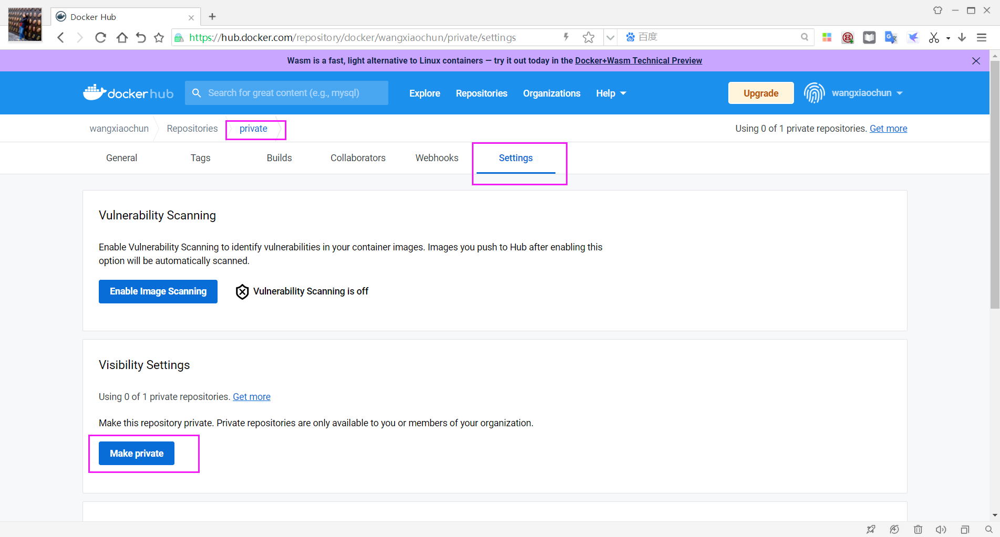

**输入仓库的名称**

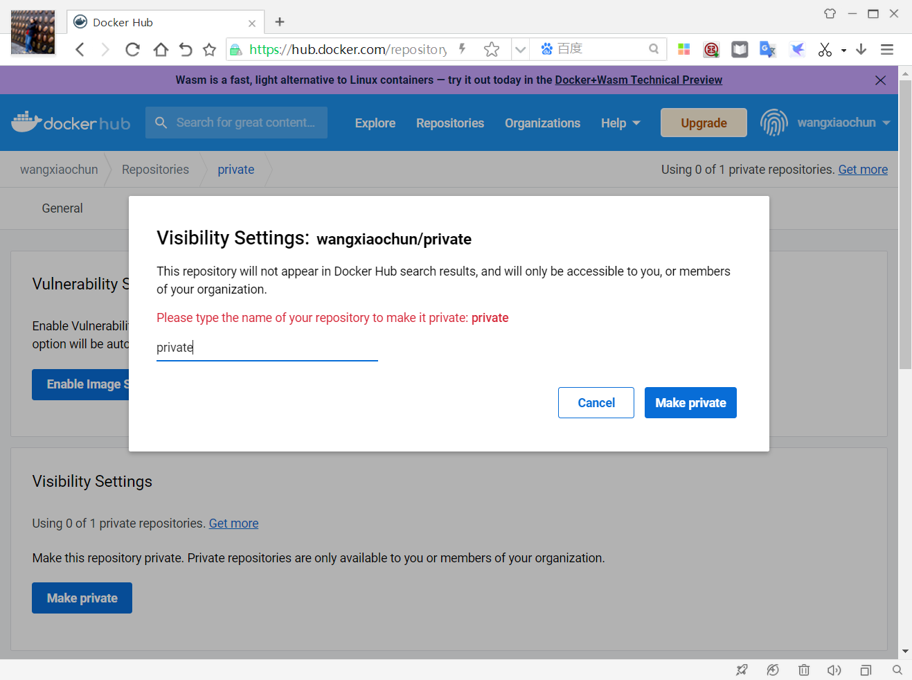

**查看状态变为private**

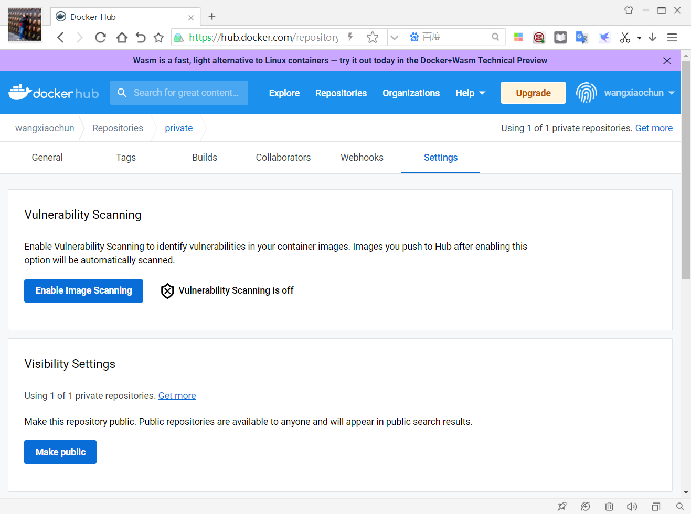

范例: 测试用docker拉取上面的私有镜像

```text
#不登录验证无法拉取镜像
[root@ubuntu2204 ~]#docker pull wangxiaochun/private:nginx-1.20.0
Error response from daemon: pull access denied for wangxiaochun/private,
repository does not exist or may require 'docker login': denied: requested
access to the resource is denied
```

```text
#登录
[root@ubuntu2204 ~]#docker login -u wangxiaochun -p 123456
WARNING! Using --password via the CLI is insecure. Use --password-stdin.
WARNING! Your password will be stored unencrypted in /root/.docker/config.json.
Configure a credential helper to remove this warning. See
https://docs.docker.com/engine/reference/commandline/login/#credentials-store
```

```text
Login Succeeded
[root@ubuntu2204 ~]#docker pull wangxiaochun/private:nginx-1.20.0
```

```text
[root@ubuntu2204 ~]#docker images wangxiaochun/private:nginx-1.20.0
REPOSITORY             TAG            IMAGE ID       CREATED         SIZE
wangxiaochun/private   nginx-1.20.0   7145ef2ae727   12 months ago   133MB
```

```text
[root@ubuntu2204 ~]#cat .docker/config.json
{
"auths": {
"https://index.docker.io/v1/": {
"auth": "d2FuZ3hpYW9jaHVuOjEyMzQ1Ng=="
}
}
}
```

#### 2.3.7.2 通过命令创建私有仓库登录认证信息

##### 2.3.7.2.1 命令创建私有仓库harbor登录认证信息

范例:  命令创建私有仓库harbor登录认证信息

**安装并创建Harbor的私有仓库和项目**

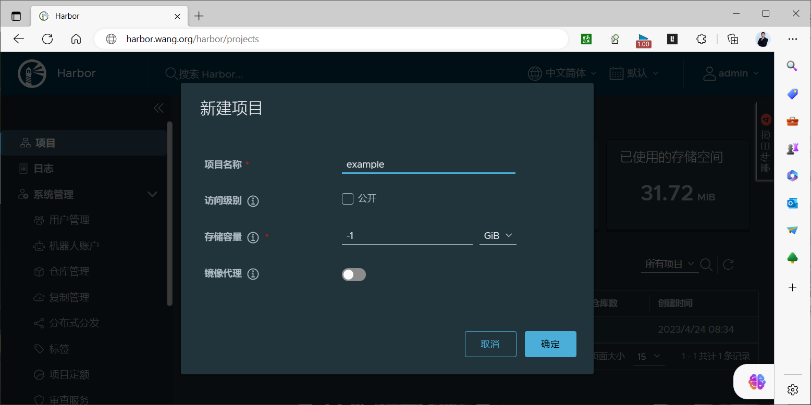

```text
#修改所有集群节点的Docker配置支持私有仓库
[root@node1 ~]#vim /etc/docker/daemon.json
{
"registry-mirrors": [
"https://si7y70hh.mirror.aliyuncs.com",
"https://docker.mirrors.ustc.edu.cn",
"https://hub-mirror.c.163.com"
],
"insecure-registries":["harbor.wang.org"],  #添加此行,确保docker节点能够域名解析，而非
Pod解析
"exec-opts": ["native.cgroupdriver=systemd"]
}
[root@node1 ~]#systemctl restart docker
```

```text
#拉取镜像
[root@ubuntu2204 ~]#docker pull wangxiaochun/pod-test:v0.1
[root@ubuntu2204 ~]#docker tag wangxiaochun/pod-test:v0.1
harbor.wang.org/example/pod-test:v0.1
```

```text
#登录
[root@ubuntu2204 ~]#docker login -u admin -p 123456 harbor.wang.org
```

```text
#上传镜像到私有仓库
[root@ubuntu2204 ~]#docker push harbor.wang.org/example/pod-test:v0.1
```

**查看镜像**

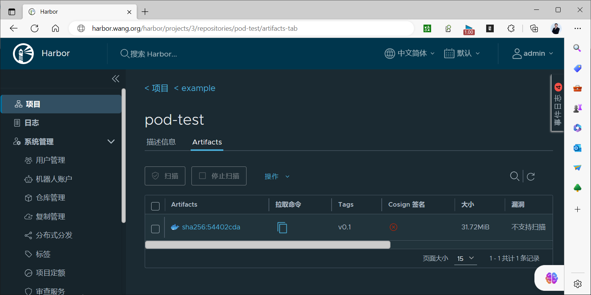

```text
#方法1：命令行创建Secret
root@master1 ~]#kubectl create secret docker-registry harbor-docker-registry-
secret  --docker-server=harbor.wang.org --docker-username=admin --docker-
password=123456
```

```text
#方法2
[root@master1 ~]#kubectl create secret docker-registry harbor-docker-registry-
secret --from-file=.dockerconfigjson=/root/.docker/config.json
```

```text
[root@master1 ~]#kubectl get secrets harbor-docker-registry-secret
NAME                            TYPE                             DATA   AGE
harbor-docker-registry-secret   kubernetes.io/dockerconfigjson   1      10m
```

```text
[root@master1 ~]#kubectl get secrets harbor-docker-registry-secret -o yaml
apiVersion: v1
data:
.dockerconfigjson:
eyJhdXRocyI6eyJoYXJib3Iud2FuZy5vcmciOnsidXNlcm5hbWUiOiJhZG1pbiIsInBhc3N3b3JkIjoi
MTIzNDU2IiwiYXV0aCI6IllXUnRhVzQ2TVRJek5EVTIifX19
kind: Secret
metadata:
creationTimestamp: "2022-02-24T00:51:43Z"
name: harbor-docker-registry-secret
namespace: default
resourceVersion: "682806"
uid: d5bc9bc6-6a28-4f8f-ab19-b4c52725c8f3
type: kubernetes.io/dockerconfigjson
```

```text
#查看Secret内容
[root@master1 ~]#echo
eyJhdXRocyI6eyJoYXJib3Iud2FuZy5vcmciOnsidXNlcm5hbWUiOiJhZG1pbiIsInBhc3N3b3JkIjoi
MTIzNDU2IiwiYXV0aCI6IllXUnRhVzQ2TVRJek5EVTIifX19 |base64 -d
{"auths":{"harbor.wang.org":
{"username":"admin","password":"123456","auth":"YWRtaW46MTIzNDU2"}}}
```

```text
#准备清单文件
[root@master1 ~]#cat storage-secret-docker-registry-harbor.yaml
apiVersion: apps/v1
kind: Deployment
metadata:
```

```text
name: deployment-harbor-docker-registry-secret
spec:
replicas: 3
selector:
matchLabels:
app: pod-test-harbor-docker-registry-secret
template:
metadata:
labels:
app: pod-test-harbor-docker-registry-secret
spec:
containers:
- name: pod-test-harbor-docker-registry-secret
image: harbor.wang.org/example/pod-test:v0.1
ports:
- containerPort: 80
imagePullSecrets:
- name: harbor-docker-registry-secret  #指定docker-registry类型的secret,如
果有多个会逐个验证
```

```text
#应用清单
[root@master1 ~]#kubectl apply -f storage-secret-docker-registry-harbor.yaml
```

```text
#验证Pod启动成功
[root@master1 ~]#kubectl get pod |grep harbor
deployment-harbor-docker-registry-secret-648986d7d-4pnbv   1/1     Running
0             3s
deployment-harbor-docker-registry-secret-648986d7d-66ppw   1/1     Running
0             3s
deployment-harbor-docker-registry-secret-648986d7d-tvf24   1/1     Running
0             3s
```

```text
#测试访问Pod成功
[root@master1 ~]#curl 10.244.2.39
kubernetes pod-test v0.1!! ClientIP: 10.244.0.0, ServerName: deployment-harbor-
docker-registry-secret-648986d7d-4pnbv, ServerIP: 10.244.2.39!
```

##### 2.3.7.2.2 命令行创建阿里云的私有仓库登录认证信息

范例: 通过命令创建阿里云的私有仓库登录认证信息

```text
#注意:如果不是docker官方仓库,必须指定--docker-server 选项
[root@master1 ~]#kubectl create secret docker-registry aliyun-docker-registry-
secret --docker-server=registry.cn-beijing.aliyuncs.com --docker-
username=29308620@qq.com --docker-password=123456
```

```text
[root@master1 ~]#cat storage-secret-docker-registry-aliyun.yaml
apiVersion: apps/v1
kind: Deployment
metadata:
name: deployment-aliyun-docker-registry-secret
spec:
replicas: 3
selector:
matchLabels:
app: nginx-aliyun-docker-registry-secret
template:
```

```text
metadata:
labels:
app: nginx-aliyun-docker-registry-secret
spec:
containers:
- name: nginx-aliyun-docker-registry-secret
image: registry.cn-beijing.aliyuncs.com/wangxiaochun/private:nginx-
1.20.0
ports:
- containerPort: 80
imagePullSecrets:
- name: aliyun-docker-registry-secret  #调用上面创建的secret名称，列表方式，多
个容器遍历多个secret访问
```

```text
[root@master1 ~]#kubectl apply -f storage-secret-docker-registry-aliyun.yaml
deployment.apps/deployment-aliyun-docker-registry-secret created
[root@master1 ~]#kubectl get pod
NAME                                                        READY   STATUS
RESTARTS        AGE
deployment-aliyun-docker-registry-secret-54b9c6766f-95szd   1/1     Running   0
3s
deployment-aliyun-docker-registry-secret-54b9c6766f-kbtth   1/1     Running   0
3s
deployment-aliyun-docker-registry-secret-54b9c6766f-rxx6b   1/1     Running   0
3s
```

```text
[root@master1 ~]#kubectl get secrets aliyun-docker-registry-secret -o yaml
apiVersion: v1
data:
.dockerconfigjson:
eyJhdXRocyI6eyJyZWdpc3RyeS5jbi1iZWlqaW5nLmFsaXl1bmNzLmNvbSI6eyJ1c2VybmFtZSI6IjI5
MzA4NjIwQHFxLmNvbSIsInBhc3N3b3JkIjoiMTIzNDU2IiwiYXV0aCI6Ik1qa3pNRGcyTWpCQWNYRXVZ
Mjl0T2pFeU16UTFOZz09In19fQ==
kind: Secret
metadata:
creationTimestamp: "2020-11-08T08:28:53Z"
name: aliyun-docker-registry-secret
namespace: default
resourceVersion: "824679"
uid: dadd0676-49de-40be-aeb4-e87249b523ba
type: kubernetes.io/dockerconfigjson
```

```text
#解析secret信息,可以看到密码
[root@master1 ~]#echo
eyJhdXRocyI6eyJyZWdpc3RyeS5jbi1iZWlqaW5nLmFsaXl1bmNzLmNvbSI6eyJ1c2VybmFtZSI6IjI5
MzA4NjIwQHFxLmNvbSIsInBhc3N3b3JkIjoiMTIzNDU2IiwiYXV0aCI6Ik1qa3pNRGcyTWpCQWNYRXVZ
Mjl0T2pFeU16UTFOZz09In19fQ== |base64 -d
{"auths":{"registry.cn-beijing.aliyuncs.com":
{"username":"29308620@qq.com","password":"123456","auth":"MjkzMDg2MjBAcXEuY29tOj
EyMzQ1Ng=="}}}
```

#### 2.3.7.3 通过 Docker 认证文件实现

注意: harbor.wang.org 服务器的域名解析要在worker节点上的DNS或/etc/hosts文件中实现,而无需在集群内的coreDNS实现。

范例: 通过docker认证文件实现Harbor私有仓库访问

```text
#登录Harbor仓库生成dockerconfig文件
[root@master1 ~]#docker login harbor.wang.org -u admin -p 123456
```

```text
[root@master1 ~]#cat .docker/config.json
{
"auths": {
"harbor.wang.org": {
"auth": "YWRtaW46MTIzNDU2"
}
}
}
```

```text
#准备镜像并上传到私用仓库
[root@master1 ~]#docker pull wangxiaochun/pod-test:v0.2
[root@master1 ~]#docker tag wangxiaochun/pod-test:v0.2
harbor.wang.org/example/pod-test:v0.2
[root@master1 ~]#docker push harbor.wang.org/example/pod-test:v0.2
```

```text
#在worker节点上访问私有仓库不经过验证,无法下载镜像
[root@node1 ~]#docker pull harbor.wang.org/example/pod-test:v0.2
Error response from daemon: unauthorized: unauthorized to access repository:
example/pod-test, action: pull: unauthorized to access repository: example/pod-
test, action: pull
```

```text
#基于dockerconfig生成secret
[root@master1 ~]#kubectl create secret docker-registry secret-docker-registry-
harbor-dockerconfig --from-file=.dockerconfigjson=/root/.docker/config.json
```

```text
[root@master1 ~]#kubectl get secrets
NAME                                         TYPE
DATA   AGE
secret-docker-registry-harbor-dockerconfig   kubernetes.io/dockerconfigjson   1
10s
```

```text
[root@master1 ~]#kubectl get secrets secret-docker-registry-harbor-dockerconfig -
o yaml
apiVersion: v1
data:
.dockerconfigjson:
ewoJImF1dGhzIjogewoJCSJoYXJib3Iud2FuZy5vcmciOiB7CgkJCSJhdXRoIjogIllXUnRhVzQ2TVRJ
ek5EVTIiCgkJfQoJfQp9
kind: Secret
metadata:
name: secret-docker-registry-harbor-dockerconfig
namespace: default
resourceVersion: "734984"
uid: f039e6d5-c30a-4412-98d8-ca2c8a7cd532
type: kubernetes.io/dockerconfigjson
```

```text
#查看data内容
[root@master1 ~]#echo
ewoJImF1dGhzIjogewoJCSJoYXJib3Iud2FuZy5vcmciOiB7CgkJCSJhdXRoIjogIllXUnRhVzQ2TVRJ
ek5EVTIiCgkJfQoJfQp9 |base64 -d
{
"auths": {
"harbor.wang.org": {
"auth": "YWRtaW46MTIzNDU2"
```

```text
}
}
}
```

```text
#准备清单文件
[root@master1 ~]#cat storage-secret-docker-registry-harbor-dockerconfig.yaml
apiVersion: apps/v1
kind: Deployment
metadata:
name: deployment-secret-docker-registry-harbor-dockerconfig
spec:
replicas: 3
selector:
matchLabels:
app: pod-test-secret-docker-registry-harbor-dockerconfig
template:
metadata:
labels:
app: pod-test-secret-docker-registry-harbor-dockerconfig
spec:
containers:
- name: pod-test-harbor-docker-registry-secret
image: harbor.wang.org/example/pod-test:v0.2
ports:
- containerPort: 80
imagePullSecrets:
- name: secret-docker-registry-harbor-dockerconfig
```

```text
#应用
[root@master1 ~]#kubectl apply -f storage-secret-docker-registry-harbor-
dockerconfig.yaml
```

```text
#查看
[root@master1 ~]#kubectl get pod -o wide
NAME                                                              READY   STATUS
RESTARTS   AGE   IP            NODE             NOMINATED NODE   READINESS
GATES
deployment-secret-docker-registry-harbor-dockerconfig-6cf59fmd8   1/1
Running   0          67s   10.244.1.42   node1.wang.org   <none>
<none>
deployment-secret-docker-registry-harbor-dockerconfig-6cf59h8vx   1/1
Running   0          67s   10.244.3.32   node3.wang.org   <none>
<none>
deployment-secret-docker-registry-harbor-dockerconfig-6cf5k5r22   1/1
Running   0          67s   10.244.2.43   node2.wang.org   <none>
<none>
```

```text
#查看到Pod的镜像下载成功
[root@master1 ~]#kubectl describe pod deployment-secret-docker-registry-harbor-
dockerconfig-6cf5k5r22 |tail
Tolerations:                 node.kubernetes.io/not-ready:NoExecute op=Exists
for 300s
node.kubernetes.io/unreachable:NoExecute op=Exists
for 300s
Events:
Type    Reason     Age    From               Message
----    ------     ----   ----               -------
```

```text
Normal  Scheduled  6m23s  default-scheduler  Successfully assigned
default/deployment-secret-docker-registry-harbor-dockerconfig-6cf5k5r22 to
node2.wang.org
Normal  Pulling    6m23s  kubelet            Pulling image
"harbor.wang.org/example/pod-test:v0.2"
Normal  Pulled     6m23s  kubelet            Successfully pulled image
"harbor.wang.org/example/pod-test:v0.2" in 74.107717ms (74.117064ms including
waiting)
Normal  Created    6m23s  kubelet            Created container pod-test-harbor-
docker-registry-secret
Normal  Started    6m23s  kubelet            Started container pod-test-harbor-
docker-registry-secret
```

```text
#在上面pod运行的节点上仍然无法用docker拉取镜像
[root@node1 ~]#docker pull harbor.wang.org/example/pod-test:v0.2
Error response from daemon: unauthorized: unauthorized to access repository:
example/pod-test, action: pull: unauthorized to access repository: example/pod-
test, action: pull
```

```text
#环境清理
[root@master1 ~]#kubectl delete -f storage-secret-docker-registry-harbor-
dockerconfig.yaml
[root@master1 ~]#kubectl delete secrets secret-docker-registry-harbor-
dockerconfig
```

范例: 通过docker认证文件实现阿里云私有仓库访问

```text
#尝试无登录直接拉取私有仓库的镜像失败
[root@node1 ~]#docker push registry.cn-
beijing.aliyuncs.com/wangxiaochun/private:nginx-1.20.0
The push refers to repository [registry.cn-
beijing.aliyuncs.com/wangxiaochun/private]
An image does not exist locally with the tag: registry.cn-
beijing.aliyuncs.com/wangxiaochun/private
```

```text
[root@master1 ~]#docker login --username=29308620@qq.com registry.cn-
beijing.aliyuncs.com
Password:
```

```text
[root@master1 ~]#cat /root/.docker/config.json
{
"auths": {
"registry.cn-beijing.aliyuncs.com": {
"auth": "MjkzMDg2MjBAcXEuY29tOjEyMzQ1Ng=="
}
}
}[root@master1 ~]#
```

```text
#创建secret
[root@master1 ~]#kubectl create secret generic aliyun-registry-secret-auth --
type='kubernetes.io/dockerconfigjson' --from-
file=.dockerconfigjson=/root/.docker/config.json
```

```text
[root@master1 ~]#kubectl get secrets
NAME                          TYPE                             DATA   AGE
aliyun-registry-secret-auth   kubernetes.io/dockerconfigjson   1      48s
```

```text
[root@master1 ~]#kubectl get secrets aliyun-registry-secret-auth -o yaml
apiVersion: v1
data:
.dockerconfigjson:
ewoJImF1dGhzIjogewoJCSJyZWdpc3RyeS5jbi1iZWlqaW5nLmFsaXl1bmNzLmNvbSI6IHsKCQkJImF1
dGgiOiAiTWprek1EZzJNakJBY1hFdVkyOXRPbmRoYm1jd016QTAiCgkJfQoJfQp9
kind: Secret
metadata:
creationTimestamp: "2021-02-28T15:38:48Z"
name: aliyun-registry-secret-auth
namespace: default
resourceVersion: "568129"
uid: 70605fce-35ef-4b21-9a41-3fa09a58c2c6
type: kubernetes.io/dockerconfigjson
```

```text
#创建deployment引用secret
[root@master1 ~]#cat storage-secret-docker-registry-dockerconfig.yaml
apiVersion: apps/v1
kind: Deployment
metadata:
name: deployment-aliyun-registry-secret-auth
spec:
replicas: 1
selector:
matchLabels:
app: nginx-aliyun-registry-secret
template:
metadata:
labels:
app: nginx-aliyun-registry-secret
spec:
containers:
- name: nginx-aliyun-registry-secret
image: registry.cn-beijing.aliyuncs.com/wangxiaochun/private:nginx-
1.20.0
ports:
- containerPort: 80
imagePullSecrets:
- name: aliyun-registry-secret-auth
```

```text
[root@master1 ~]#kubectl apply  -f storage-secret-docker-registry-
dockerconfig.yaml
deployment.apps/deployment-aliyun-registry-secret-auth created
```

```text
#查看Pod成功创建在node1节点
[root@master1 ~]#kubectl get pod -o wide
NAME                                                      READY   STATUS
RESTARTS        AGE    IP            NODE             NOMINATED NODE   READINESS
GATES
deployment-aliyun-registry-secret-auth-5c76cb9d99-drz8r   1/1     Running   0
43s    10.244.1.52   node1.wang.org   <none>           <none>
```

```text
#成功下载镜像
[root@master1 ~]#kubectl describe pod deployment-aliyun-registry-secret-auth-
5c76cb9d99-drz8r
.....
```

```text
Events:
Type    Reason     Age   From               Message
----    ------     ----  ----               -------
Normal  Scheduled  27s   default-scheduler  Successfully assigned
default/deployment-aliyun-registry-secret-auth-5c76cb9d99-drz8r to
node1.wang.org
Normal  Pulling    26s   kubelet            Pulling image "registry.cn-
beijing.aliyuncs.com/wangxiaochun/private:nginx-1.20.0"
Normal  Pulled     2s    kubelet            Successfully pulled image
"registry.cn-beijing.aliyuncs.com/wangxiaochun/private:nginx-1.20.0" in
24.153465179s
Normal  Created    2s    kubelet            Created container nginx-aliyun-
registry-secret
Normal  Started    2s    kubelet            Started container nginx-aliyun-
registry-secret
```

```text
#Pod正常访问
[root@master1 ~]#curl 10.244.1.52
Welcome to Nginx Web Site ! Nginx Version: 1.20.0
```

```text
#在node1节点实时观察日志如下
[root@node1 ~]#docker events
2021-02-28T16:40:02.660893707Z container create
4b107a1940e673148cf2e4a6f7c3a280ccdfd0070d91cdf8690809ff454b9135
(annotation.kubernetes.io/config.seen=2021-02-28T16:40:02.290472349Z,
annotation.kubernetes.io/config.source=api, app=nginx-aliyun-registry-secret,
image=registry.aliyuncs.com/google_containers/pause:3.7,
io.kubernetes.container.name=POD, io.kubernetes.docker.type=podsandbox,
io.kubernetes.pod.name=deployment-aliyun-registry-secret-auth-5c76cb9d99-x6lf9,
io.kubernetes.pod.namespace=default, io.kubernetes.pod.uid=bf09c67d-4318-4a17-
b745-a048106afe2e, name=k8s_POD_deployment-aliyun-registry-secret-auth-
5c76cb9d99-x6lf9_default_bf09c67d-4318-4a17-b745-a048106afe2e_0, pod-template-
hash=5c76cb9d99)
2021-02-28T16:40:02.673345012Z network connect
39a693c74c1dd533cd09c9fe81a21098b15f135150251f3500bb3f12947d1726
(container=4b107a1940e673148cf2e4a6f7c3a280ccdfd0070d91cdf8690809ff454b9135,
name=none, type=null)
2021-02-28T16:40:03.113171612Z container start
4b107a1940e673148cf2e4a6f7c3a280ccdfd0070d91cdf8690809ff454b9135
(annotation.kubernetes.io/config.seen=2021-02-28T16:40:02.290472349Z,
annotation.kubernetes.io/config.source=api, app=nginx-aliyun-registry-secret,
image=registry.aliyuncs.com/google_containers/pause:3.7,
io.kubernetes.container.name=POD, io.kubernetes.docker.type=podsandbox,
io.kubernetes.pod.name=deployment-aliyun-registry-secret-auth-5c76cb9d99-x6lf9,
io.kubernetes.pod.namespace=default, io.kubernetes.pod.uid=bf09c67d-4318-4a17-
b745-a048106afe2e, name=k8s_POD_deployment-aliyun-registry-secret-auth-
5c76cb9d99-x6lf9_default_bf09c67d-4318-4a17-b745-a048106afe2e_0, pod-template-
hash=5c76cb9d99)
```

```text
2021-02-28T16:40:03.224076848Z container create
26cd765096a6ac461474822b26da7348d2a7a1e5de8ed44a1d81a11c2d3391ea
(annotation.io.kubernetes.container.hash=80100196,
annotation.io.kubernetes.container.ports=
[{"containerPort":80,"protocol":"TCP"}],
annotation.io.kubernetes.container.restartCount=0,
annotation.io.kubernetes.container.terminationMessagePath=/dev/termination-log,
annotation.io.kubernetes.container.terminationMessagePolicy=File,
annotation.io.kubernetes.pod.terminationGracePeriod=30,
image=sha256:7145ef2ae7275df3a3f51bcfb81936451c334a6511d13473f97e7a520f4670f6,
io.kubernetes.container.logpath=/var/log/pods/default_deployment-aliyun-
registry-secret-auth-5c76cb9d99-x6lf9_bf09c67d-4318-4a17-b745-a048106afe2e/nginx-
aliyun-registry-secret/0.log, io.kubernetes.container.name=nginx-aliyun-
registry-secret, io.kubernetes.docker.type=container,
io.kubernetes.pod.name=deployment-aliyun-registry-secret-auth-5c76cb9d99-x6lf9,
io.kubernetes.pod.namespace=default, io.kubernetes.pod.uid=bf09c67d-4318-4a17-
b745-a048106afe2e,
io.kubernetes.sandbox.id=4b107a1940e673148cf2e4a6f7c3a280ccdfd0070d91cdf8690809f
f454b9135, maintainer=NGINX Docker Maintainers <docker-maint@nginx.com>,
name=k8s_nginx-aliyun-registry-secret_deployment-aliyun-registry-secret-auth-
5c76cb9d99-x6lf9_default_bf09c67d-4318-4a17-b745-a048106afe2e_0)
2021-02-28T16:40:03.338513035Z container start
26cd765096a6ac461474822b26da7348d2a7a1e5de8ed44a1d81a11c2d3391ea
(annotation.io.kubernetes.container.hash=80100196,
annotation.io.kubernetes.container.ports=
[{"containerPort":80,"protocol":"TCP"}],
annotation.io.kubernetes.container.restartCount=0,
annotation.io.kubernetes.container.terminationMessagePath=/dev/termination-log,
annotation.io.kubernetes.container.terminationMessagePolicy=File,
annotation.io.kubernetes.pod.terminationGracePeriod=30,
image=sha256:7145ef2ae7275df3a3f51bcfb81936451c334a6511d13473f97e7a520f4670f6,
io.kubernetes.container.logpath=/var/log/pods/default_deployment-aliyun-
registry-secret-auth-5c76cb9d99-x6lf9_bf09c67d-4318-4a17-b745-a048106afe2e/nginx-
aliyun-registry-secret/0.log, io.kubernetes.container.name=nginx-aliyun-
registry-secret, io.kubernetes.docker.type=container,
io.kubernetes.pod.name=deployment-aliyun-registry-secret-auth-5c76cb9d99-x6lf9,
io.kubernetes.pod.namespace=default, io.kubernetes.pod.uid=bf09c67d-4318-4a17-
b745-a048106afe2e,
io.kubernetes.sandbox.id=4b107a1940e673148cf2e4a6f7c3a280ccdfd0070d91cdf8690809f
f454b9135, maintainer=NGINX Docker Maintainers <docker-maint@nginx.com>,
name=k8s_nginx-aliyun-registry-secret_deployment-aliyun-registry-secret-auth-
5c76cb9d99-x6lf9_default_bf09c67d-4318-4a17-b745-a048106afe2e_0)
```

```text
#node1节点仍然无法直接下载镜像
[root@node1 ~]#docker push registry.cn-
beijing.aliyuncs.com/wangxiaochun/private:nginx-1.20.0
The push refers to repository [registry.cn-
beijing.aliyuncs.com/wangxiaochun/private]
0544a0706b26: Preparing
272bc57d3405: Preparing
f7141923aaa3: Preparing
9b63e6289fbe: Preparing
a2f4f809e04e: Preparing
1839f9962bd8: Waiting
02c055ef67f5: Waiting
denied: requested access to the resource is denied
```

## 2.4 downwardAPI

### 2.4.1 downwardAPI 介绍

```text
https://kubernetes.io/zh-cn/docs/concepts/storage/volumes/#downwardapi
```

在Kubernetes集群场景中，对于运行中的pod来说，可以通过 configmap 、secret、volume等方式为pod提供相应的配置属性或者配置文件等信息。但是对于pod中的应用程序来说，有时候还需要获取其所在的宿主机提供的外在环境信息。

比如：集群节点主机本身是有资源容量的，可以通过resources的limits或者requests对pod内部的容器进行资源限制，如果能够将宿主机本地的相关资源信息，传递到pod内部，便于其在进行资源调度的时候，进行充分的考量。在Kubernetes中 可以基于一种 downwardAPI 的对象，将宿主机相关的信息以存储卷的样式加载到pod内部。相较于configmap、secret等资源对象需要创建后才能使用，downwardAPI 不是存储卷，无需人为创建，它自身一直就存在。

downwardAPI 不是一种独立的API资源类型，只是一种引用Pod自身的运行环境信息。downwardAPI 包括Pod的metadata,spec或status字段值，将这些信息注入到容器内部的方式。downwardAPI 为运行在pod中的应用容器提供了一种反向引用。让容器中的应用程序了解所处pod或Node的一些基础属性信息。

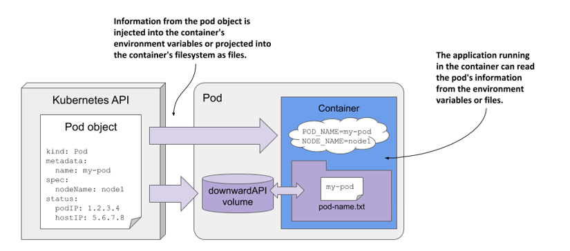

不过，通常只有常量类型的属性才能够通过环境变量注入到容器中，毕竟，在进程启动完成后无法再向其告知变量值的变动，于是，环境变量也就不支持中途的更新操作。

DownwardAPI提供了两种方式用于将 Pod 的信息注入到容器内部。


环境变量：用于单个变量，可以将 Pod 信息和容器信息直接注入容器内部Volume挂载：将 Pod 信息生成为文件，再挂载到容器内部中。

类似于ConfigMap或Secret资源，容器能够在环境变量中valueFrom字段中基于两个字段来引用其所属Pod对象的元数据信息。

fieldRef：引用常规性的元数据resourceFieldRef：引用和资源限制和资源请求相关的元数据。

#### Downward API fields injected via the fieldRef field

Allowed

Field Description Allowed

in

in env

volume

metadata.name The pod’s name.Yes Yes

metadata.namespace The pod’s namespace.Yes Yes

metadata.uid The pod’s UID.Yes Yes

All the pod’s labels, one label

```text
metadata.labels
```

per line, formatted as key=”

No Yes

value” .

metadata.labels['key']The value of the specified

label.Yes Yes

All the pod’s annotations, one

```text
metadata.annotations
```

per line, formatted as key=”

No Yes

value” .

metadata.annotations['key']The value of the specified

annotation.Yes Yes

spec.nodeName The name of the worker node

the pod runs on.Yes No

spec.serviceAccountName The name of the pod’s service

account.Yes No

status.podIP The pod’s IP address.Yes No

status.hostIP The worker node’s IP address.Yes No

#### Downward API resource fields injected via the resourceFieldRef field

Allowed

Resource field Description Allowed

in env

in vol

requests.cpu The container’s CPU request.Yes Yes

requests.memory The container’s memory

request.Yes Yes

requests.ephemeral-storage The container’s ephemeral

storage request.Yes Yes

limits.cpu The container’s CPU limit.Yes Yes

limits.memory The container’s memory limit.Yes Yes

limits.ephemeral-storage The container’s ephemeral

storage limit.Yes Yes

容器规范中可在环境变量配置中的valueFrom通过内嵌字段fieldRef引用的信息包括如下信息：

```text
metadata.name：Pod对象的名称
metadata.namespace：Pod对象隶属的名称空间
metadata.uid：Pod对象的UID
metadata.labels['<KEY>']：Pod对象标签中的指定键的值，例如metadata.labels['mylabel']
metadata.annotations['<KEY>']：Pod对象注解信息中的指定键的值
```

容器上的计算资源需求和资源限制相关的信息，以及临时存储资源需求和资源限制相关的信息可通过容器规范中的resourceFieldRef字段引用，相关字段包括requests.cpu、limits.cpu、requests.memory和limits.memory等。

另外，可通过环境变量引用的信息有如下几个：

```text
status.podIP：Pod对象的IP地址
spec.serviceAccountName：Pod对象使用的ServiceAccount资源名称
spec.nodeName：节点名称
status.hostIP：节点IP地址
```

容器上的当前容器的资源请求及资源限额的定义，可以通过resourceFieldRef字段引用，因此它们包括6项。

```text
requests.cpu
requests.memory
requests.ephemeral-storage
limits.cpu
limits.memory
limits.ephemeral-storage
```

### 2.4.2 downwardAPI 案例

范例: 获取基本的变量信息通过变量方式引用

```text
#定制的资源对象
[root@master1 ~]#cat storage-downwardapi-env-test.yaml
apiVersion: v1
kind: Pod
metadata:
name: downwardapi-env-test
labels:
app: downwardapi-env
spec:
containers:
- name: downwardapi-env-test
image: registry.cn-beijing.aliyuncs.com/wangxiaochun/pod-test:v0.1
resources:
requests:
memory: "32Mi"
cpu: "250m"
limits:
memory: "64Mi"
cpu: "500m"
env:
- name: THIS_POD_NAME
valueFrom:
fieldRef:
fieldPath: metadata.name
```

```text
- name: THIS_POD_NAMESPACE
valueFrom:
fieldRef:
fieldPath: metadata.namespace
- name: THIS_APP_LABEL
valueFrom:
fieldRef:
fieldPath: metadata.labels['app']
- name: THIS_CPU_LIMIT
valueFrom:
resourceFieldRef:
resource: limits.cpu
- name: THIS_MEM_REQUEST
valueFrom:
resourceFieldRef:
resource: requests.memory
divisor: 1Mi
- name: VAR_REF
value: $(THIS_POD_NAMESPACE).wang.org  #变量引用格式:$(VAR_NAME)
```

```text
#应用资源对象
[root@master1 ~]#kubectl apply -f storage-downwardapi-env-test.yaml
```

```text
#查看效果
[root@master1 ~]# kubectl get pod
NAME                   READY   STATUS    RESTARTS   AGE
downwardapi-env-test   1/1     Running   0          7s
```

```text
[root@master1 ~]# kubectl exec -it downwardapi-env-test -- env
PATH=/usr/local/sbin:/usr/local/bin:/usr/sbin:/usr/bin:/sbin:/bin
HOSTNAME=downwardapi-env-test
TERM=xterm
THIS_POD_NAMESPACE=default
THIS_APP_LABEL=downwardapi-env
THIS_CPU_LIMIT=1  #向
THIS_MEM_REQUEST=32
THIS_POD_NAME=downwardapi-env-test
VAR_REF=default.wang.org
```

范例: 存储卷方式使用

```text
[root@master1 ~]#cat  storage-downwardapi-volume-test.yaml
kind: Pod
apiVersion: v1
metadata:
name: downwardapi-volume-test
labels:
zone: Beijing
rack: zhongguancun
app: redis-master
annotations:
region: Asia-China
spec:
volumes:
- name: podinfo
downwardAPI:
defaultMode: 0420  #文件权限，默认0644
```

```text
items:
- fieldRef:
fieldPath: metadata.namespace
path: "pod_namespace"
- fieldRef:
fieldPath: metadata.labels
path: "pod_labels"
- fieldRef:
fieldPath: metadata.annotations
path: "pod_annotations"
- resourceFieldRef:
containerName: downwardapi-volume-test
resource: limits.cpu
path: "cpu_limit"
- resourceFieldRef:
containerName: downwardapi-volume-test
resource: requests.memory
divisor: "1Mi"
path: "mem_request"
containers:
- name: downwardapi-volume-test
image: registry.cn-beijing.aliyuncs.com/wangxiaochun/pod-test:v0.1
resources:
requests:
memory: "32Mi"
cpu: "250m"
limits:
memory: "64Mi"
cpu: "500m"
volumeMounts:
- name: podinfo
mountPath: /etc/podinfo/
readOnly: false
#属性解析；defaultMode 表示挂载文件后，文件的权限限制,items 定制自己的一些名称
```

```text
#应用资源对象
[root@master1 ~]#kubectl apply -f storage-downwardapi-volume-test.yaml
```

```text
#查看效果
[root@master1 ~]#kubectl get pod
NAME                      READY   STATUS    RESTARTS   AGE
downwardapi-volume-test   1/1     Running   0          2s
```

```text
[root@master1 ~]#kubectl exec -it downwardapi-volume-test -- ls /etc/podinfo/
cpu_limit        pod_annotations  pod_namespace
mem_request      pod_labels
[root@master1 ~]#kubectl exec -it downwardapi-volume-test -- cat
/etc/podinfo/pod_labels
app="redis-master"
rack="zhongguancun"
zone="Beijing"
[root@master1 ~]#kubectl exec -it downwardapi-volume-test -- cat
/etc/podinfo/cpu_limit
1
```

```text
#双层软链接，支持动态更新
[root@master1 ~]#kubectl exec -it -n demons downwardapi-volume-test -- sh
[root@downwardapi-volume-test /]# ls /etc/podinfo -l
```

```text
total 0
lrwxrwxrwx    1 root     root            16 Jun  6 01:20 cpu_limit ->
..data/cpu_limit
lrwxrwxrwx    1 root     root            18 Jun  6 01:20 mem_request ->
..data/mem_request
lrwxrwxrwx    1 root     root            22 Jun  6 01:20 pod_annotations ->
..data/pod_annotations
lrwxrwxrwx    1 root     root            17 Jun  6 01:20 pod_labels ->
..data/pod_labels
lrwxrwxrwx    1 root     root            20 Jun  6 01:20 pod_namespace ->
..data/pod_namespace
```

```text
#更新Pod属性，再次观察
[root@master1 ~]#kubectl edit pod -n demons downwardapi-volume-test
```

## 2.5 Projected

```text
https://kubernetes.io/docs/concepts/storage/projected-volumes/
https://kubernetes.io/zh-cn/docs/concepts/storage/projected-volumes/
```

之前的CM,Secret等卷资源在Pod内的一个目录同时只能挂载一个卷，而我们有时希望在一个目录内生成来自多个卷的多个文件。Projected  volumes 是一种特殊的卷类型，支持同时投射多个卷至同一个挂载点。Projected  不是一个独立的API 资源类型，但其可以引用现有的configmap、secret资源对象，或downwardAPI中的元数据信息。

此类的卷一般用于为容器提供预先定义好的数据

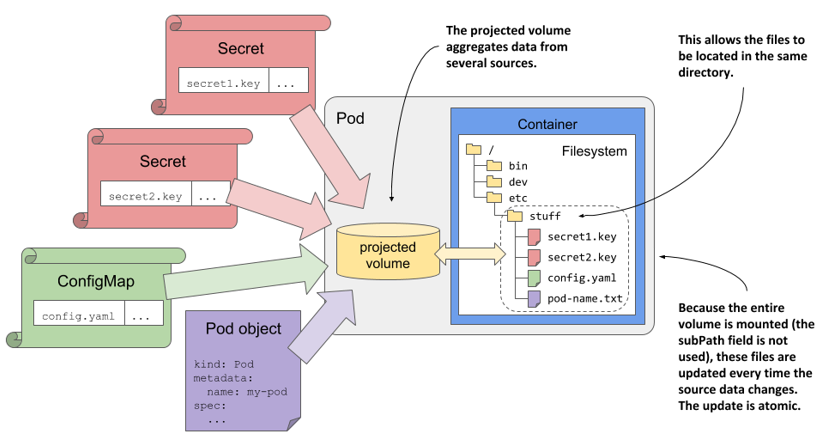

Projected Volume仅支持对如下四种类型的卷（数据源）进行投射操作。

**ConfigMap**：投射ConfgMap对象Secret：投射Secret对象DownwardAPI：投射Pod元数据ServiceAccountToken：投射ServiceAccountToken。

范例：默认每一个Pod都有Projected卷

```text
[root@master1 ~]#kubectl run myapp --image registry.cn-
beijing.aliyuncs.com/wangxiaochun/pod-test:v0.1
```

```text
[root@master1 ~]#kubectl get pod myapp -o yaml
apiVersion: v1
kind: Pod
metadata:
creationTimestamp: "2022-04-17T15:38:19Z"
labels:
run: myapp
name: myapp
namespace: default
resourceVersion: "185818"
uid: 3059fd59-1a6e-47d0-af1b-28d015f2b3bb
spec:
containers:
- image: registry.cn-beijing.aliyuncs.com/wangxiaochun/pod-test:v0.1
imagePullPolicy: IfNotPresent
name: myapp
resources: {}
terminationMessagePath: /dev/termination-log
terminationMessagePolicy: File
volumeMounts:
- mountPath: /var/run/secrets/kubernetes.io/serviceaccount
name: kube-api-access-cl7p6
readOnly: true
dnsPolicy: ClusterFirst
enableServiceLinks: true
nodeName: node1.wang.org
preemptionPolicy: PreemptLowerPriority
priority: 0
restartPolicy: Always
schedulerName: default-scheduler
securityContext: {}
serviceAccount: default
serviceAccountName: default
terminationGracePeriodSeconds: 30
tolerations:
- effect: NoExecute
key: node.kubernetes.io/not-ready
operator: Exists
tolerationSeconds: 300
- effect: NoExecute
key: node.kubernetes.io/unreachable
operator: Exists
tolerationSeconds: 300
volumes:
- name: kube-api-access-cl7p6
projected:
defaultMode: 420
sources:
- serviceAccountToken:
expirationSeconds: 3607
path: token
- configMap:
items:
- key: ca.crt
path: ca.crt
```

```text
name: kube-root-ca.crt
- downwardAPI:
items:
- fieldRef:
apiVersion: v1
fieldPath: metadata.namespace
path: namespace
status:
conditions:
- lastProbeTime: null
lastTransitionTime: "2022-04-17T15:38:19Z"
status: "True"
type: Initialized
- lastProbeTime: null
lastTransitionTime: "2022-04-17T15:38:19Z"
message: 'containers with unready status: [myapp]'
reason: ContainersNotReady
status: "False"
type: Ready
- lastProbeTime: null
lastTransitionTime: "2022-04-17T15:38:19Z"
message: 'containers with unready status: [myapp]'
reason: ContainersNotReady
status: "False"
type: ContainersReady
- lastProbeTime: null
lastTransitionTime: "2022-04-17T15:38:19Z"
status: "True"
type: PodScheduled
containerStatuses:
- image: registry.cn-beijing.aliyuncs.com/wangxiaochun/pod-test:v0.1
imageID: ""
lastState: {}
name: myapp
ready: false
restartCount: 0
started: false
state:
waiting:
reason: ContainerCreating
hostIP: 10.0.0.201
phase: Pending
qosClass: BestEffort
startTime: "2022-04-17T15:38:19Z"
```

范例：挂载secret,configMap和downwardAPI到容器内的同一个目录

```text
#Example configuration with a secret, a downwardAPI, and a configMap
#https://kubernetes.io/docs/concepts/storage/projected-volumes/#example-
configuration-secret-downwardapi-configmap
```

```text
[root@master1 ~]#cat  storage-projected-demo.yaml
apiVersion: v1
data:
username: d2FuZ3hpYW9jaHVu
kind: Secret
metadata:
```

```text
name: mysecret
namespace: default
type: Opaque
```

```text
---
apiVersion: v1
data:
myconfig: Hello,Myconfig
kind: ConfigMap
metadata:
name: myconfigmap
namespace: default
---
apiVersion: v1
kind: Pod
metadata:
name: projected-volume-demo
spec:
containers:
- name: container-test
image: registry.cn-beijing.aliyuncs.com/wangxiaochun/pod-test:v0.1
volumeMounts:
- name: all-in-one
mountPath: "/projected-volume"
readOnly: true
volumes:
- name: all-in-one
projected:
sources:
- secret:
name: mysecret
items:
- key: username
path: my-group/my-username
- downwardAPI:
items:
- path: "labels"
fieldRef:
fieldPath: metadata.labels
- path: "cpu_limit"
resourceFieldRef:
containerName: container-test
resource: limits.cpu
- configMap:
name: myconfigmap
items:
- key: myconfig
path: my-group/my-config
```

```text
[root@master1 ~]#kubectl apply -f storage-projected-demo.yaml
secret/mysecret created
configmap/myconfigmap created
pod/projected-volume-demo created
```

```text
[root@master1 ~]#kubectl exec -it projected-volume-demo -- sh
[root@projected-volume-demo /]# ls -l  /projected-volume/
total 0
```

```text
lrwxrwxrwx    1 root     root            16 Apr 17 16:07 cpu_limit ->
..data/cpu_limit
lrwxrwxrwx    1 root     root            13 Apr 17 16:07 labels -> ..data/labels
lrwxrwxrwx    1 root     root            15 Apr 17 16:07 my-group -> ..data/my-
group
[root@projected-volume-demo /]# cat   /projected-volume/cpu_limit
2
[root@projected-volume-demo /]# cat   /projected-volume/labels
[root@projected-volume-demo /]# ls   /projected-volume/my-group/
my-config    my-username
[root@projected-volume-demo /]# cat   /projected-volume/my-group/my-config
Hello,Myconfig
[root@projected-volume-demo /]# cat   /projected-volume/my-group/my-username
wangxiaochun
```

范例：Example configuration: secrets with a non-default permission mode set

```text
#https://kubernetes.io/docs/concepts/storage/projected-volumes/#example-
configuration-secrets-nondefault-permission-mode
```

```text
apiVersion: v1
kind: Pod
metadata:
name: volume-test
spec:
containers:
- name: container-test
image: busybox:1.28
volumeMounts:
- name: all-in-one
mountPath: "/projected-volume"
readOnly: true
volumes:
- name: all-in-one
projected:
sources:
- secret:
name: mysecret
items:
- key: username
path: my-group/my-username
- secret:
name: mysecret2
items:
- key: password
path: my-group/my-password
mode: 511
```

范例：serviceAccountToken projected volumes

```text
#https://kubernetes.io/docs/concepts/storage/projected-
volumes/#serviceaccounttoken
```

```text
apiVersion: v1
kind: Pod
metadata:
```

```text
name: sa-token-test
spec:
containers:
- name: container-test
image: busybox:1.28
command: ["sleep", "3600"]
volumeMounts:
- name: token-vol
mountPath: "/service-account"
readOnly: true
serviceAccountName: default
volumes:
- name: token-vol
projected:
sources:
- serviceAccountToken:
audience: api
expirationSeconds: 3600
path: token
```

范例：

```text
#https://livebook.manning.com/book/kubernetes-in-action-second-edition/chapter-
9/v-13/371
```

```text
apiVersion: v1
kind: Pod
metadata:
name: kiada-ssl
spec:
volumes:
- name: etc-envoy
projected:
sources:
- configMap:
name: kiada-envoy-config
- secret:
name: kiada-tls
items:
- key: tls.crt
path: example-com.crt
- key: tls.key
path: example-com.key
mode: 0600
containers:
- name: kiada
image: luksa/kiada:1.2
env:
...
- name: envoy
image: envoyproxy/envoy:v1.14.1
volumeMounts:
- name: etc-envoy
mountPath: /etc/envoy
readOnly: true
ports:
...
```



<nav class="article-end" aria-label="章节导航">
  <a href="{{ '/subjects/Kubernetes/22-storageclass-openebs.html' | relative_url }}">← 上一章：StorageClass 与 OpenEBS</a>
  <a href="{{ '/subjects/Kubernetes/' | relative_url }}">返回 Kubernetes 目录</a>
  <a href="{{ '/subjects/Kubernetes/24-storage-wordpress-mysql.html' | relative_url }}">下一章：存储与配置综合实践 →</a>
</nav>
