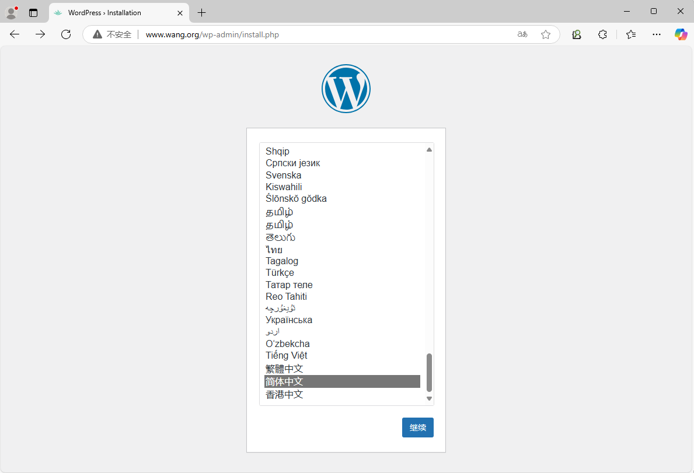

[← 返回 Kubernetes 目录]({{ '/subjects/Kubernetes/' | relative_url }})



# 24 存储与配置综合实践：部署 WordPress 与 MySQL

本例把前几章的 StorageClass、PVC、Secret、Service、Deployment 和 Ingress 串成一条部署链：MySQL 保存文章与账户数据，WordPress 的两个副本共享上传目录，Service 对副本做负载分发。先确认存储与网络，再创建数据库，最后部署前端并验证故障恢复；不要仅凭 Pod 进入 `Running` 就认定应用可用。

> 本例是教学环境中的组合实践，不等同于完整的生产高可用方案：MySQL 仍是单实例，数据库 PVC 即使标记为 `ReadWriteOnce`，底层 NFS 也不会因此获得块存储级的单写保障。生产环境宜使用数据库 Operator、可靠的存储与备份方案，并另行设计数据库高可用。

## 24.1 前提与存储选择

- 集群中已有可用的 `sc-nfs` StorageClass，NFS 动态供给器处于 `Running`，且后端目录可写。第 22 章介绍了供给器的部署。
- 若要通过 `LoadBalancer` 暴露前端，先部署 MetalLB 并分配地址池；否则把前端 Service 改成 `ClusterIP`，由 Ingress 统一接入。
- 两个 WordPress 副本只共享 `wp-content/uploads`。主题、插件和 WordPress 配置应随同一个镜像发布，或另行设计共享配置；仅共享上传目录并不会同步这些内容。

先检查依赖，再创建业务名称空间和密码 Secret。以下命令中的占位密码必须替换；实际环境应避免把密码留在终端历史或 Git 仓库中，并使用专门的密钥管理方案。

```bash
kubectl get storageclass sc-nfs
kubectl -n sc-nfs get pods
kubectl -n metallb-system get pods  # 仅使用 LoadBalancer 时检查
kubectl create namespace wordpress
kubectl -n wordpress create secret generic mysql-pass \
  --from-literal=root-password='<数据库管理员密码>' \
  --from-literal=app-password='<WordPress 数据库密码>'
```

## 24.2 部署 MySQL

将以下内容保存为 `mysql.yaml`。`wordpress-mysql` 是集群内部 Service；PVC 绑定 `sc-nfs`。单实例数据库使用 `Recreate`，避免 Deployment 更新期间同时运行新旧实例；这仍不能替代数据库级备份和故障切换。

```yaml
apiVersion: v1
kind: Service
metadata:
  name: wordpress-mysql
spec:
  ports:
    - port: 3306
      targetPort: mysql
  selector:
    app: wordpress-mysql
---
apiVersion: v1
kind: PersistentVolumeClaim
metadata:
  name: mysql-pv-claim
spec:
  storageClassName: sc-nfs
  accessModes: [ReadWriteOnce]
  resources:
    requests:
      storage: 20Gi
---
apiVersion: apps/v1
kind: Deployment
metadata:
  name: wordpress-mysql
spec:
  replicas: 1
  strategy:
    type: Recreate
  selector:
    matchLabels:
      app: wordpress-mysql
  template:
    metadata:
      labels:
        app: wordpress-mysql
    spec:
      containers:
        - name: mysql
          image: mysql:8.0
          env:
            - name: MYSQL_ROOT_PASSWORD
              valueFrom:
                secretKeyRef:
                  name: mysql-pass
                  key: root-password
            - name: MYSQL_DATABASE
              value: wordpress
            - name: MYSQL_USER
              value: wordpress
            - name: MYSQL_PASSWORD
              valueFrom:
                secretKeyRef:
                  name: mysql-pass
                  key: app-password
          ports:
            - name: mysql
              containerPort: 3306
          volumeMounts:
            - name: mysql-data
              mountPath: /var/lib/mysql
      volumes:
        - name: mysql-data
          persistentVolumeClaim:
            claimName: mysql-pv-claim
```

```bash
kubectl -n wordpress apply -f mysql.yaml
kubectl -n wordpress rollout status deployment/wordpress-mysql
kubectl -n wordpress get pvc mysql-pv-claim
```

若 PVC 一直是 `Pending`，先检查 StorageClass、供给器日志与 NFS 导出目录，而不是反复重建数据库 Pod。

## 24.3 部署两个 WordPress 副本

将以下内容保存为 `wordpress.yaml`。NFS StorageClass 必须支持 `ReadWriteMany`；否则两个副本无法跨节点同时挂载同一上传目录。这里用滚动发布更新无状态的前端，与上面的单实例 MySQL 策略不同。

```yaml
apiVersion: v1
kind: Service
metadata:
  name: wordpress
spec:
  type: LoadBalancer  # 未部署 MetalLB 时改成 ClusterIP
  ports:
    - port: 80
      targetPort: http
  selector:
    app: wordpress
---
apiVersion: v1
kind: PersistentVolumeClaim
metadata:
  name: wp-pv-claim
spec:
  storageClassName: sc-nfs
  accessModes: [ReadWriteMany]
  resources:
    requests:
      storage: 20Gi
---
apiVersion: apps/v1
kind: Deployment
metadata:
  name: wordpress
spec:
  replicas: 2
  selector:
    matchLabels:
      app: wordpress
  template:
    metadata:
      labels:
        app: wordpress
    spec:
      containers:
        - name: wordpress
          image: wordpress:php8.2-apache
          env:
            - name: WORDPRESS_DB_HOST
              value: wordpress-mysql:3306
            - name: WORDPRESS_DB_NAME
              value: wordpress
            - name: WORDPRESS_DB_USER
              value: wordpress
            - name: WORDPRESS_DB_PASSWORD
              valueFrom:
                secretKeyRef:
                  name: mysql-pass
                  key: app-password
          ports:
            - name: http
              containerPort: 80
          readinessProbe:
            httpGet:
              path: /
              port: http
            initialDelaySeconds: 10
            periodSeconds: 10
          volumeMounts:
            - name: uploads
              mountPath: /var/www/html/wp-content/uploads
      volumes:
        - name: uploads
          persistentVolumeClaim:
            claimName: wp-pv-claim
```

```bash
kubectl -n wordpress apply -f wordpress.yaml
kubectl -n wordpress rollout status deployment/wordpress
kubectl -n wordpress get deploy,svc,pvc,pod -o wide
```

两个副本应均为 `Ready`，两个 PVC 应均为 `Bound`。若前端无法连接数据库，检查 Secret 的键名、MySQL 初始化日志、Service selector 与数据库 Pod 的 Endpoints。

## 24.4 可选：通过 Ingress 提供 HTTPS

已经部署 Ingress Controller 时，可将前端 Service 改成 `ClusterIP`，再创建下列 Ingress。`wordpress-tls` 证书 Secret 应预先创建，证书域名必须匹配访问域名；HTTP 到 HTTPS 的重定向行为还取决于所用控制器的配置。

```yaml
apiVersion: networking.k8s.io/v1
kind: Ingress
metadata:
  name: wordpress
spec:
  ingressClassName: nginx
  tls:
    - hosts: [www.example.test]
      secretName: wordpress-tls
  rules:
    - host: www.example.test
      http:
        paths:
          - path: /
            pathType: Prefix
            backend:
              service:
                name: wordpress
                port:
                  number: 80
```

```bash
kubectl -n wordpress apply -f ingress-wordpress.yaml
kubectl -n wordpress get ingress wordpress
kubectl -n wordpress get endpoints wordpress wordpress-mysql
```

## 24.5 验证与清理

浏览器访问 LoadBalancer 地址或 Ingress 域名，完成 WordPress 安装并上传测试图片。再分别访问两个前端 Pod 对应的服务实例，确认上传内容一致。删除一个前端 Pod 后，应观察 Deployment 自动补足副本；删除数据库 Pod 后，应确认数据来自原 PVC，而不是误把新建的空数据库当成恢复成功。

```bash
kubectl -n wordpress get pods -o wide
kubectl -n wordpress describe pvc wp-pv-claim
kubectl -n wordpress logs deployment/wordpress-mysql --tail=100
kubectl -n wordpress delete pod -l app=wordpress
kubectl -n wordpress rollout status deployment/wordpress
```

若只需清理实验环境，可以执行 `kubectl delete namespace wordpress`；但应先核对 PV 的回收策略。`Delete` 策略及 NFS 供给器可能同时删除后端数据，因此清理前必须备份需要保留的文章、数据库和上传文件。





<nav class="article-end" aria-label="章节导航">
  <a href="{{ '/subjects/Kubernetes/23-configmap-secret.html' | relative_url }}">← 上一章：ConfigMap、Secret 与配置注入</a>
  <a href="{{ '/subjects/Kubernetes/' | relative_url }}">返回 Kubernetes 目录</a>
  <a href="{{ '/subjects/Kubernetes/25-statefulset.html' | relative_url }}">下一章：StatefulSet 与有状态应用 →</a>
</nav>
