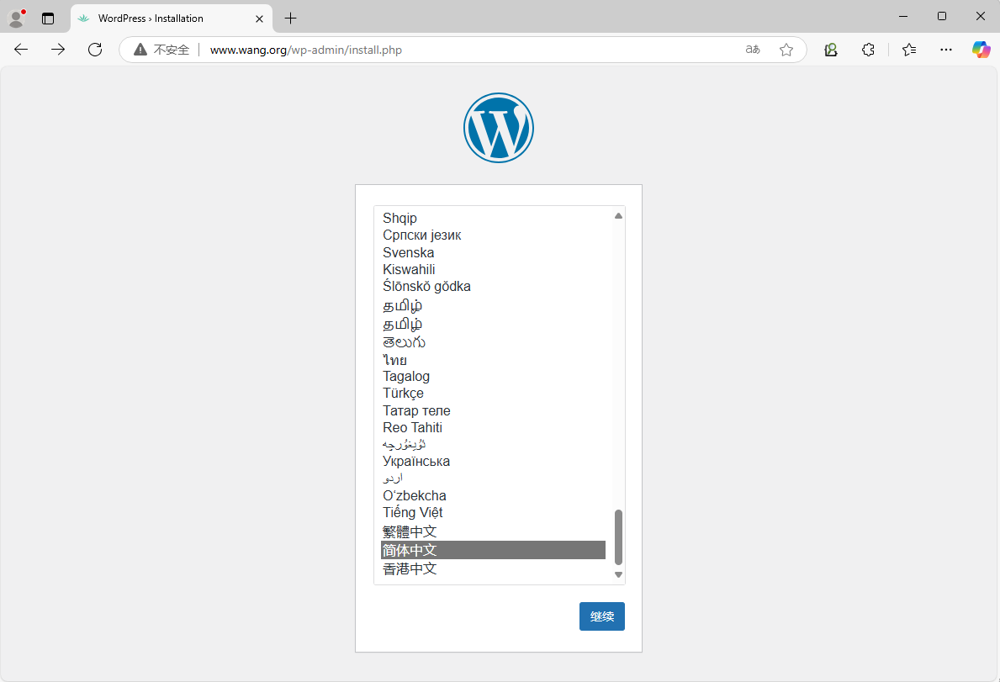

[← 返回 Kubernetes 目录]({{ '/subjects/Kubernetes/' | relative_url }})



# 24 存储与配置综合实践

# 3 综合案例:  使用持久卷和CM等部署 WordPress 和 MySQL

在kubernetes部署 wordpress，要满足以下要求：

**基本需求**

独立部署两个wordpress Pod实例实现负载均衡和高可用，它们使用NFS StorageClass 存储卷存储用户上传的图片或文件等数据；以ConfigMap和Secret提供必要的配置部署一个MySQL数据库，使用NFS StorageClass 存储卷存储，以ConfigMap和Secret提供必要的配置service 暴露 wordpress 的服务。

扩展需求

部署一个独立的ingress或者nginx Pod实例，为wordpress提供反向代理。同时提供https和http虚拟主机，其中发往http的请求都重定向给https；以ConfigMap和Secret提供必要的配置。

**动态的蓝绿发布和滚动发布**

对于wordpress 来说，没有本质的区别nginx的更新，依赖configmap和secret的内容。

示例
```text
https://kubernetes.io/zh-cn/docs/tutorials/stateful-application/mysql-wordpress-
persistent-volume/
```

## 3.1  准备基于NFS的 StorageClass
```bash
#参考1.6.3.2 案例sc-nfs名称的storageClass

#检查下面的资源
[root@master1 ~]#kubectl get all -n sc-nfs
NAME                                          READY   STATUS    RESTARTS
AGE
pod/nfs-client-provisioner-7cbdc4cf66-v4nvs   1/1     Running   1 (36m ago)
46h

NAME                                     READY   UP-TO-DATE   AVAILABLE   AGE
deployment.apps/nfs-client-provisioner   1/1     1            1           46h

NAME                                                DESIRED   CURRENT   READY
AGE
replicaset.apps/nfs-client-provisioner-7cbdc4cf66   1         1         1
46h
[root@master1 ~]#kubectl get sc
NAME     PROVISIONER                                   RECLAIMPOLICY
VOLUMEBINDINGMODE   ALLOWVOLUMEEXPANSION   AGE
sc-nfs   k8s-sigs.io/nfs-subdir-external-provisioner   Delete          Immediate
false                  46h

[root@master1 ~]#exportfs -v

/data/sc-nfs    <world>
(sync,wdelay,hide,no_subtree_check,sec=sys,rw,secure,no_root_squash,no_all_squas
h)
```

## 3.2 部署 Metallb 的 LoadBalancer 服务
```bash
#部署过程参看Kubernetes 服务发现和域名解析的小节1.3.4.4.2 MetalLB 实现

#检查
[root@master1 ~]#kubectl get all -n metallb-system
NAME                             READY   STATUS    RESTARTS       AGE
pod/controller-bb5f47665-cfs2k   1/1     Running   7 (45m ago)    7d16h
pod/speaker-4wsm9                1/1     Running   13 (44m ago)   7d16h
pod/speaker-76p7c                1/1     Running   14 (44m ago)   7d16h
pod/speaker-mm424                1/1     Running   8 (44m ago)    7d16h
pod/speaker-srmsx                1/1     Running   13 (44m ago)   7d16h

NAME                              TYPE        CLUSTER-IP     EXTERNAL-IP
PORT(S)   AGE
service/metallb-webhook-service   ClusterIP   10.103.38.17   <none>
443/TCP   7d16h

NAME                     DESIRED   CURRENT   READY   UP-TO-DATE   AVAILABLE
NODE SELECTOR            AGE
daemonset.apps/speaker   4         4         4       4            4
kubernetes.io/os=linux   7d16h

NAME                         READY   UP-TO-DATE   AVAILABLE   AGE
deployment.apps/controller   1/1     1            1           7d16h

NAME                                   DESIRED   CURRENT   READY   AGE
replicaset.apps/controller-bb5f47665   1         1         1       7d16h
```

## 3.3 MySQL的相关资源
```yaml
#提前准备名为sc-nfs的storage Class
[root@master1 ~]#cat > storage-wordpress-mysql.yaml
apiVersion: v1
kind: Secret
metadata:
name: mysql-pass
type: kubernetes.io/basic-auth
#type: Opaque  #也可以用Opaque类型
data:
password: MTIzNDU2             #key名称:password,value为123456

---
apiVersion: v1
kind: Service
metadata:
name: wordpress-mysql
labels:
app: wordpress
spec:

ports:
- port: 3306
selector:
app: wordpress
tier: mysql
clusterIP: None
---
apiVersion: v1
kind: PersistentVolumeClaim
metadata:
name: mysql-pv-claim
labels:
app: wordpress
spec:
storageClassName: sc-nfs  #需要和前面创建的storageClass名称相同,如果是默认的
storageClass,此项可选
accessModes:
- ReadWriteOnce
resources:
requests:
storage: 20Gi
---
apiVersion: apps/v1
kind: Deployment
metadata:
name: wordpress-mysql
labels:
app: wordpress
spec:
selector:
matchLabels:
app: wordpress
tier: mysql
strategy:
type: Recreate
template:
metadata:
labels:
app: wordpress
tier: mysql
spec:
containers:
- image: registry.cn-beijing.aliyuncs.com/bowen/mysql:8.0.29-oracle
name: mysql
env:
- name: MYSQL_ROOT_PASSWORD
valueFrom:
secretKeyRef:
name: mysql-pass
key: password
- name: MYSQL_DATABASE
value: wordpress
- name: MYSQL_USER
value: wordpress
- name: MYSQL_PASSWORD
valueFrom:
secretKeyRef:
name: mysql-pass

key: password
ports:
- containerPort: 3306
name: mysql
volumeMounts:
- name: mysql-persistent-storage
mountPath: /var/lib/mysql
volumes:
- name: mysql-persistent-storage
persistentVolumeClaim:
claimName: mysql-pv-claim
```

## 3.4 wordpress 相关资源
```yaml
[root@master1 ~]#cat > storage-wordpress-wordpress.yaml
apiVersion: v1
kind: Service
metadata:
name: wordpress
labels:
app: wordpress
spec:
ports:
- port: 80
selector:
app: wordpress
tier: frontend
type: LoadBalancer
sessionAffinity: ClientIP    #会话保持
externalTrafficPolicy: Local #DNAT
#type: ClusterIP  #如何部署了ingress可以使用此项
---
apiVersion: v1
kind: PersistentVolumeClaim
metadata:
name: wp-pv-claim
labels:
app: wordpress
spec:
storageClassName: sc-nfs  #需要和前面创建的storageClass名称相同,如果是默认的
storageClass,此项可选
accessModes:
- ReadWriteMany
resources:
requests:
storage: 20Gi
---
apiVersion: apps/v1
kind: Deployment
metadata:
name: wordpress
labels:
app: wordpress
spec:
replicas: 2
selector:
matchLabels:

app: wordpress
tier: frontend
strategy:
type: Recreate
template:
metadata:
labels:
app: wordpress
tier: frontend
spec:
containers:
- image: registry.cn-beijing.aliyuncs.com/bowen/wordpress:php8.2-
apache
name: wordpress
env:
- name: WORDPRESS_DB_HOST
value: wordpress-mysql
- name: WORDPRESS_DB_PASSWORD
valueFrom:
secretKeyRef:
name: mysql-pass
key: password
- name: WORDPRESS_DB_USER
value: wordpress
ports:
- containerPort: 80
name: wordpress
volumeMounts:
- name: wordpress-persistent-storage
#mountPath: /var/www/html  #此方式性能较差
mountPath: /var/www/html/wp-content/uploads #此方式性能较好，wordpress的配
置不能实现多个Pod同步
volumes:
- name: wordpress-persistent-storage
persistentVolumeClaim:
claimName: wp-pv-claim
```

## 3.5 创建 Ingress (可选)
```yaml
[root@master1 ~]#cat ingress-wordpress.yaml
apiVersion: networking.k8s.io/v1
kind: Ingress
metadata:
name: ingress-test
namespace: wordpress
#annotations:
#  kubernetes.io/ingress.class: "nginx" ,k8s-v1.32.0不支持
spec:
ingressClassName: nginx   #新版建议使用此项指定controller类型
rules:
- host: www.bowen.org
http:
paths:
- path: /
pathType: Prefix
backend:
service:

name: wordpress
port:
number: 80

[root@master1 wordpress-mysql]#kubectl apply -f  ingress-wordpress.yaml

[root@master1 wordpress-mysql]#kubectl get ingress -n wordpress
NAME           CLASS   HOSTS          ADDRESS               PORTS   AGE
ingress-test   nginx   www.bowen.org   10.0.0.10,10.0.0.99   80      25s
```

## 3.6 应用并测试
```bash
#创建独立的名称空间
[root@master1 ~]#kubectl create ns wordpress

#应用
[root@master1 ~]#kubectl apply -f storage-wordpress-mysql.yaml -f storage-
wordpress-wordpress.yaml -n wordpress
secret/mysql-pass created
service/wordpress-mysql created
persistentvolumeclaim/mysql-pv-claim created
deployment.apps/wordpress-mysql created
service/wordpress created
persistentvolumeclaim/wp-pv-claim created
deployment.apps/wordpress created

#可以正常访问
[root@master1 ~]#kubectl  get all -n wordpress
NAME                                   READY   STATUS    RESTARTS   AGE
pod/wordpress-9c8c6d676-xghzw          1/1     Running   0          95s
pod/wordpress-mysql-6d86b54f56-4gbjt   1/1     Running   0          2m35s

NAME                      TYPE           CLUSTER-IP    EXTERNAL-IP   PORT(S)
AGE
service/wordpress         LoadBalancer   10.99.25.42   10.0.0.10
80:32734/TCP   8m38s
service/wordpress-mysql   ClusterIP      None          <none>        3306/TCP
8m38s

NAME                              READY   UP-TO-DATE   AVAILABLE   AGE
deployment.apps/wordpress         1/1     1            1           8m38s
deployment.apps/wordpress-mysql   1/1     1            1           8m38s

NAME                                         DESIRED   CURRENT   READY   AGE
replicaset.apps/wordpress-9c8c6d676          1         1         1       8m38s
replicaset.apps/wordpress-mysql-6d86b54f56   1         1         1       8m38s

#通过SVC直接访问
10.0.0.10

[root@master1 ~]#kubectl get pod -n wordpress
NAME                               READY   STATUS    RESTARTS   AGE
wordpress-9c8c6d676-xghzw          1/1     Running   0          68s
wordpress-mysql-6d86b54f56-4gbjt   1/1     Running   0          2m8s

#删除Pod，自动创建新的Pod,仍可以继续访问
[root@master1 ~]#kubectl  delete pod --all -n wordpress

pod "wordpress-9c8c6d676-xghzw" deleted
pod "wordpress-mysql-6d86b54f56-4gbjt" deleted

[root@master1 ~]#kubectl get pod -n wordpress
NAME                               READY   STATUS    RESTARTS   AGE
wordpress-9c8c6d676-5cqrk          1/1     Running   0          33s
wordpress-mysql-6d86b54f56-s8gw8   1/1     Running   0          33s

#Pod所在主机宕机后，等待几分钟后会在其它主机节点重建Pod
[root@master1 ~]#kubectl get pod -n wordpress -o wide
NAME                               READY   STATUS        RESTARTS   AGE    IP
NODE             NOMINATED NODE   READINESS GATES
wordpress-7674c49955-5qmh4         1/1     Running       0          3m7s
10.244.1.109   node1.bowen.org   <none>           <none>
wordpress-7674c49955-hfftf         1/1     Running       0          112s
10.244.1.111   node1.bowen.org   <none>           <none>
wordpress-7674c49955-hwvmr         1/1     Terminating   0          16m
10.244.2.117   node3.bowen.org   <none>           <none>
wordpress-7674c49955-phsss         1/1     Terminating   0          16m
10.244.4.120   node2.bowen.org   <none>           <none>
wordpress-mysql-7fdbb5fb4c-f7bbb   1/1     Running       0          16m
10.244.1.107   node1.bowen.org   <none>           <none>

#清理环境
[root@master1 ~]#kubectl delete ns wordpress
namespace "wordpress" deleted
```





<nav class="article-end" aria-label="章节导航">
  <a href="{{ '/subjects/Kubernetes/23-configmap-secret.html' | relative_url }}">← 上一章：ConfigMap、Secret 与配置注入</a>
  <a href="{{ '/subjects/Kubernetes/' | relative_url }}">返回 Kubernetes 目录</a>
  <a href="{{ '/subjects/Kubernetes/25-statefulset.html' | relative_url }}">下一章：StatefulSet 与有状态应用 →</a>
</nav>
