[← 返回 Kubernetes 目录]({{ '/subjects/Kubernetes/' | relative_url }})



# 25 StatefulSet 与有状态应用

# 1 StatefulSet

## 1.1 StatefulSet 机制

```text
https://kubernetes.io/zh-cn/docs/tutorials/stateful-application/
https://kubernetes.io/zh-cn/docs/tasks/run-application/run-single-instance-
stateful-application/
```

### 1.1.1 应用状态说明

无状态和有状态

**无状态（Stateless）**

无状态的系统不会在多个请求之间保存任何状态信息。每个请求都独立处理，不考虑之前的请求或状态。无状态的每次的请求都是独立的，它的执行情况和结果与前面的请求和之后的请求是无直接关系的，它不会受前面的请求应答情况直接影响，也不会直接影响后面的请求应答情况。典型的无状态系统包括HTTP协议、RESTful API等。每个请求都包含了足够的信息来完成其处理，服务器不需要保存任何客户端的状态信息。

**有状态（Stateful）**

有状态的系统在处理请求或通信时会记住之前的状态信息。这意味着系统会存储客户端的历史信息或状态，并基于这些信息进行处理。有状态应用会在其会话中保存客户端的数据，并且有可能会在客户端下一次的请求中使用这些数据。

应用上常见的状态类型:会话状态、连接状态、配置状态、集群状态、持久性状态等。

典型的有状态系统包括数据库系统、TCP连接等。这些系统需要在通信过程中维护状态信息，以确保数据的可靠性和一致性。

无状态和有状态应用区别：

复杂度：有状态系统通常比无状态系统更复杂，因为它们需要维护和管理状态信息。无状态系统则更简单，因为它们不需要处理状态信息。可伸缩性：无状态系统通常更易于扩展，因为它们不需要考虑会话状态，可以更容易地实现负载均衡和水平扩展。有状态系统可能需要更复杂的状态管理和同步机制，因此在大规模应用中可能需要更多的资源和设计考虑。

大型应用通常具有众多功能模块，这些模块通常会被设计为有状态模块和无状态模块两部分。业务逻辑模块一般会被设计为无状态，这些模块需要将其状态数据保存在有状态的中间件服务上，如消息队列、数据库或缓存系统等无状态的业务逻辑模块易于横向扩展，有状态的后端则存在不同的难题。在设计系统时，选择使用有状态还是无状态取决于特定的需求和场景。Http 协议是无状态的，对于http协议本身的每一次请求都是相互独立的，彼此之间没有关联关系。而 Http 相关的应用往往是有状态的。很多的 Web 程序是需要有大量的业务逻辑相互关联才可以实现最终的目标，也就是说基于http协议的web应用程序是有状态的。只不过这个状态是需要借助于其他的机制来实现，比如 cookies、session、token以及其他辅助的机制。

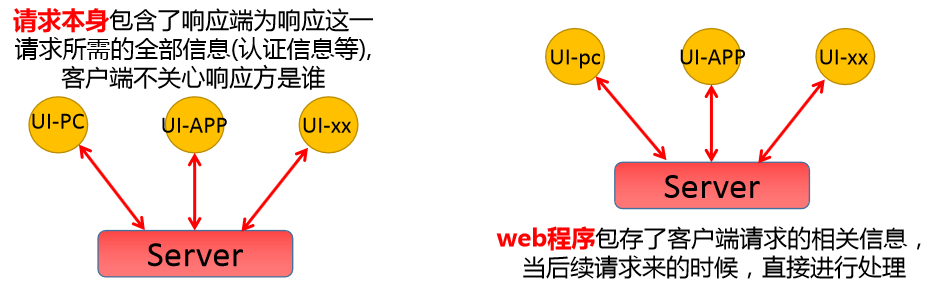

为了实现http的会话有状态，基于 cookies、session、token等机制都涉及到文件的保存，要么保存到客户端，要么保存到服务端。以session为例，就在服务端保存相关的信息，提高正常通信的效率。实际的生产环境中，web程序为了保证高可用，所以通过集群的方式实现，应用的访问分布式效果。在这种场景中，可以基于下面方法实现有状态的会话保持。session sticky - 根据用户的行为数据，找到上次响应请求的服务器，直接响应session cluster - 通过服务集群之间的通信机制实现会话数据的同步session server - 借助于一个专用的服务器来保存会话信息。

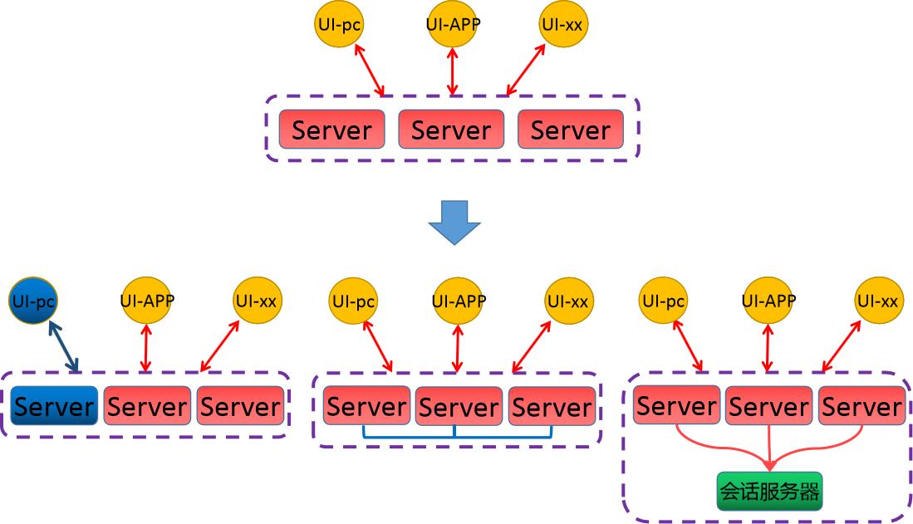

生产中一些中间件业务集群，比如MySQL集群、Redis集群、ElasticSearch集群、MongoDB集群、Nacos集群、MinIO集群、Zookeeper集群、Kafka集群、RabbitMQ集群等。

这些应用集群都有以下相同特点：

每个节点都有固定的身份ID，集群成员通过身份ID进行通信集群的规模是比较固定的，一般不能随意变动。节点都是由状态的，而且状态数据通常会做持久化存储集群中某个节点出现故障，集群功能肯定受到影响。像这种状态类型的服务，只要过程中存在一点问题，那么影响及范围都是不可预测。

**应用编排工作负载型控制器**

无状态应用编排:Deployment<--ReplicaSet系统级应用编排:DaemonSet作业类应用编排:CronJob <--bob有状态应用编排: StatefulSet

### 1.1.2 StatefulSet 工作机制

#### 1.1.2.1 StatefulSet 介绍

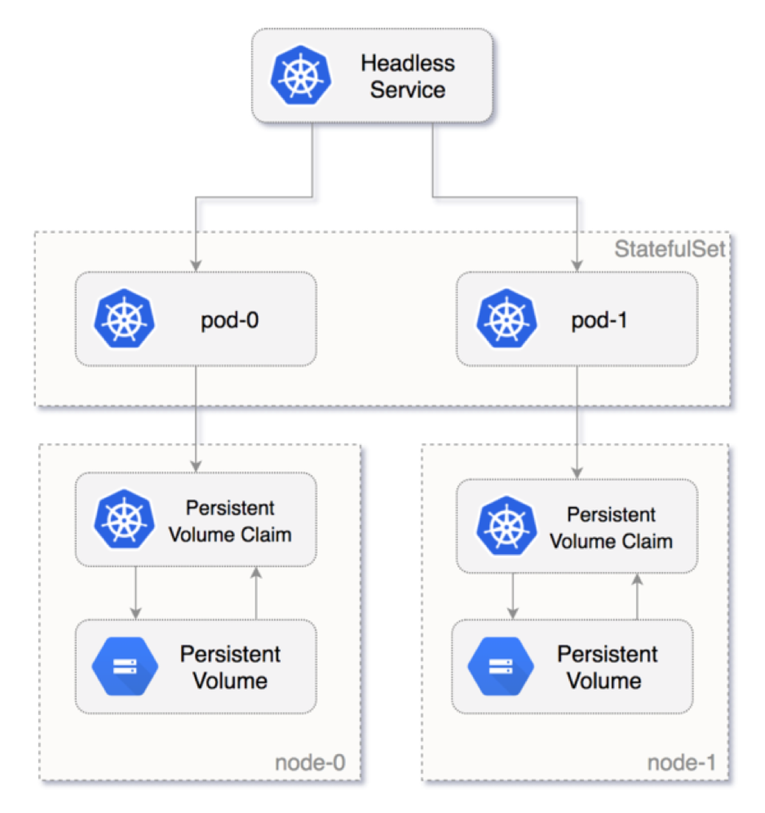

Pod的管理对象有Deployment，RS、DaemonSet、RC这些都是面向无状态的服务，满足不了上述的有状态集群的场景需求。从Kubernetes-v1.4版本引入了集群状态管理的功能，v1.5版本更名为StatefulSet 有状态应用副本集。

StatefulSet 最早在 Kubernetes 1.5 版本中引入，作为一个 alpha 特性。经过几个版本的改进和稳定，在 Kubernetes 1.9 版本中，StatefulSet 变成了一个稳定的、通用可用（GA，General Availability）的特性。StatefulSet 旨在与有状态的应用及分布式系统一起使用。然而在 Kubernetes 上管理有状态应用和分布式系统是一个宽泛而复杂的话题。

由于每个有状态服务的特点，工作机制和配置方式都存在很大的不同，因此当前Kubernetes并没有提供统一的具体的解决方案。而 Statefulset 只是为有状态应用提供了基础框架，而非完整的解决方案。如果想实现具体的有状态应用，建议可以使用相应的专用 Operator 实现。

#### 1.1.2.2 StatefulSet 特点

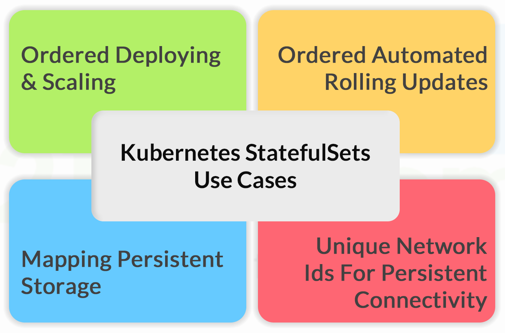

每个Pod 都有稳定、唯一的网络访问标识，即网络名称每个Pod 彼此间的通信基于Headless Service和Pod名称实现每个Pod 的网络名称实现需要利用KubeDNS来实现解析至每个Pod的IP StatefulSet 控制的Pod副本启动、扩展、删除、更新等操作都是有顺序的StatefulSet里的每个Pod存储的数据一般是不同的，所以采用专用的稳定独立的持久化存储卷，用于存储Pod的状态数据。

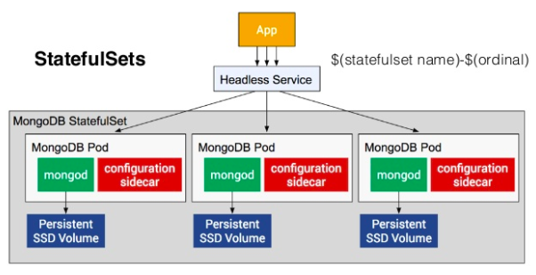

#### 1.1.2.3 StatefulSet 对应Pod 的网络标识

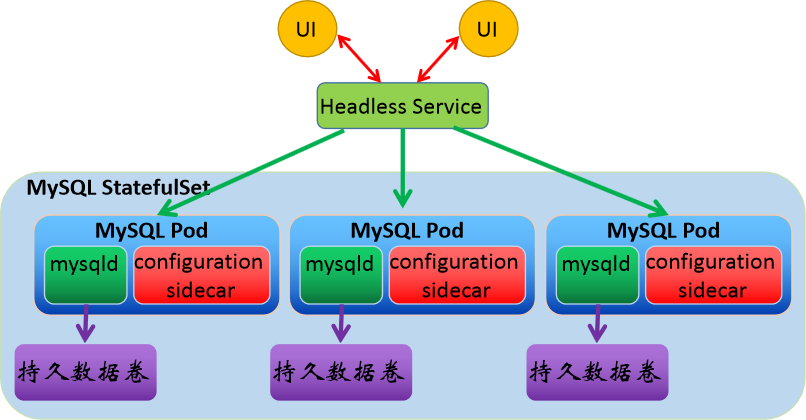

每个StatefulSet对象一般会对应于一个专用的Headless Service 对象使用 Headless service 给每一个StatufulSet控制的Pod提供一个唯一的DNS域名来作为每个成员的网络标识每个Pod都一个从0开始，从小到的序号的名称，创建和扩容时序号从小到大，删除，缩容和更新镜像时从大到小通过ClusterDNS解析为Pod的地址，从而实现集群内部成员之间使用域名通信。

每个Pod对应的DNS域名格式：

```text
$(statefulset_name)-$(orederID).$(headless_service_name).$(namespace_name).svc.c
luster.local
```

```text
#示例
mysql-0.mysql.wordpress.svc.cluster.local
mysql-1.mysql.wordpress.svc.cluster.local
mysql-2.mysql.wordpress.svc.cluster.local
```

#### 1.1.2.4 StatefulSet的 Pod 管理策略 Pod Management Policy

定义创建、删除及扩缩容等管理操作期间，在Pod副本上的创建两种模式。

OrderedReady

创建或扩容时，顺次完成各Pod副本的创建，且要求只有前一个Pod转为Ready状态后，才能进行后一个Pod副本的创建。删除或缩容时，逆序、依次完成相关Pod副本的终止。

Parallel

各Pod副本的创建或删除操作不存在顺序方面的要求，可同时进行。

#### 1.1.2.5 StatefulSet 的存储方式

基于podTempiate定义Pod模板在podTemplate上使用volumeTemplate为各Pod副本动态置备PersistentVolume因为每个Pod存储的状态数据不尽相同，所以在创建每一个Pod副本时绑定至专有的固定的PVC PVC的名称遵循特定的格式，从而能够与StatefulSet控制器对象的Pod副本建立紧密的关联关系支持从静态置备或动态置备的PV中完成绑定删除Pod(例如缩容)，并不会一并删除相关的PVC。

#### 1.1.2.6 StatefulSet 相关组件

**组件描述**

一般的Pod名称是随机的，而为了statefulset的唯一性，所以借用headless service通过唯一的"网络标识"来直接指定的pod应用，所以它要求我们的dns环境是完好的。

headless service

当一个StatefulSet挂掉，新创建的StatefulSet会被赋予跟原来的Pod一样的名字，通过这个名字来匹配到原来的存储，实现了状态保存。

有状态集群中的副本数据是不一样的(例：redis)，如果用共享存储的话，会导致多副本间的数据被覆盖，为了statefulsed数据持久化，需

volumeClaimTemplate

要将pod和其申请的数据卷隔离开，每一种pod都有其独立的对应的数据卷配置模板，来满足该要求。

#### 1.1.2.6 StatefulSet 局限性

根据对 StatefulSet的 原理解析，如果实现一个通用的有状态应用的集群，那基本没有可能完成。原因是不同的应用集群，其内部的状态机制几乎是完全不同的。

集群解析

当向当前数据库集群添加从角色节点的时候，可不仅仅为添加一个唯一的节点标识及对

MySQL主从集

应的后端存储就完了。我们要提前知道，从角色节点的时间、数据复制的起始位置(日。

群

志文件名、日志位置、时间戳等)，然后才可以进行数据的同步。

Redis

集群中，添加节点的时候，会自动根据slaveof设定的主角色节点上获取最新的数据，

主从集

然后直接在本地还原，然后借助于软件专用的机制进行数据的同步机制。

群

StatefulSet本身的代码无法考虑周全到所有的集群状态机制StatefulSet 只是提供了一个基础的编排框架有状态应用所需要的管理操作，需要由用户自行编写代码完成。

这也是为什么早期的Kubernetes只能运行无状态的应用，为了实现所谓的状态集群效果，只能将所有的有状态服务独立管理，然后以自建EndPoint或者ExternalName的方式引入到Kubernetes集群中，实现所谓的类似状态效果.

当前而这种方法仍然在很多企业中使用。

### 1.1.3 StatefulSet 配置

注意：StatefulSet除了需要定义自身的标签选择器和Pod模板等属性字段，StatefulSet必须要配置一个专用的Headless Service，而且还可能要根据需要，编写代码完成扩容、缩容等功能所依赖的必要操作步骤。

**属性解析**

```text
apiVersion: apps/v1                 # API群组及版本
kind: StatefulSet                   # 资源类型的特有标识
metadata:
name <string>                     # 资源名称，在作用域中要唯一
namespace <string>                # 名称空间；StatefulSet隶属名称空间级别
spec:
replicas <integer>                # 期望的Pod副本数，默认为1
selector <object>                 # 标签选择器，须匹配Pod模板中的标签，必选字段
template <object>                 # Pod模板对象，必选字段
revisionHistoryLimit <integer>    # 滚动更新历史记录数量，默认为10
updateStrategy <Object>           # 滚动更新策略
type <string>                   # 指定更新策略类型，可用值：OnDelete和
Rollingupdate
# OnDelete 表示只有在手动删除旧 Pod 后才会触发更新
# RollingUpdate 表示会自动进行滚动更新。
rollingUpdate <Object>          # 滚动更新参数，专用于RollingUpdate类型
maxUnavailable: <integer>     # 更新期间可比期望的Pod数量缺少的数量或比例
partition <integer>           # 分区值,表示只更新大于等于此索引值的Pod，默认为0,一
般用于金丝雀场景，更新和缩容时都是索引号的Pod从大到小进行，即按从大到小的顺序进行，比如：MySQL-
2,MySQL-1,MySQL-0
serviceName  <string>             # Service名称(Headless,也支持有头)，必选字段,只有
指定此字段才能支持Pod的域名解析
apiVersion <string>             # PVC资源所属的API群组及版本，可省略
kind <string>                   # PVC资源类型标识，可省略
metadata <Object>               # 卷申请模板元数据
spec <Object>                   # 期望的状态，可用字段同PVC
podManagementPolicy  <string>     # Pod管理策略，默认“OrderedReady”表示顺序创建并逆
序删除，“Parallel”表示并行模式
volumeClaimTemplates:   <[]Object> # 指定PVC的模板.存储卷申请模板，实现数据持久化
- metadata:
name: <string>                #生成的PVC的名称格式为：<volumeClaimTemplates>.
<StatefulSet>-<orederID>
spec:
accessModes: [ "ReadWriteOnce" ]
storageClassName: "sc-nfs"      #如果有动态置备的StorageClass,可以指定名称
resources:
requests:
storage: 1Gi
```

范例:  简单 statefulset 案例

```text
[root@master1 ~]#cat statefulset-demo.yaml
apiVersion: v1
kind: Service
metadata:
name: nginx
labels:
app: nginx
```

```text
spec:
ports:
- port: 80
name: http
clusterIP: None  #可使用无头或有头服务,因为每个有状态服务的Pod功能不同,一般会使用无头服务,
防止利用同一个Service ClusterIP随机解析到不同的Pod
selector:
app: nginx
---
apiVersion: apps/v1
kind: StatefulSet
metadata:
name: web
spec:
serviceName: "nginx"
replicas: 2
selector:
matchLabels:
app: nginx
template:
metadata:
labels:
app: nginx
spec:
containers:
- name: nginx
image: registry.cn-beijing.aliyuncs.com/wangxiaochun/pod-test:v0.1
ports:
- containerPort: 80
name: http
```

```text
[root@master1 ~]#kubectl apply -f statefulset-demo.yaml
```

```text
#观察到Pod按顺序创建
[root@master1 ~]#kubectl get pod -w
NAME    READY   STATUS              RESTARTS   AGE
web-0   0/1     ContainerCreating   0          63s
web-0   1/1     Running             0          30s
web-1   0/1     ContainerCreating   0          20s
web-1   1/1     Running             0          3s
```

```text
#测试名称解析
#方式1:创建测试pod
[root@master1 ~]#kubectl run busybox --image busybox:1.30 -- sleep 3600; kubectl
exec -it busybox -- sh
#方式2:创建临时Pod测试
[root@master1 ~]#kubectl run client-test-$RANDOM --image registry.cn-
beijing.aliyuncs.com/wangxiaochun/admin-box:v0.1 --restart=Never --rm -it --
command -- /bin/bash
#利用serivce名称解析
/ # host nginx
nginx.default.svc.cluster.local has address 10.244.3.92
nginx.default.svc.cluster.local has address 10.244.2.110
```

```text
#访问完整的service名称,注意最后的点号
/ # curl  nginx.default.svc.cluster.local.
kubernetes pod-test v0.1!! ClientIP: 10.244.3.88, ServerName: web-1, ServerIP:
10.244.2.110!
```

```text
/ # curl  nginx.default.svc.cluster.local.
kubernetes pod-test v0.1!! ClientIP: 10.244.3.88, ServerName: web-0, ServerIP:
10.244.3.92!
/ # curl  nginx
kubernetes pod-test v0.1!! ClientIP: 10.244.3.88, ServerName: web-0, ServerIP:
10.244.3.92!
/ # curl  nginx
kubernetes pod-test v0.1!! ClientIP: 10.244.3.88, ServerName: web-1, ServerIP:
10.244.2.110!
```

```text
#观察扩容和缩容都按顺序
[root@master1 ~]#kubectl scale sts web --replicas 5
statefulset.apps/web scaled
```

```text
[root@master1 ~]#kubectl scale sts web --replicas 3
statefulset.apps/web scaled
```

```text
#查看扩容和缩容的过程,扩容是Pod编号从小到大,缩容正好反之
[root@master1 ~]#kubectl get pod -w
NAME    READY   STATUS    RESTARTS   AGE
web-0   1/1     Running   0          76m
web-1   0/1     Pending   0          0s
web-1   0/1     Pending   0          0s
web-1   0/1     ContainerCreating   0          0s
web-1   1/1     Running             0          1s
web-2   0/1     Pending             0          0s
web-2   0/1     Pending             0          0s
web-2   0/1     ContainerCreating   0          0s
web-2   1/1     Running             0          1s
web-3   0/1     Pending             0          0s
web-3   0/1     Pending             0          0s
web-3   0/1     ContainerCreating   0          0s
web-3   1/1     Running             0          0s
web-4   0/1     Pending             0          0s
web-4   0/1     Pending             0          0s
web-4   0/1     ContainerCreating   0          0s
web-4   1/1     Running             0          2s
web-4   1/1     Terminating         0          22s
web-4   0/1     Terminating         0          23s
web-4   0/1     Terminating         0          23s
web-4   0/1     Terminating         0          23s
web-3   1/1     Terminating         0          23s
web-3   0/1     Terminating         0          24s
web-3   0/1     Terminating         0          24s
web-3   0/1     Terminating         0          24s
```

```text
#观察到新的pod的名称按顺序命名
[root@master1 ~]#kubectl get pod
NAME    READY   STATUS    RESTARTS   AGE
web-0   1/1     Running   0          2m49s
web-1   1/1     Running   0          2m48s
web-2   1/1     Running   0          23s
```

```text
#观察到service为无头服务
[root@master1 ~]#kubectl get svc nginx
NAME    TYPE        CLUSTER-IP   EXTERNAL-IP   PORT(S)   AGE
nginx   ClusterIP   None         <none>        80/TCP    34s
```

```text
#查看statefulsets
[root@master1 ~]#kubectl get statefulsets.apps
NAME   READY   AGE
web    3/3     3m38s
```

```text
#支持缩写
[root@master1 ~]#kubectl get sts
NAME   READY   AGE
web    3/3     3m41s
```

```text
#查看主机名和host解析
[root@master1 ~]#kubectl exec -it web-0 -- hostname
web-0
[root@master1 ~]#kubectl exec -it web-1 -- hostname
web-1
[root@master1 ~]#kubectl exec -it web-2 -- hostname
web-2
```

```text
[root@master1 ~]#kubectl exec -it web-0 -- cat /etc/hosts
# Kubernetes-managed hosts file.
127.0.0.1   localhost
::1 localhost ip6-localhost ip6-loopback
fe00::0 ip6-localnet
fe00::0 ip6-mcastprefix
fe00::1 ip6-allnodes
fe00::2 ip6-allrouters
10.244.2.9  web-0.nginx.default.svc.cluster.local   web-0
```

```text
#创建测试pod
[root@master1 ~]#kubectl run busybox --image busybox:1.30 -- sleep 3600
```

```text
[root@master1 ~]#kubectl get pod -o wide
NAME      READY   STATUS    RESTARTS   AGE     IP            NODE
NOMINATED NODE   READINESS GATES
busybox   1/1     Running   0          104s    10.244.2.11   node2.wang.org
<none>           <none>
web-0     1/1     Running   0          11m     10.244.2.9    node2.wang.org
<none>           <none>
web-1     1/1     Running   0          11m     10.244.1.14   node1.wang.org
<none>           <none>
web-2     1/1     Running   0          9m33s   10.244.3.12   node3.wang.org
<none>           <none>
```

```text
#测试Pod的名称解析
[root@master1 ~]#kubectl exec -it busybox -- sh
/ # ping -c1 web-0.nginx
PING web-0.nginx (10.244.2.9): 56 data bytes
64 bytes from 10.244.2.9: seq=0 ttl=64 time=0.116 ms
```

```text
--- web-0.nginx ping statistics ---
1 packets transmitted, 1 packets received, 0% packet loss
round-trip min/avg/max = 0.116/0.116/0.116 ms
/ # ping -c1 web-1.nginx
PING web-1.nginx (10.244.1.14): 56 data bytes
64 bytes from 10.244.1.14: seq=0 ttl=62 time=0.427 ms
```

```text
--- web-1.nginx ping statistics ---
1 packets transmitted, 1 packets received, 0% packet loss
```

```text
round-trip min/avg/max = 0.427/0.427/0.427 ms
/ # ping -c1 web-2.nginx
PING web-2.nginx (10.244.3.12): 56 data bytes
64 bytes from 10.244.3.12: seq=0 ttl=62 time=0.692 ms
```

```text
--- web-2.nginx ping statistics ---
1 packets transmitted, 1 packets received, 0% packet loss
round-trip min/avg/max = 0.692/0.692/0.692 ms
```

```text
#完整名称
/ # ping -c1  web-0.nginx.default.svc.cluster.local
PING web-0.nginx.default.svc.cluster.local (10.244.2.9): 56 data bytes
64 bytes from 10.244.2.9: seq=0 ttl=64 time=0.470 ms
```

```text
--- web-0.nginx.default.svc.cluster.local ping statistics ---
1 packets transmitted, 1 packets received, 0% packet loss
round-trip min/avg/max = 0.470/0.470/0.470 ms
```

```text
#通过名称访问nginx服务
/ # wget -qO - web-0.nginx
kubernetes pod-test v0.1!! ClientIP: 10.244.3.88, ServerName: web-0, ServerIP:
10.244.2.9!
```

范例: 级联删除和非级联删除

```text
#默认是级联删除,即删除sts同时删除Pod
[root@master1 ~]#kubectl delete sts web
statefulset.apps "web" deleted
```

```text
[root@master1 ~]#kubectl get pod
No resources found in default namespace.
```

```text
#恢复sts
root@master1 ~]#kubectl apply  -f statefulset-demo.yaml
[root@master1 ~]#kubectl get pod
NAME    READY   STATUS    RESTARTS   AGE
web-0   1/1     Running   0          5s
web-1   1/1     Running   0          4s
```

```text
#非级联删除,即删除sts不同时删除Pod,选项--cascade=orphan(旧版false废弃)
[root@master1 ~]#kubectl delete sts web --cascade=orphan
[root@master1 ~]#kubectl delete sts web --cascade=false
warning: --cascade=false is deprecated (boolean value) and can be replaced with
--cascade=orphan.
statefulset.apps "web" deleted
```

```text
#查看sts删除,Pod仍在,但Pod为孤儿状态,即删除Pod,将不会被重建
[root@master1 ~]#kubectl get sts
No resources found in default namespace.
```

```text
[root@master1 ~]#kubectl get pod
NAME    READY   STATUS    RESTARTS   AGE
web-0   1/1     Running   0          2m34s
web-1   1/1     Running   0          2m33s
```

```text
#删除Pod查看是否被重建
[root@master1 ~]#kubectl delete pod web-0
```

```text
pod "web-0" deleted
```

```text
#发现不会重建
[root@master1 ~]#kubectl get pod
NAME    READY   STATUS    RESTARTS   AGE
web-1   1/1     Running   0          5m41s
```

### 1.1.4 StatefulSet 更新策略

更新策略可以实现滚动更新发布

```text
updateStrategy <Object>            # 滚动更新策略
type <string>                   # 滚动更新类型，可用值有OnDelete和Rollingupdate
rollingUpdate <Object>          # 滚动更新参数，专用于RollingUpdate类型
partition <integer>           # 分区指示索引值，默认为0,一般用于版本分区域更新场景
```

范例: 更新策略

```text
#查看更新策略
[root@master1 ~]#kubectl get sts  web  -o yaml
.....
updateStrategy:
rollingUpdate:
partition: 0 #此编号表示更新时只更新大于等于此编号对应的Pod,小于此编号的Pod不会更新,0
表示每次全部更新,比如:共5个Pod: web{0..4},此处设为2,则从Web-2开始更新,可以通过不断从大到小的
修改此值,可以实现滚动更新策略
type: RollingUpdate
......
```

```text
#升级image版本
[root@master1 ~]#kubectl edit sts web
- image: registry.cn-beijing.aliyuncs.com/wangxiaochun/pod-test:v0.2
```

```text
#观察更新顺序,发现Pod编号从大到小更新
[root@master1 ~]#kubectl get pod
NAME    READY   STATUS              RESTARTS   AGE
web-0   1/1     Running             0          93m
web-1   1/1     Running             0          16m
web-2   0/1     ContainerCreating   0          4s
[root@master1 ~]#kubectl get pod
NAME    READY   STATUS              RESTARTS   AGE
web-0   1/1     Running             0          93m
web-1   0/1     ContainerCreating   0          21s
web-2   1/1     Running             0          43s
[root@master1 ~]#kubectl get pod
NAME    READY   STATUS              RESTARTS   AGE
web-0   0/1     ContainerCreating   0          2s
web-1   1/1     Running             0          25s
web-2   1/1     Running             0          47s
[root@master1 ~]#kubectl get pod
NAME    READY   STATUS    RESTARTS   AGE
web-0   1/1     Running   0          64s
web-1   1/1     Running   0          87s
web-2   1/1     Running   0          109s
```

```text
#跟踪更新过程
```

```text
[root@master1 ~]#kubectl rollout status sts web
Waiting for 1 pods to be ready...
Waiting for partitioned roll out to finish: 2 out of 3 new pods have been
updated...
Waiting for 1 pods to be ready...
Waiting for 1 pods to be ready...
partitioned roll out complete: 3 new pods have been updated...
```

```text
#扩容为5个Pod
[root@master1 ~]#kubectl scale sts web --replicas 5
```

```text
#修改更新策略partition为4
[root@master1 ~]#kubectl edit sts web
.....
- image: registry.cn-beijing.aliyuncs.com/wangxiaochun/pod-test:v0.3  #修改
镜像版本
.....
updateStrategy:
rollingUpdate:
partition: 4  #将此处的0修改为4
type: RollingUpdate
.....
```

```text
#确认web-4以下Pod不更新
[root@master1 ~]#kubectl get pod web-4 -o yaml|grep -m1  image
- image: registry.cn-beijing.aliyuncs.com/wangxiaochun/pod-test:v0.3
[root@master1 ~]#kubectl get pod web-3 -o yaml|grep -m1  image
- image: registry.cn-beijing.aliyuncs.com/wangxiaochun/pod-test:v0.2
[root@master1 ~]#kubectl get pod web-2 -o yaml|grep -m1  image
- image: registry.cn-beijing.aliyuncs.com/wangxiaochun/pod-test:v0.2
[root@master1 ~]#kubectl get pod web-1 -o yaml|grep -m1  image
- image: registry.cn-beijing.aliyuncs.com/wangxiaochun/pod-test:v0.2
[root@master1 ~]#kubectl get pod web-0 -o yaml|grep -m1  image
- image: registry.cn-beijing.aliyuncs.com/wangxiaochun/pod-test:v0.2
```

```text
#修改更新策略为1
[root@master1 ~]#kubectl edit sts web
......
updateStrategy:
rollingUpdate:
partition: 1  #修改此处为1
type: RollingUpdate
......
```

```text
#观察结果,发现web-1以上都更新
[root@master1 ~]#kubectl get pod -w
NAME    READY   STATUS    RESTARTS   AGE
web-0   1/1     Running   0          14m
web-1   1/1     Running   0          22s
web-2   1/1     Running   0          24s
web-3   1/1     Running   0          26s
web-4   1/1     Running   0          27s
web-4   1/1     Terminating   0          41s
web-4   0/1     Terminating   0          42s
web-4   0/1     Terminating   0          42s
web-4   0/1     Terminating   0          42s
web-4   0/1     Pending       0          0s
web-4   0/1     Pending       0          0s
```

```text
web-4   0/1     ContainerCreating   0          0s
web-4   1/1     Running             0          1s
web-3   1/1     Terminating         0          42s
web-3   0/1     Terminating         0          42s
web-3   0/1     Terminating         0          42s
web-3   0/1     Terminating         0          42s
web-3   0/1     Pending             0          0s
web-3   0/1     Pending             0          0s
web-3   0/1     ContainerCreating   0          0s
web-3   1/1     Running             0          1s
web-2   1/1     Terminating         0          41s
web-2   0/1     Terminating         0          42s
web-2   0/1     Terminating         0          42s
web-2   0/1     Terminating         0          42s
web-2   0/1     Pending             0          0s
web-2   0/1     Pending             0          0s
web-2   0/1     ContainerCreating   0          0s
web-2   1/1     Running             0          1s
web-1   1/1     Terminating         0          41s
web-1   0/1     Terminating         0          42s
web-1   0/1     Terminating         0          42s
web-1   0/1     Terminating         0          42s
web-1   0/1     Pending             0          0s
web-1   0/1     Pending             0          0s
web-1   0/1     ContainerCreating   0          0s
web-1   1/1     Running             0          1s
```

```text
[root@master1 ~]#kubectl get pod
NAME    READY   STATUS    RESTARTS   AGE
web-0   1/1     Running   0          8m40s
web-1   1/1     Running   0          2s
web-2   1/1     Running   0          3s
web-3   1/1     Running   0          5s
web-4   1/1     Running   0          4m30s
[root@master1 ~]#kubectl get pod web-0 -o yaml|grep -m1  image
- image: registry.cn-beijing.aliyuncs.com/wangxiaochun/pod-test:v0.2
[root@master1 ~]#kubectl get pod web-1 -o yaml|grep -m1  image
- image: registry.cn-beijing.aliyuncs.com/wangxiaochun/pod-test:v0.3
[root@master1 ~]#kubectl get pod web-2 -o yaml|grep -m1  image
- image: registry.cn-beijing.aliyuncs.com/wangxiaochun/pod-test:v0.3
[root@master1 ~]#kubectl get pod web-3 -o yaml|grep -m1  image
- image: registry.cn-beijing.aliyuncs.com/wangxiaochun/pod-test:v0.3
[root@master1 ~]#kubectl get pod web-4 -o yaml|grep -m1  image
- image: registry.cn-beijing.aliyuncs.com/wangxiaochun/pod-test:v0.3
```

```text
#修改更新策略为OnDelete,表示只有删除时才更新
[root@master1 ~]#kubectl edit sts web
.......
containers:
- image: registry.cn-beijing.aliyuncs.com/wangxiaochun/pod-test:v0.4  #修改
版本
....
updateStrategy:
type: OnDelete           #修改更新策略
.......
```

```text
#观察到没有变化
```

```text
[root@master1 ~]#kubectl get pod -w
NAME    READY   STATUS    RESTARTS   AGE
web-0   1/1     Running   0          70m
web-1   1/1     Running   0          71m
web-2   1/1     Running   0          71m
```

```text
#删除指定Pod
[root@master1 ~]#kubectl delete pod web-0
pod "web-0" deleted
[root@master1 ~]#kubectl get pod
NAME    READY   STATUS              RESTARTS   AGE
web-0   0/1     ContainerCreating   0          13s
web-1   1/1     Running             0          74m
web-2   1/1     Running             0          75m
```

```text
#发现只有删除的Pod才更新镜像
[root@master1 ~]#kubectl get pod web-0 -o yaml|grep image:
- image: registry.cn-beijing.aliyuncs.com/wangxiaochun/pod-test:v0.4
[root@master1 ~]#kubectl get pod web-1 -o yaml|grep image:
- image: registry.cn-beijing.aliyuncs.com/wangxiaochun/pod-test:v0.3
[root@master1 ~]#kubectl get pod web-2 -o yaml|grep image:
- image: registry.cn-beijing.aliyuncs.com/wangxiaochun/pod-test:v0.3
```

```text
#全部删除
[root@master1 ~]#kubectl delete pod web-{0..2}
pod "web-0" deleted
pod "web-1" deleted
pod "web-2" deleted
```

```text
#查看按顺序创建Pod
[root@master1 ~]#kubectl get pod -w
NAME    READY   STATUS        RESTARTS   AGE
web-0   0/1     Terminating   0          18m
web-0   0/1     Terminating   0          21m
web-0   0/1     Terminating   0          21m
web-0   0/1     Terminating   0          21m
web-0   0/1     Pending       0          0s
web-0   0/1     Pending       0          0s
web-0   0/1     ContainerCreating   0          0s
web-0   1/1     Running             0          1s
web-1   0/1     Pending             0          0s
web-1   0/1     Pending             0          0s
web-1   0/1     ContainerCreating   0          0s
web-1   1/1     Running             0          1s
web-2   0/1     Pending             0          0s
web-2   0/1     Pending             0          0s
web-2   0/1     ContainerCreating   0          0s
web-2   1/1     Running             0          1s
```

## 1.2 案例：StatefulSet 简单案例

### 1.2.1 准备NFS服务

```text
#准备NFS服务
[root@master1 ~]#apt install -y nfs-kernel-server
```

```text
#方法1：有动态置备的SC，如下配置
[root@master1 ~]#cat /etc/exports
/data/sc-nfs *(rw,no_root_squash)
```

```text
[root@master1 ~]#exportfs -r
```

```text
#方法2：没有动态置备的SC，如下配置
[root@master1 ~]#mkdir /nfs-data/v{1,2,3,4} -p
[root@master1 ~]#for i in {1..4} ;do echo "/nfs-data/v$i *
(rw,no_root_squash,sync)" >> /etc/exports;done
```

```text
[root@master1 ~]#cat /etc/exports
/nfs-data/v1 *(rw,no_root_squash,sync)
/nfs-data/v2 *(rw,no_root_squash,sync)
/nfs-data/v3 *(rw,no_root_squash,sync)
/nfs-data/v4 *(rw,no_root_squash,sync)
```

```text
[root@master1 ~]#exportfs -r
[root@master1 ~]#exportfs
/nfs-data       <world>
/nfs-data/v1    <world>
/nfs-data/v2    <world>
/nfs-data/v3    <world>
/nfs-data/v4    <world>
```

```text
#在所有客户端安装NFS客户端软件
[root@node1 ~]#apt -y install nfs-common
```

### 1.2.2 准备 PV 和 Service资源

#### 1.2.2.1 有动态置备的SC的配置

```text
#如果有动态置备的SC，如下配置
#无需手动创建PV,基于在statefulset中定义名称为sc-nfs的StorageClass实现PV的动态置备
#只需需创建headless service 即可
[root@master1 ~]#cat statefulset-service.yaml
#准备无头服务
apiVersion: v1
kind: Service
metadata:
name: statefulset-headless
spec:
ports:
- port: 80
clusterIP: None
selector:
app: myapp-pod
```

```text
[root@master1 ~]#kubectl apply  -f statefulset-service.yaml
```

```text
#验证结果
[root@master1 ~]#kubectl get svc
NAME                   TYPE        CLUSTER-IP    EXTERNAL-IP   PORT(S)   AGE
kubernetes             ClusterIP   192.168.0.1   <none>        443/TCP   4d18h
statefulset-headless   ClusterIP   None          <none>        80/TCP    11s
```

#### 1.2.2.2  没有动态置备的SC配置（可选）

```text
#如果没有动态置备的SC，如下配置
[root@master1 ~]#cat statefulset-pv-service.yaml
apiVersion: v1
kind: PersistentVolume
metadata:
name: pv001
spec:
nfs:
path: /nfs-data/v1
server: nfs.wang.org
accessModes: ["ReadWriteOnce"]
capacity:
storage: 1Gi
---
apiVersion: v1
kind: PersistentVolume
metadata:
name: pv002
spec:
nfs:
path: /nfs-data/v2
server: nfs.wang.org
accessModes: ["ReadWriteOnce"]
capacity:
storage: 1Gi
---
apiVersion: v1
kind: PersistentVolume
metadata:
name: pv003
spec:
nfs:
path: /nfs-data/v3
server: nfs.wang.org
accessModes: ["ReadWriteOnce"]
capacity:
storage: 2Gi
---
apiVersion: v1
kind: PersistentVolume
metadata:
name: pv004
spec:
nfs:
path: /nfs-data/v4
server: nfs.wang.org
accessModes: ["ReadWriteOnce"]
```

```text
capacity:
storage: 2Gi
---
```

```text
#准备无头服务
apiVersion: v1
kind: Service
metadata:
name: statefulset-headless
spec:
ports:
- port: 80
clusterIP: None
selector:
app: myapp-pod
```

```text
[root@master1 ~]#kubectl apply  -f statefulset-pv-service.yaml
```

```text
#验证结果
[root@master1 ~]#kubectl get pv
NAME    CAPACITY   ACCESS MODES   RECLAIM POLICY   STATUS      CLAIM
STORAGECLASS   REASON   AGE
pv001   1Gi        RWO            Retain           Available
6s
pv002   1Gi        RWO            Retain           Available
6s
pv003   2Gi        RWO            Retain           Available
6s
pv004   2Gi        RWO            Retain           Available
6s
```

```text
[root@master1 ~]#kubectl get svc
NAME                   TYPE        CLUSTER-IP    EXTERNAL-IP   PORT(S)   AGE
kubernetes             ClusterIP   192.168.0.1   <none>        443/TCP   4d18h
statefulset-headless   ClusterIP   None          <none>        80/TCP    11s
```

### 1.2.3 创建 statefulset 资源

```text
#清单文件
[root@master1 ~]#cat statefulset-test.yaml
apiVersion: apps/v1
kind: StatefulSet
metadata:
name: myapp
spec:
serviceName: statefulset-headless  #必须指定一个存在service
replicas: 3
selector:
matchLabels:
app: myapp-pod
template:
metadata:
labels:
app: myapp-pod
spec:
```

```text
containers:
- name: myapp
image: registry.cn-beijing.aliyuncs.com/wangxiaochun/nginx:1.20.0
volumeMounts:
- name: myappdata
mountPath: /usr/share/nginx/html
volumeClaimTemplates:   #定义PVC的模板，和deployment不同，不是具体的PVC名称
- metadata:
name: myappdata
spec:
accessModes: [ "ReadWriteOnce" ]
storageClassName: "sc-nfs" #如果有动态置备的StorageClass,可以指定名称
resources:
requests:
storage: 1Gi
```

```text
#应用
[root@master1 ~]#kubectl apply -f statefulset-test.yaml
```

### 1.2.4 验证结果

```text
#结果显示：所有的资源对象(pod+pv)都是按照顺序创建的，而且每个pv都有自己独有的标识符
[root@master1 ~]#kubectl get pod -o wide
NAME      READY   STATUS    RESTARTS   AGE    IP            NODE
NOMINATED NODE   READINESS GATES
myapp-0   1/1     Running   0          19m    172.16.3.14   node3.wang.org
<none>           <none>
myapp-1   1/1     Running   0          5m5s   172.16.2.7    node2.wang.org
<none>           <none>
myapp-2   1/1     Running   0          5m4s   172.16.1.18   node1.wang.org
<none>           <none>
```

```text
[root@master1 ~]#kubectl get pvc
NAME                STATUS   VOLUME   CAPACITY   ACCESS MODES   STORAGECLASS
AGE
myappdata-myapp-0   Bound    pv001    1Gi        RWO
62s
myappdata-myapp-1   Bound    pv002    1Gi        RWO
59s
myappdata-myapp-2   Bound    pv003    2Gi        RWO
55s
```

```text
#如果是动态置备，可以看到下面PV
[root@master1 ~]#kubectl get pv
kubectl get pv
NAME                                       CAPACITY   ACCESS MODES   RECLAIM
POLICY   STATUS   CLAIM                       STORAGECLASS
VOLUMEATTRIBUTESCLASS   REASON   AGE
pvc-8349bdec-a9e4-4136-92a7-ff228a08d12f   1Gi        RWO            Delete
Bound    default/myappdata-myapp-0   sc-nfs         <unset>
18s
pvc-ff524a4e-2a40-4283-ab38-00d6caba80a0   1Gi        RWO            Delete
Bound    default/myappdata-myapp-2   sc-nfs         <unset>
14s
```

```text
pvc-ffd32f67-3308-4914-92cc-9aa4d9182552   1Gi        RWO            Delete
Bound    default/myappdata-myapp-1   sc-nfs         <unset>
16s
```

```text
#如果是静态置备，可以看到下面PV
[root@master1 ~]#kubectl get pv
NAME    CAPACITY   ACCESS MODES   RECLAIM POLICY   STATUS      CLAIM
STORAGECLASS   REASON   AGE
pv001   1Gi        RWO            Retain           Bound       default/myappdata-
myapp-0                           6m26s
pv002   1Gi        RWO            Retain           Bound       default/myappdata-
myapp-1                           6m26s
pv003   2Gi        RWO            Retain           Bound       default/myappdata-
myapp-2                           6m26s
pv004   2Gi        RWO            Retain           Available
6m26s
```

```text
#有动态置备的SC，如下配置
[root@master1 ~]#for i in {1..4};do echo  statefulset website  > /data/sc-
nfs/index.html;done
```

```text
[root@master1 ~]#kubectl run client-test-$RANDOM --image registry.cn-
beijing.aliyuncs.com/wangxiaochun/admin-box:v0.1 --restart=Never --rm -it --
command -- /bin/bash
curl 172.16.3.14
```

```text
#没有动态置备的SC，生成测试数据
[root@master1 ~]#for i in {1..4};do echo  /nfs-data/v$i/index.html > /nfs-
data/v$i/index.html;done
```

```text
[root@master1 ~]#curl 172.16.3.14
/nfs-data/v1/index.html
[root@master1 ~]#curl 172.16.1.17
/nfs-data/v2/index.html
[root@master1 ~]#curl 172.16.2.6
/nfs-data/v3/index.html
```

### 1.2.5 缩容和扩容

缩容和扩容都是按一定的顺序进行的

扩容是从编号为0到N的顺序创建Pod。缩容正好相反, 是从编号N到0的顺序销毁Pod。

```text
#缩容
[root@master1 ~]#kubectl scale statefulset myapp  --replicas=1 ; kubectl get pod
-w
statefulset.apps/myapp scaled
NAME      READY   STATUS        RESTARTS   AGE
myapp-0   1/1     Running       0          13m
myapp-1   1/1     Running       0          13m
myapp-2   1/1     Terminating   0          13m
myapp-2   0/1     Terminating   0          13m
myapp-2   0/1     Terminating   0          13m
```

```text
myapp-2   0/1     Terminating   0          13m
myapp-1   1/1     Terminating   0          13m
myapp-1   0/1     Terminating   0          13m
myapp-1   0/1     Terminating   0          13m
myapp-1   0/1     Terminating   0          13m
```

```text
[root@master1 ~]#kubectl get pv
NAME    CAPACITY   ACCESS MODES   RECLAIM POLICY   STATUS   CLAIM
STORAGECLASS   REASON   AGE
pv001   1Gi        RWO            Retain           Bound    default/myappdata-
myapp-0                           27m
pv002   1Gi        RWO            Retain           Bound    default/myappdata-
myapp-1                           27m
pv003   2Gi        RWO            Retain           Bound    default/myappdata-
myapp-2                           27m
#可以看到：pod的删除不影响pv和pvc，说明pod的状态数据没有丢失，而且pvc指定的名称不变，只要是同
一个statufulset创建的pod，会自动找到根据指定的pvc找到具体的pv
#pvc 的名称是 <PVC_name>-<POD_name>的组合，所以pod可以直接找到绑定的pvc
```

```text
#扩容
[root@master1 ~]#kubectl scale statefulset myapp  --replicas=4 ; kubectl get pod
-w
statefulset.apps/myapp scaled
NAME      READY   STATUS              RESTARTS   AGE
myapp-0   1/1     Running             0          14m
myapp-1   0/1     ContainerCreating   0          0s
myapp-1   1/1     Running             0          1s
myapp-2   0/1     Pending             0          0s
myapp-2   0/1     Pending             0          0s
myapp-2   0/1     ContainerCreating   0          0s
myapp-2   1/1     Running             0          2s
myapp-3   0/1     Pending             0          0s
myapp-3   0/1     Pending             0          0s
myapp-3   0/1     Pending             0          1s
myapp-3   0/1     ContainerCreating   0          1s
myapp-3   1/1     Running             0          2s
```

```text
#数据访问顺序没有变化
[root@master1 ~]#kubectl get pod -o wide
NAME      READY   STATUS    RESTARTS   AGE    IP            NODE
NOMINATED NODE   READINESS GATES
myapp-0   1/1     Running   0          19m    172.16.3.14   node3.wang.org
<none>           <none>
myapp-1   1/1     Running   0          5m5s   172.16.2.7    node2.wang.org
<none>           <none>
myapp-2   1/1     Running   0          5m4s   172.16.1.18   node1.wang.org
<none>           <none>
myapp-3   1/1     Running   0          5m2s   172.16.3.15   node3.wang.org
<none>           <none>
```

```text
[root@master1 ~]#curl 172.16.3.14
/nfs-data/v1/index.html
[root@master1 ~]#curl 172.16.2.7
/nfs-data/v2/index.html
[root@master1 ~]#curl 172.16.1.18
/nfs-data/v3/index.html
[root@master1 ~]#curl 172.16.3.15
/nfs-data/v4/index.html
```

```text
#缩容和扩容相反，逆序删除Pod
[root@master1 ~]#kubectl scale statefulset myapp  --replicas=1 ; kubectl get pod
-w
```

### 1.2.6 镜像更新

```text
[root@master1 ~]#vim statefulset-test.yaml
apiVersion: apps/v1
kind: StatefulSet
metadata:
name: myapp
spec:
updateStrategy <Object>           # 添加滚动更新策略
type Rollingupdate              # 指定更新策略类型，可用值：OnDelete和
Rollingupdate
rollingUpdate:                  # 滚动更新参数，专用于RollingUpdate类型
maxUnavailable: 1
partition 2                   # 只更新编号为2号Pod以后的Pod
serviceName: statefulset-headless
replicas: 3
selector:
matchLabels:
app: myapp-pod
template:
metadata:
labels:
app: myapp-pod
spec:
containers:
- name: myapp
image: registry.cn-beijing.aliyuncs.com/wangxiaochun/nginx:1.22.0 #更新版
本
volumeMounts:
- name: myappdata
mountPath: /usr/share/nginx/html
volumeClaimTemplates:
- metadata:
name: myappdata
spec:
accessModes: [ "ReadWriteOnce" ]
storageClassName: "sc-nfs" #如果有动态置备的StorageClass,可以指定名称
resources:
requests:
storage: 1Gi
```

```text
#应用
[root@master1 ~]#kubectl apply -f statefulset-test.yaml
```

```text
#观察结果
[root@master1 ~]#kubectl get pod -l app=myapp-pod -w
```

### 1.2.7 名称访问

自动创建pod的名称默认是可以解析的

```text
[root@master1 ~]#kubectl run client --image=busybox:1.32.0 -it --rm sh
If you don't see a command prompt, try pressing enter.
/ # nslookup statefulset-headless #解析headless servcie名称到相应的pod的IP
Server:     192.168.0.10
Address:    192.168.0.10:53
```

```text
Name:   statefulset-headless.default.svc.cluster.local
Address: 172.16.3.14
Name:   statefulset-headless.default.svc.cluster.local
Address: 172.16.3.16
Name:   statefulset-headless.default.svc.cluster.local
Address: 172.16.1.19
```

```text
/ # nslookup 172.16.3.14 #反向解析Pod的IP
Server:     192.168.0.10
Address:    192.168.0.10:53
```

```text
14.3.16.172.in-addr.arpa    name = myapp-0.statefulset-
headless.default.svc.cluster.local
```

```text
/ # nslookup myapp-0.statefulset-headless.default.svc.cluster.local #解析pod名称
Server:     192.168.0.10
Address:    192.168.0.10:53
```

```text
Name:   myapp-0.statefulset-headless.default.svc.cluster.local
Address: 172.16.3.14
```

```text
#注意：Pod可以直接解析自己的pod名称，解析其他pod的名称必须携带其无头服务的完整名称
#完整名称格式：
<statefulsetNmae>-<n>.<headless_name>.<ns_name>.svc.<k8s-clusterDoamin>
#示例：
myapp-1.statefulset-headless.default.svc.cluster.local
```

## 1.3 案例：MySQL 主从复制集群

注意: MySQL5.7.39失败,其它版本MySQL5.7.36，44 都成功

```text
https://kubernetes.io/zh-cn/docs/tasks/run-application/run-replicated-stateful-
application/
```

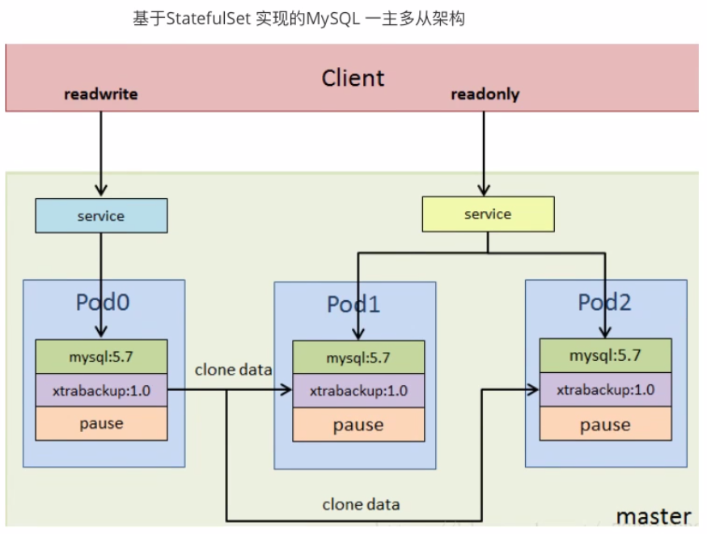

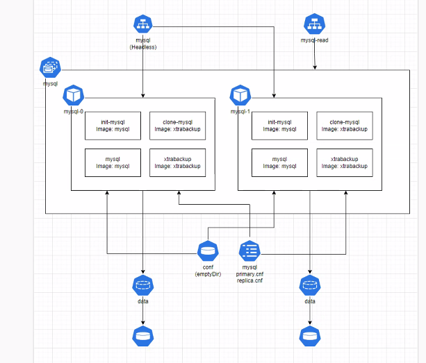

### 1.3.1 准备 NFS 服务

```text
#在所有node节点安装NFS客户端
[root@node1 ~]#apt update && apt -y install nfs-common
```

```text
#在所有node节点下载镜像，可能需要科学上网,可选，后面修改国内镜像地址
[root@node1 ~]#docker pull gcr.io/google-samples/xtrabackup:1.0
```

```text
#在master节点安装NFS服务器
[root@master1 ~]#apt -y install nfs-server
```

```text
#方式1：有动态置备的SC
准备一个sc-nfs的storageClass
```

```text
#方式2：没有动态置备的SC，如下配置
[root@master1 ~]#mkdir /nfs-data/data{1,2,3}
```

```text
[root@master1 ~]#echo "/nfs-data *(rw,no_root_squash)" >> /etc/exports
[root@master1 ~]#exportfs -r
[root@master1 ~]#exportfs -v
/nfs-data       <world>
(sync,wdelay,hide,no_subtree_check,sec=sys,rw,secure,no_root_squash,no_all_squas
h)
```

### 1.3.2 准备 StorageClass 或者 PV

```text
#方法1：准备StorageClass
创建一个名为：sc-nfs的storageclass
```

```text
#方法2：没有动态置备的SC，给三个节点分别准备PV
[root@master1 ~]#cat storage-multi-pv.yaml
apiVersion: v1
kind: PersistentVolume
metadata:
name: pv-nfs-1
spec:
capacity:
storage: 10Gi
volumeMode: Filesystem
accessModes:
- ReadWriteOnce
persistentVolumeReclaimPolicy: Retain
nfs:
path:  "/nfs-data/data1"
server: 10.0.0.200
---
apiVersion: v1
kind: PersistentVolume
metadata:
name: pv-nfs-2
spec:
capacity:
storage: 10Gi
volumeMode: Filesystem
accessModes:
```

```text
- ReadWriteOnce
persistentVolumeReclaimPolicy: Retain
nfs:
path:  "/nfs-data/data2"
server: 10.0.0.200
---
apiVersion: v1
kind: PersistentVolume
metadata:
name: pv-nfs-3
spec:
capacity:
storage: 10Gi
volumeMode: Filesystem
accessModes:
- ReadWriteOnce
persistentVolumeReclaimPolicy: Retain
nfs:
path:  "/nfs-data/data3"
server: 10.0.0.200
```

```text
[root@master1 ~]#kubectl apply -f storage-multi-pv.yaml
```

### 1.3.3 创建 ConfigMap

```text
#https://k8s.io/examples/application/mysql/mysql-configmap.yaml
#MySQL的配置
[root@master1 statefulset]#cat statefulset-mysql-configmap.yaml
---
apiVersion: v1
kind: ConfigMap
metadata:
name: mysql
labels:
app: mysql
app.kubernetes.io/name: mysql
data:
primary.cnf: |
# 仅在主服务器上应用此配置
[mysqld]
log-bin
replica.cnf: |
# 仅在副本服务器上应用此配置
[mysqld]
super-read-only
```

### 1.3.4 创建 Service

```text
# https://k8s.io/examples/application/mysql/mysql-services.yaml
```

```text
# 为 StatefulSet 成员提供稳定的 DNS 表项的无头服务（Headless Service）
# 主节点的对应的Service
```

```text
[root@master1 statefulset]#cat statefulset-mysql-svc.yaml
---
apiVersion: v1
```

```text
kind: Service
metadata:
name: mysql
labels:
app: mysql
app.kubernetes.io/name: mysql
spec:
ports:
- name: mysql
port: 3306
clusterIP: None
selector:
app: mysql
---
# 用于连接到任一 MySQL 实例执行读操作的客户端服务
# 对于写操作，必须连接到主服务器：mysql-0.mysql
# 从节点的对应的Service，注意：此处无需无头服务（Headless Service）
# 下面的service可以不创建，直接使用无头服务mysql也可以
apiVersion: v1
kind: Service
metadata:
name: mysql-read
labels:
app: mysql
app.kubernetes.io/name: mysql
readonly: "true"
spec:
ports:
- name: mysql
port: 3306
selector:
app: mysql
```

### 1.3.5 创建 statefulset

```text
#https://k8s.io/examples/application/mysql/mysql-statefulset.yaml
```

```text
#StatefulSet
[root@master1 statefulset]#cat statefulset-mysql-statefulset.yaml
---
apiVersion: apps/v1
kind: StatefulSet
metadata:
name: mysql
spec:
selector:
matchLabels:
app: mysql
app.kubernetes.io/name: mysql
serviceName: mysql
replicas: 3
template:
metadata:
labels:
app: mysql
app.kubernetes.io/name: mysql
spec:
```

```text
initContainers:
- name: init-mysql
#image: mysql:5.7
image: registry.cn-beijing.aliyuncs.com/wangxiaochun/mysql:5.7
command:
- bash
- "-c"
- |
set -ex
# 基于 Pod 序号生成 MySQL 服务器的 ID。
[[ $HOSTNAME =~ -([0-9]+)$ ]] || exit 1
ordinal=${BASH_REMATCH[1]} #BASH_REMATCH bash内置，存放从前面的正则表达式分
组的结果
echo [mysqld] > /mnt/conf.d/server-id.cnf
# 添加偏移量以避免使用 server-id=0 这一保留值。
echo server-id=$((100 + $ordinal)) >> /mnt/conf.d/server-id.cnf
# 将合适的 conf.d 文件从 config-map 复制到 emptyDir。
if [[ $ordinal -eq 0 ]]; then
cp /mnt/config-map/primary.cnf /mnt/conf.d/
else
cp /mnt/config-map/replica.cnf /mnt/conf.d/
fi
volumeMounts:
- name: conf
mountPath: /mnt/conf.d
- name: config-map
mountPath: /mnt/config-map
- name: clone-mysql
#image: gcr.io/google-samples/xtrabackup:1.0
image: registry.cn-beijing.aliyuncs.com/wangxiaochun/xtrabackup:1.0
command:
- bash
- "-c"
- |
set -ex
# 如果已有数据，则跳过克隆。
[[ -d /var/lib/mysql/mysql ]] && exit 0
# 跳过主实例（序号索引 0）的克隆。
[[ `hostname` =~ -([0-9]+)$ ]] || exit 1
ordinal=${BASH_REMATCH[1]}
[[ $ordinal -eq 0 ]] && exit 0
# 从原来的对等节点克隆数据。
ncat --recv-only mysql-$(($ordinal-1)).mysql 3307 | xbstream -x -C
/var/lib/mysql
# 准备备份。
xtrabackup --prepare --target-dir=/var/lib/mysql
volumeMounts:
- name: data
mountPath: /var/lib/mysql
subPath: mysql
- name: conf
mountPath: /etc/mysql/conf.d
containers:
- name: mysql
#image: mysql:5.7
image: registry.cn-beijing.aliyuncs.com/wangxiaochun/mysql:5.7
env:
- name: MYSQL_ALLOW_EMPTY_PASSWORD
```

```text
value: "1"
ports:
- name: mysql
containerPort: 3306
volumeMounts:
- name: data
mountPath: /var/lib/mysql
subPath: mysql
- name: conf
mountPath: /etc/mysql/conf.d
resources:
requests:
cpu: 500m
memory: 1Gi
livenessProbe:
exec:
command: ["mysqladmin", "ping"]
initialDelaySeconds: 30
periodSeconds: 10
timeoutSeconds: 5
readinessProbe:
exec:
# 检查我们是否可以通过 TCP 执行查询（skip-networking 是关闭的）。
command: ["mysql", "-h", "127.0.0.1", "-e", "SELECT 1"]
initialDelaySeconds: 5
periodSeconds: 2
timeoutSeconds: 1
- name: xtrabackup
#image: gcr.io/google-samples/xtrabackup:1.0
image: registry.cn-beijing.aliyuncs.com/wangxiaochun/xtrabackup:1.0
ports:
- name: xtrabackup
containerPort: 3307
command:
- bash
- "-c"
- |
set -ex
cd /var/lib/mysql
```

```text
# 确定克隆数据的 binlog 位置（如果有的话）。
if [[ -f xtrabackup_slave_info && "x$(<xtrabackup_slave_info)" != "x"
]]; then
# XtraBackup 已经生成了部分的 “CHANGE MASTER TO” 查询
# 因为从一个现有副本进行克隆。(需要删除末尾的分号!)
cat xtrabackup_slave_info | sed -E 's/;$//g' >
change_master_to.sql.in
# 在这里要忽略 xtrabackup_binlog_info （它是没用的）。
rm -f xtrabackup_slave_info xtrabackup_binlog_info
elif [[ -f xtrabackup_binlog_info ]]; then
# 直接从主实例进行克隆。解析 binlog 位置。
[[ `cat xtrabackup_binlog_info` =~ ^(.*?)[[:space:]]+(.*?)$ ]] ||
exit 1
rm -f xtrabackup_binlog_info xtrabackup_slave_info
echo "CHANGE MASTER TO MASTER_LOG_FILE='${BASH_REMATCH[1]}',\
MASTER_LOG_POS=${BASH_REMATCH[2]}" > change_master_to.sql.in
fi
```

```text
# 检查是否需要通过启动复制来完成克隆。
if [[ -f change_master_to.sql.in ]]; then
echo "Waiting for mysqld to be ready (accepting connections)"
until mysql -h 127.0.0.1 -e "SELECT 1"; do sleep 1; done
```

```text
echo "Initializing replication from clone position"
mysql -h 127.0.0.1 \
-e "$(<change_master_to.sql.in), \
MASTER_HOST='mysql-0.mysql', \
MASTER_USER='root', \
MASTER_PASSWORD='', \
MASTER_CONNECT_RETRY=10; \
START SLAVE;" || exit 1
# 如果容器重新启动，最多尝试一次。
mv change_master_to.sql.in change_master_to.sql.orig
fi
```

```text
# 当对等点请求时，启动服务器发送备份。
exec ncat --listen --keep-open --send-only --max-conns=1 3307 -c \
"xtrabackup --backup --slave-info --stream=xbstream --host=127.0.0.1
--user=root"
volumeMounts:
- name: data
mountPath: /var/lib/mysql
subPath: mysql
- name: conf
mountPath: /etc/mysql/conf.d
resources:
requests:
cpu: 100m
memory: 100Mi
volumes:
- name: conf
emptyDir: {}
- name: config-map
configMap:
name: mysql
volumeClaimTemplates:
- metadata:
name: data
spec:
accessModes: ["ReadWriteOnce"]
storageClassName: "sc-nfs"  #如果使用StorageClass,启用此行
resources:
requests:
storage: 10Gi
```

### 1.3.6 验证

```text
#官方
[root@master1 ~]#kubectl apply -f
https://k8s.io/examples/application/mysql/mysql-configmap.yaml
[root@master1 ~]#kubectl apply -f
https://k8s.io/examples/application/mysql/mysql-services.yaml
[root@master1 ~]#kubectl apply -f
https://k8s.io/examples/application/mysql/mysql-statefulset.yaml
#上面修改过的清单文件
```

```text
[root@master1 ~]#kubectl apply -f mysql-configmap.yaml -f mysql-services.yaml -f
mysql-statefulset.yaml
```

```text
#跟踪查看
[root@master1 ~]#kubectl get pods -l app=mysql --watch
NAME      READY   STATUS    RESTARTS        AGE
mysql-0   2/2     Running   0               12m
mysql-1   2/2     Running   1 (9m45s ago)   10m
mysql-2   2/2     Running   1 (9m2s ago)    9m39s
```

```text
[root@master1 ~]#kubectl get pvc
NAME           STATUS   VOLUME     CAPACITY   ACCESS MODES   STORAGECLASS   AGE
data-mysql-0   Bound    pv-nfs-1   10Gi       RWO                           13m
data-mysql-1   Bound    pv-nfs-2   10Gi       RWO                           10m
data-mysql-2   Bound    pv-nfs-3   10Gi       RWO
9m53s
```

```text
[root@master1 ~]#kubectl get pv
NAME       CAPACITY   ACCESS MODES   RECLAIM POLICY   STATUS   CLAIM
STORAGECLASS   REASON   AGE
pv-nfs-1   10Gi       RWO            Retain           Bound    default/data-
mysql-0                           13m
pv-nfs-2   10Gi       RWO            Retain           Bound    default/data-
mysql-1                           13m
pv-nfs-3   10Gi       RWO            Retain           Bound    default/data-
mysql-2                           13m
```

```text
[root@master1 ~]#tree /nfs-data/ -d
/nfs-data/
├── data1
│   └── mysql
│       ├── db1
│       ├── mysql
│       ├── performance_schema
│       ├── sys
│       └── xtrabackup_backupfiles
├── data2
│   └── mysql
│       ├── db1
│       ├── mysql
│       ├── performance_schema
│       ├── sys
│       └── xtrabackup_backupfiles
└── data3
└── mysql
├── db1
├── mysql
├── performance_schema
├── sys
└── xtrabackup_backupfiles
```

```text
21 directories
```

```text
#创建一个测试Pod
[root@master1 ~]#kubectl run client-test-$RANDOM --image registry.cn-
beijing.aliyuncs.com/wangxiaochun/ubuntu:22.04 --restart=Never --rm -it --command
-- /bin/bash
```

```text
root@client-test-7246:/#apt update && apt -y install mysql-client bind9-dnsutils
bind9-host iputils-ping
root@client-test-7246:/# host mysql-0.mysql.default.svc.cluster.local
root@client-test-7246:/# mysql -h mysql-read  -e "show variables"|grep -i
hostname
hostname    mysql-0
root@client-test-7246:/# mysql -h mysql-read  -e "show variables"|grep -i
hostname
hostname    mysql-2
root@client-test-7246:/# mysql -h mysql-read  -e "show variables"|grep -i
hostname
hostname    mysql-1
```

```text
# mysql -hmysql-read.default.svc.cluster.local -e 'select @@hostname'
+------------+
| @@hostname |
+------------+
| mysql-1    |
+------------+
# mysql -hmysql-read.default.svc.cluster.local -e 'select @@hostname'
+------------+
| @@hostname |
+------------+
| mysql-2    |
+------------+
# mysql -hmysql-read.default.svc.cluster.local -e 'select @@hostname'
+------------+
| @@hostname |
+------------+
| mysql-1    |
+------------+
```

```text
#验证主从关系
[root@master1 ~]#kubectl exec -it pods/mysql-1 -- mysql -e 'show slave status\G'
| head -13
Defaulted container "mysql" out of: mysql, xtrabackup, init-mysql (init), clone-
mysql (init)
*************************** 1. row ***************************
Slave_IO_State: Waiting for master to send event
Master_Host: mysql-0.mysql
Master_User: root
Master_Port: 3306
Connect_Retry: 10
Master_Log_File: mysql-0-bin.000003
Read_Master_Log_Pos: 310
Relay_Log_File: mysql-1-relay-bin.000002
Relay_Log_Pos: 478
Relay_Master_Log_File: mysql-0-bin.000003
Slave_IO_Running: Yes
Slave_SQL_Running: Yes
```

```text
#删除statefulset
[root@master1 ~]#kubectl delete -f mysql-statefulset.yaml
#重新创建statefulset
[root@master1 ~]#kubectl apply -f mysql-statefulset.yaml
[root@master1 ~]#kubectl get pod -w
NAME                   READY   STATUS    RESTARTS      AGE
```

```text
daemonset-demo-kk2b7   1/1     Running   1 (20m ago)   8h
daemonset-demo-kxpf4   1/1     Running   1 (20m ago)   8h
daemonset-demo-s2jd8   1/1     Running   2 (20m ago)   8h
mysql-0                2/2     Running   0             13s
mysql-1                1/2     Running   0             4s
mysql-1                2/2     Running   0             8s
mysql-2                0/2     Pending   0             0s
mysql-2                0/2     Pending   0             0s
mysql-2                0/2     Init:0/2   0             0s
mysql-2                0/2     Init:1/2   0             2s
mysql-2                0/2     PodInitializing   0             3s
mysql-2                1/2     Running           0             4s
mysql-2                2/2     Running           0             8s
```

```text
#查看原来的数据还在
[root@master1 ~]#kubectl exec -it mysql-0 -- mysql -e 'show databases;'
```

## 1.4 案例：Redis cluster

### 1.4.1 Redis Cluster 创建

#### 1.4.1.1 Redis Cluster 说明

对于statefulset的使用，最常见的就是状态集群，而redis的集群就属于一种典型的状态集群。这里基于Statefulset功能来创建一个redis多主集群。

**集群的要求**：每个Mater 都可以拥有多个slave，在我们的环境中设置6个节点，3主3从。当Master掉线后,redis cluster集群会从多个Slave中选举出来一个新的Matser作为代替旧的Master重新上线后变成 Master 的Slave.

对于redis的集群，可以有多种方案选择，常见的方案有：

方案1：Statefulset:  statefulset 适用于通用的状态服务场景方案2：Service&depolyment :虽然可以实现功能，但是涉及到大量额外的功能组件，对于初学者甚至熟练实践者都是不太友好的。方案3：使用 Operator 实现。

涉及模式

模式解析

拓

应用的多个实例之间不是完全对等的关系,这个应用实例的启动必须按照某些顺序启动,比如：

扑

应用的主节点 A 要先于从节点 B 启动。而如果你把 A 和 B 两个Pod删除掉,他们再次被创建。

状

出来是也必须严格按照这个顺序才行,并且,新创建出来的Pod,必须和原来的Pod的网络标识一。

态

样,这样原先的访问者才能使用同样的方法,访问到这个新的Pod。

存

应用的多个实例分别绑定了不同的存储数据.对于这些应用实例来说,Pod A第一次读取到的数。

储

据,和隔了十分钟之后再次读取到的数据,应该是同一份,哪怕在此期间Pod A被重新创建过.一。

状

个数据库应用的多个存储实例。

态

**statefulset效果**

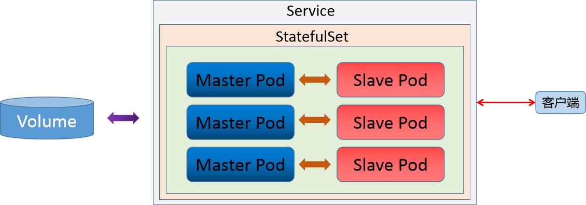

无论是Master 还是 slave 都作为 statefulset 的一个副本,通过pv/pvc进行持久化,对外暴露一个service接受客户端请求。

#### 1.4.1.2 创建NFS共享服务

**准备 nfs服务器**

```text
#清空之前的环境
[root@master1 ~]#> /etc/exports
```

```text
#配置共享目录
[root@master1 ~]#mkdir /nfs-data/pv/redis{1..6} -p
for i in {1..6}
do
echo "/nfs-data/pv/redis$i *(rw,no_root_squash,sync)" >> /etc/exports
done
```

```text
#启动服务
[root@master1 ~]#systemctl restart nfs-kernel-server.service
```

```text
#命令验证
exportfs
```

#### 1.4.1.3 创建PV

**在master主机上创建 PV**

```text
#同样的格式创建6个pv
[root@master1 ~]#for i in {1..6};do cat >> statefulset-redis-pv.yaml <<-EOF
---
apiVersion: v1
kind: PersistentVolume
metadata:
name: redis-pv00$i
spec:
capacity:
storage: 200M
accessModes:
- ReadWriteMany
nfs:
server: 10.0.0.101
path: /nfs-data/pv/redis$i
EOF
done
```

```text
#应用文件
[root@master1 ~]#kubectl create -f statefulset-redis-pv.yaml
```

```text
#检查效果
[root@master1 ~]#kubectl get pv
NAME          CAPACITY   ACCESS MODES   RECLAIM POLICY   STATUS      CLAIM
STORAGECLASS   REASON   AGE
redis-pv001   200M       RWX            Retain           Available
5s
redis-pv002   200M       RWX            Retain           Available
5s
redis-pv003   200M       RWX            Retain           Available
5s
redis-pv004   200M       RWX            Retain           Available
5s
redis-pv005   200M       RWX            Retain           Available
5s
redis-pv006   200M       RWX            Retain           Available
5s
```

#### 1.4.1.4 准备 Redis 配置文件

通过configmap环境实现Redis 配置

```text
#因为redis的配置文件可能会改变,所以使用configmap的方式将核心的配置信息单独管理,便于后期统一升
级管理。
[root@master1 ~]#cat >> redis.conf <<-EOF
port 6379
cluster-enabled yes
cluster-config-file /var/lib/redis/nodes.conf
cluster-node-timeout 5000
appendonly yes
dir /var/lib/redis
EOF
```

```text
#注意：cluster-conf-file: 选项设定了保存节点配置文件的路径,如果这个配置文件不存在,每个节点在
启动的时候都为他自身指定了一个新的ID存档到这个文件中,实例会一直使用同一个ID,在集群中保持一个独一
无二的(Unique)名字.每个节点都是用ID而不是IP或者端口号来记录其他节点,因为在Kubernetes中,IP地
址是不固定的,而这个独一无二的标识符(Identifier)则会在节点的整个生命周期中一直保持不变,我们这个
文件里面存放的是节点ID
```

```text
#创建Configmap
[root@master1 ~]#kubectl create configmap redis-conf --from-file=redis.conf
```

```text
#查看效果
[root@master1 ~]#kubectl get configmaps
[root@master1 ~]#kubectl describe configmaps redis-conf
```

#### 1.4.1.5 headless service

```text
#Headless service是StatefulSet实现稳定网络标识的基础，需要提前创建。准备文件headless-
service.yml如下：
[root@master1 ~]#cat  statefulset-redis-headlessservice.yaml <<-EOF
apiVersion: v1
kind: Service
metadata:
```

```text
name: redis-service
labels:
app: redis
spec:
ports:
- name: redis-port
port: 6379
clusterIP: None
selector:
app: redis
appCluster: redis-cluster
```

```text
#创建headless服务
[root@master1 ~]#kubectl create -f statefulset-redis-headlessservice.yaml
```

```text
#检查效果
[root@master1 ~]#kubectl get svc redis-service
NAME            TYPE        CLUSTER-IP   EXTERNAL-IP   PORT(S)    AGE
redis-service   ClusterIP   None         <none>        6379/TCP   12s
```

#### 1.4.1.6 statefulset 配置

```text
#这是本案例的核心内容,创建文件
[root@master1 ~]#cat  statefulset-redis-cluster.yaml
apiVersion: apps/v1
kind: StatefulSet
metadata:
name: redis-cluster
spec:
serviceName: "redis-service"
selector:
matchLabels:
app: redis
appCluster: redis-cluster
replicas: 6
template:
metadata:
labels:
app: redis
appCluster: redis-cluster
spec:
terminationGracePeriodSeconds: 20
affinity:
podAntiAffinity:
preferredDuringSchedulingIgnoredDuringExecution:
- weight: 100
podAffinityTerm:
labelSelector:
matchExpressions:
- key: app
operator: In
values:
- redis
topologyKey: kubernetes.io/hostname
containers:
- name: redis
#image: redis:6.2.5
```

```text
image: registry.cn-beijing.aliyuncs.com/wangxiaochun/redis:6.2.5
command:
- "redis-server"
args:
- "/etc/redis/redis.conf"
- "--protected-mode"
- "no"
# command: redis-server /etc/redis/redis.conf --protected-mode no
resources:
requests:
cpu: "100m"
memory: "100Mi"
ports:
- name: redis
containerPort: 6379
protocol: "TCP"
- name: cluster
containerPort: 16379
protocol: "TCP"
volumeMounts:
- name: "redis-conf"
mountPath: "/etc/redis"
- name: "redis-data"
mountPath: "/var/lib/redis"
volumes:
- name: "redis-conf"
configMap:
name: "redis-conf"
items:
- key: "redis.conf"
path: "redis.conf"
volumeClaimTemplates:
- metadata:
name: redis-data
spec:
accessModes:
- ReadWriteMany
resources:
requests:
storage: 200M
```

```text
#注意：PodAntiAffinity:表示反亲和性，其决定了某个pod不可以和哪些Pod部署在同一拓扑域，可以用
于将一个服务的POD分散在不同的主机或者拓扑域中，提高服务本身的稳定性。
#matchExpressions:规定了Redis Pod要尽量不要调度到包含app为redis的Node上，也即是说已经存在
Redis的Node上尽量不要再分配Redis Pod了.
```

根据StatefulSet的规则，生成的Redis的6个Pod的hostname会被依次命名为((statefulset名称)-)(序号)：

```text
[root@master1 ~]##创建对象
kubectl apply -f statefulset-redis-cluster.yml
```

```text
#查看效果
kubectl get pod -o wide
NAME              READY   STATUS    RESTARTS   AGE   IP            NODE    ...
redis-cluster-0   1/1     Running   0          69s   10.244.2.49   node2   ...
redis-cluster-1   1/1     Running   0          61s   10.244.1.37   node1   ...
```

```text
redis-cluster-2   1/1     Running   0          36s   10.244.1.38   node1   ...
redis-cluster-3   1/1     Running   0          31s   10.244.2.50   node2   ...
redis-cluster-4   1/1     Running   0          25s   10.244.1.39   node1   ...
redis-cluster-5   1/1     Running   0          21s   10.244.2.51   node2   ...
```

```text
#结果显示：这些Pods在部署时是以{0..N-1}的顺序依次创建的。
```

```text
#dns记录检查
[root@master1 ~]#kubectl run client --image=busybox:v0.1 -it --rm sh
```

```text
#结果显示：每个Pod都会得到集群内的一个DNS域名，格式为
$(podname).$(service name).$(namespace).svc.cluster.local
在Kubernetes集群内部，这些Pod就可以利用该域名互相通信。
```

**集群节点更新**

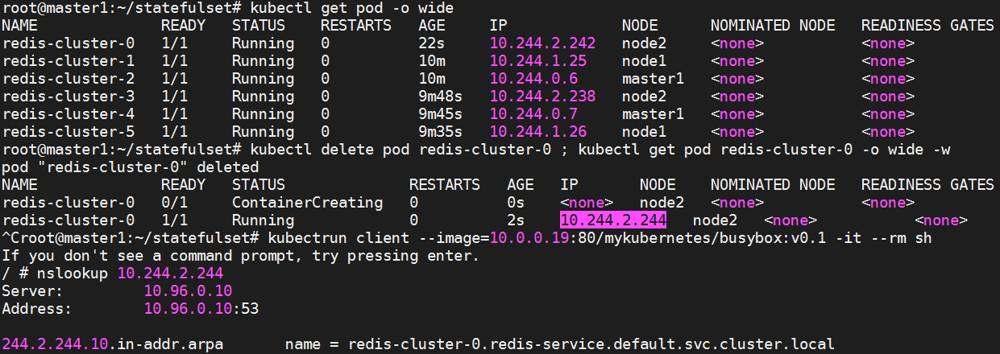

```text
#结果显示：若Redis Pod迁移或是重启（我们可以手动删除掉一个Redis Pod来测试），则IP是会改变的，
但Pod的域名、SRV records、A record都不会改变。
```

**查看pv 和 pvc效果**

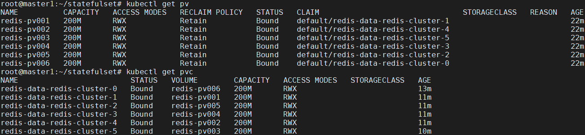

**查看当前所有节点的状态**

```text
[root@master1 ~]#nodelist=$(kubectl get pod -o wide | grep -v NAME | awk '{print
$1}')
[root@master1 ~]#for i in $nodelist
do
Role=$(kubectl exec -it $i -- redis-cli info Replication | grep role)
echo "$i | $Role"
done
```

```text
#结果显示：目前所有的节点状态都是 master状态
```

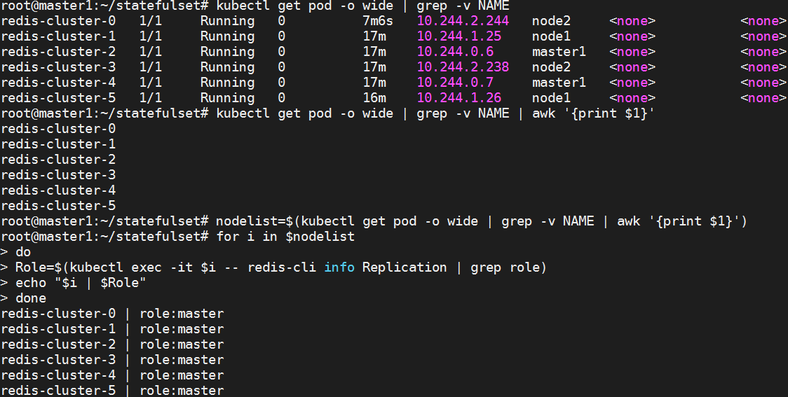

#### 1.4.1.7 创建Redis集群

创建好6个Redis Pod后，我们还需要利用工具进行集群的初始化。由于Redis集群必须在所有节点启动后才能进行初始化，而如果将初始化逻辑写入Statefulset中，则是一件非常复杂而且低效的行为。我们可以在Kubernetes上创建一个额外的容器，专门用于进行Kubernetes集群内部某些服务的管理控制。

```text
#启动一个Ubuntu的redis管理容器
[root@master1 ~]#kubectl run -i --tty ubuntu --image=ubuntu:22.04 /bin/bash
root@ubuntu:/#
#更新软件源
root@ubuntu:/# apt update
```

```text
#集群工具
apt -y install redis-server dnsutils
```

```text
#获取集群节点ip
]# dig +short redis-cluster-0.redis-service.default.svc.cluster.local
10.244.2.244
```

**创建集群**

```text
#创建集群
[root@master1 ~]#redis-cli --cluster create  10.244.2.244:6379 10.244.1.25:6379
10.244.0.6:6379 10.244.2.238:6379 10.244.0.7:6379 10.244.1.26:6379 --cluster-
replicas 1
#参数详解：
create: 创建一个新的集群
--replicas 1 : 创建的集群中每个主节点分配一个从节点,达到3主3从，后面写上所有redis实例地址
#注意：不支持域名方式来创建集群,这里不要将ip转换成 pod的名称，否则提示如下错误
Node redis-cluster-1.redis-service.default.svc.cluster.local:6379 replied
with error:
ERR Invalid node address specified: redis-cluster-0.redis-
service.default.svc.cluster.local:6379
#执行效果如下
```

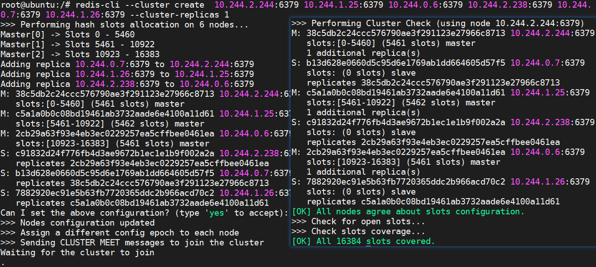

最后一句表示集群中的16384个槽都有至少一个主节点在处理， 集群运作正常.

至此，我们的Redis集群就真正创建完毕了，连到任意一个Redis Pod中检验一下：

```text
[root@master1 ~]#kubectl exec -it redis-cluster-0 -- /bin/bash
redis-cli cluster info
redis-cli cluster nodes
```

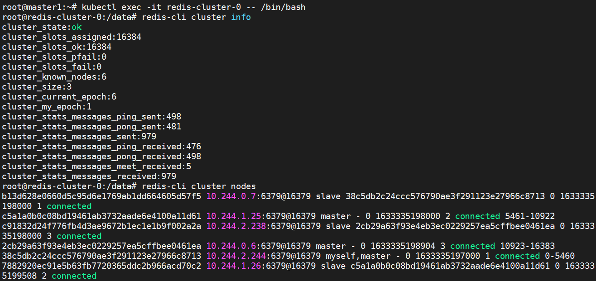

```text
#查看Redis挂载的数据
[root@master1 ~]#tree /nfs-data/
/nfs-data/
├── lost+found
├── pv
│   ├── redis1
│   │   ├── appendonly.aof
│   │   ├── dump.rdb
│   │   └── nodes.conf
...
│   └── redis6
│       ├── appendonly.aof
│       ├── dump.rdb
│       └── nodes.conf
```

#### 1.4.1.8 创建访问service

```text
#前面我们创建了用于实现statefulset的headless service,但该service没有cluster IP,因此不能
用于外界访问.所以我们还需要创建一个service,专用于为Redis集群提供访问和负载均衡:
[root@master1 ~]#cat statefulset-redis-access-service.yaml
apiVersion: v1
kind: Service
metadata:
name: statefulset-redis-access-service
labels:
app: redis
spec:
ports:
- name: redis-port
protocol: "TCP"
port: 6379
targetPort: 6379
selector:
app: redis
appCluster: redis-cluster
#属性详解：Service名称为 redis-access-service，在Kubernetes集群中暴露6379端口，并且会对
labels name为app: redis或appCluster: redis-cluster的pod进行负载均衡。
```

```text
#创建service
[root@master1 ~]#kubectl apply -f statefulset-redis-access-service.yaml
```

```text
#检查效果
[root@master1 ~]#kubectl get svc -l app=redis
NAME                   TYPE        CLUSTER-IP       EXTERNAL-IP   PORT(S)    AGE
redis-access-service   ClusterIP   10.107.21.119    <none>        6379/TCP
110s
redis-service          ClusterIP   None             <none>        6379/TCP   11h
#结果显示：在Kubernetes集群中,所有应用都可以通过10.107.21.119:6379来访问redis集群,当然，为
了方便测试，我们也可以为Service添加一个NodePort映射到物理机上。
```

#### 1.4.1.9 简单测试

```text
#在Kubernetes上搭建完好Redis集群后，我们最关心的就是其原有的高可用机制是否正常。
#查看当前效果
[root@master1 ~]#nodelist=$(kubectl get pod -o wide | grep -v NAME | awk '{print
$1}')
[root@master1 ~]#for i in $nodelist
do
Role=$(kubectl exec -it $i -- redis-cli info Replication | grep slave0)
echo "$i | $Role"
done
```

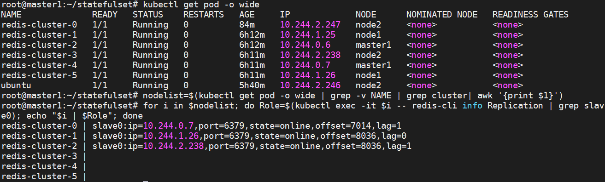

```text
#可以任意挑选一个Master的Pod来测试集群的主从切换机制，如redis-cluster-0(10.244.2.247)：
[root@master1 ~]#kubectl get pods redis-cluster-0 -o wide
NAME              READY   STATUS    RESTARTS   AGE    IP             NODE    ...
redis-cluster-0   1/1     Running   0          55m   10.244.2.247   node1  ...
进入redis-cluster-2查看：
root@master1:~/statefulset# kubectl exec -it redis-cluster-0 -- redis-cli ROLE
1) "master"
2) (integer) 7168
3) 1) 1) "10.244.0.7"
2) "6379"
3) "7168"
#结果显示：当前节点的角色为master，slave为10.244.0.7即redis-cluster-4。
```

### 1.4.2 Redis Cluster 管理

#### 1.4.2.1 主从切换

```text
#手动删除redis-cluster-0
[root@master1 ~]#kubectl delete pods redis-cluster-0 ; kubectl get pod redis-
cluster-0 -o wide -w
pod "redis-cluster-0" deleted
NAME              READY   STATUS              RESTARTS   AGE   IP       NODE
...
redis-cluster-0   0/1     ContainerCreating   0          0s    <none>   node2
...
redis-cluster-0   1/1     Running             0          2s    10.244.2.248
node2   ...
#结果显示：ip已经改变
```

```text
#重新进入，检查效果
```

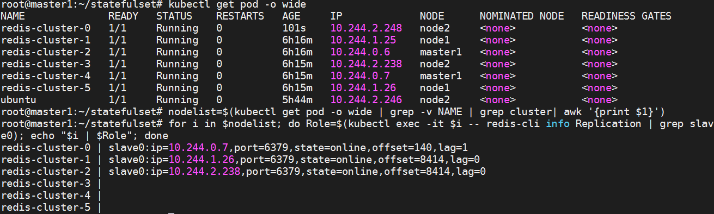

```text
#结果显示：原来的主角色已经发生改变，但是生成新的主角色与之前的效果一致，继承了从属于它之前的从节
点10.244.0.7
```

#### 1.4.2.2 动态扩容

现在这个集群中有6个节点三主三从,现在添加两个pod节点,达到4主4从。

```text
#添加nfs共享目录
mkdir /nfs-data/pv/redis{7..8}
chmod 777 /nfs-data/pv/*
cat >> /etc/exports <<-EOF
/nfs-data/pv/redis7 *(rw,all_squash)
/nfs-data/pv/redis8 *(rw,all_squash)
EOF
systemctl restart nfs-kernel-server.service
```

**准备pv文件**

```text
#同样的格式创建6个pv
for i in {7..8}
do
cat >> statefulset-redis-pv-add.yaml <<-EOF
---
apiVersion: v1
kind: PersistentVolume
metadata:
name: redis-pv00$i
spec:
capacity:
storage: 200M
accessModes:
- ReadWriteMany
nfs:
server: nfs.wang.org
path: /nfs-data/pv/redis$i
EOF
done
#应用文件
kubectl create -f statefulset-redis-pv-add.yaml
#检查效果
kubectl get pv
```

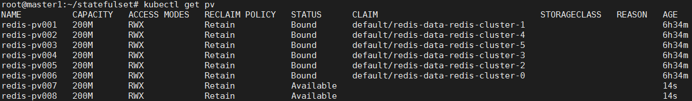

**添加redis节点**

```text
#更改redis的yml文件里面的replicas:字段8
kubectl patch statefulsets redis-cluster -p '{"spec":{"replicas":8}}'
kubectl get pod -o wide
```

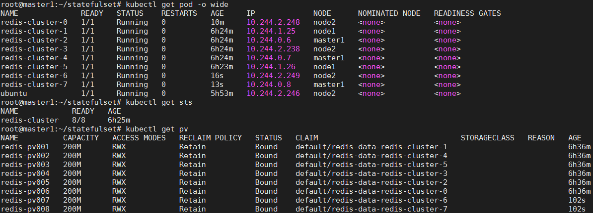

```text
#添加集群节点 命令格式：
redis-cli --cluster add-node 新节点ip:端口 集群节点ip:端口
```

```text
kubectl exec -it ubuntu --  /bin/bash
[root@ubuntu /]# redis-cli --cluster add-node 10.244.2.249:6379
10.244.2.248:6379
[root@ubuntu /]# redis-cli --cluster add-node 10.244.0.8:6379 10.244.2.248:6379
#注意：add-node后面跟的是新节点的信息,后面是以前集群中的任意 一个节点
```

```text
#查看redis节点状态
kubectl exec -it redis-cluster-0 -- redis-cli CLUSTER INFO
kubectl exec -it redis-cluster-0 -- redis-cli CLUSTER NODES
```

```text
#结果显示：确认集群节点信息，可以看到新的节点已加入到集群中，默认为master角色
```

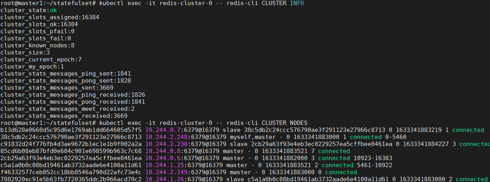

```text
#由于要设置redis-cluster-7(10.244.0.8)为master节点，就要为它分配槽位，新加入的节点是空的没
有槽位的,需要登录到集群的一个主角色上面调整槽位，然后为其分配从角色节点即可。
```

```text
#登录集群其中一个master主节点
kubectl exec -it redis-cluster-0 -- redis-cli --cluster reshard
10.244.2.248:6379
...
[OK] All 16384 slots covered.
```

```text
# 这里是指给他分配多少槽位
How many slots do you want to move (from 1 to 16384)? 4096
```

```text
# 这里是指分配给谁，填写集群node的ID，给redis-cluster-7分配，就写redis-cluster-7节点的ID
What is the receiving node ID? 85cd6b08eb87bfd0e604c901e698599b963c7c68
```

```text
# 这里是指从哪些节点分配，all表示从所有节点
```

```text
Please enter all the source node IDs.
Type 'all' to use all the nodes as source nodes for the hash slots.
Type 'done' once you entered all the source nodes IDs.
Source node #1: all
······
省略输出内容
······
Moving slot 6449 from c5a1a0b0c08bd19461ab3732aade6e4100a11d61
Moving slot 6450 from c5a1a0b0c08bd19461ab3732aade6e4100a11d61
...
Moving slot 12287 from 2cb29a63f93e4eb3ec0229257ea5cffbee0461ea
# 上面是已经重新分配好的槽位，是否要执行上面的分配计划，这里输yes
Do you want to proceed with the proposed reshard plan (yes/no)? yes
······
省略输出内容
······
Moving slot 5461 from 10.244.1.25:6379 to 10.244.0.8:6379:
...
Moving slot 927 from 10.244.2.248:6379 to 10.244.0.8:6379:
...
Moving slot 11055 from 10.244.0.6:6379 to 10.244.0.8:6379:
#结果显示：从三个主角色节点上，分出一些插槽给新加入的主角色节点
```

```text
#查看集群节点信息，确认刚才的槽位分配结果和redis-cluster-7节点角色
kubectl exec -it redis-cluster-0 -- redis-cli CLUSTER NODES
```

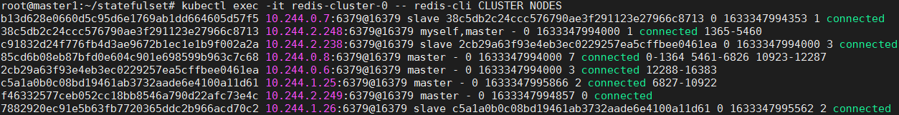

```text
#结果显示：10.244.0.8:6379@16379 是master角色，分配的插槽范围：
0-1364(1035个) 5461-6826(1366个) 10923-12287(1365个) 共计4096个
```

设置redis-cluster-6(10.244.2.249)节点为slave从节点。

```text
# 登录redis-cluster-6节点，执行从节点的主节点id (这里id写redis-cluster-7主节点的id)
root@master1:~/statefulset# kubectl exec -it redis-cluster-6 -- redis-cli cluster
replicate 85cd6b08eb87bfd0e604c901e698599b963c7c68
OK
```

```text
#查看集群节点信息，确认7008 slave节点是否设置成功
kubectl exec -it redis-cluster-0 -- redis-cli CLUSTER NODES
```

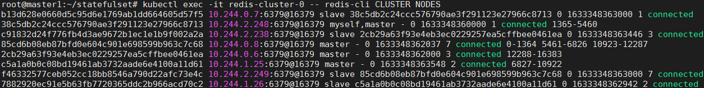

```text
#结果显示：redis-cluster-6(10.244.2.249) 是 id为
85cd6b08eb87bfd0e604c901e698599b963c7c68 (redis-cluster-7)的从角色了
```

**尝试数据操作**

```text
#对于redis集群来说，任何一个节点都可以添加数据
```

```text
[root@master1 ~]#kubectl exec -it redis-cluster-6 -- redis-cli -c
127.0.0.1:6379> set name wang
-> Redirected to slot [6704] located at 10.244.0.8:6379
OK
10.244.0.8:6379> exit
```

```text
#来另一个节点查看效果
[root@master1 ~]# kubectl exec -it redis-cluster-7 -- redis-cli -c
127.0.0.1:6379> keys *
1) "name"
127.0.0.1:6379> get redis-cluster
"wang"
```

```text
#注意：这里连接redis集群一定要用 -c 参数来启动集群模式，否则就会发生如下报错
[root@master1 ~]# kubectl exec -it redis-cluster-2 -- redis-cli
127.0.0.1:6379> set name wang
(error) MOVED 11081 10.244.0.8:6379
```

#### 1.4.2.3 动态缩容

简介

```text
#redis cluster 集群节点在缩容的时候，一定要考虑如下原则：
删除从节点：直接删除即可，就算有数据也无所谓。
删除主节点：如果主节点有从节点，将从节点转移到其他主节点,如果主节点有slot，去掉分配的slot，然后
在删除主节点
```

```text
#删除命令：
redis-cli --cluster del-node 删除节点的ip:port 删除节点的id
#转移命令：
redis-cli --cluster reshard 转移节点的ip:port
```

```text
#根据我们刚才的实践：
redis-cluster 这个key所在的插槽 6704 位于 10.244.0.8 节点上
xxx 10.244.0.8:6379@16379 myself,master - 0 1633349457000 7 connected 0-1364
5461-6826 10923-12287
10.244.0.8 节点有一个从节点 10.244.2.249，我们准备把这两个节点都删除
```

```text
#连接集群主角色，删除一个从节点 10.244.2.249
kubectl exec -it redis-cluster-2 -- redis-cli --cluster del-node
10.244.2.249:6379 f46332577ceb052cc18bb8546a790d22afc73e4c
```

```text
#确认效果
kubectl exec -it redis-cluster-7 -- redis-cli cluster nodes
```

```text
#结果显示：10.244.2.249 已经从节点中被删除了
```

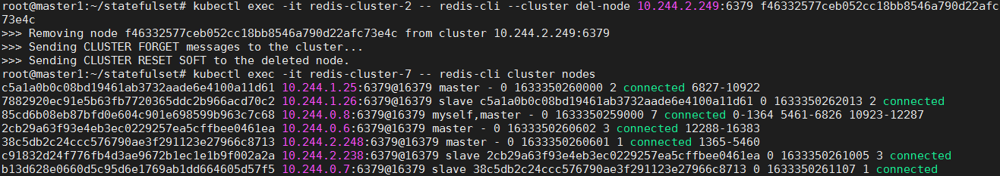

```text
#移动10.244.0.8主节点的槽位到其他节点中
kubectl exec -it redis-cluster-2 -- redis-cli --cluster reshard 10.244.0.8:6379
```

```text
[OK] All 16384 slots covered.
```

```text
# 10.244.0.8节点有多少槽位就写多少
How many slots do you want to move (from 1 to 16384)? 4096
```

```text
# 要移动到哪个节点，写10.244.1.25主节点id
What is the receiving node ID? c5a1a0b0c08bd19461ab3732aade6e4100a11d61
Please enter all the source node IDs.
Type 'all' to use all the nodes as source nodes for the hash slots.
Type 'done' once you entered all the source nodes IDs.
```

```text
# 从哪个节点移动，写10.244.0.8主节点id
Source node #1: 85cd6b08eb87bfd0e604c901e698599b963c7c68
Source node #2: done
······
忽略输出内容
······
Moving slot 12287 from 85cd6b08eb87bfd0e604c901e698599b963c7c68
# 是否执行以上操作，输入yes确认执行
Do you want to proceed with the proposed reshard plan (yes/no)? yes
······
忽略输出内容
······
Moving slot 65 from 10.244.0.8:6379 to 10.244.1.25:6379:
...
Moving slot 5670 from 10.244.0.8:6379 to 10.244.1.25:6379:
...
Moving slot 12287 from 10.244.0.8:6379 to 10.244.1.25:6379:
```

```text
#查看集群节点信息，确认10.244.0.8主节点没有槽位
kubectl exec -it redis-cluster-7 -- redis-cli cluster nodes
```

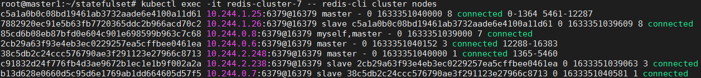

```text
#结果显示：10.244.0.8 节点已经没有被分配的数据插槽了
```

```text
#删除10.244.0.8主节点
kubectl exec -it redis-cluster-2 -- redis-cli --cluster del-node 10.244.0.8:6379
85cd6b08eb87bfd0e604c901e698599b963c7c68
```

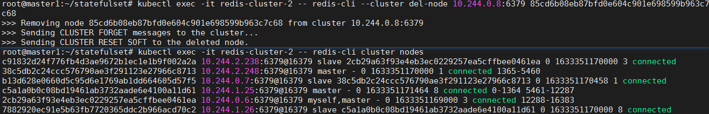

```text
#结果显示：10.244.0.8 节点已经被移除集群了，但是Kubernetes集群中的节点数量没有变化，因为新加
入的节点，没有添加到集群中
```

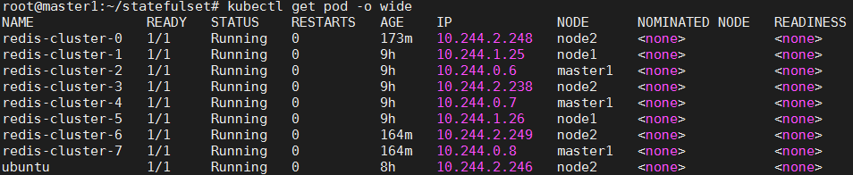

## 1.5 案例：Nacos 集群

```text
https://github.com/nacos-group/nacos-k8s/blob/master/README-CN.md
```

```text
---
apiVersion: v1
kind: Service
metadata:
name: nacos-headless
labels:
app: nacos
spec:
publishNotReadyAddresses: true
ports:
- port: 8848
name: server
targetPort: 8848
- port: 9848
name: client-rpc
targetPort: 9848
- port: 9849
name: raft-rpc
targetPort: 9849
## 兼容1.4.x版本的选举端口
- port: 7848
name: old-raft-rpc
targetPort: 7848
clusterIP: None
selector:
app: nacos
---
apiVersion: apps/v1
kind: StatefulSet
metadata:
name: nacos
spec:
podManagementPolicy: Parallel
serviceName: nacos-headless
replicas: 3
selector:
matchLabels:
app: nacos
template:
metadata:
labels:
app: nacos
annotations:
pod.alpha.kubernetes.io/initialized: "true"
prometheus.io/scrape: "true"
```

```text
prometheus.io/port: "8848"
prometheus.io/path: "/nacos/actuator/prometheus"
spec:
initContainers:
- name: peer-finder-plugin-install
#image: nacos/nacos-peer-finder-plugin:1.1
image: registry.cn-beijing.aliyuncs.com/wangxiaochun/nacos-peer-finder-
plugin:1.1
imagePullPolicy: Always
volumeMounts:
- mountPath: /home/nacos/plugins/peer-finder
name: data
subPath: peer-finder
containers:
- name: nacos
imagePullPolicy: Always
#image: nacos/nacos-server:v2.3.1-slim
image: registry.cn-beijing.aliyuncs.com/wangxiaochun/nacos-
server:v2.2.3-slim
resources:
requests:
memory: "2Gi"
cpu: "500m"
ports:
- containerPort: 8848
name: client-port
- containerPort: 9848
name: client-rpc
- containerPort: 9849
name: raft-rpc
- containerPort: 7848
name: old-raft-rpc
env:
- name: NACOS_REPLICAS
value: "3"
- name: SERVICE_NAME
value: "nacos-headless"
- name: DOMAIN_NAME
value: "cluster.local"
- name: POD_NAMESPACE
valueFrom:
fieldRef:
apiVersion: v1
fieldPath: metadata.namespace
- name: MYSQL_SERVICE_HOST
valueFrom:
configMapKeyRef:
name: nacos-cfg
key: mysql.host
- name: MYSQL_SERVICE_DB_NAME
valueFrom:
secretKeyRef:
name: mysql-secret
key: database.name
- name: MYSQL_SERVICE_PORT
valueFrom:
configMapKeyRef:
name: nacos-cfg
```

```text
key: mysql.port
- name: MYSQL_SERVICE_USER
valueFrom:
secretKeyRef:
name: mysql-secret
key: user.name
- name: MYSQL_SERVICE_PASSWORD
valueFrom:
secretKeyRef:
name: mysql-secret
key: user.password
- name: SPRING_DATASOURCE_PLATFORM
value: "mysql"
- name: NACOS_SERVER_PORT
value: "8848"
- name: NACOS_APPLICATION_PORT
value: "8848"
- name: PREFER_HOST_MODE
value: "hostname"
volumeMounts:
- name: properties
mountPath: /home/nacos/conf/application.properties
subPath: application.properties
- name: data
mountPath: /home/nacos/plugins/peer-finder
subPath: peer-finder
- name: data
mountPath: /home/nacos/data
subPath: data
- name: data
mountPath: /home/nacos/logs
subPath: logs
volumes:
- name: properties
configMap:
name: nacos-cfg
volumeClaimTemplates:
- metadata:
name: data
spec:
accessModes: [ "ReadWriteOnce" ]
# Modify StorageClass before deployment.
storageClassName: "sc-nfs"
resources:
requests:
storage: 10Gi
---
```

```text
---
apiVersion: v1
kind: ConfigMap
metadata:
name: nacos-cfg
data:
application.properties: |
```

```text
# spring
server.servlet.contextPath=${SERVER_SERVLET_CONTEXTPATH:/nacos}
server.contextPath=/nacos
server.port=${NACOS_APPLICATION_PORT:8848}
server.tomcat.accesslog.max-days=30
server.tomcat.accesslog.pattern=%h %l %u %t "%r" %s %b %D %{User-Agent}i %
{Request-Source}i
server.tomcat.accesslog.enabled=${TOMCAT_ACCESSLOG_ENABLED:false}
server.error.include-message=ALWAYS
# default current work dir
server.tomcat.basedir=file:.
#*************** Config Module Related Configurations ***************#
# Deprecated configuration property, it is recommended to use
`spring.sql.init.platform` replaced.
#spring.datasource.platform=${SPRING_DATASOURCE_PLATFORM:}
spring.sql.init.platform=${SPRING_DATASOURCE_PLATFORM:}
nacos.cmdb.dumpTaskInterval=3600
nacos.cmdb.eventTaskInterval=10
nacos.cmdb.labelTaskInterval=300
nacos.cmdb.loadDataAtStart=false
db.num=${MYSQL_DATABASE_NUM:1}
```

```text
db.url.0=jdbc:mysql://${MYSQL_SERVICE_HOST}:${MYSQL_SERVICE_PORT:3306}/${MYSQL_S
ERVICE_DB_NAME}?
${MYSQL_SERVICE_DB_PARAM:characterEncoding=utf8&connectTimeout=1000&socketTimeou
t=3000&autoReconnect=true&useSSL=false}
db.user.0=${MYSQL_SERVICE_USER}
db.password.0=${MYSQL_SERVICE_PASSWORD}
# The auth system to use, currently only 'nacos' and 'ldap' is supported:
nacos.core.auth.system.type=${NACOS_AUTH_SYSTEM_TYPE:nacos}
# worked when nacos.core.auth.system.type=nacos
# The token expiration in seconds:
```

```text
nacos.core.auth.plugin.nacos.token.expire.seconds=${NACOS_AUTH_TOKEN_EXPIRE_SECO
NDS:18000}
# The default token:
nacos.core.auth.plugin.nacos.token.secret.key=${NACOS_AUTH_TOKEN:}
# Turn on/off caching of auth information. By turning on this switch, the
update of auth information would have a 15 seconds delay.
nacos.core.auth.caching.enabled=${NACOS_AUTH_CACHE_ENABLE:false}
```

```text
nacos.core.auth.enable.userAgentAuthWhite=${NACOS_AUTH_USER_AGENT_AUTH_WHITE_ENA
BLE:false}
nacos.core.auth.server.identity.key=${NACOS_AUTH_IDENTITY_KEY:}
nacos.core.auth.server.identity.value=${NACOS_AUTH_IDENTITY_VALUE:}
# spring security config
# turn off security
```

```text
nacos.security.ignore.urls=${NACOS_SECURITY_IGNORE_URLS:/,/error,/**/*.css,/**/*
.js,/**/*.html,/**/*.map,/**/*.svg,/**/*.png,/**/*.ico,/console-
fe/public/**,/v1/auth/**,/v1/console/health/**,/actuator/**,/v1/console/server/*
*}
# metrics for elastic search
# meterics path is "/nacos/actuator/prometheus"
management.endpoints.web.exposure.include=*
management.metrics.export.elastic.enabled=false
management.metrics.export.influx.enabled=false
nacos.naming.distro.taskDispatchThreadCount=10
```

```text
nacos.naming.distro.taskDispatchPeriod=200
nacos.naming.distro.batchSyncKeyCount=1000
nacos.naming.distro.initDataRatio=0.9
nacos.naming.distro.syncRetryDelay=5000
nacos.naming.data.warmup=true
#mysql.host: "mysql-0.mysql.mall.svc.cluster.local"
mysql.host: "mysql-0.mysql"
# mysql master host
mysql.port: "3306"
```

## 1.6 案例：Elasticsearch 集群

```text
---
kind: Service
apiVersion: v1
metadata:
name: elasticsearch
labels:
app: elasticsearch
spec:
selector:
app: elasticsearch
clusterIP: None
ports:
- port: 9200
name: rest
- port: 9300
name: inter-node
---
apiVersion: apps/v1
kind: StatefulSet
metadata:
name: es-cluster
spec:
serviceName: elasticsearch
replicas: 3
selector:
matchLabels:
app: elasticsearch
template:
metadata:
labels:
app: elasticsearch
annotations:
prometheus.io/scrape: "true"
prometheus.io/port: "9114"
prometheus.io/path: "/metrics"
# Grafana dashboard: https://github.com/prometheus-
community/elasticsearch_exporter/blob/master/examples/grafana/dashboard.json
spec:
containers:
- name: elasticsearch
image: elasticsearch:7.17.7-ik
imagePullPolicy: IfNotPresent
resources:
limits:
cpu: 1000m
```

```text
requests:
cpu: 100m
ports:
- containerPort: 9200
name: rest
protocol: TCP
- containerPort: 9300
name: inter-node
protocol: TCP
volumeMounts:
- name: data
mountPath: /usr/share/elasticsearch/data
env:
- name: cluster.name
value: k8s-logs
- name: node.name
valueFrom:
fieldRef:
fieldPath: metadata.name
- name: discovery.seed_hosts
value: "es-cluster-0.elasticsearch,es-cluster-1.elasticsearch,es-
cluster-2.elasticsearch"
- name: cluster.initial_master_nodes
value: "es-cluster-0"
- name: ES_JAVA_OPTS
value: "-Xms1g -Xmx1g"
- name: network.host
value: "_site_"
- name: xpack.security.enabled
value: 'false'
- name: xpack.security.transport.ssl.enabled
value: 'false'
- name: elasticsearch-exporter
image: prometheuscommunity/elasticsearch-exporter:v1.7.0
args:
- '--es.uri=http://localhost:9200'
- '--es.shards'
- '--es.indices'
- '--es.indices_settings'
ports:
- name: es-exporter
containerPort: 9114
livenessProbe:
httpGet:
path: /healthz
port: 9114
initialDelaySeconds: 30
timeoutSeconds: 10
readinessProbe:
httpGet:
path: /healthz
port: 9114
initialDelaySeconds: 10
timeoutSeconds: 10
resources:
limits:
cpu: 100m
memory: 128Mi
```

```text
requests:
cpu: 25m
memory: 64Mi
initContainers:
- name: fix-permissions
image: registry.cn-beijing.aliyuncs.com/wangxiaochun/admin-box:v0.1
command: ["sh", "-c", "chown -R 1000:1000
/usr/share/elasticsearch/data"]
securityContext:
privileged: true
volumeMounts:
- name: data
mountPath: /usr/share/elasticsearch/data
- name: increase-vm-max-map
image: registry.cn-beijing.aliyuncs.com/wangxiaochun/admin-box:v0.1
command: ["sysctl", "-w", "vm.max_map_count=262144"]
securityContext:
privileged: true
- name: increase-fd-ulimit
image: registry.cn-beijing.aliyuncs.com/wangxiaochun/admin-box:v0.1
command: ["sh", "-c", "ulimit -n 65536"]
securityContext:
privileged: true
volumeClaimTemplates:
- metadata:
name: data
labels:
app: elasticsearch
spec:
accessModes: [ "ReadWriteOnce" ]
storageClassName: sc-nfs
resources:
requests:
storage: 10Gi
```

## 1.7 案例：MinIO 集群

```text
---
apiVersion: apps/v1
kind: StatefulSet
metadata:
name: minio
labels:
app: minio
spec:
serviceName: "minio-headless"
replicas: 4
podManagementPolicy: "Parallel"
selector:
matchLabels:
app: minio
template:
metadata:
labels:
app: minio
annotations:
prometheus.io/scrape: "true"
```

```text
prometheus.io/port: "9000"
prometheus.io/path: "/minio/v2/metrics/node"
#prometheus.io/path: "/minio/v2/metrics/cluster"
#prometheus.io/path: "/minio/v2/metrics/bucket"
spec:
containers:
- name: minio
image: minio/minio:RELEASE.2024-03-10T02-53-48Z
volumeMounts:
- name: data
mountPath: /data
args:
- server
- http://minio-{0...3}.minio-
headless.$(MINIO_POD_NAMESPACE).svc.cluster.local/data
- "--address=:9000"
- "--console-address=:9001"
env:
# MinIO access key and secret key
- name: MINIO_ROOT_USER
valueFrom:
secretKeyRef:
name: minio-secret
key: MINIO_ROOT_USER
- name: MINIO_ROOT_PASSWORD
valueFrom:
secretKeyRef:
name: minio-secret
key: MINIO_ROOT_PASSWORD
- name: MINIO_POD_NAMESPACE
valueFrom:
fieldRef:
fieldPath: metadata.namespace
- name: MINIO_PROMETHEUS_AUTH_TYPE
value: "public"
livenessProbe:
failureThreshold: 3
httpGet:
path: /minio/health/live
port: http
scheme: HTTP
initialDelaySeconds: 120
periodSeconds: 15
successThreshold: 1
timeoutSeconds: 10
ports:
- containerPort: 9000
name: http
protocol: TCP
volumeClaimTemplates:
- metadata:
name: data
spec:
accessModes:
- ReadWriteOnce
resources:
requests:
storage: 10Gi
```

```text
storageClassName: "sc-nfs"
# This field references the existing StorageClass
```

```text
---
kind: Service
apiVersion: v1
metadata:
name: minio-headless
labels:
app: minio
spec:
clusterIP: None
#publishNotReadyAddresses: true
selector:
app: minio
ports:
- name: http
port: 9000
targetPort: 9000
---
apiVersion: v1
kind: Service
metadata:
name: minio
spec:
type: LoadBalancer
selector:
app: minio
ports:
- port: 9000
targetPort: 9000
name: http
- port: 9001
targetPort: 9001
name: console
---
```

```text
apiVersion: v1
kind: Secret
metadata:
name: minio-secret
data:
MINIO_ROOT_USER: bWluaW9hZG1pbgo=
# username: minioadmin
MINIO_ROOT_PASSWORD: MTIzNDU2
# root password: 123456
```

## 1.8 案例：Redis 主从复制哨兵

```text
---
apiVersion: v1
```

```text
kind: ConfigMap
metadata:
name: redis-conf
data:
# Variable needed for sentinel init container
REDIS_NODES: "redis-0.redis,redis-1.redis,redis-2.redis"
```

```text
# Config used in all redises
redis.conf: |
# Redis configuration file example.
#
# Note that in order to read the configuration file, Redis must be
# started with the file path as first argument:
#
# ./redis-server /path/to/redis.conf
#slaveof redis-master-0.redis-master.redis.svc.cluster.local 6379
# masterauth a-very-complex-password-here
# requirepass a-very-complex-password-here
# Note on units: when memory size is needed, it is possible to specify
# it in the usual form of 1k 5GB 4M and so forth:
#
# 1k => 1000 bytes
# 1kb => 1024 bytes
# 1m => 1000000 bytes
# 1mb => 1024*1024 bytes
# 1g => 1000000000 bytes
# 1gb => 1024*1024*1024 bytes
#
# units are case insensitive so 1GB 1Gb 1gB are all the same.
################################## INCLUDES
###################################
# Include one or more other config files here.  This is useful if you
# have a standard template that goes to all Redis servers but also need
# to customize a few per-server settings.  Include files can include
# other files, so use this wisely.
#
# Notice option "include" won't be rewritten by command "CONFIG REWRITE"
# from admin or Redis Sentinel. Since Redis always uses the last processed
# line as value of a configuration directive, you'd better put includes
# at the beginning of this file to avoid overwriting config change at
runtime.
#
# If instead you are interested in using includes to override configuration
# options, it is better to use include as the last line.
#
# include /path/to/local.conf
# include /path/to/other.conf
################################## MODULES
#####################################
# Load modules at startup. If the server is not able to load modules
# it will abort. It is possible to use multiple loadmodule directives.
#
# loadmodule /path/to/my_module.so
# loadmodule /path/to/other_module.so
################################## NETWORK
#####################################
# By default, if no "bind" configuration directive is specified, Redis
listens
```

```text
# for connections from all the network interfaces available on the server.
# It is possible to listen to just one or multiple selected interfaces using
# the "bind" configuration directive, followed by one or more IP addresses.
#
# Examples:
#
# bind 192.168.1.100 10.0.0.1
# bind 127.0.0.1 ::1
#
# ~~~ WARNING ~~~ If the computer running Redis is directly exposed to the
# internet, binding to all the interfaces is dangerous and will expose the
# instance to everybody on the internet. So by default we uncomment the
# following bind directive, that will force Redis to listen only into
# the IPv4 loopback interface address (this means Redis will be able to
# accept connections only from clients running into the same computer it
# is running).
#
# IF YOU ARE SURE YOU WANT YOUR INSTANCE TO LISTEN TO ALL THE INTERFACES
# JUST COMMENT THE FOLLOWING LINE.
# ~~~~~~~~~~~~~~~~~~~~~~~~~~~~~~~~~~~~~~~~~~~~~~~~~~~~~~~~~~~~~~~~~~~~~~~~
bind 0.0.0.0
# Protected mode is a layer of security protection, in order to avoid that
# Redis instances left open on the internet are accessed and exploited.
#
# When protected mode is on and if:
#
# 1) The server is not binding explicitly to a set of addresses using the
#    "bind" directive.
# 2) No password is configured.
#
# The server only accepts connections from clients connecting from the
# IPv4 and IPv6 loopback addresses 127.0.0.1 and ::1, and from Unix domain
# sockets.
#
# By default protected mode is enabled. You should disable it only if
# you are sure you want clients from other hosts to connect to Redis
# even if no authentication is configured, nor a specific set of interfaces
# are explicitly listed using the "bind" directive.
protected-mode no
# Accept connections on the specified port, default is 6379 (IANA #815344).
# If port 0 is specified Redis will not listen on a TCP socket.
port 6379
# TCP listen() backlog.
#
# In high requests-per-second environments you need an high backlog in order
# to avoid slow clients connections issues. Note that the Linux kernel
# will silently truncate it to the value of /proc/sys/net/core/somaxconn so
# make sure to raise both the value of somaxconn and tcp_max_syn_backlog
# in order to get the desired effect.
tcp-backlog 511
# Unix socket.
#
# Specify the path for the Unix socket that will be used to listen for
# incoming connections. There is no default, so Redis will not listen
# on a unix socket when not specified.
#
# unixsocket /tmp/redis.sock
# unixsocketperm 700
```

```text
# Close the connection after a client is idle for N seconds (0 to disable)
timeout 10
# TCP keepalive.
#
# If non-zero, use SO_KEEPALIVE to send TCP ACKs to clients in absence
# of communication. This is useful for two reasons:
#
# 1) Detect dead peers.
# 2) Take the connection alive from the point of view of network
#    equipment in the middle.
#
# On Linux, the specified value (in seconds) is the period used to send
ACKs.
# Note that to close the connection the double of the time is needed.
# On other kernels the period depends on the kernel configuration.
#
# A reasonable value for this option is 300 seconds, which is the new
# Redis default starting with Redis 3.2.1.
tcp-keepalive 30
################################# TLS/SSL
#####################################
# By default, TLS/SSL is disabled. To enable it, the "tls-port"
configuration
# directive can be used to define TLS-listening ports. To enable TLS on the
# default port, use:
#
# port 0
# tls-port 6379
# Configure a X.509 certificate and private key to use for authenticating
the
# server to connected clients, masters or cluster peers.  These files should
be
# PEM formatted.
#
# tls-cert-file redis.crt
# tls-key-file redis.key
# Configure a DH parameters file to enable Diffie-Hellman (DH) key exchange:
#
# tls-dh-params-file redis.dh
# Configure a CA certificate(s) bundle or directory to authenticate TLS/SSL
# clients and peers.  Redis requires an explicit configuration of at least
one
# of these, and will not implicitly use the system wide configuration.
#
# tls-ca-cert-file ca.crt
# tls-ca-cert-dir /etc/ssl/certs
# By default, clients (including replica servers) on a TLS port are required
# to authenticate using valid client side certificates.
#
# It is possible to disable authentication using this directive.
#
# tls-auth-clients no
# By default, a Redis replica does not attempt to establish a TLS connection
# with its master.
#
# Use the following directive to enable TLS on replication links.
#
# tls-replication yes
```

```text
# By default, the Redis Cluster bus uses a plain TCP connection. To enable
# TLS for the bus protocol, use the following directive:
#
# tls-cluster yes
# Explicitly specify TLS versions to support. Allowed values are case
insensitive
# and include "TLSv1", "TLSv1.1", "TLSv1.2", "TLSv1.3" (OpenSSL >= 1.1.1) or
# any combination. To enable only TLSv1.2 and TLSv1.3, use:
#
# tls-protocols "TLSv1.2 TLSv1.3"
# Configure allowed ciphers.  See the ciphers(1ssl) manpage for more
information
# about the syntax of this string.
#
# Note: this configuration applies only to <= TLSv1.2.
#
# tls-ciphers DEFAULT:!MEDIUM
# Configure allowed TLSv1.3 ciphersuites.  See the ciphers(1ssl) manpage for
more
# information about the syntax of this string, and specifically for TLSv1.3
# ciphersuites.
#
# tls-ciphersuites TLS_CHACHA20_POLY1305_SHA256
# When choosing a cipher, use the server's preference instead of the client
# preference. By default, the server follows the client's preference.
#
# tls-prefer-server-ciphers yes
# By default, TLS session caching is enabled to allow faster and less
expensive
# reconnections by clients that support it. Use the following directive to
disable
# caching.
#
# tls-session-caching no
# Change the default number of TLS sessions cached. A zero value sets the
cache
# to unlimited size. The default size is 20480.
#
# tls-session-cache-size 5000
# Change the default timeout of cached TLS sessions. The default timeout is
300
# seconds.
#
# tls-session-cache-timeout 60
################################# GENERAL
#####################################
# By default Redis does not run as a daemon. Use 'yes' if you need it.
# Note that Redis will write a pid file in /var/run/redis.pid when
daemonized.
daemonize no
# If you run Redis from upstart or systemd, Redis can interact with your
# supervision tree. Options:
#   supervised no      - no supervision interaction
#   supervised upstart - signal upstart by putting Redis into SIGSTOP mode
#   supervised systemd - signal systemd by writing READY=1 to $NOTIFY_SOCKET
#   supervised auto    - detect upstart or systemd method based on
#                        UPSTART_JOB or NOTIFY_SOCKET environment variables
# Note: these supervision methods only signal "process is ready."
```

```text
#       They do not enable continuous liveness pings back to your
supervisor.
supervised no
# If a pid file is specified, Redis writes it where specified at startup
# and removes it at exit.
#
# When the server runs non daemonized, no pid file is created if none is
# specified in the configuration. When the server is daemonized, the pid
file
# is used even if not specified, defaulting to "/var/run/redis.pid".
#
# Creating a pid file is best effort: if Redis is not able to create it
# nothing bad happens, the server will start and run normally.
pidfile "/var/run/redis_6379.pid"
# Specify the server verbosity level.
# This can be one of:
# debug (a lot of information, useful for development/testing)
# verbose (many rarely useful info, but not a mess like the debug level)
# notice (moderately verbose, what you want in production probably)
# warning (only very important / critical messages are logged)
loglevel notice
# Specify the log file name. Also the empty string can be used to force
# Redis to log on the standard output. Note that if you use standard
# output for logging but daemonize, logs will be sent to /dev/null
logfile ""
# To enable logging to the system logger, just set 'syslog-enabled' to yes,
# and optionally update the other syslog parameters to suit your needs.
# syslog-enabled no
# Specify the syslog identity.
# syslog-ident redis
# Specify the syslog facility. Must be USER or between LOCAL0-LOCAL7.
# syslog-facility local0
# Set the number of databases. The default database is DB 0, you can select
# a different one on a per-connection basis using SELECT <dbid> where
# dbid is a number between 0 and 'databases'-1
databases 16
# By default Redis shows an ASCII art logo only when started to log to the
# standard output and if the standard output is a TTY. Basically this means
# that normally a logo is displayed only in interactive sessions.
#
# However it is possible to force the pre-4.0 behavior and always show a
# ASCII art logo in startup logs by setting the following option to yes.
always-show-logo yes
################################ SNAPSHOTTING
################################
#
# Save the DB on disk:
#
#   save <seconds> <changes>
#
#   Will save the DB if both the given number of seconds and the given
#   number of write operations against the DB occurred.
#
#   In the example below the behaviour will be to save:
#   after 900 sec (15 min) if at least 1 key changed
#   after 300 sec (5 min) if at least 10 keys changed
#   after 60 sec if at least 10000 keys changed
#
```

```text
#   Note: you can disable saving completely by commenting out all "save"
lines.
#
#   It is also possible to remove all the previously configured save
#   points by adding a save directive with a single empty string argument
#   like in the following example:
#
# #   save ""
save ""
# save 900 1
# save 300 10
# save 60 10000
# By default Redis will stop accepting writes if RDB snapshots are enabled
# (at least one save point) and the latest background save failed.
# This will make the user aware (in a hard way) that data is not persisting
# on disk properly, otherwise chances are that no one will notice and some
# disaster will happen.
#
# If the background saving process will start working again Redis will
# automatically allow writes again.
#
# However if you have setup your proper monitoring of the Redis server
# and persistence, you may want to disable this feature so that Redis will
# continue to work as usual even if there are problems with disk,
# permissions, and so forth.
stop-writes-on-bgsave-error yes
# Compress string objects using LZF when dump .rdb databases?
# For default that's set to 'yes' as it's almost always a win.
# If you want to save some CPU in the saving child set it to 'no' but
# the dataset will likely be bigger if you have compressible values or keys.
rdbcompression yes
# Since version 5 of RDB a CRC64 checksum is placed at the end of the file.
# This makes the format more resistant to corruption but there is a
performance
# hit to pay (around 10%) when saving and loading RDB files, so you can
disable it
# for maximum performances.
#
# RDB files created with checksum disabled have a checksum of zero that will
# tell the loading code to skip the check.
rdbchecksum yes
# The filename where to dump the DB
# dbfilename "dump.rdb"
# Remove RDB files used by replication in instances without persistence
# enabled. By default this option is disabled, however there are
environments
# where for regulations or other security concerns, RDB files persisted on
# disk by masters in order to feed replicas, or stored on disk by replicas
# in order to load them for the initial synchronization, should be deleted
# ASAP. Note that this option ONLY WORKS in instances that have both AOF
# and RDB persistence disabled, otherwise is completely ignored.
#
# An alternative (and sometimes better) way to obtain the same effect is
# to use diskless replication on both master and replicas instances. However
# in the case of replicas, diskless is not always an option.
rdb-del-sync-files no
# The working directory.
#
```

```text
# The DB will be written inside this directory, with the filename specified
# above using the 'dbfilename' configuration directive.
#
# The Append Only File will also be created inside this directory.
#
# Note that you must specify a directory here, not a file name.
dir "/data"
################################# REPLICATION
#################################
# Master-Replica replication. Use replicaof to make a Redis instance a copy
of
# another Redis server. A few things to understand ASAP about Redis
replication.
#
#   +------------------+      +---------------+
#   |      Master      | ---> |    Replica    |
#   | (receive writes) |      |  (exact copy) |
#   +------------------+      +---------------+
#
# 1) Redis replication is asynchronous, but you can configure a master to
#    stop accepting writes if it appears to be not connected with at least
#    a given number of replicas.
# 2) Redis replicas are able to perform a partial resynchronization with the
#    master if the replication link is lost for a relatively small amount of
#    time. You may want to configure the replication backlog size (see the
next
#    sections of this file) with a sensible value depending on your needs.
# 3) Replication is automatic and does not need user intervention. After a
#    network partition replicas automatically try to reconnect to masters
#    and resynchronize with them.
#
# replicaof <masterip> <masterport>
# If the master is password protected (using the "requirepass" configuration
# directive below) it is possible to tell the replica to authenticate before
# starting the replication synchronization process, otherwise the master
will
# refuse the replica request.
#
#
# However this is not enough if you are using Redis ACLs (for Redis version
# 6 or greater), and the default user is not capable of running the PSYNC
# command and/or other commands needed for replication. In this case it's
# better to configure a special user to use with replication, and specify
the
# masteruser configuration as such:
#
#masteruser master
#
# When masteruser is specified, the replica will authenticate against its
# master using the new AUTH form: AUTH <username> <password>.
# When a replica loses its connection with the master, or when the
replication
# is still in progress, the replica can act in two different ways:
#
# 1) if replica-serve-stale-data is set to 'yes' (the default) the replica
will
#    still reply to client requests, possibly with out of date data, or the
#    data set may just be empty if this is the first synchronization.
```

```text
#
# 2) if replica-serve-stale-data is set to 'no' the replica will reply with
#    an error "SYNC with master in progress" to all the kind of commands
#    but to INFO, replicaOF, AUTH, PING, SHUTDOWN, REPLCONF, ROLE, CONFIG,
#    SUBSCRIBE, UNSUBSCRIBE, PSUBSCRIBE, PUNSUBSCRIBE, PUBLISH, PUBSUB,
#    COMMAND, POST, HOST: and LATENCY.
#
replica-serve-stale-data yes
# You can configure a replica instance to accept writes or not. Writing
against
# a replica instance may be useful to store some ephemeral data (because
data
# written on a replica will be easily deleted after resync with the master)
but
# may also cause problems if clients are writing to it because of a
# misconfiguration.
#
# Since Redis 2.6 by default replicas are read-only.
#
# Note: read only replicas are not designed to be exposed to untrusted
clients
# on the internet. It's just a protection layer against misuse of the
instance.
# Still a read only replica exports by default all the administrative
commands
# such as CONFIG, DEBUG, and so forth. To a limited extent you can improve
# security of read only replicas using 'rename-command' to shadow all the
# administrative / dangerous commands.
replica-read-only yes
# Replication SYNC strategy: disk or socket.
#
# New replicas and reconnecting replicas that are not able to continue the
# replication process just receiving differences, need to do what is called
a
# "full synchronization". An RDB file is transmitted from the master to the
# replicas.
#
# The transmission can happen in two different ways:
#
# 1) Disk-backed: The Redis master creates a new process that writes the RDB
#                 file on disk. Later the file is transferred by the parent
#                 process to the replicas incrementally.
# 2) Diskless: The Redis master creates a new process that directly writes
the
#              RDB file to replica sockets, without touching the disk at
all.
#
# With disk-backed replication, while the RDB file is generated, more
replicas
# can be queued and served with the RDB file as soon as the current child
# producing the RDB file finishes its work. With diskless replication
instead
# once the transfer starts, new replicas arriving will be queued and a new
# transfer will start when the current one terminates.
#
# When diskless replication is used, the master waits a configurable amount
of
# time (in seconds) before starting the transfer in the hope that multiple
```

```text
# replicas will arrive and the transfer can be parallelized.
#
# With slow disks and fast (large bandwidth) networks, diskless replication
# works better.
repl-diskless-sync no
# When diskless replication is enabled, it is possible to configure the
delay
# the server waits in order to spawn the child that transfers the RDB via
socket
# to the replicas.
#
# This is important since once the transfer starts, it is not possible to
serve
# new replicas arriving, that will be queued for the next RDB transfer, so
the
# server waits a delay in order to let more replicas arrive.
#
# The delay is specified in seconds, and by default is 5 seconds. To disable
# it entirely just set it to 0 seconds and the transfer will start ASAP.
repl-diskless-sync-delay 5
# ---------------------------------------------------------------------------
--
# WARNING: RDB diskless load is experimental. Since in this setup the
replica
# does not immediately store an RDB on disk, it may cause data loss during
# failovers. RDB diskless load + Redis modules not handling I/O reads may
also
# cause Redis to abort in case of I/O errors during the initial
synchronization
# stage with the master. Use only if your do what you are doing.
# ---------------------------------------------------------------------------
--
#
# Replica can load the RDB it reads from the replication link directly from
the
# socket, or store the RDB to a file and read that file after it was
completely
# recived from the master.
#
# In many cases the disk is slower than the network, and storing and loading
# the RDB file may increase replication time (and even increase the master's
# Copy on Write memory and salve buffers).
# However, parsing the RDB file directly from the socket may mean that we
have
# to flush the contents of the current database before the full rdb was
# received. For this reason we have the following options:
#
# "disabled"    - Don't use diskless load (store the rdb file to the disk
first)
# "on-empty-db" - Use diskless load only when it is completely safe.
# "swapdb"      - Keep a copy of the current db contents in RAM while
parsing
#                 the data directly from the socket. note that this requires
#                 sufficient memory, if you don't have it, you risk an OOM
kill.
repl-diskless-load disabled
# Replicas send PINGs to server in a predefined interval. It's possible to
# change this interval with the repl_ping_replica_period option. The default
```

```text
# value is 10 seconds.
#
appendonly no
# repl-ping-replica-period 10
# The following option sets the replication timeout for:
#
# 1) Bulk transfer I/O during SYNC, from the point of view of replica.
# 2) Master timeout from the point of view of replicas (data, pings).
# 3) Replica timeout from the point of view of masters (REPLCONF ACK pings).
#
# It is important to make sure that this value is greater than the value
# specified for repl-ping-replica-period otherwise a timeout will be
detected
# every time there is low traffic between the master and the replica.
#
# repl-timeout 60
# Disable TCP_NODELAY on the replica socket after SYNC?
#
# If you select "yes" Redis will use a smaller number of TCP packets and
# less bandwidth to send data to replicas. But this can add a delay for
# the data to appear on the replica side, up to 40 milliseconds with
# Linux kernels using a default configuration.
#
# If you select "no" the delay for data to appear on the replica side will
# be reduced but more bandwidth will be used for replication.
#
# By default we optimize for low latency, but in very high traffic
conditions
# or when the master and replicas are many hops away, turning this to "yes"
may
# be a good idea.
repl-disable-tcp-nodelay no
# Set the replication backlog size. The backlog is a buffer that accumulates
# replica data when replicas are disconnected for some time, so that when a
# replica wants to reconnect again, often a full resync is not needed, but a
# partial resync is enough, just passing the portion of data the replica
# missed while disconnected.
#
# The bigger the replication backlog, the longer the time the replica can be
# disconnected and later be able to perform a partial resynchronization.
#
# The backlog is only allocated once there is at least a replica connected.
#
# repl-backlog-size 1mb
# After a master has no longer connected replicas for some time, the backlog
# will be freed. The following option configures the amount of seconds that
# need to elapse, starting from the time the last replica disconnected, for
# the backlog buffer to be freed.
#
# Note that replicas never free the backlog for timeout, since they may be
# promoted to masters later, and should be able to correctly "partially
# resynchronize" with the replicas: hence they should always accumulate
backlog.
#
# A value of 0 means to never release the backlog.
#
# repl-backlog-ttl 3600
# The replica priority is an integer number published by Redis in the INFO
```

```text
# output. It is used by Redis Sentinel in order to select a replica to
promote
# into a master if the master is no longer working correctly.
#
# A replica with a low priority number is considered better for promotion,
so
# for instance if there are three replicas with priority 10, 100, 25
Sentinel
# will pick the one with priority 10, that is the lowest.
#
# However a special priority of 0 marks the replica as not able to perform
the
# role of master, so a replica with priority of 0 will never be selected by
# Redis Sentinel for promotion.
#
# By default the priority is 100.
replica-priority 100
# It is possible for a master to stop accepting writes if there are less
than
# N replicas connected, having a lag less or equal than M seconds.
#
# The N replicas need to be in "online" state.
#
# The lag in seconds, that must be <= the specified value, is calculated
from
# the last ping received from the replica, that is usually sent every
second.
#
# This option does not GUARANTEE that N replicas will accept the write, but
# will limit the window of exposure for lost writes in case not enough
replicas
# are available, to the specified number of seconds.
#
# For example to require at least 3 replicas with a lag <= 10 seconds use:
#
# min-replicas-to-write 3
# min-replicas-max-lag 10
#
# Setting one or the other to 0 disables the feature.
#
# By default min-replicas-to-write is set to 0 (feature disabled) and
# min-replicas-max-lag is set to 10.
# A Redis master is able to list the address and port of the attached
# replicas in different ways. For example the "INFO replication" section
# offers this information, which is used, among other tools, by
# Redis Sentinel in order to discover replica instances.
# Another place where this info is available is in the output of the
# "ROLE" command of a master.
#
# The listed IP and address normally reported by a replica is obtained
# in the following way:
#
#   IP: The address is auto detected by checking the peer address
#   of the socket used by the replica to connect with the master.
#
#   Port: The port is communicated by the replica during the replication
#   handshake, and is normally the port that the replica is using to
#   listen for connections.
```

```text
#
# However when port forwarding or Network Address Translation (NAT) is
# used, the replica may be actually reachable via different IP and port
# pairs. The following two options can be used by a replica in order to
# report to its master a specific set of IP and port, so that both INFO
# and ROLE will report those values.
#
# There is no need to use both the options if you need to override just
# the port or the IP address.
#
# replica-announce-ip 5.5.5.5
# replica-announce-port 1234
############################### KEYS TRACKING
#################################
# Redis implements server assisted support for client side caching of
values.
# This is implemented using an invalidation table that remembers, using
# 16 millions of slots, what clients may have certain subsets of keys. In
turn
# this is used in order to send invalidation messages to clients. Please
# to understand more about the feature check this page:
#
#   https://redis.io/topics/client-side-caching
#
# When tracking is enabled for a client, all the read only queries are
assumed
# to be cached: this will force Redis to store information in the
invalidation
# table. When keys are modified, such information is flushed away, and
# invalidation messages are sent to the clients. However if the workload is
# heavily dominated by reads, Redis could use more and more memory in order
# to track the keys fetched by many clients.
#
# For this reason it is possible to configure a maximum fill value for the
# invalidation table. By default it is set to 1M of keys, and once this
limit
# is reached, Redis will start to evict keys in the invalidation table
# even if they were not modified, just to reclaim memory: this will in turn
# force the clients to invalidate the cached values. Basically the table
# maximum size is a trade off between the memory you want to spend server
# side to track information about who cached what, and the ability of
clients
# to retain cached objects in memory.
#
# If you set the value to 0, it means there are no limits, and Redis will
# retain as many keys as needed in the invalidation table.
# In the "stats" INFO section, you can find information about the number of
# keys in the invalidation table at every given moment.
#
# Note: when key tracking is used in broadcasting mode, no memory is used
# in the server side so this setting is useless.
#
# tracking-table-max-keys 1000000
################################## SECURITY
###################################
# Warning: since Redis is pretty fast an outside user can try up to
# 1 million passwords per second against a modern box. This means that you
```

```text
# should use very strong passwords, otherwise they will be very easy to
break.
# Note that because the password is really a shared secret between the
client
# and the server, and should not be memorized by any human, the password
# can be easily a long string from /dev/urandom or whatever, so by using a
# long and unguessable password no brute force attack will be possible.
# Redis ACL users are defined in the following format:
#
#   user <username> ... acl rules ...
#
# For example:
#
#   user worker +@list +@connection ~jobs:* on >ffa9203c493aa99
#
# The special username "default" is used for new connections. If this user
# has the "nopass" rule, then new connections will be immediately
authenticated
# as the "default" user without the need of any password provided via the
# AUTH command. Otherwise if the "default" user is not flagged with "nopass"
# the connections will start in not authenticated state, and will require
# AUTH (or the HELLO command AUTH option) in order to be authenticated and
# start to work.
#
# The ACL rules that describe what an user can do are the following:
#
#  on           Enable the user: it is possible to authenticate as this
user.
#  off          Disable the user: it's no longer possible to authenticate
#               with this user, however the already authenticated
connections
#               will still work.
#  +<command>   Allow the execution of that command
#  -<command>   Disallow the execution of that command
#  +@<category> Allow the execution of all the commands in such category
#               with valid categories are like @admin, @set, @sortedset, ...
#               and so forth, see the full list in the server.c file where
#               the Redis command table is described and defined.
#               The special category @all means all the commands, but
currently
#               present in the server, and that will be loaded in the future
#               via modules.
#  +<command>|subcommand    Allow a specific subcommand of an otherwise
#                           disabled command. Note that this form is not
#                           allowed as negative like -DEBUG|SEGFAULT, but
#                           only additive starting with "+".
#  allcommands  Alias for +@all. Note that it implies the ability to execute
#               all the future commands loaded via the modules system.
#  nocommands   Alias for -@all.
#  ~<pattern>   Add a pattern of keys that can be mentioned as part of
#               commands. For instance ~* allows all the keys. The pattern
#               is a glob-style pattern like the one of KEYS.
#               It is possible to specify multiple patterns.
#  allkeys      Alias for ~*
#  resetkeys    Flush the list of allowed keys patterns.
#  ><password>  Add this passowrd to the list of valid password for the
user.
#               For example >mypass will add "mypass" to the list.
```

```text
#               This directive clears the "nopass" flag (see later).
#  <<password>  Remove this password from the list of valid passwords.
#  nopass       All the set passwords of the user are removed, and the user
#               is flagged as requiring no password: it means that every
#               password will work against this user. If this directive is
#               used for the default user, every new connection will be
#               immediately authenticated with the default user without
#               any explicit AUTH command required. Note that the
"resetpass"
#               directive will clear this condition.
#  resetpass    Flush the list of allowed passwords. Moreover removes the
#               "nopass" status. After "resetpass" the user has no
associated
#               passwords and there is no way to authenticate without adding
#               some password (or setting it as "nopass" later).
#  reset        Performs the following actions: resetpass, resetkeys, off,
#               -@all. The user returns to the same state it has immediately
#               after its creation.
#
# ACL rules can be specified in any order: for instance you can start with
# passwords, then flags, or key patterns. However note that the additive
# and subtractive rules will CHANGE MEANING depending on the ordering.
# For instance see the following example:
#
#   user alice on +@all -DEBUG ~* >somepassword
#
# This will allow "alice" to use all the commands with the exception of the
# DEBUG command, since +@all added all the commands to the set of the
commands
# alice can use, and later DEBUG was removed. However if we invert the order
# of two ACL rules the result will be different:
#
#   user alice on -DEBUG +@all ~* >somepassword
#
# Now DEBUG was removed when alice had yet no commands in the set of allowed
# commands, later all the commands are added, so the user will be able to
# execute everything.
#
# Basically ACL rules are processed left-to-right.
#
# For more information about ACL configuration please refer to
# the Redis web site at https://redis.io/topics/acl
# ACL LOG
#
# The ACL Log tracks failed commands and authentication events associated
# with ACLs. The ACL Log is useful to troubleshoot failed commands blocked
# by ACLs. The ACL Log is stored in memory. You can reclaim memory with
# ACL LOG RESET. Define the maximum entry length of the ACL Log below.
acllog-max-len 128
# Using an external ACL file
#
# Instead of configuring users here in this file, it is possible to use
# a stand-alone file just listing users. The two methods cannot be mixed:
# if you configure users here and at the same time you activate the exteranl
# ACL file, the server will refuse to start.
#
# The format of the external ACL user file is exactly the same as the
# format that is used inside redis.conf to describe users.
```

```text
#
# aclfile /etc/redis/users.acl
# IMPORTANT NOTE: starting with Redis 6 "requirepass" is just a compatiblity
# layer on top of the new ACL system. The option effect will be just setting
# the password for the default user. Clients will still authenticate using
# AUTH <password> as usually, or more explicitly with AUTH default
<password>
# if they follow the new protocol: both will work.
#
```

```text
---
apiVersion: v1
kind: ConfigMap
metadata:
name: sentinel-scripts
data:
```

```text
sentinel_init.sh: |
#!/bin/bash
```

```text
for i in ${REDIS_NODES//,/ }
do
echo "finding master at $i"
MASTER=$(redis-cli --no-auth-warning --raw -h $i -a ${REDIS_PASSWORD}
info replication | awk '{print $1}' | grep master_host: | cut -d ":" -f2)
```

```text
if [ "${MASTER}" == "" ]; then
echo "no master found"
MASTER=
else
echo "found ${MASTER}"
break
fi
```

```text
done
```

```text
#echo "sentinel monitor mymaster MASTER 6379 2" >> /tmp/master
echo "port 5000
sentinel resolve-hostnames yes
sentinel announce-hostnames yes
sentinel monitor mymaster MASTER_HOST 6379 2
sentinel down-after-milliseconds mymaster 1000
sentinel failover-timeout mymaster 10000
sentinel parallel-syncs mymaster 1
sentinel sentinel-pass ${REDIS_PASSWORD}
sentinel auth-pass mymaster ${REDIS_PASSWORD}
requirepass ${REDIS_PASSWORD}
sentinel announce-ip ${HOSTNAME}.sentinel
sentinel announce-port 5000
```

```text
" > /etc/redis/sentinel.conf
```

```text
cat /etc/redis/sentinel.conf
```

```text
sed -i "s@MASTER_HOST@${MASTER}@g" /etc/redis/sentinel.conf
```

```text
redis_init.sh: |
```

```text
#!/bin/bash
```

```text
cp /tmp/redis/redis.conf /etc/redis/redis.conf
echo "requirepass ${REDIS_PASSWORD}" >> /etc/redis/redis.conf
echo "masterauth ${REDIS_PASSWORD}" >> /etc/redis/redis.conf
echo "replica-announce-ip ${HOSTNAME}.redis" >> /etc/redis/redis.conf
echo "replica-announce-port 6379 " >> /etc/redis/redis.conf
```

```text
echo "finding master..."
```

```text
if [ "$(timeout 5 redis-cli -h sentinel -p 5000 -a ${REDIS_PASSWORD} ping)"
!= "PONG" ]; then
```

```text
echo "sentinel not found, defaulting to redis-0"
```

```text
if [ ${HOSTNAME} == "redis-0" ]; then
echo "this is redis-0, not updating config..."
else
echo "updating redis.conf..."
echo "repl-ping-replica-period 3" >> /etc/redis/redis.conf
echo "slave-read-only no" >> /etc/redis/redis.conf
echo "slaveof redis-0.redis 6379" >> /etc/redis/redis.conf
fi
```

```text
else
```

```text
echo "sentinel found, finding master"
MASTER="$(redis-cli -h sentinel -p 5000 -a ${REDIS_PASSWORD} sentinel get-
master-addr-by-name mymaster | grep -E '(^redis-*)|([0-9]{1,3}\.[0-9]{1,3}\.[0-9]
{1,3}\.[0-9]{1,3})')"
```

```text
if [ "${HOSTNAME}.redis" == ${MASTER} ]; then
echo "this is master, not updating config..."
else
echo "master found : ${MASTER}, updating redis.conf"
echo "slave-read-only no" >> /etc/redis/redis.conf
echo "slaveof ${MASTER} 6379" >> /etc/redis/redis.conf
echo "repl-ping-replica-period 3" >> /etc/redis/redis.conf
fi
```

```text
fi
```

```text
---
kind: Secret
apiVersion: v1
metadata:
name: redis-secret
type: Opaque
data:
REDIS_PASSWORD: " MTIzNDU2"
#REDIS_PASSWORD: "123456"
```

```text
apiVersion: v1
kind: Service
```

```text
metadata:
name: redis
labels:
app: redis
app.kubernetes.io/component: redis
app.kubernetes.io/instance: redis
spec:
clusterIP: None
ports:
- port: 6379
targetPort: 6379
name: redis
selector:
app: redis
```

```text
---
# Sentinel service used for project pod connection
apiVersion: v1
kind: Service
metadata:
name: sentinel
labels:
app: sentinel
app.kubernetes.io/component: sentinel
app.kubernetes.io/instance: sentinel
spec:
type: ClusterIP
sessionAffinity: None
ports:
- port: 5000
targetPort: 5000
name: sentinel
selector:
app: sentinel
```

```text
---
apiVersion: apps/v1
kind: StatefulSet
metadata:
name: redis
spec:
serviceName: redis
replicas: 3
selector:
matchLabels:
app: redis
template:
metadata:
labels:
app: redis
annotations:
prometheus.io/scrape: "true"
prometheus.io/port: "9121"
prometheus.io/path: "/metrics"
# Grafana Dashboard ID: 763
spec:
initContainers:
```

```text
- name: config
image: redis:7.2
env:
- name: REDIS_PASSWORD
valueFrom:
secretKeyRef:
name: redis-secret
key: REDIS_PASSWORD
command: [ "sh", "-c", "/scripts/redis_init.sh" ]
volumeMounts:
- name: redis-config
mountPath: /etc/redis/
- name: config
mountPath: /tmp/redis/
- name: init-script
mountPath: /scripts/
containers:
- name: redis
image: redis:7.2
command: ["redis-server"]
args: ["/etc/redis/redis.conf"]
ports:
- containerPort: 6379
name: redis
volumeMounts:
- name: data
mountPath: /data
- name: redis-config
mountPath: /etc/redis/
- name: redis-exporter
image: oliver006/redis_exporter:v1.55.0-alpine
env:
- name: REDIS_ADDR
value: "redis://localhost:6379"
- name: REDIS_USER
value: "default"
- name: REDIS_PASSWORD
valueFrom:
secretKeyRef:
name: redis-secret
key: REDIS_PASSWORD
ports:
- name: redis-exporter
containerPort: 9121
volumes:
- name: data
persistentVolumeClaim:
claimName: data
- name: redis-config
emptyDir: {}
- name: init-script
configMap:
name: sentinel-scripts
defaultMode: 0777
items:
- key: redis_init.sh
path: redis_init.sh
- name: config
```

```text
configMap:
name: redis-conf
items:
- key: redis.conf
path: redis.conf
volumeClaimTemplates:
- metadata:
name: data
labels:
app: redis
spec:
accessModes: [ "ReadWriteOnce" ]
storageClassName: sc-nfs
resources:
requests:
storage: 10Gi
```

```text
apiVersion: apps/v1
kind: StatefulSet
metadata:
name: sentinel
spec:
serviceName: sentinel
replicas: 3
selector:
matchLabels:
app: sentinel
template:
metadata:
labels:
app: sentinel
spec:
initContainers:
- name: config
image: redis:7.0
env:
- name: REDIS_NODES
valueFrom:
configMapKeyRef:
name: redis-conf
key: REDIS_NODES
- name: REDIS_PASSWORD
valueFrom:
secretKeyRef:
name: redis-secret
key: REDIS_PASSWORD
command: [ "sh", "-c", "/scripts/sentinel_init.sh" ]
volumeMounts:
- name: redis-config
mountPath: /etc/redis/
- name: init-script
mountPath: /scripts/
containers:
- name: sentinel
image: redis:7.0
command: ["redis-sentinel"]
args: ["/etc/redis/sentinel.conf"]
```

```text
ports:
- containerPort: 5000
name: sentinel
volumeMounts:
- name: redis-config
mountPath: /etc/redis/
- name: data
mountPath: /data
volumes:
- name: init-script
configMap:
name: sentinel-scripts
defaultMode: 0777
items:
- key: sentinel_init.sh
path: sentinel_init.sh
- name: redis-config
emptyDir: {}
- name: data
persistentVolumeClaim:
claimName: data
volumeClaimTemplates:
- metadata:
name: data
labels:
app: redis-sentinel
spec:
accessModes: [ "ReadWriteOnce" ]
storageClassName: sc-nfs
resources:
requests:
storage: 10Gi
```

## 1.9 案例：ZooKeeper 集群

```text
https://kubernetes.io/zh-cn/docs/tutorials/stateful-application/zookeeper/
```

```text
apiVersion: v1
kind: Service
metadata:
name: zk-hs
labels:
app: zk
spec:
ports:
- port: 2888
name: server
- port: 3888
name: leader-election
clusterIP: None
selector:
app: zk
---
apiVersion: v1
kind: Service
metadata:
```

```text
name: zk-cs
labels:
app: zk
spec:
ports:
- port: 2181
name: client
selector:
app: zk
---
apiVersion: policy/v1
kind: PodDisruptionBudget
metadata:
name: zk-pdb
spec:
selector:
matchLabels:
app: zk
maxUnavailable: 1
---
apiVersion: apps/v1
kind: StatefulSet
metadata:
name: zk
spec:
selector:
matchLabels:
app: zk
serviceName: zk-hs
replicas: 3
updateStrategy:
type: RollingUpdate
podManagementPolicy: OrderedReady
template:
metadata:
labels:
app: zk
spec:
affinity:
podAntiAffinity:
requiredDuringSchedulingIgnoredDuringExecution:
- labelSelector:
matchExpressions:
- key: "app"
operator: In
values:
- zk
topologyKey: "kubernetes.io/hostname"
containers:
- name: kubernetes-zookeeper
imagePullPolicy: Always
#image: "registry.k8s.io/kubernetes-zookeeper:1.0-3.4.10"
image: registry.cn-beijing.aliyuncs.com/wangxiaochun/kubernetes-
zookeeper:1.0-3.4.10
resources:
requests:
memory: "1Gi"
cpu: "0.5"
```

```text
ports:
- containerPort: 2181
name: client
- containerPort: 2888
name: server
- containerPort: 3888
name: leader-election
command:
- sh
- -c
- "start-zookeeper \
--servers=3 \
--data_dir=/var/lib/zookeeper/data \
--data_log_dir=/var/lib/zookeeper/data/log \
--conf_dir=/opt/zookeeper/conf \
--client_port=2181 \
--election_port=3888 \
--server_port=2888 \
--tick_time=2000 \
--init_limit=10 \
--sync_limit=5 \
--heap=512M \
--max_client_cnxns=60 \
--snap_retain_count=3 \
--purge_interval=12 \
--max_session_timeout=40000 \
--min_session_timeout=4000 \
--log_level=INFO"
readinessProbe:
exec:
command:
- sh
- -c
- "zookeeper-ready 2181"
initialDelaySeconds: 10
timeoutSeconds: 5
livenessProbe:
exec:
command:
- sh
- -c
- "zookeeper-ready 2181"
initialDelaySeconds: 10
timeoutSeconds: 5
volumeMounts:
- name: datadir
mountPath: /var/lib/zookeeper
securityContext:
runAsUser: 1000
fsGroup: 1000
volumeClaimTemplates:
- metadata:
name: datadir
spec:
accessModes: [ "ReadWriteOnce" ]
resources:
requests:
storage: 10Gi
```



<nav class="article-end" aria-label="章节导航">
  <a href="{{ '/subjects/Kubernetes/24-storage-wordpress-mysql.html' | relative_url }}">← 上一章：存储与配置综合实践</a>
  <a href="{{ '/subjects/Kubernetes/' | relative_url }}">返回 Kubernetes 目录</a>
  <a href="{{ '/subjects/Kubernetes/26-crd-operator.html' | relative_url }}">下一章：CRD 与 Operator →</a>
</nav>
