[← 返回 Kubernetes 目录]({{ '/subjects/Kubernetes/' | relative_url }})



# 25 StatefulSet 与有状态应用

StatefulSet 解决的是 Pod 的稳定身份、相对有序的创建/删除和独立卷关联。它不替数据库完成复制、选主、数据一致性或备份。本篇先掌握控制器本身，再比较 MySQL、Redis、Nacos、Elasticsearch、MinIO、Redis Sentinel 和 ZooKeeper 的实际要求，避免把多个产品的超长配置文件误当成 StatefulSet 的通用模板。

## 1 StatefulSet 的职责

有状态应用通常要求一个副本能被稳定识别、重建后接回自己的数据目录，并在扩缩容时按应用协议操作。HTTP 本身无状态，但一个 Web 系统可能把会话放在数据库或缓存中；反过来，并非所有使用数据库的 Pod 都需要 StatefulSet。可互换的应用副本优先用 Deployment，节点级组件用 DaemonSet，一次性任务用 Job，而具有稳定成员身份的服务才考虑 StatefulSet。

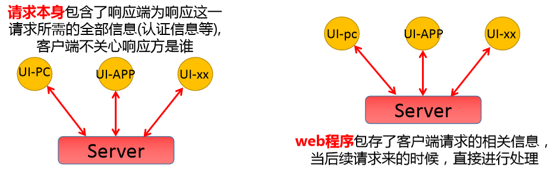

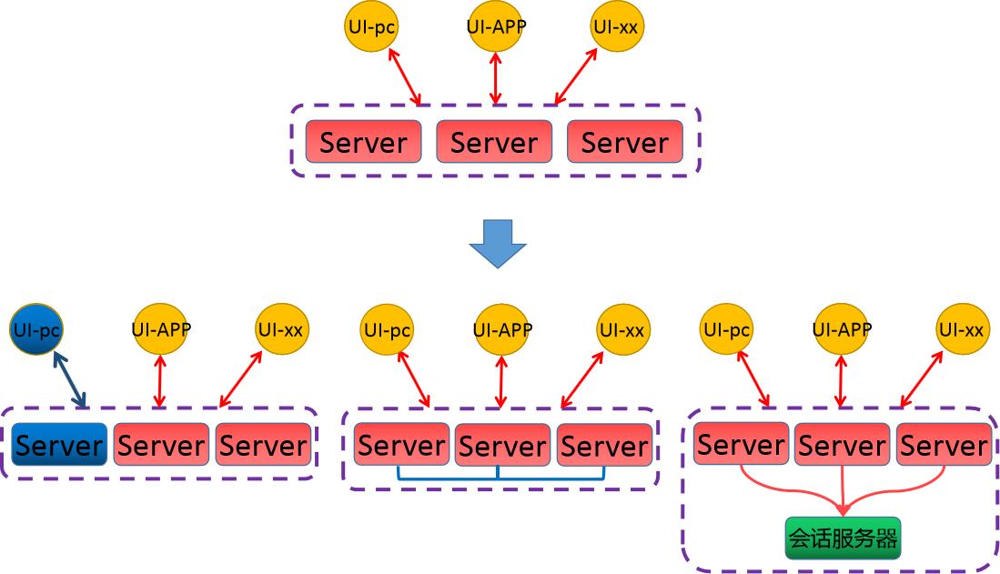

StatefulSet 的 Pod 名称按序号生成，例如 `web-0`、`web-1`。配合无头 Service（`clusterIP: None`），`web-0.web.default.svc.cluster.local` 可作为成员的稳定 DNS 名称；Pod IP 仍会变化，程序应使用 DNS 而不是缓存旧 IP。每个 `volumeClaimTemplates` 条目为每个 Pod 创建独立 PVC；Pod 被重建时会重新关联对应 PVC。**默认缩容或删除 StatefulSet 不会自动删除这些 PVC**，应按当前版本与 `persistentVolumeClaimRetentionPolicy` 设置核对实际保留行为。

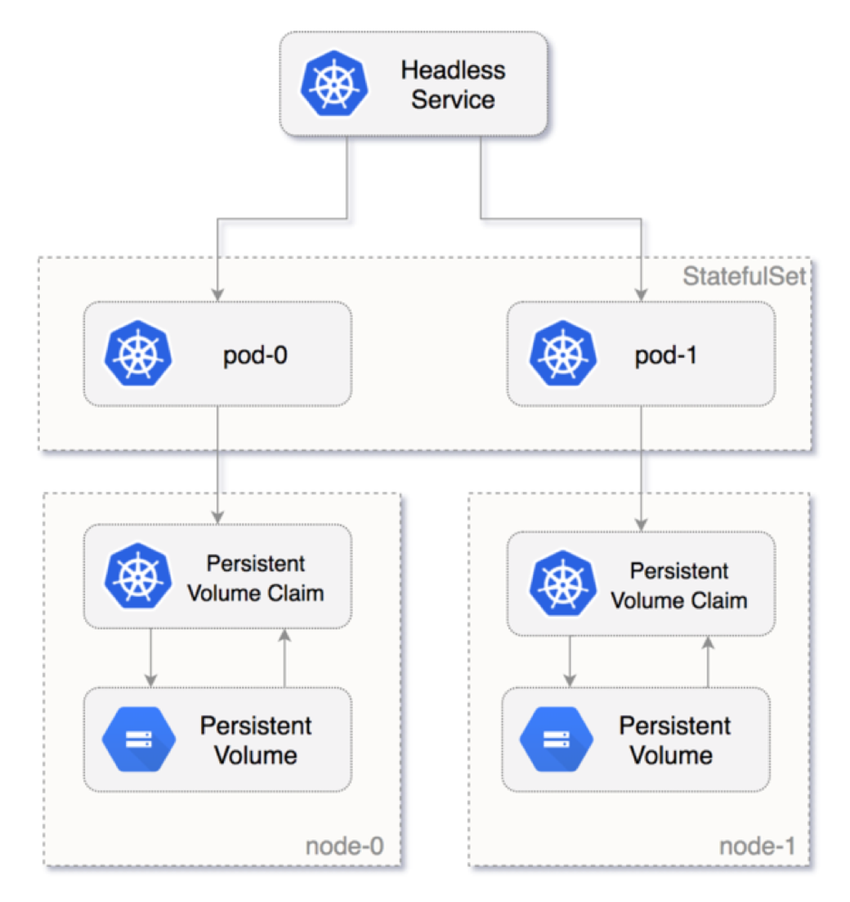

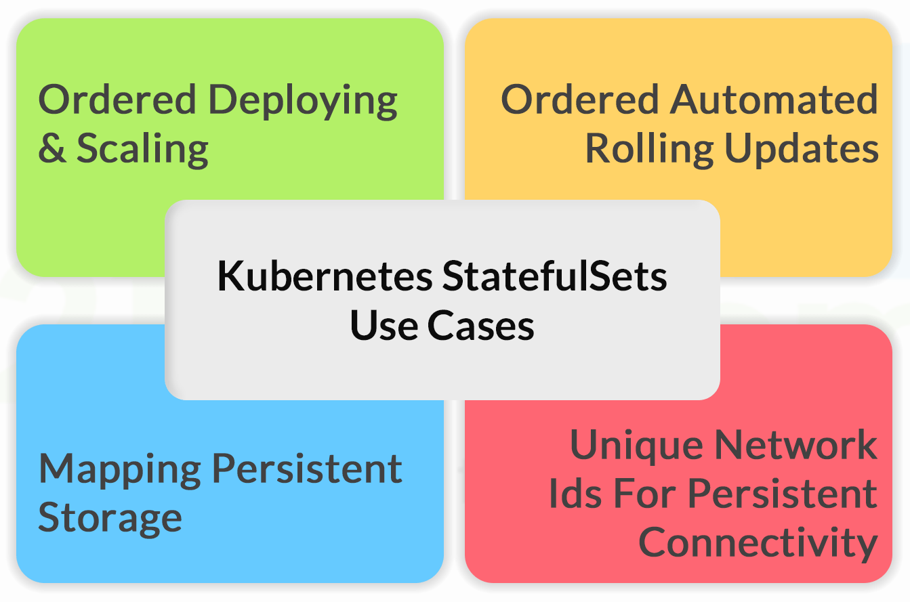


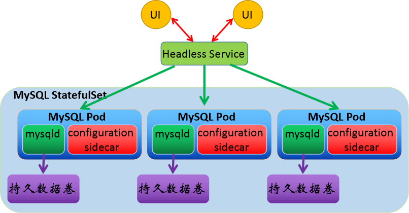

`podManagementPolicy: OrderedReady` 是默认策略：创建/扩容按序号递增，并等待前一个 Pod Ready；缩容按逆序。若成员互不依赖，可选择 `Parallel` 以并行创建和删除。更新策略 `RollingUpdate` 通常从高序号向低序号逐个更新；`OnDelete` 要手动删除 Pod 才替换。滚动更新的 `partition` 可以让高于等于分区序号的 Pod 先用新模板，适合分阶段验证；**探针未正确反映应用就绪时，顺序保障也会失去业务意义**。

StatefulSet 不会解析 MySQL 复制位点、Redis 槽位、ZooKeeper 法定票数或 Elasticsearch 分片。因此“副本数改成 5”只会改变 Pod 数，是否形成健康集群还要看应用自己的加入/退出协议。复杂系统优先评估成熟 Operator；直接写 YAML 时要把成员初始化、备份、故障切换和扩缩容流程逐项实现。

## 2 从一个最小工作负载验证身份与存储

先确认上一章准备的 `nfs-client` StorageClass 可以动态制备，再创建无头 Service 和 StatefulSet。这里用 BusyBox 写入自己的 Pod 名称，只验证身份与卷重连，不模拟数据库复制。

```yaml
apiVersion: v1
kind: Service
metadata:
  name: web
spec:
  clusterIP: None
  selector:
    app: web
  ports:
    - name: peer
      port: 8080
      targetPort: 8080
---
apiVersion: apps/v1
kind: StatefulSet
metadata:
  name: web
spec:
  serviceName: web
  replicas: 3
  selector:
    matchLabels:
      app: web
  template:
    metadata:
      labels:
        app: web
    spec:
      containers:
        - name: app
          image: busybox:1.36
          command: ["sh", "-c", "echo $HOSTNAME > /data/member; sleep 3600"]
          volumeMounts:
            - name: data
              mountPath: /data
  volumeClaimTemplates:
    - metadata:
        name: data
      spec:
        accessModes: [ReadWriteMany]
        storageClassName: nfs-client
        resources:
          requests:
            storage: 1Gi
```

检查 `web-0` 至 `web-2` 的 Pod、`data-web-0` 至 `data-web-2` 的 PVC，以及容器中 `/data/member` 文件。把副本数从 3 缩到 2 后，`web-2` 的 PVC 默认仍保留；再扩回 3，Pod 会重新关联原卷。测试前后应观察 PVC 的 `Bound` 状态和数据，而不是只看 Pod 名称。生产场景还要为应用定义就绪/存活探针、资源配额、反亲和性、拓扑分散和备份。

```bash
kubectl get statefulset,pods,pvc
kubectl exec web-0 -- cat /data/member
kubectl scale statefulset web --replicas=2
kubectl get pods,pvc
kubectl scale statefulset web --replicas=3
```

## 3 不同有状态系统如何使用这一框架

### 3.1 MySQL：身份稳定不等于复制已建立

原案例通过无头 Service 提供 `mysql-0.mysql` 等成员地址，用 `volumeClaimTemplates` 给每个实例独立数据卷，并在初始化容器中生成不同的配置，再利用 XtraBackup 和辅助容器克隆数据、启动复制。理解时应把责任分开：StatefulSet 保证序号和卷关联；MySQL 决定主从角色、复制位点、故障切换与事务一致性。XtraBackup、MySQL 版本和镜像必须相互兼容；克隆失败或复制延迟不能靠重建 Pod 自动修复。

扩容前先验证新副本的初始数据来源和复制权限；缩容前确认被移除成员没有承担主库职责，备份并处理对应 PVC。写请求应指向确定的主库；读 Service 可以路由到符合延迟要求的副本，但不能把所有 Pod 混在一起当作可任意写入的副本池。生产环境应评估专门的 MySQL Operator 或托管数据库。

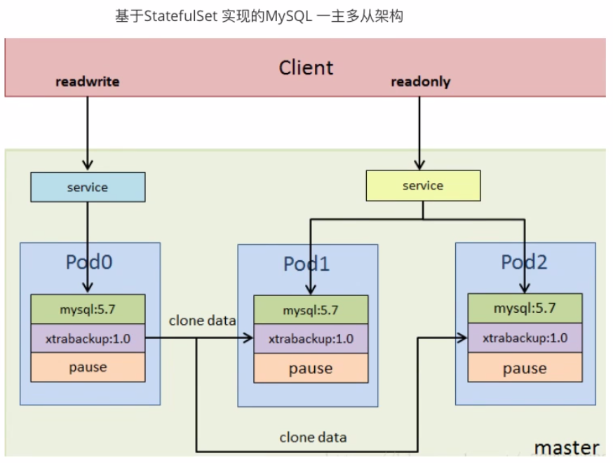

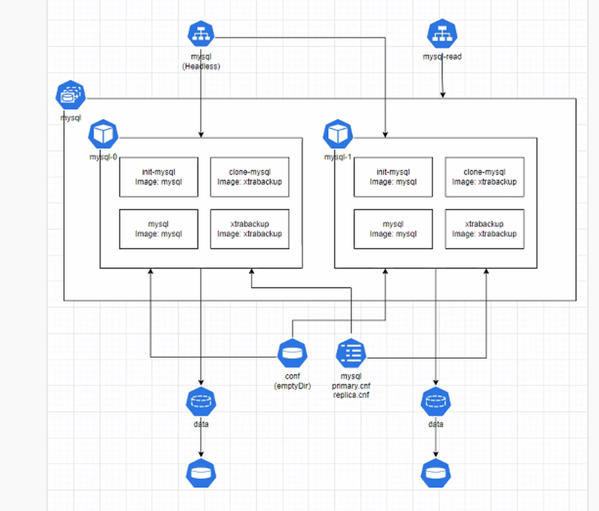

### 3.2 Redis Cluster：先处理槽位再调整 Pod 数

六个 Pod 可用 StatefulSet 获得固定名称和独立 PVC，Redis Cluster 自身再把它们组织为三主三从，并分配 16,384 个槽。新 Pod 创建后并不会自动拥有槽位；需要加入集群、分配主从角色、迁移槽位。缩容更要先把待移除主节点的槽和键迁出，再删除节点，最后调整 StatefulSet 副本数。原案例中的 Pod IP 会变，节点公布地址、客户端发现、总线端口和 Cluster 重定向都要按 Kubernetes 网络实际验证。

```bash
kubectl get pods,pvc -l app=redis-cluster
kubectl exec redis-cluster-0 -- redis-cli CLUSTER INFO
kubectl exec redis-cluster-0 -- redis-cli CLUSTER NODES
```

生产集群还需认证、网络隔离、备份与故障域分散；原笔记的 `--protected-mode no`、固定简单密码和整份 `redis.conf` 复制不能当作上线模板。Redis 集群的槽位和扩缩容细节另见 Redis 专题。

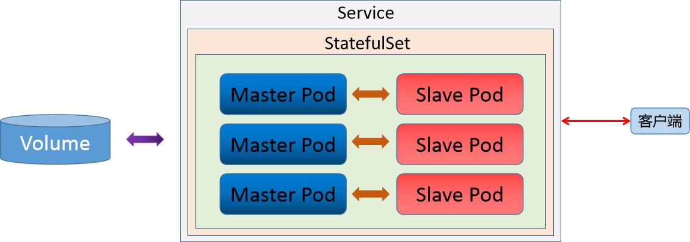

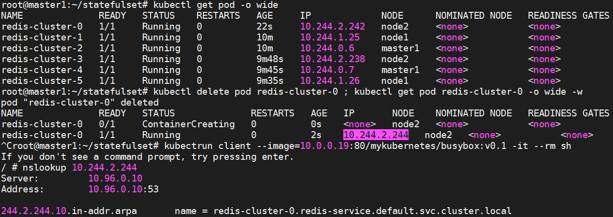

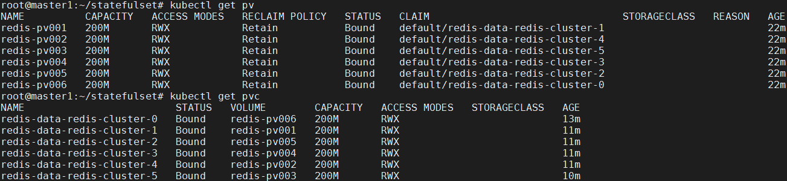

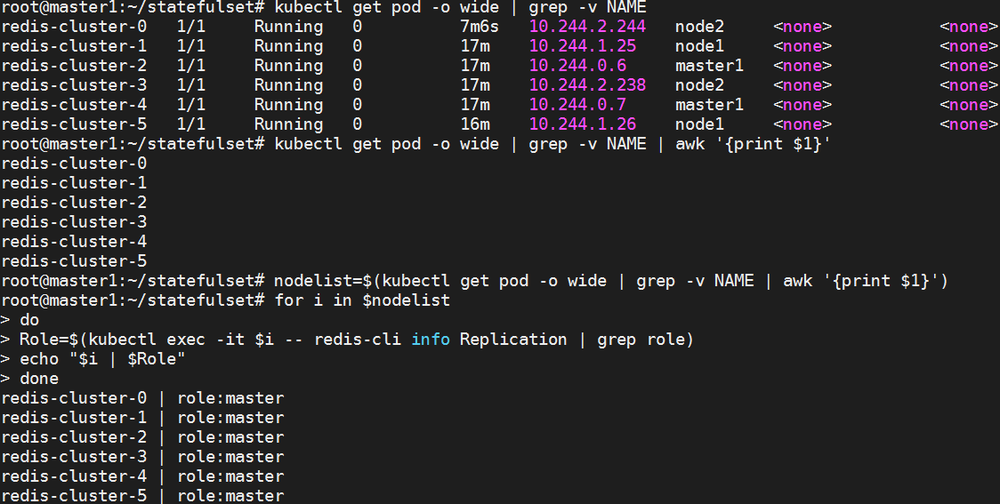

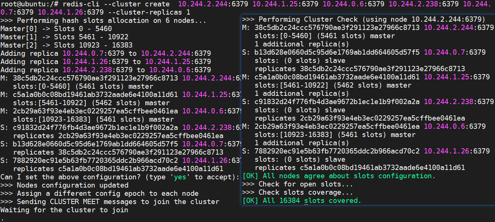

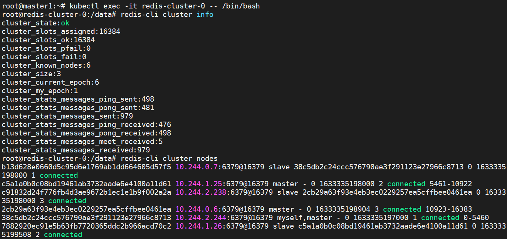

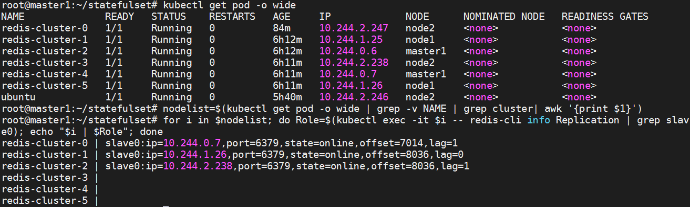

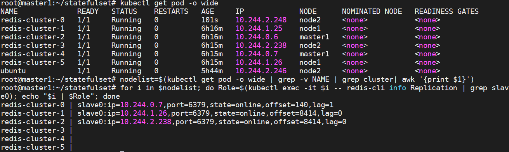

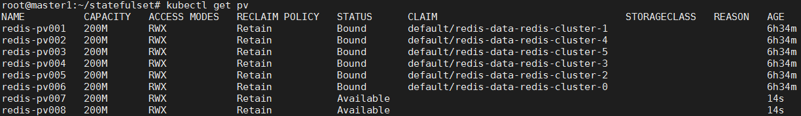

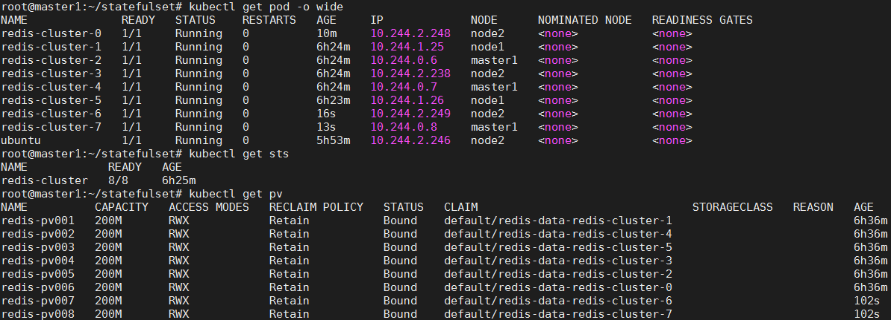

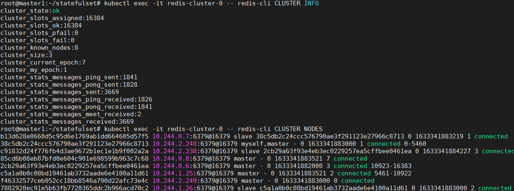

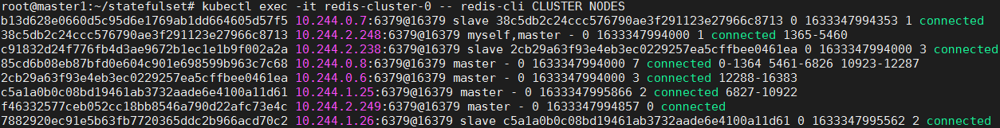

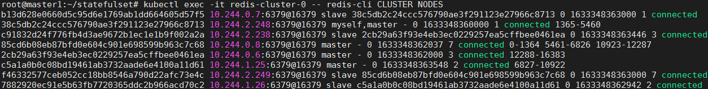

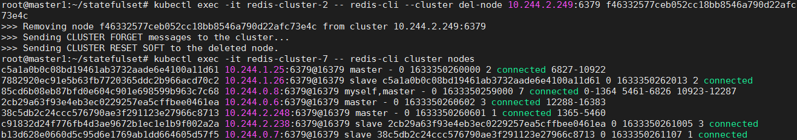

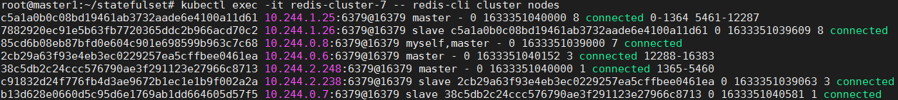

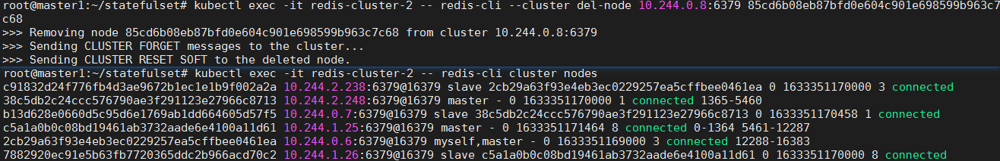

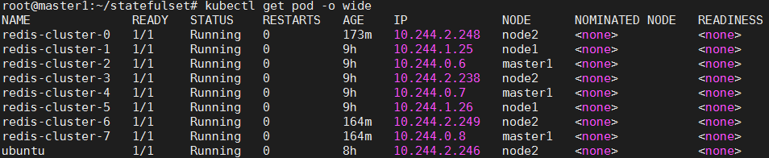

### 3.3 Nacos、Elasticsearch、MinIO、Redis Sentinel 与 ZooKeeper

这些案例共同利用稳定成员名与独立卷，但集群协议不同，不能复用 Redis 或 MySQL 的启动逻辑：

| 系统 | StatefulSet 提供的基础 | 额外必须验证的应用机制 |
| --- | --- | --- |
| Nacos | 固定 Pod DNS、配置与日志目录 | 外部数据库可用性、成员发现、认证配置与版本兼容 |
| Elasticsearch | 每个节点独立数据卷、稳定身份 | 节点角色、发现/首次引导、分片副本与滚动升级；优先评估 ECK |
| MinIO | 固定节点与磁盘路径 | 分布式卷布局、纠删码、故障域、凭据及备份；PVC 本身不等于对象数据已复制 |
| Redis 主从 + Sentinel | 主从及 Sentinel Pod 的身份和存储 | Sentinel 法定票数、主库发现、故障切换与客户端更新；与 Redis Cluster 不是同一种拓扑 |
| ZooKeeper | 成员 ID 与稳定域名 | 奇数法定票数、持久日志、顺序启停和多数派健康 |

原案例中出现的完整 Redis 配置文件、过时镜像标签和硬编码 MinIO 凭据容易淹没知识主线，也会造成误用；实际部署应从对应版本的官方配置或维护中的 Operator 出发，把密码放入 Secret，并逐项完成应用层健康验证。下一篇说明 Operator 如何把这些应用特有的协调逻辑写成控制器。

## 4 运维检查顺序

1. 先确认 Service 选择器、Pod DNS、Pod Ready 与成员发现是否符合应用协议。
2. 检查每个 Pod 是否绑定预期 PVC，重建后能否读到原数据；备份与恢复必须单独演练。
3. 升级和缩容前查询应用自己的复制、分片、选主及成员状态，再决定操作顺序；不要只看 StatefulSet 的 `READY` 数量。
4. 观察 Pod 事件、存储驱动日志和应用日志，区分调度失败、卷挂载失败与数据库启动失败。
5. 更新镜像时使用分区滚动或专用 Operator 的流程，确认上一成员恢复健康再推进下一个。操作失败时记录当前序号、卷和数据状态，避免贸然删除 PVC。

这些检查说明了 StatefulSet 的边界：它把成员“安放到正确位置”，真正让有状态系统健康运行，仍要依赖应用协议和可靠的存储管理。



<nav class="article-end" aria-label="章节导航">
  <a href="{{ '/subjects/Kubernetes/24-storage-wordpress-mysql.html' | relative_url }}">← 上一篇：WordPress 与 MySQL 存储实践</a>
  <a href="{{ '/subjects/Kubernetes/' | relative_url }}">返回 Kubernetes 目录</a>
  <a href="{{ '/subjects/Kubernetes/26-crd-operator.html' | relative_url }}">下一篇：CRD 与 Operator →</a>
</nav>
