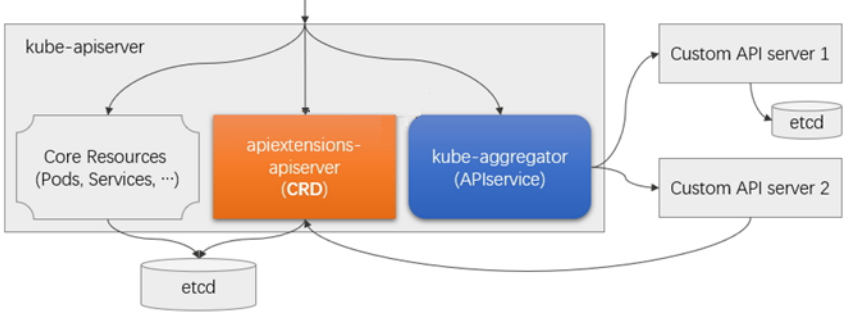
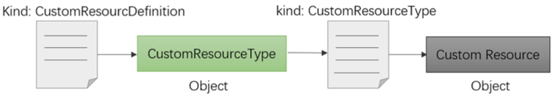
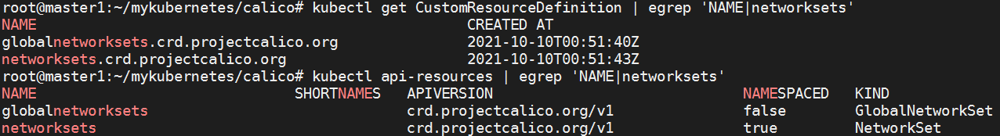
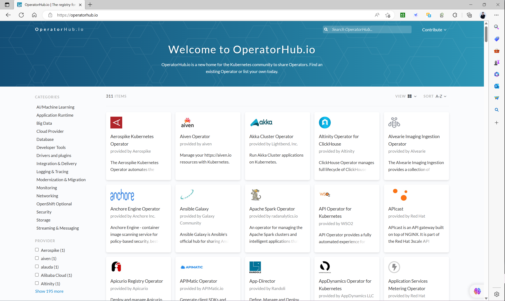
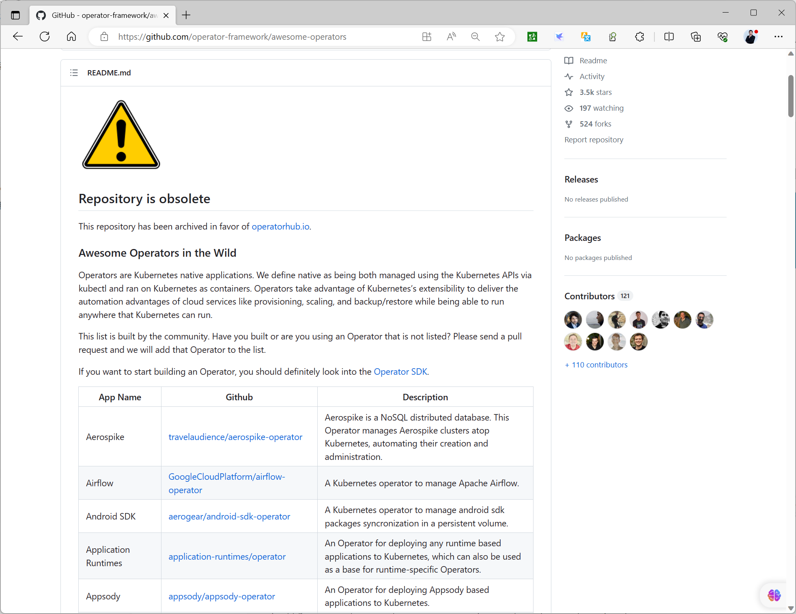
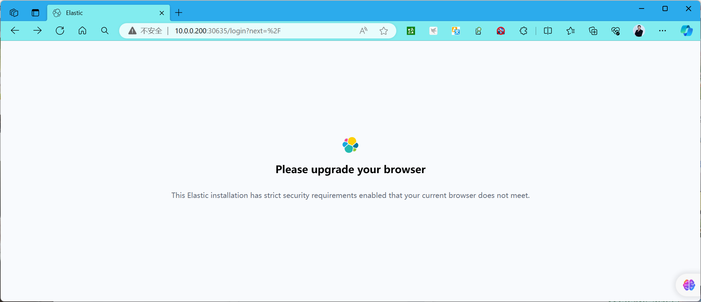
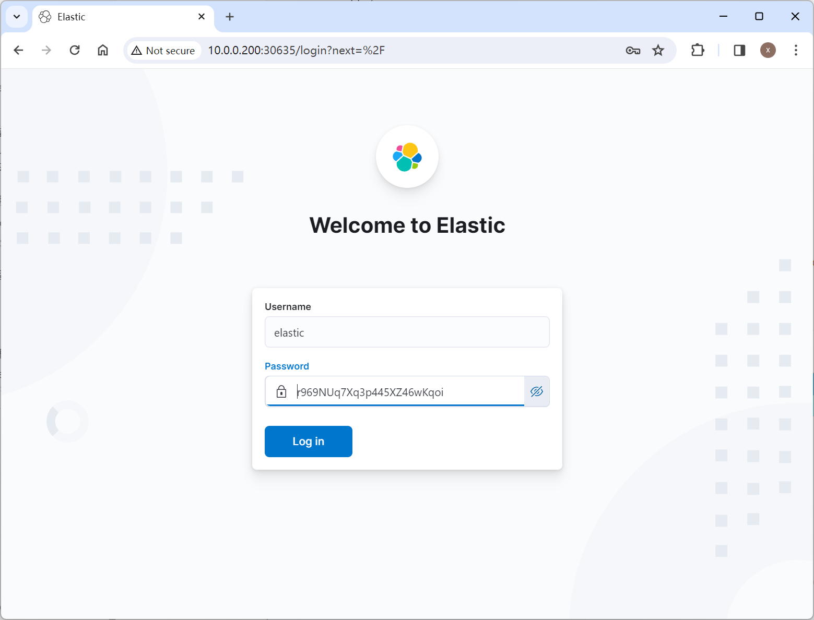
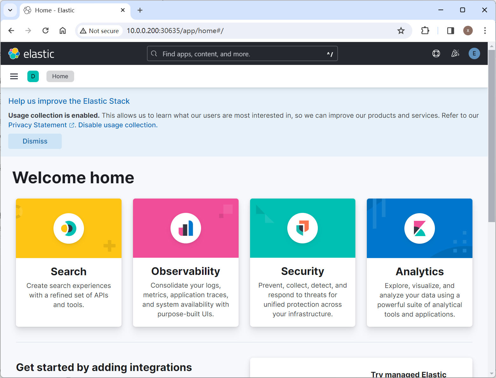
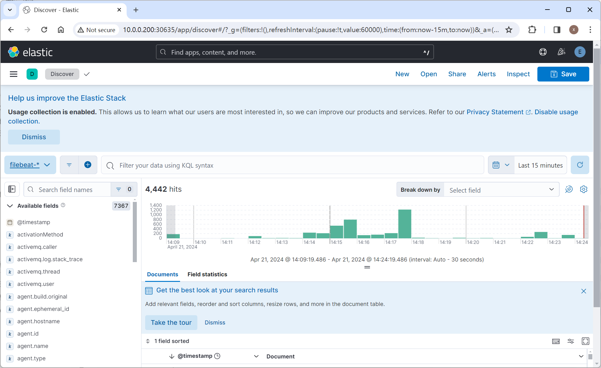

[← 返回 Kubernetes 目录]({{ '/subjects/Kubernetes/' | relative_url }})



# 26 CRD 与 Operator

# 2 CRD 定制资源

## 2.1 CRD 说明


为了在k8s上能够正常的运行所需的服务，需要遵循以下方式来创建相关资源：

1. 合理的分析业务需求

2. 梳理业务需求的相关功能

3. 定制不同功能的资源配置文件

4. 应用资源配置文件，完善业务环境。

当前所有的操作基本上都是在k8s内置的有限的资源对象中进行相关的操作，这些资源对象适用于通用的业务场景，而在我们的业务场景中，多多少少的会涉及到特殊功能的资源对象。

比如：监控场景需要监控的数据、日志场景需要收集的日志、流量场景需要传递的数据等等。为了高效的定制我们需要的环境，那么需要拥有一些专用的资源方便我们来使用，而在k8s之上提供了一个专用的接口，可以方便我们自己来定制需要的资源。

扩展Kubernetes API常用方式：

二次开发 API Server 源码,适合在添加新的核心类型时采用开发自定义API Server并聚合至主API Server ,富于弹性但代码工作量大使用CRD( Custom Resource Definition )自定义资源类型 , 易用但限制较多，对应的控制器还需在自行开发。



示例: 查看calico 自定义的资源CRD
```bash
#calico环境创建的时候，就用到了很多CRD对象，而且我们为了让CRD能够生效，该软件还提供了一个
controller的CRD控制器。这个控制器就是将CRD对象转换为真正有意义的现实的代码。
[root@master1 ~]#kubectl get pod -n kube-system | egrep 'NAME|calico'
NAME                                         READY   STATUS    RESTARTS
AGE
calico-kube-controllers-6fd7b9848d-7wtvh     1/1     Running   0
11m
calico-node-5rfrl                            1/1     Running   0
11m
calico-node-8624w                            1/1     Running   0
11m
calico-node-g4tcn                            1/1     Running   0
11m
calico-node-hgwd9                            1/1     Running   0
11m
calico-node-msjqp                            1/1     Running   0
11m
calico-node-tbh9k                            1/1     Running   0
11m
```

### CRD简介

资源（Resource） 是 Kubernetes API 中的一个端点， 其中存储的是某个类别的 API 对象 的一个集合。 例如内置的 pods 资源包含一组 Pod 对象。定制资源（Custom Resource） 是对 Kubernetes API 的扩展，不一定在默认的 Kubernetes 安装中就可用。定制资源所代表的是对特定 Kubernetes 安装的一种定制。 不过，很多 Kubernetes 核心功能现在都用定制资源来实现，这使得 Kubernetes 更加模块化。

CRD( Custom Resource Definition ) 定制资源可以通过动态注册的方式在运行中的集群内或出现或消失，集群管理员可以独立于集群更新定制资源。一旦某定制资源被安装，用户可以使用 kubectl 来创建和访问其中的对象，就像他们为 pods 这种内置资源所做的一样。CRD 功能是在 Kubernetes 1.7 版本被引入的，用户可以根据自己的需求添加自定义的 Kubernetes 对象资源。



**定制CRD的控制器**

就定制资源本身而言，它只能用来存取结构化的数据。 当你将定制资源与定制控制器（Custom Controller） 相结合时，定制资源就能够 提供真正的声明式 API（Declarative API）。使用声明式 API， 你可以声明或者设定你的资源的期望状态，并尝试让 Kubernetes 对象的当前状态同步到其期望状态。控制器负责将结构化的数据解释为用户所期望状态的记录，并持续地维护该状态。

你可以在一个运行中的集群上部署和更新定制控制器，这类操作与集群的生命周期无关。 定制控制器可以用于任何类别的资源，不过它们与定制资源结合起来时最为有效。Operator 模式就是将定制资源 与定制控制器相结合的。你可以使用定制控制器来将特定于某应用的领域知识组织起来，以编码的形式构造对 Kubernetes API 的扩展。

什么样的情况下用 CRD

希望使用 Kubernetes 客户端库和 CLI 来创建和更改新的资源。

希望 kubectl 能够直接支持你的资源；例如，kubectl get my-object object-name希望构造新的自动化机制，监测新对象上的更新事件，并对其他对象执行CRUD操作，或监测后者更新前者希望编写自动化组件来处理对对象的更新希望使用 Kubernetes API 对诸如 .spec、.status 和 .metadata 等字段的约定希望对象是对一组受控资源的抽象，或者对其他资源的归纳提炼。

**资源对象的定制方式**：在现有的控制器基础上，扩展资源对象，基于Kubernetes的内置资源 customresourcedefinitions实现从0开始定制资源对象和资源对象控制器，此方式需要具有编程语言的开发能力。

通常情况下，一个CRD会结合对应的Controller，并添加一些其它资源，组成一个专属应用的Operator，来解决特定应用的功能。

## 2.2 CRD 配置解析
```yaml
apiVersion: apiextensions.k8s.io/v1     # API群组和版本
kind: CustomResourceDefinition          # 资源类别
metadata:
name <string>                         # 资源名称
spec:
conversion <Object>                 # 定义不同版本间的格式转换方式
trategy <string>                 # 不同版本间的自定义资源转换策略，有None和
Webhook两种取值
webhook <Object>                 # 如何调用用于进行格式转换的webhook
group <string>                      # 资源所属的API群组
names <Object>                      # 自定义资源的类型，即该CRD创建资源规范时使用的
kind
categories  <[]string>            # 资源所属的类别编目，例如”kubectl get all”中
的all
kind <string>                     # kind名称，必选字段
listKind <string>                 # 资源列表名称，默认为"`kind`List"
plural <string>                   # 用于API路径
`/apis/<group>/<version>/.../<plural>`
shortNames <[]string>             # 该资源的kind的缩写格式
singular <string>                 # 资源kind的单数形式，必须使用全小写字母
preserveUnknownFields <boolean>     # 预留的非知名字段，kind等都是知名的预留字段
scope <string>                      # 作用域，可用值为Cluster和Namespaced
versions <[]Object>                 # 版本号定义
additionalPrinterColumns <[]Object>  # 需要返回的额外信息
name <string>                     # 形如vM[alphaN|betaN]格式的版本名称，例如v1
或v1alpha2
schema <Object>                   # 该资源的数据格式（schema）定义，必选字段
openAPIV3Schema  <Object>       # 用于校验字段的schema对象，格式请参考相关手册
served <boolean>                  # 是否允许通过RESTful API调度该版本，必选字段
storage <boolean>                 # 将自定义资源存储于etcd中时是不是使用该版本
subresources <Object>             # 子资源定义
scale <Object>                  # 启用scale子资源，通过autoscaling/v1.Scale
发送负荷
status <map[string]>            # 启用status子资源，为资源生成/status端点
```

范例： 查看网络附件Calico的自定义资源对象CRD
```yaml
apiVersion: apiextensions.k8s.io/v1
kind: CustomResourceDefinition
metadata:
name: networksets.crd.projectcalico.org
spec:
group: crd.projectcalico.org
names:
kind: NetworkSet
listKind: NetworkSetList
plural: networksets
singular: networkset
scope: Namespaced
versions:
- name: v1
schema:
openAPIV3Schema:
description: NetworkSet is the Namespaced-equivalent of the
GlobalNetworkSet.
properties:
apiVersion:
description: '。。。'
type: string
kind:
description: '。。。'
type: string
metadata:
type: object
spec:
description: 。。。.
properties:
nets:
description: 。。。.
items:
type: string
type: array
type: object
type: object
served: true
storage: true
status:
acceptedNames:
kind: ""
plural: ""
conditions: []
storedVersions: []
```



## 2.3  CRD 案例

范例: 自定义CRD资源
```yaml
#创建一个基于用户的CRD资源

[root@master1 ~]#cat crd-user.yaml
apiVersion: apiextensions.k8s.io/v1
kind: CustomResourceDefinition
metadata:
name: users.auth.democrd.io
spec:
group: auth.democrd.io
names:
kind: User
plural: users  #复数
singular: user #单数
shortNames:
- u
scope: Namespaced
versions:
- served: true
storage: true
name: v1alpha1
schema:
openAPIV3Schema:
type: object
properties:
spec:
type: object
properties:
userID:
type: integer
minimum: 1
maximum: 65535
groups:
type: array
items:
type: string
email:
type: string
password:
type: string
format: password
required: ["userID","groups"]

#应用资源配置文件
[root@master1 ~]#kubectl apply  -f  scheduler-crd-user.yaml

#查看效果
[root@master1 ~]#kubectl api-resources  |grep user
users                             u            auth.democrd.io/v1alpha1
true         User

[root@master1 ~]#kubectl  get crd | egrep 'NA|users'
NAME                    CREATED AT
users.auth.democrd.io   2021-04-04T02:54:13Z

[root@master1 ~]#kubectl explain users.auth.democrd.io
KIND:     User
VERSION:  auth.democrd.io/v1alpha1

DESCRIPTION:
<empty>
```


FIELDS: apiVersion   <string>APIVersion defines the versioned schema of this representation of an object. Servers should convert recognized schemas to the latest internal value, and may reject unrecognized values. More info:

<https://git.k8s.io/community/contributors/devel/sig-architecture/api->

conventions.md#resources


kind <string>Kind is a string value representing the REST resource this object represents. Servers may infer this from the endpoint the client submits requests to. Cannot be updated. In CamelCase. More info:

<https://git.k8s.io/community/contributors/devel/sig-architecture/api->

conventions.md#types-kinds

```text
metadata <Object>
Standard object's metadata. More info:
https://git.k8s.io/community/contributors/devel/sig-architecture/api-conventions.md#metadata

spec <Object>
```

范例: 简单使用自定义资源CRD
```yaml
#创建自定义资源
[root@master1 ~]#cat crd-user-test.yaml
apiVersion: auth.democrd.io/v1alpha1
kind: User
metadata:
name: bowen
namespace: default
spec:
userID: 1
email: bowen@bowen.org
groups:
- superusers
- adminstrators
password: "123456"

#监听
[root@master1 ~]#kubectl proxy
[root@master1 ~]#curl http://localhost:8001/apis/auth.democrd.io/v1alpha1/users?watch=true
#应用资源清单文件后可以显示下面内容

{"type":"ADDED","object":
{"apiVersion":"auth.democrd.io/v1alpha1","kind":"User","metadata":
{"annotations":{"kubectl.kubernetes.io/last-applied-configuration":"
{\"apiVersion\":\"auth.democrd.io/v1alpha1\",\"kind\":\"User\",\"metadata\":
{\"annotations\":{},\"name\":\"bowen\",\"namespace\":\"default\"},\"spec\":
{\"email\":\"bowen@bowen.org\",\"groups\":
[\"superusers\",\"adminstrators\"],\"password\":\"123456\",\"userID\":1}}\n"},"c
reationTimestamp":"2021-04-04T02:58:53Z","generation":1,"managedFields":
[{"apiVersion":"auth.democrd.io/v1alpha1","fieldsType":"FieldsV1","fieldsV1":
{"f:metadata":{"f:annotations":{".":{},"f:kubectl.kubernetes.io/last-applied-
configuration":{}}},"f:spec":{".":{},"f:email":{},"f:groups":{},"f:password":
{},"f:userID":{}}},"manager":"kubectl-client-side-
apply","operation":"Update","time":"2024-08-
20T06:07:42Z"}],"name":"bowen","namespace":"default","resourceVersion":"1224837",
"uid":"4513a391-2fca-4cf6-b5b7-4efa721a76c3"},"spec":
{"email":"bowen@bowen.org","groups":
["superusers","adminstrators"],"password":"123456","userID":1}}}

#应用资源配置文件
[root@master1 ~]#kubectl apply -f crd-user-test.yaml

#查看效果
[root@master1 ~]#kubectl get users
NAME    AGE
bowen   26s

[root@master1 ~]#kubectl get user -o yaml
apiVersion: v1
items:
- apiVersion: auth.democrd.io/v1alpha1
kind: User
metadata:
annotations:
kubectl.kubernetes.io/last-applied-configuration: |
{"apiVersion":"auth.democrd.io/v1alpha1","kind":"User","metadata":
{"annotations":{},"name":"admin","namespace":"default"},"spec":
{"email":"bowen@bowen.org","groups":
["superusers","adminstrators"],"password":"123456","userID":1}}
creationTimestamp: "2021-04-04T02:58:53Z"
generation: 1
name: bowen
namespace: default
resourceVersion: "166759"
uid: d742870e-12c5-413b-a98a-541873c2205e
spec:
email: bowen@bowen.org
groups:
- superusers
- adminstrators
password: 123456
userID: 1
kind: List
metadata:
resourceVersion: ""

[root@master1 ~]#kubectl describe users bowen
Name:         bowen

Namespace:    default
Labels:       <none>
Annotations:  <none>
API Version:  auth.democrd.io/v1alpha1
Kind:         User
Metadata:
Creation Timestamp:  2021-04-04T02:58:53Z
Generation:          1
Managed Fields:
API Version:  auth.democrd.io/v1alpha1
Fields Type:  FieldsV1
fieldsV1:
f:metadata:
f:annotations:
.:
f:kubectl.kubernetes.io/last-applied-configuration:
f:spec:
.:
f:email:
f:groups:
f:password:
f:userID:
Manager:         kubectl-client-side-apply
Operation:       Update
Time:            2021-04-04T02:58:53Z
Resource Version:  166759
UID:               d742870e-12c5-413b-a98a-541873c2205e
Spec:
Email:  bowen@bowen.org
Groups:
superusers
adminstrators
Password:  123456
User ID:   1
Events:      <none>

#注意:虽然创建好了CRD，但是CRD本身没有太大的意义，意义只在于如何在控制器或者operator中使用它

#清理环境,注意顺序,如果相反会导致admin资源不可用，无法删除
[root@master1 ~]#kubectl delete  -f  crd-user-test.yaml
[root@master1 ~]#kubectl delete  -f  crd-user.yaml
```

# 3 Operator

## 3.1 Operator 说明

由于不同集群的特殊性，所以StatefulSet只能应用于通用的状态管理机制,用户自已实现应用的集群又比较麻烦。

一些热心的软件开发者利用Statefulset等技术将应用封装成各种应用程序专用的 Operator，以便于帮助相关企业进行使用Kubernetes，并将这些做好的状态管理工具放到了 GitHub网站的awsomes-operators项目中，当前迁移到了 https://operatorhub.io/

因此如果涉及到一些状态集群场景，建议可以直接使用operatorhub提供好的工具，而无需自己编写实现。

### Operator 工作机制

Kubernetes中两个核心的理念：“声明式API”和“控制器模式”。“声明式API”的核心原理，就是当用户向Kubernetes提交了一个API对象描述之后，Kubernetes会负责为你保证整个集群里各项资源的状态，都与你的API对象描述的需求保持一致。Kubernetes通过启动一种叫做“控制器模式”的无限循环，watch这些API对象的变化，不断检查，然后调谐，最后确保整个集群的状态与这个API对象的描述一致。

Operator就是基于以上原理工作，以Redis Operator为例，为了实现Operator，首先需要将自定义对象CRD(Custom Resource Definition)的说明，注册到Kubernetes中，用于描述Operator控制的应用：Redis集群实例，这样当用户告诉Kubernetes想要一个redis集群实例后，Redis Operator就能通过控制循环执行调谐逻辑达到用户定义状态。

所以Operator本质上是一个个特殊应用的控制器，其提供了一种在Kubernetes API之上构建应用程序，并在Kubernetes上部署程序的方法，它允许开发者扩展Kubernetes API，增加新功能，像管理Kubernetes原生组件一样管理自定义的资源。如果你想运行一个Redis哨兵模式的主从集群，或者TiDB集群，那么你只需要提交一个声明就可以了，而不需要关心部署这些分布式的应用需要的相关领域的知识。Operator本身就可以做到创建应用、监控应用状态、扩缩容、升级、故障恢复、及资源清理等，从而将分布式应用的门槛降到最低。

基于专用的Operator编排运行某有状态应用的流程：

部署Operator及其专用的资源类型使用上面创建的专用的资源类型，来声明一个有状态应用的编排需求。

Operator 链接：


- <https://operatorhub.io/>
- <https://github.com/operator-framework/awesome-operators>






## 3.2 Operator 案例

### 3.2.1 案例：基于 Operator  实现 ECK（ Elastic Cloud on Kubernetes )

注意：Worker 节点内存需要4G以上。

**官方安装说明**
```text
https://www.elastic.co/guide/en/cloud-on-k8s/current/k8s-quickstart.html
https://www.elastic.co/guide/en/cloud-on-k8s/current/k8s-deploy-eck.html
https://www.elastic.co/guide/en/cloud-on-k8s/current/k8s-deploy-elasticsearch.html

#1)Install custom resource definitions:

kubectl create -f https://download.elastic.co/downloads/eck/2.12.1/crds.yaml
```


The following Elastic resources have been created: customresourcedefinition.apiextensions.k8s.io/agents.agent.k8s.elastic.co created customresourcedefinition.apiextensions.k8s.io/apmservers.apm.k8s.elastic.co created customresourcedefinition.apiextensions.k8s.io/beats.beat.k8s.elastic.co created customresourcedefinition.apiextensions.k8s.io/elasticmapsservers.maps.k8s.elasti c.co created customresourcedefinition.apiextensions.k8s.io/elasticsearches.elasticsearch.k8s. elastic.co created customresourcedefinition.apiextensions.k8s.io/enterprisesearches.enterprisesearc h.k8s.elastic.co created

```text
customresourcedefinition.apiextensions.k8s.io/kibanas.kibana.k8s.elastic.co
created
customresourcedefinition.apiextensions.k8s.io/logstashes.logstash.k8s.elastic.co
created

#2)Install the operator with its RBAC rules:

kubectl apply -f https://download.elastic.co/downloads/eck/2.12.1/operator.yaml
```


The ECK operator runs by default in the elastic-system namespace. It is recommended that you choose a dedicated namespace for your workloads, rather than using the elastic-system or the default namespace.

```yaml
#Monitor the operator logs:

kubectl -n elastic-system logs -f statefulset.apps/elastic-operator

#3)Apply a simple Elasticsearch cluster specification, with one Elasticsearch
node:
cat <<EOF | kubectl apply -f -
apiVersion: elasticsearch.k8s.elastic.co/v1
kind: Elasticsearch
metadata:
name: quickstart
spec:
version: 8.13.2
nodeSets:
- name: default
count: 1
config:
node.store.allow_mmap: false
EOF

#4)Monitor cluster health and creation progressedit
#Get an overview of the current Elasticsearch clusters in the Kubernetes cluster,
including health, version and number of nodes:

kubectl get elasticsearch
NAME          HEALTH    NODES     VERSION   PHASE         AGE
quickstart    green     1         8.13.2     Ready         1m
```


#When you create the cluster, there is no HEALTH status and the PHASE is empty. After a while, the PHASE turns into Ready, and HEALTH becomes green. The HEALTH status comes from Elasticsearch’s cluster health API.

```bash
#One Pod is in the process of being started:

kubectl get pods --selector='elasticsearch.k8s.elastic.co/cluster-
name=quickstart'
NAME                      READY   STATUS    RESTARTS   AGE
quickstart-es-default-0   1/1     Running   0          79s

#Access the logs for that Pod:

kubectl logs -f quickstart-es-default-0

#Request Elasticsearch accessedit
#A ClusterIP Service is automatically created for your cluster:

kubectl get service quickstart-es-http
NAME                 TYPE        CLUSTER-IP      EXTERNAL-IP   PORT(S)    AGE
quickstart-es-http   ClusterIP   10.15.251.145   <none>        9200/TCP   34m

#Get the credentials.

#A default user named elastic is automatically created with the password stored
in a Kubernetes secret:

PASSWORD=$(kubectl get secret quickstart-es-elastic-user -o go-
template='{{.data.elastic | base64decode}}')
Request the Elasticsearch endpoint.

#From inside the Kubernetes cluster:

curl -u "elastic:$PASSWORD" -k "https://quickstart-es-http:9200"

#From your local workstation, use the following command in a separate terminal:

kubectl port-forward service/quickstart-es-http 9200

#Then request localhost:

curl -u "elastic:$PASSWORD" -k "https://localhost:9200"
```

#### 3.2.1.1 安装 Operator
```bash
#安装Operator
[root@master1 ~]#kubectl create -f
https://download.elastic.co/downloads/eck/2.12.1/crds.yaml
customresourcedefinition.apiextensions.k8s.io/agents.agent.k8s.elastic.co
created
customresourcedefinition.apiextensions.k8s.io/apmservers.apm.k8s.elastic.co
created
customresourcedefinition.apiextensions.k8s.io/beats.beat.k8s.elastic.co created
customresourcedefinition.apiextensions.k8s.io/elasticmapsservers.maps.k8s.elasti
c.co created
customresourcedefinition.apiextensions.k8s.io/elasticsearchautoscalers.autoscali
ng.k8s.elastic.co created
customresourcedefinition.apiextensions.k8s.io/elasticsearches.elasticsearch.k8s.
elastic.co created
customresourcedefinition.apiextensions.k8s.io/enterprisesearches.enterprisesearc
h.k8s.elastic.co created
customresourcedefinition.apiextensions.k8s.io/kibanas.kibana.k8s.elastic.co
created
customresourcedefinition.apiextensions.k8s.io/logstashes.logstash.k8s.elastic.co
created
customresourcedefinition.apiextensions.k8s.io/stackconfigpolicies.stackconfigpol
icy.k8s.elastic.co created

#自动创建相关CRD
[root@master1 ~]#kubectl get crd --sort-by='{.metadata.creationTimestamp}'|tail
enterprisesearches.enterprisesearch.k8s.elastic.co     2024-04-21T03:41:22Z
elasticmapsservers.maps.k8s.elastic.co                 2024-04-21T03:41:22Z

elasticsearchautoscalers.autoscaling.k8s.elastic.co    2024-04-21T03:41:22Z
stackconfigpolicies.stackconfigpolicy.k8s.elastic.co   2024-04-21T03:41:22Z
logstashes.logstash.k8s.elastic.co                     2024-04-21T03:41:22Z
agents.agent.k8s.elastic.co                            2024-04-21T03:41:22Z
kibanas.kibana.k8s.elastic.co                          2024-04-21T03:41:22Z
elasticsearches.elasticsearch.k8s.elastic.co           2024-04-21T03:41:22Z
beats.beat.k8s.elastic.co                              2024-04-21T03:41:22Z
apmservers.apm.k8s.elastic.co                          2024-04-21T03:41:22Z

#安装operator相关RBAC 规则
[root@master1 ~]#kubectl apply -f
https://download.elastic.co/downloads/eck/2.12.1/operator.yaml
namespace/elastic-system created
serviceaccount/elastic-operator created
secret/elastic-webhook-server-cert created
configmap/elastic-operator created
clusterrole.rbac.authorization.k8s.io/elastic-operator created
clusterrole.rbac.authorization.k8s.io/elastic-operator-view created
clusterrole.rbac.authorization.k8s.io/elastic-operator-edit created
clusterrolebinding.rbac.authorization.k8s.io/elastic-operator created
service/elastic-webhook-server created
statefulset.apps/elastic-operator created
validatingwebhookconfiguration.admissionregistration.k8s.io/elastic-
webhook.k8s.elastic.co created

#在elastic-system 名称空间查看相关资源
[root@master1 ~]#kubectl get all -n elastic-system
NAME                     READY   STATUS    RESTARTS   AGE
pod/elastic-operator-0   1/1     Running   0          23s

NAME                             TYPE        CLUSTER-IP       EXTERNAL-IP
PORT(S)   AGE
service/elastic-webhook-server   ClusterIP   10.100.174.107   <none>
443/TCP   23s

NAME                                READY   AGE
statefulset.apps/elastic-operator   1/1     23s
```

#### 3.2.1.2 部署 Elasticsearch
```yaml
#准备业务的名称空间
[root@master1 ~]#kubectl create ns demo

#准备elasticsearch-cluster清单文件
[root@master1 ~]#cat operator-elasticsearch-cluster.yaml
apiVersion: elasticsearch.k8s.elastic.co/v1
kind: Elasticsearch
metadata:
name: my-es-cluster
#namespace: elastic-system
namespace: demo
spec:
#version: 8.13.2
version: 8.14.0
nodeSets:
- name: default

count: 3                  #3个节点的集群
config:
node.store.allow_mmap: false
volumeClaimTemplates:
- metadata:
name: elasticsearch-data
spec:
accessModes: ["ReadWriteOnce"]
resources:
requests:
storage: 2Gi
storageClassName: sc-nfs     #需要提前准备sc-nfs的storageClass

#注意：节点内存需要4G以上
[root@master1 ~]#kubectl apply -f operator-elasticsearch-cluster.yaml

#查看结果
[root@master1 ~]#kubectl get elasticsearch -n demo
NAME            HEALTH   NODES   VERSION   PHASE   AGE
my-es-cluster   green    3       8.13.2    Ready   51m

#查看结果
[root@master1 ~]#kubectl get all -n demo
NAME                             READY   STATUS    RESTARTS   AGE
pod/my-es-cluster-es-default-0   1/1     Running   0          31s
pod/my-es-cluster-es-default-1   1/1     Running   0          31s
pod/my-es-cluster-es-default-2   1/1     Running   0          31s

NAME                                     TYPE        CLUSTER-IP       EXTERNAL-IP
PORT(S)    AGE
service/my-es-cluster-es-default         ClusterIP   None             <none>
9200/TCP   31s
service/my-es-cluster-es-http            ClusterIP   10.99.139.6      <none>
9200/TCP   42s
service/my-es-cluster-es-internal-http   ClusterIP   10.105.185.183   <none>
9200/TCP   42s
service/my-es-cluster-es-transport       ClusterIP   None             <none>
9300/TCP   42s

NAME                                        READY   AGE
statefulset.apps/my-es-cluster-es-default   3/3     31s

[root@master1 ~]#kubectl get secret -n demo
NAME                                          TYPE     DATA   AGE
my-es-cluster-es-default-es-config            Opaque   1      20m
my-es-cluster-es-default-es-transport-certs   Opaque   7      20m
my-es-cluster-es-elastic-user                 Opaque   1      20m
my-es-cluster-es-file-settings                Opaque   1      20m
my-es-cluster-es-http-ca-internal             Opaque   2      20m
my-es-cluster-es-http-certs-internal          Opaque   3      20m
my-es-cluster-es-http-certs-public            Opaque   2      20m
my-es-cluster-es-internal-users               Opaque   4      20m
my-es-cluster-es-remote-ca                    Opaque   1      20m
my-es-cluster-es-transport-ca-internal        Opaque   2      20m
my-es-cluster-es-transport-certs-public       Opaque   1      20m
my-es-cluster-es-xpack-file-realm             Opaque   4      20m

[root@master1 ~]#ls /data/sc-nfs/
demo-elasticsearch-data-my-es-cluster-es-default-0-pvc-2c75f0cd-4f73-42dc-9f00-
80862d43128e
demo-elasticsearch-data-my-es-cluster-es-default-1-pvc-de45a3e6-820f-4e27-b596-
c50eb57e0563
demo-elasticsearch-data-my-es-cluster-es-default-2-pvc-8704ca2c-f0e4-4c1a-90c0-
47c3a9e5f809

#取出ES的访问密码
[root@master1 ~]#PASSWORD=$(kubectl get secret my-es-cluster-es-elastic-user -n
demo -o go-template='{{.data.elastic | base64decode}}')
#或者
[root@master1 ~]#PASSWORD=$(kubectl get secret my-es-cluster-es-elastic-user -n
demo -o jsonpath={.data.elastic} -n demo|base64 -d)

[root@master1 ~]#echo $PASSWORD
r969NUq7Xq3p445XZ46wKqoi

#开启一个新的Pod测试访问ES Cluster
[root@master1 ~]#kubectl run --env="PASSWORD=$PASSWORD" client-$RANDOM --image
registry.cn-beijing.aliyuncs.com/bowen/admin-box:v0.1 -it --rm --
restart=Never --command -- /bin/bash
If you don't see a command prompt, try pressing enter.
root@client-6625 /# curl -u "elastic:$PASSWORD" -k https://my-es-cluster-es-
http.demo:9200
{
"name" : "my-es-cluster-es-default-0",
"cluster_name" : "my-es-cluster",
"cluster_uuid" : "Ljm9XSU0SmuvZjVNT8sYFg",
"version" : {
"number" : "8.13.2",
"build_flavor" : "default",
"build_type" : "docker",
"build_hash" : "16cc90cd2d08a3147ce02b07e50894bc060a4cbf",
"build_date" : "2024-04-05T14:45:26.420424304Z",
"build_snapshot" : false,
"lucene_version" : "9.10.0",
"minimum_wire_compatibility_version" : "7.17.0",
"minimum_index_compatibility_version" : "7.0.0"
},
"tagline" : "You Know, for Search"
}

root@client-6625 /#curl -u "elastic:$PASSWORD" -k https://my-es-cluster-es-
http.demo:9200/_cat/health
1713678472 05:47:52 my-es-cluster green 3 3 0 0 0 0 0 0 - 100.0%
root@client-6625 /#curl -u "elastic:$PASSWORD" -k https://my-es-cluster-es-
http.demo:9200/_cat/nodes
10.244.2.76 61 73 4 0.36 0.43 0.45 cdfhilmrstw - my-es-cluster-es-default-2
10.244.3.65 53 71 4 0.81 0.74 0.52 cdfhilmrstw - my-es-cluster-es-default-0
10.244.1.84 39 71 4 0.19 0.19 0.26 cdfhilmrstw * my-es-cluster-es-default-1

[root@master1 ~]#curl -u "elastic:$PASSWORD" -k
https://10.109.165.206:9200/_cat/health?v
epoch      timestamp cluster       status node.total node.data shards pri relo
init unassign pending_tasks max_task_wait_time active_shards_percent
1755490243 04:10:43  my-es-cluster green           3         3      0   0    0
0        0             0                  -                100.0%

#当前没有索引
root@client-6625 /#curl -u "elastic:$PASSWORD" -k https://my-es-cluster-es-
http.demo:9200/_cat/indices
```

#### 3.2.1.3 部署 Kibana
```yaml
#部署Kibana
[root@master1 ~]#cat operator-elasticsearch-cluster-kibana.yaml
apiVersion: kibana.k8s.elastic.co/v1
kind: Kibana
metadata:
name: kibana
#namespace: elastic-system
namespace: demo
spec:
#version: 8.11.3
#version: 8.13.2
version: 8.14.0
count: 1
elasticsearchRef:
name: "my-es-cluster"
http:
tls:
selfSignedCertificate:
disabled: true
service:
spec:
type: LoadBalancer #
#type: NodePort
---
#apiVersion: networking.k8s.io/v1
#kind: Ingress
#metadata:
#  name: kibana
#  namespace: elastic-system
#spec:
#  ingressClassName: nginx
#  rules:
#  - host: kibana.bowen.org
#    http:
#      paths:
#      - backend:
#          service:
#            name: kibana-kb-http
#            port:
#              number: 5601
#        path: /
#        pathType: Prefix
#  # tls:
#  # - hosts:
#  #   - host-name
#  #   secretName: tls-secret-name

[root@master1 ~]#kubectl apply -f operator-elasticsearch-cluster-kibana.yaml
kibana.kibana.k8s.elastic.co/kibana created

#查看状态
[root@master1 ~]#kubectl get kibana  -n demo
NAME     HEALTH   NODES   VERSION   AGE
kibana   green    1       8.11.3    26m

#查看SVC
[root@master1 ~]#kubectl get svc  -n demo
NAME                                     TYPE        CLUSTER-IP       EXTERNAL-IP
PORT(S)          AGE
service/kibana-kb-http                   LoadBalancer  10.108.134.123
10.0.0.10   5601:30635/TCP   2m8s
```

#### 3.2.1.4 部署 Filebeat
```yaml
#部署Filebeat
[root@master1 ~]#cat operator-elasticsearch-cluster-filebeat.yaml
apiVersion: beat.k8s.elastic.co/v1beta1
kind: Beat
metadata:
name: filebeat
#namespace: elastic-system
namespace: demo                #指定名称空间
spec:
type: filebeat
#version: 8.11.3
#version: 8.13.2
version: 8.14.0
elasticsearchRef:
name: "my-es-cluster"       #指定ES的名称
kibanaRef:
name: "kibana"              #指定kibana的名称
config:
filebeat:
autodiscover:
providers:
- type: kubernetes
node: ${NODE_NAME}
hints:
enabled: true
default_config:
type: container
paths:
- /var/log/containers/*${data.kubernetes.container.id}.log
processors:
- add_kubernetes_metadata:
host: ${NODE_NAME}
matchers:
- logs_path:
logs_path: "/var/log/containers/"
- drop_event.when:
or:
- equals:
kubernetes.namespace: "kube-system"
- equals:
kubernetes.namespace: "logging"
- equals:
kubernetes.namespace: "ingress-nginx"

- equals:
kubernetes.namespace: "kube-node-lease"
- equals:
kubernetes.namespace: "elastic-system"
daemonSet:
podTemplate:
spec:
serviceAccountName: filebeat
automountServiceAccountToken: true
terminationGracePeriodSeconds: 30
dnsPolicy: ClusterFirstWithHostNet
hostNetwork: true # Allows to provide richer host metadata
containers:
- name: filebeat
securityContext:
runAsUser: 0
# If using Red Hat OpenShift uncomment this:
#privileged: true
volumeMounts:
- name: varlogcontainers
mountPath: /var/log/containers
- name: varlogpods
mountPath: /var/log/pods
- name: varlibdockercontainers
mountPath: /var/lib/docker/containers
env:
- name: NODE_NAME
valueFrom:
fieldRef:
fieldPath: spec.nodeName
volumes:
- name: varlogcontainers
hostPath:
path: /var/log/containers
- name: varlogpods
hostPath:
path: /var/log/pods
- name: varlibdockercontainers
hostPath:
path: /var/lib/docker/containers
---
apiVersion: rbac.authorization.k8s.io/v1
kind: ClusterRole
metadata:
name: filebeat
rules:
- apiGroups: [""] # "" indicates the core API group
resources:
- namespaces
- pods
- nodes
verbs:
- get
- watch
- list
---
apiVersion: v1
kind: ServiceAccount

metadata:
name: filebeat
#namespace: elastic-system
namespace: demo
---
apiVersion: rbac.authorization.k8s.io/v1
kind: ClusterRoleBinding
metadata:
name: filebeat
subjects:
- kind: ServiceAccount
name: filebeat
#namespace: elastic-system
namespace: demo
roleRef:
kind: ClusterRole
name: filebeat
apiGroup: rbac.authorization.k8s.io
```
```bash
[root@master1 ~]#kubectl apply -f operator-elasticsearch-cluster-filebeat.yaml

[root@master1 ~]#kubectl get beats -n demo
NAME       HEALTH   AVAILABLE   EXPECTED   TYPE       VERSION   AGE
filebeat   green    3           3          filebeat   8.11.3    28m

[root@master1 ~]#kubectl get all -n demo
NAME                               READY   STATUS    RESTARTS      AGE
pod/filebeat-beat-filebeat-42qfw   1/1     Running   3 (50s ago)   2m6s
pod/filebeat-beat-filebeat-5tmzz   1/1     Running   3 (76s ago)   2m6s
pod/filebeat-beat-filebeat-bqzk8   1/1     Running   4 (50s ago)   2m6s
pod/kibana-kb-6bcdf8d8d8-b2jp2     1/1     Running   0             2m6s
pod/my-es-cluster-es-default-0     1/1     Running   0             58m
pod/my-es-cluster-es-default-1     1/1     Running   0             58m
pod/my-es-cluster-es-default-2     1/1     Running   0             58m

NAME                                     TYPE        CLUSTER-IP       EXTERNAL-IP
PORT(S)          AGE
service/kibana-kb-http                   LoadBalancer  10.108.134.123
10.0.0.10   5601:30635/TCP   2m8s
service/my-es-cluster-es-default         ClusterIP   None             <none>
9200/TCP         58m
service/my-es-cluster-es-http            ClusterIP   10.99.139.6      <none>
9200/TCP         58m
service/my-es-cluster-es-internal-http   ClusterIP   10.105.185.183   <none>
9200/TCP         58m
service/my-es-cluster-es-transport       ClusterIP   None             <none>
9300/TCP         58m

NAME                                    DESIRED   CURRENT   READY   UP-TO-DATE
AVAILABLE   NODE SELECTOR   AGE
daemonset.apps/filebeat-beat-filebeat   3         3         3       3
3           <none>          2m7s

NAME                        READY   UP-TO-DATE   AVAILABLE   AGE
deployment.apps/kibana-kb   1/1     1            1           2m7s

NAME                                   DESIRED   CURRENT   READY   AGE

replicaset.apps/kibana-kb-6bcdf8d8d8   1         1         1       2m7s

NAME                                        READY   AGE
statefulset.apps/my-es-cluster-es-default   3/3     58m
```

#### 3.2.1.5 测试访问 Kibana
```bash
#使用ElasticSearch部署时生成的用户elastic及其密码即可登录service的NodePort
#用前面的命令取出密码
[root@master1 ~]#kubectl get secret my-es-cluster-es-elastic-user -n demo -o
jsonpath={.data.elastic} -n demo|base64 -d
r969NUq7Xq3p445XZ46wKqoi
http://10.0.0.200:30635/

#或者通过Kibana的LoadBalancer SVC的IP直接访问
```

如果浏览器如下提示，换一个新的浏览器。







Kibana会自动加载由filebeat生成的index pattern。


因此直接进行Discover页面即可查看到数据


```bash
#查看到索引
[root@master1 ~]#PASSWORD=$(kubectl get secret my-es-cluster-es-elastic-user -n
demo -o jsonpath={.data.elastic} -n demo|base64 -d)
[root@master1 ~]#kubectl run --env="PASSWORD=$PASSWORD" client-$RANDOM --image
bowen/admin-box:v0.1 -it --rm --restart=Never --command -- /bin/bash
If you don't see a command prompt, try pressing enter.
root@client-20723 /# curl -u "elastic:$PASSWORD" -k https://my-es-cluster-es-
http.demo:9200/_cat/indices
green open .internal.alerts-observability.metrics.alerts-default-000001   MMRQMC-
oSlOgecn87Ps0VQ 1 1    0 0 498b 249b 249b
green open .kibana-observability-ai-assistant-kb-000001
yY4nKSl1QEiBLoWZa1hAHA 1 1    0 0 498b 249b 249b
green open .internal.alerts-observability.logs.alerts-default-000001
0rebNDt6STq4uY2PMvQHsg 1 1    0 0 498b 249b 249b
green open .internal.alerts-observability.uptime.alerts-default-000001
T2TTfGYvTWKRgH2kO603wA 1 1    0 0 498b 249b 249b
green open .internal.alerts-observability.apm.alerts-default-000001
0NbmQkWaSGmER2J4iN0OLQ 1 1    0 0 498b 249b 249b
green open .internal.alerts-stack.alerts-default-000001                   lS-
lNfqrTgiuYRKO2TsJkg 1 1    0 0 498b 249b 249b
green open .internal.alerts-security.alerts-default-000001
9mVaeXk6TsCTYTQcAfZHlA 1 1    0 0 498b 249b 249b
green open .internal.alerts-observability.threshold.alerts-default-000001
N51ZdJrrSFCnT5Z7K-KwzQ 1 1    0 0 498b 249b 249b
green open .kibana-observability-ai-assistant-conversations-000001
8TAi14SnQgye5caorEFeBQ 1 1    0 0 498b 249b 249b
green open .internal.alerts-ml.anomaly-detection.alerts-default-000001
7RGqT7NETAy89tFplSXg8A 1 1    0 0 498b 249b 249b
green open .ds-filebeat-8.11.3-2024.04.21-000001
8tYtJg8GR4qtstr3C8IH6w 1 1 8708 0  8mb  4mb  4mb
green open .internal.alerts-observability.slo.alerts-default-000001       p10vO-
qUQluR1wwqM3U6KQ 1 1    0 0 498b 249b 249b
```

### 3.2.2 案例：基于 Operator 部署 Prometheus

**github 参考链接**


- <https://github.com/prometheus-operator/kube-prometheus>
- <https://github.com/prometheus-operator/kube-prometheus/tree/main/manifests>


参看Prometheus 课件的11.1.3 小节

注意:镜像下载需要科学上网

### 3.2.3   案例：基于 Operator  实现 Nacos


- <https://github.com/nacos-group/nacos-k8s/blob/master/operator/README-CN.md>


nacos-operator项目，快速在K8s上面部署构建nacos。

注意：当前项目不支持k8s-1.33版本。

#### 3.2.3.1 Nacos-Operator 项目与基于manifest清单文件nacos-k8s项目的区别


- <https://github.com/nacos-group/nacos-k8s/blob/master/README-CN.md>


nacos-k8s的项目包含一个可构建的Nacos Docker Image,旨在利用StatefulSets在Kubernetes上部署Nacos。

优点

通过operator快速构建nacos集群，指定简单的cr.yaml文件，既可以实现各种类型的nacos集群(数据库选型、standalone/cluster模式等)增加一定的运维能力，在status中增加对nacos集群状态的检查、自动化运维等(后续扩展更多功能)。

#### 3.2.3.2 快速开始
```bash
#方法1: 直接使用helm方式安装operator
helm install nacos-operator ./chart/nacos-operator

#方法2: 如果没有helm, 使用kubectl进行安装, 默认安装在default下面
kubectl apply -f chart/nacos-operator/nacos-operator-all.yaml
```

#### 3.2.3.3 启动单实例，standalone模式

**查看cr文件**
```yaml
cat config/samples/nacos.yaml
apiVersion: nacos.io/v1alpha1
kind: Nacos
metadata:
name: nacos
spec:
type: standalone
image: nacos/nacos-server:1.4.1
replicas: 1

# 安装demo standalone模式
kubectl apply -f config/samples/nacos.yaml
```

**查看nacos实例**
```bash
kubectl get nacos
NAME    REPLICAS   READY     TYPE         DBTYPE   VERSION   CREATETIME
nacos   1          Running   standalone            1.4.1     2021-03-
14T09:21:49Z

kubectl get pod  -o wide
NAME                 READY   STATUS    RESTARTS   AGE    IP               NODE
NOMINATED NODE   READINESS GATES
nacos-0   1/1     Running   0          84s    10.168.247.38    slave-100   <none>
<none>

kubectl get nacos nacos -o yaml
...
status
conditions:
- instance: 10.168.247.38
nodeName: slave-100
podName: nacos-0
status: "true"
type: leader
phase: Running
version: 1.4.1
```

清除
```text
make demo clear=true
```

#### 3.2.3.4 启动集群模式
```yaml
cat config/samples/nacos_cluster.yaml

apiVersion: nacos.io/v1alpha1
kind: Nacos
metadata:
name: nacos
spec:
type: cluster
image: nacos/nacos-server:1.4.1
replicas: 3

# 创建nacos集群
kubectl apply -f config/samples/nacos_cluster.yaml

kubectl get po -o wide
NAME             READY   STATUS    RESTARTS   AGE    IP               NODE
NOMINATED NODE   READINESS GATES
nacos-0          1/1     Running   0          111s   10.168.247.39    slave-100
<none>           <none>
nacos-1          1/1     Running   0          109s   10.168.152.186   master-212
<none>           <none>
nacos-2          1/1     Running   0          108s   10.168.207.209   slave-214
<none>           <none>

kubectl get nacos
NAME    REPLICAS   READY     TYPE      DBTYPE   VERSION   CREATETIME
nacos   3          Running   cluster            1.4.1     2021-03-14T09:33:09Z

kubectl get nacos nacos -o yaml -w
...
status:
conditions:
- instance: 10.168.247.39
nodeName: slave-100
podName: nacos-0
status: "true"
type: leader
- instance: 10.168.152.186
nodeName: master-212
podName: nacos-1
status: "true"
type: Followers
- instance: 10.168.207.209
nodeName: slave-214
podName: nacos-2
status: "true"
type: Followers
event:
- code: -1
firstAppearTime: "2021-03-05T08:35:03Z"
lastTransitionTime: "2021-03-05T08:35:06Z"
message: The number of ready pods is too small[]
status: false
- code: 200
firstAppearTime: "2021-03-05T08:36:09Z"
lastTransitionTime: "2021-03-05T08:36:48Z"
status: true
phase: Running
version: 1.4.1
```

清除
```text
make demo clear=true
```

#### 3.2.3.5 设置模式

目前支持standalone和cluster模式

通过配置spec.type 为 standalone/cluster

#### 3.2.3.6 数据库配置

**embedded数据库**
```yaml
apiVersion: nacos.io/v1alpha1
kind: Nacos
metadata:
name: nacos
spec:
type: standalone
image: nacos/nacos-server:1.4.1
replicas: 1
database:
type: embedded
# 启动数据卷，不然重启后数据丢失
volume:
enabled: true
requests:
storage: 1Gi
storageClass: default
```

**mysql数据库**

该模式下需要提供外部mysql连接信息，会自动创建创建nacos数据库，并执行初始化sql。
```yaml
apiVersion: nacos.io/v1alpha1
kind: Nacos
metadata:
name: nacos
spec:
type: standalone
image: nacos/nacos-server:1.4.1
replicas: 1
database:
type: mysql
mysqlHost: mysql
mysqlDb: nacos
mysqlUser: root
mysqlPort: "3306"
mysqlPassword: "123456"
```

#### 3.2.3.7 自定义配置

1. 通过环境变量配置 兼容nacos-docker项目， https://github.com/nacos-group/nacos-docker
```yaml
apiVersion: nacos.io/v1alpha1
kind: Nacos
metadata:
name: nacos
spec:
type: standalone
env:
- key: JVM_XMS
value: 2g
```

2. 通过properties文件配置

https://github.com/nacos-group/nacos-docker/blob/master/build/bin/docker-startup.sh
```bash
export CUSTOM_SEARCH_NAMES="application,custom"
export CUSTOM_SEARCH_LOCATIONS=${BASE_DIR}/init.d/,file:${BASE_DIR}/conf/
```

支持自定义配置文件，spec.config 会直接映射成custom.properties文件。
```yaml
apiVersion: nacos.io/v1alpha1
kind: Nacos
metadata:
name: nacos
spec:
...
config:|
management.endpoints.web.exposure.include=*
```



<nav class="article-end" aria-label="章节导航">
  <a href="{{ '/subjects/Kubernetes/25-statefulset.html' | relative_url }}">← 上一章：StatefulSet 与有状态应用</a>
  <a href="{{ '/subjects/Kubernetes/' | relative_url }}">返回 Kubernetes 目录</a>
  <a href="{{ '/subjects/Kubernetes/27-helm-basics.html' | relative_url }}">下一章：Helm 基础、部署与命令 →</a>
</nav>
