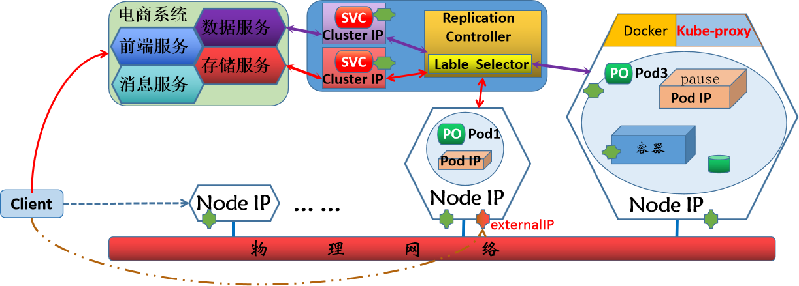
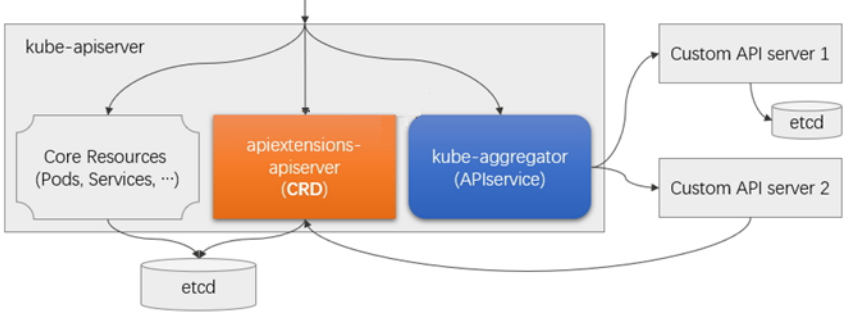
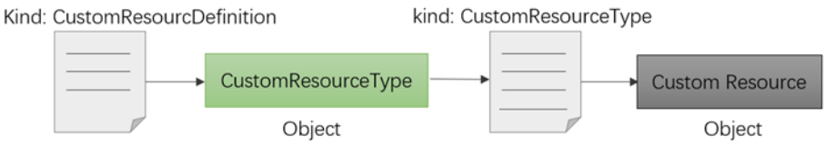
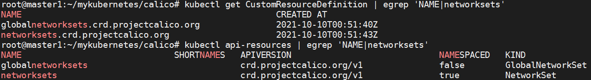
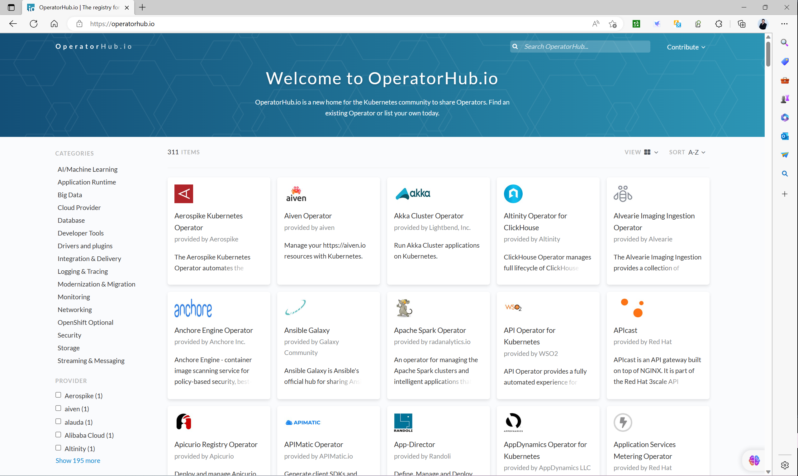
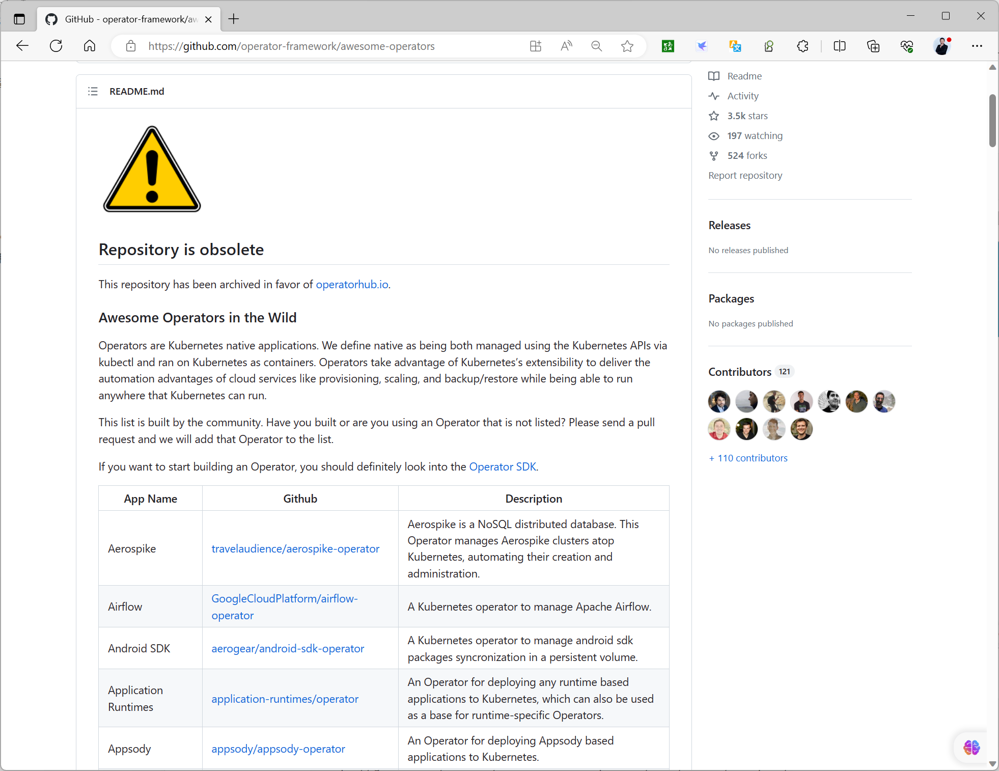
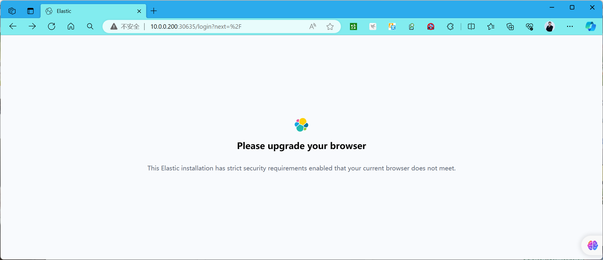
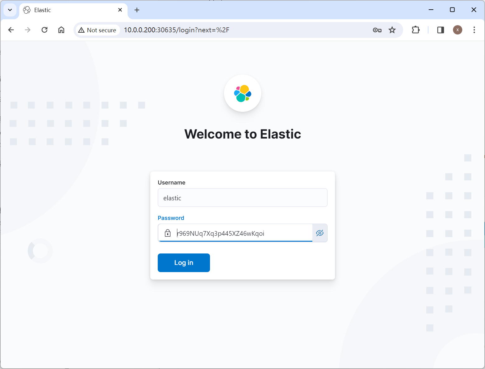
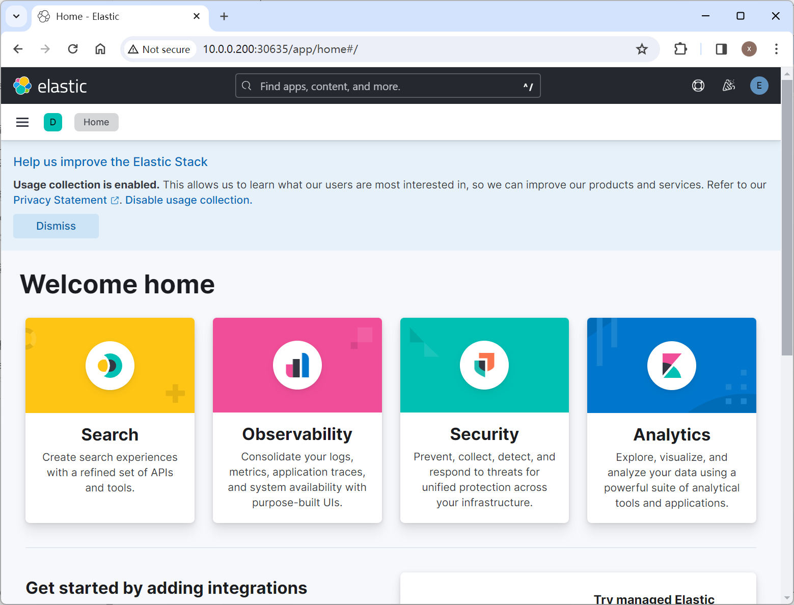
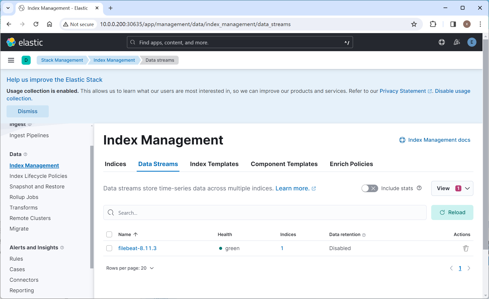

[← 返回 Kubernetes 目录]({{ '/subjects/Kubernetes/' | relative_url }})



# 26 CRD 与 Operator

上一篇看到 StatefulSet 只保证稳定身份与卷关联，却不知道怎样为 MySQL 选主、给 Redis 迁槽或让 Elasticsearch 安全滚动升级。本篇区分 **CRD 扩展 API 数据模型** 与 **Operator 控制器执行应用逻辑**，再用 ECK、Prometheus Operator 和 Nacos Operator 观察两者如何配合。

## 1 CRD：给 Kubernetes API 增加类型

Kubernetes 内置 Pod、Service 等通用对象。若某个业务概念无法清晰表达为这些对象，可通过 CustomResourceDefinition（CRD）注册新的 API 类型，例如 `Profile`。CRD 定义资源组、名称、作用域、版本和 OpenAPI 结构校验；创建 CRD 后，`kubectl` 可以查询、创建和更新对应对象。**CRD 本身只保存声明，不会自动启动应用或执行复制**。







`spec.group` 与 `spec.names` 决定访问路径，`spec.scope` 决定名称空间级或集群级，`spec.versions` 中只能有一个存储版本。`schema` 可以拒绝类型错误与缺失字段；`status` 子资源让控制器报告观察到的状态，而用户在 `spec` 表达期望状态。升级 CRD 版本时要规划兼容与转换，不应直接删掉仍在使用的旧版本。



下面是最小教学示例，注册名称空间级 `Profile`。它只保存非敏感配置；不要把密码写进 CR 的 `spec`，因为 API 响应、审计和备份都可能包含其内容。

```yaml
apiVersion: apiextensions.k8s.io/v1
kind: CustomResourceDefinition
metadata:
  name: profiles.demo.example.com
spec:
  group: demo.example.com
  scope: Namespaced
  names:
    plural: profiles
    singular: profile
    kind: Profile
  versions:
    - name: v1alpha1
      served: true
      storage: true
      schema:
        openAPIV3Schema:
          type: object
          properties:
            spec:
              type: object
              required: [displayName]
              properties:
                displayName:
                  type: string
                  minLength: 1
            status:
              type: object
              properties:
                observedGeneration:
                  type: integer
      subresources:
        status: {}
```

把上面保存为 `profile-crd.yaml` 后，可用 `kubectl apply -f profile-crd.yaml` 和 `kubectl wait --for=condition=Established crd/profiles.demo.example.com --timeout=60s` 注册类型。再创建 `apiVersion: demo.example.com/v1alpha1`、`kind: Profile` 的资源，并用 `kubectl get profiles` 查看。此时没有控制器，`status` 不会自动变化。删除 CRD 会一并删除该类型的自定义资源；共享集群中必须先盘点依赖和备份。

## 2 Operator：持续调谐期望状态

Operator 通常把 CRD、控制器、RBAC、ServiceAccount 和部署清单组合在一起。用户提交自定义资源后，控制器观察 `spec` 和集群当前状态，创建或修改 Deployment、StatefulSet、Service、Secret 等对象，再把结果写入 `status`。这称为调谐循环：即使控制器暂时重启，也应能从当前对象状态继续工作，而不是把一次事件当作唯一触发。

控制器应考虑重复执行与失败重试、拥有者引用和资源清理、终结器、权限最小化以及状态条件。Operator 把应用领域知识编码进去，但它的能力取决于具体实现；“安装了 Operator”不意味着它一定支持自动备份、无损升级或所有故障恢复。尤其要核对 Operator 版本、CRD 版本、受管应用版本与 Kubernetes 版本的兼容矩阵。





## 3 三类 Operator 案例

### 3.1 ECK：Elasticsearch、Kibana 与 Beats

Elastic Cloud on Kubernetes（ECK）安装后注册 Elasticsearch、Kibana、Beat 等自定义资源并运行控制器。用户创建 Elasticsearch CR，Operator 再创建 StatefulSet、Service、PVC 与所需的 TLS/凭据资源；Kibana CR 可通过 `elasticsearchRef` 引用集群。原案例还部署 Filebeat 收集日志，但采集目标、权限和索引策略需要独立设计。

部署前核对 ECK 与 Elasticsearch/Kibana 版本兼容、节点内存与磁盘、StorageClass、证书信任和资源配额。单节点教学配置只说明对象关系，不能推断具备高可用；生产集群应按节点角色与故障域规划副本和分片。生成的管理员 Secret 只在受控场景读取，不能粘贴到网页或长期保存在 shell 历史里。Kibana 对外暴露时还需独立配置 Ingress/TLS 与访问控制。

```bash
kubectl get crd | grep elasticsearch.k8s.elastic.co
kubectl get elasticsearch,kibana -A
kubectl get pods -n elastic-system
kubectl describe elasticsearch <集群名称> -n <命名空间>
```

检查 CR 的 `status`、事件、受管 Pod 和 PVC；若集群未 Ready，先区分驱动无法制备卷、资源不足、版本不兼容和证书连接失败。不要直接编辑 Operator 生成的 StatefulSet，下一次调谐可能把手动改动覆盖。











### 3.2 Prometheus Operator：让监控配置成为资源

Prometheus Operator 常管理 `Prometheus`、`Alertmanager`、`ServiceMonitor`、`PodMonitor` 和 `PrometheusRule` 等资源。它把“采集哪些目标、用哪些规则、如何运行 Prometheus”转成 API 对象。ServiceMonitor 的选择器匹配 Service 的标签，`endpoints.port` 对应 **Service 端口的名称**；资源存在而目标页没有 Target，常见原因是标签、命名空间选择器或端口名不匹配。

```yaml
apiVersion: monitoring.coreos.com/v1
kind: ServiceMonitor
metadata:
  name: app-metrics
  labels:
    release: monitoring
spec:
  selector:
    matchLabels:
      app: my-service
  endpoints:
    - port: metrics
      path: /metrics
```

上例只有在对应 Service、Prometheus CR 的 `serviceMonitorSelector` 与命名空间选择器都匹配时才会被采集。具体安装、告警与存储请衔接 Prometheus 专题，避免把“CR 创建成功”误当作采集成功。

### 3.3 Nacos Operator：区分安装清单与控制器

直接应用 Nacos StatefulSet/Service 清单，只是把资源放进集群；Nacos Operator 则通过自定义资源和控制循环管理 Nacos 实例。比较两者时，应看 Operator 是否真正覆盖持久化、外部 MySQL、成员发现、认证、扩缩容和升级；不能只看仓库名称或演示命令。不同社区项目的 CRD 字段可能不兼容，应固定项目版本并核对维护状态，不要把旧教程中的 Nacos CR 粘贴到另一套 Operator。

验证顺序是：CRD 已注册 → 控制器 Pod Ready → Nacos CR 状态正常 → StatefulSet/Service/PVC 成功 → Nacos API 与实际配置读写正常。若数据库配置或认证 Secret 不正确，StatefulSet Pod 即使 Running 也未必能提供服务。

## 4 评估与排障

部署 Operator 前，先评估维护活跃度、兼容矩阵、升级路径、RBAC 权限、CRD 删除影响、备份与恢复能力。运行中先看自定义资源 `status.conditions` 和事件，再看控制器日志、它生成的工作负载与 PVC；不要只看 Operator Pod 是否 Running。变更 CRD schema 或 Operator 版本时，先备份现有 CR，按官方迁移步骤升级，避免新控制器无法读取旧对象。

Operator 让重复运维动作自动化，仍需团队理解其控制范围与故障边界。自定义资源中的期望状态、Operator 的调谐结果和真实业务健康，三者都要验证。



<nav class="article-end" aria-label="章节导航">
  <a href="{{ '/subjects/Kubernetes/25-statefulset.html' | relative_url }}">← 上一篇：StatefulSet 与有状态应用</a>
  <a href="{{ '/subjects/Kubernetes/' | relative_url }}">返回 Kubernetes 目录</a>
  <a href="{{ '/subjects/Kubernetes/27-helm-basics.html' | relative_url }}">下一篇：Helm 基础 →</a>
</nav>
