[← 返回 Kubernetes 目录]({{ '/subjects/Kubernetes/' | relative_url }})



# 27 Helm 基础、部署与命令

直接维护 Deployment、Service、Ingress、ConfigMap 等多份 YAML，在只有一个应用、一个环境时尚可管理；当同一应用要部署到开发、预发布和生产环境时，清单复制和手工替换很容易产生漂移。Helm 将有关联的资源组织为 **Chart**，用模板与值文件配置环境，再以 **Release** 记录每次安装或升级。

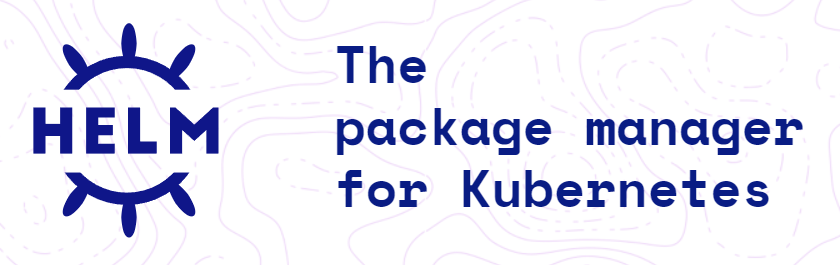

## 27.1 理解 Chart、Release 与 Repository

- **Chart**：有约定目录结构的应用包，包含 `Chart.yaml`、默认 `values.yaml`、`templates/` 和可选依赖；它通常不包含容器镜像。
- **Values**：渲染模板的输入。默认值可由 `-f custom-values.yaml` 或 `--set key=value` 覆盖；涉及密码时优先引用已有 Secret，不要把真实密码放进公开仓库。
- **Release**：一个 Chart 在某个名称空间中的已安装实例。安装同一 Chart 两次可产生两个 Release；升级和回滚形成多个修订号。
- **Repository**：Chart 的发布源。传统 Helm 仓库使用索引文件，OCI 仓库使用镜像仓库协议；Artifact Hub 是多个发布方的检索入口，不是一个统一的“官方 Chart 仓库”。

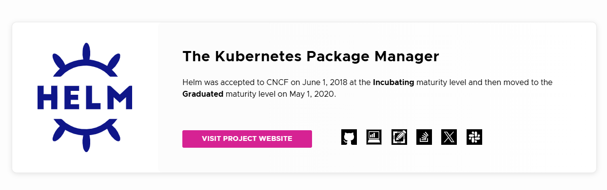

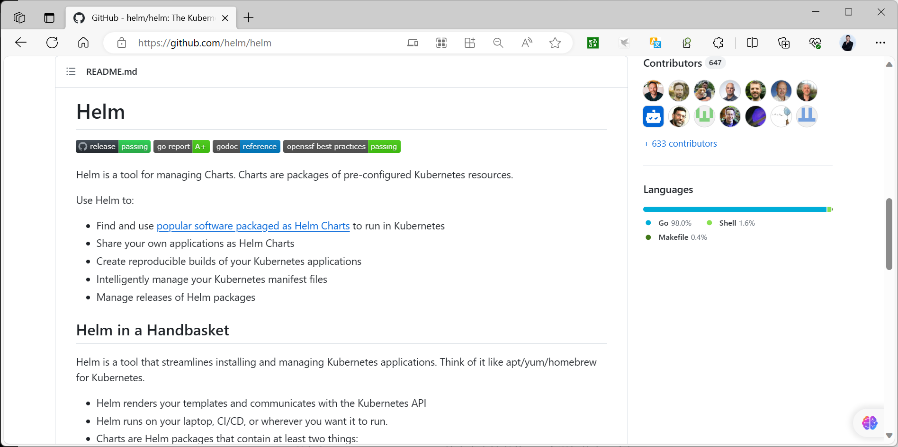

Helm 3 客户端通过 kubeconfig 直接与 Kubernetes API Server 通信。Helm 2 使用的 Tiller 服务端已移除；不要将旧教程中安装 Tiller、为其绑定广泛 ClusterRole 的步骤搬到 Helm 3。Helm 自身不提高工作负载的权限安全性：渲染结果仍受当前操作者的 Kubernetes RBAC 与准入策略约束。

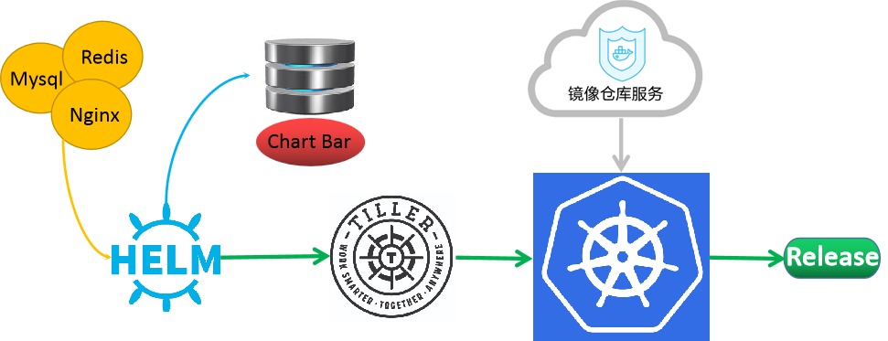

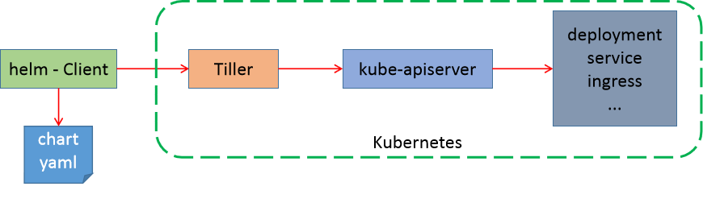

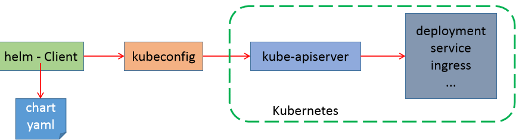

## 27.2 安装客户端并检查环境

从 [Helm 官方文档](https://helm.sh/docs/intro/install/) 选择当前操作系统适用的包管理器或已校验的二进制包安装 Helm。安装后先检查版本、当前 kubeconfig 上下文和权限，再管理 Release：

```bash
helm version
kubectl config current-context
kubectl auth can-i create deployments -n default
helm env
```

`helm env` 显示本地缓存和配置目录，不表示已经连接到集群。不同操作系统的路径可能不同。Chart 下载、模板渲染可以离线做部分检查，但安装和升级需要 API Server 可达。

## 27.3 查找并审查 Chart

先从应用项目文档或 Artifact Hub 确认**发布者、仓库、Chart 版本、应用版本及维护状态**。示例以项目当前仍提供的仓库为前提；实际安装前应核对最新地址，不使用历史镜像站的 HTTP 地址作为默认来源。

```bash
helm repo add example https://charts.example.test/
helm repo update
helm repo list
helm search repo example/myapp --versions
helm show chart example/myapp --version "$CHART_VERSION"
helm show values example/myapp --version "$CHART_VERSION" > default-values.yaml
```

`helm search repo` 搜索已添加的仓库；`helm search hub` 搜索 Artifact Hub；对于 OCI Chart，则使用 `oci://` 地址并按版本拉取。Chart 版本与容器镜像版本是两套独立标识，不要只看 Chart 的发布时间推断实际运行镜像。

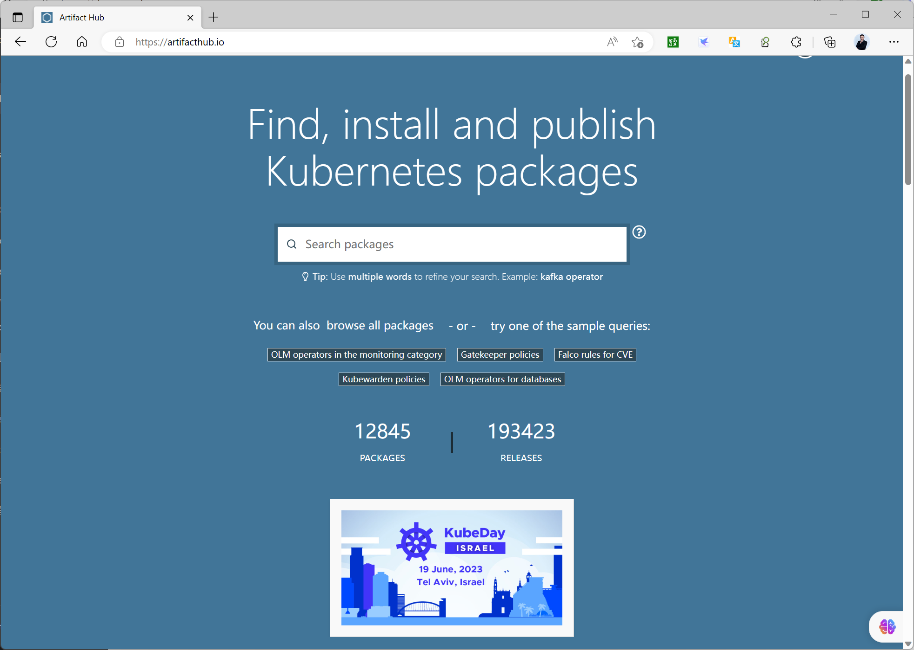

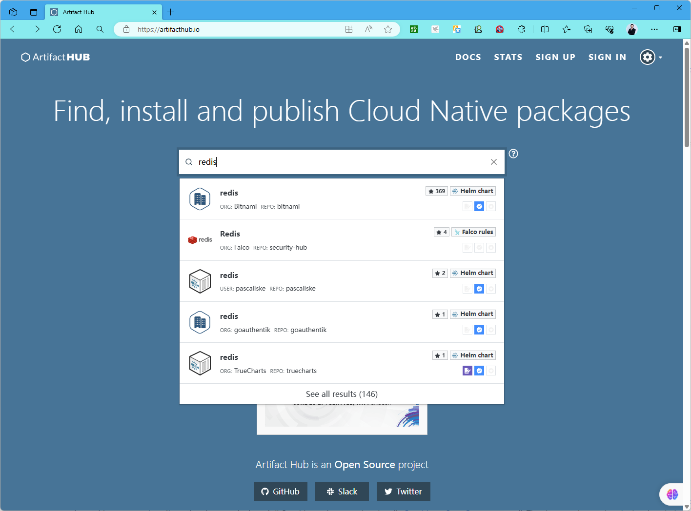

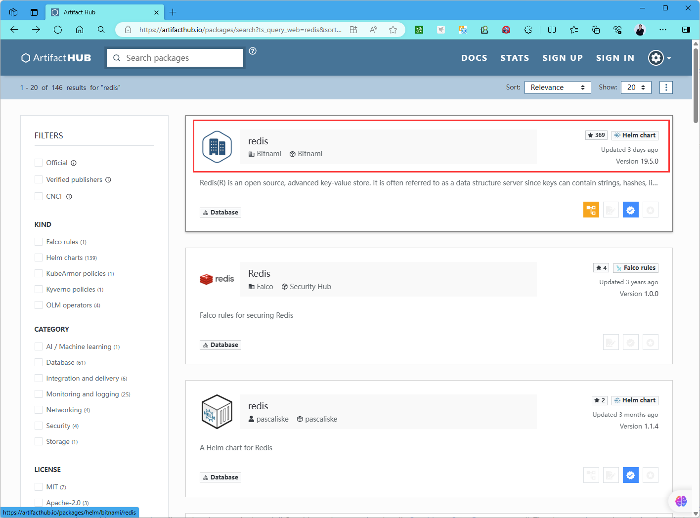

## 27.4 从渲染到部署

把业务配置写入 `myapp-values.yaml`。第一次安装前先运行 `helm template` 阅读渲染出的 Deployment、Service、PVC 与 Ingress，确认镜像、存储类、名称空间、Service selector 和敏感字段；`helm lint` 仅做 Chart 静态检查，不能证明应用可用。

```bash
helm pull example/myapp --version "$CHART_VERSION" --untar
helm lint ./myapp -f myapp-values.yaml
helm template myapp ./myapp -f myapp-values.yaml \
  --namespace demo > rendered.yaml
helm upgrade --install myapp ./myapp -f myapp-values.yaml \
  --namespace demo --create-namespace --wait
kubectl -n demo get pods,svc,pvc,ingress
helm -n demo status myapp
```

`--create-namespace` 只在目标名称空间不存在时创建它；Chart 模板中的资源仍须正确指定作用域。`--wait` 等待支持的资源就绪，遇到数据库初始化或外部服务依赖时还应执行真实读写测试。

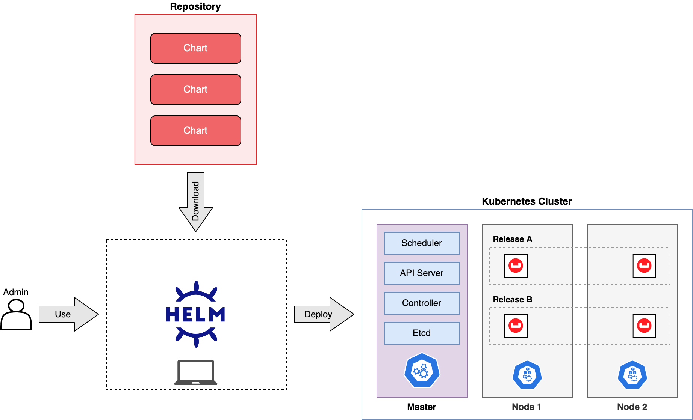

## 27.5 升级、回滚与清理

`helm upgrade` 生成新修订，`helm history` 查看修订历史。回滚到旧修订会再生成一次**新的**修订；它回滚的是 Kubernetes 资源声明，不会自动逆转数据库 schema 或 PVC 中的数据。安装失败时先看 `helm status`、Pod 事件和控制器日志，再决定修正值文件或回滚。

```bash
helm -n demo get values myapp
helm -n demo history myapp
helm upgrade myapp ./myapp -f myapp-values.yaml --namespace demo --wait
helm -n demo rollback myapp 1 --wait
helm -n demo uninstall myapp
```

若想自动生成 Release 名，可在安装时使用 `helm install ./myapp --generate-name`；但可预测的名称更便于 CI/CD、告警和日常排错。卸载前核对 PVC、PV 回收策略、Hook 创建的资源和需要保留的数据。

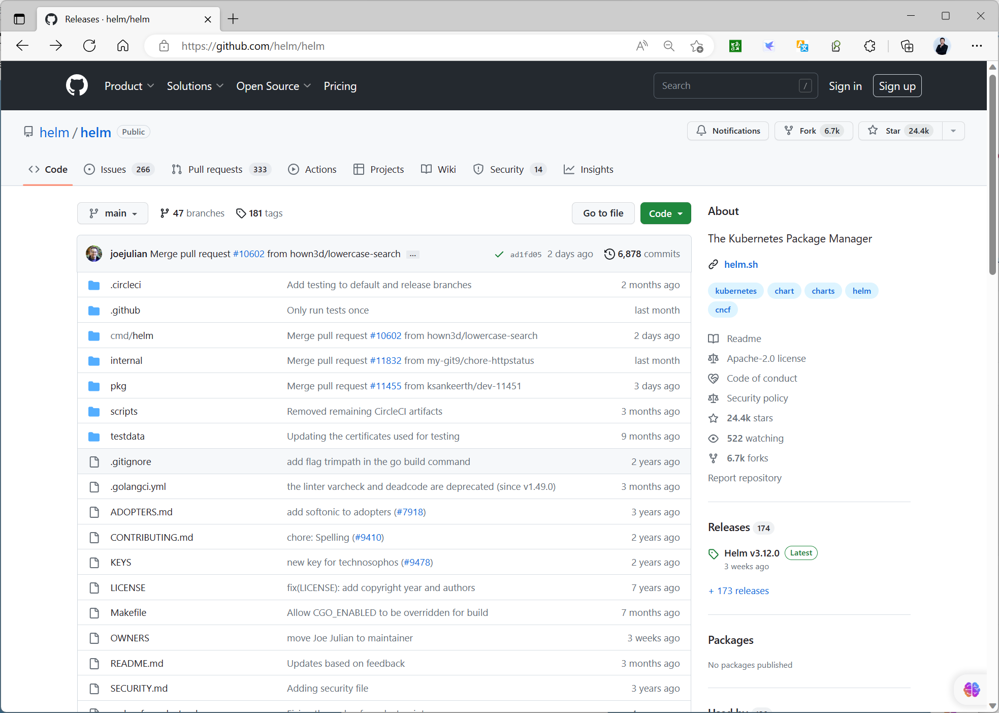

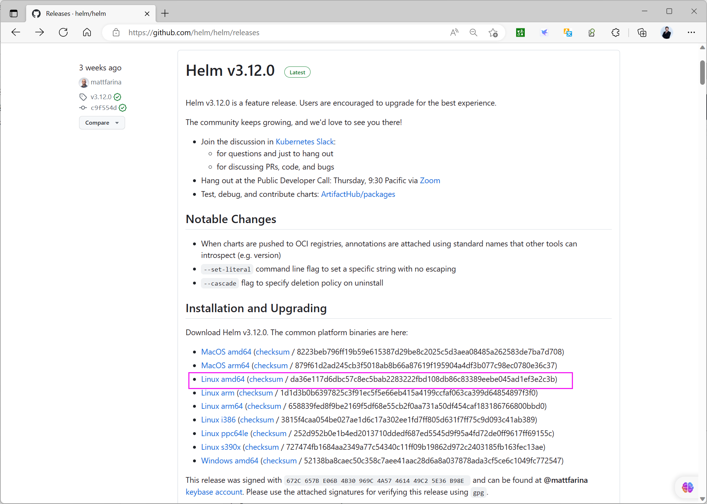

下一章将把这些命令应用于数据库、博客、镜像仓库和监控系统；第 29 章再从零编写模板。



<nav class="article-end" aria-label="章节导航">
  <a href="{{ '/subjects/Kubernetes/26-crd-operator.html' | relative_url }}">← 上一章：CRD 与 Operator</a>
  <a href="{{ '/subjects/Kubernetes/' | relative_url }}">返回 Kubernetes 目录</a>
  <a href="{{ '/subjects/Kubernetes/28-helm-cases.html' | relative_url }}">下一章：Helm 应用部署案例 →</a>
</nav>
