[← 返回 Kubernetes 目录]({{ '/subjects/Kubernetes/' | relative_url }})



# 27 Helm 基础、部署与命令

# 1 Helm 说明和部署

## 1.1 Helm 说明

### 1.1.1 Helm 介绍

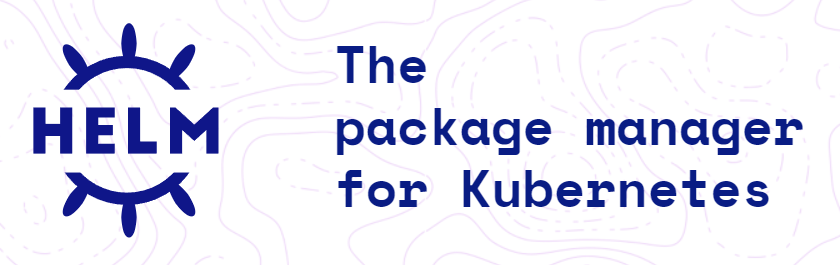

#### 1.1.1.1 传统的软件管理机制

传统的软件安装基于编译安装方式非常繁琐，所以会使用包管理方式简化软件安装的过程。

包管理器：

deb，dpkg rpm, rpm

程序包仓库：维护有仓库内部各程序文件元数据，其中包含了包依赖关系。

前端工具：客户端

yum, dnf, ...apt-get, ...

#### 1.1.1.2 将应用服务部署到 Kubernetes 集群的传统流程

拉取源代码打包编译构建容器的镜像和上传到Harbor准备一堆相关部署资源清单的 yaml 文件(如:deployment、statefulset、service、ingress、RABC等)kubectl apply 部署。

#### 1.1.1.3 传统方式部署引发的问题

随着资源引用的增多，需要维护大量的yaml文件。微服务场景下，每个微服务所需配置差别不大，但是众多的微服务的yaml文件无法高效复用。无法将相关yaml文件做为一个整体管理，并实现应用级别的升级和回滚等功能。无法根据一套yaml文件来创建多个环境，需要手动进行修改，尤其是微服务众多的情况，效率低下。

例如: 部署的环境都分为开发、预生产、生产环境，在开发这套环境部署完了，后面再部署到预生产和生产环境，还需要重新复制出两套配置文件，并手动修改才能完成。

#### 1.1.1.4 Kubernetes 的软件管理器 Helm 介绍
```text
Helm is a tool for managing Charts. Charts are packages of pre-configured
Kubernetes resources.
```

Kubernetes也提供了类似于包管理机制 Helm。Helm （船舵，掌舵 ）是一个用于简化和管理 Kubernetes 应用部署的包管理器。Helm 可以将部署应用所需要的所有配置清单文件YAML打包至一个Chart的包文件中，并使用一套资源实现定制发布到多套环境。Helm 允许用户进行定义、安装和升级 Kubernetes 应用程序的资源，称为 Helm Charts。Helm 不是 Kubernetes 官方提供的工具，但它是由 Kubernetes 社区维护和支持的。Helm 在社区中得到了广泛的支持和采用，并成为 Kubernetes 生态系统中流行的部署工具之一。

Helm 是CNCF在2020年已经毕业的项目。


- <https://www.cncf.io/projects/helm/>


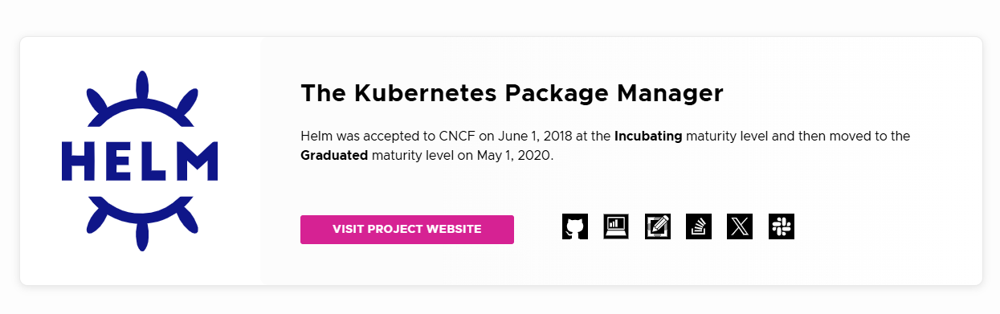

**Helm 官网**


- <https://helm.sh/>
- <https://github.com/helm/helm>


**Helm 文档**


- <https://helm.sh/zh/docs/>
- <https://helm.sh/zh/docs/intro/quickstart/>


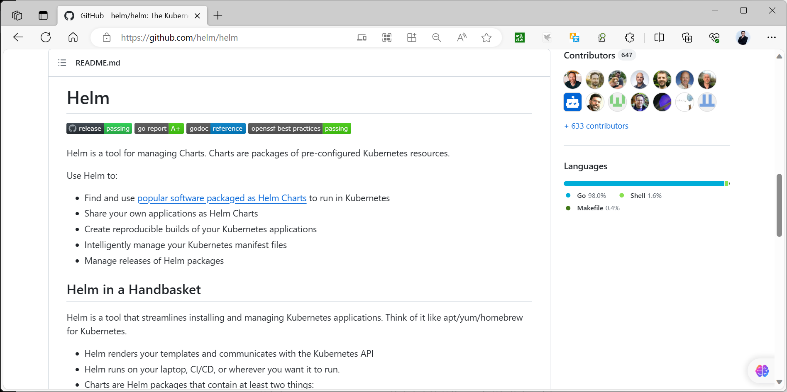

#### 1.1.1.5 Helm 重要特性

将各种资源文件按照分类进行打包，基于包的方式安装，更加方便提供template功能，可以基于同一套template文件，但对于不同环境可以赋予不同的值从而实现的灵活部署提供版本管理功能，比如，安装，删除，升级，回滚等。

#### 1.1.1.6 Helm 的历史

2015 年：Deis 团队开发了 Helm 1.0，最初称为 Kubernetes Deployment Manager。2016 年：Helm 1.0 与 Kubernetes 项目合并，并更名為 Helm 2.0。Helm 2.0 引入了 Tiller 服务器，它用于管理 Helm 圖表。2018 年：Helm 2.0 成为 CNCF 毕业項目。2019 年：Helm 3.0 发布，刪除了 Tiller 服务器，并引入了新的功能，例如 Chart templating 和Chart hooks。2020 年：Helm 3.0 成为 CNCF 毕业项目

### 1.1.2 Helm 相关概念

**Helm**：Helm的客户端工具，负责和API Server 通信。

Helm 和 kubectl 类似，也是Kubernetes API Server的命令行客户端工具。

支持kubeconfig认证文件

需要事先从仓库或本地加载到要使用目标Chart，并基于Chart完成应用管理Chart可缓存于Helm本地主机上。支持仓库管理和包管理的各类常用操作，例如Chart仓库的增、删、改、查，以及Chart包的制作、发布、搜索、下载等。

**Chart**：图表，打包文件，将所有相关的资源清单文件YAML的打包文件。

Chart  是一种打包格式，文件后缀为tar.gz或者 tgz，代表着可由Helm管理的有着特定格式的程序包，类似于RPM，DEB包格式。Chart 包含了应用所需的资源相关的各种yaml/json配置清单文件，比如：deployment,service等，但不包含容器的镜像。Chart 可以使用默认配置，或者定制用户自已的配置进行安装应用。Chart 中的资源配置文件通常以模板(go template)形式定义，在部署时，用户可通过向模板参数赋值实现定制化安装的目的。

Chart 中各模板参数通常也有默认值，这些默认值定义在Chart包里一个名为values.yml的文件中。

**Release**：表示基于chart部署的一个实例。通过chart部署的应用都会生成一个唯一的Release,即使同一个chart部署多次也会产生多个Release.将这些release应用部署完成后，也会记录部署的一个版本，维护了一个release版本状态,基于此可以实现版本回滚等操作。

**Repository**：chart包存放的仓库，Harobr可以实现，相当于APT和YUM仓库。

### 1.1.3 Helm 版本

#### 1.1.3.1 Helm-v2

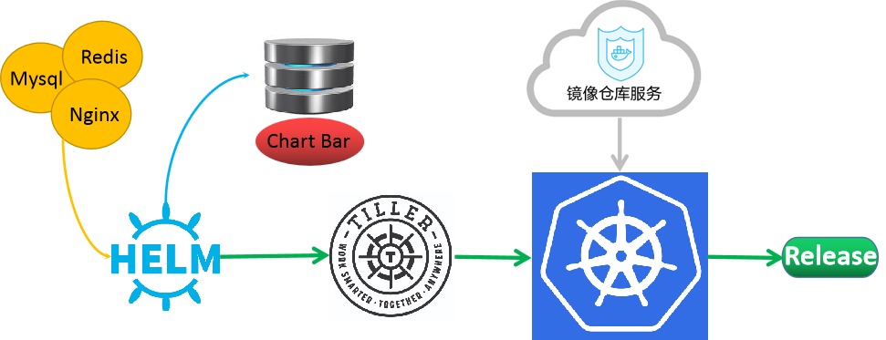

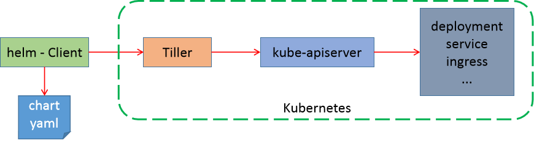

C/S 架构:

**Client**：helm client，通过gRPC协议和Tiller通信Server: 称为Tiller, 以Operator形式部署Kubernetes 集群内，表现为相应的一个Pod，还需要做RBAC的授权。

Tiller Server

Tiller Server是一个部署在Kubernetes集群内部的 server，其与 Helm client、Kubernetes API server进行交互。

Tiller server 主要负责如下：

监听来自 Helm client 的请求通过 chart 及其配置构建一次发布安装 chart 到Kubernetes集群，并跟踪随后的发布通过与Kubernetes交互升级或卸载 chart。

权限管理：

Helm 客户端配置 kubeconfig 文件，以便能够与 Kubernetes API 服务器通信。这个配置通常在~/.kube/config 文件中。加载认证配置文件的机制同kubectl Tiller 服务端需要在其运行的命名空间中具有足够的权限来管理 Kubernetes 资源。这通常通过创建一个服务账户（ServiceAccount）并绑定适当的角色（例如 ClusterRole 和ClusterRoleBinding）来实现。

#### 1.1.3.2 Helm-v3

2019年11月发布Helm-v3版本

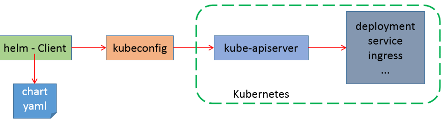

Helm 3 的变化

**Tiller 服务器端被废弃**

仅保留helm客户端，helm 通过 kubeconfig 认证到 API Server ， 加载认证配置文件的机制同kubectl。Helm3 的 Release 可以在不同名称空间重用，每个名称空间名称唯一即可,而Helm 2 中，Release的名称在整个 Kubernetes 集群中必须是唯一的。虽然 Helm 2 支持将 Release 安装到不同的命名空间中，但它们的名称仍然不能重复。支持将Chart 推送至Docker 镜像仓库。支持更强大的 Chart templating 语法，包括 Go 模板和新的 templating 函数。

这使得 Helm 3 更灵活，可以用于更复杂的部署场景。Helm 3 默认使用secrets来存储发行信息，提供了更高的安全性。Helm 2 默认使用configmaps存储发行信息。

**自动创建名称空间**

在不存在的命名空间中创建Release时，Helm 2可以自动创建名称空间。Helm 3遵循其他Kubermetes对象的行为，如果命名空间不存在则返回错误。Helm 3 可以通过 --create-namespace 选项当名称空间不存在时自动创建。不再需要requirements.yaml,依赖关系是直接在 Chart.yaml中定义。

命令变化

**删除 release 命令变化**

helm delete RELEASE_NAME --purge => helm uninstall RELEASE_NAME

**查看 chart 信息命令变化**

helm inspect RELEASE_NAME   => helm  show RELEASE_NAME

**拉取 chart包命令变化**

helm fetch CHART_NAME => helm pull CHART_NAME

**生成release的随机名**

helm-v3 必须指定release名，如果想使用随机名，必须通过--genrate-name 选项实现，helm-v2可以自动生成随机名。

helo install ./mychart  --generate-name

### 1.1.4 Chart 仓库

Chart 仓库：用于实现Chart包的集中存储和分发,类似于Docker仓库Harbor。

Chart 仓库：

常见的 Helm Chart 仓库：

- **官方仓库**：https://artifacthub.io/
- **微软仓库**（推荐使用）：http://mirror.azure.cn/kubernetes/charts/
- **阿里云仓库**：http://kubernetes.oss-cn-hangzhou.aliyuncs.com/charts
- **项目官方仓库**：由项目自身维护的 Chart 仓库。
- **Harbor 仓库**：新版支持基于 OCI:// 协议，将 Chart 存放在公共 Docker 镜像仓库。

Chart 官方仓库Hub:


- <https://artifacthub.io/>


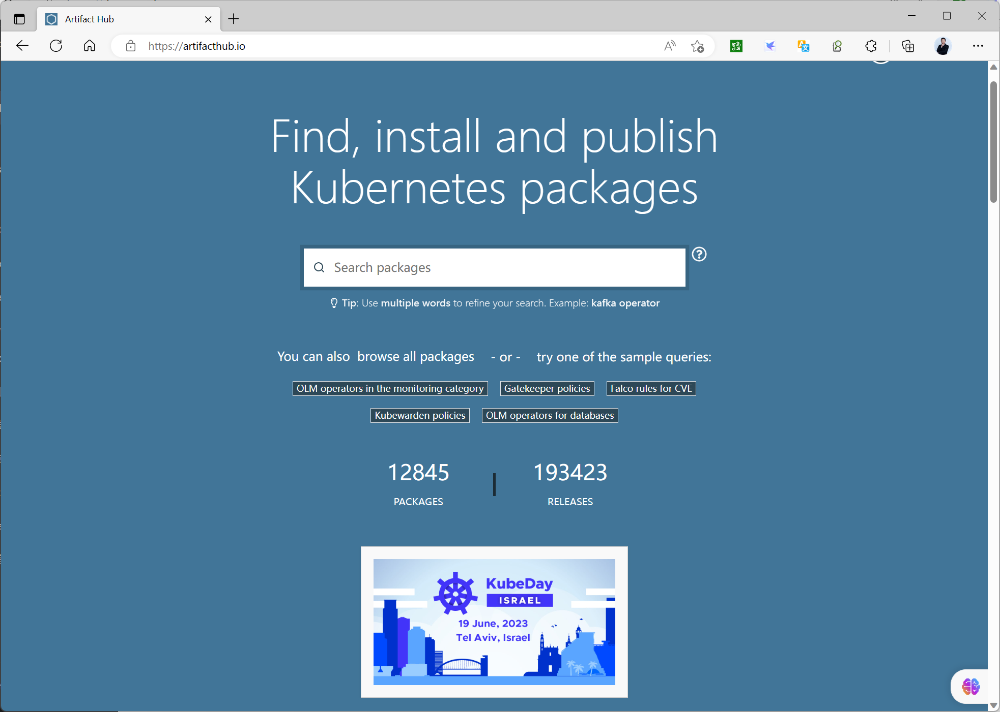

可以搜索需要的应用，如下示例：redis。

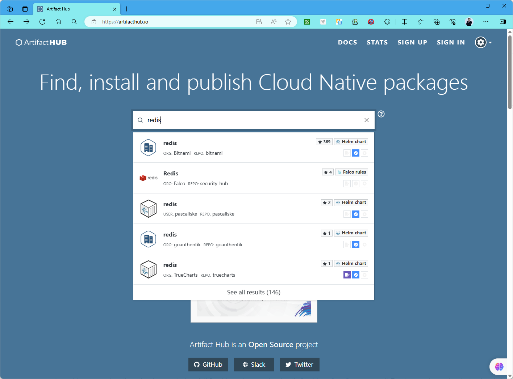

**选择点赞最多的chart**

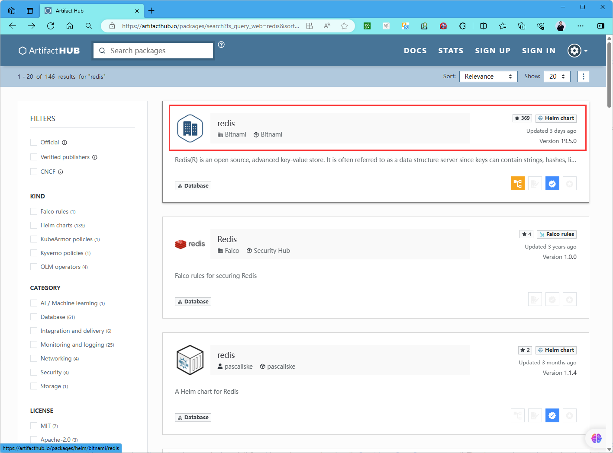

### 1.1.5 使用Helm部署应用流程

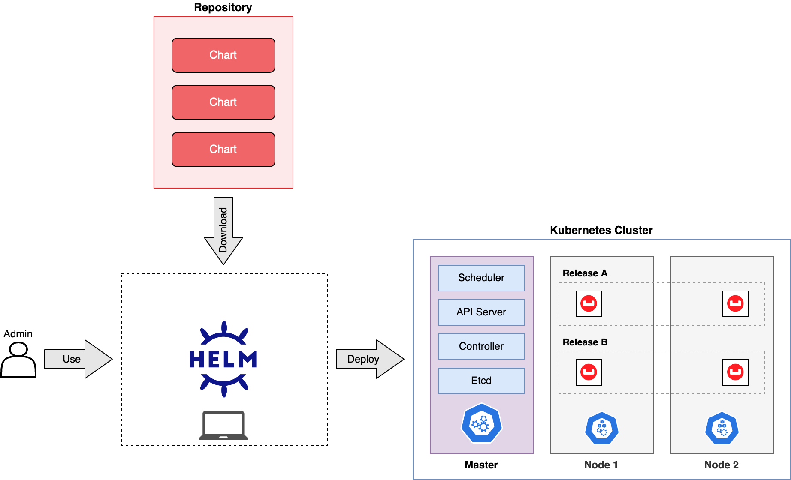

使用Helm部署应用流程

安装 helm 工具

查找合适的 chart 仓库

配置 chart 仓库(可选)

**定位 chart**

通过向Chart中模板文件中字串赋值完成其实例化，即模板渲染， 实例化的结果就可以部署到目标Kubernetes上。

模板字串的定制方式三种：

默认使用chart中的values.yaml中定义的默认值直接在helm install的命令行，通过--set选项进行自定义values.yaml，由helm install -f values.yaml 命令加载该文件。同一个chart 可以部署出来的多个不同的实例，每个实例称为一个release。Chart 和Release的关系，相当于OOP开发中的Class和对象的关系,相当于image和container。

应用release 安装命令：helm install

## 1.2 Helm 客户端安装

### 1.2.1 官方说明


- <https://helm.sh/docs/intro/install/>


**安装方法**
```text
From the Binary Releases
Every release of Helm provides binary releases for a variety of OSes. These
binary versions can be manually downloaded and installed.

Download your desired version
```


Unpack it (tar -zxvf helm-v3.0.0-linux-amd64.tar.gz) Find the helm binary in the unpacked directory, and move it to its desired destination (mv linux-amd64/helm /usr/local/bin/helm) From there, you should be able to run the client and add the stable repo: helm help.


Note: Helm automated tests are performed for Linux AMD64 only during CircleCi builds and releases. Testing of other OSes are the responsibility of the community requesting Helm for the OS in question.

```text
From Script
Helm now has an installer script that will automatically grab the latest version
of Helm and install it locally.
```


You can fetch that script, and then execute it locally. It's well documented so that you can read through it and understand what it is doing before you run it.

```bash
$ curl -fsSL -o get_helm.sh
https://raw.githubusercontent.com/helm/helm/main/scripts/get-helm-3
$ chmod 700 get_helm.sh
$ ./get_helm.sh
Yes, you can curl https://raw.githubusercontent.com/helm/helm/main/scripts/get-helm-3 | bash if you want to live on the edge.
```

**Helm 下载链接**


- <https://github.com/helm/helm/releases>


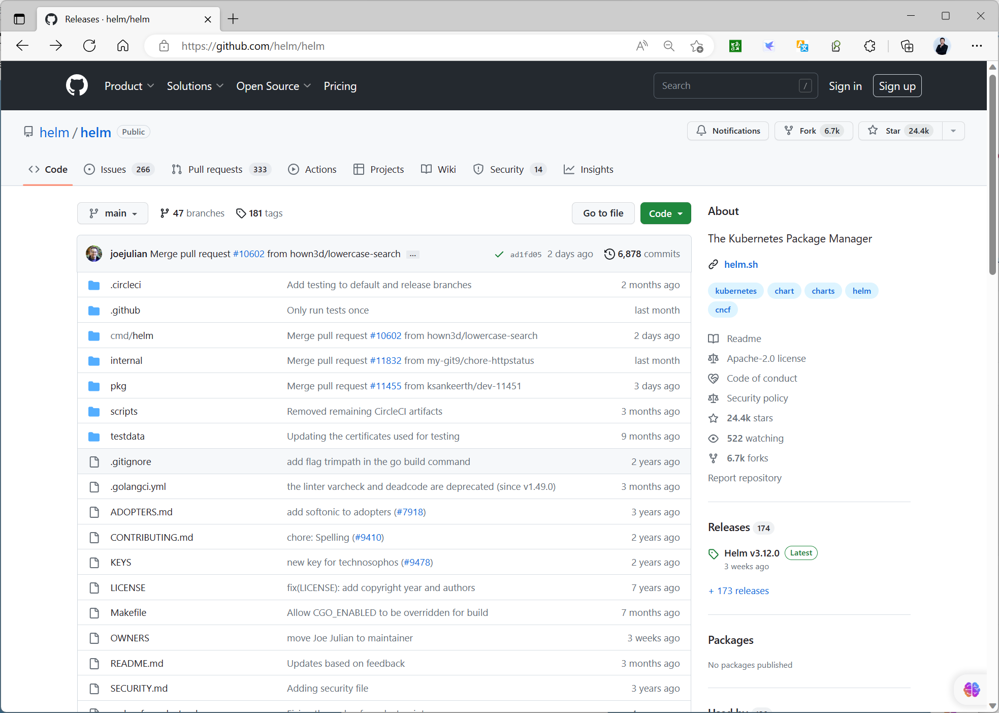

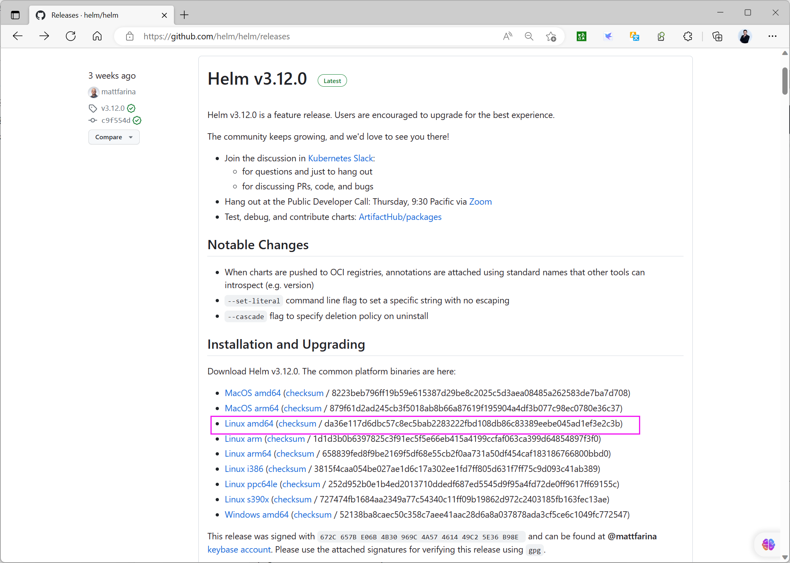

### 1.2.2 范例：二进制安装 Helm
```bash
#在kubernetes的管理节点部署
[root@master1 ~]#wget https://get.helm.sh/helm-v3.12.0-linux-amd64.tar.gz
[root@master1 ~]#tar xf helm-v3.12.0-linux-amd64.tar.gz -C /usr/local/
[root@master1 ~]#ls /usr/local/linux-amd64/
helm  LICENSE  README.md
[root@master1 ~]#ln -s /usr/local/linux-amd64/helm  /usr/local/bin/
[root@master1 ~]#ldd /usr/local/bin/helm
不是动态可执行文件

##helm-v3版本显示效果如下
[root@master1 ~]#helm  version
version.BuildInfo{Version:"v3.12.0",
GitCommit:"c9f554d75773799f72ceef38c51210f1842a1dea", GitTreeState:"clean",
GoVersion:"go1.20.3"}

#helm-v2版本显示效果如下
[root@master1 ~]#helm  version
Client:
&version.Version{semVer:"v2.9.1",GitCommit:"c9f554d75773799f72ceef38c51210f1842a
1dea"，GitTreeS
tate: "clean"}
Server:
&version.Version{SemVer:"v2.9.1",GitCommit:"c9f554d75773799f72ceef38c51210f1842a
1dea"，GitTreeS
tate: "clean"}

#Helm命令补会,重新登录生效
#方法1
[root@master1 ~]#echo 'source <(helm completion bash)' >> .bashrc && exit
#方法2

[root@master1 ~]#helm completion bash > /etc/bash_completion.d/helm  && exit
```

### 1.2.3 范例：官方脚本安装
```bash
[root@master1 ~]#curl -fsSL -o get_helm.sh
https://raw.githubusercontent.com/helm/helm/main/scripts/get-helm-3
[root@master1 ~]#chmod +x get_helm.sh
[root@master1 ~]#./get_helm.sh
Downloading https://get.helm.sh/helm-v3.12.2-linux-amd64.tar.gz
Verifying checksum... Done.
Preparing to install helm into /usr/local/bin
helm installed into /usr/local/bin/helm

[root@master1 ~]#helm version
version.BuildInfo{Version:"v3.12.2",
GitCommit:"1e210a2c8cc5117d1055bfaa5d40f51bbc2e345e", GitTreeState:"clean",
GoVersion:"go1.20.5"}
```

## 1.3 Helm 命令用法


- <https://v3.helm.sh/zh/docs/helm/>
- <https://docs.helm.sh/docs/helm/helm/>


### 1.3.1 Helm 命令用法说明

常用的 helm命令分类

**Repostory 管理**：repo命令，支持repository的add、list、remove、update和index等子命令。

**Chart 管理**：create、package、pull、push、dependency、search、show和verify等操作

**Release 管理**：install、upgrade、get、list、history、status、rollback和uninstall等操作

Helm常见子命令：


version #查看helm客户端版本 repo   #添加、列出、移除、更新和索引chart仓库，相当于apt/yum仓库,可用子命令:add、index、list、remove、update search #根据关键字搜索chart包 show:  #查看chart包的基本信息和详细信息，可用子命令:all、chart、readme、values pull  #从远程仓库中拉取chart包并解压到本地，通过选项 --untar 解压,默认不解压 create #创建一个chart包并指定chart包名字 install #通过chart包安装一个release实例 create #创建chart目录 list  #列出release实例名 upgrade #更新一个release实例 rollback #从之前版本回滚release实例，也可指定要回滚的版本号 uninstall #卸载一个release实例 history  #获取release历史，用法:helm history release实例名 package  # 将chart目录打包成chart存档文件.tgz中 get  #下载一个release,可用子命令:all、hooks、manifest、notes、values status #显示release实例的状态，显示已命名版本的状态


**Helm 常见命令用法**
```bash
#仓库管理
helm repo list   #列出已添加的仓库
helm repo add [REPO_NAME] [URL] #添加远程仓库并命名,如下示例
helm repo add bitnami https://charts.bitnami.com/bitnami
helm repo add ingress-nginx https://kubernetes.github.io/ingress-nginx
helm repo add myharbor https://harbor.bowen.com/chartrepo/myweb --username
admin --password 123456
helm repo remove [REPO1 [REPO2 ...]]   #删除仓库
helm repo update                #更新仓库,相当于apt update
helm search hub  [KEYWORD]      #从artifacthub网站搜索,无需配置本地仓库,相当于docker
search
helm search repo [KEYWORD]      #本地仓库搜索,需要配置本地仓库才能搜索,相当于apt search
helm search repo [KEYWORD]   --versions #显示所有版本

#chart管理
helm show chart [CHART]         #查看chart包的信息,类似于apt info
helm show values [CHART]        #查看chart包的values.yaml文件内容

#拉取chart到本地
helm pull repo/chartname        #下载charts的压缩包文件到当前目录下，表现为tgz文件,默认
最新版本，相当于wget
helm pull chart_URL             #直接下载，默认为.tgz文件
helm pull myrepo/myapp --version 1.2.3 --untar  #直接下载指定版本的chart包并解压缩

#创建chart目录结构
helm create NAME

#检查语法
helm lint [PATH]  #默认检查当前目录

#安装
helm install [NAME] [CHART] [--version <string> ]     #安装指定版本的chart
helm install [CHART] --generate-name               #自动生成  RELEASE_NAME
helm install --set KEY1=VALUE1 --set KEY2=VALUE2  RELEASE_NAME CHART ... #指定属性
实现定制配置
helm install -f values.yaml  RELEASE_NAME CHART.....                    #引用文件
实现定制配置
helm install --debug --dry-run RELEASE_NAME CHART                       #调试并不
执行,可以查看到执行的渲染结果

#删除
helm uninstall RELEASE_NAME                               #卸载RELEASE

#查看
helm list        #列出安装的release
helm status RELEASE_NAME                                  #查看RELEASE状态
helm get notes RELEASE_NAME -n NAMESPACE                  #查看RELEASE的说明
helm get values RELEASE_NAME -n NAMESPACE > values.yaml   #查看RELEASE的生成的值,可
以导出方便以后使用
helm get manifest RELEASE_NAME -n NAMESPACE               #查看RELEASE的生成的资源清
单文件

#升级和回滚

helm upgrade RELEASE_NAME CHART   --set key=newvalue     #通过指定新的key/value值实
现release 更新
helm upgrade RELEASE_NAME CHART -f mychart/values.yaml   #通过更新values.yaml 文件
中key/value值实现release 更新
helm rollback RELEASE_NAME [REVISION]    #release 回滚到指定版本，如果不指定版本，默认
回滚至上一个版本,而且只能回滚一个版本
helm history RELEASE_NAME                #查看Release的版本历史

#打包
helm package mychart/ #将指定目录的chart打包为.tgz到当前目录下
```

**helm install 说明**
```text
#helm install  --help
Usage:  helm install [NAME] [CHART] [flags]
```


#安装的CHART有六种形式 1. By chart reference: helm install mymaria example/mariadb  #在线安装,先通过helm repo add添加仓库，才能在线安装 2. By path to a packaged chart: helm install myweb ./nginx-1.2.3.tgz  #离线安装 3. By path to an unpacked chart directory: helm install myweb ./nginx #离线安装 4. By absolute URL: helm install myweb https://example.com/charts/nginx-1.2.3.tgz #在线安装 5. By chart reference and repo url: helm install --repo https://example.com/charts/ myweb nginx #在线安装 6. By OCI registries: helm install myweb --version 1.2.3 oci://example.com/charts/nginx #在线安装。


Helm相关环境变量：

名称描述

$HELM_CACHE_HOME设置一个存储缓存文件的可选位置。$HELM_CONFIG_HOME设置一个存储Helm配置的可选位置。$HELM_DATA_HOME设置一个存储Helm数据的可选位置。$HELM_DEBUG表示Helm是否在Debug模式系运行。

$HELM_DRIVER设置后台存储驱动，可选值包括：configmap,

secret, memory, sql

$HELM_DRIVER_SQL_CONNECTION_STRING设置SQL存储驱动使用连接字符串。$HELM_MAX_HISTORY设置发布历史记录的最大值。$HELM_NAMESPACE设置用于helm操作的命名空间。

$HELM_NO_PLUGINS禁用插件，HELM_NO_PLUGINS=1 表示禁用插

件

$HELM_PLUGINS设置插件目录路径

$HELM_REGISTRY_CONFIG设置注册配置文件的路径。

$HELM_REPOSITORY_CACHE设置仓库缓存目录路径

$HELM_REPOSITORY_CONFIG设置仓库文件的路径

$KUBECONFIG设置Kubernetes的可选配置文件(默认。

是"~/.kube/config")

$HELM_KUBEAPISERVER设置用于身份认证的Kubernetes API服务端。

$HELM_KUBECAFILE设置Kubernetes证书机构文件

$HELM_KUBEASGROUPS使用逗号分隔的列表设置用于模拟的组。$HELM_KUBEASUSER为操作设置要模拟的用户名。

$HELM_KUBECONTEXT设置kubeconfig上下文的名称

$HELM_KUBETOKEN设置用于身份验证的不记名KubeToken。$HELM_KUBEINSECURE_SKIP_TLS_VERIFY设置 Kubernetes API 服务的证书验证是否跳过。

（不安全）

$HELM_KUBETLS_SERVER_NAME设置用于验证 Kubernetes API 服务器证书的服。

务器名称

**$HELM_BURST_LIMIT**：当 Kubernetes 服务包含大量 CRD 时，设置默认的突发请求上限（默认 100，-1 表示禁用该限制）。

Helm 基于以下配置顺序存储缓存，配置和添加数据：

如果设置了 HELM*HOME 环境变量，则使用该变量否则，在支持XDG基本目录规范的系统上，会使用XDG变量当没有设置其他位置时，将根据操作系统使用默认位置。

默认情况下，默认目录取决于操作系统，默认值如下：

操作系统缓存路径配置路径数据路径

Linux$HOME/.cache/helm$HOME/.config/helm$HOME/.local/share/helm

macOS$HOME/Library/Caches/helm$HOME/Library/Preferences/helm$HOME/Library/helm

Windows%TEMP%\helm%APPDATA%\helm%APPDATA%\helm

范例: Helm 配置和缓存文件
```yaml
[root@master1 ~]#helm repo add  bitnami https://charts.bitnami.com/bitnami

helm repo list
#添加一个 Chart 仓库时，生成的仓库配置会存放在用户主目录下的
~/.config/helm/repositories.yaml 文件中。这个文件包含了所有添加的 Chart 仓库的信息，包括
仓库的名称和 URL。
[root@master1 ~]#tree .config/
.config/
└── helm
├── repositories.lock
└── repositories.yaml

1 directory, 2 files

#目录中创建一个对应的缓存文件，用于存储该仓库的索引数据。这个缓存文件会以 {repo-name}-
index.yaml 命名，例如 my-repo-index.yaml。
[root@master1 ~]#tree .cache/
.cache/
├── helm
│   └── repository
│       ├── bitnami-charts.txt
│       └── bitnami-index.yaml
└── motd.legal-displayed

2 directories, 3 files
[root@master1 ~]#tree .cache/helm/
.cache/helm/
└── repository
├── bitnami-charts.txt
└── bitnami-index.yaml

1 directory, 2 files

[root@master1 ~]#cat .config/helm/repositories.yaml
apiVersion: ""
generated: "0001-01-01T00:00:00Z"
repositories:
- caFile: ""
certFile: ""
insecure_skip_tls_verify: false
keyFile: ""
name: bitnami
pass_credentials_all: false
password: ""
url: https://charts.bitnami.com/bitnami
username: ""
```

范例：查看帮助
```bash
#查看helm命令用法
[root@master1 ~]#helm
The Kubernetes package manager

Common actions for Helm:

- helm search:    search for charts
- helm pull:      download a chart to your local directory to view
- helm install:   upload the chart to Kubernetes
- helm list:      list releases of charts

Environment variables:

| Name                               | Description
|
|------------------------------------|-------------------------------------------
--------------------------------------------------------|
| $HELM_CACHE_HOME                   | set an alternative location for storing
cached files.                                             |
| $HELM_CONFIG_HOME                  | set an alternative location for storing
Helm configuration.                                       |
| $HELM_DATA_HOME                    | set an alternative location for storing
Helm data.                                                |
| $HELM_DEBUG                        | indicate whether or not Helm is running
in Debug mode                                             |
| $HELM_DRIVER                       | set the backend storage driver. Values
are: configmap, secret, memory, sql.                       |
| $HELM_DRIVER_SQL_CONNECTION_STRING | set the connection string the SQL storage
driver should use.                                      |
| $HELM_MAX_HISTORY                  | set the maximum number of helm release
history.                                                   |
| $HELM_NAMESPACE                    | set the namespace used for the helm
operations.                                                   |
| $HELM_NO_PLUGINS                   | disable plugins. Set HELM_NO_PLUGINS=1 to
disable plugins.                                        |
| $HELM_PLUGINS                      | set the path to the plugins directory
|
| $HELM_REGISTRY_CONFIG              | set the path to the registry config file.
|
| $HELM_REPOSITORY_CACHE             | set the path to the repository cache
directory                                                    |
| $HELM_REPOSITORY_CONFIG            | set the path to the repositories file.
|
| $KUBECONFIG                        | set an alternative Kubernetes
configuration file (default "~/.kube/config")                       |
| $HELM_KUBEAPISERVER                | set the Kubernetes API Server Endpoint
for authentication                                         |
| $HELM_KUBECAFILE                   | set the Kubernetes certificate authority
file.                                                    |
| $HELM_KUBEASGROUPS                 | set the Groups to use for impersonation
using a comma-separated list.                             |
| $HELM_KUBEASUSER                   | set the Username to impersonate for the
operation.                                                |

| $HELM_KUBECONTEXT                  | set the name of the kubeconfig context.
|
| $HELM_KUBETOKEN                    | set the Bearer KubeToken used for
authentication.                                                 |
| $HELM_KUBEINSECURE_SKIP_TLS_VERIFY | indicate if the Kubernetes API server's
certificate validation should be skipped (insecure)       |
| $HELM_KUBETLS_SERVER_NAME          | set the server name used to validate the
Kubernetes API server certificate                        |
| $HELM_BURST_LIMIT                  | set the default burst limit in the case
the server contains many CRDs (default 100, -1 to disable)|

Helm stores cache, configuration, and data based on the following configuration
order:

- If a HELM_*_HOME environment variable is set, it will be used
- Otherwise, on systems supporting the XDG base directory specification, the XDG
variables will be used
- When no other location is set a default location will be used based on the
operating system

By default, the default directories depend on the Operating System. The defaults
are listed below:

| Operating System | Cache Path                | Configuration Path             |
Data Path               |
|------------------|---------------------------|--------------------------------
|-------------------------|
| Linux            | $HOME/.cache/helm         | $HOME/.config/helm
| $HOME/.local/share/helm |
| macOS            | $HOME/Library/Caches/helm | $HOME/Library/Preferences/helm
| $HOME/Library/helm      |
| Windows          | %TEMP%\helm               | %APPDATA%\helm                 |
%APPDATA%\helm          |

Usage:
helm [command]

Available Commands:
completion  generate autocompletion scripts for the specified shell
create      create a new chart with the given name
dependency  manage a chart's dependencies
env         helm client environment information
get         download extended information of a named release
help        Help about any command
history     fetch release history
install     install a chart
lint        examine a chart for possible issues
list        list releases
package     package a chart directory into a chart archive
plugin      install, list, or uninstall Helm plugins
pull        download a chart from a repository and (optionally) unpack it in
local directory
push        push a chart to remote
registry    login to or logout from a registry
repo        add, list, remove, update, and index chart repositories
rollback    roll back a release to a previous revision
search      search for a keyword in charts
show        show information of a chart

status      display the status of the named release
template    locally render templates
test        run tests for a release
uninstall   uninstall a release
upgrade     upgrade a release
verify      verify that a chart at the given path has been signed and is valid
version     print the client version information
```


Flags:--burst-limit int                 client-side default throttling limit(default 100)--debug                           enable verbose output-h, --help                            help for helm--kube-apiserver string           the address and the port for the Kubernetes API server--kube-as-group stringArray       group to impersonate for the operation, this flag can be repeated to specify multiple groups.--kube-as-user string             username to impersonate for the operation--kube-ca-file string             the certificate authority file for the Kubernetes API server connection--kube-context string             name of the kubeconfig context to use--kube-insecure-skip-tls-verify   if true, the Kubernetes API server's certificate will not be checked for validity. This will make your HTTPS connections insecure--kube-tls-server-name string     server name to use for Kubernetes API server certificate validation. If it is not provided, the hostname used to contact the server is used--kube-token string               bearer token used for authentication--kubeconfig string               path to the kubeconfig file-n, --namespace string                namespace scope for this request--registry-config string          path to the registry config file(default "/root/.config/helm/registry/config.json")--repository-cache string         path to the file containing cached repository indexes (default "/root/.cache/helm/repository")--repository-config string        path to the file containing repository names and URLs (default "/root/.config/helm/repositories.yaml")

```bash
Use "helm [command] --help" for more information about a command.

#查看子命令用法
[root@master1 ~]#helm search --help
```


Search provides the ability to search for Helm charts in the various places they can be stored including the Artifact Hub and repositories you have added. Use search subcommands to search different locations for charts.

```text
Usage:
helm search [command]

Available Commands:
hub         search for charts in the Artifact Hub or your own hub instance
repo        search repositories for a keyword in charts

Flags:
-h, --help   help for search
```


Global Flags:--burst-limit int                 client-side default throttling limit(default 100)--debug                           enable verbose output--kube-apiserver string           the address and the port for the Kubernetes API server--kube-as-group stringArray       group to impersonate for the operation, this flag can be repeated to specify multiple groups.--kube-as-user string             username to impersonate for the operation--kube-ca-file string             the certificate authority file for the Kubernetes API server connection--kube-context string             name of the kubeconfig context to use--kube-insecure-skip-tls-verify   if true, the Kubernetes API server's certificate will not be checked for validity. This will make your HTTPS connections insecure--kube-tls-server-name string     server name to use for Kubernetes API server certificate validation. If it is not provided, the hostname used to contact the server is used--kube-token string               bearer token used for authentication--kubeconfig string               path to the kubeconfig file-n, --namespace string                namespace scope for this request--registry-config string          path to the registry config file(default "/root/.config/helm/registry/config.json")--repository-cache string         path to the file containing cached repository indexes (default "/root/.cache/helm/repository")--repository-config string        path to the file containing repository names and URLs (default "/root/.config/helm/repositories.yaml")

```text
Use "helm search [command] --help" for more information about a command.
```

范例:  helm install 帮助
```bash
[root@master1 ~]#helm install --help

This command installs a chart archive.

The install argument must be a chart reference, a path to a packaged chart,
a path to an unpacked chart directory or a URL.
```


To override values in a chart, use either the '--values' flag and pass in a file or use the '--set' flag and pass configuration from the command line, to force a string value use '--set-string'. You can use '--set-file' to set individual values from a file when the value itself is too long for the command line or is dynamically generated. You can also use '--set-json' to set json values(scalars/objects/arrays) from the command line.

```bash
$ helm install -f myvalues.yaml myredis ./redis

or

$ helm install --set name=prod myredis ./redis

or

$ helm install --set-string long_int=1234567890 myredis ./redis

or

$ helm install --set-file my_script=dothings.sh myredis ./redis

or

$ helm install --set-json 'master.sidecars=
[{"name":"sidecar","image":"myImage","imagePullPolicy":"Always","ports":
[{"name":"portname","containerPort":1234}]}]' myredis ./redis
```


You can specify the '--values'/'-f' flag multiple times. The priority will be given to the last (right-most) file specified. For example, if both myvalues.yaml and override.yaml contained a key called 'Test', the value set in override.yaml would take precedence:

```bash
$ helm install -f myvalues.yaml -f override.yaml  myredis ./redis
```


You can specify the '--set' flag multiple times. The priority will be given to the last (right-most) set specified. For example, if both 'bar' and 'newbar' values are set for a key called 'foo', the 'newbar' value would take precedence:

```bash
$ helm install --set foo=bar --set foo=newbar  myredis ./redis

Similarly, in the following example 'foo' is set to '["four"]':

$ helm install --set-json='foo=["one", "two", "three"]' --set-json='foo=
["four"]' myredis ./redis

And in the following example, 'foo' is set to '{"key1":"value1","key2":"bar"}':

$ helm install --set-json='foo={"key1":"value1","key2":"value2"}' --set-
json='foo.key2="bar"' myredis ./redis

To check the generated manifests of a release without installing the chart,
the '--debug' and '--dry-run' flags can be combined.

If --verify is set, the chart MUST have a provenance file, and the provenance
file MUST pass all verification steps.

There are six different ways you can express the chart you want to install:
```


1. By chart reference: helm install mymaria example/mariadb 2. By path to a packaged chart: helm install myweb ./nginx-1.2.3.tgz 3. By path to an unpacked chart directory: helm install myweb ./nginx 4. By absolute URL: helm install myweb https://example.com/charts/nginx-1.2.3.tgz 5. By chart reference and repo url: helm install --repo https://example.com/charts/ myweb nginx 6. By OCI registries: helm install myweb --version 1.2.3 oci://example.com/charts/nginx

```text
CHART REFERENCES

A chart reference is a convenient way of referencing a chart in a chart
repository.
```


When you use a chart reference with a repo prefix ('example/mariadb'), Helm will look in the local configuration for a chart repository named 'example', and will then look for a chart in that repository whose name is 'mariadb'. It will install the latest stable version of that chart until you specify '--devel' flag to also include development version (alpha, beta, and release candidate releases), or supply a version number with the '--version' flag.

```text
To see the list of chart repositories, use 'helm repo list'. To search for
charts in a repository, use 'helm search'.

Usage:
helm install [NAME] [CHART] [flags]
```


Flags:--atomic                                     if set, the installation process deletes the installation on failure. The --wait flag will be set automatically if --atomic is used--ca-file string                             verify certificates of HTTPS-enabled servers using this CA bundle--cert-file string                           identify HTTPS client using this SSL certificate file--create-namespace                           create the release namespace if not present--dependency-update                          update dependencies if they are missing before installing the chart--description string                         add a custom description--devel                                      use development versions, too. Equivalent to version '>0.0.0-0'. If --version is set, this is ignored--disable-openapi-validation                 if set, the installation process will not validate rendered templates against the Kubernetes OpenAPI Schema--dry-run                                    simulate an install--enable-dns                                 enable DNS lookups when rendering templates--force                                      force resource updates through a replacement strategy-g, --generate-name                              generate the name (and omit the NAME parameter)-h, --help                                       help for install--insecure-skip-tls-verify                   skip tls certificate checks for the chart download--key-file string                            identify HTTPS client using this SSL key file--keyring string                             location of public keys used for verification (default "/root/.gnupg/pubring.gpg")--name-template string                       specify template used to name the release--no-hooks                                   prevent hooks from running during install-o, --output format                              prints the output in the specified format. Allowed values: table, json, yaml (default table)--pass-credentials                           pass credentials to all domains

```text
--password string                            chart repository password
where to locate the requested chart
--post-renderer postRendererString           the path to an executable to
be used for post rendering. If it exists in $PATH, the binary will be used,
otherwise it will try to look for the executable at the given path
--post-renderer-args postRendererArgsSlice   an argument to the post-
renderer (can specify multiple) (default [])
--render-subchart-notes                      if set, render subchart notes
along with the parent
--replace                                    re-use the given name, only
if that name is a deleted release which remains in the history. This is unsafe
in production
--repo string                                chart repository url where to
locate the requested chart
--set stringArray                            set values on the command
line (can specify multiple or separate values with commas: key1=val1,key2=val2)
--set-file stringArray                       set values from respective
files specified via the command line (can specify multiple or separate values
with commas: key1=path1,key2=path2)
--set-json stringArray                       set JSON values on the
command line (can specify multiple or separate values with commas:
key1=jsonval1,key2=jsonval2)
--set-literal stringArray                    set a literal STRING value on
the command line
--set-string stringArray                     set STRING values on the
command line (can specify multiple or separate values with commas:
key1=val1,key2=val2)
--skip-crds                                  if set, no CRDs will be
installed. By default, CRDs are installed if not already present
--timeout duration                           time to wait for any
individual Kubernetes operation (like Jobs for hooks) (default 5m0s)
--username string                            chart repository username
where to locate the requested chart
-f, --values strings                             specify values in a YAML file
or a URL (can specify multiple)
--verify                                     verify the package before
using it
--version string                             specify a version constraint
for the chart version to use. This constraint can be a specific tag (e.g. 1.1.1)
or it may reference a valid range (e.g. ^2.0.0). If this is not specified, the
latest version is used
--wait                                       if set, will wait until all
Pods, PVCs, Services, and minimum number of Pods of a Deployment, StatefulSet, or
ReplicaSet are in a ready state before marking the release as successful. It
will wait for as long as --timeout
--wait-for-jobs                              if set and --wait enabled,
will wait until all Jobs have been completed before marking the release as
successful. It will wait for as long as --timeout
```


Global Flags:--burst-limit int                 client-side default throttling limit(default 100)--debug                           enable verbose output--kube-apiserver string           the address and the port for the Kubernetes API server--kube-as-group stringArray       group to impersonate for the operation, this flag can be repeated to specify multiple groups.


--kube-as-user string             username to impersonate for the operation--kube-ca-file string             the certificate authority file for the Kubernetes API server connection--kube-context string             name of the kubeconfig context to use--kube-insecure-skip-tls-verify   if true, the Kubernetes API server's certificate will not be checked for validity. This will make your HTTPS connections insecure--kube-tls-server-name string     server name to use for Kubernetes API server certificate validation. If it is not provided, the hostname used to contact the server is used--kube-token string               bearer token used for authentication--kubeconfig string               path to the kubeconfig file-n, --namespace string                namespace scope for this request--registry-config string          path to the registry config file(default "/root/.config/helm/registry/config.json")--repository-cache string         path to the file containing cached repository indexes (default "/root/.cache/helm/repository")--repository-config string        path to the file containing repository names and URLs (default "/root/.config/helm/repositories.yaml")


### 1.3.2 Helm 命令范例

范例：添加仓库并下载MySQL chart
```bash
#默认没有仓库
[root@master1 ~]#helm repo list
Error: no repositories to show

#默认没有通过Helm安装的release
[root@master1 ~]#helm list
NAME    NAMESPACE   REVISION    UPDATED STATUS  CHART   APP VERSION

#从官方仓库搜索MySQL
[root@master1 ~]#helm search hub  mysql
URL                                                 CHART VERSION   APP VERSION
DESCRIPTION
https://artifacthub.io/packages/helm/choerodon/...  8.5.1           8.5.1
Chart to create a Highly available MySQL cluster
https://artifacthub.io/packages/helm/bitnami-ak...  9.4.3           8.0.31
MySQL is a fast, reliable, scalable, and easy t...
https://artifacthub.io/packages/helm/kubegems/m...  8.9.6           8.0.29
MySQL is a fast, reliable, scalable, and easy t...
https://artifacthub.io/packages/helm/stakater/m...  1.0.6
mysql chart that runs on kubernetes
https://artifacthub.io/packages/helm/bitnami/mysql  11.1.2          8.4.0
MySQL is a fast, reliable, scalable, and easy t...
https://artifacthub.io/packages/helm/kvalitetsi...  9.10.4          8.0.33
MySQL is a fast, reliable, scalable, and easy t...
https://artifacthub.io/packages/helm/saber/mysql    8.8.21          8.0.27
Chart to create a Highly available MySQL cluster
https://artifacthub.io/packages/helm/kubesphere...  1.0.2           5.7.33
High Availability MySQL Cluster, Open Source.
https://artifacthub.io/packages/helm/mysql/mysql    2.1.3           8.0.26
deploy mysql standalone or group-replication He...

#添加仓库

[root@master1 ~]#helm repo add bitnami https://charts.bitnami.com/bitnami
"bitnami" has been added to your repositories

#添加第二个仓库
[root@master1 ~]#helm repo add ingress-nginx
https://kubernetes.github.io/ingress-nginx
"ingress-nginx" has been added to your repositories

#查看本地配置的仓库
[root@master1 ~]#helm repo list
NAME            URL
bitnami         https://charts.bitnami.com/bitnami
ingress-nginx   https://kubernetes.github.io/ingress-nginx

#查看配置的仓库，但没有安装的release
[root@master1 ~]#helm list
NAME    NAMESPACE   REVISION    UPDATED STATUS  CHART   APP VERSION

[root@master1 ~]#helm search repo mysql
NAME                    CHART VERSION   APP VERSION DESCRIPTION
```


bitnami/mysql           9.10.1          8.0.33      MySQL is a fast, reliable, scalable, and easy t... bitnami/phpmyadmin      11.1.2          5.2.1       phpMyAdmin is a free software tool written in P... bitnami/mariadb         12.2.4          10.11.3     MariaDB is an open source, community-developed ... bitnami/mariadb-galera  8.2.4           10.11.3     MariaDB Galera is a multi-primary database clus...

```bash
#新版路径支持OCI
[root@master1 ~]#helm pull oci://registry-1.docker.io/bitnamicharts/mysql
Pulled: registry-1.docker.io/bitnamicharts/mysql:9.10.1
Digest: sha256:9649992e623df7d016a6a822ea034cf7b798ef9f9a5afc8e2ac3e6c9fea98a4c
#如果下载失败，需要科学上网
[root@master1 ~]#source set_http_proxy.sh start
[root@master1 ~]#ll -h mysql-14.0.3.tgz
-rw-r--r-- 1 root root 68K Aug 18 16:50 mysql-14.0.3.tgz

#旧版路径
[root@master1 ~]#cd /tmp
[root@master1 tmp]#helm pull bitnami/mysql

#比较是相同的
[root@master1 ~]#ll mysql-9.10.1.tgz /tmp/mysql-9.10.1.tgz
-rw-r--r-- 1 root root 44000  5月 28 21:35 mysql-9.10.1.tgz
-rw-r--r-- 1 root root 44000  5月 28 21:34 /tmp/mysql-9.10.1.tgz

[root@master1 ~]#ls mysql
Chart.lock  charts  Chart.yaml  README.md  templates  values.schema.json
values.yaml
[root@master1 ~]#tree mysql
mysql
├── Chart.lock
├── charts
│   └── common
│       ├── Chart.yaml

│       ├── README.md
│       ├── templates
│       │   ├── _affinities.tpl
│       │   ├── _capabilities.tpl
│       │   ├── _errors.tpl
│       │   ├── _images.tpl
│       │   ├── _ingress.tpl
│       │   ├── _labels.tpl
│       │   ├── _names.tpl
│       │   ├── _secrets.tpl
│       │   ├── _storage.tpl
│       │   ├── _tplvalues.tpl
│       │   ├── _utils.tpl
│       │   ├── validations
│       │   │   ├── _cassandra.tpl
│       │   │   ├── _mariadb.tpl
│       │   │   ├── _mongodb.tpl
│       │   │   ├── _mysql.tpl
│       │   │   ├── _postgresql.tpl
│       │   │   ├── _redis.tpl
│       │   │   └── _validations.tpl
│       │   └── _warnings.tpl
│       └── values.yaml
├── Chart.yaml
├── README.md
├── templates
│   ├── extra-list.yaml
│   ├── _helpers.tpl
│   ├── metrics-svc.yaml
│   ├── networkpolicy.yaml
│   ├── NOTES.txt
│   ├── primary
│   │   ├── configmap.yaml
│   │   ├── initialization-configmap.yaml
│   │   ├── pdb.yaml
│   │   ├── statefulset.yaml
│   │   ├── svc-headless.yaml
│   │   └── svc.yaml
│   ├── prometheusrule.yaml
│   ├── rolebinding.yaml
│   ├── role.yaml
│   ├── secondary
│   │   ├── configmap.yaml
│   │   ├── pdb.yaml
│   │   ├── statefulset.yaml
│   │   ├── svc-headless.yaml
│   │   └── svc.yaml
│   ├── secrets.yaml
│   ├── serviceaccount.yaml
│   └── servicemonitor.yaml
├── values.schema.json
└── values.yaml

7 directories, 49 files
```

范例：添加aliyun和azure仓库
```bash
[root@master1 ~]#helm repo add aliyun http://kubernetes.oss-cn-hangzhou.aliyuncs.com/charts
"aliyun" has been added to your repositories
[root@master1 ~]#helm repo list
NAME    URL
aliyun  http://kubernetes.oss-cn-hangzhou.aliyuncs.com/charts

[root@master1 ~]#helm search repo mysql
NAME                            CHART VERSION   APP VERSION DESCRIPTION
```


aliyun/mysql                    0.3.5                       Fast, reliable, scalable, and easy to use open-... aliyun/percona                  0.3.0                       free, fully compatible, enhanced, open source d... aliyun/percona-xtradb-cluster   0.0.2           5.7.19      free, fully compatible, enhanced, open source d... aliyun/gcloud-sqlproxy          0.2.3                       Google Cloud SQL Proxy aliyun/mariadb                  2.1.6           10.1.31     Fast, reliable, scalable, and easy to use open-...

```bash
[root@master1 ~]#helm repo add azure http://mirror.azure.cn/kubernetes/charts/
"azure" has been added to your repositories
[root@master1 ~]#helm repo list
NAME    URL
aliyun  http://kubernetes.oss-cn-hangzhou.aliyuncs.com/charts
azure   http://mirror.azure.cn/kubernetes/charts/
[root@master1 ~]#helm search repo mysql
NAME                            CHART VERSION   APP VERSION DESCRIPTION
```


aliyun/mysql                    0.3.5                       Fast, reliable, scalable, and easy to use open-... azure/mysql                     1.6.9           5.7.30      DEPRECATED - Fast, reliable, scalable, and easy... azure/mysqldump                 2.6.2           2.4.1       DEPRECATED! - A Helm chart to help backup MySQL... azure/prometheus-mysql-exporter 0.7.1           v0.11.0     DEPRECATED A Helm chart for prometheus mysql ex... aliyun/percona                  0.3.0                       free, fully compatible, enhanced, open source d... aliyun/percona-xtradb-cluster   0.0.2           5.7.19      free, fully compatible, enhanced, open source d... azure/percona                   1.2.3           5.7.26      DEPRECATED - free, fully compatible, enhanced, ... azure/percona-xtradb-cluster    1.0.8           5.7.19      DEPRECATED - free, fully compatible, enhanced, ... azure/phpmyadmin                4.3.5           5.0.1       DEPRECATED phpMyAdmin is an mysql administratio... aliyun/gcloud-sqlproxy          0.2.3                       Google Cloud SQL Proxy aliyun/mariadb                  2.1.6           10.1.31     Fast, reliable, scalable, and easy to use open-... azure/gcloud-sqlproxy           0.6.1           1.11        DEPRECATED Google Cloud SQL Proxy azure/mariadb                   7.3.14          10.3.22     DEPRECATED Fast, reliable, scalable, and easy t...

```bash
#删除仓库
[root@master1 ~]#helm repo remove  aliyun azure
"aliyun" has been removed from your repositories
"azure" has been removed from your repositories

[root@master1 ~]#helm repo list
Error: no repositories to show
```



<nav class="article-end" aria-label="章节导航">
  <a href="{{ '/subjects/Kubernetes/26-crd-operator.html' | relative_url }}">← 上一章：CRD 与 Operator</a>
  <a href="{{ '/subjects/Kubernetes/' | relative_url }}">返回 Kubernetes 目录</a>
  <a href="{{ '/subjects/Kubernetes/28-helm-cases.html' | relative_url }}">下一章：Helm 应用部署案例 →</a>
</nav>
