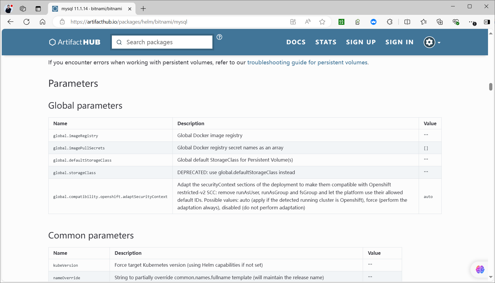
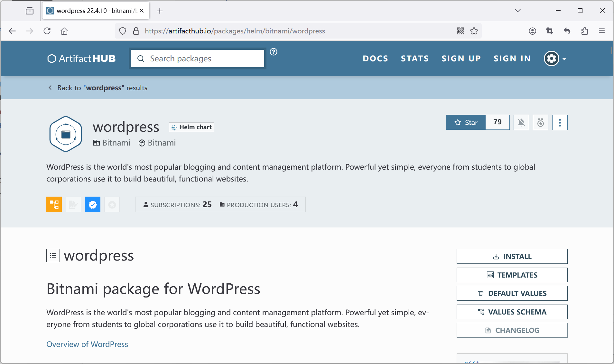
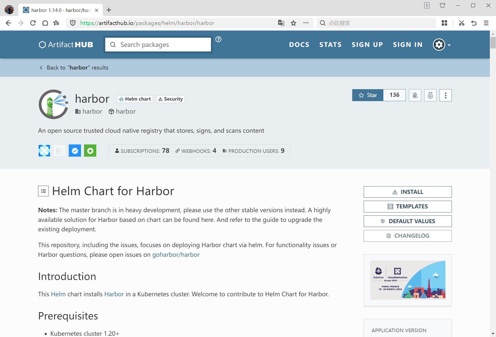
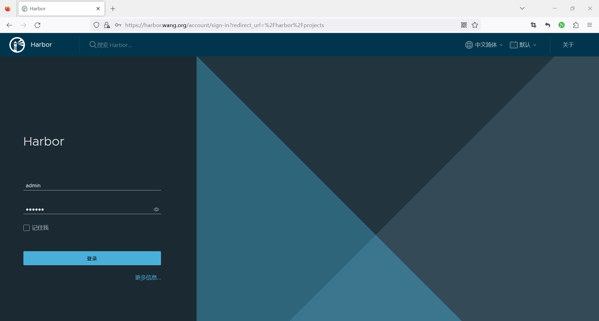
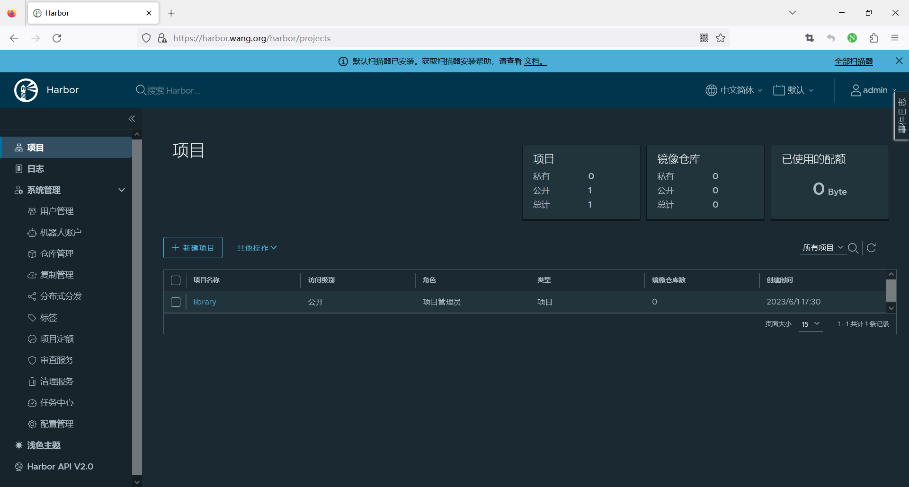

[← 返回 Kubernetes 目录]({{ '/subjects/Kubernetes/' | relative_url }})



# 28 Helm 应用部署案例

# 2 Helm 案例

## 2.1 案例：部署 MySQL


- <https://artifacthub.io/packages/helm/bitnami/mysql>




### 2.1.1 案例：添加仓库并使用默认配置安装 MySQL8.0
```bash
#可能需要科学上网
[root@master1 ~]#bash set_docker_proxy.sh start
[root@master1 ~]#helm repo add bitnami https://charts.bitnami.com/bitnami
"bitnami" has been added to your repositories

[root@master1 ~]#tree .config/ .cache/
.config/
└── helm
├── repositories.lock
└── repositories.yaml
.cache/
├── helm
│   └── repository
│       ├── bitnami-charts.txt
│       └── bitnami-index.yaml
└── motd.legal-displayed

2 directories, 3 files

[root@master1 ~]#helm repo list
NAME    URL
bitnami https://charts.bitnami.com/bitnami

[root@master1 ~]#helm search repo  mysql
NAME                    CHART VERSION   APP VERSION DESCRIPTION
```


bitnami/mysql           11.1.2          8.4.0       MySQL is a fast, reliable, scalable, and easy t... bitnami/phpmyadmin      16.2.5          5.2.1       phpMyAdmin is a free software tool written in P... bitnami/mariadb         18.2.2          11.3.2      MariaDB is an open source, community-developed ... bitnami/mariadb-galera  13.2.3          11.3.2      MariaDB Galera is a multi-primary database clus...

```bash
#查看版本
[root@master1 ~]#helm search repo  mysql --versions
NAME                    CHART VERSION   APP VERSION DESCRIPTION
```


bitnami/mysql           11.1.2          8.4.0       MySQL is a fast, reliable, scalable, and easy t... bitnami/mysql           11.1.1          8.4.0       MySQL is a fast, reliable, scalable, and easy t... bitnami/mysql           11.1.0          8.4.0       MySQL is a fast, reliable, scalable, and easy t... bitnami/mysql           11.0.0          8.4.0       MySQL is a fast, reliable, scalable, and easy t... bitnami/mysql           10.3.0          8.0.37      MySQL is a fast, reliable, scalable, and easy t... bitnami/mysql           10.2.4          8.0.37      MySQL is a fast, reliable, scalable, and easy t...

```bash
#查看
[root@master1 ~]#helm show values bitnami/mysql --version 10.3.0
# Copyright Broadcom, Inc. All Rights Reserved.
# SPDX-License-Identifier: APACHE-2.0

## @section Global parameters
## Global Docker image parameters
## Please, note that this will override the image parameters, including
dependencies, configured to use the global value
## Current available global Docker image parameters: imageRegistry,
imagePullSecrets and storageClass
##

## @param global.imageRegistry Global Docker image registry
## @param global.imagePullSecrets Global Docker registry secret names as an
array
## @param global.storageClass Global StorageClass for Persistent Volume(s)
##
global:
imageRegistry: ""
## E.g.
## imagePullSecrets:
##   - myRegistryKeySecretName
##
imagePullSecrets: []

........

[root@master1 ~]#helm show all bitnami/mysql --version 10.3.0|head
annotations:
category: Database
images: |
- name: mysql
image: docker.io/bitnami/mysql:8.0.37-debian-12-r2
#可修改为registry.cn-beijing.aliyuncs.com/bowen/bitnami-mysql:8.0.37-
debian-12-r
- name: mysqld-exporter
image: docker.io/bitnami/mysqld-exporter:0.15.1-debian-12-r16
- name: os-shell
image: docker.io/bitnami/os-shell:12-debian-12-r21
licenses: Apache-2.0

#安装时必须指定存储卷，否则会处于Pending状态
[root@master1 ~]#helm install mysql bitnami/mysql --version 10.3.0 --set
primary.persistence.storageClass=sc-nfs
#如果指定了默认的storageClass，可以不提定primary.persistence.storageClass=sc-nfs
[root@master1 ~]#helm install mysql bitnami/mysql --version 10.3.0

NAME: mysql
LAST DEPLOYED: Mon Jun 10 21:31:51 2024
NAMESPACE: default
STATUS: deployed
REVISION: 1
TEST SUITE: None
NOTES:
CHART NAME: mysql
CHART VERSION: 10.3.0
APP VERSION: 8.0.37

** Please be patient while the chart is being deployed **

Tip:

Watch the deployment status using the command: kubectl get pods -w --namespace
default

Services:

echo Primary: mysql.default.svc.cluster.local:3306

Execute the following to get the administrator credentials:

echo Username: root
MYSQL_ROOT_PASSWORD=$(kubectl get secret --namespace default mysql -o
jsonpath="{.data.mysql-root-password}" | base64 -d)

To connect to your database:

1. Run a pod that you can use as a client:

kubectl run mysql-client --rm --tty -i --restart='Never' --image
docker.io/bitnami/mysql:8.0.37-debian-12-r2 --namespace default --env
MYSQL_ROOT_PASSWORD=$MYSQL_ROOT_PASSWORD --command -- bash

2. To connect to primary service (read/write):

mysql -h mysql.default.svc.cluster.local -uroot -p"$MYSQL_ROOT_PASSWORD"
```


WARNING: There are "resources" sections in the chart not set. Using"resourcesPreset" is not recommended for production. For production installations, please set the following values according to your workload needs:- primary.resources- secondary.resources+info https://kubernetes.io/docs/concepts/configuration/manage-resources-containers/

```bash
#安装时必须指定存储卷，否则会处于Pending状态，如下状态
[root@master1 ~]#kubectl get pvc
NAME           STATUS    VOLUME   CAPACITY   ACCESS MODES   STORAGECLASS   AGE
data-mysql-0   Pending

#查看相关资源
[root@master1 ~]#kubectl get all
NAME                                          READY   STATUS    RESTARTS
AGE
pod/mysql-0                                   1/1     Running   0
6m29s
pod/nfs-client-provisioner-65fdb45b5f-hwzwl   1/1     Running   10 (95m ago)
22d

NAME                     TYPE        CLUSTER-IP     EXTERNAL-IP   PORT(S)    AGE
service/kubernetes       ClusterIP   10.96.0.1      <none>        443/TCP
463d
service/mysql            ClusterIP   10.99.25.136   <none>        3306/TCP
6m29s
service/mysql-headless   ClusterIP   None           <none>        3306/TCP
6m29s

NAME                                     READY   UP-TO-DATE   AVAILABLE   AGE
deployment.apps/nfs-client-provisioner   1/1     1            1           22d

NAME                                                DESIRED   CURRENT   READY
AGE
replicaset.apps/nfs-client-provisioner-65fdb45b5f   1         1         1
22d

NAME                     READY   AGE
statefulset.apps/mysql   1/1     6m29s

[root@master1 ~]#helm list
NAME    NAMESPACE   REVISION    UPDATED                                 STATUS
CHART           APP VERSION
mysql   default     1           2024-06-10 21:31:51.348395216 +0800 CST deployed
mysql-10.3.0    8.0.37

#查看Pod
[root@master1 ~]#kubectl get pod
NAME                                      READY   STATUS    RESTARTS       AGE
mysql-0                                   0/1     Running   0              37s

#查看PVC
[root@master1 ~]#kubectl get pvc
NAME           STATUS   VOLUME                                     CAPACITY
ACCESS MODES   STORAGECLASS   AGE
data-mysql-0   Bound    pvc-ed28d524-1715-4602-806e-2634c8f48a8c   8Gi        RWO
sc-nfs         7m44s
[root@master1 ~]#kubectl get pv
NAME     CAPACITY   ACCESS MODES   RECLAIM POLICY   STATUS   CLAIM
STORAGECLASS   REASON   AGE
pvc-ed28d524-1715-4602-806e-2634c8f48a8c  8Gi  RWO  Delete   Bound  default/data-
mysql-0   sc-nfs    7m49s

#查看输出信息
[root@master1 ~]#helm status mysql
NAME: mysql
LAST DEPLOYED: Mon Jun 10 21:31:51 2024
NAMESPACE: default
STATUS: deployed
REVISION: 1
TEST SUITE: None
NOTES:
CHART NAME: mysql
CHART VERSION: 10.3.0
APP VERSION: 8.0.37
.....

#获取root连接密码
[root@master1 ~]#MYSQL_ROOT_PASSWORD=$(kubectl get secret --namespace default
mysql -o jsonpath="{.data.mysql-root-password}" | base64 -d)

[root@master1 ~]#echo $MYSQL_ROOT_PASSWORD
j0i2WZtj6O

#创建临时Pod测试访问
[root@master1 ~]#kubectl run mysql-client --rm --tty -i --restart='Never' --image
docker.io/bitnami/mysql:8.0.37-debian-12-r2 --namespace default --env
MYSQL_ROOT_PASSWORD=$MYSQL_ROOT_PASSWORD --command -- bash
If you don't see a command prompt, try pressing enter.
I have no name!@mysql-client:/$ env
KUBERNETES_SERVICE_PORT_HTTPS=443
MYSQL_PORT=tcp://10.102.4.207:3306
MYSQL_PORT_3306_TCP_ADDR=10.102.4.207
KUBERNETES_SERVICE_PORT=443
MYSQL_PORT_3306_TCP_PORT=3306
HOSTNAME=mysql-client
MYSQL_PORT_3306_TCP=tcp://10.102.4.207:3306
PWD=/
OS_FLAVOUR=debian-12
MYSQL_ROOT_PASSWORD=j0i2WZtj6O
HOME=/
KUBERNETES_PORT_443_TCP=tcp://10.96.0.1:443
MYSQL_SERVICE_PORT_MYSQL=3306

TERM=xterm
MYSQL_SERVICE_PORT=3306
MYSQL_SERVICE_HOST=10.102.4.207
MYSQL_PORT_3306_TCP_PROTO=tcp
SHLVL=1
KUBERNETES_PORT_443_TCP_PROTO=tcp
BITNAMI_APP_NAME=mysql
KUBERNETES_PORT_443_TCP_ADDR=10.96.0.1
APP_VERSION=8.0.37
KUBERNETES_SERVICE_HOST=10.96.0.1
KUBERNETES_PORT=tcp://10.96.0.1:443
KUBERNETES_PORT_443_TCP_PORT=443
OS_NAME=linux
PATH=/opt/bitnami/common/bin:/opt/bitnami/mysql/bin:/opt/bitnami/mysql/sbin:/usr
/local/sbin:/usr/local/bin:/usr/sbin:/usr/bin:/sbin:/bin
OS_ARCH=amd64
_=/usr/bin/env

#连接MySQL
I have no name!@mysql-client:/$ mysql -h mysql.default.svc.cluster.local -uroot
-p"$MYSQL_ROOT_PASSWORD"
mysql: [Warning] Using a password on the command line interface can be insecure.
Welcome to the MySQL monitor.  Commands end with ; or \g.
Your MySQL connection id is 65
Server version: 8.0.37 Source distribution

Copyright (c) 2000, 2024, Oracle and/or its affiliates.

Oracle is a registered trademark of Oracle Corporation and/or its
affiliates. Other names may be trademarks of their respective
owners.

Type 'help;' or '\h' for help. Type '\c' to clear the current input statement.

mysql> show databases;
+--------------------+
| Database           |
+--------------------+
| information_schema |
| my_database        |
| mysql              |
| performance_schema |
| sys                |
+--------------------+
5 rows in set (0.00 sec)

mysql> status
--------------
mysql  Ver 8.0.37 for Linux on x86_64 (Source distribution)

Connection id:      65
Current database:
Current user:       root@10.244.2.86
SSL:            Cipher in use is TLS_AES_256_GCM_SHA384
Current pager:      stdout
Using outfile:      ''
Using delimiter:    ;
Server version:     8.0.37 Source distribution
```


Protocol version:   10 Connection:     mysql.default.svc.cluster.local via TCP/IP Server characterset:    utf8mb3 Db     characterset:    utf8mb3 Client characterset:    utf8mb4 Conn.  characterset:    utf8mb4 TCP port:       3306 Binary data as:     Hexadecimal Uptime:         5 min 53 sec

```bash
Threads: 2  Questions: 152  Slow queries: 0  Opens: 137  Flush tables: 3  Open
tables: 56  Queries per second avg: 0.430
--------------

#删除
[root@master1 ~]#helm uninstall mysql
release "mysql" uninstalled

[root@master1 ~]#helm list
NAME    NAMESPACE   REVISION    UPDATED STATUS  CHART   APP VERSION

[root@master1 ~]#kubectl get pvc
NAME           STATUS   VOLUME                                     CAPACITY
ACCESS MODES   STORAGECLASS   AGE
data-mysql-0   Bound    pvc-ed28d524-1715-4602-806e-2634c8f48a8c   8Gi        RWO
sc-nfs         9m30s

[root@master1 ~]#kubectl delete pvc data-mysql-0
persistentvolumeclaim "data-mysql-0" deleted

#sc存储还存在
[root@master1 ~]#ls /data/sc-nfs/
archived-default-data-mysql-0-pvc-ed28d524-1715-4602-806e-2634c8f48a8c

#清除sc数据
[root@master1 ~]#rm -rf /data/sc-nfs/*
```

### 2.1.2 案例：指定值文件values.yaml内容实现定制Release
```bash
[root@master1 ~]#helm show values bitnami/mysql --version 10.3.0 > values.yaml

#定制内容
[root@master1 ~]#vim  values.yaml
image:
registry: docker.io
repository: bitnami/mysql
tag: 8.0.37-debian-12-r2

auth:
rootPassword: "123456"
database: bowendb
username: bowen
password: "654321"

primary:

persistence:
storageClass: sc-nfs

persistence:
enabled: true
storageClass: "sc-nfs"
accessMode: ReadWrite0nce
size: 8Gi

[root@master1 ~]#helm install mysql bitnami/mysql --version 10.3.0 -f
values.yaml
[root@master1 ~]#helm  status mysql
NAME: mysql
LAST DEPLOYED: Mon Jun 10 22:18:58 2024
NAMESPACE: default
STATUS: deployed
REVISION: 1
TEST SUITE: None
NOTES:
CHART NAME: mysql
CHART VERSION: 11.1.2
APP VERSION: 8.4.0

** Please be patient while the chart is being deployed **

Tip:

Watch the deployment status using the command: kubectl get pods -w --namespace
default

Services:

echo Primary: mysql.default.svc.cluster.local:3306

Execute the following to get the administrator credentials:

echo Username: root
MYSQL_ROOT_PASSWORD=$(kubectl get secret --namespace default mysql -o
jsonpath="{.data.mysql-root-password}" | base64 -d)

To connect to your database:

1. Run a pod that you can use as a client:

kubectl run mysql-client --rm --tty -i --restart='Never' --image
docker.io/bitnami/mysql:8.0.37-debian-12-r2 --namespace default --env
MYSQL_ROOT_PASSWORD=$MYSQL_ROOT_PASSWORD --command -- bash

2. To connect to primary service (read/write):

mysql -h mysql.default.svc.cluster.local -uroot -p"$MYSQL_ROOT_PASSWORD"
```


WARNING: There are "resources" sections in the chart not set. Using"resourcesPreset" is not recommended for production. For production installations, please set the following values according to your workload needs:- primary.resources- secondary.resources

```text
+info https://kubernetes.io/docs/concepts/configuration/manage-resources-
containers/
```

⚠ SECURITY WARNING: Original containers have been substituted. This Helm chart


was designed, tested, and validated on multiple platforms using a specific set of Bitnami and Tanzu Application Catalog containers. Substituting other containers is likely to cause degraded security and performance, broken chart features, and missing environment variables.

```bash
Substituted images detected:
- docker.io/bitnami/mysql:8.0.37-debian-12-r2

#显示版本不匹配,需要修改Chart.yaml才可以
[root@master1 ~]#helm list
NAME    NAMESPACE   REVISION    UPDATED                                 STATUS
CHART           APP VERSION
mysql   default     1           2024-06-10 22:18:58.842461092 +0800 CST deployed
mysql-11.1.2    8.4.0

#测试访问
[root@master1 ~]# kubectl run client-test-$RANDOM --image registry.cn-
beijing.aliyuncs.com/bowen/ubuntu:22.04 --restart=Never --rm -it --command
-- /bin/bash
If you don't see a command prompt, try pressing enter.
root@client-test-22972:/# apt update && apt -y install mysql-client
root@client-test-22972:/#

[root@master1 ~]# kubectl run mysql-client --rm --tty -i --restart='Never' --
image  docker.io/bitnami/mysql:8.0.37-debian-12-r2 --namespace default --env
MYSQL_ROOT_PASSWORD=$MYSQL_ROOT_PASSWORD --command -- bash
If you don't see a command prompt, try pressing enter.

I have no name!@mysql-client:/$ mysql -h mysql.default.svc.cluster.local -ubowen
-p654321
mysql: [Warning] Using a password on the command line interface can be insecure.
Welcome to the MySQL monitor.  Commands end with ; or \g.
Your MySQL connection id is 43
Server version: 8.0.37 Source distribution

Copyright (c) 2000, 2024, Oracle and/or its affiliates.

Oracle is a registered trademark of Oracle Corporation and/or its
affiliates. Other names may be trademarks of their respective
owners.

Type 'help;' or '\h' for help. Type '\c' to clear the current input statement.

mysql> show databases;
+--------------------+
| Database           |
+--------------------+
| information_schema |
| performance_schema |
| bowendb             |
+--------------------+
3 rows in set (0.01 sec)
mysql> exit
Bye

I have no name!@mysql-client:/$ exit
exit
pod "mysql-client" deleted

#清理环境
[root@master1 ~]#helm uninstall mysql
release "mysql" uninstalled

[root@master1 ~]#kubectl get pvc
NAME           STATUS   VOLUME                                     CAPACITY
ACCESS MODES   STORAGECLASS   AGE
data-mysql-0   Bound    pvc-f4ced5d8-b278-4aa3-b388-54da6854903d   8Gi        RWO
sc-nfs         5m44s

[root@master1 ~]#kubectl delete pvc data-mysql-0

[root@master1 ~]#ls /data/sc-nfs/
archived-default-data-mysql-0-pvc-f4ced5d8-b278-4aa3-b388-54da6854903d

[root@master1 ~]#rm -rf /data/sc-nfs/*
```

### 2.1.3 案例：单节点 MySQL

说明：是否为主从架构，取决于architecture参数的值，可用值有默认的standalone，以及支持主从的replication；
```bash
[root@master1 ~]#helm repo add bitnami https://charts.bitnami.com/bitnami

#可选
[root@master1 ~]#kubectl create namespace wordpress

#安装
[root@master1 ~]#helm install mysql  \
--set architecture=standalone \                 #此为默认值，可以省略
--set auth.rootPassword='P@ssw0rd' \
--set primary.persistence.storageClass=sc-nfs \  #必须配置，否则会Pending
--set auth.database=wordpress \
--set auth.username=wordpress\
--set auth.password='P@ssw0rd' \
bitnami/mysql \
-n wordpress --create-namespace

#测试访问
[root@master1 ~]#kubectl run client-test-$RANDOM --image registry.cn-
beijing.aliyuncs.com/bowen/ubuntu:22.04 --restart=Never --rm -it --command
-- /bin/bash
If you don't see a command prompt, try pressing enter.
root@client-test-11910:/# apt update && apt install mysql-client -y
```

### 2.1.4 范例：基于dockerhub的OCI协议仓库的单节点 MySQL
```bash
#准备名称为sc-nfs的storageClass
略

#创建名称空间（可选）,可以使用 helm install --create-namespace 创建
[root@master1 ~]#kubectl create namespace wordpress

#Helm安装chart
[root@master1 ~]#helm install mysql  --version 10.3.0 \
--set auth.rootPassword='P@ssw0rd' \
--set primary.persistence.storageClass=sc-nfs \  #必须提前配置对应的SC，否则会
Pending
--set auth.database=wordpress \
--set auth.username=wordpress\
--set auth.password='P@ssw0rd' \
oci://registry-1.docker.io/bitnamicharts/mysql \
-n wordpress --create-namespace

Pulled: registry-1.docker.io/bitnamicharts/mysql:9.10.1
Digest: sha256:9649992e623df7d016a6a822ea034cf7b798ef9f9a5afc8e2ac3e6c9fea98a4c
NAME: mysql
LAST DEPLOYED: Sun May 28 21:47:07 2023
NAMESPACE: wordpress
STATUS: deployed
REVISION: 1
TEST SUITE: None
NOTES:
CHART NAME: mysql
CHART VERSION: 9.10.1
APP VERSION: 8.0.33

** Please be patient while the chart is being deployed **

Tip:

Watch the deployment status using the command: kubectl get pods -w --namespace
wordpress

Services:

echo Primary: mysql.wordpress.svc.cluster.local:3306

Execute the following to get the administrator credentials:

echo Username: root
MYSQL_ROOT_PASSWORD=$(kubectl get secret --namespace wordpress mysql -o
jsonpath="{.data.mysql-root-password}" | base64 -d)

To connect to your database:

1. Run a pod that you can use as a client:

kubectl run mysql-client --rm --tty -i --restart='Never' --image
docker.io/bitnami/mysql:8.0.33-debian-11-r12 --namespace wordpress --env
MYSQL_ROOT_PASSWORD=$MYSQL_ROOT_PASSWORD --command -- bash

2. To connect to primary service (read/write):

mysql -h mysql.wordpress.svc.cluster.local -uroot -p"$MYSQL_ROOT_PASSWORD"

[root@master1 ~]#helm list -n wordpress
NAME    NAMESPACE   REVISION    UPDATED                 STATUS      CHART
APP VERSION
mysql   wordpress       1       2023-05-28 21:47:07.788350418 +0800 CST deployed
mysql-9.10.1    8.0.33

#查看生成的资源
[root@master1 ~]#kubectl get all -n wordpress

[root@master1 ~]#kubectl get pod
NAME      READY   STATUS    RESTARTS   AGE
mysql-0   0/1     Running   0          4m29s

[root@master1 ~]#kubectl get svc -n wordpress
NAME             TYPE        CLUSTER-IP      EXTERNAL-IP   PORT(S)    AGE
mysql            ClusterIP   10.100.55.213   <none>        3306/TCP   8m18s
mysql-headless   ClusterIP   None            <none>        3306/TCP   8m18s

[root@master1 ~]#kubectl get pvc -n wordpress
NAME           STATUS   VOLUME                                     CAPACITY
ACCESS MODES   STORAGECLASS   AGE
data-mysql-0   Bound    pvc-5a4096ba-f5b5-42e0-95b7-bcad86ce7d98   8Gi        RWO
sc-nfs        18m

[root@master1 ~]#helm get values mysql
USER-SUPPLIED VALUES:
auth:
database: wordpress
password: P@ssw0rd
rootPassword: P@ssw0rd
username: wordpress

#查看状态
[root@master1 ~]#helm status mysql -n wordpress

#download the notes for a named release
[root@master1 ~]#helm get notes mysql -n wordpress
NOTES:
CHART NAME: mysql
CHART VERSION: 9.10.1
APP VERSION: 8.0.33

** Please be patient while the chart is being deployed **

Tip:

Watch the deployment status using the command: kubectl get pods -w --namespace
default

Services:

echo Primary: mysql.wordpress.svc.cluster.local:3306

Execute the following to get the administrator credentials:

echo Username: root
MYSQL_ROOT_PASSWORD=$(kubectl get secret --namespace wordpress mysql -o
jsonpath="{.data.mysql-root-password}" | base64 -d)

To connect to your database:

1. Run a pod that you can use as a client:

kubectl run mysql-client --rm --tty -i --restart='Never' --image
docker.io/bitnami/mysql:8.0.33-debian-11-r12 --namespace wordpress --env
MYSQL_ROOT_PASSWORD=$MYSQL_ROOT_PASSWORD --command -- bash

2. To connect to primary service (read/write):

mysql -h mysql.wordpress.svc.cluster.local -uroot -p"$MYSQL_ROOT_PASSWORD"
```
```bash
[root@master1 ~]#helm history mysql
REVISION    UPDATED                     STATUS      CHART           APP VERSION
DESCRIPTION
1           Sun May 28 21:47:07 2023    deployed    mysql-9.10.1    8.0.33
Install complete

#修改配置重新部署，使用helm upgrade命令，用法同install
[root@master1 ~]#helm upgrade mysql --version 10.3.0  \
--set auth.rootPassword='123456' \
--set primary.persistence.storageClass=sc-nfs \  #必须提前配置对应的SC，否则会
Pending
--set auth.database=wordpress \
--set auth.username=wordpress\
--set auth.password='P@ssw0rd' \
oci://registry-1.docker.io/bitnamicharts/mysql \
-n wordpress --create-namespace

#卸载
[root@master1 ~]#helm uninstall mysql -n wordpress
release "mysql" uninstalled

[root@master1 ~]#helm list
NAME    NAMESPACE   REVISION    UPDATED STATUS  CHART   APP VERSION
```

### 2.1.5 案例：MySQL 主从复制


- <https://artifacthub.io/packages/helm/bitnami/mysql>

```bash
#方法1:通过仓库
[root@master1 ~]#helm repo add bitnami https://charts.bitnami.com/bitnami
"bitnami" has been added to your repositories

[root@master1 ~]#helm install mysql  --version 10.3.0 \
--set auth.rootPassword='P@ssw0rd' \
--set global.storageClass=sc-nfs \
--set auth.database=wordpress \

--set auth.username=wordpress \
--set auth.password='P@ssw0rd' \
--set architecture=replication \
--set secondary.replicaCount=1 \
--set auth.replicationPassword='P@ssw0rd' \
bitnami/mysql \
-n wordpress --create-namespace

#方法2:通过OCI协议
[root@master1 ~]#helm install mysql  \
--set auth.rootPassword='P@ssw0rd' \
--set global.storageClass=sc-nfs \
--set auth.database=wordpress \
--set auth.username=wordpress \
--set auth.password='P@ssw0rd' \
--set architecture=replication \
--set secondary.replicaCount=1 \
--set auth.replicationPassword='P@ssw0rd' \
oci://registry-1.docker.io/bitnamicharts/mysql \
-n wordpress --create-namespace

#方法3：离线安装
[root@master1 ~]#helm repo add bitnami https://charts.bitnami.com/bitnami
"bitnami" has been added to your repositories

#下载chart
[root@master1 ~]#helm pull  bitnami/mysql --version 10.3.0

[root@master1 ~]#ls mysql-10.3.0.tgz -hl
-rw-r--r-- 1 root root 54K Jul 31 17:45 mysql-10.3.0.tgz

[root@master1 ~]#helm install mysql  \
--set auth.rootPassword='P@ssw0rd' \
--set global.storageClass=sc-nfs \
--set auth.database=wordpress \
--set auth.username=wordpress \
--set auth.password='P@ssw0rd' \
--set architecture=replication \
--set secondary.replicaCount=1 \
--set auth.replicationPassword='P@ssw0rd' \
./mysql-10.3.0.tgz  \
-n wordpress --create-namespace

#查看结果
[root@master1 ~]#helm status mysql -n wordpress

#主从复制更新副本数为2
[root@master1 ~]#helm upgrade mysql  \
--set auth.rootPassword='P@ssw0rd' \
--set global.storageClass=sc-nfs \
--set auth.database=wordpress \
--set auth.username=wordpress \
--set auth.password='P@ssw0rd' \
--set architecture=replication \
--set secondary.replicaCount=2 \
--set auth.replicationPassword='P@ssw0rd' \
bitnami/mysql \
-n wordpress
```

## 2.2 案例：部署 WordPress


- <https://artifacthub.io/packages/helm/bitnami/wordpress>




以下案例需要事先添加bitnami的仓库源。
```bash
[root@master1 ~]#helm repo add bitnami https://charts.bitnami.com/bitnami

#查看wordpress版本
[root@master1 ~]#helm search repo  wordpress --versions|head -n3
NAME                    CHART VERSION   APP VERSION DESCRIPTION

bitnami/wordpress       23.0.11         6.6.1       WordPress is the world's
most popular blogging ...
bitnami/wordpress       23.0.10         6.6.1       WordPress is the world's
most popular blogging ...
```

### 2.2.1 范例1：使用Chart内置MariaDB
```bash
helm repo add bitnami https://charts.bitnami.com/bitnami

#Wordpress使用内置的MariaDB:
helm install wordpress \
--version 22.4.20 \
--set mariadb.enabled=true \
--set mariadb.auth.rootPassword='P@ssw0rd' \
--set mariadb.primary.persistence.enabled=true  \
--set mariadb.primary.persistence.storageClass=sc-nfs \ #需要实现数据库持久化,否
则会pending
--set wordpressUsername=admin \
--set wordpressPassword='P@ssw0rd' \
--set persistence.storageClass=sc-nfs \
bitnami/wordpress             \

-n wordpress --create-namespace
#oci://registry-1.docker.io/bitnamicharts/wordpress  #新版路径

#查看生成的YAML清单内容
[root@master1 ~]#helm get manifest -n wordpress wordpress |grep ^kind:
kind: NetworkPolicy
kind: NetworkPolicy
kind: PodDisruptionBudget
kind: PodDisruptionBudget
kind: ServiceAccount
kind: ServiceAccount
kind: Secret
kind: Secret
kind: ConfigMap
kind: PersistentVolumeClaim
kind: Service
kind: Service
kind: Deployment
kind: StatefulSet
```

### 2.2.2 范例2：使用外部的MySQL数据库

需要提前单独部署在wordpress名称空间的MySQL。
```bash
helm repo add bitnami https://charts.bitnami.com/bitnami

#Wordpress使用外部的数据库
helm install wordpress \
--version 22.4.20 \
--set mariadb.enabled=false \    #不使用内置数据库
--set externalDatabase.host=mysql.wordpress.svc.cluster.local \
--set externalDatabase.user=wordpress \
--set externalDatabase.password='P@ssw0rd' \
--set externalDatabase.database=wordpress \
--set externalDatabase.port=3306 \
--set persistence.storageClass=sc-nfs \  #指定storageclass
--set wordpressUsername=admin \
--set wordpressPassword='P@ssw0rd' \
#bitnami/wordpress             #旧版路径
oci://registry-1.docker.io/bitnamicharts/wordpress  \ #新版路径
-n wordpress --create-namespace
```

### 2.2.3 范例3：使用外部MySQL主从复制和并实现Ingress暴露wordpress服务

准备：需要提前单独部署MySQL主从和Ingress-nginx。
```bash
helm repo add bitnami https://charts.bitnami.com/bitnami

#Wordpress使用外部的数据库，支持自动配置Ingress-nginx发布，且使用的mysql支持主从架构
helm install wordpress \
--version 22.4.20 \
--set mariadb.enabled=false \                 #不使用内置数据库

--set externalDatabase.host=mysql-primary.wordpress.svc.cluster.local \ #指定
MySQL的主节点的SVC地址
--set externalDatabase.user=wordpress \
--set externalDatabase.password='P@ssw0rd' \
--set externalDatabase.database=wordpress \
--set externalDatabase.port=3306 \
--set wordpressUsername=admin \
--set wordpressPassword='P@ssw0rd' \
--set persistence.storageClass=sc-nfs \  #指定storageclass
--set ingress.enabled=true \             #创建创建ingress
--set ingress.ingressClassName=nginx \
--set ingress.hostname=wordpress.bowen.org \
--set ingress.pathType=Prefix \
--set wordpressUsername=admin \
--set wordpressPassword='P@ssw0rd' \
bitnami/wordpress \                                  #旧版传统方式的路径
-n wordpress --create-namespace
#oci://registry-1.docker.io/bitnamicharts/wordpress  #新版OCI协议路径
```

## 2.3 案例：部署 Harbor


- <https://artifacthub.io/packages/helm/harbor/harbor>




实现流程

使用helm将harbor部署到kubernetes集群使用ingress发布到集群外部使用 PVC 持久存储。

范例：
```bash
#安装前准备
#ingress controller 基于nginx实现

#SC名称为sc-nfs

#在artifacthub官网搜索
[root@master1 ~]#helm search hub harbor
URL                                                 CHART VERSION   APP VERSION
DESCRIPTION
https://artifacthub.io/packages/helm/harbor/harbor  1.12.1          2.8.1
An open source trusted cloud native registry th...
https://artifacthub.io/packages/helm/zbl-harbor...  1.12.0          2.8.0
An open source trusted cloud native registry th...
.....

#添加仓库配置
[root@master1 ~]#helm repo add harbor https://helm.goharbor.io

[root@master1 ~]#helm repo list
NAME    URL
harbor  https://helm.goharbor.io

#在repo中搜索
[root@master1 ~]#helm search repo harbor
NAME            CHART VERSION   APP VERSION DESCRIPTION

harbor/harbor   1.12.1          2.8.1       An open source trusted cloud native
registry th...

#方式1：使用默认默认安装，第一个harbor表示repo仓库名，第二个harbor表示chart名,此方式缺少持久
化存储配置,会导致pending
[root@master1 ~]#helm install myharbor harbor/harbor
#卸载
[root@master1 ~]#helm uninstall myharbor

#方式2：定制配置
#生成配置文件
[root@master1 ~]#helm show values harbor/harbor > harbor-values.yaml
#修改配置文件
[root@master1 ~]#vim harbor-values.yaml
[root@master1 ~]#cat harbor-values.yaml
expose:
type: ingress
tls:
enabled: true
certSource: auto
ingress:
hosts:
core: harbor.bowen.org     #指定harbor访问的域名
notary: notary.bowen.org   #公证人，用于Docker image 签名和认证，开发者在发布镜像后
使用 Notary 进行签名，并发布签名信息。运维团队在拉取镜像时使用 Notary 来验证镜像的签名，确保其
没有被篡改
controller: default
annotations:
kubernetes.io/ingress.class: "nginx"  #添加此行，指定ingress
#ingressClassName: "nginx"              #新版用法，添加此行，指定ingress

ipFamily:
ipv4:

enabled: true
ipv6:
enabled: false

externalURL: https://harbor.bowen.org   #指定harbor访问的域名,和前面域名要一致
```


# 持久化存储配置部分 persistence: enabled: true resourcePolicy: "keep"persistentVolumeClaim:                # 定义Harbor各个组件的PVC持久卷 registry:                           # registry组件（持久卷）storageClass: "sc-nfs"            # 前面创建的StorageClass，其它组件同样配置,如果设置默认storageClass，可以不用配置 accessMode: ReadWriteMany         # 卷的访问模式，需要修改为ReadWriteMany size: 5Gi chartmuseum:                        # chartmuseum组件（持久卷）storageClass: "sc-nfs"accessMode: ReadWriteMany size: 5Gi jobservice: jobLog: storageClass: "sc-nfs"         #如果设置默认storageClass，可以不用配置 accessMode: ReadWriteOnce size: 1Gi scanDataExports: storageClass: "sc-nfs"accessMode: ReadWriteOnce size: 1Gi database:                            # PostgreSQl数据库组件 storageClass: "sc-nfs"             #如果设置默认storageClass，可以不用配置 accessMode: ReadWriteMany size: 2Gi redis:    # Redis缓存组件 storageClass: "sc-nfs"           #如果设置默认storageClass，可以不用配置 accessMode: ReadWriteMany size: 2Gi trivy:         # Trity漏洞扫描 storageClass: "sc-nfs"           #如果设置默认storageClass，可以不用配置 accessMode: ReadWriteMany size: 1Gi

```bash
harborAdminPassword: "123456"

#创建名称空间(可选)
[root@master1 ~]#kubectl create namespace harbor

#安装Harbor,指定release为myharbor,可以自动创建namespace
[root@master1 ~]#helm install myharbor -f harbor-values.yaml harbor/harbor -n
harbor --create-namespace
NAME: myharbor
LAST DEPLOYED: Thu Jun  1 16:52:30 2023
NAMESPACE: harbor
STATUS: deployed
REVISION: 1
TEST SUITE: None
NOTES:
Please wait for several minutes for Harbor deployment to complete.

Then you should be able to visit the Harbor portal at https://hub.magedu.com
For more details, please visit https://github.com/goharbor/harbor

#查看
[root@master1 ~]#helm list -n harbor
NAME        NAMESPACE   REVISION    UPDATED
STATUS      CHART           APP VERSION
myharbor    harbor      1           2023-06-01 16:52:30.201618498 +0800 CST
deployed    harbor-1.12.1   2.8.1

#查看生成的值
[root@master1 ~]#helm get values myharbor -n harbor
#查看生成的资源清单文件
[root@master1 ~]#helm get manifest myharbor -n harbor

[root@master1 ~]#kubectl get pod -n harbor
NAME                                      READY   STATUS    RESTARTS       AGE
myharbor-core-754dbd9d6-bwb7s             1/1     Running   1 (107s ago)   2m56s
myharbor-database-0                       1/1     Running   0              2m56s
myharbor-jobservice-6f97974588-8ksdm      1/1     Running   3 (69s ago)    2m56s
myharbor-notary-server-5d5bddc5b4-fq4z2   1/1     Running   2 (111s ago)   2m56s
myharbor-notary-signer-9666f889c-b9tqk    1/1     Running   2 (113s ago)   2m56s
myharbor-portal-75ccfd448-w8qgb           1/1     Running   0              2m56s
myharbor-redis-0                          1/1     Running   0              2m56s
myharbor-registry-ddd99c7ff-tjj4w         2/2     Running   0              2m56s
myharbor-trivy-0                          1/1     Running   0              2m56s

root@master1 ~]#kubectl get pvc -n harbor
NAME                                STATUS   VOLUME
CAPACITY   ACCESS MODES   STORAGECLASS   AGE
data-myharbor-redis-0               Bound    pvc-4f59ffd1-a1aa-4717-86e0-
44a9cd12091c   2Gi        RWX            sc-nfs         10m
data-myharbor-trivy-0               Bound    pvc-0166920a-84ea-4f93-a3bf-
a4266de00cc6   5Gi        RWX            sc-nfs         10m
database-data-myharbor-database-0   Bound    pvc-b6f7de23-32f2-4548-9bba-
acb53dc32bf5   2Gi        RWX            sc-nfs         10m
myharbor-jobservice                 Bound    pvc-c878c7a6-030a-4f53-b05e-
d135b3c22a6f   1Gi        RWO            sc-nfs         10m
myharbor-registry                   Bound    pvc-848fef52-cab4-46ed-adf6-
6279a0cd5baa   5Gi        RWX            sc-nfs         10m
[root@master1 ~]#kubectl get pv
NAME                                       CAPACITY   ACCESS MODES   RECLAIM
POLICY   STATUS   CLAIM                                      STORAGECLASS
REASON   AGE
pvc-0166920a-84ea-4f93-a3bf-a4266de00cc6   5Gi        RWX            Delete
Bound    harbor/data-myharbor-trivy-0               sc-nfs
10m
pvc-4f59ffd1-a1aa-4717-86e0-44a9cd12091c   2Gi        RWX            Delete
Bound    harbor/data-myharbor-redis-0               sc-nfs
10m
pvc-848fef52-cab4-46ed-adf6-6279a0cd5baa   5Gi        RWX            Delete
Bound    harbor/myharbor-registry                   sc-nfs
10m
pvc-b6f7de23-32f2-4548-9bba-acb53dc32bf5   2Gi        RWX            Delete
Bound    harbor/database-data-myharbor-database-0   sc-nfs
10m

pvc-c878c7a6-030a-4f53-b05e-d135b3c22a6f   1Gi        RWO            Delete
Bound    harbor/myharbor-jobservice                 sc-nfs
10m

[root@master1 ~]#kubectl get svc -n harbor
NAME                  TYPE        CLUSTER-IP       EXTERNAL-IP   PORT(S)
AGE
myharbor-core         ClusterIP   10.102.32.130    <none>        80/TCP
48m
myharbor-database     ClusterIP   10.100.180.83    <none>        5432/TCP
48m
myharbor-jobservice   ClusterIP   10.110.17.44     <none>        80/TCP
48m
myharbor-portal       ClusterIP   10.98.180.53     <none>        80/TCP
48m
myharbor-redis        ClusterIP   10.98.159.41     <none>        6379/TCP
48m
myharbor-registry     ClusterIP   10.111.108.165   <none>
5000/TCP,8080/TCP   48m
myharbor-trivy        ClusterIP   10.97.127.41     <none>        8080/TCP
48m

#名称解析
[root@master1 ~]#host myharbor-portal.harbor.svc.cluster.local.  10.96.0.10
Using domain server:
Name: 10.96.0.10
Address: 10.96.0.10#53
Aliases:

myharbor-portal.harbor.svc.cluster.local has address 10.98.180.53

#查看域名解析地址
[root@master1 ~]#kubectl get ingress -n harbor
NAME                      CLASS    HOSTS             ADDRESS     PORTS     AGE
myharbor-ingress          <none>   harbor.bowen.org   10.0.0.99   80, 443   11m
myharbor-ingress-notary   <none>   notary.bowen.org   10.0.0.99   80, 443   11m

#如果默认安装显示如下，导致访问失败，需要修改ingress指定ingressClass
[root@master1 ~]#kubectl get ingress
NAME                                CLASS    HOSTS                ADDRESS
PORTS     AGE
my-release-harbor-ingress           <none>   core.harbor.domain
80, 443   5m11s

[root@master1 ~]#kubectl edit ingress my-release-harbor-ingress
......
spec:
ingressClassName: nginx #添加此行

[root@master1 ~]#kubectl get ingress
NAME                                CLASS   HOSTS                ADDRESS
PORTS     AGE
my-release-harbor-ingress           nginx   core.harbor.domain   10.0.0.10   80,
443   18m

#使用用户名密码:admin/123456登录验证

#如果不改密码：默认是Habor12345
```


- <http://harbor.bowen.org>

```bash
#删除
[root@master1 ~]#helm delete myharbor -n harbor
```





## 2.4 案例: 部署 kubernetes dashboard


- <https://github.com/kubernetes/dashboard?tab=readme-ov-file#installation>

```bash
# Add kubernetes-dashboard repository
helm repo add kubernetes-dashboard https://kubernetes.github.io/dashboard/
# Deploy a Helm Release named "kubernetes-dashboard" using the kubernetes-
dashboard chart
helm upgrade --install kubernetes-dashboard kubernetes-dashboard/kubernetes-
dashboard --create-namespace --namespace kubernetes-dashboard
```

范例:
```bash
[root@master1 ~]#helm repo add kubernetes-dashboard
https://kubernetes.github.io/dashboard/
"kubernetes-dashboard" has been added to your repositories

[root@master1 ~]#helm upgrade --install kubernetes-dashboard kubernetes-
dashboard/kubernetes-dashboard --create-namespace --namespace kubernetes-
dashboard
Release "kubernetes-dashboard" does not exist. Installing it now.
NAME: kubernetes-dashboard
LAST DEPLOYED: Wed Oct  9 11:46:24 2024
NAMESPACE: kubernetes-dashboard
STATUS: deployed
REVISION: 1
TEST SUITE: None
NOTES:
********************************************************************************
*****************
*** PLEASE BE PATIENT: Kubernetes Dashboard may need a few minutes to get up and
become ready ***
********************************************************************************
*****************

Congratulations! You have just installed Kubernetes Dashboard in your cluster.

To access Dashboard run:
kubectl -n kubernetes-dashboard port-forward svc/kubernetes-dashboard-kong-
proxy 8443:443

NOTE: In case port-forward command does not work, make sure that kong service
name is correct.
Check the services in Kubernetes Dashboard namespace using:
kubectl -n kubernetes-dashboard get svc

Dashboard will be available at:
https://localhost:8443

[root@master1 ~]#kubectl -n kubernetes-dashboard port-forward svc/kubernetes-
dashboard-kong-proxy 8443:443

[root@master1 ~]#kubectl -n kubernetes-dashboard get svc
NAME                                   TYPE        CLUSTER-IP      EXTERNAL-IP
PORT(S)    AGE
kubernetes-dashboard-api               ClusterIP   10.109.77.48    <none>
8000/TCP   28s
kubernetes-dashboard-auth              ClusterIP   10.107.70.119   <none>
8000/TCP   28s
kubernetes-dashboard-kong-proxy        ClusterIP   10.97.60.177    <none>
443/TCP    28s
kubernetes-dashboard-metrics-scraper   ClusterIP   10.105.43.93    <none>
8000/TCP   28s
kubernetes-dashboard-web               ClusterIP   10.99.124.8     <none>
8000/TCP   28s

#转发端口
[root@master1 ~]#kubectl -n kubernetes-dashboard port-forward svc/kubernetes-
dashboard-kong-proxy --address 0.0.0.0 8443:443

Forwarding from 0.0.0.0:8443 -> 8443

#访问
[root@master1 ~]#curl https://localhost:8443
```

## 2.5  案例: 基于 Helm 部署 Prometheus

参看Prometheus 的11.1.2 小节

## 2.6  案例: 基于 Helm 部署 Nacos


- <https://github.com/nacos-group/nacos-k8s/tree/master/helm>


注意：不支持k8s-1.33



<nav class="article-end" aria-label="章节导航">
  <a href="{{ '/subjects/Kubernetes/27-helm-basics.html' | relative_url }}">← 上一章：Helm 基础、部署与命令</a>
  <a href="{{ '/subjects/Kubernetes/' | relative_url }}">返回 Kubernetes 目录</a>
  <a href="{{ '/subjects/Kubernetes/29-helm-charts.html' | relative_url }}">下一章：自定义 Helm Chart →</a>
</nav>
