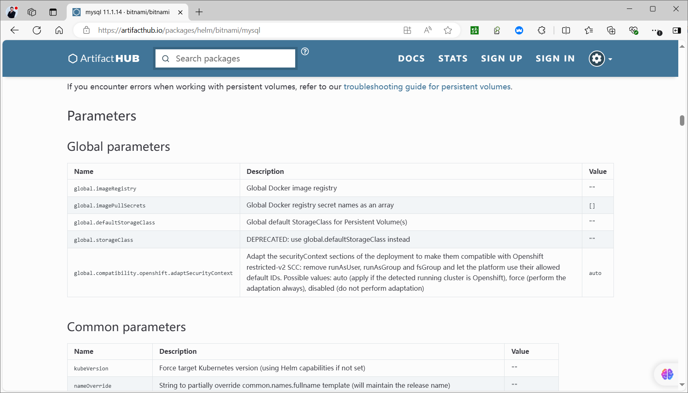
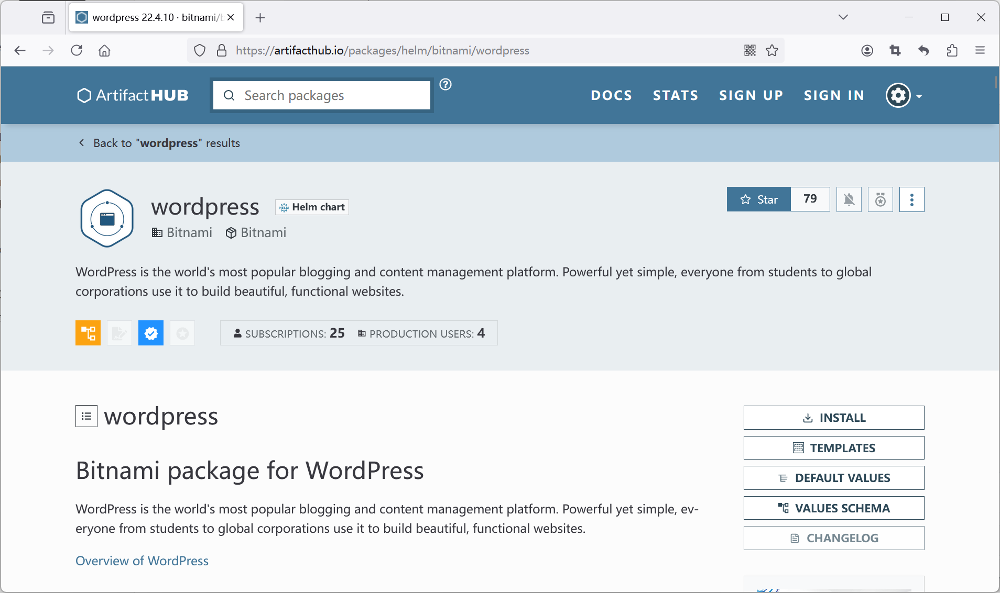
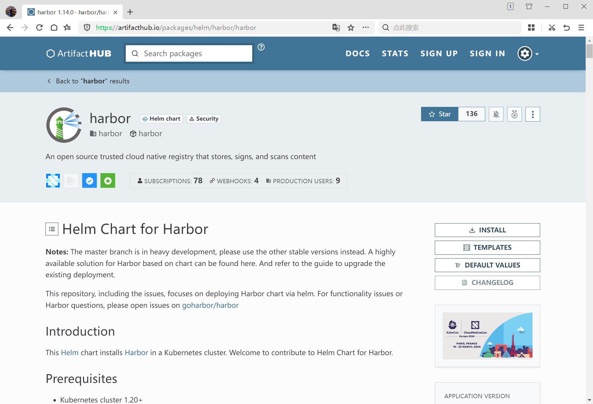
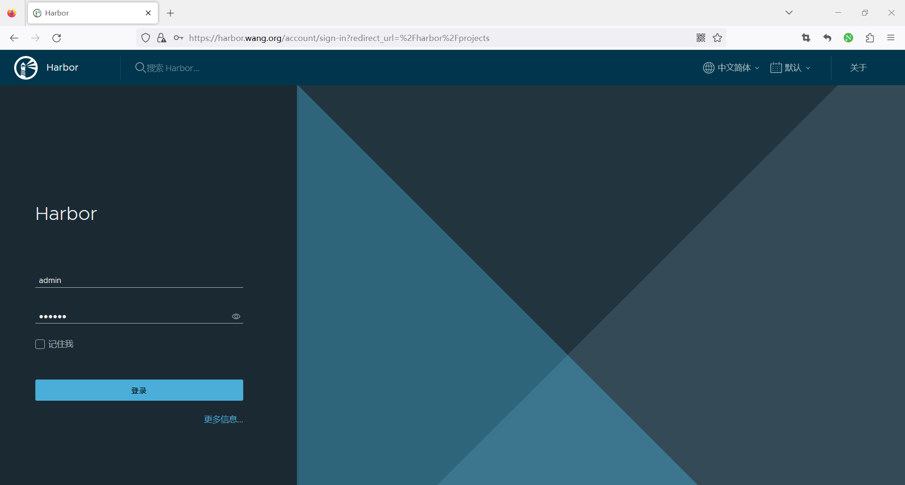
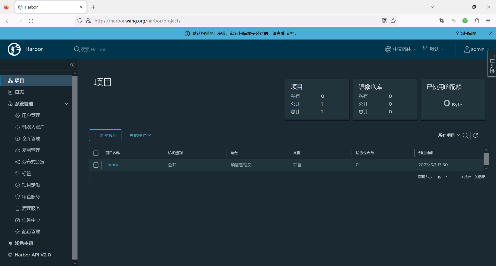

[← 返回 Kubernetes 目录]({{ '/subjects/Kubernetes/' | relative_url }})



# 28 Helm 应用部署案例

本章关注**如何读懂 Chart 并验证 Release**，而不是复制某次安装时的完整终端输出。Chart 参数、镜像仓库和默认密码会随发布版本改变；实际部署前先固定 Chart 版本、检查 `helm show values` 与 `helm template`，再准备存储、密钥和入口。以下 `CHART_VERSION`、域名与密码均需按目标环境填写，不应把真实凭据提交到仓库。

## 28.1 MySQL：从默认安装到可维护配置



先确认 Chart 和应用版本的对应关系：Chart 版本与 MySQL 镜像版本不是同一个编号；同名 Chart 在不同版本中可能更换参数和镜像来源。下面以 Bitnami 仓库说明流程，仓库可用性和许可条件以发布方当前说明为准。

```bash
helm repo add bitnami https://charts.bitnami.com/bitnami
helm repo update
helm search repo bitnami/mysql --versions
helm show chart bitnami/mysql --version "$CHART_VERSION"
helm show values bitnami/mysql --version "$CHART_VERSION" > mysql-default-values.yaml
```

单实例实验需要先确认默认 StorageClass，或在值文件中设置持久卷的 StorageClass 与容量。密码应由现有 Secret 提供，并核对该 Chart 版本要求的 Secret 名称及键名；不要把密码硬编码进 `values.yaml`。将选定参数写入 `mysql-values.yaml` 后，先渲染，再部署：

```bash
helm template mysql bitnami/mysql --version "$CHART_VERSION" \
  --namespace db -f mysql-values.yaml > mysql-rendered.yaml
helm pull bitnami/mysql --version "$CHART_VERSION" --untar
helm lint ./mysql --values mysql-values.yaml
helm upgrade --install mysql bitnami/mysql --version "$CHART_VERSION" \
  --namespace db --create-namespace -f mysql-values.yaml --wait
kubectl -n db get pods,pvc,svc
helm -n db status mysql
```

`helm upgrade --install` 可以创建或更新 Release；`--wait` 会等待部分资源就绪，但仍需用数据库客户端验证写入、重启后的持久性和备份恢复。若 PVC 为 `Pending`，先排查 StorageClass、供给器与拓扑约束；若 Pod 反复启动，检查 Secret 键名、镜像拉取和数据库日志。

原笔记还比较了**单节点 MySQL、OCI 仓库中的 Chart 与主从复制**：OCI 形式只改变 Chart 的获取方式，例如 `helm show values oci://... --version ...`，不改变应用的持久化要求。主从复制需要额外规划读写入口、复制延迟、故障切换和备份；Chart 安装成功并不等于数据库具备自动高可用。

## 28.2 WordPress：内置数据库与外部数据库

WordPress Chart 的第一种模式由 Chart 同时管理 WordPress 和依赖的 MariaDB，适合快速演示；第二种模式关闭内置数据库，让 WordPress 连接已有的 MySQL 服务，适合数据库独立管理。两者都要核对 PVC 与上传目录的持久化方式，不能只凭 `helm status` 的 `deployed` 判断网页已可访问。

1. 用 `helm show values` 查找当前 Chart 中数据库子 Chart 开关、`externalDatabase` 字段、Secret 字段以及 WordPress 持久卷参数。
2. 内置数据库模式：为数据库和 WordPress 分别准备可靠的持久卷，并验证数据库初始化与网页安装。
3. 外部数据库模式：关闭内置 MariaDB，配置数据库 Service 地址、库名、用户名与密码 Secret；连接目标若是复制集群，应使用稳定的**写入口**，不要把客户端写流量随机分发给只读副本。
4. 通过 Ingress 暴露时设置 `ingressClassName`、真实域名与 TLS Secret，并检查 Chart 渲染结果是否与所用控制器兼容。



```bash
helm show values bitnami/wordpress --version "$WP_CHART_VERSION" > wordpress-default-values.yaml
helm template wordpress bitnami/wordpress --version "$WP_CHART_VERSION" \
  --namespace wordpress -f wordpress-values.yaml > wordpress-rendered.yaml
helm upgrade --install wordpress bitnami/wordpress --version "$WP_CHART_VERSION" \
  --namespace wordpress --create-namespace -f wordpress-values.yaml --wait
kubectl -n wordpress get pods,pvc,svc,ingress
```

和第 24 章手工部署的案例相比，Helm 简化的是**清单渲染和 Release 生命周期**，并不替代应用架构设计。

## 28.3 Harbor：先规划入口、存储和密钥

Harbor 包含 Core、Registry、数据库、Redis、JobService 等组件，所需的持久卷并非只有一个。安装前应确定 `externalURL`、Ingress 域名、TLS 证书、管理员密码来源和各组件的 PVC；若使用外部数据库/Redis，还需检查 Chart 对这些端点的配置。



```bash
helm repo add harbor https://helm.goharbor.io
helm repo update
helm search repo harbor/harbor --versions
helm show values harbor/harbor --version "$HARBOR_CHART_VERSION" > harbor-default-values.yaml
helm template harbor harbor/harbor --version "$HARBOR_CHART_VERSION" \
  --namespace harbor -f harbor-values.yaml > harbor-rendered.yaml
helm upgrade --install harbor harbor/harbor --version "$HARBOR_CHART_VERSION" \
  --namespace harbor --create-namespace -f harbor-values.yaml --wait
kubectl -n harbor get pods,pvc,ingress
```

初次登录后应立即核对管理员凭据与 TLS；不要沿用教程中出现的固定演示密码。测试镜像推送、拉取及 Pod 重启后的数据保留，才能确认 Registry、入口和存储链路都有效。





## 28.4 Dashboard、Prometheus 与 Nacos

**Kubernetes Dashboard**：使用项目当前文档列出的仓库和 Chart 版本，安装到独立名称空间。不同 Chart 版本的代理 Service 名称可能变化，先 `kubectl get svc` 再选择端口转发目标。仅把端口转发绑定本机回环地址；管理界面不应直接以无认证 HTTP 方式暴露到公网。

```bash
helm repo add kubernetes-dashboard https://kubernetes.github.io/dashboard/
helm repo update
helm upgrade --install kubernetes-dashboard kubernetes-dashboard/kubernetes-dashboard \
  --namespace kubernetes-dashboard --create-namespace --wait
kubectl -n kubernetes-dashboard get pods,svc
# 根据上一步实际服务名，选择对应的 HTTPS 代理服务执行 port-forward
```

**Prometheus**：常用 `kube-prometheus-stack` Chart 将 Prometheus Operator、Prometheus、Alertmanager 和 Grafana 关联部署。部署前检查 CRD、StorageClass、抓取目标、保留周期和内存预算；更新时单独留意 CRD 升级与数据卷迁移。可对照 Prometheus 专题的完整监控章节。

**Nacos**：原案例使用 `nacos-k8s` 项目的 Helm Chart。先核对项目维护状态、目标 Kubernetes 版本、Nacos 版本、数据库选型和 StatefulSet 的存储方案；不要将旧课件中的“某一版本不支持”视为永久结论。安装后检查三个层次：Pod 是否就绪、Nacos 节点是否组成预期集群、配置读写是否可用。

部署任何 Chart 后，建议统一保留以下检查与回退手段：

```bash
helm -n NAMESPACE status RELEASE
helm -n NAMESPACE history RELEASE
helm -n NAMESPACE get values RELEASE
kubectl -n NAMESPACE get events --sort-by=.metadata.creationTimestamp
# 验证新修订不符合预期时，先查 history，再回滚到经过确认的修订：
helm -n NAMESPACE rollback RELEASE REVISION
```

这里的 `NAMESPACE`、`RELEASE`、`REVISION` 是需要替换的参数。回滚 Release 只能回滚 Kubernetes 资源清单，**不会自动逆向恢复数据库 schema 或持久卷数据**；执行应用回滚前应确认数据兼容性。



<nav class="article-end" aria-label="章节导航">
  <a href="{{ '/subjects/Kubernetes/27-helm-basics.html' | relative_url }}">← 上一章：Helm 基础、部署与命令</a>
  <a href="{{ '/subjects/Kubernetes/' | relative_url }}">返回 Kubernetes 目录</a>
  <a href="{{ '/subjects/Kubernetes/29-helm-charts.html' | relative_url }}">下一章：自定义 Helm Chart →</a>
</nav>
