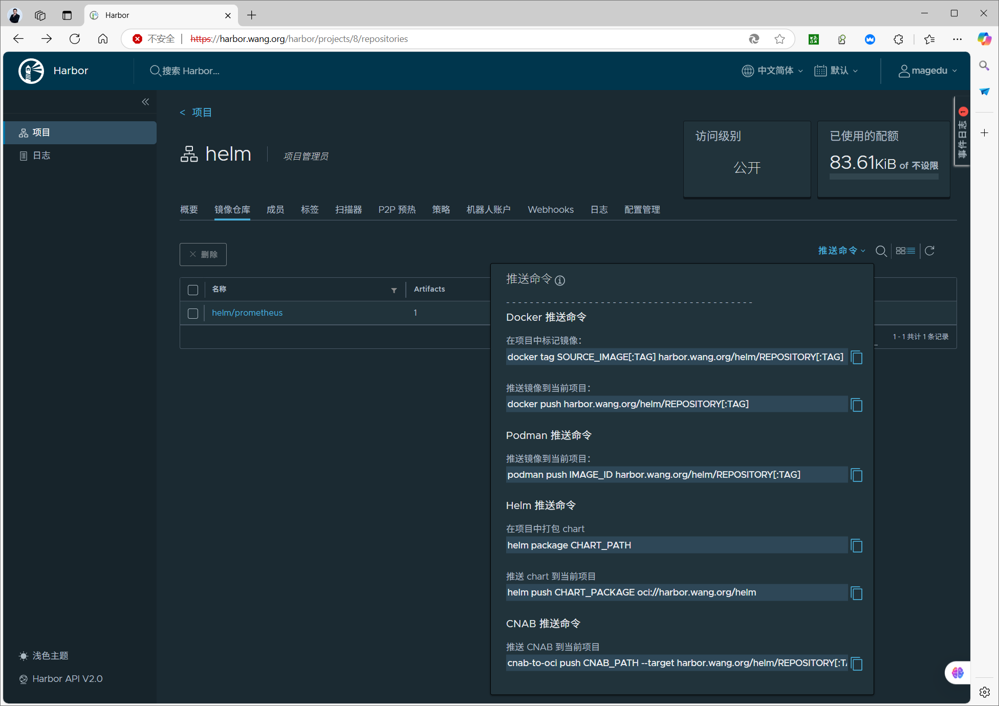

[← 返回 Kubernetes 目录]({{ '/subjects/Kubernetes/' | relative_url }})



# 29 自定义 Helm Chart

# 3  自定义 Chart

## 3.1 自定义 Chart 说明

### 3.1.1 Chart 目录结构

```text
https://docs.helm.sh/docs/chart_template_guide/getting_started/
```

**使用 Golang 模板语法**

```text
https://pkg.go.dev/text/template
https://helm.sh/zh/docs/chart_template_guide/data_types/
```

附录：Go 数据类型和模板

Helm 模板语言是用强类型Go编程语言实现的。 因此，模板中的变量是 有类型的。大多数情况下，变量将作为以下类型之一显示：

常见 Go 数据类型：

| 类型 | 说明 |
| --- | --- |
| `string` | 文本字符串。 |
| `bool` | `true` 或 `false`。 |
| `int` | 整型值，可包含 8、16、32、64 位有符号或无符号整数。 |
| `float64` | 64 位浮点数；Go 还提供 `float32` 类型。 |
| `[]byte` | 字节切片，通常保存二进制数据。 |
| `struct` | 具有属性和方法的对象。 |
| 切片 | 上述某种类型的索引列表。 |
| `map[string]interface{}` | 字符串键的映射，其值可为上述某种类型。 |

Go里面有很多其他类型，有时你需要在模板里转换。调试对象类型最简便的方式是在模板中传递给printf "%t" ，这样会打印类型。 也可以使用 typeOf 和 kindOf 函数。

如 Charts 指南所述， Helm chart的结构如下：

```text
mychart/
Chart.yaml
values.yaml
charts/
templates/
...
```

Chart.yaml 文件

必选项

包含了该chart的描述。你可以从模板中访问它。helm show chart [CHART] 查看到即此文件内容。

templates/ 目录

**必选项**

包括了各种资源清单的模板文件。比如: deployment,service,ingress, configmap,secret等。可以是固定内容的文本,也可以包含一些变量,函数等模板语法。当Helm评估chart时，会通过模板渲染引擎将所有文件发送到templates/ 目录中。 然后收集模板的结果并发送给Kubernetes。

values.yaml 文件

可选项

如果 templetes/目录下文件都是固定内容,此文件无需创建。如果templates/ 目录中包含变量时,可以通过此文件提供变量的默认值。这些值可以在用户执行helm install 或 helm upgrade 时被覆盖。helm show values  [CHART]  查看到即此文件内容。

charts/ 目录

可选项

可以包含依赖的其他的chart, 称之为 子chart。

范例: 生成chart目录结构

```text
[root@master1 ~]#helm create myapp-chart
```

```text
[root@master1 ~]#tree myapp-chart
myapp-chart               #chart包的名称
├── charts                #存放子chart的目录，目录里存放这个chart依赖的所有子chart
├── Chart.yaml            #保存chart的基本信息，包括名字、描述信息及版本等，这个变量文件可
以被templates目录下文件所引用
├── templates             #模板文件目录，目录里面存放所有yaml模板文件，包含了所有部署应用的
yaml文件
│   ├── deployment.yaml   #创建deployment对象的模板文件
│   ├── _helpers.tpl      #放置模板助手文件，可在整个chart中重复使用，放一些templates目录
下yaml文件可能会用到的一些模板
│   ├── hpa.yaml
│   ├── ingress.yaml
│   ├── NOTES.txt         #存放提示信息的文件,helm install部署后展示给用户的提示和帮助信
息,比如: 后续如何使用chart等
│   ├── serviceaccount.yaml
│   ├── service.yaml
│   └── tests             #用于测试的文件，测试完部署完chart后，如web，生成一个链接，看看
你是否部署正常
│       └── test-connection.yaml
└── values.yaml #用于渲染模板的文件(变量文件，定义变量的值),定义templates目录下的yaml文件
可能引用到的变量,用于存储 templates 目录中模板文件中用到变量的值，这些变量定义可以让templates
目录下yaml引用
```

```text
3 directories, 10 files
```

### 3.1.2 常用的内置对象

Chart 中支持多种内置对象,即相关内置的相关变量,可以通过对这些变量进行定义和引用,实现定制Chart的目的。

Release 对象Chart 对象Values 对象Capabilities 对象Template 对象

helm3 的内置对象详解

Release对象

描述应用发布自身的一些信息,主要包括如下对象。

```text
#Release 对象变量都是来自说系统信息,无需自定义
.Release.Name      #release 的名称
,Release.Namespace #release 的命名空间
.Release.Revision  #获取此次修订的版本号。初次安装时为1，每次升级或回滚都会递增
.Release.Service   #获取渲染当前模板的服务名称。一般都是 Helm
.Release.IsInstall #如果当前操作是安装，该值为 true
.Release.IsUpgrade #如果当前操作是升级或回滚，该值为true
```

```text
#引用格式
{{ .Release.Name }}
```

Chart 对象

用于获取Chart.yaml 文件中的内容。

```text
.Chart.Name    #引用Chart.yaml文件定义的chart的名称
.Chart.Version #引用Chart.yaml文件定义的Chart的版本
```

```text
#引用格式
{{ .Chart.Name }}
```

Values 对象

描述 values.yaml 文件(用于定义默认变量的值文件)中的内容，默认为空。使用 Values 对象可以获取到 values.yaml 文件中已定义的任何变量数值。

形式为key/value对

```text
#values.yaml文件中变量赋值格式:
key1: value1
```

```text
info:
key2: value2
```

```text
#变量引用格式:
#注意: 首字字母的是大写V
{{ .Values.key1 }}
{{ .Values.info.key2 }}
```

定制值的两种方法

values.yaml 文件--set 选项

name: wang--set name=wang

name: "wang,xiao,chun"--set name=wang\,xiao\,chun

name: wang age: 18--set name=wang,age=18

info:name: wang--set info.name=wang

name:

- wang

--set name={wang,zhao,li}

- zhao

-  li

info:

- name: wang--set info[0].name=wang

info:

- name: wang

--set info[0].name=wang,info[0].age=18

age: 18

nodeSelector:kubernetes.io/role: worker--set nodeSelector."kubernetes.io/role"=worker

Capabilities 对象

提供了关于kubernetes 集群相关的信息。该对象有如下对象。

```text
#来自于kubernetes的信息,无需定义
.Capabilities.APIVersions #返回kubernetes集群 API版本信息集合
.Capabilities.APIVersions.Has $version #检测指定版本或资源在k8s中是否可用，例
如:apps/v1/Deployment,可用为true
.Capabilities.KubeVersion和.Capabilities.KubeVersion.Version #用于获取
kubernetes 的版本,包括Major和Minor
.Capabilities.KubeVersion.Major  #引用kubernetes 的主版本号,第一位的版本号,比
如:v1.18.2中为1
.Capabilities.KubeVersion.Minor   #引用kubernetes 的小版本号,第二位版本号,比
如:v1.18.2中为18
```

```text
#引用
{{ .Capabilities.APIVersions }}
```

Template对象

用于获取当前模板的信息，它包含如下两个对象。

```text
#信息来自于模板的文件路径和名称,无需定义
.Template.BasePath  #引用当前模板文件所在目录路径,示例:<Chart.yaml文件定义的
name>/templates
.Template.Name      #引用当前模板文件名和路径,示例:<Chart.yaml文件定义的
name>/templates/configmap.yaml
```

```text
#引用
{{ .Template.Name }}
```

范例:  测试各种对象

```text
[root@master1 ~]#helm create mychart
[root@master1 ~]#rm -rf mychart/templates/* mychart/charts
```

```text
[root@master1 ~]#tree mychart
mychart
├── Chart.yaml
├── templates
└── values.yaml
```

```text
1 directory, 2 files
```

```text
#修改Chart.yaml
[root@master1 ~]#vim  mychart/Chart.yaml
[root@master1 ~]#grep -v "#" mychart/Chart.yaml
apiVersion: v2
name: myapp
description: A Helm chart for Kubernetes
```

```text
type: application
```

```text
version: 1.2.3
```

```text
appVersion: "6.6.6"
```

```text
[root@master1 ~]#vim mychart/values.yaml
NAME: "wangxiaochun"
USER:
AGE: "18"
CITY: "beijing"
```

```text
[root@master1 ~]#vim mychart/templates/configmap.yaml
apiVersion: v1
kind: ConfigMap
metadata:
name: {{ .Release.Name }}-configmap
namespace: {{ .Release.Namespace }}
data:
data1: "{{ .Release.Revision }}"  #获取此次修订的版本号。初次安装时为1，每次升级或回滚
都会递增
data2: "{{ .Release.Service }}"   #获取渲染当前模板的服务名称。一般都是 Helm
data3: "{{ .Release.IsInstall }}" #如果当前操作是安装，该值为 true
data4: "{{ .Release.IsUpgrade }}" #如果当前操作是升级或回滚，该值为true
data5: "{{ .Release.Name  }}"     #Release 空间
data6: "{{ .Release.Namespace }}" #名称空间
data7: "{{ .Values.NAME }}"
data8: "{{ .Values.USER.AGE }}"
data9: "{{ .Values.USER.CITY }}"
data10: "{{ .Chart.Name }}"
data11: "{{ .Chart.Version }}"
data12: "{{ .Capabilities.APIVersions }}"
data13: '{{ .Capabilities.APIVersions.Has "apps/v1/Deployment" }}'
data14: "{{ .Capabilities.KubeVersion }}"
data15: "{{ .Capabilities.KubeVersion.Version }}"
data16: "{{ .Capabilities.KubeVersion.Major }}"
data17: "{{ .Capabilities.KubeVersion.Minor }}"
```

```text
data18: "{{ .Template.BasePath }}"
data19: "{{ .Template.Name }}"
```

```text
#模拟运行
[root@master1 ~]#helm install myapp ./mychart -n demo --debug --dry-run
install.go:222: [debug] Original chart version: ""
install.go:239: [debug] CHART PATH: /root/mychart
```

```text
NAME: myapp
LAST DEPLOYED: Thu Aug  1 15:36:02 2024
NAMESPACE: default
STATUS: pending-install
REVISION: 1
TEST SUITE: None
USER-SUPPLIED VALUES:
{}
```

```text
COMPUTED VALUES:
NAME: wangxiaochun
USER:
AGE: "18"
CITY: beijing
```

```text
HOOKS:
MANIFEST:
---
# Source: myapp/templates/configmap.yaml
apiVersion: v1
kind: ConfigMap
metadata:
name: myapp-configmap
namespace: default
data:
data1: "1"  #获取此次修订的版本号。初次安装时为1，每次升级或回滚都会递增
data2: "Helm"   #获取渲染当前模板的服务名称。一般都是 Helm
data3: "true" #如果当前操作是安装，该值为 true
data4: "false" #如果当前操作是升级或回滚，该值为true
data5: "myapp"     #Release 空间
data6: "demo" #名称空间
data7: "wangxiaochun"
data8: "18"
data9: "beijing"
data10: "mychart"
data11: "0.0.1"
```

```text
data12: "[v1/Service enterprisesearch.k8s.elastic.co/v1beta1/EnterpriseSearch
flowcontrol.apiserver.k8s.io/v1 scheduling.k8s.io/v1/PriorityClass
autoscaling/v2/HorizontalPodAutoscaler stackconfigpolicy.k8s.elastic.co/v1alpha1
networking.k8s.io/v1/NetworkPolicy elasticsearch.k8s.elastic.co/v1/Elasticsearch
kibana.k8s.elastic.co/v1beta1/Kibana flowcontrol.apiserver.k8s.io/v1beta3
beat.k8s.elastic.co/v1beta1 v1/Node
rbac.authorization.k8s.io/v1/ClusterRoleBinding
admissionregistration.k8s.io/v1/ValidatingAdmissionPolicyBinding
agent.k8s.elastic.co/v1alpha1/Agent discovery.k8s.io/v1 authentication.k8s.io/v1
enterprisesearch.k8s.elastic.co/v1 apps/v1/Scale
flowcontrol.apiserver.k8s.io/v1/FlowSchema apm.k8s.elastic.co/v1beta1/ApmServer
apps/v1 logstash.k8s.elastic.co/v1alpha1
admissionregistration.k8s.io/v1/ValidatingWebhookConfiguration
coordination.k8s.io/v1/Lease metrics.k8s.io/v1beta1/PodMetrics autoscaling/v1
v1/LimitRange v1/PodAttachOptions
admissionregistration.k8s.io/v1/MutatingWebhookConfiguration
enterprisesearch.k8s.elastic.co/v1/EnterpriseSearch
kafka.strimzi.io/v1beta2/KafkaMirrorMaker2 metrics.k8s.io/v1beta1
v1/PodProxyOptions rbac.authorization.k8s.io/v1/Role
metallb.io/v1beta1/BGPAdvertisement batch/v1 kafka.strimzi.io/v1beta2/Scale
batch/v1/Job kafka.strimzi.io/v1beta1/KafkaTopic
rbac.authorization.k8s.io/v1/ClusterRole v1/ServiceProxyOptions batch/v1/CronJob
kafka.strimzi.io/v1beta2/KafkaTopic events.k8s.io/v1
admissionregistration.k8s.io/v1 kafka.strimzi.io/v1beta2 v1/ConfigMap
autoscaling/v2 enterprisesearch.k8s.elastic.co/v1beta1
authorization.k8s.io/v1/SelfSubjectAccessReview policy/v1/PodDisruptionBudget
apm.k8s.elastic.co/v1 storage.k8s.io/v1 kafka.strimzi.io/v1alpha1
autoscaling.k8s.elastic.co/v1alpha1/ElasticsearchAutoscaler
logstash.k8s.elastic.co/v1alpha1/Logstash logstash.k8s.elastic.co/v1alpha1/Scale
rbac.authorization.k8s.io/v1 elasticsearch.k8s.elastic.co/v1beta1 v1/Event
autoscaling/v1/HorizontalPodAutoscaler beat.k8s.elastic.co/v1beta1/Beat
kafka.strimzi.io/v1alpha1/KafkaUser
maps.k8s.elastic.co/v1alpha1/ElasticMapsServer policy/v1
authorization.k8s.io/v1/LocalSubjectAccessReview
networking.k8s.io/v1/IngressClass node.k8s.io/v1/RuntimeClass
kafka.strimzi.io/v1beta2/KafkaBridge metallb.io/v1beta1/L2Advertisement
v1/ComponentStatus v1/PersistentVolumeClaim v1/Scale apps/v1/ControllerRevision
authorization.k8s.io/v1/SubjectAccessReview node.k8s.io/v1
apiextensions.k8s.io/v1/CustomResourceDefinition
discovery.k8s.io/v1/EndpointSlice
flowcontrol.apiserver.k8s.io/v1beta3/PriorityLevelConfiguration
enterprisesearch.k8s.elastic.co/v1/Scale kafka.strimzi.io/v1beta2/KafkaRebalance
kafka.strimzi.io/v1alpha1/KafkaTopic metallb.io/v1beta2/BGPPeer apps/v1/DaemonSet
metallb.io/v1beta1/BGPPeer certificates.k8s.io/v1/CertificateSigningRequest
storage.k8s.io/v1/CSIDriver storage.k8s.io/v1/VolumeAttachment
apm.k8s.elastic.co/v1/ApmServer kafka.strimzi.io/v1beta2/KafkaConnect
kibana.k8s.elastic.co/v1/Scale metallb.io/v1beta1/ServiceL2Status v1/PodTemplate
coordination.k8s.io/v1 v1/Binding v1/PersistentVolume apps/v1/Deployment
authorization.k8s.io/v1 elasticsearch.k8s.elastic.co/v1 kafka.strimzi.io/v1beta1
v1/Pod apiregistration.k8s.io/v1/APIService storage.k8s.io/v1/CSIStorageCapacity
core.strimzi.io/v1beta2/StrimziPodSet kafka.strimzi.io/v1beta1/KafkaUser
networking.k8s.io/v1 v1/ReplicationController storage.k8s.io/v1/CSINode
kafka.strimzi.io/v1beta2/KafkaNodePool metallb.io/v1beta1/IPAddressPool
maps.k8s.elastic.co/v1alpha1 autoscaling.k8s.elastic.co/v1alpha1
core.strimzi.io/v1beta2 v1/Secret authentication.k8s.io/v1/SelfSubjectReview
apm.k8s.elastic.co/v1/Scale metrics.k8s.io/v1beta1/NodeMetrics
scheduling.k8s.io/v1 v1/NodeProxyOptions v1/Eviction v1/PodExecOptions
v1/PodPortForwardOptions apps/v1/ReplicaSet events.k8s.io/v1/Event
```

```text
rbac.authorization.k8s.io/v1/RoleBinding apiextensions.k8s.io/v1
maps.k8s.elastic.co/v1alpha1/Scale storage.k8s.io/v1/StorageClass
metallb.io/v1beta1/BFDProfile metallb.io/v1beta1/Community certificates.k8s.io/v1
kafka.strimzi.io/v1beta2/KafkaMirrorMaker kafka.strimzi.io/v1beta2/Kafka
metallb.io/v1beta2 kibana.k8s.elastic.co/v1/Kibana metallb.io/v1beta1
authorization.k8s.io/v1/SelfSubjectRulesReview
admissionregistration.k8s.io/v1/ValidatingAdmissionPolicy
agent.k8s.elastic.co/v1alpha1 kibana.k8s.elastic.co/v1beta1 v1/ResourceQuota
flowcontrol.apiserver.k8s.io/v1beta3/FlowSchema apm.k8s.elastic.co/v1beta1
v1/TokenRequest apps/v1/StatefulSet
flowcontrol.apiserver.k8s.io/v1/PriorityLevelConfiguration v1/Namespace
authentication.k8s.io/v1/TokenReview networking.k8s.io/v1/Ingress
elasticsearch.k8s.elastic.co/v1beta1/Elasticsearch v1/ServiceAccount
apiregistration.k8s.io/v1 kibana.k8s.elastic.co/v1 v1/Endpoints
kafka.strimzi.io/v1beta2/KafkaConnector kafka.strimzi.io/v1beta2/KafkaUser
stackconfigpolicy.k8s.elastic.co/v1alpha1/StackConfigPolicy v1]"
data13: 'true'
data14: "v1.31.1"
data15: "v1.31.1"
data16: "1"
data17: "31"
data18: "mychart/templates"
data19: "mychart/templates/configmap.yaml"
```

### 3.1.3 函数

```text
https://helm.sh/zh/docs/chart_template_guide/function_list/
```

到目前为止，我们已经知道了如何将信息传到模板中。 但是传入的信息并不能被修改。有时我们希望以一种更有用的方式来转换所提供的数据。

比如: 可以通过调用模板指令中的quote 函数把.Values 对象中的字符串属性用双引号引起来，然后放到模板中。

```text
apiVersion: v1
kind: ConfigMap
metadata:
name: {{ .Release.Name }}-configmap
data:
myvalue: "Hello World"
#格式1
drink: {{ quote .Values.favorite.drink }}  #双引号函数quote
food: {{ squote .Values.favorite.food }}   #单引号函数squote
#格式2
#drink: {{ .Values.favorite.drink | quote }} #双引号函数quote
#food: {{ .Values.favorite.food |  squote }} #单引号函数squote
```

模板函数的语法是

```text
#格式1
functionName arg1 arg2...
```

```text
#格式2: 多次函数处理
arg1 | functionName1 | functionName2...
```

在上面的代码片段中，quote .Values.favorite.drink 调用了quote 函数并传递了一个参数( .Values.favorite.drink )。Helm 有超过60个可用函数。其中有些通过 Go模板语言本身定义。其他大部分都是 Sprig 模板库。我们可以在示例看到其中很多函数。

Helm 包含了很多可以在模板中利用的模板函数。以下列出了具体分类：

```text
Cryptographic and Security
Date
Dictionaries
Encoding
File Path
Kubernetes and Chart
Logic and Flow Control
Lists
Math
Float Math
Network
Reflection
Regular Expressions
Semantic Versions
String
Type Conversion
URL
UUID
```

**常见函数**

```text
#字符串函数
quote #添加双引号
squote #添加单引号
upper  #转换为大写
lower  #转换为小写
title #用于将首字母转换成大写，示例:title "test'
untitle #用于将大写的首字母转换成小写，示例: untitle"Test”
snakecase #用于将驼峰写法转换为下划线命名写法，示例:snakecase "UserName" 返回结果
user_name
camelcase #用于将下划线命名写法转换为驼峰写法，示例:camelcase "user_name" 返回结果
UserName
kebabcase #用于将驼峰写法转换为中横线写法，示例:kebabcase "UserName" 返回结果 user-name
swapcase #作用是基于内置的算法来切换字符串的大小写,算法规则如下:a).大写字符变成小写字母 b).首
字母变成小写字母c).空格后或开头的小写字母转换成大写字母d).其他小写字母转换成大写字母,示
例:swapcase "This Is A.Test"  返回结果:"tHIS iS a.tEST"
cat #用于将多个字符串合并成一个字符串，并使用空格分隔开,示例:cat "Hello" "World",结果:
Hello World
replace #用于字符串替换。需要三个参数:待替换的字符串、将要替换的字符串、源字符串,第1个参数表示
被替换的源字符串,第2个参数表示要替换为目标字符串,第3个参数表示需要对哪个字符串执行替换,示例:"I
Am Test"| replace " " "+" ,返回结果:I+Am+Test
substr #对字符串指定切割起、始位置，返回切割后的字串,该函数需要指定三个参数:1)start(int):起
始位置，索引位置从0开始 2)end(int):结束位置(不包含)，索引位置从0开始,3)string(string):需要
切割的字符串,示例:substr 3 5 "abcdefg" 返回结果"de'
trunc #用于截断字符串。可以使用正整数或负整数来分别表示从左向右截取的个数和从右向左截取的个数,
示例:trunc 5 "Hello World" 返回结果:"Hello" 示例:trunc -5 "Hello World" 返回结
果:"World"
```

```text
abbrev #作用是使用省略号(...)从左到右切割字符串，保留指定的长度，注意省略号的长度是3个。其中省
略号也是计算在长度之内的。如要将一个字符串保留长度为5，那么字符的个数只有两个，剩下三个是省略号。
示例:abbrev 5 "Hello World" 返回结果:"He..."
shuffle #用于对字符串中的字符基于内部的算法进行重新排序,示例:shuffle "Hello" 返回 "Hlleo"
indent #用于以指定长度来缩进指定字符串所在行,示例:indent 4 "this is indent"
nindent #添加新的空行后,再缩进字符串,示例:nindent 4 "this is nindent'
plural #判断字符串的长度,并且据长度返回不同的值,如果字符串的长度为1会返回plural 函数的第一个
参数,若不是1则返回第二个参数(包括0)示例:len "a" | plural "one" "two",结果返回 one,示
例:len "abc" | plrual "one" "two" 结果返回 two
```

```text
#使用不同的字符生成加密的随机字符串,指定生成的字符串长度
randAlphaNum N #使用 0-9a-zA-Z，生成随机字符串
randAlpha N #使用 a-zA-Z，生成随机字符串
randNumeric  N #使用 0-9，生成随机字符串
randAscii N #使用所有的可使用的 ASCII 字符生成随机字符串
```

```text
contains #测试字符串是否包含指定的字符串，包含返回true，反之返回false,示例:contains "ll"
"Hello" 结果返回 true
```

```text
hasPrefix #用于测试一个字符串是否是指定字符串的前缀,包含返回true,不包含返回false,示
例:hasPrefix "He" "Hello" 结果返回 true
hasSuffix #测试一个字符串是否是指定字符串的后缀,返回布尔值,true或false,示例:hasSuffix
"lo" "Hello" 判断后缀，结果返回 true
```

```text
repeat N #函数用于将字符串重复输出指定的次数,示例:repeat 3 "Hello" 结果返回
HelloHelloHello
nospace  #用于去掉字符串中所有的空格,示例:nospace "T e s t" 返回 Test
initials #用于截取指定字符串的每个单词的首字母，并拼接在一起,示例:initials "People Like
Peace" 返回 PLP
```

```text
wrapWith #对给定的字符串在指定列数(从0开始)前加别的字符串，示例:wrapWith 5 "\t"
"HelloWorld",会在第五个索引的位置添加"\t" 结果为:"Hello World"
```

```text
default value #当前面的值不存在时，用value做为默认值
print #返回各部分组合的字符串。示例:print "Matt has " .Dogs " dogs" 如果可能，非字符串类
型会被转换成字符串。注意，当相邻两个参数不是字符串时会在它们之间添加一个空格。
println #和 print效果相类，但是会多个字符串参数之间会添加一个空格分隔,还会在末尾新添加一行。
trim    #可以用来去除字符串两边的空稻，示例: trim " hello "
trimAll #用于移除字符串中指定的字符，示例: trimAll "$" "$10.00"
trimpPefix #用于移除字符串中指定的前缀:示例: trimpPefix "=" "=hello"
trimSuffix #用于移除字符串中指定的后缀:示例: trimSuffix "=" "hello="
lookup  <apiVersion> <kind> [namespace] [name]  #获取kubernetes的指定的资源信息
```

```text
#逻辑和流控制函数
eq #用于判断两个参数是否相等，如果等于则为 true，不等于则为 false.
ne #用于判断两个参数是否不相等，如果不等于则为 true，等于则为 false
lt #函数用于判断第一个参数是否小于第二个参数，如果小于则为 true，如果大于则为 false。
le #判断第一个参数是否小于等于第二个参数，如果成立则为 true，如果不成立则为 false。
gt #函数用于判断第一个参数是否大于第二个参数，如果大于则为 true，如果小于则为 false。
ge #判断第一个参数是否大于等于第二个参数，如果成立则为 true，如果不成立则为 false。
and #返回两个参数的逻辑与结果(布尔值)，如果两个参数都为真，则结果为 true。否则则返回false
or #判断多个参数的逻辑或的关系，两个参数中只要有一个为真，则为真。返回第一个不为空的参数，如果第
一个参数为空，则返回后一个参数
not #用于对参数的布尔值取反,如果参数是正常参数(非空)，正常为true，取反后就为fàlse，参数是空
的,正常是false，取反后是true
default #用来设置一个默认值，在参数的值为空时，则会使用默认值
empty #用于判断给定值是否为空，如果为空则返回true
coalesce #用于扫描一个给定的列表，并返回第一个非空的值。
```

```text
ternary #接受两个参数和一个test值，如果test的布尔值为true，则返回第一个参数值，如果test的布
尔值为false，则返回第二个参数值
```

```text
#类型转换函数
kindOf #判断数据类型
atoi  #将字符串转换为整型,例: atoi "10" | kindOf
float64 #转换成 float64 类型,例: float64 "1.23" | kindOf
int #转换为 int 类型
toString #转换成字符串,例: toString 10 | kindOf
int64 #转换成 int64 类型
toDecimal # 将 unix 八进制转换成 int64
toStrings #将列表、切片或数组转换成字符串列表
to]son (mustToJson) #将列表、切片、数组、字典或对象转换成JSON
toPretty]son (mustToPrettyJson) #将列表、切片、数组、字典或对象转换成格式化JSON
toRawJson函数(mustToRawJson) #将列表、切片、数组、字典或对象转换成JSON(HTML字符不转义)
```

```text
#正则表达式函数
regexMatch和mustRegexMatch #用于根据指定的正则来匹配字符串,如果匹配成功则返回true.如果表达
式有问题,regexMatch会直接抛出错误,mustRegexMatch会向模板引擎返回错误。示例: regexMatch
"^[0-9]+$" "123456" 返回true
```

```text
regexFind和mustRegexFind #用于根据指定的正则式来查找匹配的字符串,用于从左向右获取第一个匹配
的字符串,示例: regexFind "[a-zA-Z][0-9]" "abc123def456" 返回c1,示例: mustRegexFind "
[a-zA-Z][0-9]" "abc123def456" 返回c1
```

```text
regexFindAll和mustRegexFindAll #用于获取字符串中匹配正则表达式的字符串,最后一个整型参数表示
返回多少个正则匹配的字符串。-1 代表返回所有正则匹配的结果
#示例:regexFindAll "[2,4,6,8]" "123456789" 3 返回2,4,6
#示例:regexFindAll "2,4,6,8""123456789" -1 返回所有,即2,4,6,8
```

```text
regexReplaceAll和mustRegexReplaceAll #使用指定字符串替换正则表达式匹配到的字符串,在替换字
符串里面，
#示例:regexReplaceAll "a(x*)b" "1axxxb2" "${1}hello" 返回1xxxhello2
#将"1axxxb2"中匹配"a(x*)b" 正则表达式的内容替换为"${1}hello"的内容
```

```text
regexReplaceAllLiteral和mustRegexReplaceAllLiteral#将通过正则匹配到的内容替换成其他内
容,用法和 regexReplaceAll函数/mustRegexReplaceAll相似,不同的是: regexReplaceAlliteral
中不包括$拓展,会将$也视作字符串直接替换
regexSplit和mustRegexSplit #指定一个分隔符(以正则表达式匹配的内容为分隔符),将字符串进行切
割，并返回切割后的字符串切片,在函数的最后需要指定一个整型，来确定要返回的切片数量，-1 代表返回所
有的切片,示例:regexSplit "o+" "google" -1 返回 [g gle]
匹配到正则的内容。
```

```text
#加密解密和编码函数
shalsum #用于计算字符串的SHA1值
sha256sum #用于计算字符串的SHA256值
adler32sum #用于计算字符串的Adler-32校验和进行加密
htpasswd #根据传入的userame和password生成一个bcrypt哈希值,可以用于HTTP的basic认证,示例:
hapasswd wang 123456
encryptAES #使用AES-256 CBC 加密文本并返回一个base64编码字符串,示例:encryptAES "key"
"hello" 对于key对称密钥加密hello
decryptAES #接收一个AES-256 CBC编码的字符串并返回解密文本,示例:decryptAES "key" "上面的
加密结果" 基于key对称密钥解密
b64enc #Base64编码函数,编写k8s的secret文件时候会用到
b64dec #Base64解码函数
```

```text
#日期时间函数
now #用于返回当前日期和时间，通常与其他日期函数共同使用
```

```text
date #用于将日期信息进行格式化。date 函数后面需要指明日期的格式，这个格式内容必须使用"2006-
01-02"或"02/01/2006"来标明，否则会出错,示例:now | date "2006-01-02" 或者
now|date"02/01/2006” 注意:格式内容必须是这两个示例的内容，其他日期格式不支持
dateInZone #用法与date基本一致，只是dataInzone函数可以指定时区返回时间，如:指定UTC时区返回
时间,示例:dateInZone "2006-01-02" (now) "UTC” 指定UTC时区返回时间
duration #该函数可以将给定的秒数转换为golang 中的time.Duration类型，例如指定100秒可以返回
1m40s,秒数必须需要使用双引号,否则会返回 0s, 示例:duration"100" 结果:1m40s
durationRound  #durationRound函数用于将给定的日期进行取整，保留最大的单位,示
例:durationRound "2h3m4s" 结果:2h
unixEpoch #用于返回给定时间的时间戳格式,示例:nowunixEpoch
dateModify和mustDateModify #用于将一个给定的日期进行修改,并返回修改后的时间,区别是:如果修改
格式错误,dateModify会返回日期未定义,而mustDateModify会返回错误,示例:now | date modify
"-2h" 将当前的时间减去2h再返回
toDate和mustToDate函数 #用于将指定的字符串转换成日期,第一个参数指明要转成为的目标日期格式,第
二个参数传递需要被转换字符串,区别是:如果字符串无法转换,toDate函数就会返回0值。mustToDate 函数
无法转换时会抛出错误,例:toDate "2006-01-02" "2017-12-31"
```

```text
#字典函数
dict #用于存储key/value键值对,其中字典的key必须是字符串,value可以是任何类型,例:  $myDict
:= dict "k1" "v1" "k2" "v2"
get #函数来获取指定字典的值,例: get myDict  "k1"
set #用于向已有的字典中添加新的键值对,也可修改原来键值对的值,例: set myDict "k3" "v3"
unset #用于删除字典中指定的key,例: unset myDict "k3"
Keys #用于获取一个或多个字典中所有key的名称并返回一个列表。由于字典是无序的，所以每次返回的列表
中key 的顺序也是会变化的。在指定多个字典并且字典中存在相同key的时候，这些key都会保存在列表中,可
以使用sortAlpha 函数对列表进行排序，再使用uniq函数去重。
#例: keys $myDict1 $myDict2 $myDict3 | sortAlpha | uniq | quote
hasKey #用于判断字典中是否包含指定的key，如果包含则返回 true，否则返回 false,例: hasKey
$mydict1 "k1"
pluck #根据一个key在多个字典中时获得所有匹配的value，并返回一个value组成的列表,如果key在字典
中都不存在，则返回空列表。
merge和mustMerge #两个函数都是用于合并两个或多个字典，由源字典向目标字典合并，如果目标字典中已
经存在相同的key 值，则忽略源字典中对应的键值对，目标字典不变,如果源字典中的key没有包含在自标字
典中，那么将对应的键值对合并到目标字典中。使用 mustMerge 合并时，如果合并不成功会抛出错误。
merge 函数的使用格式如下:merge $destDict $sourceDict1 $sourceDict2 其中$destDict 是目
标字典，把后面的所有字典都合并到第一个目标字典$destDict中
MergeOverwrite和mustMergeOverwrite #也是用来合并字典,但与merge函数不同的是，如果目标字典
中存在与源字典中相同的key，那么目标字典中的key会被覆盖，如果合并出错,mustMergeOverwrite会返
回错误
```

```text
values #获取一个字典中所有的value值并返回一个列表,由于字典是无序的，所以返回的list 的内容也是
无序的，如果需要排序和去重，可以使用sortAlpha排序后再使用 uniq 函数去重。
```

```text
pick #根据指定的字典和多个key名称来获取value，并将key和value 组成一个新的字典返回。
omit #和pick 函数正好相反，该函数会将指定的key忽略，获取的是未被指定的key和value(也就是取
反)，并返回一个新的字典。
```

```text
deepCopy和mustDeepCopy #这两个函数都是用于深度拷贝一个字典并返回一个字典(也就是复制一个字
典),deepCopy有问题时会出错，而mustDeepCopy出错时，会返回一个错误给模板系统,例: $myDict |
deepCopy
```

```text
#列表list函数
list #用于生成一个列表，传入的参数将会作为列表中的值，示例: $myList := list 1 2 3 "a"
"bb" "ccc"
first #用于获取列表的第一元素，示例:first $myList
last  #获取列表的最后一元素，示例:last $myList
rest  #获取列表中除第一元素以外的所有内容，示例:rest $myList
initial #获取到列表中除最后一元素以外的所有内容，与rest 正好相反，示例:initial $myList
```

```text
append #用于在已有的列表中追加一个元素,并返回新的列表。原列表内容保持不变。格式:$newList =
append$ $列表变量 要追加的内容
prepend #用于在列表的最前面加入一个新值，并返回一个新的列表，原列表内容不变。格式:$newList =
prepend $列表变量 最前面加的值
concat #用于将任意数量的列表合并成一个新的列表，原列表内容保持不变。格式:concat $原列表名 新
列表1 新列表2, 示例:concat $myList (list 1 2 3) (list a b c)
reverse #反转一个列表，并返回一个新的列表。示例:reverse $myList
uniq  #用于去除一个列表中的重复项，并返回一个新的列表:示例:list 1 1 2 2 3 3 | uniq
```

```text
without #用于过滤掉列表中的指定值(即:不要某个值或多个值)，并返回包含剩下值的列表,示
例:without(list 1 2 3 4) 3 返回[1 2 4],也可过滤掉多个值:示例:without(list 1 2 3 4) 2
3 结果返回 [1 4]
has #判断一个值是否包含在列表中，如果包含返回 true，否则返回 false:示例:has 2 (list 1 2 3
4) 返回 true
compact #删除一个列表中的空值，并返回一个新的列表:示例:compact( list 1 2 3 "" ) | quote
返回[1 2 3]
#需要注意的是，空值不仅仅只是""空值包括: 整型:0 字符串:" 列表:[] 字典: {} 布尔: false 以及
所有的nil 或者 null
```

```text
slice #对列表进行切片，命令格式为 slice list [n][m]，相当于 list[n:m],例:{{-$myList :=
list 1 2 3 4 5 }}
slice $myList 返回 [1 2 3 4 5]。等同于 myList[:]，没有设置步长，返回所有
slice $myList 3 返回 [4 5]等同于 myList[3:]，从索引为3的位置进行切片
slice $myList 1 3 返回[2 3]等同于 myList[1:3]，从索引为1的位置进行切片，切到索引3之前
slice $myList 0 3 返回[1 2 3]等同于 myList[:3]，从索引为0的位置进行切片，切到索引3之前
until #用于构建一个指定整数范围内的列表:示例:until 6 构建一个6以内的列表, [0 1 2 3 4 5]
untilStep #与until 作用类似，不过可以定义整数的开始和步长:示例:untilStep 3 9 2 输出 3-9之
间的数字,切步长值为2
seq  #与linux 中的seq命令类似，用于生成指定范围内的整数。最多可以传递三个参数:
#单个参数(结束位置) #会生成所有从1到包含 end 的整数。
#多个参数(开始，结束) #会生成所有包含start 和 end 的整数，递增或者递减。
#多个参数(开始，步长，结束) #会生成所有包含 start 和 end 按 step递增或递减的整数。
#示例:
seg 5 => 1 2 3 4 5
seq -3 => 1 0 -1 -2 -3
seq 0 2 => 0 1 2
seq 2 -2 => 2 1 0 -1 -2
seq 0 2 10 => 0 2 4 6 8 10
seq 0 -2 -5 => 0 -2 -4
```

```text
#数学计算函数
add #加，例： add 1 2 3
sub #减，例： sub 5 3
mul #乘，例： mul 2 3
div #除，例： div 6 2
mod #取模,即取余数，例： mod 7 5
add1 #加1，例： add1 10 返回11
```

```text
max和min #分别用于取出一组参数中的最大值和最小值。示例1: max 1 2 3 示例2:min 1 2 3
round #用计算输入值四舍五入后的值，需传入两个参数，第二个参数代表保留的小数位。示例:round
3.1415926 3 返回3.142
len  #用于计算参数的长度。示例:len "abcde” 返回5
floor #地板，用于返回小于等于输入值的最大浮点整数。示例:floor 123.9999 返回 123
ceil #天花板，用于返回大于等于输入值的最小浮点整数，返回的值一定要大于或等于输入的值。 示例:
ceil 123.9999 返回 124.0
```

```text
#网络函数
```

```text
getHostByName #用于接收一个域名并返回该域名的解析后的IP地址 示例:getHostByName
"www.wangxiaochun.com"
```

```text
#文件路径函数
base #用于返回指定路径的basename
dir #用于返回指定路径的dirname
ext #用于返回文件的扩展名,包含点.符号
isAbs #用于判断文件路径是否是绝对路径，是绝对路径则返回true，否则返回false
```

```text
#类型检查和对比函数
kindOf #返回对象的类型上,例： kindOf ( list 1 2 3 )
kindIs #检测某个对象是否是指定类型，返回布尔值，第一个参数指定类型，第二个参数指定检查的数据对
象,例：kindIs "string" "wang"
deepEqual #用于判断两个对象的值是否完全一致，返回布尔值，例：deepEqual (list 1 2 3) (list
1 2 3)
```

### 3.1.4 流控制

```text
https://helm.sh/zh/docs/chart_template_guide/control_structures/
```

控制结构(在模板语言中称为"actions")提供给你和模板作者控制模板迭代流的能力。 Helm的模板语言提供了以下控制结构：

if / else ， 用来创建条件语句with ， 主要是用来控制变量的范围，也就是修改查找变量的作用域range ， 提供"for each"类型的循环。

#### 3.1.4.1 If/Else

第一个控制结构是在按照条件在一个模板中包含一个块文本。即if / else 块。

基本的条件结构看起来像这样：

```text
{{ if PIPELINE }}
# Do something
{{ else if OTHER PIPELINE }}
# Do something else
{{ else }}
# Default case
{{ end }}
```

注意我们讨论的是 PIPELINE 而不是值。这样做的原因是要清楚地说明控制结构可以执行整个管道，而不仅仅是计算一个值。

如果是以下值时，PIPELINE会被设置为 false：

布尔false数字0空字符串nil (空或null)空集合( map , slice , tuple , dict , array )

在所有其他条件下，条件都为true。

让我们先在配置映射中添加一个简单的条件。如果饮品是coffee会添加另一个配置：

```text
apiVersion: v1
kind: ConfigMap
metadata:
name: {{ .Release.Name }}-configmap
data:
myvalue: "Hello World"
drink: {{ .Values.favorite.drink | default "tea" | quote }}
food: {{ .Values.favorite.food | upper | quote }}
{{ if eq .Values.favorite.drink "coffee" }}mug: "true"{{ end }}
```

由于我们在最后一个例子中注释了drink: coffee ，输出中就不会包含mug: "true" 标识。但如果将这行添加到values.yaml 文件中，输入就会是这样：

```text
# Source: mychart/templates/configmap.yaml
apiVersion: v1
kind: ConfigMap
metadata:
name: eyewitness-elk-configmap
data:
myvalue: "Hello World"
drink: "coffee"
food: "PIZZA"
mug: "true"
```

范例：

```text
#mychart/values.yaml #定义变量和赋值
person:
name: wangxiaochun
age: 18
sex: boy
address: beijing
ingress:
enabled: true
```

```text
#编写模板文件
#./mychart/templates/configmap.yaml
apiVersion: v1
kind: ConfigMap
metadata:
name: "{{ .Release.Name }}-configmap"
namespace: "{{ .Release.Namespace }}"
data:
sex: "{{ .Values.person.sex }}"
name: {{ .Values.person.name | default "wang" | quote }}
sex: {{ .Values.person.sex | upper | quote }}
{{- if .Values.ingress.enabled }}
ingress: "配置ingress..." #若ingress开关开启,做ingress相关配置
{{- else }}
ingress: "不配置ingress..." #否则ingress开关没开启,不配置ingress
{{- end }}
{{- if eq .Values.person.address "beijing" }}
address : {{ .Values.person.address | quote }}
{{- else }}
address: "other city"
```

```text
{{- end }}
```

```text
#注意:执行报错时候，去掉下面注释
#{{- }} 表示向左删除空白包括删除空格和换行,不加可能会增加一个换行,前面加横线是为了去掉该行的空
格,如果不加,该行渲染时会形成空格
#{{ -}} 表示向右删除空白,并且会删除换行,一般慎用,因为删除换行时候，打印内容就乱了,还可能语法报
错
```

#### 3.1.4.2 修改使用with的范围

下一个控制结构是with 操作。这个用来控制变量范围。回想一下，点符号. 是对 当前作用域 的引用。因此 .Values 就是告诉模板在当前作用域查找Values 对象。

with语句主要是用来控制变量的范围，也就是修改查找变量的作用域。

示例:

```text
...
data:
#正常方式调用values.yaml文件,引用好多变量对象时,会重复写很多相同的引用
Name: {{.Values.people.info.name }}
Age: {{ .Values.people.info.age }}
Sex: {{ .Values.people.info.sex }}
```

```text
#通过with语句,效果和上面一样,引用很多重复的变量对象时,可用with语句将重复的路径作用域设置过来
{{ - with .Values.people }}
Name: {{ .info.name }}
Age: {{ .info.age }}
Sex: {{ .info.sex }}
{{- end }}
```

```text
#通过with语句,效果和上面一样,引用很多重复的变量对象时,可用with语句将重复的路径作用域设置过来
{{ - with .Values.people.info }}
Name: {{ .name }}
Age: {{ .age }}
Sex: {{ .sex }}
{{- end }}
```

with 的语法与if 语句类似：

```text
{{ with PIPELINE }}
# restricted scope
{{ end }}
```

作用域可以被改变。with 允许你为特定对象设定当前作用域( . )。比如，我们已经在使用.Values.favorite 。 修改配置映射中的. 的作用域指向.Values.favorite ：

```text
apiVersion: v1
kind: ConfigMap
metadata:
name: {{ .Release.Name }}-configmap
data:
myvalue: "Hello World"
{{- with .Values.favorite }}
drink: {{ .drink | default "tea" | quote }}
food: {{ .food | upper | quote }}
{{- end }}
```

注意我们从之前的练习中移除了if 条件，因为现在不需要了—— with 后面的块只有在 PIPELINE 的值不为空时才会执行。

注意现在我们可以引用.drink 和.food 了，而不必限定他们。因为with 语句设置了. 指向.Values.favorite 。 . 被重置为{{ end }} 之后的上一个作用域。但是这里有个注意事项，在限定的作用域内，无法使用. 访问父作用域的对象。错误示例如下：

```text
{{- with .Values.favorite }}
drink: {{ .drink | default "tea" | quote }}
food: {{ .food | upper | quote }}
release: {{ .Release.Name }}
{{- end }}
```

这样会报错因为Release.Name 不在. 限定的作用域内。但是如果对调最后两行就是正常的， 因为在{{end }} 之后作用域被重置了。

```text
{{- with .Values.favorite }}
drink: {{ .drink | default "tea" | quote }}
food: {{ .food | upper | quote }}
{{- end }}
release: {{ .Release.Name }}
```

或者，我们可以使用$ 从父作用域中访问Release.Name 对象。当模板开始执行后$ 会被映射到根作用域，且执行过程中不会更改。 下面这种方式也可以正常工作：

```text
{{- with .Values.favorite }}
drink: {{ .drink | default "tea" | quote }}
food: {{ .food | upper | quote }}
release: {{ $.Release.Name }}
{{- end }}
```

在介绍了range 之后，我们会看看模板变量，提供了上述作用域问题的另一种解决方案。

范例：

```text
#mychart/values.yaml #定义变量和赋值
person:
info:
name: wangxiaochun
age: 18
sex: boy
address: beijing
```

```text
#编写模板文件
#./mychart/templates/configmap.yaml
apiVersion:v1
kind: ConfigMap
metadata:
name: {{ .Release.Name }}-configmap
namespace: {{ ,Release.Namespace}}
data:
#方式1：通过一般方式实现,此方式会导致多次重复写相同的引用路径
NAME: {{ .Values.person.info.name }}
SEX: {{ .Values.person.info.sex }}
AGE: {{ .Values.person.info.age }}
#方式2：通过with方式实现
{{- with .Values.people }}
NAME: {{ .info.name }}
SEX: {{  .info.sex }}
AGE: {{ .info.age }}
{{- end }}
#方式3：通过with方式实现
{{- with .Values.people.info }}
NAME: {{ .name }}
SEX: {{  .sex }}
AGE: {{ .age }}
{{- end }}
```

#### 3.1.4.3 使用range操作循环

很多编程语言支持使用for 循环，foreach 循环，或者类似的方法机制。在Helm的模板语言中，在一个集合中迭代的方式是使用range 操作符。

range用于提供循环遍历集合输出的功能

range指定遍历指定对象，每次循环的时候，都会将作用域设置为当前的对象。

直接使用来代表当前作用域并对当前的对象进行输出。除了Values 对象中的集合，range 也可以对 tuple、dict、list 等进行遍历。

用法格式:

```text
{{- range 要遍历的对象 }}
# do something
{{- end }}
```

开始之前，我们先在values.yaml 文件添加一个披萨的配料列表：

```text
favorite:
drink: coffee
food: pizza
pizzaToppings:
- mushrooms
- cheese
- peppers
- onions
```

现在我们有了一个pizzaToppings 列表（模板中称为切片）。修改模板把这个列表打印到配置映射中：

```text
apiVersion: v1
kind: ConfigMap
metadata:
name: {{ .Release.Name }}-configmap
data:
myvalue: "Hello World"
{{- with .Values.favorite }}
drink: {{ .drink | default "tea" | quote }}
food: {{ .food | upper | quote }}b
{{- end }}
toppings: |-
{{- range .Values.pizzaToppings }}
- {{ . | title | quote }}
{{- end }}
```

我可以使用$ 从父作用域访问Values.pizzaToppings 列表。当模板开始执行后$ 会被映射到根作用域， 且执行过程中不会更改。下面这种方式也可以正常工作：

```text
apiVersion: v1
kind: ConfigMap
metadata:
name: {{ .Release.Name }}-configmap
data:
myvalue: "Hello World"
{{- with .Values.favorite }}
drink: {{ .drink | default "tea" | quote }}
food: {{ .food | upper | quote }}
toppings: |-
{{- range $.Values.pizzaToppings }}
- {{ . | title | quote }}
{{- end }}
{{- end }}
```

让我们仔细看看toppings: 列表。range 方法“涵盖”（迭代）pizzaToppings 列表。但现在发生了有意思的事情。 就像with 设置了. 的作用域，range 操作符也做了同样的事。每一次循环，. 都会设置为当前的披萨配料。 也就是说，第一次. 设置成了mushrooms ，第二次迭代设置成了cheese ，等等。我们可以直接发送. 的值给管道，因此当我们执行{{ . | title | quote }} 时，它会发送. 到title 然后发送到quote 。 如果执行这个模板，输出是这样的：

```text
# Source: mychart/templates/configmap.yaml
apiVersion: v1
kind: ConfigMap
metadata:
name: edgy-dragonfly-configmap
data:
myvalue: "Hello World"
drink: "coffee"
food: "PIZZA"
toppings: |-
- "Mushrooms"
- "Cheese"
- "Peppers"
- "Onions"
```

现在，我们已经处理了一些棘手的事情。toppings: |- 行是声明的多行字符串。所以这个配料列表实际上不是YAML列表， 是个大字符串。为什么要这样做？因为在配置映射data 中的数据是由键值对组成，key和value都是简单的字符串。 要理解这个示例，请查看 Kubernetes ConfigMap 文档。 但对于我们来说，这个细节并不重要。正如例子中所示，|- 标识在YAML中是指多行字符串。这在清单列表中嵌入大块数据是很有用的技术。

有时能在模板中快速创建列表然后迭代很有用，Helm模板的tuple 可以很容易实现该功能。在计算机科学中， 元组表示一个有固定大小的类似列表的集合，但可以是任意数据类型。这大致表达了tuple 的用法。

```text
sizes: |-
{{- range tuple "small" "medium" "large" }}
- {{ . }}
{{- end }}
```

上述模板会生成以下内容：

```text
sizes: |-
- small
- medium
- large
```

除了列表和元组，range 可被用于迭代有键值对的集合（像map 或dict ）。我们会在下一部分介绍模板变量是看到它是如何应用的。

PREV

范例：

```text
#mychart/values.yaml #定义变量和赋值
address:
- beijing
- shanghai
- guangzhou
```

```text
#编写一个需要的模板文件
#./mychart/templates/configmap.yaml
apiVersion:v1
kind: ConfigMap
metadata:
name: {{ .Release.Name }}-configmap
namespace: {{ ,Release.Namespace }}
data:
address: |-
{{- range .Values.address }}   #从values.yaml文件中获取列表
- {{. | title}}  #首字母的写
{{- end }}
{{- range tuple "wang","zhao","song"}} #指定列表内容
- {{. | title}}
{{- end}}
```

```text
#range用于提供循环遍历集合输出的功能，
#- {{.|title }} #用.表示输出,并使用title函数进行了修饰为首字母大写,或去掉title函数,仅使用其
作为输出
```

```text
#上面是用range对获取的address变量字符串内容进行遍历输出
#下面是用range对元组进行遍历输出
```

### 3.1.5 变量

#### 3.1.5.1 变量定义

在 helm3中，变量通常是搭配 with语句 和 range语句使用，这样能有效的简化代码。变量的定义格式如下:

```text
$name :=  value
#说明
:=  为赋值运算符，将后面值赋值给前面的变量 name
```

#### 3.1.5.2 使用变量解决对象作用域问题

helm流控制结构中使用with 更改当前作用域的用法。

但是存在一个问题是在with 语句中，无法使用父作用域中的对象，需要使用$符号或者将语句移到{{-end }} 的外面才可以。现在使用变量也可以解决这个问题。因为with语句里不能调用父级别的变量,所以如果需要调用父级别的变量,需要声明一个变量名,将父级别的变量值赋值给声明的变量。

```text
#values.yaml
people:
info:
name: wang
age: 18
sex: boy
```

```text
#configmap.yaml
apiVersion: v1
kind: ConfigMap
metadata:
name: {{ .Release.Name }}-configmap
data:
{{ - $releaseName := .Release.Name }} #在作用域外先定义变量
{{ - with .Values.people.info }}  #指定作用域
name: {{ .name }}
age: {{ .age }}
#release1: {{ .Release.Name }} #在with语句内(因为改变了变量作用域)，不能调用父级别的
变量,甚至注释此行仍会报错
release2: {{ $releaseName }}   #通过变量名解决调用父级别的变量
{{ end }}
release3: {{ - Release.Name }} #在with语句外，可以调用父级别的变量
```

#### 3.5.4.3 变量在遍历列表和元组中的使用

变量常用在遍历列表或元组中，可以获取到元素对应的索引和值。

```text
#values.yaml
address:
- beijing
```

```text
- shanghai
- guangzhou
```

```text
#configmap.yaml
apiVersion: v1
kind: ConfigMap
metadata:
name:{{ .Release.Name }}-configmap }}
namespace: {{ .Release.Namespace }}
data:
address: |-
{{ - range $index, $addr := .Values.address }} #将遍历列表元素赋值给两个变量,是索
引号$index和元素值$addr
{{ $index }}: {{ $addr }}
{{ - end }}
```

```text
#结果:
address: |-
0: beijing
1: shanghai
2: guangzhou
```

#### 3.5.4.4 变量在遍历字典中的使用

变量能用于变量字典，获取字典每个元素的键值对key/value。对于字典类型的结构，可以使用 range 获取到每个键值对的 key和 value。

注意，字典是无序的，所以遍历出来的结果也是无序的。

示例:

```text
#values.yaml 定义变量和赋值
person:
info:
name: wang
sex: boy
address: beijing
age: 18
```

```text
#configmap.yaml
apiVersion: v1
kind: ConfigMap
metadata:
name: {{ .Release.Name }}-configmap
data:
info: |-
{{ - range $key, $value := .Values.person.info }} #遍历字典,将字典中key赋值给
$key,将value赋值给$value
{{ $key }}: {{ $value }}
{{ - end }}
```

```text
#结果:
info: |-
address: beijing
age: 18
name: wang
sex: boy
```

## 3.2 案例：自定义 Chart 实现部署升级回滚版本管理

### 3.2.1 安装 Helm 工具

略

```text
[root@master1 ~]#ls .kube/config
.kube/config
[root@master1 ~]#helm version
version.BuildInfo{Version:"v3.18.5",
GitCommit:"b78692c18f0fb38fe5ba4571a674de067a4c53a5", GitTreeState:"clean",
GoVersion:"go1.24.5"}
[root@master1 ~]#
```

### 3.2.2 自定义 Chart

#### 3.2.2.1 案例：固定配置的 Chart

```text
[root@master1 ~]#helm create myapp-chart
```

```text
[root@master1 ~]#tree myapp-chart
myapp-chart
├── charts
├── Chart.yaml
├── templates
│   ├── deployment.yaml
│   ├── _helpers.tpl
│   ├── hpa.yaml
│   ├── ingress.yaml
│   ├── NOTES.txt
│   ├── serviceaccount.yaml
│   ├── service.yaml
│   └── tests
│       └── test-connection.yaml
└── values.yaml
```

```text
3 directories, 10 files
```

```text
[root@master1 ~]#rm -rf myapp-chart/templates/* myapp-chart/values.yaml  myapp-
chart/charts/
```

```text
[root@master1 ~]#tree myapp-chart
myapp-chart
├── Chart.yaml
└── templates
```

```text
1 directory, 1 file
```

```text
#生成相关的资源清单文件
[root@master1 ~]#kubectl create deployment myapp --image registry.cn-
beijing.aliyuncs.com/wangxiaochun/pod-test:v0.1 --replicas 3 --dry-run=client -o
yaml > myapp-chart/templates/myapp-deployment.yaml
```

```text
[root@master1 ~]#kubectl create service loadbalancer myapp --tcp 80:80 --dry-
run=client -o yaml > myapp-chart/templates/myapp-service.yaml
```

```text
[root@master1 ~]#tree myapp-chart/
myapp-chart/
├── Chart.yaml
└── templates
├── myapp-deployment.yaml
└── myapp-service.yaml
```

```text
1 directory, 3 files
```

```text
#修改清单文件
[root@master1 ~]#vim myapp-chart/templates/myapp-deployment.yaml
[root@master1 ~]#cat myapp-chart/templates/myapp-deployment.yaml
apiVersion: apps/v1
kind: Deployment
metadata:
labels:
app: myapp
name: myapp
spec:
replicas: 3
selector:
matchLabels:
app: myapp
template:
metadata:
labels:
app: myapp
spec:
containers:
- image: registry.cn-beijing.aliyuncs.com/wangxiaochun/pod-test:v0.1
name: pod-test
```

```text
[root@master1 ~]#vim  myapp-chart/templates/myapp-service.yaml
[root@master1 ~]#cat myapp-chart/templates/myapp-service.yaml
apiVersion: v1
kind: Service
metadata:
labels:
app: myapp
name: myapp
spec:
ports:
- name: 80-80
port: 80
protocol: TCP
targetPort: 80
selector:
app: myapp
type: loadbalancer
```

```text
#修改配置
[root@master1 ~]#vim myapp-chart/Chart.yaml
apiVersion: v2
name: myapp-chart
description: A Helm chart for Kubernetes
```

```text
type: application
version: 0.0.1
appVersion: "0.1.0
```

```text
#检查语法
[root@master1 ~]#helm lint myapp-chart/
==> Linting myapp-chart/
[INFO] Chart.yaml: icon is recommended
[INFO] values.yaml: file does not exist
```

```text
1 chart(s) linted, 0 chart(s) failed
```

```text
#打包
[root@master1 ~]#helm package  ./myapp-chart
[root@master1 ~]#ls -l myapp-chart-0.0.1.tgz
-rw-r--r-- 1 root root 776 Oct 14 14:12 myapp-chart-0.0.1.tgz
```

```text
#部署应用
#方法1
[root@master1 ~]#helm install myapp ./myapp-chart/ --create-namespace  --
namespace  demo
#方法2
[root@master1 ~]#helm install myapp  myapp-chart-0.0.1.tgz --create-namespace  --
namespace  demo
NAME: myapp
LAST DEPLOYED: Thu Jun 16 12:42:22 2022
NAMESPACE: demo
STATUS: deployed
REVISION: 1
TEST SUITE: None
```

```text
#查看结果
[root@master1 ~]#kubectl get all -n demo
NAME                         READY   STATUS    RESTARTS   AGE
pod/myapp-684cc94c55-fpcc8   1/1     Running   0          6s
pod/myapp-684cc94c55-hqb8v   1/1     Running   0          6s
pod/myapp-684cc94c55-wnppw   1/1     Running   0          6s
```

```text
NAME            TYPE       CLUSTER-IP       EXTERNAL-IP   PORT(S)        AGE
service/myapp   loadbalancer   10.100.218.129   <none>        80:31937/TCP   6s
```

```text
NAME                    READY   UP-TO-DATE   AVAILABLE   AGE
deployment.apps/myapp   3/3     3            3           6s
```

```text
NAME                               DESIRED   CURRENT   READY   AGE
replicaset.apps/myapp-684cc94c55   3         3         3       6s
```

```text
[root@master1 ~]#helm list -n demo
NAME    NAMESPACE   REVISION    UPDATED                                 STATUS
CHART               APP VERSION
myapp   demo        1           2022-06-16 12:42:22.109288895 +0800 CST deployed
myapp-chart-0.0.1   0.1.0
```

```text
#卸载
[root@master1 ~]#helm uninstall myweb -n demo
```

```text
release "myweb" uninstalled
```

```text
[root@master1 ~]#helm list -n demo
NAME    NAMESPACE   REVISION    UPDATED STATUS  CHART   APP VERSION
```

```text
[root@master1 ~]#kubectl get all -n demo
No resources found in demo namespace.
```

#### 3.2.2.2 案例：可变配置的 Chart

```text
[root@master1 ~]#helm create myweb-chart
Creating myweb-chart
```

```text
[root@master1 ~]#tree myweb-chart
myweb-chart
├── charts
├── Chart.yaml
├── templates
│   ├── deployment.yaml
│   ├── _helpers.tpl
│   ├── hpa.yaml
│   ├── ingress.yaml
│   ├── NOTES.txt
│   ├── serviceaccount.yaml
│   ├── service.yaml
│   └── tests
│       └── test-connection.yaml
└── values.yaml
```

```text
3 directories, 10 files
```

```text
[root@master1 ~]#rm -rf myweb-chart/templates/*  myweb-chart/charts/
[root@master1 ~]#tree myweb-chart
myweb-chart
├── Chart.yaml
├── templates
└── values.yaml
```

```text
1 directories, 2 files
```

```text
#生成模板文件
[root@master1 ~]#kubectl create deployment myweb --image registry.cn-
beijing.aliyuncs.com/wangxiaochun/pod-test:v0.1 --replicas 3 --dry-run=client -o
yaml > myweb-chart/templates/myweb-deployment.yaml
```

```text
[root@master1 ~]#kubectl create service loadbalancer myweb --tcp 80:80  --dry-
run=client -o yaml > myweb-chart/templates/myweb-service.yaml
```

```text
#修改相关资源的模板文件,添加变量引用
[root@master1 ~]#vim myweb-chart/templates/myweb-deployment.yaml
apiVersion: apps/v1
kind: Deployment
metadata:
name: {{ .Values.deployment.deployment_name }}
#namespace: {{ .Values.namespace }}
namespace: {{ .Release.Namespace }}
spec:
```

```text
replicas: {{ .Values.deployment.replicas }}
selector:
matchLabels:
app: {{ .Values.deployment.pod_label }}
template:
metadata:
labels:
app: {{ .Values.deployment.pod_label }}
spec:
containers:
- image: {{ .Values.deployment.image }}:{{ .Values.deployment.imageTag }}
name: {{ .Values.deployment.container_name }}
ports:
- containerPort: {{ .Values.service.containerport }}
```

```text
#修改相关资源的模板文件,添加变量引用
[root@master1 ~]#vim  myweb-chart/templates/myweb-service.yaml
apiVersion: v1
kind: Service
metadata:
name: {{ .Values.service.service_name }}
#namespace: {{ .Values.namespace }}
namespace: {{ .Release.Namespace }}
spec:
type: LoadBalancer
ports:
- port: {{ .Values.service.port }}
protocol: TCP
targetPort: {{ .Values.service.targetport }}
nodePort: {{ .Values.service.nodeport }}
selector:
app: {{ .Values.deployment.pod_label }}
```

```text
#创建默认值文件
[root@master1 ~]#vim  myweb-chart/values.yaml
deployment:
deployment_name: myweb-deployment
replicas: 3
pod_label: myweb-pod-label
#image: wangxiaochun/pod-test
image: registry.cn-beijing.aliyuncs.com/wangxiaochun/pod-test
imageTag: v0.1
container_name: myweb-container
service:
service_name: myweb-service
port: 80
targetport: 80
containerport: 80
nodeport: 30080
```

```text
[root@master1 ~]#grep -v "#" myweb-chart/Chart.yaml
apiVersion: v2
name: myweb-chart
description: A Helm chart for Kubernetes
```

```text
type: application
```

```text
version: 0.1.0
```

```text
appVersion: "1.16.0"
```

```text
[root@master1 ~]#tree myweb-chart/
myweb-chart/
├── charts
├── Chart.yaml
├── templates
│   ├── myweb-deployment.yaml
│   └── myweb-service.yaml
└── values.yaml
```

```text
2 directories, 4 files
```

```text
#检查语法
[root@master1 ~]#helm lint myweb-chart/
```

```text
#打包
[root@master1 ~]#helm package  ./myweb-chart
[root@master1 ~]#ll -h myweb-chart-0.1.0.tgz
-rw-r--r-- 1 root root 776 Oct 14 14:12 myapp-chart-0.1.0.tgz
```

```text
#安装
#方法1
[root@master1 ~]#helm install myweb ./myweb-chart/ --create-namespace  --
namespace  demo
#方法2
[root@master1 ~]#helm install myweb myweb-chart-0.1.0.tgz --create-namespace  --
namespace  demo
NAME: myweb
LAST DEPLOYED: Tue May 28 21:39:24 2024
NAMESPACE: demo
STATUS: deployed
REVISION: 1
TEST SUITE: None
```

```text
#生成定义制值配置文件
[root@master1 ~]#helm show values ./myweb-chart-0.1.0.tgz  > myweb-values.yaml
```

```text
[root@master1 ~]#vim myweb-values.yaml
deployment:
deployment_name: myweb2-deployment
replicas: 3
pod_label: myweb-pod-label
#image: wangxiaochun/pod-test
image: registry.cn-beijing.aliyuncs.com/wangxiaochun/pod-test
imageTag: v0.2
container_name: myweb2-container
service:
service_name: myweb2-service
port: 80
targetport: 80
containerport: 80
```

```text
nodeport: 30088
```

```text
[root@master1 ~]#helm install myweb2 myweb-chart-0.1.0.tgz -f myweb-values.yaml
--create-namespace  --namespace  demo
```

```text
[root@master1 ~]#helm list -n demo
NAME    NAMESPACE   REVISION    UPDATED                                 STATUS
CHART               APP VERSION
myweb   demo        1           2024-10-14 20:03:57.182389018 +0800 CST deployed
myweb-chart-0.1.0   1.16.0
myweb2  demo        1           2024-10-14 20:08:42.349619438 +0800 CST deployed
myweb-chart-0.1.0   1.16.0
```

```text
#可以使用 --set 选项覆盖 -f myweb-values.yaml 文件内容，--set 优先高于 -f 文件
[root@master1 ~]#helm install myweb3 myweb-chart-0.0.1.tgz -f myweb-values.yaml
--set deployment.replicas=6 --set service.nodeport=30082  --create-namespace  --
namespace  demo03
```

### 3.2.3 验证 Chart

```text
[root@master1 ~]#helm list -n demo
NAME    NAMESPACE   REVISION    UPDATED                                 STATUS
CHART               APP VERSION
myweb demo        1           2024-05-28 21:43:58.443981289 +0800 CST deployed
myweb-chart-0.1.0 1.16.0
```

```text
#查看生成的清单文件内容
[root@master1 ~]#helm get manifest -n demo myweb
---
# Source: myweb-chart/templates/myweb-service.yaml
apiVersion: v1
kind: Service
metadata:
name: myweb-service
#namespace:
namespace: demo
spec:
type: NodePort
ports:
- port: 80
protocol: TCP
targetPort: 80
nodePort: 30080
selector:
app: myweb-pod-label
```

```text
---
# Source: myweb-chart/templates/myweb-deployment.yaml
apiVersion: apps/v1
kind: Deployment
metadata:
name: myweb-deployment
#namespace:
namespace: demo
spec:
```

```text
replicas: 3
selector:
matchLabels:
app: myweb-pod-label
template:
metadata:
labels:
app: myweb-pod-label
spec:
containers:
- image: registry.cn-beijing.aliyuncs.com/wangxiaochun/pod-test:v0.1
name: myweb-container
ports:
- containerPort: 80
```

```text
[root@master1 ~]#kubectl get all -n demo
NAME                                      READY   STATUS    RESTARTS   AGE
pod/myweb-deployment-7f75d8d87b-m7x8g   1/1     Running   0          66s
pod/myweb-deployment-7f75d8d87b-r6g84   1/1     Running   0          66s
pod/myweb-deployment-7f75d8d87b-zqqsv   1/1     Running   0          66s
```

```text
NAME                      TYPE       CLUSTER-IP       EXTERNAL-IP   PORT(S)
AGE
service/myweb-service   NodePort   10.105.105.171   <none>        80:30080/TCP
66s
```

```text
NAME                                 READY   UP-TO-DATE   AVAILABLE   AGE
deployment.apps/myweb-deployment   3/3     3            3           66s
```

```text
NAME                                            DESIRED   CURRENT   READY   AGE
replicaset.apps/myweb-deployment-7f75d8d87b   3         3         3       66s
```

```text
[root@master1 ~]#curl 10.0.0.200:30080
kubernetes pod-test v0.1!! ClientIP: 10.244.0.0, ServerName: myweb-deployment-
79bfd564d5-hvxd7, ServerIP: 10.244.1.57!
[root@master1 ~]#curl 10.0.0.200:30080
kubernetes pod-test v0.1!! ClientIP: 10.244.0.0, ServerName: myweb-deployment-
79bfd564d5-tzj47, ServerIP: 10.244.3.38!
[root@master1 ~]#curl 10.0.0.200:30080
kubernetes pod-test v0.1!! ClientIP: 10.244.0.0, ServerName: myweb-deployment-
79bfd564d5-r828f, ServerIP: 10.244.2.44!
```

### 3.2.4 升级和回滚

```text
#升级方法1
[root@master1 ~]#helm upgrade myweb ./myweb-chart -n demo  --set
deployment.image=registry.cn-beijing.aliyuncs.com/wangxiaochun/pod-test --set
deployment.imageTag=v0.2
```

```text
#显示如下
Release "myweb" has been upgraded. Happy Helming!
NAME: myweb
LAST DEPLOYED: Tue May 28 22:11:46 2024
NAMESPACE: demo
STATUS: deployed
```

```text
REVISION: 2
TEST SUITE: None
```

```text
#升级方法2
[root@master1 ~]#vim myweb-chart/values.yaml
imageTag: v0.2
[root@master1 ~]#helm upgrade myweb ./myweb-chart -n demo -f myweb-
chart/values.yaml
```

```text
#查看版本历史
[root@master1 ~]#helm history -n demo myweb
REVISION    UPDATED                     STATUS      CHART               APP
VERSION DESCRIPTION
1           Tue May 28 22:10:15 2024    superseded  myweb-chart-0.1.0 1.16.0
Install complete
2           Tue May 28 22:11:46 2024    deployed    myweb-chart-0.1.0 1.16.0
Upgrade complete
```

```text
#验证升级成功
[root@master1 ~]#kubectl get pod -n demo
NAME                                 READY   STATUS    RESTARTS   AGE
myweb-deployment-c969dbc7d-4cxgd   1/1     Running   0          118s
myweb-deployment-c969dbc7d-j72st   1/1     Running   0          2m43s
myweb-deployment-c969dbc7d-rsjb7   1/1     Running   0          92s
```

```text
[root@master1 ~]#curl 10.0.0.200:30080
kubernetes pod-test v0.2!! ClientIP: 10.244.0.0, ServerName: myweb-deployment-
c969dbc7d-4cxgd, ServerIP: 10.244.3.39!
```

```text
#回滚到指定REVESION号，如果不指定版本，默认回滚至上一个版本,而且只能回滚一个版本
[root@master1 ~]#helm rollback -n demo myweb 1
Rollback was a success! Happy Helming!
```

```text
[root@master1 ~]#helm history -n demo myweb
REVISION    UPDATED                     STATUS      CHART               APP
VERSION DESCRIPTION
1           Tue May 28 22:10:15 2024    superseded  myweb-chart-0.1.0 1.16.0
Install complete
2           Tue May 28 22:11:46 2024    superseded  myweb-chart-0.1.0 1.16.0
Upgrade complete
3           Tue May 28 22:15:02 2024    deployed    myweb-chart-0.1.0 1.16.0
Rollback to 1
```

```text
[root@master1 ~]#kubectl get pod -n demo
NAME                                  READY   STATUS        RESTARTS   AGE
myweb-deployment-79bfd564d5-4rqrh   1/1     Running       0          15s
myweb-deployment-79bfd564d5-4znkv   1/1     Running       0          12s
myweb-deployment-79bfd564d5-c9ct2   1/1     Running       0          13s
myweb-deployment-c969dbc7d-4cxgd    1/1     Terminating   0          2m46s
myweb-deployment-c969dbc7d-j72st    1/1     Terminating   0          3m31s
myweb-deployment-c969dbc7d-rsjb7    1/1     Terminating   0          2m20s
```

```text
[root@master1 ~]#curl 10.0.0.200:30080
kubernetes pod-test v0.1!! ClientIP: 10.244.0.0, ServerName: myweb-deployment-
79bfd564d5-4rqrh, ServerIP: 10.244.1.59!
```

### 3.2.5 打包至文件

```text
[root@master1 ~]#helm package ./myweb-chart/
Successfully packaged chart and saved it to: /root/myweb-chart-0.1.0.tgz
[root@master1 ~]#ll myweb-chart-0.1.0.tgz
-rw-r--r-- 1 root root 963  5月 28 21:48 myweb-chart-0.1.0.tgz
```

### 3.2.6 删除 release

```text
#卸载
[root@master1 ~]#helm uninstall -n demo myweb
release "myweb" uninstalled
```

```text
[root@master1 ~]#helm list -n demo
NAME    NAMESPACE   REVISION    UPDATED STATUS  CHART   APP VERSION
```

```text
[root@master1 ~]#kubectl get all -n demo
No resources found in demo namespace.
```

### 3.2.7 上传到 Harbor

```text
#准备包文件
[root@master1 ~]#helm repo add prometheus-community https://prometheus-
community.github.io/helm-charts
```

```text
[root@master1 ~]#helm repo  list
NAME                    URL
prometheus-community    https://prometheus-community.github.io/helm-charts
```

```text
#下载为tgz文件
[root@master1 ~]#helm pull prometheus-community/prometheus
```

```text
[root@master1 ~]#ls -l prometheus-27.11.0.tgz
-rw-r--r-- 1 root root 82434 Apr 24 13:17 prometheus-27.11.0.tgz
```

```text
#http需要加--insecure选项
[root@master1 ~]#helm registry login --insecure  harbor.wang.org -u magedu -p
Magedu123
WARNING: Using --password via the CLI is insecure. Use --password-stdin.
Login Succeeded
```

```text
#如果是自签名证书,需要信任CA
[root@master1 ~]#cat harbor-wang-org.crt >> /etc/ssl/certs/ca-certificates.crt
[root@master1 ~]#cat ca.crt >> /etc/ssl/certs/ca-certificates.crt
```

```text
#上传chart到harobr
[root@master1 ~]#helm push myapp-chart-0.0.1.tgz  oci://harbor.wang.org/helm
[root@master1 ~]#helm push prometheus-27.11.0.tgz oci://harbor.wang.org/helm
```

```text
#测试从harbor下载chart
[root@master1 ~]#helm pull oci://harbor.wang.org/helm/myapp-chart --version
0.0.1
[root@master1 ~]#ll myapp-chart-0.0.1.tgz
-rw-r--r-- 1 root root 792 Aug 20 11:00 myapp-chart-0.0.1.tgz
```

```text
[root@master1 ~]#helm pull oci://harbor.wang.org/helm/prometheus/prometheus --
version 27.11.0
Pulled: harbor.wang.org/helm/prometheus/prometheus:27.11.0
Digest: sha256:3f5bcbaa03114c1a2e325997a69887e5ff17e6c8ed449fc01df5b49af870c6ec
```

```text
[root@master1 ~]#ls -l prometheus-27.11.0.tgz
-rw-r--r-- 1 root root 82434 Apr 24 13:17 prometheus-27.11.0.tgz
```





<nav class="article-end" aria-label="章节导航">
  <a href="{{ '/subjects/Kubernetes/28-helm-cases.html' | relative_url }}">← 上一章：Helm 应用部署案例</a>
  <a href="{{ '/subjects/Kubernetes/' | relative_url }}">返回 Kubernetes 目录</a>
  <a href="{{ '/subjects/Kubernetes/30-security-authentication.html' | relative_url }}">下一章：安全体系与身份认证 →</a>
</nav>
