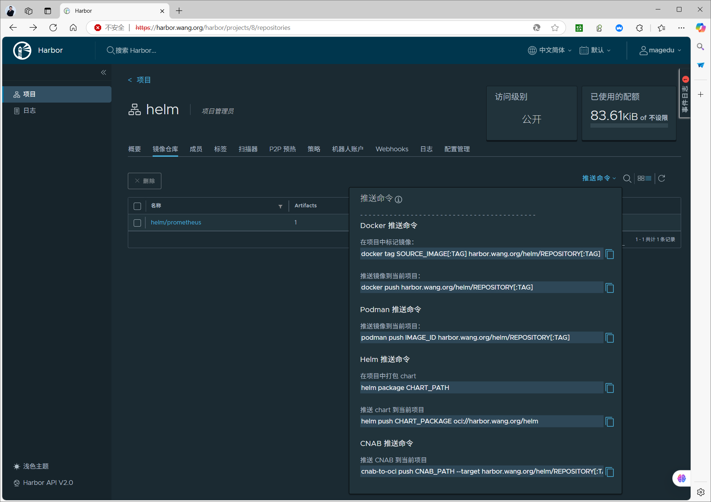

[← 返回 Kubernetes 目录]({{ '/subjects/Kubernetes/' | relative_url }})



# 29 自定义 Helm Chart

上一章使用现成 Chart；本章从一个最小 Web 服务出发，说明 Chart 目录、内置对象、模板函数、条件与循环，以及安装、升级、回滚和发布。关键原则是：**先渲染并核查 YAML，再把 Release 应用到集群**。模板语法正确不代表 Kubernetes 资源一定有效，也不代表应用已经就绪。

## 29.1 Chart 的结构与数据来源

```text
myweb/
├── Chart.yaml              # Chart 名称、版本与应用版本
├── values.yaml             # 默认值
├── charts/                 # 可选的依赖 Chart
└── templates/              # 渲染为 Kubernetes 资源的模板
    ├── deployment.yaml
    └── service.yaml
```

`Chart.yaml` 的 `version` 是 Chart 自身版本，`appVersion` 仅说明应用版本，不会自动更换容器镜像。模板中的 `.Values` 来自默认值、自定义值文件与 `--set`；`.Release.Name`、`.Release.Namespace` 来自当前 Release；`.Chart.Name`、`.Chart.Version` 来自 Chart 元数据；`.Capabilities` 提供目标集群 API 能力。`$` 指向根作用域，因此进入 `with` 或 `range` 后仍可通过 `$.Release.Name` 访问全局对象。

```yaml
# myweb/Chart.yaml
apiVersion: v2
name: myweb
description: 演示 Helm 模板与 Release 生命周期
type: application
version: 0.1.0
appVersion: "1.27"
```

```yaml
# myweb/values.yaml
replicaCount: 2
image:
  repository: nginx
  tag: "1.27"
service:
  port: 80
  targetPort: 80
resources:
  requests:
    cpu: 50m
    memory: 64Mi
  limits:
    memory: 256Mi
```

`values.yaml` 不适合存放真实密码。密钥可由外部 Secret 管理，再让模板引用它；发布 Chart 时也不要把包含密码的临时值文件打包进去。

## 29.2 写出可渲染的模板

Deployment 与 Service 使用相同标签，确保 Service 能找到 Pod。下面模板里的空白控制符 `{{-` 会去除左侧多余空白，`toYaml | nindent` 将结构化值写成缩进正确的 YAML。

```yaml
# myweb/templates/deployment.yaml
apiVersion: apps/v1
kind: Deployment
metadata:
  name: {{ .Release.Name }}-web
  labels:
    app.kubernetes.io/name: {{ .Chart.Name }}
    app.kubernetes.io/instance: {{ .Release.Name }}
spec:
  replicas: {{ .Values.replicaCount }}
  selector:
    matchLabels:
      app.kubernetes.io/instance: {{ .Release.Name }}
  template:
    metadata:
      labels:
        app.kubernetes.io/instance: {{ .Release.Name }}
    spec:
      containers:
        - name: web
          image: "{{ .Values.image.repository }}:{{ .Values.image.tag }}"
          ports:
            - name: http
              containerPort: {{ .Values.service.targetPort }}
          resources:
            {{- toYaml .Values.resources | nindent 12 }}
```

```yaml
# myweb/templates/service.yaml
apiVersion: v1
kind: Service
metadata:
  name: {{ .Release.Name }}-web
spec:
  type: ClusterIP
  selector:
    app.kubernetes.io/instance: {{ .Release.Name }}
  ports:
    - name: http
      port: {{ .Values.service.port }}
      targetPort: http
```

上例可通过 `helm create myweb` 初始化目录，再按所需保留或替换生成的模板；不要同时留下默认的 Deployment/Service 模板，否则可能渲染出两套资源。

## 29.3 函数、条件、循环与作用域

- `default` 提供缺省值，例如 `{{ .Values.image.tag | default .Chart.AppVersion | quote }}`；但显式设置为 `false`、`0` 或空字符串时也会被视为“空”，需按业务需求判断是否合适。
- `required` 对必填值给出清晰错误，例如 `{{ required "必须设置 service.port" .Values.service.port }}`。
- `quote` 使字符串值明确带引号；`toYaml` 配合 `nindent` 适合输出标签、资源限制等嵌套结构。
- `if` 决定是否生成片段，`range` 遍历列表或映射，`with` 将当前作用域切到某个对象。使用 `include` 可调用 `_helpers.tpl` 里的命名模板。

条件与循环通常写在模板文件中，而不是写进渲染后的 Kubernetes YAML。下面按 `values.yaml` 的 `extraEnv` 列表生成容器环境变量：

```yaml
# values.yaml 片段
extraEnv:
  - name: APP_MODE
    value: production
```

```yaml
# Deployment 容器片段
{{- with .Values.extraEnv }}
          env:
{{- range . }}
            - name: {{ .name | quote }}
              value: {{ .value | quote }}
{{- end }}
{{- end }}
```

进入 `with` 或 `range` 后，`.` 指向局部对象。如果要在循环里取 Release 名，使用 `{{ $.Release.Name }}`，或先保存根对象 `{{- $root := . -}}`。缩进不确定时先运行 `helm template --debug`，再核查具体资源清单。

## 29.4 验证、升级与回滚

```bash
helm lint ./myweb
helm template demo ./myweb --namespace demo --debug > rendered.yaml
helm upgrade --install demo ./myweb --namespace demo --create-namespace --wait
helm -n demo status demo
kubectl -n demo get deployment,service,pod
```

把新镜像版本写到自定义值文件，再执行 `helm upgrade`。`helm history` 显示 Release 修订号；`helm rollback demo 1` 会创建一次**新的修订**，将 Kubernetes 清单恢复为修订 1 的内容，历史不会被删除。

```bash
helm upgrade demo ./myweb --namespace demo --set image.tag=1.28 --wait
helm -n demo history demo
helm -n demo rollback demo 1 --wait
helm -n demo status demo
```

回滚不会自动恢复数据库 schema、PVC 数据或外部系统状态。因此数据迁移应有独立的前向/回退方案，不能仅依赖 Helm 修订历史。

## 29.5 打包、OCI 发布与清理

`helm package` 从 `Chart.yaml` 读取包名与版本，输出 `.tgz`。发布到支持 OCI 的仓库时先创建仓库项目，再使用 `helm registry login`；不要在命令行参数中直接写密码，优先使用标准输入或系统凭据存储。仓库地址、证书与权限必须在当前环境中核实。

```bash
helm package ./myweb
helm registry login registry.example.test --username USERNAME
helm push myweb-0.1.0.tgz oci://registry.example.test/charts
helm pull oci://registry.example.test/charts/myweb --version 0.1.0
helm -n demo uninstall demo
```

卸载 Release 会删除该 Release 管理的 Kubernetes 资源；PVC 与后端数据是否保留取决于模板、保留注解和 PV 回收策略，清理前应逐项确认。





<nav class="article-end" aria-label="章节导航">
  <a href="{{ '/subjects/Kubernetes/28-helm-cases.html' | relative_url }}">← 上一章：Helm 应用部署案例</a>
  <a href="{{ '/subjects/Kubernetes/' | relative_url }}">返回 Kubernetes 目录</a>
  <a href="{{ '/subjects/Kubernetes/30-security-authentication.html' | relative_url }}">下一章：安全体系与身份认证 →</a>
</nav>
