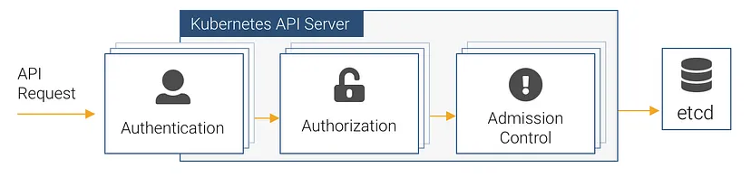
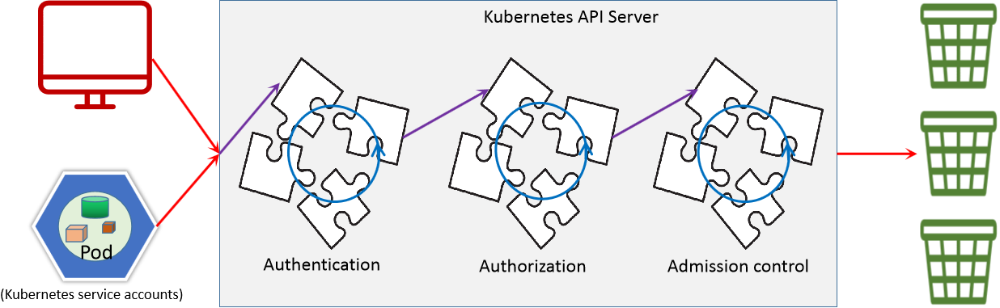
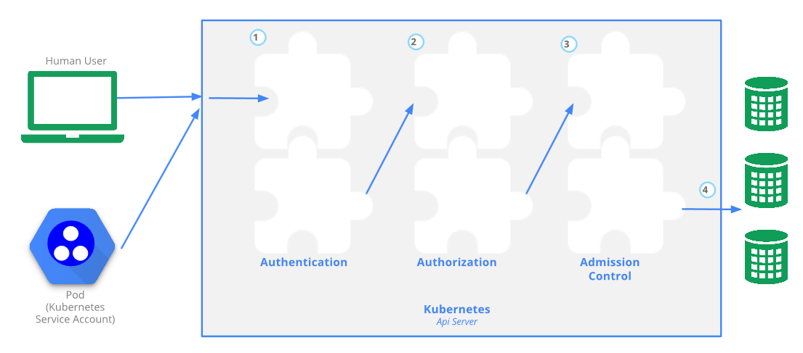
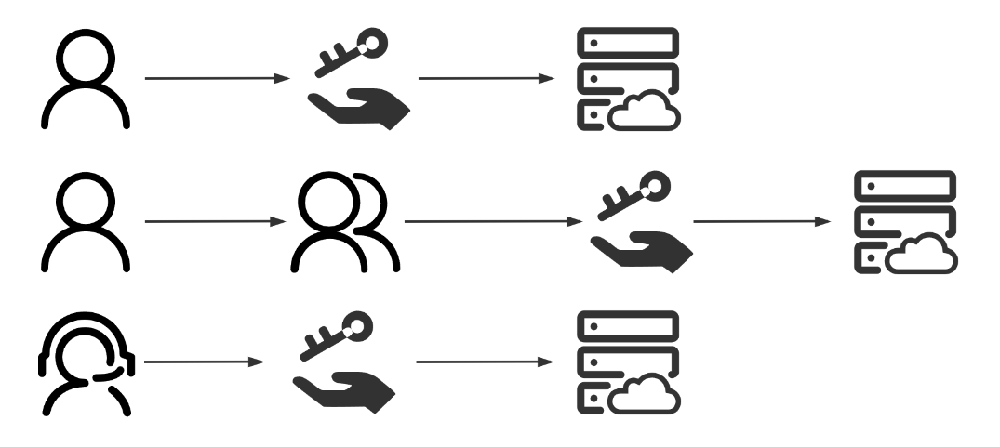
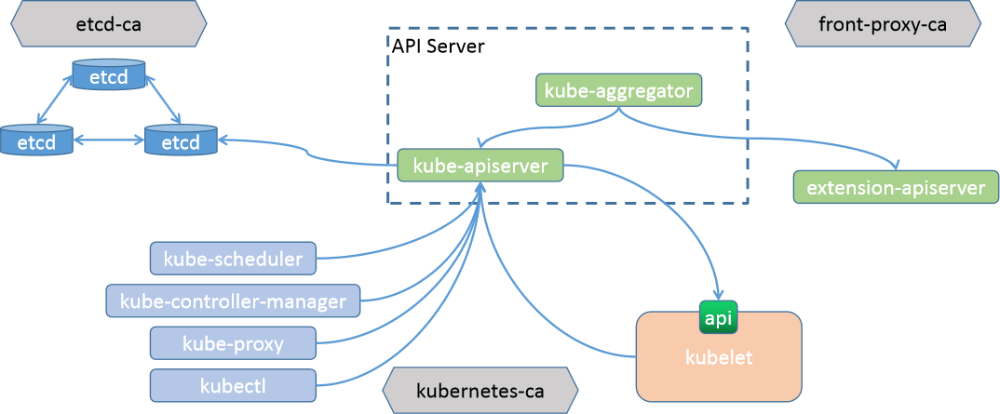
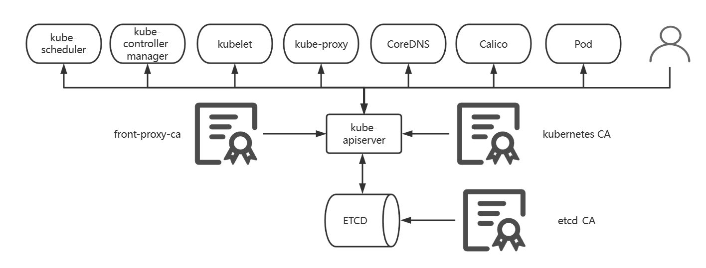
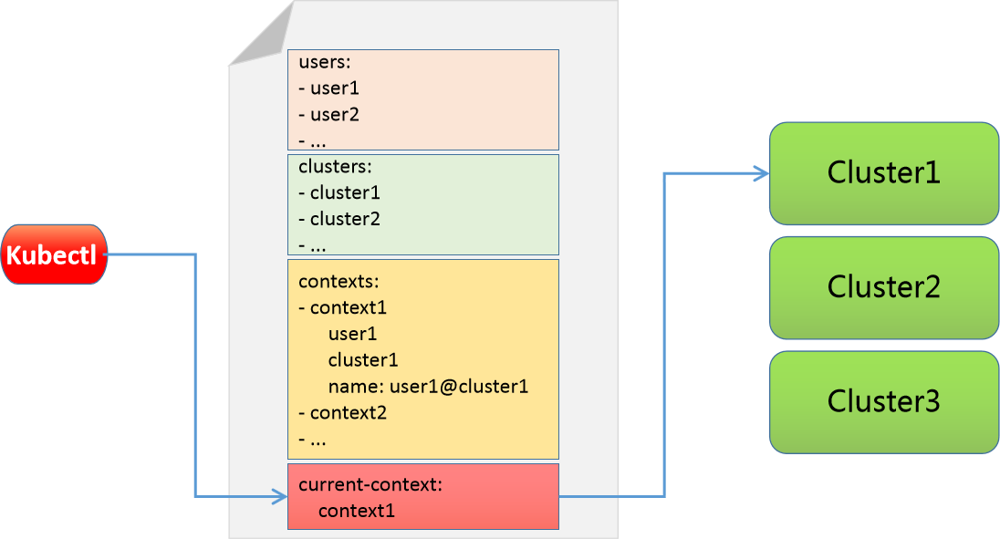

[← 返回 Kubernetes 目录]({{ '/subjects/Kubernetes/' | relative_url }})



# 30 安全体系与身份认证

# 1 安全体系

对于一些重要应用场景，其权限的认证管理都是非常重要的，对于linux系统，用户和组、文件权限、SELinux、防火墙、pam、sudo等，究其核心的目的都是为了保证系统是安全的。对于kubernetes的这种大型的任务编排系统来说，同样也陆续产生了一系列对平台的权限认证、对业务的权限认证、对网络的安全认证等认证体系。

这里专门针对平台和应用的权限认证来进行详细说明

用户访问kubernetes业务应用的流程：

无需api_server认证

访问业务服务

用户 <-----> service  <----->  pod

用户 <-----> ingress <-----> service  <----->  pod

基于api_server认证

访问和管理kubernetes平台上各种应用对象。对于Kubernetes平台来说，几乎所有的管理操作基本上都是通过kube apiserver这个组件进行的，该组件提供HTTP RESTful形式的API供集群内外客户端调用。对于kubernetes集群的部署样式主要有两种：http形式和https形式。采用kubeadm部署的形式默认对外是基于https的方式，而内部组件间的通信时基于http方式。

Kubernetes 强烈推荐仅使用 HTTPS 暴露 API Server，默认安装工具（如 kubeadm ）会强制启用HTTPS 并禁用 HTTP。如果客户端通过 HTTP 明文连接 API Server，且未明确配置匿名访问，请求会被拒绝（返回 403 Forbidden ），因为默认的认证/授权机制（如 TLS 客户端证书、Bearer Token、Webhook 等）仅作用于 HTTPS 流量。kubernetes的认证授权机制仅仅存在于https形式的api访问中，也就是说，如果客户端使用HTTP连接到kube-apiserver，那么是不会进行认证授权的，这样既增加了安全性，也不至于太复杂。

kubelet 和kube apiserver类似，提供一个简单的REST API 服务，也监听一些TCP的套接字。

10250:具有所在节点上Pod管理权限的读写端口，应谨慎管理10255:仅提供只读操作，是REST API的子集,新版不再使用10248:是本地healthz端点使用的端口

**安全基本流程**


- <https://kubernetes.io/zh-cn/docs/reference/access-authn-authz/>


对APIServer的访问一般都要经过的三个步骤的安全访问控制。



认证 Authentication授权 Authorization准入控制 Admission control

此安全机制在一定程度上提高安全性，不过更多是资源管理方面的作用。认证,授权和准入控制功能都是以插件化的方式来实现的，这样可以最大化的用户自定义灵活性。

**步骤解析**

对用户进行身份认证，只允许被许可的用户才能进入集群内部，认证失败返回401。遵循“或”逻辑,且任何一个插件核验成功后都将不再进行后续的插件验证，即短。

认证(Authn)

路模式前面的插件检查失败,则检查下一个插件,如里都不成功,才失败,或以匿名身份访问。

不同用户获取不同的资源操作权限，比如普通用户、超级用户等。权限不足返回403<

**授权(Authz)**

鉴权过程遵循“或”逻辑，且任何一个插件许可授权后都将不再进行后续的插件验证，即短路模式如果都未许可,则拒绝请求。用户认证、授权之后，当进行一些写操作的时候，需要遵循的一些限制性的校验要求,比如资源限制内容合规性检查遵循“与”逻辑，且无论成败，每次操作都要经由所有插件检验,最后统一返回结。

准入控制

果，执行一票否决制

(Admission)

只对写操作进行合规性检查，在授权范围内，对用户的某些命令或者操作进行进一步的限制分为两类: validaing 校验(合规性,资源默认和最大和最小限制)和 mutating 变更(补全,默认值填充)。



左侧：kubernetes主要有两种用户：

**User Account**：普通人类用户(交互模式)Service Account:集群内部的pod用户(服务进程)。

中间：每个部分都是以插件的方式来整合到 kubernetes 集群环境中：

认证和授权是按照插件的顺序依次进行检测，并且遵循 "短路模型" 的认证方式。所谓的"短路"即，失败的时候，到此结束,后续的规则不会进行。准入控制 由于仅用户写操作场景，所以它不遵循 "短路模型"，而是会全部检测通过才允许执行。原因在于，它要记录为什么不执行，原因是什么，方便后续审计等动作。



# 2 认证机制

主要涉及到用户帐号UA和服务帐号SA的认证内容。



## 2.1 认证机制说明

### 2.1.1 Kubernetes 中的用户


- <https://kubernetes.io/zh-cn/docs/reference/access-authn-authz/authentication/>


所有 Kubernetes 集群都有两类用户：由 Kubernetes 管理的服务账号和普通用户。在 Kubernetes 中，subject 是指一个对象或实体，该对象或实体可以是用户、服务帐户、组或其他可识别的实体。它在授权策略中用于标识哪些实体被允许或被拒绝访问资源。简而言之，subject 就是需要被授权访问资源的实体。认证用户即属于Subject。

在Kubernetes集群中定义了两种类型的subject资源的认证用户：

**用户种类解析**

用户账户，指非Pod类的客户端访问API Server时使用的身份标识，一般是现实中的“人”API Server没有为这类账户提供保存其信息的资源类型，相关的信息通常保存于外部。

User

的文件或认证系统中,由外部独立服务进行管理，所以用户不能通过集群内部的 API 来。

Account

进行管理。身份核验操作可由API Server进行，也可能是由外部身份认证服务完成作用域为整个集群级别,常见的管理方式，如： openssl等。

Service Accounts（SA）在 Kubernetes 中是一种内建的、与 Pod 关联的账号类型。它们主要是为了在Pod中运行的进程提供一个身份标识，以便访问 Kubernetes API所有Pod默认使用default名称空间的default的SA用户通过Kubernetes API 来管理的用户帐号，适用于集群中Pod内的进程访问API Server。

Service

时使用的身份信息，需要通过 API 来完成权限认证。

Account

API Server使用ServiceAccount类型的资源对象来保存该类账号认证到API Server的认证信息称为Service Account Token，它们保存于同名的专用类型的Secret对象中在集群内部进行权限操作，都需要使用到 ServiceAccount namespace 别级的资源类型,即帐号隶属于名称空间,但可以授予集群级别的权限。

匿名用户不能被识别为Service Account，也不能被识别为User Account的用户，即“匿名用户”。

Kubernetes 假定普通用户是由一个与集群无关的服务通过以下方式之一进行管理的：

负责分发私钥的管理员类似 Keystone 或者 Google Accounts 这类用户数据库包含用户名和密码列表的文件。

有鉴于此，Kubernetes 并不包含用来代表普通用户账号UA的对象。 普通用户的信息无法通过 API 调用添加到集群中。尽管无法通过 API 调用来添加普通用户， Kubernetes 仍然认为能够提供由集群的证书机构签名的合法证书的用户是通过身份认证的用户。 基于这样的配置，Kubernetes 使用证书中的 'subject' 的通用名称（Common Name）字段 （例如，"/CN=bob"）来确定用户名。 接下来，基于角色访问控制（RBAC）子系统会确定用户是否有权针对某资源执行特定的操作。

与此不同，服务账号是 Kubernetes API 所管理的用户。它们被绑定到特定的名字空间， 或者由 API 服务器自动创建，或者通过 API 调用创建。服务账号与一组以 Secret 保存的凭据相关，这些凭据会被挂载到 Pod 中，从而允许集群内的进程访问 Kubernetes API。API 请求则或者与某普通用户相关联，或者与某服务账号相关联， 亦或者被视作匿名请求。这意味着集群内外的每个进程在向 API 服务器发起请求时都必须通过身份认证，否则会被视作匿名用户。这里的进程可以是在某工作站上输入 kubectl 命令的操作人员，也可以是节点上的 kubelet 组件，还可以是控制面的成员。

### 2.1.2 用户组

在kubernetes集群中，为了更方便的对某一类用户帐号UA进行方便管理，一般会通过用户组的方式来进行管理。

注意:  Kubernetes 不支持将一个SA服务帐户加入一个指定的组中,但是可以通过RBAC机制创建一个授权的角色,再将服务帐户和角色绑定实现相似的授权功能。

Kubernetes常见的内置用户组有以下四类：

**用户组解析**

system:unauthenticated未能通过任何一个授权插件检验的账号的所有未通过认证测试的用户。

统一隶属的用户组

system:authenticated认证成功后的用户自动加入的一个专用组，用于快捷引用所有正常通。

过认证的用户账号

system:serviceaccounts所有名称空间中的所有ServiceAccount对象。

system:serviceaccounts:特定名称空间内所有的ServiceAccount对象。

Kubernetes本身并没有对用户或用户组的内建概念或实体。在Kubernetes中，用户和组是在身份提供者（如OpenID Connect，Active Directory等）中创建和管理的，而不是在Kubernetes集群自身中创建。所以，无法直接在Kubernetes中创建组。在Kubernetes中，用户和用户组主要在认证 (Authentication) 和授权 (Authorization) 环节中发挥作用。这就意味着在Kubernetes中没有直接的方式去查看用户或用户组。

通常情况下，用户和用户组是在Kubernetes集群外部定义和管理的。这可能是在使用的身份提供商（例如OpenID或Active Directory）中或者在Kubeconfig文件中定义的。对于用户组，Kubernetes RBAC (Role-Based Access Control) 可以使用 "Group" 字段来限定对某些资源的访问。例如，您可能有一个RoleBinding或ClusterRoleBinding，其subjects字段包括一个特定的group，这就意味着这个绑定是对应的用户组。

所以，如果想要查看当前Kubernetes集群中的用户和用户组，通常需要查看的是外部身份提供商的设置或Kubeconfig文件。同时，您可以查看在Kubernetes中定义的RBAC策略，以理解哪些用户和用户组有权访问特定资源。

在Kubernetes中，服务帐户(ServiceAccount)默认会被放入两个组之一：
```text
system:serviceaccounts （表示集群中的所有服务帐户）和system:serviceaccounts:
```

<namespace> （表示给定命名空间中的所有服务帐户）。这些是内置的组。

范例：查看用户组kubeadm:cluster-admins的权限（新版）
```yaml
[root@master1 ~]#kubectl get nodes
NAME               STATUS     ROLES           AGE   VERSION
master1.bowen.org   Ready      control-plane   96d   v1.30.0
node1.bowen.org     Ready      <none>          96d   v1.30.0
node2.bowen.org     NotReady   <none>          96d   v1.30.0
node3.bowen.org     NotReady   <none>          96d   v1.30.0

[root@master1 ~]#diff /etc/kubernetes/admin.conf .kube/config

[root@master1 ~]#grep client-certificate-data .kube/config |awk  '{print
$NF}'|base64 -d | openssl x509 -noout -subject
subject=O = kubeadm:cluster-admins, CN = kubernetes-admin

#新版：查看role角色cluster-admin同名的clusterrolebinding，分配权限给kubeadm:cluster-
admins组
[root@master1 ~]#kubectl get clusterrolebinding  kubeadm:cluster-admins -o yaml
apiVersion: rbac.authorization.k8s.io/v1
kind: ClusterRoleBinding
metadata:
creationTimestamp: "2024-07-15T03:05:26Z"
name: kubeadm:cluster-admins
resourceVersion: "201"
uid: a92b105a-78c6-4d71-9533-3da5c76a4f72
roleRef:
apiGroup: rbac.authorization.k8s.io
kind: ClusterRole
name: cluster-admin
subjects:
- apiGroup: rbac.authorization.k8s.io
kind: Group
name: kubeadm:cluster-admins
```

范例：查看用户组system:masters的权限(旧版)
```yaml
[root@master1 ~]#kubectl get nodes
NAME               STATUS   ROLES           AGE    VERSION
master1.bowen.org   Ready    control-plane   511d   v1.26.2
node1.bowen.org     Ready    <none>          511d   v1.26.2
node2.bowen.org     Ready    <none>          511d   v1.26.2
node3.bowen.org     Ready    <none>          511d   v1.26.2

[root@master1 ~]#diff /etc/kubernetes/admin.conf .kube/config
[root@master1 ~]#grep client-certificate-data .kube/config |awk  '{print
$NF}'|base64 -d | openssl x509 -noout -subject
subject=O = system:masters, CN = kubernetes-admin
[root@master1 ~]#kubectl get clusterrolebinding  cluster-admin -o yaml
apiVersion: rbac.authorization.k8s.io/v1
kind: ClusterRoleBinding
metadata:
annotations:
rbac.authorization.kubernetes.io/autoupdate: "true"
creationTimestamp: "2023-03-04T15:36:34Z"
labels:
kubernetes.io/bootstrapping: rbac-defaults
name: cluster-admin
resourceVersion: "135"
uid: 6a335ccd-6e56-4161-a365-5faa12bb15b1
roleRef:
apiGroup: rbac.authorization.k8s.io
kind: ClusterRole
name: cluster-admin
subjects:
- apiGroup: rbac.authorization.k8s.io
kind: Group
name: system:masters
```

范例：查看用户组system:masters的权限(旧版)


#所有的k8s集群资源操作，其实都是通过node节点上的kubelet和master节点上的apiserver之间的通信实现，而在kubernetes的认证目录中有其专用的通信认证证书 apiserver-kubelet-client.crt，可以通过该文件来检查一下这两者之间是一个怎样的关系。

```yaml
#新版
[root@master1 ~]#openssl x509 -in /etc/kubernetes/pki/apiserver-kubelet-
client.crt  -text -noout
Certificate:
Data:
Version: 3 (0x2)
Serial Number: 6571974555277789823 (0x5b345809c83d0a7f)
Signature Algorithm: sha256WithRSAEncryption
Issuer: CN = kubernetes
Validity
Not Before: Jul 15 03:00:20 2024 GMT
Not After : Jul 15 03:05:20 2025 GMT
Subject: O = kubeadm:cluster-admins, CN = kube-apiserver-kubelet-client

#旧版
[root@master1 ~]#openssl x509 -in /etc/kubernetes/pki/apiserver-kubelet-
client.crt  -text -noout
Certificate:
...
Issuer: CN = kubernetes
Validity
Not Before: Oct  3 03:06:43 2021 GMT
Not After : Oct  3 03:06:43 2022 GMT
Subject: O=system:masters, CN=kube-apiserver-kubelet-client
...
#结果显示：对于kubelet，用户名是kube-apiserver-kubelet-client，而且属于system:master的
组，这两者的关系是在基于openssl或者csffl工具创建用户时候基于CN和O来设定的信息。

#查看集群角色的权限
[root@master1 ~]#kubectl get clusterrole  cluster-admin -o yaml
apiVersion: rbac.authorization.k8s.io/v1
kind: ClusterRole
metadata:
annotations:
rbac.authorization.kubernetes.io/autoupdate: "true"
creationTimestamp: "2021-08-21T01:07:21Z"
labels:
kubernetes.io/bootstrapping: rbac-defaults
name: cluster-admin
resourceVersion: "109"
uid: 66442981-6f7d-4168-94b9-0797012eef8a
rules:
- apiGroups:
- '*'
resources:
- '*'
verbs:
- '*'

- nonResourceURLs:
- '*'
verbs:
- '*'

#新版：查看role角色cluster-admin同名的clusterrolebinding，分配权限给kubeadm:cluster-
admins组
[root@master1 ~]#kubectl get clusterrolebinding  kubeadm:cluster-admins -o yaml
apiVersion: rbac.authorization.k8s.io/v1
kind: ClusterRoleBinding
metadata:
creationTimestamp: "2024-07-15T03:05:26Z"
name: kubeadm:cluster-admins
resourceVersion: "201"
uid: a92b105a-78c6-4d71-9533-3da5c76a4f72
roleRef:
apiGroup: rbac.authorization.k8s.io
kind: ClusterRole
name: cluster-admin
subjects:
- apiGroup: rbac.authorization.k8s.io
kind: Group
name: kubeadm:cluster-admins

#旧版：查看role角色cluster-admin同名的clusterrolebinding，分配权限给system:masters组
[root@master1 ~]#kubectl get clusterrolebinding  cluster-admin -o yaml
apiVersion: rbac.authorization.k8s.io/v1
kind: ClusterRoleBinding
metadata:
annotations:
rbac.authorization.kubernetes.io/autoupdate: "true"
creationTimestamp: "2021-08-21T01:07:21Z"
labels:
kubernetes.io/bootstrapping: rbac-defaults
name: cluster-admin
resourceVersion: "138"
uid: 67e002c3-1deb-47c8-9e4e-f5e932633610
roleRef:
apiGroup: rbac.authorization.k8s.io
kind: ClusterRole
name: cluster-admin
subjects:
- apiGroup: rbac.authorization.k8s.io
kind: Group
name: system:masters        #对组system:masters进行角色绑定
```

### 2.1.3 认证插件


Kubernetes 通过身份认证插件利用客户端证书、持有者令牌（Bearer Token）或身份认证代理（Proxy） 来认证 API 请求的身份。

HTTP 请求发给 API 服务器时，插件会将以下属性关联到请求本身：

用户名：用来辩识最终用户的字符串。常见的值可以是 kube-admin 或 jane@example.com 。用户 ID：用来辩识最终用户的字符串，旨在比用户名有更好的一致性和唯一性。用户组：取值为一组字符串，其中各个字符串用来标明用户是某个命名的用户逻辑集合的成员。 常见的值可能是 system:masters 或者 devops-team 等。附加字段：一组额外的键-值映射，键是字符串，值是一组字符串； 用来保存一些鉴权组件可能觉得有用的额外信息。

kubernetes提供了多种认证方式，可以同时使用一种或多种认证方式，只要通过任何一个成功即被认作是认证通过。即或关系。

常见的认证方式如下：

**认证方式解析**

TLS双向认证，客户端持有数字证书,API Server信任客户端证书的颁发者.即服务器客户端互相验证信任的CA需要在kube-apiserver启动时,通过--client-ca-file选项指定.

X509

证书中的Subject中的 CN(CommonName)即被识别为用户名，而O（Organization）。

客户端

被识别为组名

证书认

对于这种客户的账号，k8s是无法管理的。为了使用这个方案，api-server需要用--。

证

client-ca-file、--tls-private-key-file、--tls-cert-file选项来开启。kubeadm部署的Kubernetes集群，默认使用 /etc/kubernetes/pki/ca.crt 进行客户端认证,此文件是kubeadm为Kubernetes各组件间颁发数字证书的CA。

在节点数量非常多的时候，大量手动配置TLS认证比较麻烦，可以通过在api-server开启 experimental-bootstrap-token-auth 特性，通过对客户端的和k8s平台预先定义的

令牌认

token信息进行匹配，认证通过后，自动为节点颁发证书，可以大大减轻工作量，而且。

证

应用场景非常广。

(Token)

包括: Service Account 令牌,静态令牌文件,Bootstrap令牌,OIDC(OpenID Connect)令牌,Webhook 令牌 等。

代理认证一般借助于中间代理的方式来进行统用的认证方式，样式不固定。

匿名无法认证的其它请求

#### API Server启用的身份认证机制

基于认证插件支持多种认证方式，而相应认证插件的启用需要经由kube-apiserver上的专用选项完成。kubeadm 部署的集群默认启用的认证机制包括如下几种。

X509客户端证书认证Bootstrap令牌认证前端代理身份认证 front-proxy Service Account 令牌

注意：API Server并不保证各认证插件的生效次序与定义的次序相同。

范例:  查看API Server 的认证机制
```yaml
#在Master节查看认证机制
[root@master1 ~]#cat /etc/kubernetes/manifests/kube-apiserver.yaml
apiVersion: v1
kind: Pod
metadata:
annotations:
kubeadm.kubernetes.io/kube-apiserver.advertise-address.endpoint:
10.0.0.200:6443
creationTimestamp: null
labels:
component: kube-apiserver
tier: control-plane
name: kube-apiserver
namespace: kube-system
spec:
containers:
- command:

- kube-apiserver
- --advertise-address=10.0.0.200
- --allow-privileged=true
- --authorization-mode=Node,RBAC,
- --client-ca-file=/etc/kubernetes/pki/ca.crt    #X509客户端认证,此CA颁发的证书对
应的用户都是合法用户
- --enable-admission-plugins=NodeRestriction
- --enable-bootstrap-token-auth=true             #Bootstrap 令牌认证
- --etcd-cafile=/etc/kubernetes/pki/etcd/ca.crt
- --etcd-certfile=/etc/kubernetes/pki/apiserver-etcd-client.crt
- --etcd-keyfile=/etc/kubernetes/pki/apiserver-etcd-client.key
- --etcd-servers=https://127.0.0.1:2379
- --kubelet-client-certificate=/etc/kubernetes/pki/apiserver-kubelet-
client.crt
- --kubelet-client-key=/etc/kubernetes/pki/apiserver-kubelet-client.key
- --kubelet-preferred-address-types=InternalIP,ExternalIP,Hostname
- --proxy-client-cert-file=/etc/kubernetes/pki/front-proxy-client.crt   #身份
认证代理
- --proxy-client-key-file=/etc/kubernetes/pki/front-proxy-client.key    #身份
认证代理
- --requestheader-allowed-names=front-proxy-client                      #身份
认证代理
- --requestheader-client-ca-file=/etc/kubernetes/pki/front-proxy-ca.crt #身份
认证代理
- --requestheader-extra-headers-prefix=X-Remote-Extra-                  #身份
认证代理
- --requestheader-group-headers=X-Remote-Group                          #身份
认证代理
- --requestheader-username-headers=X-Remote-User                        #身份
认证代理
- --secure-port=6443
- --service-account-issuer=https://kubernetes.default.svc.cluster.local #SA认
证
- --service-account-key-file=/etc/kubernetes/pki/sa.pub                 #SA认
证
- --service-account-signing-key-file=/etc/kubernetes/pki/sa.key         #SA认
证
- --service-cluster-ip-range=10.96.0.0/12
- --tls-cert-file=/etc/kubernetes/pki/apiserver.crt
- --tls-private-key-file=/etc/kubernetes/pki/apiserver.key
image: registry.aliyuncs.com/google_containers/kube-apiserver:v1.26.2
imagePullPolicy: IfNotPresent
livenessProbe:
failureThreshold: 8
httpGet:
host: 10.0.0.200
path: /livez
port: 6443
scheme: HTTPS
initialDelaySeconds: 10
periodSeconds: 10
timeoutSeconds: 15
name: kube-apiserver
readinessProbe:
failureThreshold: 3
httpGet:
host: 10.0.0.200
path: /readyz

port: 6443
scheme: HTTPS
periodSeconds: 1
timeoutSeconds: 15
resources:
requests:
cpu: 250m
startupProbe:
failureThreshold: 24
httpGet:
host: 10.0.0.200
path: /livez
port: 6443
scheme: HTTPS
initialDelaySeconds: 10
periodSeconds: 10
timeoutSeconds: 15
volumeMounts:
- mountPath: /etc/ssl/certs
name: ca-certs
readOnly: true
- mountPath: /etc/ca-certificates
name: etc-ca-certificates
readOnly: true
- mountPath: /etc/pki
name: etc-pki
readOnly: true
- mountPath: /etc/kubernetes/pki
name: k8s-certs
readOnly: true
- mountPath: /usr/local/share/ca-certificates
name: usr-local-share-ca-certificates
readOnly: true
- mountPath: /usr/share/ca-certificates
name: usr-share-ca-certificates
readOnly: true
hostNetwork: true
priorityClassName: system-node-critical
securityContext:
seccompProfile:
type: RuntimeDefault
volumes:
- hostPath:
path: /etc/ssl/certs
type: DirectoryOrCreate
name: ca-certs
- hostPath:
path: /etc/ca-certificates
type: DirectoryOrCreate
name: etc-ca-certificates
- hostPath:
path: /etc/pki
type: DirectoryOrCreate
name: etc-pki
- hostPath:
path: /etc/kubernetes/pki
type: DirectoryOrCreate
name: k8s-certs

- hostPath:
path: /usr/local/share/ca-certificates
type: DirectoryOrCreate
name: usr-local-share-ca-certificates
- hostPath:
path: /usr/share/ca-certificates
type: DirectoryOrCreate
name: usr-share-ca-certificates
status: {}
```

**Kubelet启用的身份认证机制**：kubelet的REST API端点默认通过TCP协议的10250端口提供，支持管理操作。

Kubelet API功能简介

/pods列出当前kubelet节点上的Pod

/run在一个容器内运行指定的命令

/exec在一个容器内运行指定的命令

/configz设置Kubelet的配置文件参数

/debug调试信息

需要对客户端身份进行认证

**启用的身份认证**：webhook,x509客户端证书认证。

注意：建议显式禁用匿名用户

API Server是该API端点的客户端，因此，kubelet需要在验证客户端身份时信任给API Server颁发数字证书的CA。

范例:  查看 Kubelet 的认证机制
```yaml
#在每个worker节点查看
[root@node1 ~]#cat /var/lib/kubelet/config.yaml
apiVersion: kubelet.config.k8s.io/v1beta1
authentication:
anonymous:
enabled: false      #匿名认证，true为允许匿名访问，但是权限不足
webhook:
cacheTTL: 0s        #Webhook 认证
enabled: true
x509:
clientCAFile: /etc/kubernetes/pki/ca.crt  #证书认证
authorization:
mode: Webhook
webhook:
cacheAuthorizedTTL: 0s
cacheUnauthorizedTTL: 0s
cgroupDriver: systemd
clusterDNS:
- 10.96.0.10
clusterDomain: cluster.local
cpuManagerReconcilePeriod: 0s

evictionPressureTransitionPeriod: 0s
fileCheckFrequency: 0s
healthzBindAddress: 127.0.0.1
healthzPort: 10248
httpCheckFrequency: 0s
imageMinimumGCAge: 0s
kind: KubeletConfiguration
logging:
flushFrequency: 0
options:
json:
infoBufferSize: "0"
verbosity: 0
memorySwap: {}
nodeStatusReportFrequency: 0s
nodeStatusUpdateFrequency: 0s
resolvConf: /run/systemd/resolve/resolv.conf
rotateCertificates: true
runtimeRequestTimeout: 0s
shutdownGracePeriod: 0s
shutdownGracePeriodCriticalPods: 0s
staticPodPath: /etc/kubernetes/manifests
streamingConnectionIdleTimeout: 0s
syncFrequency: 0s
volumeStatsAggPeriod: 0s

#如果修改,不建议修改/var/lib/kubelet/config.yaml配置文件,而通过修改对应的configmap实现
[root@master1 ~]#kubectl get cm kubelet-config  -n kube-system  -o yaml
apiVersion: v1
data:
kubelet: |
apiVersion: kubelet.config.k8s.io/v1beta1
authentication:
anonymous:
enabled: false
webhook:
cacheTTL: 0s
enabled: true
x509:
clientCAFile: /etc/kubernetes/pki/ca.crt
authorization:
mode: Webhook
webhook:
cacheAuthorizedTTL: 0s
cacheUnauthorizedTTL: 0s
cgroupDriver: systemd
clusterDNS:
- 10.96.0.10
clusterDomain: cluster.local
cpuManagerReconcilePeriod: 0s
evictionPressureTransitionPeriod: 0s
fileCheckFrequency: 0s
healthzBindAddress: 127.0.0.1
healthzPort: 10248
httpCheckFrequency: 0s
imageMinimumGCAge: 0s
kind: KubeletConfiguration
logging:

flushFrequency: 0
options:
json:
infoBufferSize: "0"
verbosity: 0
memorySwap: {}
nodeStatusReportFrequency: 0s
nodeStatusUpdateFrequency: 0s
resolvConf: /run/systemd/resolve/resolv.conf
rotateCertificates: true
runtimeRequestTimeout: 0s
shutdownGracePeriod: 0s
shutdownGracePeriodCriticalPods: 0s
staticPodPath: /etc/kubernetes/manifests
streamingConnectionIdleTimeout: 0s
syncFrequency: 0s
volumeStatsAggPeriod: 0s
kind: ConfigMap
metadata:
annotations:
kubeadm.kubernetes.io/component-config.hash:
sha256:000a5dd81630f64bd6f310899359dfb9e8818fc8fe011b7fdc0ec73783a42452
creationTimestamp: "2023-03-07T04:30:22Z"
name: kubelet-config
namespace: kube-system
resourceVersion: "200"
uid: e4834954-b6a4-494a-a1e0-5bc7d3cad278
```

## 2.2  User Account 管理

### 2.2.1 X509客户端认证

#### 2.2.1.1 X509客户端认证说明

**官方说明**


- <https://kubernetes.io/zh/docs/setup/best-practices/certificates/>


Kubernetes集群中的X509客户端认证依赖于PKI证书体系,有如下三套CA证书系统。



kubeadm部署Kubernetes集群时会自动生成所需要的证书，它们位于/etc/kubernetes/pki自录下。

文件Default CN说明

ca.crt,ca.key kubernetes-ca Kubernetes general CA

etcd/ca.crt,etcd/ca.key etcd-ca For all etcd-related

functions

front-proxy-ca.crt,front-proxy-

kubernetes-front-

ca.crt.key

proxy-ca For the front-end proxy

对于一个kubernetes集群，它依赖三个CA颁发的所有相关的证书。



默认 CN父级 CA Organization类型主机 (SAN)

localhost ,

kube-etcd etcd-ca server,
```text
127.0.0.1
```

client

<hostname> ,<Host_IP> ,

kube-etcd-peer etcd-ca server,

client

localhost ,
```text
127.0.0.1
```

kube-etcd-healthcheck-

etcd-ca client

client

kube-apiserver-etcd-client etcd-ca system:masters client

<hostname> ,<Host_IP> ,

kube-apiserver kubernetes-ca server

<advertise_IP> ,
```text
[1]
```

kube-apiserver-kubelet-client kubernetes-ca system:masters client

front-proxy-

kubernetes-

client

front-proxy-ca client

各kubelet的证书可在Bootstrap过程中自动生成证书签署请求，而后由Kubernetes CA予以签署。各kube-proxy、kube-scheduler和kube-controller-manager也都有相应的数字证书以完成向API Server的身份认证。

#### 2.2.1.2 案例: 创建基于X509客户端用户证书

##### 2.2.1.2.1 方法1：基于openssl 命令创建管理证书

###### 2.2.1.2.1.1 创建基于X509客户端普通的用户证书

范例：创建基于X509客户端普通的用户证书，并使用此证书访问kubernetes集群
```bash
#查看到以下内容，表示默认kubernetes的CA签发的证书，都是k8s客户端的用户
[root@master1 ~]#grep '\-\-client-ca-file' /etc/kubernetes/manifests/kube-
apiserver.yaml
- --client-ca-file=/etc/kubernetes/pki/ca.crt

#在master节点创建test用户证书
[root@master1 ~]#mkdir pki
[root@master1 ~]#(umask 077; openssl genrsa -out pki/test.key 4096)
[root@master1 ~]#ls pki/
test.key

#生成证书申请,加入ops组只具有普通权限
[root@master1 ~]#openssl req -new -key pki/test.key -out pki/test.csr -subj
"/CN=bowen/O=ops"

#使用kubernetes-ca颁发证书
[root@master1 ~]#openssl x509 -req -days 3650 -CA /etc/kubernetes/pki/ca.crt -
CAkey  /etc/kubernetes/pki/ca.key -CAcreateserial -in pki/test.csr -out
pki/test.crt

#复制证书文件到到worker节点
[root@master1 ~]#scp -r pki/ node1:

#在worker节点使用证书访问kubernetes集群,权限不足
[root@node1 ~]#ls pki/
test.crt  test.csr  test.key
[root@node1 ~]#ls /etc/kubernetes/pki/
ca.crt

#默认从worker节点因为API-Server地址错误的原因，所以无法访问,报错如下
[root@node1 ~]#kubectl get pod
E0415 20:16:30.966136  668159 memcache.go:238] couldn't get current server API
group list: Get "http://localhost:8080/api?timeout=32s": dial tcp 127.0.0.1:8080:
connect: connection refused

#验证身份
#方法1:指定apiserver地址和证书信息等信息,再次执行可以看到下面提示已识别用户test，但无权限访问
资源
[root@node1 ~]#kubectl get pod  --server=https://kubeapi.bowen.org:6443 --client-
certificate=pki/test.crt  --client-key=pki/test.key --certificate-
authority=/etc/kubernetes/pki/ca.crt
Error from server (Forbidden): pods is forbidden: User "bowen" cannot
list resource "pods" in API group "" in the namespace "default"

#方法2:下面选项忽略证书校验也可以

[root@node1 ~]#kubectl get pod -s https://kubeapi.bowen.org:6443 --client-
certificate=pki/test.crt  --client-key=pki/test.key  --insecure-skip-tls-
verify=true
Error from server (Forbidden): pods is forbidden: User "bowen" cannot
list resource "pods" in API group "" in the namespace "default"

#方法3:通过curl使用证书访问，仍是权限不足，无法访问
[root@node1 ~]#curl --cert pki/test.crt --key pki/test.key --key-type PEM --
cacert /etc/kubernetes/pki/ca.crt https://kubeapi.bowen.org:6443
{
"kind": "Status",
"apiVersion": "v1",
"metadata": {},
"status": "Failure",
"message": "forbidden: User \"bowen\" cannot get path \"/\"",
"reason": "Forbidden",
"details": {},
"code": 403
}
```

###### 2.2.1.2.1.2 创建基于X509客户端管理员的用户证书

范例：创建X509客户端管理员的用户证书，并使用此证书访问 Kubernetes 集群
```yaml
#创建管理员用户bowen证书
[root@master1 ~]#(umask 077; openssl genrsa -out pki/bowen.key 4096)
[root@master1 ~]#ls pki
test.crt  test.csr  test.key  bowen.key

#生成证书申请文件,注意：加入kubeadm:cluster-admins/system:masters组或System组才具有管理
权限

#新版v1.32.0以后版本
[root@master1 ~]#openssl req -new -key pki/bowen.key -out pki/bowen.csr -subj
"/CN=bowen/O=kubeadm:cluster-admins"
#旧版：v1.31.0以前版本
[root@master1 ~]#openssl req -new -key pki/bowen.key -out pki/bowen.csr -subj
"/CN=bowen/O=system:masters"
[root@master1 ~]#ls pki
test.crt  test.csr  test.key  bowen.csr  bowen.key

#查看到system:masters组被授权ClusterRole角色,具有集群的管理权限
#新版
[root@master1 ~]#kubectl get clusterrolebinding  kubeadm:cluster-admins -o yaml
apiVersion: rbac.authorization.k8s.io/v1
kind: ClusterRoleBinding
metadata:
creationTimestamp: "2024-07-15T03:05:26Z"
name: kubeadm:cluster-admins
resourceVersion: "201"
uid: a92b105a-78c6-4d71-9533-3da5c76a4f72
roleRef:
apiGroup: rbac.authorization.k8s.io
kind: ClusterRole
name: cluster-admin
subjects:
- apiGroup: rbac.authorization.k8s.io

kind: Group
name: kubeadm:cluster-admins

#旧版
[root@master1 ~]#kubectl get clusterrolebindings.rbac.authorization.k8s.io
cluster-admin -o yaml
apiVersion: rbac.authorization.k8s.io/v1
kind: ClusterRoleBinding
metadata:
annotations:
rbac.authorization.kubernetes.io/autoupdate: "true"
creationTimestamp: "2021-03-07T04:30:21Z"
labels:
kubernetes.io/bootstrapping: rbac-defaults
name: cluster-admin
resourceVersion: "134"
uid: 0923463d-aa18-480e-b22c-e2e8b0925f0c
roleRef:
apiGroup: rbac.authorization.k8s.io
kind: ClusterRole
name: cluster-admin
subjects:
- apiGroup: rbac.authorization.k8s.io
kind: Group
name: system:masters

#使用kubernetes-ca颁发证书
[root@master1 ~]#openssl x509 -req -days 3650 -CA /etc/kubernetes/pki/ca.crt -
CAkey /etc/kubernetes/pki/ca.key -CAcreateserial -in pki/bowen.csr -out
pki/bowen.crt
Certificate request self-signature ok
subject=CN = bowen, O = system:masters

[root@master1 ~]#ls pki
test.crt  test.csr  test.key  bowen.crt  bowen.csr  bowen.key

[root@master1 ~]#scp -r pki/ node1.bowen.org:

#worker节点使用证书访问测试
[root@node1 ~]#kubectl  get pods -s https://kubeapi.bowen.org:6443 --certificate-
authority=/etc/kubernetes/pki/ca.crt --client-certificate=pki/bowen.crt  --client-
key=pki/bowen.key
NAME                        READY   STATUS    RESTARTS      AGE
pod-test-6d8c97ff75-qt8zq   1/1     Running   1 (10h ago)   2d
pod-test-6d8c97ff75-rhwkv   1/1     Running   1 (10h ago)   2d
pod-test-6d8c97ff75-tmtl9   1/1     Running   1 (10h ago)   2d

#curl命令使用证书访问
[root@node1 ~]#curl --cert pki/bowen.crt --key pki/bowen.key --key-type PEM --
cacert /etc/kubernetes/pki/ca.crt https://kubeapi.bowen.org:6443/api
{
"kind": "APIVersions",
"versions": [
"v1"
],
"serverAddressByClientCIDRs": [
{

"clientCIDR": "0.0.0.0/0",
"serverAddress": "10.0.0.200:6443"
}
]
}

#注意：如果在master节点执行会出现下面提示错
[root@master1 ~]#kubectl  get pods -s https://kubeapi.bowen.org:6443 --
certificate-authority=/etc/kubernetes/pki/ca.crt --client-
certificate=pki/bowen.crt  --client-key=pki/bowen.key
Error in configuration:
* client-cert-data and client-cert are both specified for kubernetes-admin.
client-cert-data will override.
* client-key-data and client-key are both specified for kubernetes-admin;
client-key-data will override

#提示错误的原因:$HOME/.kube/config文件还有其它用户身份，解决方法如下
[root@master1 ~]#mv ~/.kube/config  /tmp
#再次执行成功
[root@master1 ~]#kubectl  get pods -s https://kubeapi.bowen.org:6443 --
certificate-authority=/etc/kubernetes/pki/ca.crt --client-
certificate=pki/bowen.crt  --client-key=pki/bowen.key
NAME                        READY   STATUS    RESTARTS      AGE
pod-test-6d8c97ff75-qt8zq   1/1     Running   1 (10h ago)   2d
pod-test-6d8c97ff75-rhwkv   1/1     Running   1 (10h ago)   2d
pod-test-6d8c97ff75-tmtl9   1/1     Running   1 (10h ago)   2d

#报错
[root@master1 ~]#kubectl get pod
E0415 20:16:30.966136  668159 memcache.go:238] couldn't get current server API
group list: Get "http://localhost:8080/api?timeout=32s": dial tcp 127.0.0.1:8080:
connect: connection refused

#还原环境
[root@master1 ~]#mv /tmp/config ~/.kube/
#测试成功
[root@master1 ~]#kubectl get pod
```

##### 2.2.1.2.2 方法2: Kubernetes的API资源实现证书管理功能
```yaml
#创建私钥
[root@master1 ~]#openssl genrsa -out bowen.key 2048

#创建证书申请
[root@master1 ~]#openssl req -new -key bowen.key -out bowen.csr -subj
"/CN=bowen/O=devops"

#查看证书信息
[root@master1 ~]#cat bowen.csr |base64 |tr -d "\n"

LS0tLS1CRUdJTiBDRVJUSUZJQ0FURSBSRVFVRVNULS0tLS0KTUlJQ1pUQ0NBVTBDQVFBd0lERU5NQXNH
QTFVRUF3d0VkMkZ1WnpFUE1BMEdBMVVFQ2d3R1pHVjJiM0J6TUlJQgpJakFOQmdrcWhraUc5dzBCQVFF
RkFBT0NBUThBTUlJQkNnS0NBUUVBa3VjSjl4UjVHRnZ4WEdXWmdCQWxVYk14Ckk3a1VqYk5wbTQ2MlpW
Y3NqbFcrUTIyUFRoRWVOeVRiOVNDaXNqcFlPenBUVmd5eFpJcmFLY211ZHZCSjBTSGkKMVlreXRWUWZ6
WFBqYllibzNLVW4zcitVdHVDM2pVbXRPZGUyczNWbFZ3NzlVaXJ3SHcxTHFua0djMWlFWmVYaQpocE9U
T21mUDBKM1BqdnI0THdRUTQvbUVyVkFtVmd2dTI4cFdOcE5IUXlVZVF6c1BPQVBJZ0lWVFVmc2J5QXhu
CnVLZWcrUm8zV2VCcGpwS0FlOU1TT2xIV2xNd0dLbzFnTjU2aUcvVVh2RHFTREdVMGI0QnBpZnZLbkE4
Rm90NmgKMWVpV1Y2YUxtc3p3WUkzeG51dGRTblZoQVRXVWtLKzZtenpyQlZ0Qmx6VE5kSGtOQmVSZHBQ
TzdSVTJZdVFJRApBUUFCb0FBd0RRWUpLb1pJaHZjTkFRRUxCUUFEZ2dFQkFIU0d6K1NLb3VJVFUvdmsv
Smg0cE9pV2xFcTlhQkdVClc3SHVSZEZ5R1djMkpOdWhYMExzLzgrZ3ArcWtEVUhVeWJYdkpoYmpxNFEx
dGM3NFlEQmpISTlmaFY3aEZ1ZUsKZ1lGUHY3cmR5TXhwL2N0K2VIZzU5RCtkQWtWY3p1NzNYOXBQeWZO
alhMTmc1WENMOThrOTZyc284NTBlS1FoMQp2M2hDTndHU3drb2gya05LVWdwb3lYNGVzaGFTWDR6WWdy
YUlrLzFVcG41Zyt2b1lPc1BtOHNFOURYQ3ovbXhuCkRMSWJXZCtmeWdSVE1EM0xsTDVHbUMxU0tybFU1
NHpmNjRlWnNiemlNWWJWMS9IUGRjZkI3WVRvS1dybXB6RTAKYi96TUVHaldxM3AwOVpOZzNxa0pNZTJO
ck94YUpzTXhub09EbmR5T3huZEJUUnlFMEtKZ1hXWT0KLS0tLS1FTkQgQ0VSVElGSUNBVEUgUkVRVUVT
VC0tLS0tCg==

#将CSR进行base64编码后，创建为Kubernetes的CSR资源对象，并提交给API Server
[root@master1 ~]#vim securiy-certificaterequests-bowen.yaml
apiVersion: certificates.k8s.io/v1
kind: CertificateSigningRequest
metadata:
name: bowen
spec: #将上面生成的证书信息填定在下面
request:
LS0tLS1CRUdJTiBDRVJUSUZJQ0FURSBSRVFVRVNULS0tLS0KTUlJQ1pUQ0NBVTBDQVFBd0lERU5NQXNH
QTFVRUF3d0VkMkZ1WnpFUE1BMEdBMVVFQ2d3R1pHVjJiM0J6TUlJQgpJakFOQmdrcWhraUc5dzBCQVFF
RkFBT0NBUThBTUlJQkNnS0NBUUVBa3VjSjl4UjVHRnZ4WEdXWmdCQWxVYk14Ckk3a1VqYk5wbTQ2MlpW
Y3NqbFcrUTIyUFRoRWVOeVRiOVNDaXNqcFlPenBUVmd5eFpJcmFLY211ZHZCSjBTSGkKMVlreXRWUWZ6
WFBqYllibzNLVW4zcitVdHVDM2pVbXRPZGUyczNWbFZ3NzlVaXJ3SHcxTHFua0djMWlFWmVYaQpocE9U
T21mUDBKM1BqdnI0THdRUTQvbUVyVkFtVmd2dTI4cFdOcE5IUXlVZVF6c1BPQVBJZ0lWVFVmc2J5QXhu
CnVLZWcrUm8zV2VCcGpwS0FlOU1TT2xIV2xNd0dLbzFnTjU2aUcvVVh2RHFTREdVMGI0QnBpZnZLbkE4
Rm90NmgKMWVpV1Y2YUxtc3p3WUkzeG51dGRTblZoQVRXVWtLKzZtenpyQlZ0Qmx6VE5kSGtOQmVSZHBQ
TzdSVTJZdVFJRApBUUFCb0FBd0RRWUpLb1pJaHZjTkFRRUxCUUFEZ2dFQkFIU0d6K1NLb3VJVFUvdmsv
Smg0cE9pV2xFcTlhQkdVClc3SHVSZEZ5R1djMkpOdWhYMExzLzgrZ3ArcWtEVUhVeWJYdkpoYmpxNFEx
dGM3NFlEQmpISTlmaFY3aEZ1ZUsKZ1lGUHY3cmR5TXhwL2N0K2VIZzU5RCtkQWtWY3p1NzNYOXBQeWZO
alhMTmc1WENMOThrOTZyc284NTBlS1FoMQp2M2hDTndHU3drb2gya05LVWdwb3lYNGVzaGFTWDR6WWdy
YUlrLzFVcG41Zyt2b1lPc1BtOHNFOURYQ3ovbXhuCkRMSWJXZCtmeWdSVE1EM0xsTDVHbUMxU0tybFU1
NHpmNjRlWnNiemlNWWJWMS9IUGRjZkI3WVRvS1dybXB6RTAKYi96TUVHaldxM3AwOVpOZzNxa0pNZTJO
ck94YUpzTXhub09EbmR5T3huZEJUUnlFMEtKZ1hXWT0KLS0tLS1FTkQgQ0VSVElGSUNBVEUgUkVRVUVT
VC0tLS0tCg==
signerName: kubernetes.io/kube-apiserver-client
expirationSeconds: 8640000
usages:
- client auth

[root@master1 ~]#kubectl apply -f securiy-certificaterequests-bowen.yaml
certificatesigningrequest.certificates.k8s.io/bowen created

[root@master1 ~]#kubectl get csr
NAME   AGE   SIGNERNAME                            REQUESTOR
REQUESTEDDURATION   CONDITION
bowen   13s   kubernetes.io/kube-apiserver-client   kubernetes-admin   100d
Pending

#以kubernetes管理员身份，颁发证书
[root@master1 ~]#kubectl certificate approve bowen

certificatesigningrequest.certificates.k8s.io/bowen approved

#查看状态已颁发
[root@master1 ~]#kubectl get csr
NAME   AGE   SIGNERNAME                            REQUESTOR
REQUESTEDDURATION   CONDITION
bowen   50s   kubernetes.io/kube-apiserver-client   kubernetes-admin   100d
Approved,Issued

#获取证书
[root@master1 ~]#kubectl get csr bowen -o jsonpath={.status.certificate}|base64 -d
> bowen.crt

[root@master1 ~]#cat bowen.crt
-----BEGIN CERTIFICATE-----
MIIDBjCCAe6gAwIBAgIRAMZsUjMXeJvzlst5Ot7UgwUwDQYJKoZIhvcNAQELBQAw
FTETMBEGA1UEAxMKa3ViZXJuZXRlczAeFw0yNDA3MjcxNTQ4MDZaFw0yNDExMDQx
NTQ4MDZaMCAxDzANBgNVBAoTBmRldm9wczENMAsGA1UEAxMEd2FuZzCCASIwDQYJ
KoZIhvcNAQEBBQADggEPADCCAQoCggEBAJLnCfcUeRhb8VxlmYAQJVGzMSO5FI2z
aZuOtmVXLI5VvkNtj04RHjck2/UgorI6WDs6U1YMsWSK2inJrnbwSdEh4tWJMrVU
H81z422G6NylJ96/lLbgt41JrTnXtrN1ZVcO/VIq8B8NS6p5BnNYhGXl4oaTkzpn
z9Cdz476+C8EEOP5hK1QJlYL7tvKVjaTR0MlHkM7DzgDyICFU1H7G8gMZ7inoPka
N1ngaY6SgHvTEjpR1pTMBiqNYDeeohv1F7w6kgxlNG+AaYn7ypwPBaLeodXollem
i5rM8GCN8Z7rXUp1YQE1lJCvups86wVbQZc0zXR5DQXkXaTzu0VNmLkCAwEAAaNG
MEQwEwYDVR0lBAwwCgYIKwYBBQUHAwIwDAYDVR0TAQH/BAIwADAfBgNVHSMEGDAW
gBQYBw71g89xRG+mdl4X756AouGILTANBgkqhkiG9w0BAQsFAAOCAQEAHc1B44O+
8kM89c+JMkDouBPkQCEjx/rsgs5XDbO2xK2jtZCkCzU5Ssl91y7VoFG9Aa6xV264
AyGm+dA6T3zHzy53FodCLfGoFBrwM0y/r9Up4tWyLy8bS6VzGUtZS6HXnzyNneyW
tveHG7lNWYuGxiH8GR0hVZYH/3yWA2a4dDfK9Bdpcjl0pem7pwHCbauJEAc5Bdpc
8jPA9Jz9SwtdrlPvmmOddGXv78YMM5aLJDDb8Mq/dKsC3NCWB9lBPXa+XrSG5nUQ
Qy949nHoe5tzA8/ctncqZIlOof3I4dZ99ka2W9ESRi7bG9a/ZimZYkGK4p3jYyZb
nPZpYPD37pIwLw==
-----END CERTIFICATE-----

#用户证书访问
[root@master1 ~]#scp bowen.crt bowen.key  node1.bowen.org:

#验证访问
#方法1：
[root@node1 ~]#kubectl  get pods -s https://kubeapi.bowen.org:6443 --certificate-
authority=/etc/kubernetes/pki/ca.crt --client-certificate=/tmp/bowen.crt  --
client-key=/tmp/bowen.key
Error from server (Forbidden): pods is forbidden: User "bowen" cannot list
resource "pods" in API group "" in the namespace "default"

#方法2：
[root@node1 ~]#kubectl  get pods -s https://kubeapi.bowen.org:6443 --insecure-
skip-tls-verify=true --client-certificate=/tmp/bowen.crt  --client-
key=/tmp/bowen.key
Error from server (Forbidden): pods is forbidden: User "bowen" cannot
list resource "pods" in API group "" in the namespace "default"
```

### 2.2.2 令牌Token认证

#### 2.2.2.1 常见的令牌认证

引导令牌

kubeadm创建集群初始化环境时，自动创建好的一次性令牌，用于其他节点加入到集群环境中。

**静态令牌**

将用户和令牌存放于有一定格式的文本文件中,并启动API Server进程时加载此文件，该文件内容会由API Server缓存于内存中。由kube-apiserver在启动时通过--token-auth-file选项加载,默认没有加载此选项。加载完成后的文件变动，仅能通过重启程序进行重载，因此，相关的令牌会长期有效。客户端在HTTP请求中，通过“Authorization Bearer TOKEN”标头附带令牌以完成认证。

比如在使用kubelet的时候，需要依赖的token文件。

**静态密码**

存储于API Server进程可直接加载到的文件中保存的账户和密码令牌，该文件内容会由API Server缓存于内存中。比如在使用kubelet的时候，需要依赖的.kube/config文件。

Service Account 令牌

此令牌专用于ServiceAccount

用于将Pod认证到API Server 上，以支持集群内的进程与API Server通信。该认证方式将由kube-apiserver程序内置直接启。用它借助于经过签名的Bearer Token来验证请求。签名时使用的密钥可以由--service-account-key-file选项指定，也可以默认使用API Server的tls私钥。

Kubernetes可使用ServiceAccount准入控制器自动为Pod关联ServiceAccount。

**OIDC令牌**

OIDC 就是 OpenID Connect，是一种动态令牌,主要应用于集成第三方认证的一种集中式认证方式。

比如: KeyCloak,通常遵循OAuth 2协议。尤其是第三方云服务商的认证。

Webhook令牌

常应用于触发第三方的动作时候的一些认证机制，主要侧重于http协议场景。

#### 2.2.2.2 静态令牌认证实现

**静态令牌认证的配置说明**

令牌信息保存于格式为CSV的文本文件，每行定义一个用户，由“令牌、用户名、用户ID和所属的用户组”四个字段组成，用户组为可选字段。
```text
#格式：
token,user,uid,"group1,group2,....."
```

由kube-apiserver在启动时通过--token-auth-file选项加载。加载完成后如果再有文件变动，需要通过重启kube-apiserver进行重载。可在客户端在HTTP请求中，通过“Authorization: Bearer TOKEN”标头附带令牌令牌以完成认证。

静态令牌认证配置过程

生成token，命令如下：
```bash
echo "$(openssl rand -hex 3).$(openssl rand -hex 8)"
```

生成static token文件

配置kube-apiserver加载该静态令牌文件以启用相应的认证功能。

测试命令：
```bash
#方法1
curl -k -H "Authorization: Bearer $TOKEN"
https://API_SERVER:6443/api/v1/namespaces/default/pods/
#方法2
kubectl --insecure-skip-tls-verify  --token=$TOKEN -s
https://kubeapi.bowen.org:6443 get pod

#说明： TOKEN表示上面用户生成的token
```

范例:  基于静态token令牌向API Server添加认证用户
```bash
#在所有Master节点上配置下面过程,如果只有一个Master节点配置,只能连接此Master节点测试
#准备Token文件存放的独立目录
[root@master1 ~]#mkdir /etc/kubernetes/auth

#创建静态令牌文件并添加用户信息
[root@master1 ~]#echo "$(openssl rand -hex 3).$(openssl rand -hex
8),bowen,1001,ops" > /etc/kubernetes/auth/token.csv
[root@master1 ~]#echo "$(openssl rand -hex 3).$(openssl rand -hex
8),test,1002,dev" >> /etc/kubernetes/auth/token.csv

#新版添加管理员用户
[root@master1 ~]#echo "$(openssl rand -hex 3).$(openssl rand -hex
8),admin,1002,kubeadm:cluster-admins" >> /etc/kubernetes/auth/token.csv
#旧版添加管理员用户
[root@master1 ~]#echo "$(openssl rand -hex 3).$(openssl rand -hex
8),admin,1002,kubeadm:system:masters" >> /etc/kubernetes/auth/token.csv

[root@master1 ~]#cat /etc/kubernetes/auth/token.csv
BOOTSTRAP_TOKEN,bowen,1001,ops
BOOTSTRAP_TOKEN,test,1002,dev
BOOTSTRAP_TOKEN,admin,1003,kubeadm:cluster-admins

#先备份配置文件，注意：不要将备份文件放在原目录下
[root@master1 ~]#cp /etc/kubernetes/manifests/kube-apiserver.yaml .

#直接修改原文件三次
[root@master1 ~]#vim /etc/kubernetes/manifests/kube-apiserver.yaml
......
- command:
- kube-apiserver
- --token-auth-file=/etc/kubernetes/auth/token.csv  #加一行，指定前面创建文件的路
径
- --advertise-address=10.0.0.200
- --allow-privileged=true
- --authorization-mode=Node,RBAC

- --client-ca-file=/etc/kubernetes/pki/ca.crt

.....
volumeMounts:
......
- mountPath: /etc/kubernetes/auth                   #添加三行,实现数据卷的挂载配
置,注意：此处是目录
name: static-auth-token
readOnly: true
hostNetwork: true
......
volumes:
.......
- hostPath:                                           #添加四行数据卷定义
path: /etc/kubernetes/auth                        #注意：此处是目录
type: DirectoryOrCreate
name: static-auth-token
status: {}
.....

#上面文件修改后,Kubernetes会自动重启名为kube-apiserver-master1.bowen.org的Pod,可能需要等
一会儿才能启动成功
[root@master1 ~]#kubectl get pod -n kube-system kube-apiserver-master1.bowen.org
NAME                              READY   STATUS    RESTARTS   AGE
kube-apiserver-master1.bowen.org   1/1     Running   0          45s

#查看容器是否加载了token.csv文件
[root@master1 ~]#docker ps |grep api
109a085e8573   63d3239c3c15                                        "kube-
apiserver --ad…"   11 minutes ago      Up 11 minutes                k8s_kube-
apiserver_kube-apiserver-master1.bowen.org_kube-
system_ea7b1e231e4db35575d1ce2d202143cb_0
70aa628e4602   registry.aliyuncs.com/google_containers/pause:3.7   "/pause"
11 minutes ago      Up 11 minutes                k8s_POD_kube-
apiserver-master1.bowen.org_kube-system_ea7b1e231e4db35575d1ce2d202143cb_0

[root@master1 ~]#docker inspect 109 |grep -n token.csv
11:            "--token-auth-file=/etc/kubernetes/auth/token.csv",
303:                "--token-auth-file=/etc/kubernetes/auth/token.csv",

#验证方法1:使用上面任意用户的token访问,提示用户bowen被禁止访问，说明用户验证成功，只是权限不足
#注意:如果只是修改一个master节点的配置,只能连接此节点测试,示例:  "https://修改配置的master
节点:6443/api/....."

[root@master1 ~]#TOKEN="BOOTSTRAP_TOKEN";
[root@node1 ~]#curl -k -H "Authorization: Bearer $TOKEN"
https://kubeapi.bowen.org:6443
{
"kind": "Status",
"apiVersion": "v1",
"metadata": {},
"status": "Failure",
"message": "forbidden: User \"bowen\" cannot get path \"/\"",
"reason": "Forbidden",
"details": {},
"code": 403
}

[root@master1 ~]#curl -k -H "Authorization: Bearer $TOKEN"
https://kubeapi.bowen.org:6443/api/v1/namespaces/default/pods/
#结果如下
{
"kind": "Status",
"apiVersion": "v1",
"metadata": {},
"status": "Failure",
"message": "pods is forbidden: User \"bowen\" cannot list resource \"pods\" in
API group \"\" in the namespace \"default\"",
"reason": "Forbidden",
"details": {
"kind": "pods"
},
"code": 403
}

#管理员访问
```
```bash
[root@ubuntu2204 ~]#TOKEN="BOOTSTRAP_TOKEN";curl -k -H "Authorization:
Bearer $TOKEN"  https://kubeapi.bowen.org:6443/api/v1/namespaces/kube-system/pods/
"kind": "PodList",
"apiVersion": "v1",
"metadata": {
"resourceVersion": "341495"
},
"items": [
{
"metadata": {
"name": "coredns-855c4dd65d-fz59g",
.....

#验证方法2:忽略证书验证，在worker节点执行,提示用户bowen被禁止访问，说明用户验证成功，只是权限不
足
#注意:如果只是修改一下master节点的配置,只能连接此节点测试,示例: -s "https://修改配置的
master节点:6443"
[root@node1 ~]#kubectl -s "https://kubeapi.bowen.org:6443" --token="$TOKEN"  --
certificate-authority=/etc/kubernetes/pki/ca.crt  get pod
[root@node1 ~]#TOKEN="BOOTSTRAP_TOKEN";kubectl -s
"https://kubeapi.bowen.org:6443" --token="$TOKEN"  --insecure-skip-tls-verify=true
get pod
Error from server (Forbidden): pods is forbidden: User "bowen" cannot list
resource "pods" in API group "" in the namespace "default"

#管理员访问
[root@node1 ~]#TOKEN="BOOTSTRAP_TOKEN";kubectl -n kube-system -s
"https://kubeapi.bowen.org:6443" --token="$TOKEN" --insecure-skip-tls-verify=true
get pod
NAME                                       READY   STATUS    RESTARTS        AGE
coredns-855c4dd65d-fz59g                   1/1     Running   3 (7h45m ago)   9d
coredns-855c4dd65d-pb78b                   1/1     Running   3 (7h45m ago)   9d
etcd-master1.bowen.org                      1/1     Running   6 (7h45m ago)   15d
kube-apiserver-master1.bowen.org            1/1     Running   0
9m16s
kube-controller-manager-master1.bowen.org   1/1     Running   8 (9m42s ago)   15d
kube-proxy-472v7                           1/1     Running   4 (7h45m ago)   10d

kube-proxy-4nlj6                           1/1     Running   5 (7h9m ago)    10d
kube-proxy-jpml5                           1/1     Running   4 (7h45m ago)   10d
kube-proxy-khsjs                           1/1     Running   7 (7h45m ago)   10d
kube-scheduler-master1.bowen.org            1/1     Running   7 (9m41s ago)   15d
metrics-server-76467c74d9-llzqz            1/1     Running   8 (7h45m ago)   13d

#验证方法3：证书验证
[root@node1 ~]#TOKEN="BOOTSTRAP_TOKEN";kubectl -s
"https://kubeapi.bowen.org:6443" --token="$TOKEN"  --certificate-
authority='/etc/kubernetes/pki/ca.crt'  get pod
Error from server (Forbidden): pods is forbidden: User "bowen" cannot list
resource "pods" in API group "" in the namespace "default"

#管理员访问
[root@node1 ~]#TOKEN="BOOTSTRAP_TOKEN";kubectl -n kube-system -s
"https://kubeapi.bowen.org:6443" --token="$TOKEN"  --certificate-
authority='/etc/kubernetes/pki/ca.crt'  get pod
NAME                                       READY   STATUS    RESTARTS        AGE
coredns-855c4dd65d-fz59g                   1/1     Running   3 (7h41m ago)   9d
coredns-855c4dd65d-pb78b                   1/1     Running   3 (7h41m ago)   9d
etcd-master1.bowen.org                      1/1     Running   6 (7h41m ago)   15d
kube-apiserver-master1.bowen.org            1/1     Running   0
5m24s
kube-controller-manager-master1.bowen.org   1/1     Running   8 (5m50s ago)   15d
kube-proxy-472v7                           1/1     Running   4 (7h41m ago)   10d
kube-proxy-4nlj6                           1/1     Running   5 (7h5m ago)    10d
kube-proxy-jpml5                           1/1     Running   4 (7h41m ago)   10d
kube-proxy-khsjs                           1/1     Running   7 (7h41m ago)   10d
kube-scheduler-master1.bowen.org            1/1     Running   7 (5m49s ago)   15d
metrics-server-76467c74d9-llzqz            1/1     Running   8 (7h41m ago)   13d

#使用错误Token访问，观察结果
[root@master1 ~]#TOKEN="123456";curl  -k -H "Authorization: Bearer $TOKEN"
https://kubeapi.bowen.org:6443/api/v1/namespaces/default/pods/
{
"kind": "Status",
"apiVersion": "v1",
"metadata": {},
"status": "Failure",
"message": "Unauthorized",
"reason": "Unauthorized",
"code": 401
}

#不使用Token访问，观察结果
[root@master1 ~]#curl  -k
https://kubeapi.bowen.org:6443/api/v1/namespaces/default/pods/
{
"kind": "Status",
"apiVersion": "v1",
"metadata": {},
"status": "Failure",
"message": "pods is forbidden: User \"system:anonymous\" cannot list resource
\"pods\" in API group \"\" in the namespace \"default\"",
"reason": "Forbidden",
"details": {
"kind": "pods"

},
"code": 403
}
```

## 2.3 kubeconfig  管理

### 2.3.1 kubeconfig 说明

#### 2.3.1.1 kubeconfig 文件介绍

前面介绍的使用X509或静态令牌方式创建用户帐号的命令行方式需要指定很多选项,无疑是很麻烦的。因此可以将用户的凭证信息保存在kubeconfig文件中方便使用。kubeconfig 是YAML格式的文件，用于存储身份认证信息，以便于客户端加载并认证接入到API Server。kubeconfig 保存有认证到一或多个Kubernetes集群的相关配置信息，并允许管理员按需在各配置间灵活切换。

通过kubeadm在创建集群的时候，其中有一步就是：生成kubernetes控制组件的kubeconfig文件及相关的启动配置文件,通过各种conf文件，让不同的组件具备操作相关资源的权限。

范例: 集群始始化的过程
```bash
[root@master1 ~]#kubeadm init --control-plane-endpoint kubeapi.bowen.org --
kubernetes-version=v1.22.1 --pod-network-cidr 10.244.0.0/16 --service-cidr
10.96.0.0/12  --image-repository registry.cn-
hangzhou.aliyuncs.com/google_containers --token-ttl=0
[init] Using Kubernetes version: v1.22.1
[preflight] Running pre-flight checks
[preflight] Pulling images required for setting up a Kubernetes cluster
[preflight] This might take a minute or two, depending on the speed of your
internet connection
[preflight] You can also perform this action in beforehand using 'kubeadm config
images pull'
[certs] Using certificateDir folder "/etc/kubernetes/pki"
[certs] Generating "ca" certificate and key
[certs] Generating "apiserver" certificate and key
[certs] apiserver serving cert is signed for DNS names [kubeapi.bowen.org
kubernetes kubernetes.default kubernetes.default.svc
kubernetes.default.svc.cluster.local master1.bowen.org] and IPs [10.96.0.1
10.0.0.101]
[certs] Generating "apiserver-kubelet-client" certificate and key
[certs] Generating "front-proxy-ca" certificate and key
[certs] Generating "front-proxy-client" certificate and key
[certs] Generating "etcd/ca" certificate and key
[certs] Generating "etcd/server" certificate and key
[certs] etcd/server serving cert is signed for DNS names [localhost
master1.bowen.org] and IPs [10.0.0.101 127.0.0.1 ::1]
[certs] Generating "etcd/peer" certificate and key
[certs] etcd/peer serving cert is signed for DNS names [localhost
master1.bowen.org] and IPs [10.0.0.101 127.0.0.1 ::1]
[certs] Generating "etcd/healthcheck-client" certificate and key
[certs] Generating "apiserver-etcd-client" certificate and key
[certs] Generating "sa" key and public key
[kubeconfig] Using kubeconfig folder "/etc/kubernetes"  #生成相关的kubeconfig文件
[kubeconfig] Writing "admin.conf" kubeconfig file        #生成相关的kubeconfig文件
```


[kubeconfig] Writing "kubelet.conf" kubeconfig file       #生成相关的kubeconfig文件[kubeconfig] Writing "controller-manager.conf" kubeconfig file  #生成相关的 kubeconfig文件[kubeconfig] Writing "scheduler.conf" kubeconfig file         #生成相关的 kubeconfig文件[kubelet-start] Writing kubelet environment file with flags to file"/var/lib/kubelet/kubeadm-flags.env"[kubelet-start] Writing kubelet configuration to file"/var/lib/kubelet/config.yaml"[kubelet-start] Starting the kubelet[control-plane] Using manifest folder "/etc/kubernetes/manifests"[control-plane] Creating static Pod manifest for "kube-apiserver"[control-plane] Creating static Pod manifest for "kube-controller-manager"[control-plane] Creating static Pod manifest for "kube-scheduler"[etcd] Creating static Pod manifest for local etcd in"/etc/kubernetes/manifests"[wait-control-plane] Waiting for the kubelet to boot up the control plane as static Pods from directory "/etc/kubernetes/manifests". This can take up to 4m0s[apiclient] All control plane components are healthy after 11.530951 seconds[upload-config] Storing the configuration used in ConfigMap "kubeadm-config" in the "kube-system" Namespace[kubelet] Creating a ConfigMap "kubelet-config-1.22" in namespace kube-system with the configuration for the kubelets in the cluster[upload-certs] Skipping phase. Please see --upload-certs[mark-control-plane] Marking the node master1.bowen.org as control-plane by adding the labels: [node-role.kubernetes.io/master(deprecated) node-role.kubernetes.io/control-plane node.kubernetes.io/exclude-from-external-load-balancers][mark-control-plane] Marking the node master1.bowen.org as control-plane by adding the taints [node-role.kubernetes.io/master:NoSchedule][bootstrap-token] Using token: BOOTSTRAP_TOKEN[bootstrap-token] Configuring bootstrap tokens, cluster-info ConfigMap, RBAC Roles[bootstrap-token] configured RBAC rules to allow Node Bootstrap tokens to get nodes[bootstrap-token] configured RBAC rules to allow Node Bootstrap tokens to post CSRs in order for nodes to get long term certificate credentials[bootstrap-token] configured RBAC rules to allow the csrapprover controller automatically approve CSRs from a Node Bootstrap Token[bootstrap-token] configured RBAC rules to allow certificate rotation for all node client certificates in the cluster[bootstrap-token] Creating the "cluster-info" ConfigMap in the "kube-public"namespace[kubelet-finalize] Updating "/etc/kubernetes/kubelet.conf" to point to a rotatable kubelet client certificate and key[addons] Applied essential addon: CoreDNS[addons] Applied essential addon: kube-proxy

```bash
Your Kubernetes control-plane has initialized successfully!

To start using your cluster, you need to run the following as a regular user:

mkdir -p $HOME/.kube
sudo cp -i /etc/kubernetes/admin.conf $HOME/.kube/config  #配置使用kubeconfig文件
才能访问集群
sudo chown $(id -u):$(id -g) $HOME/.kube/config

Alternatively, if you are the root user, you can run:

export KUBECONFIG=/etc/kubernetes/admin.conf
```


You should now deploy a pod network to the cluster. Run "kubectl apply -f [podnetwork].yaml" with one of the options listed at:

<https://kubernetes.io/docs/concepts/cluster-administration/addons/>

```bash
You can now join any number of control-plane nodes by copying certificate
authorities
and service account keys on each node and then running the following as root:

kubeadm join kubeapi.bowen.org:6443 --token BOOTSTRAP_TOKEN \
--discovery-token-ca-cert-hash
sha256:CA_CERT_HASH \
--control-plane   --certificate-key
CERTIFICATE_KEY

Then you can join any number of worker nodes by running the following on each as
root:

kubeadm join kubeapi.bowen.org:6443 --token BOOTSTRAP_TOKEN \
--discovery-token-ca-cert-hash
sha256:CA_CERT_HASH
```

#### 2.3.1.2 Kubeconfig 文件格式

注意：kubeconfig文件中kind: Config 并非表示Kubernetes资源类型中的Config资源，而是指kubeconfig文件的格式规范，此处的Config 是kubeconfig文件的内部结构标识，属于客户端配置范畴，而非Kubernetes API资源类型。

kubeconfig 包括如下信息



clusters：每个Kubernetes集群的信息，包括集群对应访问端点（API Server）的地址users：认证到API Server的用户的身份凭据列表contexts：将每一个user同可认证到的cluster建立关联关系的上下文列表current-context：当前默认使用的context。

客户端程序kubectl 加载的kubeconfig文件的途径及从高到低优先级次序

--kubeconfig选项,只支持一个文件KUBECONFIG环境变量：其值是包含有kubeconfig文件的列表,支持多个文件,用冒号隔离默认路径：$HOME/.kube/config。

范例：默认 /etc/kubernetes/*.conf 的文件都属于 Kubeconfig 文件
```yaml
[root@master1 ~]#ls /etc/kubernetes/*.conf
/etc/kubernetes/admin.conf
/etc/kubernetes/controller-manager.conf
/etc/kubernetes/kubelet.conf
/etc/kubernetes/scheduler.conf

[root@master1 ~]#grep '^[a-z]' /etc/kubernetes/admin.conf
apiVersion: v1
clusters:
contexts:
current-context: kubernetes-admin@kubernetes
kind: Config
preferences: {}
users:

[root@master1 ~]#grep '^[a-z]' /etc/kubernetes/controller-manager.conf
apiVersion: v1
clusters:
contexts:
current-context: system:kube-controller-manager@kubernetes
kind: Config
preferences: {}
users:

[root@master1 ~]#grep '^[a-z]' /etc/kubernetes/scheduler.conf
apiVersion: v1
clusters:
contexts:
current-context: system:kube-scheduler@kubernetes
kind: Config
preferences: {}
users:

[root@master1 ~]#grep '^[a-z]' /etc/kubernetes/kubelet.conf
apiVersion: v1
clusters:
contexts:
current-context: system:node:master1.bowen.org@kubernetes
kind: Config
preferences: {}
users:
```

范例: 利用kubeconfig实现集群外主机访问集群资源
```yaml
#在集群外节点安装kubectl工具
#方法1
[root@ubuntu2204 ~]#curl -s  https://mirrors.aliyun.com/kubernetes/apt/doc/apt-key.gpg | apt-key add -
[root@ubuntu2204 ~]#cat << EOF > /etc/apt/sources.list.d/kubernetes.list
deb https://mirrors.aliyun.com/kubernetes/apt/ kubernetes-xenial main
EOF

[root@ubuntu2204 ~]#cat /etc/apt/sources.list.d/kubernetes.list
deb https://mirrors.aliyun.com/kubernetes/apt/ kubernetes-xenial main
[root@ubuntu2204 ~]#apt update &> /dev/null
[root@ubuntu2204 ~]#apt install -y  kubectl

#方法2:直接将master节点的kubectl程序文件复制到集群外节点
[root@ubuntu2204 ~]#scp master1.bowen.org:/usr/bin/kubectl /usr/local/bin/
[root@ubuntu2204 ~]#ls -l /usr/local/bin/
total 46904
-rwxr-xr-x 1 root root 48029696 Jul  6 14:23 kubectl
[root@ubuntu2204 ~]#ldd /usr/local/bin/kubectl
not a dynamic executable

#确认安装工具成功
[root@ubuntu2204 ~]#kubectl version --output=yaml
clientVersion:
buildDate: "2023-05-17T14:20:07Z"
compiler: gc
gitCommit: 7f6f68fdabc4df88cfea2dcf9a19b2b830f1e647
gitTreeState: clean
gitVersion: v1.27.2
goVersion: go1.20.4
major: "1"
minor: "27"
platform: linux/amd64
kustomizeVersion: v5.0.1

The connection to the server localhost:8080 was refused - did you specify the
right host or port?

#查看集群控制节点上的 Kubeconfig 文件
#复制kubeconfig文件到集群外的节点
[root@ubuntu2204 ~]#scp master1.bowen.org:/etc/kubernetes/admin.conf .
[root@ubuntu2204 ~]#cat admin.conf
apiVersion: v1
clusters:
- cluster:
certificate-authority-data:
LS0tLS1CRUdJTiBDRVJUSUZJQ0FURS0tLS0tCk1JSUMvakNDQWVhZ0F3SUJBZ0lCQURBTkJna3Foa2lH
OXcwQkFRc0ZBREFWTVJNd0VRWURWa0h4Um42cmYwNkJiNXFrYVZXVjR6Z0JCVTVkNkFhCkRjeGNoclk1
aTZRdUtuTkZQbVV5WEVTbGw5QmtVTFFxQjVUK3lyalJqNmRJR3ZITUo4OEJpcTl3bTdrdUhRTlkKRUNZ
PQotLS0tLUVORCBDRVJUSUZJQ0FURS0tLS0tCg==
server: https://kubeapi.bowen.org:6443
name: kubernetes
contexts:
- context:
cluster: kubernetes
user: kubernetes-admin
name: kubernetes-admin@kubernetes
current-context: kubernetes-admin@kubernetes
kind: Config
preferences: {}
users:
- name: kubernetes-admin
user:

client-certificate-data:
LS0tLS1CRUdJTiBDRVJUSUZJQ0FURS0tLS0tCk1JSURJVENDQWdtZ0F3SUJBZ0lJRVMzdk5VQ200Sjh3
RFFZSktvWklodmNOQVFFTEJRQXdGbDZVY2NVM2h0UHh6OTkKWEdQbUpHeHlVR1JKcUFmdWZ4bU1GUXp5
bHY0V1VMMmt0Tnp4RnJNWFJHQ2Zja3BPcWc9PQotLS0tLUVORCBDRVJUSUZJQ0FURS0tLS0tCg==
client-key-data:
LS0tLS1CRUdJTiBSU0EgUFJJVkFURSBLRVktLS0tLQpNSUlFcFFJQkFBS0NBUUVBeXNLZWFMYjZPcjFC
UUkyUFUva3VVZE1zMUUwZmMyVlJIWFRUeURwVERCdUxQN0VJdkNVWjN6VkZGNGFVPQotLS0tLUVORCBS
U0EgUFJJVkFURSBLRVktLS0tLQo=

#在集群外节点实现kubeapi节点的名称解析
[root@ubuntu2204 ~]#echo 10.0.0.200 kubeapi.bowen.org >> /etc/hosts

#在集群外节点不使用kubeconfig直接访问集群失败
[root@ubuntu2204 ~]#kubectl  get nodes
E0608 11:15:05.855109    2218 memcache.go:265] couldn't get current server API
group list: Get "http://localhost:8080/api?timeout=32s": dial tcp 127.0.0.1:8080:
connect: connection refused

#在集群外节点引用kubeconfig文件,执行访问集群命令成功
[root@ubuntu2204 ~]#kubectl --kubeconfig=admin.conf  get nodes
NAME               STATUS   ROLES           AGE   VERSION
master1.bowen.org   Ready    control-plane   92d   v1.26.2
node1.bowen.org     Ready    <none>          92d   v1.26.2
node2.bowen.org     Ready    <none>          92d   v1.26.2
node3.bowen.org     Ready    <none>          92d   v1.26.2

#通过环境变量实现
[root@ubuntu2204 ~]#export KUBECONFIG=admin.conf

[root@ubuntu2204 ~]#kubectl  get nodes
NAME               STATUS   ROLES           AGE   VERSION
master1.bowen.org   Ready    control-plane   92d   v1.26.2
node1.bowen.org     Ready    <none>          92d   v1.26.2
node2.bowen.org     Ready    <none>          92d   v1.26.2
node3.bowen.org     Ready    <none>          92d   v1.26.2

#查看集群
[root@ubuntu2204 ~]#kubectl config get-clusters
NAME
kubernetes
```

范例:查看 kubeconfig 中的用户证书信息
```bash
[root@master1 ~]#awk  '/client-certificate-data/{print $NF}' .kube/config |
base64 -d | openssl  x509  -noout -text
Certificate:
Data:
Version: 3 (0x2)
Serial Number: 1237908484593737887 (0x112def3540a6e09f)
Signature Algorithm: sha256WithRSAEncryption
Issuer: CN = kubernetes
Validity
Not Before: Mar  7 04:30:12 2023 GMT
Not After : Mar  6 04:30:13 2024 GMT
Subject: O = system:masters, CN = kubernetes-admin   #加入system:masters组
织,即为管理员
Subject Public Key Info:

Public Key Algorithm: rsaEncryption
Public-Key: (2048 bit)
Modulus:
00:ca:c2:9e:68:b6:fa:3a:bd:41:40:8d:8f:53:f9:
2e:51:d3:2c:d4:4d:1f:73:65:51:1c:ba:91:a2:1a:
c9:13:0f:73:af:59:7c:ae:fd:1c:77:dd:a7:f2:f5:
17:08:9d:34:4d:09:2b:e1:05:f4:8a:7c:b7:31:38:
01:dc:81:ac:f7:ef:80:b0:92:79:30:60:f4:0f:9a:
52:32:61:dc:6c:15:17:5e:af:32:e6:6d:97:a3:ce:
3f:27:a4:c1:36:82:73:31:70:78:d1:24:21:54:83:
b2:3d:af:08:02:e2:6e:89:56:7f:5f:c6:f0:dc:ea:
ee:ef:c8:4a:cd:ad:9a:04:b2:cd:b7:03:38:90:50:
7c:49:b5:02:0a:22:56:84:67:d3:ba:2f:53:97:6a:
9f:3b:12:7a:c0:9c:e5:6f:75:44:01:ea:44:d2:3f:
68:04:f3:cc:cd:4e:99:bc:a5:8c:98:f7:fe:72:75:
f8:c7:78:72:5f:4f:fb:aa:bd:46:c5:28:43:c6:87:
68:c5:f2:c4:58:50:e3:19:5a:c8:d0:32:43:b4:c7:
3d:64:ce:90:68:d0:51:9d:52:d4:d5:97:de:f5:7d:
2b:90:3b:b9:8e:ac:e1:86:14:cb:a2:e7:01:d5:52:
6a:78:a9:50:11:33:d1:0b:6b:2c:42:b3:8a:0c:35:
be:c5
Exponent: 65537 (0x10001)
X509v3 extensions:
X509v3 Key Usage: critical
Digital Signature, Key Encipherment
X509v3 Extended Key Usage:
TLS Web Client Authentication
X509v3 Basic Constraints: critical
CA:FALSE
X509v3 Authority Key Identifier:
8F:2E:B0:0D:13:2D:14:B7:DE:D0:2B:F7:33:66:7B:0B:32:D2:61:F7
Signature Algorithm: sha256WithRSAEncryption
Signature Value:
74:37:8f:c0:40:62:3d:0a:86:c9:da:37:09:6a:0b:87:74:a9:
c8:cf:fe:e7:c3:1c:58:9b:e8:36:98:25:54:f0:b9:2a:b1:8e:
b5:bd:ce:de:12:e1:7b:52:60:e7:54:f0:69:01:46:b1:ad:a3:
f4:e3:4f:b5:6a:83:07:00:e5:7f:ee:10:1d:ef:55:b4:17:63:
de:10:46:3c:e4:bc:4d:27:58:50:b7:ce:fa:2c:fd:19:f8:ce:
39:26:fe:f2:6d:2e:f8:62:7f:d7:2f:66:7a:b0:ff:f5:3a:a1:
90:60:b8:ed:34:82:16:92:d6:71:81:cf:d5:07:d6:90:87:40:
9d:99:e1:9d:64:a9:8e:0b:b6:a4:23:39:d5:75:f4:5c:48:cf:
81:25:9c:47:ab:32:9e:6a:70:9e:8f:4d:c1:d3:b3:14:0a:97:
ab:2b:ca:4f:8f:1b:05:8a:51:1e:7b:46:2f:56:05:d7:17:00:
cb:fc:e1:d5:44:a5:86:65:ae:b1:84:f0:16:c9:74:a3:2c:87:
7e:4a:4e:f1:37:ab:ea:7b:82:34:19:7a:51:c7:14:de:1b:4f:
c7:3f:7d:5c:63:e6:24:6c:72:50:64:49:a8:07:ee:7f:19:8c:
15:0c:f2:96:fe:16:50:bd:a4:b4:dc:f1:16:b3:17:44:60:9f:
72:4a:4e:aa
```

### 2.3.2 Kubeconfig 管理说明

kubectl config 命令可以创建和管理kubeconfig文件。

扩展工具:  kubectx 和 kubens

kubectx is a tool to switch between contexts (clusters) on kubectl faster.

kubens is a tool to switch between Kubernetes namespaces (and configure them for kubectl)easily.
```text
https://github.com/ahmetb/kubectx
https://github.com/junegunn/fzf
https://github.com/sbstp/kubie #kubie is an alternative to kubectx, kubens and
the k on prompt modification script
```

**kubectl config 命令用法**
```bash
#kubernetes 配置文件管理
[root@master ~]# kubectl config -h
Modify kubeconfig files using subcommands like "kubectl config set current-
context my-context"

The loading order follows these rules:
```


1. If the --kubeconfig flag is set, then only that file is loaded. The flag may only be set once and no merging takes place. 2. If $KUBECONFIG environment variable is set, then it is used as a list of paths (normal path delimitting rules for your system). These paths are merged. When a value is modified, it is modified in the file that defines the stanza. When a value is created, it is created in the first file that exists. If no files in the chain exist, then it creates the last file in the list. 3. Otherwise, ${HOME}/.kube/config is used and no merging takes place.# 配置文件的基本信息 1 使用 --kubeconfig 参数管理某个指定的配置文件路径 2 该文件可以使用 $KUBECONFIG 变量来管理 3 其他情况下，配置文件指的就是 ${HOME}/.kube/config 优先级： 1 > 2 > 3 Available Commands: current-context   显示 current_context delete-cluster    删除 kubeconfig 文件中指定的集群 delete-context    删除 kubeconfig 文件中指定的 context get-clusters      显示 kubeconfig 文件中定义的集群 get-contexts      描述一个或多个 contexts rename-context    Renames a context from the kubeconfig file. set               设置 kubeconfig 文件中的一个单个值 set-cluster       设置 kubeconfig 文件中的一个集群条目 set-context       设置 kubeconfig 文件中的一个 context 条目 set-credentials   设置 kubeconfig 文件中的一个用户条目 unset             取消设置 kubeconfig 文件中的一个单个值 use-context       设置 kubeconfig 文件中的当前上下文 view              显示合并的 kubeconfig 配置或一个指定的 kubeconfig 文件

```text
Usage:
kubectl config SUBCOMMAND [options]

#集群相关
delete-cluster
set-cluster
get-clusters

#用户相关
set-credentials
get-users

delete-user

#上下文相关
delete-context
get-contexts
set-context
rename-context

#current-context相关的子命令
use-context
current-context

#查看
view
```


#结果显示：对于一个用户账号，至少包含三部分：1.用户条目-credentials 设定具体的user account名称 2.集群-cluster 设定该user account所工作的区域 3.上下文环境-context 设定用户和集群的关系


范例：加载 kubeconfig 文件三种方式
```bash
#方法1：默认方式：使用${HOME}/.kube/config
[root@master1 ~]# kubectl config --help
Modify kubeconfig files using subcommands like "kubectl config set current-
context my-context"

The loading order follows these rules:

1.  If the --kubeconfig flag is set, then only that file is loaded. The flag
may only be set once and no merging takes
place.
2.  If $KUBECONFIG environment variable is set, then it is used as a list of
paths (normal path delimiting rules for
your system). These paths are merged. When a value is modified, it is modified
in the file that defines the stanza. When
a value is created, it is created in the first file that exists. If no files in
the chain exist, then it creates the
last file in the list.
3.  Otherwise, ${HOME}/.kube/config is used and no merging takes place.

Available Commands:
current-context Display the current-context
delete-cluster  删除 kubeconfig 文件中指定的集群
delete-context  删除 kubeconfig 文件中指定的 context
delete-user     Delete the specified user from the kubeconfig
get-clusters    显示 kubeconfig 文件中定义的集群
get-contexts    描述一个或多个 contexts
get-users       Display users defined in the kubeconfig
rename-context  Rename a context from the kubeconfig file
set             Set an individual value in a kubeconfig file
set-cluster     Set a cluster entry in kubeconfig
set-context     Set a context entry in kubeconfig
set-credentials Set a user entry in kubeconfig
unset           Unset an individual value in a kubeconfig file
use-context     Set the current-context in a kubeconfig file
view            显示合并的 kubeconfig 配置或一个指定的 kubeconfig 文件

Usage:
kubectl config SUBCOMMAND [options]
```


Use "kubectl <command> --help" for more information about a given command. Use "kubectl options" for a list of global command-line options (applies to all commands).

```bash
#结果显示：默认使用的kubeconfig 就是当前用户家目录下的 .kube/config 文件，而这个文件是在创建
集群复制过来的
[root@master1 ~]# diff .kube/config /etc/kubernetes/admin.conf

#方法2：命令方式
[root@master1 ~]#kubectl options | grep kubeconfig
--cluster='': The name of the kubeconfig cluster to use
--context='': The name of the kubeconfig context to use
--kubeconfig='': Path to the kubeconfig file to use for CLI requests.
--user='': The name of the kubeconfig user to use

#结果显示：如果有自己的config文件，可以使用 --kubeconfig 选项来覆盖默认的配置文件

#方法3：环境变量方式
[root@master1 ~]#export KUBECONFIG=/etc/kubernetes/admin.conf

[root@master1 ~]#kubectl --kubeconfig=/etc/kubernetes/admin.conf get nodes
NAME               STATUS   ROLES                  AGE   VERSION
master1.bowen.org   Ready    control-plane,master   2d    v1.22.1
master2.bowen.org   Ready    control-plane,master   47h   v1.22.1
master3.bowen.org   Ready    control-plane,master   47h   v1.22.1
node1.bowen.org     Ready    <none>                 47h   v1.22.1
node2.bowen.org     Ready    <none>                 47h   v1.22.1
node3.bowen.org     Ready    <none>                 47h   v1.22.1
```

**创建和使用kubeconfig 流程**
```bash
#1)在kubeconfig中添加集群信息
kubectl config set-cluster mykube --embed-certs=true --certificate-
authority=/etc/kubernetes/pki/ca.crt --server="https://kubeapi.bowen.org:6443" --
kubeconfig=$HOME/.kube/mykube.conf

#2)在kubeconfig中添加用户凭证
#方式1:X509数字证书认证
kubectl config set-credentials bowen --embed-certs=true --client-
certificate=./bowen.crt --client-key=./bowen.key --
kubeconfig=$HOME/.kube/mykube.conf

#方式2:静态令牌认证
kubectl config set-credentials bowen --token="xxxxxxx" --
kubeconfig=$HOME/.kube/mykube.conf

#3)在kubeconfig中添加context,实现集群和用户关联
kubectl config set-context bowen@mykube --cluster=mykube --user=bowen --
kubeconfig=$HOME/.kube/mykube.conf
kubectl --context='bowen@mykube'  get pods  --kubeconfig=$HOME/.kube/mykube.conf

#4)设置默认context

kubectl config use-context bowen@mykube --kubeconfig=$HOME/.kube/mykube.conf

#5)查看kubeconfig内容
kubectl config view --kubeconfig=$HOME/.kube/mykube.conf --raw
cat $HOME/.kube/mykube.conf

#6)使用kubeconfig
1)kubectl get pods --kubeconfig=$HOME/.kube/mykube.conf
2)export KUBECONFIG="$HOME/.kube/mykube.conf"; kubectl get pods
3)kubectl get pods

#7)使用指定的context访问集群
kubectl get pods --context='bowen@mykube' --kubeconfig=$HOME/.kube/mykube.conf
```

范例： 查看默认的kubeconfig配置内容
```yaml
#查看默认的配置文件内容
[root@master1 ~]# kubectl config view [--raw]
apiVersion: v1
clusters:                                   # 集群列表
- cluster:
certificate-authority-data: DATA+OMITTED    # 证书的认证方式
server: https://kubeapi.bowen.org:6443       # api_server 的地址
name: kubernetes                              # 当前集群的名称
contexts:                                       # 上下文列表，一般指的是多集群间用户的
切换所需的环境属性
- context:
cluster: kubernetes                         # 集群名称kubernetes
user: kubernetes-admin                      # 使用kubernetes-admin用户来访问集群
kubernetes
name: kubernetes-admin@kubernetes             # 该context的名称标准写法
current-context: kubernetes-admin@kubernetes    # 当前正在使用的上下文的名称
kind: Config
preferences: {}
users:                                          # 用户列表
- name: kubernetes-admin                        # 用户名称
user:                                         # 用户自己认证属性
client-certificate-data: REDACTED           # 客户端证书
client-key-data: REDACTED                   # 客户端私钥
```


#结果显示：一个config主要包含了三部分内容：users、clusters、contexts，每个部分都有两部分组成：name和user|cluster|context 对于cluster，对外的地址-server 和 基本的认证方式-certificate-authority-data 对于context，连接到的集群-cluster 和 连接集群的用户-user 对于user，连接集群的认证方式-client-certificate-data 和 私钥信息-client-key-data current-context表明我们是处于哪一个环境中。


范例: 查看指定的 kubeconfig 配置
```yaml
#查看kubeconfig文件列表
[root@master1 ~]#ls /etc/kubernetes/*.conf -1
/etc/kubernetes/admin.conf
/etc/kubernetes/controller-manager.conf
/etc/kubernetes/kubelet.conf
/etc/kubernetes/scheduler.conf

#查看默认的kubeconfig路径：~/.kube/config文件，默认不显示敏感信息，--raw=true 显示敏感
[root@master1 ~]#kubectl config view
apiVersion: v1
clusters:
- cluster:
certificate-authority-data: DATA+OMITTED
server: https://kubeapi.bowen.org:6443
name: kubernetes
contexts:
- context:
cluster: kubernetes
user: kubernetes-admin
name: kubernetes-admin@kubernetes
current-context: kubernetes-admin@kubernetes
kind: Config
preferences: {}
users:
- name: kubernetes-admin
user:
client-certificate-data: DATA+OMITTED
client-key-data: DATA+OMITTED

[root@master1 ~]#kubectl config view --raw=true

#指定kubeconfig文件路径
[root@master1 ~]#kubectl config view --kubeconfig=/etc/kubernetes/admin.conf
apiVersion: v1
clusters:
- cluster:
certificate-authority-data: DATA+OMITTED
server: https://kubeapi.bowen.org:6443
name: kubernetes
contexts:
- context:
cluster: kubernetes
user: kubernetes-admin
name: kubernetes-admin@kubernetes
current-context: kubernetes-admin@kubernetes
kind: Config
preferences: {}
users:
- name: kubernetes-admin
user:
client-certificate-data: REDACTED
client-key-data: REDACTED

[root@master1 ~]#kubectl config view --kubeconfig=/etc/kubernetes/controller-
manager.conf
apiVersion: v1
clusters:
- cluster:
certificate-authority-data: DATA+OMITTED
server: https://10.0.0.101:6443
name: kubernetes
contexts:
- context:

cluster: kubernetes
user: system:kube-controller-manager
name: system:kube-controller-manager@kubernetes
current-context: system:kube-controller-manager@kubernetes
kind: Config
preferences: {}
users:
- name: system:kube-controller-manager
user:
client-certificate-data: REDACTED
client-key-data: REDACTED

[root@master1 ~]#kubectl config view --kubeconfig=/etc/kubernetes/kubelet.conf
apiVersion: v1
clusters:
- cluster:
certificate-authority-data: DATA+OMITTED
server: https://kubeapi.bowen.org:6443
name: kubernetes
contexts:
- context:
cluster: kubernetes
user: system:node:master1.bowen.org
name: system:node:master1.bowen.org@kubernetes
current-context: system:node:master1.bowen.org@kubernetes
kind: Config
preferences: {}
users:
- name: system:node:master1.bowen.org
user:
client-certificate: /var/lib/kubelet/pki/kubelet-client-current.pem
client-key: /var/lib/kubelet/pki/kubelet-client-current.pem

[root@master1 ~]#kubectl config view --kubeconfig=/etc/kubernetes/scheduler.conf

apiVersion: v1
clusters:
- cluster:
certificate-authority-data: DATA+OMITTED
server: https://10.0.0.101:6443
name: kubernetes
contexts:
- context:
cluster: kubernetes
user: system:kube-scheduler
name: system:kube-scheduler@kubernetes
current-context: system:kube-scheduler@kubernetes
kind: Config
preferences: {}
users:
- name: system:kube-scheduler
user:
client-certificate-data: REDACTED
client-key-data: REDACTED

#查看证书信息
```
```yaml
[root@master1 ~]#cat  /etc/kubernetes/manifests/kube-apiserver.yaml
apiVersion: v1

kind: Pod
metadata:
annotations:
kubeadm.kubernetes.io/kube-apiserver.advertise-address.endpoint:
10.0.0.200:6443
creationTimestamp: null
labels:
component: kube-apiserver
tier: control-plane
name: kube-apiserver
namespace: kube-system
spec:
containers:
- command:
- kube-apiserver
- --advertise-address=10.0.0.200
- --allow-privileged=true
- --authorization-mode=Node,RBAC
- --client-ca-file=/etc/kubernetes/pki/ca.crt
- --enable-admission-plugins=NodeRestriction
- --enable-bootstrap-token-auth=true
- --etcd-cafile=/etc/kubernetes/pki/etcd/ca.crt
- --etcd-certfile=/etc/kubernetes/pki/apiserver-etcd-client.crt
- --etcd-keyfile=/etc/kubernetes/pki/apiserver-etcd-client.key
- --etcd-servers=https://127.0.0.1:2379
- --kubelet-client-certificate=/etc/kubernetes/pki/apiserver-kubelet-
client.crt
- --kubelet-client-key=/etc/kubernetes/pki/apiserver-kubelet-client.key
- --kubelet-preferred-address-types=InternalIP,ExternalIP,Hostname
- --proxy-client-cert-file=/etc/kubernetes/pki/front-proxy-client.crt
- --proxy-client-key-file=/etc/kubernetes/pki/front-proxy-client.key
- --requestheader-allowed-names=front-proxy-client
- --requestheader-client-ca-file=/etc/kubernetes/pki/front-proxy-ca.crt
- --requestheader-extra-headers-prefix=X-Remote-Extra-
- --requestheader-group-headers=X-Remote-Group
- --requestheader-username-headers=X-Remote-User
- --secure-port=6443
- --service-account-issuer=https://kubernetes.default.svc.cluster.local
- --service-account-key-file=/etc/kubernetes/pki/sa.pub
- --service-account-signing-key-file=/etc/kubernetes/pki/sa.key
- --service-cluster-ip-range=10.96.0.0/12
- --tls-cert-file=/etc/kubernetes/pki/apiserver.crt
- --tls-private-key-file=/etc/kubernetes/pki/apiserver.key
image: registry.aliyuncs.com/google_containers/kube-apiserver:v1.26.2
imagePullPolicy: IfNotPresent
livenessProbe:
failureThreshold: 8
httpGet:
host: 10.0.0.200
path: /livez
port: 6443
scheme: HTTPS
initialDelaySeconds: 10
periodSeconds: 10
timeoutSeconds: 15
name: kube-apiserver
readinessProbe:
failureThreshold: 3

httpGet:
host: 10.0.0.200
path: /readyz
port: 6443
scheme: HTTPS
periodSeconds: 1
timeoutSeconds: 15
resources:
requests:
cpu: 250m
startupProbe:
failureThreshold: 24
httpGet:
host: 10.0.0.200
path: /livez
port: 6443
scheme: HTTPS
initialDelaySeconds: 10
periodSeconds: 10
timeoutSeconds: 15
volumeMounts:
- mountPath: /etc/ssl/certs
name: ca-certs
readOnly: true
- mountPath: /etc/ca-certificates
name: etc-ca-certificates
readOnly: true
- mountPath: /etc/pki
name: etc-pki
readOnly: true
- mountPath: /etc/kubernetes/pki
name: k8s-certs
readOnly: true
- mountPath: /usr/local/share/ca-certificates
name: usr-local-share-ca-certificates
readOnly: true
- mountPath: /usr/share/ca-certificates
name: usr-share-ca-certificates
readOnly: true
hostNetwork: true
priorityClassName: system-node-critical
securityContext:
seccompProfile:
type: RuntimeDefault
volumes:
- hostPath:
path: /etc/ssl/certs
type: DirectoryOrCreate
name: ca-certs
- hostPath:
path: /etc/ca-certificates
type: DirectoryOrCreate
name: etc-ca-certificates
- hostPath:
path: /etc/pki
type: DirectoryOrCreate
name: etc-pki
- hostPath:

path: /etc/kubernetes/pki
type: DirectoryOrCreate
name: k8s-certs
- hostPath:
path: /usr/local/share/ca-certificates
type: DirectoryOrCreate
name: usr-local-share-ca-certificates
- hostPath:
path: /usr/share/ca-certificates
type: DirectoryOrCreate
name: usr-share-ca-certificates
status: {}
```
```bash
[root@master1 ~]#ls /etc/kubernetes/pki/
apiserver.crt                 apiserver-kubelet-client.key  front-proxy-ca.key
apiserver-etcd-client.crt     ca.crt                        front-proxy-
client.crt
apiserver-etcd-client.key     ca.key                        front-proxy-
client.key
apiserver.key                 etcd                          sa.key
apiserver-kubelet-client.crt  front-proxy-ca.crt            sa.pub

[root@master1 ~]#ls /etc/kubernetes/pki/etcd/
ca.crt  healthcheck-client.crt  peer.crt  server.crt
ca.key  healthcheck-client.key  peer.key  server.key
```

### 2.3.3 kubeconfig 管理案例

#### 2.3.3.1 为静态令牌的认证用户添加至自定义的kubeconfig文件

范例：为静态令牌认证的用户设定一个自定义的kubeconfig文件
```yaml
#定义Cluster:提供包括集群名称、API Server URL和信任的CA的证书相关的配置；clusters配置段中
的各列表项名称需要唯一
[root@master1 ~]#kubectl config set-cluster kube-test --embed-certs=true --
certificate-authority=/etc/kubernetes/pki/ca.crt --
server="https://kubeapi.bowen.org:6443" --kubeconfig=$HOME/.kube/kubeusers.conf
#如不指定选项--kubeconfig,则默认存放在$HOME/.kube/config文件中

[root@master1 ~]#cat .kube/kubeusers.conf
apiVersion: v1
clusters:
- cluster:

certificate-authority-data:
LS0tLS1CRUdJTiBDRVJUSUZJQ0FURS0tLS0tCk1JSUMvakNDQWVhZ0F3SUJBZ0lCQURBTkJna3Foa2lH
OXcwQkFRc0ZBREFWTVJNd0VRWURWUVFERXdwcmRXSmwKY201bGRHVnpNQjRYRFRJeU1EZ3lNVEF4TURj
eE0xb1hEVE15TURneE9EQXhNRGN4TTFvd0ZURVRNQkVHQTFVRQpBeE1LYTNWaVpYSnVaWFJsY3pDQ0FT
SXdEUVlKS29aSWh2Y05BUUVCQlFBRGdnRVBBRENDQVFvQ2dnRUJBTDBHClhHdkNyd0JDVFc3WVY1MDZa
OVdiSmpSKy9RdkgvL3hYMkVDQzdZN25Rek4zTUwwdzQ5Vys4b3RpRjI1M3BJREMKK0l6ZVFIMVpEOTVo
QlY3aWwxU3NjRCtHaFZjZDA5OWlhUFJhTWRDZC9DalhtMXVSdGZVRDQxWTNpNjBwaTVqNgpLWkR3MWEv
VkNVQjhhdVJGSFk3WFc4blMzR1o2N3N0VlhiWE03bm1RcW9sL1p6Q2RFQXd1U2ZWb21PdHJNRHBjCnow
R0RYNk5tMCtibDQwc1ZDRklDSGZtcnAyVkVzZVY4ejNuWlowUGIyRlJRN1ZZQTducys0YllGdmhPd0Q2
Q0kKRmttOUR0WldlQUZiZ3h2aktreTVtdkVwV3RLc2xhbFE4TEFRVjgyYnJreTcreVpmZ0YvTFI2a0c2
TTZLazJyWgpFckxSTDZWTjFMNER1eVVyMTFNQ0F3RUFBYU5aTUZjd0RnWURWUjBQQVFIL0JBUURBZ0tr
TUE4R0ExVWRFd0VCCi93UUZNQU1CQWY4d0hRWURWUjBPQkJZRUZQdWdKU2RCc05aTFpKOFV1RlZqdVZn
ZGhMSmpNQlVHQTFVZEVRUU8KTUF5Q0NtdDFZbVZ5Ym1WMFpYTXdEUVlKS29aSWh2Y05BUUVMQlFBRGdn
RUJBR28zc0VIUkdHOWlycWRrbVJQdApqYUx5OGhaWlp6ZmJ0dWNKS1ZKejNnZ0hCVnpRYWtLek1nb2Mw
U21JS2YvZ3gxSGk0a093RnIyMlhhaDNzZjR6CkJXS0ZkaHdlRnVYeWtqSlBUUnpJQzhIaDNEYTEvUTNv
V2kxdDc1cXNBdDJ3Z2Mra1BvUGoxcHUxaWdPWklNYzYKR0lzdWIwOTROYTdLTTk1S0t2dzVQbjhGSVNW
MlY1Q2ZLMFVVTHdsMzYwNEt2S1BEVGxLa0t6Z2xCdmpqU2JqTwpGUzg5TEVrUER2WXFqU2FVZlA2aDRh
VUNLb050QTE4Tk9iU25aOHg3SSsvTzV0eTZmWU9tZTlQL0tGMGE4OXhOCkhYTFdUR2tGdXI4Rm9qMTkr
L2k4VXpPazRFL2FOZGdsM1FjeWhGclhOeXBrRUgyMHF6OS81cWFqNHBRM1BVWm4KVzBZPQotLS0tLUVO
RCBDRVJUSUZJQ0FURS0tLS0tCg==
server: https://kubeapi.bowen.org:6443
name: kube-test
contexts: null
current-context: ""
kind: Config
preferences: {}
users: null

#确认之前创建的token用户信息
[root@master1 ~]#cat /etc/kubernetes/auth/token.csv
BOOTSTRAP_TOKEN,bowen,10001,admins
BOOTSTRAP_TOKEN,test,10001,users

#定义User:添加身份凭据，使用静态令牌文件认证的bowen用户的令牌令牌
[root@master1 ~]#TOKEN="BOOTSTRAP_TOKEN";kubectl config set-credentials
bowen --token="$TOKEN"  --kubeconfig=$HOME/.kube/kubeusers.conf

#查看更新的$HOME/.kube/kubeusers.conf文件
[root@master1 ~]#kubectl config view  --kubeconfig=$HOME/.kube/kubeusers.conf
apiVersion: v1
clusters:
- cluster:
certificate-authority-data: DATA+OMITTED
server: https://kubeapi.bowen.org:6443
name: kube-test
contexts: null
current-context: ""
kind: Config
preferences: {}
users:
- name: bowen
user:
token: REDACTED

#加--raw选项显示原始数据,则可以看到token信息
[root@master1 ~]#kubectl config view --raw --
kubeconfig=$HOME/.kube/kubeusers.conf
apiVersion: v1

clusters:
- cluster:
certificate-authority-data:
LS0tLS1CRUdJTiBDRVJUSUZJQ0FURS0tLS0tCk1JSUMvakNDQWVhZ0F3SUJBZ0lCQURBTkJna3Foa2lH
OXcwQkFRc0ZBREFWTVJNd0VRWURWUVFERXdwcmRXSmwKY201bGRHVnpNQjRYRFRJeU1EZ3lNVEF4TURj
eE0xb1hEVE15TURneE9EQXhNRGN4TTFvd0ZURVRNQkVHQTFVRQpBeE1LYTNWaVpYSnVaWFJsY3pDQ0FT
SXdEUVlKS29aSWh2Y05BUUVCQlFBRGdnRVBBRENDQVFvQ2dnRUJBTDBHClhHdkNyd0JDVFc3WVY1MDZa
OVdiSmpSKy9RdkgvL3hYMkVDQzdZN25Rek4zTUwwdzQ5Vys4b3RpRjI1M3BJREMKK0l6ZVFIMVpEOTVo
QlY3aWwxU3NjRCtHaFZjZDA5OWlhUFJhTWRDZC9DalhtMXVSdGZVRDQxWTNpNjBwaTVqNgpLWkR3MWEv
VkNVQjhhdVJGSFk3WFc4blMzR1o2N3N0VlhiWE03bm1RcW9sL1p6Q2RFQXd1U2ZWb21PdHJNRHBjCnow
R0RYNk5tMCtibDQwc1ZDRklDSGZtcnAyVkVzZVY4ejNuWlowUGIyRlJRN1ZZQTducys0YllGdmhPd0Q2
Q0kKRmttOUR0WldlQUZiZ3h2aktreTVtdkVwV3RLc2xhbFE4TEFRVjgyYnJreTcreVpmZ0YvTFI2a0c2
TTZLazJyWgpFckxSTDZWTjFMNER1eVVyMTFNQ0F3RUFBYU5aTUZjd0RnWURWUjBQQVFIL0JBUURBZ0tr
TUE4R0ExVWRFd0VCCi93UUZNQU1CQWY4d0hRWURWUjBPQkJZRUZQdWdKU2RCc05aTFpKOFV1RlZqdVZn
ZGhMSmpNQlVHQTFVZEVRUU8KTUF5Q0NtdDFZbVZ5Ym1WMFpYTXdEUVlKS29aSWh2Y05BUUVMQlFBRGdn
RUJBR28zc0VIUkdHOWlycWRrbVJQdApqYUx5OGhaWlp6ZmJ0dWNKS1ZKejNnZ0hCVnpRYWtLek1nb2Mw
U21JS2YvZ3gxSGk0a093RnIyMlhhaDNzZjR6CkJXS0ZkaHdlRnVYeWtqSlBUUnpJQzhIaDNEYTEvUTNv
V2kxdDc1cXNBdDJ3Z2Mra1BvUGoxcHUxaWdPWklNYzYKR0lzdWIwOTROYTdLTTk1S0t2dzVQbjhGSVNW
MlY1Q2ZLMFVVTHdsMzYwNEt2S1BEVGxLa0t6Z2xCdmpqU2JqTwpGUzg5TEVrUER2WXFqU2FVZlA2aDRh
VUNLb050QTE4Tk9iU25aOHg3SSsvTzV0eTZmWU9tZTlQL0tGMGE4OXhOCkhYTFdUR2tGdXI4Rm9qMTkr
L2k4VXpPazRFL2FOZGdsM1FjeWhGclhOeXBrRUgyMHF6OS81cWFqNHBRM1BVWm4KVzBZPQotLS0tLUVO
RCBDRVJUSUZJQ0FURS0tLS0tCg==
server: https://kubeapi.bowen.org:6443
name: kube-test
contexts: null
current-context: ""
kind: Config
preferences: {}
users:
- name: bowen
user:
token: BOOTSTRAP_TOKEN

#查看文件内容
```
```yaml
[root@master1 ~]#cat .kube/kubeusers.conf
apiVersion: v1
clusters:
- cluster:
certificate-authority-data:
LS0tLS1CRUdJTiBDRVJUSUZJQ0FURS0tLS0tCk1JSUMvakNDQWVhZ0F3SUJBZ0lCQURBTkJna3Foa2lH
OXcwQkFRc0ZBREFWTVJNd0VRWURWUVFERXdwcmRXSmwKY201bGRHVnpNQjRYRFRJeU1EZ3lNVEF4TURj
eE0xb1hEVE15TURneE9EQXhNRGN4TTFvd0ZURVRNQkVHQTFVRQpBeE1LYTNWaVpYSnVaWFJsY3pDQ0FT
SXdEUVlKS29aSWh2Y05BUUVCQlFBRGdnRVBBRENDQVFvQ2dnRUJBTDBHClhHdkNyd0JDVFc3WVY1MDZa
OVdiSmpSKy9RdkgvL3hYMkVDQzdZN25Rek4zTUwwdzQ5Vys4b3RpRjI1M3BJREMKK0l6ZVFIMVpEOTVo
QlY3aWwxU3NjRCtHaFZjZDA5OWlhUFJhTWRDZC9DalhtMXVSdGZVRDQxWTNpNjBwaTVqNgpLWkR3MWEv
VkNVQjhhdVJGSFk3WFc4blMzR1o2N3N0VlhiWE03bm1RcW9sL1p6Q2RFQXd1U2ZWb21PdHJNRHBjCnow
R0RYNk5tMCtibDQwc1ZDRklDSGZtcnAyVkVzZVY4ejNuWlowUGIyRlJRN1ZZQTducys0YllGdmhPd0Q2
Q0kKRmttOUR0WldlQUZiZ3h2aktreTVtdkVwV3RLc2xhbFE4TEFRVjgyYnJreTcreVpmZ0YvTFI2a0c2
TTZLazJyWgpFckxSTDZWTjFMNER1eVVyMTFNQ0F3RUFBYU5aTUZjd0RnWURWUjBQQVFIL0JBUURBZ0tr
TUE4R0ExVWRFd0VCCi93UUZNQU1CQWY4d0hRWURWUjBPQkJZRUZQdWdKU2RCc05aTFpKOFV1RlZqdVZn
ZGhMSmpNQlVHQTFVZEVRUU8KTUF5Q0NtdDFZbVZ5Ym1WMFpYTXdEUVlKS29aSWh2Y05BUUVMQlFBRGdn
RUJBR28zc0VIUkdHOWlycWRrbVJQdApqYUx5OGhaWlp6ZmJ0dWNKS1ZKejNnZ0hCVnpRYWtLek1nb2Mw
U21JS2YvZ3gxSGk0a093RnIyMlhhaDNzZjR6CkJXS0ZkaHdlRnVYeWtqSlBUUnpJQzhIaDNEYTEvUTNv
V2kxdDc1cXNBdDJ3Z2Mra1BvUGoxcHUxaWdPWklNYzYKR0lzdWIwOTROYTdLTTk1S0t2dzVQbjhGSVNW
MlY1Q2ZLMFVVTHdsMzYwNEt2S1BEVGxLa0t6Z2xCdmpqU2JqTwpGUzg5TEVrUER2WXFqU2FVZlA2aDRh
VUNLb050QTE4Tk9iU25aOHg3SSsvTzV0eTZmWU9tZTlQL0tGMGE4OXhOCkhYTFdUR2tGdXI4Rm9qMTkr
L2k4VXpPazRFL2FOZGdsM1FjeWhGclhOeXBrRUgyMHF6OS81cWFqNHBRM1BVWm4KVzBZPQotLS0tLUVO
RCBDRVJUSUZJQ0FURS0tLS0tCg==

server: https://kubeapi.bowen.org:6443
name: kube-test
contexts: null
current-context: ""
kind: Config
preferences: {}
users:
- name: bowen
user:
token: BOOTSTRAP_TOKEN

#定义Context:为用户bowen的身份凭据与kube-test集群建立映射关系
[root@master1 ~]#kubectl config set-context bowen@kube-test --cluster=kube-test --
user=bowen --kubeconfig=$HOME/.kube/kubeusers.conf

#查看关联生效
[root@master1 ~]#kubectl config view  --kubeconfig=$HOME/.kube/kubeusers.conf
apiVersion: v1
clusters:
- cluster:
certificate-authority-data: DATA+OMITTED
server: https://kubeapi.bowen.org:6443
name: kube-test
contexts:
- context:
cluster: kube-test
user: bowen
name: bowen@kube-test
current-context: ""
kind: Config
preferences: {}
users:
- name: bowen
user:
token: REDACTED

#查看文件内容
[root@master1 ~]#cat .kube/kubeusers.conf
apiVersion: v1
clusters:
- cluster:

certificate-authority-data:
LS0tLS1CRUdJTiBDRVJUSUZJQ0FURS0tLS0tCk1JSUMvakNDQWVhZ0F3SUJBZ0lCQURBTkJna3Foa2lH
OXcwQkFRc0ZBREFWTVJNd0VRWURWUVFERXdwcmRXSmwKY201bGRHVnpNQjRYRFRJeU1EZ3lNVEF4TURj
eE0xb1hEVE15TURneE9EQXhNRGN4TTFvd0ZURVRNQkVHQTFVRQpBeE1LYTNWaVpYSnVaWFJsY3pDQ0FT
SXdEUVlKS29aSWh2Y05BUUVCQlFBRGdnRVBBRENDQVFvQ2dnRUJBTDBHClhHdkNyd0JDVFc3WVY1MDZa
OVdiSmpSKy9RdkgvL3hYMkVDQzdZN25Rek4zTUwwdzQ5Vys4b3RpRjI1M3BJREMKK0l6ZVFIMVpEOTVo
QlY3aWwxU3NjRCtHaFZjZDA5OWlhUFJhTWRDZC9DalhtMXVSdGZVRDQxWTNpNjBwaTVqNgpLWkR3MWEv
VkNVQjhhdVJGSFk3WFc4blMzR1o2N3N0VlhiWE03bm1RcW9sL1p6Q2RFQXd1U2ZWb21PdHJNRHBjCnow
R0RYNk5tMCtibDQwc1ZDRklDSGZtcnAyVkVzZVY4ejNuWlowUGIyRlJRN1ZZQTducys0YllGdmhPd0Q2
Q0kKRmttOUR0WldlQUZiZ3h2aktreTVtdkVwV3RLc2xhbFE4TEFRVjgyYnJreTcreVpmZ0YvTFI2a0c2
TTZLazJyWgpFckxSTDZWTjFMNER1eVVyMTFNQ0F3RUFBYU5aTUZjd0RnWURWUjBQQVFIL0JBUURBZ0tr
TUE4R0ExVWRFd0VCCi93UUZNQU1CQWY4d0hRWURWUjBPQkJZRUZQdWdKU2RCc05aTFpKOFV1RlZqdVZn
ZGhMSmpNQlVHQTFVZEVRUU8KTUF5Q0NtdDFZbVZ5Ym1WMFpYTXdEUVlKS29aSWh2Y05BUUVMQlFBRGdn
RUJBR28zc0VIUkdHOWlycWRrbVJQdApqYUx5OGhaWlp6ZmJ0dWNKS1ZKejNnZ0hCVnpRYWtLek1nb2Mw
U21JS2YvZ3gxSGk0a093RnIyMlhhaDNzZjR6CkJXS0ZkaHdlRnVYeWtqSlBUUnpJQzhIaDNEYTEvUTNv
V2kxdDc1cXNBdDJ3Z2Mra1BvUGoxcHUxaWdPWklNYzYKR0lzdWIwOTROYTdLTTk1S0t2dzVQbjhGSVNW
MlY1Q2ZLMFVVTHdsMzYwNEt2S1BEVGxLa0t6Z2xCdmpqU2JqTwpGUzg5TEVrUER2WXFqU2FVZlA2aDRh
VUNLb050QTE4Tk9iU25aOHg3SSsvTzV0eTZmWU9tZTlQL0tGMGE4OXhOCkhYTFdUR2tGdXI4Rm9qMTkr
L2k4VXpPazRFL2FOZGdsM1FjeWhGclhOeXBrRUgyMHF6OS81cWFqNHBRM1BVWm4KVzBZPQotLS0tLUVO
RCBDRVJUSUZJQ0FURS0tLS0tCg==
server: https://kubeapi.bowen.org:6443
name: kube-test
contexts:
- context:
cluster: kube-test
user: bowen
name: bowen@kube-test
current-context: ""
kind: Config
preferences: {}
users:
- name: bowen
user:
token: BOOTSTRAP_TOKEN

#使用上面的创建的context访问kubernetes集群,因没有授权而失败
```
```yaml
[root@master1 ~]#kubectl  get pods --context='bowen@kube-test' --
kubeconfig=$HOME/.kube/kubeusers.conf
Error from server (Forbidden): pods is forbidden: User "bowen" cannot list
resource "pods" in API group "" in the namespace "default"

#设定默认的Current-Context: 每次都使用--context指定context方式比较繁琐，可以设定默认的
Current-Context后无需再指定
[root@master1 ~]#kubectl config use-context bowen@kube-test --
kubeconfig=$HOME/.kube/kubeusers.conf
Switched to context "bowen@kube-test".

#查看当前context是否指定
[root@master1 ~]#kubectl config view  --kubeconfig=$HOME/.kube/kubeusers.conf
apiVersion: v1
clusters:
- cluster:
certificate-authority-data: DATA+OMITTED
server: https://kubeapi.bowen.org:6443
name: kube-test
contexts:
- context:
cluster: kube-test

user: bowen
name: bowen@kube-test
current-context: bowen@kube-test #指定当前的context
kind: Config
preferences: {}
users:
- name: bowen
user:
token: REDACTED

#再次访问,使用当前的context访问kubernetes集群,因为bowen为普通用户权限不足失败
[root@master1 ~]#kubectl  get pods --kubeconfig=$HOME/.kube/kubeusers.conf
Error from server (Forbidden): pods is forbidden: User "bowen" cannot list
resource "pods" in API group "" in the namespace "default"

#使用环境变量指定kubeconfig文件路径，则无需再使用--kubeconfig选项
[root@master1 ~]#export KUBECONFIG="$HOME/.kube/kubeusers.conf"
[root@master1 ~]#kubectl  get pods
Error from server (Forbidden): pods is forbidden: User "bowen" cannot list
resource "pods" in API group "" in the namespace "default"

#清理环境
[root@master1 ~]#unset KUBECONFIG
```

#### 2.3.4.2 为基于X509客户端证书的认证用户添加至自定义的kubeconfig文件

范例：将基于X509客户端证书认证的用户添加至kubeusers.conf文件中
```yaml
#前一个范例已创建Cluster,此处可不执行,或者指定新的cluster名称
#定义Cluster:使用不同的身份凭据访问同一集群时，集群相关的配置无须重复定义
[root@master1 ~]#kubectl config set-cluster kube-test --embed-certs=true --
certificate-authority=/etc/kubernetes/pki/ca.crt --
server="https://kubeapi.bowen.org:6443" --kubeconfig=$HOME/.kube/kubeusers.conf

#定义User:添加身份凭据，基于X509客户端证书认证时，需要提供客户端证书和私钥,注意:同一个列表下不
同项的名称不能相同
[root@master1 ~]#kubectl config set-credentials bowen2 --embed-certs=true --
client-certificate=pki/bowen.crt --client-key=pki/bowen.key --
kubeconfig=$HOME/.kube/kubeusers.conf

#查看用户是否生成
[root@master1 ~]#kubectl config view --kubeconfig=$HOME/.kube/kubeusers.conf
apiVersion: v1
clusters:
- cluster:
certificate-authority-data: DATA+OMITTED
server: https://kubeapi.bowen.org:6443
name: kube-test
contexts:
- context:
cluster: kube-test
user: bowen
name: bowen@kube-test
current-context: bowen@kube-test
kind: Config
preferences: {}
users:

- name: bowen
user:
client-certificate-data: REDACTED
client-key-data: REDACTED
token: REDACTED
- name: bowen2   #添加新用户信息
user:
client-certificate-data: REDACTED
client-key-data: REDACTED

#定义Context:为用户bowen2的身份凭据与kube-test集群建立映射关系
[root@master1 ~]#kubectl config set-context bowen2@kube-test --cluster=kube-test -
-user=bowen2 --kubeconfig=$HOME/.kube/kubeusers.conf

#查看关联生效
[root@master1 ~]#kubectl config view --kubeconfig=$HOME/.kube/kubeusers.conf
apiVersion: v1
clusters:
- cluster:
certificate-authority-data: DATA+OMITTED
server: https://kubeapi.bowen.org:6443
name: kube-test
contexts:
- context:
cluster: kube-test
user: bowen2
name: bowen2@kube-test  #添加的新context
- context:
cluster: kube-test
user: bowen
name: bowen@kube-test
current-context: bowen@kube-test
kind: Config
preferences: {}
users:
- name: bowen
user:
client-certificate-data: REDACTED
client-key-data: REDACTED
token: REDACTED
- name: bowen2
user:
client-certificate-data: REDACTED
client-key-data: REDACTED

#使用创建的context访问kubernetes集群,因为bowen2为管理员,可以成功访问
[root@master1 ~]#kubectl  get pods --context bowen2@kube-test --
kubeconfig=$HOME/.kube/kubeusers.conf

#设定Current-Context
[root@master1 ~]#kubectl config use-context bowen2@kube-test --
kubeconfig=$HOME/.kube/kubeusers.conf

#查看切换context成功
[root@master1 ~]#kubectl config view --kubeconfig=$HOME/.kube/kubeusers.conf
apiVersion: v1
clusters:

- cluster:
certificate-authority-data: DATA+OMITTED
server: https://kubeapi.bowen.org:6443
name: kube-test
contexts:
- context:
cluster: kube-test
user: bowen2
name: bowen2@kube-test
- context:
cluster: kube-test
user: bowen
name: bowen@kube-test
current-context: bowen2@kube-test
kind: Config
preferences: {}
users:
- name: bowen
user:
client-certificate-data: REDACTED
client-key-data: REDACTED
token: REDACTED
- name: bowen2
user:
client-certificate-data: REDACTED
client-key-data: REDACTED

#使用创建的context访问kubernetes集群,因为bowen2为管理员,可以成功访问
[root@master1 ~]#kubectl  get pods --kubeconfig=$HOME/.kube/kubeusers.conf
NAME                       READY   STATUS    RESTARTS      AGE
demoapp-78b49597cf-j2bk2   1/1     Running   1 (14d ago)   14d
demoapp-78b49597cf-jxtj9   1/1     Running   1 (14d ago)   14d
demoapp-78b49597cf-lt5qn   1/1     Running   1 (14d ago)   14d

#使用环境变量指定kubeconfig文件路径，则无需再使用--kubeconfig选项
[root@master1 ~]#export KUBECONFIG="$HOME/.kube/kubeusers.conf"
[root@master1 ~]#kubectl  get pods
NAME                       READY   STATUS    RESTARTS      AGE
demoapp-78b49597cf-j2bk2   1/1     Running   1 (14d ago)   14d
demoapp-78b49597cf-jxtj9   1/1     Running   1 (14d ago)   14d
demoapp-78b49597cf-lt5qn   1/1     Running   1 (14d ago)   14d

#清理环境
[root@master1 ~]#unset KUBECONFIG
```

### 2.3.4 合并多个 kubeconfig 文件

客户端能够通过多种途径获取到kubeconfig文件时，将遵循如下优先级顺序进行文件合并

设置了--kubeconfig参数时，则仅使用指定的文件，且不进行合并；该参数只能使用一次，即不支持多个文件合并。若设置了KUBECONFIG环境变量，则可以指定用冒号分隔的多个文件，进行合并处理规则。

忽略不存在的文件

遇到内容无法反序列化的文件时，将生成错误信息。文件列表中，第一个设定了特定值或映射键(map key)的文件是为生效文件，即第一个文件优先生效。修改某个映射键的值时，将修改列表中第一个出现该键的文件中的内容创建一个键时，其将保存于列表中的第一个文件中若列表中指定的文件均不存在时，则自动创建列表中的最后一个文件。

将使用默认的${HOME}/.kube/config，且不进行合并。

以上说明: 只有KUBECONFIG变量一种方式才支持合并多个kubeconfig文件。

#### context的判定机制

若使用了--context 选项，则加载该选项指定要使用的上下文否则，将使用合并后的kubeconfig文件中的current-context的设定。

范例:  利用 KUBECONFIG 变量合并多个文件
```yaml
[root@master1 ~]#kubectl config view --kubeconfig=/etc/kubernetes/admin.conf
apiVersion: v1
clusters:
- cluster:
certificate-authority-data: DATA+OMITTED
server: https://kubeapi.bowen.org:6443
name: kubernetes
contexts:
- context:
cluster: kubernetes
user: kubernetes-admin
name: kubernetes-admin@kubernetes
current-context: kubernetes-admin@kubernetes
kind: Config
preferences: {}
users:
- name: kubernetes-admin
user:
client-certificate-data: DATA+OMITTED
client-key-data: DATA+OMITTED

#注意:文件顺序,左边优先生效
[root@master1 ~]#export
KUBECONFIG="$HOME/.kube/kubeusers.conf:/etc/kubernetes/admin.conf"
[root@master1 ~]#kubectl config view
apiVersion: v1
clusters:
- cluster:
certificate-authority-data: DATA+OMITTED
server: https://kubeapi.bowen.org:6443
name: kube-test
- cluster:
certificate-authority-data: DATA+OMITTED
server: https://kubeapi.bowen.org:6443
name: kubernetes
contexts:
- context:
cluster: kubernetes
user: kubernetes-admin
name: kubernetes-admin@kubernetes
- context:

cluster: kube-test
user: bowen2
name: bowen2@kube-test
- context:
cluster: kube-test
user: bowen
name: bowen@kube-test
current-context: bowen2@kube-test  #左边文件优先生效
kind: Config
preferences: {}
users:
- name: kubernetes-admin
user:
client-certificate-data: REDACTED
client-key-data: REDACTED
- name: bowen
user:
client-certificate-data: REDACTED
client-key-data: REDACTED
token: REDACTED
- name: bowen2
user:
client-certificate-data: REDACTED
client-key-data: REDACTED

#指定context，普通用户权限不足
[root@master1 ~]#kubectl get pods --context="bowen@kube-test"
Error from server (Forbidden): pods is forbidden: User "bowen" cannot list
resource "pods" in API group "" in the namespace "default"

#管理员访问成功
[root@master1 ~]#kubectl get pods --context=kubernetes-admin@kubernetes
NAME                       READY   STATUS    RESTARTS      AGE
demoapp-78b49597cf-j2bk2   1/1     Running   1 (14d ago)   14d
demoapp-78b49597cf-jxtj9   1/1     Running   1 (14d ago)   14d
demoapp-78b49597cf-lt5qn   1/1     Running   1 (14d ago)   14d

#切换当前的context
[root@master1 ~]#kubectl config use-context bowen@kube-test --
kubeconfig=$HOME/.kube/kubeusers.conf

#调整文件的前后次序
[root@master1 ~]#export
KUBECONFIG="/etc/kubernetes/admin.conf:$HOME/.kube/kubeusers.conf"
[root@master1 ~]#kubectl config view
apiVersion: v1
clusters:
- cluster:
certificate-authority-data: DATA+OMITTED
server: https://kubeapi.bowen.org:6443
name: kube-test
- cluster:
certificate-authority-data: DATA+OMITTED
server: https://kubeapi.bowen.org:6443
name: kubernetes
contexts:
- context:
cluster: kubernetes

user: kubernetes-admin
name: kubernetes-admin@kubernetes
- context:
cluster: kube-test
user: bowen2
name: bowen2@kube-test
- context:
cluster: kube-test
user: bowen
name: bowen@kube-test
current-context: kubernetes-admin@kubernetes  #发现左边文件生效
kind: Config
preferences: {}
users:
- name: kubernetes-admin
user:
client-certificate-data: REDACTED
client-key-data: REDACTED
- name: bowen
user:
client-certificate-data: REDACTED
client-key-data: REDACTED
token: REDACTED
- name: bowen2
user:
client-certificate-data: REDACTED
client-key-data: REDACTED

#使用当前context身份kubernetes-admin@kubernetes访问
[root@master1 ~]#kubectl get pods
NAME                       READY   STATUS    RESTARTS      AGE
demoapp-78b49597cf-j2bk2   1/1     Running   1 (14d ago)   14d
demoapp-78b49597cf-jxtj9   1/1     Running   1 (14d ago)   14d
demoapp-78b49597cf-lt5qn   1/1     Running   1 (14d ago)   14d
```

## 2.4 User Account 和 Kubeconfig 综合案例

### 2.4.1 User Account 创建

#### 2.4.1.1 UA 创建流程

以基于X509的客户端为例,用户认证的创建流程

创建证书

创建私钥文件

对于用户名和用户组需要提前规划好，如果用户多权限集中的情况下，一定要规划好用户组信息。

基于私钥文件创建证书签名请求

要基于我们自建的私钥来创建签证请求文件

**基于私钥和签名请求生成证书文件**

因为生成的证书要应用在kubernetes环境中，所以必须由kubernetes的全局证书来认证。

创建 user

基于证书文件在k8s上创建用户 credentials。

创建 cluster

创建工作区域-cluster

所谓的工作区域是用户的工作场景，必须定制好，一个cluster可以被多个用户使用。

**关联 user 和 cluster**

将cluster和user关联起来-context关联的作用就是，将用户和区域整合在一起，使用资源的时候便于调用。

验证用户

因为前面只做了认证，而用户的操作涉及到资源权限，这部分是需要结合授权机制才能进行。

默认情况下，如果另外的没有授权, 基于创建好的文件来获取资源是被forbidden的

#### 2.4.1.2 UA 创建案例

##### 2.4.1.2.1 创建私钥文件
```bash
#给用户 bowen 创建一个私钥，命名成：bowen.key(无加密)
[root@master1 ~]#cd /etc/kubernetes/pki/
[root@master1 pki]#ls
apiserver.crt              apiserver.key                 ca.crt  front-proxy-
ca.crt      front-proxy-client.key
apiserver-etcd-client.crt  apiserver-kubelet-client.crt  ca.key  front-proxy-
ca.key      sa.key
apiserver-etcd-client.key  apiserver-kubelet-client.key  etcd    front-proxy-
client.crt  sa.pub

[root@master1 pki]#(umask 077; openssl genrsa -out bowen.key 2048)
#命令解析：
genrsa          该子命令用于生成RSA私钥，不会生成公钥，因为公钥提取自私钥
-out filename   生成的私钥保存至filename文件，若未指定输出文件，则为标准输出
-numbits        指定私钥的长度，默认1024，该项必须为命令行的最后一项参数

#注意：为了避免对当前环境产生不必要的影响，使用子shell的方式创建私钥,为了方便后面使用k8s的私钥
对用户进行认证，此处在k8s的认证文件目录中创建用户文件
```

##### 2.4.1.2.2 签名请求
```bash
#用刚创建的私钥创建一个证书签名请求文件：bowen.csr
[root@master1 ~]#cd /etc/kubernetes/pki
[root@master1 pki]#openssl req -new -key  bowen.key -out bowen.csr -subj
"/CN=bowen/O=devops"
```


#参数说明：-new    生成证书请求文件-key    指定已有的秘钥文件生成签名请求，必须与-new配合使用-out    输出证书文件名称-subj   输入证书拥有者信息，这里指定 CN 以及 O 的值，/表示内容分隔 CN以及O的值对于kubernetes很重要，因为kubernetes会从证书这两个值对应获取相关信息："CN"：Common Name，用于从证书中提取该字段作为请求的用户名 (User Name)；浏览器使用该字段验证网站是否合法；"O"：Organization，用于分组认证#注意：用户是bowen、组是devops

```bash
#检查效果：
[root@master1 pki]#ls bowen.*
bowen.csr  bowen.key
#结果显示：*.key 是私钥，*.csr是签名请求文件
```

##### 2.4.1.2.3 生成证书

刚才的私钥和认证并没有被Kubernetes集群纳入到管理体系，需要基于kubeadm集群的CA相关证书来进行认证。CA相关文件位于/etc/kubernetes/pki/目录下面，利用该目录下面的ca.crt和ca.key两个文件来批准上面的证书请求。
```bash
[root@master1 ~]#cd /etc/kubernetes/pki
[root@master1 pki]#openssl x509 -req  -CA ./ca.crt  -CAkey ./ca.key  -
CAcreateserial -in bowen.csr -out bowen.crt -days 365
#结果显示
Signature ok
subject=/CN=bowen/O=devops
Getting CA Private Key
```


#参数说明：-req                产生证书签发申请命令-in                 指定需要签名的请求文件-CA                 指定CA证书文件-CAkey              指定CA证书的秘钥文件-CAcreateserial     生成唯一的证书序列号-x509               表示输出一个X509格式的证书-days               指定证书过期时间为365天-out                输出证书文件

```bash
#检查文件效果
[root@master1 ~]#cd /etc/kubernetes/pki
[root@master1 pki]#ls bowen.*
bowen.crt  bowen.csr  bowen.key
#结果显示：*.crt就是最终生成的签证证书

#查看证书信息
[root@master1 pki]# openssl x509 -in bowen.crt -text -noout
Certificate:
...
Signature Algorithm: sha256WithRSAEncryption
Issuer: CN=kubernetes
Validity
Not Before: Oct  6 01:32:46 2021 GMT
Not After : Oct  6 01:32:46 2022 GMT
Subject: CN=bowen, O=devops
#结果显示：Issuer: 表示是哪个CA机构帮我们认证的,我们关注的重点在于Subject内容中的请求用户所属
的组信息
```

##### 2.4.1.2.4 创建kubernetes用户
```bash
#创建用户信息
[root@master1 ~]#cd /etc/kubernetes/pki

[root@master1 pki]#kubectl config set-credentials bowen --client-
certificate=./bowen.crt --client-key=./bowen.key  --embed-certs=true --
kubeconfig=/tmp/bowen.conf
```


#参数详解：set-credentials     #子命令的作用就是给kubeconfig认证文件创建一个用户条目--client-certificate=path/to/certfile   #指定用户的签证证书文件--client-key=path/to/keyfile            #指定用户的私钥文件--embed-certs=true                      #在kubeconfig中为用户条目嵌入客户端证书/密钥，默认值是false--kubeconfig=/path/other_config.file    #表示将属性信息单独输出到一个文件，如不指定，默认存放在 ~/.kube/config文件中

```yaml
#查看生成文件
[root@master1 ~]#cat /tmp/bowen.conf
apiVersion: v1
clusters: null
contexts: null
current-context: ""
kind: Config
preferences: {}
users:
- name: bowen
user:
client-certificate-data:
LS0tLS1CRUdJTiBDRVJUSUZJQ0FURS0tLS0tCk1JSVCQ3dVQU1CVXgKRXpB
......
client-key-data: LS0tLS1CRUdJTiBSU0EgUFJJVkFURSBLRVktLS
......

#检查效果
[root@master1 ~]#kubectl config view --kubeconfig=/tmp/bowen.conf
apiVersion: v1
clusters: []
contexts: []
current-context: ""
kind: Config
preferences: {}
users:
- name: bowen
user:                                     #下面是--embed-certs=false后的证书效果,
会显示证书和私钥的路径
client-certificate-data: REDACTED       #client-certificate:
/etc/kubernetes/pki/bowen.crt
client-key-data: REDACTED               #client-key:
/etc/kubernetes/pki/bowen.key
#结果显示：在指定配置文件的users部分增加了一个bowen的普通用户
```

##### 2.4.1.2.5 创建集群
```bash
#创建一个新的集群mycluster
[root@master1 ~]#kubectl config set-cluster mycluster  --
server="https://kubeapi.bowen.org:6443" --certificate-
authority=/etc/kubernetes/pki/ca.crt --embed-certs=true --
kubeconfig=/tmp/bowen.conf

#参数详解：
```


--server=cluster_api_server--certificate-authority=path/to/certificate/authority--embed-certs=true  #默认为false,会将证书文件路径存入kubeconfig文件中,true时会将证书内容存入kubdconfig文件中#注意：这里使用到的证书必须是kubernetes的ca证书。

```yaml
#检查效果
[root@master1 ~]#kubectl config view --kubeconfig=/tmp/bowen.conf
apiVersion: v1
clusters:
- cluster:
certificate-authority-data: DATA+OMITTED
server: https://kubeapi.bowen.org:6443
name: mycluster
contexts: null
current-context: ""
kind: Config
preferences: {}
users:
- name: bowen
user:
client-certificate-data: REDACTED
client-key-data: REDACTED

#属性解析:如果--embed-certs=false 效果如下:certificate-authority:
/etc/kubernetes/pki/ca.crt
```

##### 2.4.1.2.6 关联用户和集群

所谓关联实际上就是设置用户能在哪个集群的使用。
```bash
#配置上下文信息
[root@master1 ~]# kubectl  config set-context bowen@mycluster --cluster=mycluster
--user=bowen  --kubeconfig=/tmp/bowen.conf
```


#属性详解--cluster=cluster_nickname      关联的集群名称--user=user_nickname            关联的用户名称--namespace=namespace           可以设置该生效的命名空间

```yaml
#最终效果
[root@master1 ~]#kubectl config view --kubeconfig=/tmp/bowen.conf
apiVersion: v1
clusters:
- cluster:
certificate-authority-data: DATA+OMITTED
server: https://kubeapi.bowen.org:6443
name: mycluster
contexts:
- context:                     #生成以下信息
cluster: mycluster
user: bowen
name: bowen@mycluster
current-context: ""
kind: Config
preferences: {}
users:

- name: bowen
user:
client-certificate-data: REDACTED
client-key-data: REDACTED
```

##### 2.4.1.2.7 验证效果
```yaml
#根据刚才的信息显示，current-context的信息是空，那么切换上下文
#更改上下文
[root@master1 ~]#kubectl config use-context bowen@mycluster --
kubeconfig=/tmp/bowen.conf

#检查效果
[root@master1 ~]#kubectl config view --kubeconfig=/tmp/bowen.conf
apiVersion: v1
clusters:
- cluster:
certificate-authority-data: DATA+OMITTED
server: https://kubeapi.bowen.org:6443
name: mycluster
contexts:
- context:
cluster: mycluster
user: bowen
name: bowen@mycluster
current-context: bowen@mycluster            #生成此行信息
kind: Config
preferences: {}
users:
- name: bowen
user:
client-certificate-data: REDACTED
client-key-data: REDACTED

#验证访问,权限不足
[root@master1 ~]#kubectl get pod --kubeconfig=/tmp/bowen.conf
Error from server (Forbidden): pods is forbidden: User "bowen" cannot list
resource "pods" in API group "" in the namespace "default"
#结果显示：虽然认证信息配置好了，但是由于权限相关的内容没有设置，所以我们看不了任何资源信息

#简便方法
[root@master1 ~]# kubectl get pods --context=bowen@mycluster --
kubeconfig=/tmp/bowen.conf
```

### 2.4.2 User Account 使用
```text
#优先级从大到小
--kubeconfig  > 环境变量KUBECONFIG >  ~/.kube/config
```

#### 2.4.2.1 使用默认的kubectl配置文件
```bash
[root@master1 ~]# kubectl get sa
NAME      SECRETS   AGE
admin     1         10h
default   1         2d22h

#注意：默认的配置文件是 ~/.kube/config 文件
```

#### 2.4.2.2 使用--kubeconfig 参数
```bash
[root@master1 ~]# kubectl get sa --kubeconfig=/etc/kubernetes/admin.conf
NAME      SECRETS   AGE
admin     1         10h
default   1         2d22h

[root@master1 ~]#kubectl get sa --kubeconfig=/tmp/bowen.conf
Error from server (Forbidden): serviceaccounts is forbidden: User "bowen" cannot
list resource "serviceaccounts" in API group "" in the namespace "default"

#结果显示：--kubeconfig 参数的优先级要高于默认的 .kube/config 配置文件
```

#### 2.4.2.3 使用环境变量
```bash
[root@master1 ~]# export KUBECONFIG='/etc/kubernetes/admin.conf'
[root@master1 ~]# kubectl get sa
NAME      SECRETS   AGE
admin     1         10h
default   1         2d22h

[root@master1 ~]# export KUBECONFIG='/tmp/bowen.conf'
[root@master1 ~]# kubectl get sa
Error from server (Forbidden): serviceaccounts is forbidden: User "bowen" cannot
list resource "serviceaccounts" in API group "" in the namespace "default"

[root@master1 ~]# kubectl get sa --kubeconfig=/etc/kubernetes/admin.conf
NAME      SECRETS   AGE
admin     1         10h
default   1         2d22h
```

#### 2.4.2.4 合并多个 kubeconfig 文件

为了能让所有动作可以正常执行，我们合并两个配置文件。
```yaml
#环境变量方式
[root@master1 ~]# export KUBECONFIG='/etc/kubernetes/admin.conf:/tmp/bowen.conf'
[root@master1 ~]# kubectl get sa
NAME      SECRETS   AGE
admin     1         11h
default   1         2d23h
#注意：多个文件可以通过冒号隔开

#查看多个配置文件的合并统一查询效果
[root@master1 ~]# kubectl config view
apiVersion: v1

clusters:
- cluster:
certificate-authority-data: DATA+OMITTED
server: https://kubeapi.bowen.org:6443
name: kubernetes
- cluster:
certificate-authority-data: DATA+OMITTED
server: https://kubeapi.bowen.org:6443
name: mycluster
contexts:
- context:
cluster: kubernetes
user: kubernetes-admin
name: kubernetes-admin@kubernetes
- context:
cluster: mycluster
user: bowen
name: bowen@mycluster
current-context: kubernetes-admin@kubernetes
kind: Config
preferences: {}
users:
- name: kubernetes-admin
user:
client-certificate-data: REDACTED
client-key-data: REDACTED
- name: bowen
user:
client-certificate-data: REDACTED
client-key-data: REDACTED

#采用 merge 参数合并文件,--flatten 用于显示加密后的内容
[root@master1 ~]#kubectl config view --merge --flatten > /tmp/newconfig.conf

#使用效果
[root@master1 ~]# kubectl get sa --kubeconfig=/tmp/newconfig.conf
NAME      SECRETS   AGE
admin     1         11h
default   1         2d23h
#结果显示：我们可以在一个config文件中，配置多个用户和集群及配套的上下文环境。

#查看当前的上下文
[root@master1 ~]# kubectl config view --kubeconfig=/tmp/newconfig.conf | grep
current
current-context: kubernetes-admin@kubernetes

#切换上下文
[root@master1 ~]# kubectl config use-context bowen@mycluster --
kubeconfig=/tmp/newkubeconfig.conf
[root@master1 ~]# kubectl get sa --kubeconfig=/tmp/newkubeconfig.conf
Error from server (Forbidden): serviceaccounts is forbidden: User "bowen" cannot
list resource "serviceaccounts" in API group "" in the namespace "default"
```

## 2.5 Service Account 管理


- <https://kubernetes.io/zh-cn/docs/reference/access-authn-authz/authentication/>


### 2.5.1 Service Account 基础

**Service Account 功能**

Kubernetes原生（kubernetes-native）应用托管运行于Kubernetes之上，通常需要直接与API Server进行交互以获取必要的信息API Server同样需要对这类来自于Pod资源中客户端程序进行身份验证，Service Account也就是设计专用于这类场景的账号ServiceAccount是API Server支持的标准资源类型之一。

**ServiceAccount**：标准的API资源类型

基于资源对象保存ServiceAccount的数据认证信息保存于ServiceAccount对象专用的Secret中（v1.23版本前会自动创建和SA同名的Secret，之后需要手动创建secret）隶属名称空间级别，专供集群上的Pod中的进程访问API Server时使用需要用到特殊权限时，可为Pod指定要使用的自定义ServiceAccount资源对象每个命名空间自动生成一个名称为default的sa用户每个命名空间可以有很多sa sa内部有secrets类型的token。

在Pod上使用Service Account

自动设定：

Service Account通常由API Server自动创建并通过 ServiceAccount准入控制器自动关联到集群中创建的每个Pod上。kubernetes会自动为每个名称空间创建一个名为default的SA帐号，并做为默认Pod使用的SA帐号。K8S自动为每个Pod注入一个 同一个名称空间名为default的ServiceAccount 及配套的令牌。

default的SA帐号权限有限，无法实理Kubernetes管理性的任务。

**自定义**

为了使一些Pod能够访问一些需要特权的kubernetes的资源，需要自行创建 serviceAccount。在Pod.spec 字段上，使用serviceAccountName指定要使用的特定ServiceAccount。

**Pod中的字段spec.imagePullSecrets**

可为Pod提供从私有image registry获取时使用的docker-registery类型的secret的认证凭据。为Pod提供向私有image registry提供认证凭据的方法。pods.spec.imagePullSecrets: 直接调用的方式pods.spec.serviceAccountName指定使用的特有ServiceAccount，而后在ServiceAccount资源对象上，使用serviceaccounts.imagePullSecrets 指定 secret ,此为间接调用的方式。Kubernetes基于三个组件完成Pod上service account的自动化。

ServiceAccount Admission Controller 准入控制器

负责完成Pod的ServiceAccount的自动化。在每个名称空间，会自动生成一个名称为default的ServiceAccount及其依赖到的Secret对象，并默认将其自动分配给该空间下的每个Pod共享使用。为未定义serviceAccountName的Pod资源自动附加名称空间下的serviceaccounts/default。为定义了serviceAccountName的Pod资源检查其引用的目标对象是否存在。

一般需要用到特殊权限时，都要为Pod指定要使用的自定义ServiceAccount资源对象。

Token Controller

ServiceAccount Controller

**ServiceAccountSecret和Token**

ServiceAccount使用专用的Secret对象(Kubernetes v1.23-)存储相关的敏感信息Secret对象的类型标识为“kubernetes.io/serviceaccount该Secret对象会自动附带认证到APIServer用到的Token，也称为ServiceAccountToken特殊场景：若需要一个永不过期的Token，可手动创建ServiceAccount专用类型的Secret，并将其关联到ServiceAccount之上。

ServiceAccount Token的Kubernetes不同版本实现方式。

**Kubernetes v1.20以前版本**

只要创建ServiceAccount，系统自动生成专用的Secret对象，并基于secret卷插件关联至相关的Pod。Secret中会自动附带Token，且永久有效，有很大的安全隐患。

Kubernetes v1.21-v1.23版本

系统自动生成专用的Secret对象，并通过projected卷插件关联至相关的Pod。Pod不会使用Secret上的Token，而是由Kubelet向TokenRequest API请求生成新的Secret，默认有效期为一年，且每小时更新一次。

Kubernetes v1.24以后版本:

系统不再自动生成专用的Secret对象。由Kubelet负责向TokenRequestAPI请求自动生成对应Token。

**Pod的Secret 卷**

Pod的有一个Secret 卷，该对象中共有三个信息：namespace、ca.crt、token。

Pod用sa上附加的认证凭据：

Secret卷：Kubernetes-v1.21版本之前,被挂载至Pod 中一个固定路径/var/run/secrets/kubernetes.io/serviceaccount。

在该路径下将会存在三个文件

ca.crt：kubernetes root ca的证书namesapce：生效的名称空间token：认证令牌。

Projected卷：Kubernetes-v1.21版本以后, 同样映射到固定路径/var/run/secrets/kubernetes.io/serviceaccount/，通过三个数据源分别实现下面资源的使用。

serviceAccountToken：用于ServiceAccount的Token信息提供给Pod，同样为token文件。

configMap/kube-root-ca.crt：将kubernetes root ca自身的证书提供给Pod，同样为ca.crt。

downwardAPI: metadata.namespace，用于限制该SA可生效的名称空间，同样为namespace文件。
```yaml
#Pod内的Projected卷
[root@master1 ~]#kubectl run myapp -n demo  --image registry.cn-
beijing.aliyuncs.com/bowen/pod-test:v0.1
[root@master1 ~]#kubectl get pod -n demo myapp -o yaml
apiVersion: v1
kind: Pod
metadata:
......
spec:

containers:
.....
volumeMounts:
- mountPath: /var/run/secrets/kubernetes.io/serviceaccount
name: kube-api-access-r58s2
readOnly: true
.....
volumes:
- name: kube-api-access-r58s2
projected:
defaultMode: 420
sources:
- serviceAccountToken:
expirationSeconds: 3607
path: token
- configMap:
items:
- key: ca.crt
path: ca.crt
name: kube-root-ca.crt
- downwardAPI:
items:
- fieldRef:
apiVersion: v1
fieldPath: metadata.namespace
path: namespace
status:
.....
```

每个serviceaccount，被API Server认证为“system:serviceaccount:NAMESPACE:SANAME”

ServiceAccount用到的token，也可以为被创建为kubeconfig文件，从而被kubectl等其它客户端引用；
```bash
kubectl config set-cluster myk8s --server=https://kubernetes.default -
certificate-authority=ca.crt
kubectl config set-credentials user --token={serviceaccount_token}
kubectl config set-context user@myk8s --cluster=myk8s
kubectl config set-context user@myk8s --user=user
kubectl config use-context user@myk8s
```

认证示例:


#在k8s环境中创建任意一个pod的时候，它都会自动创建一个属性信息：#样式1：Volumes:... default-token-9vs4d: Type:        Secret (a volume populated by a Secret) SecretName:  default-token-qzmqq Optional:    false

```bash
#这里的SecretName就是一个认证信息，来源于我们创建k8s的时候，默认创建的一个secret
[root@master1 ~]#kubectl get secrets
NAME                  TYPE                                  DATA   AGE
default-token-qzmqq   kubernetes.io/service-account-token   3      47h
#这是k8s提供的一种认证模式，只不过默认的认证权限不是太大。
```


#token是有期限的，如果过期，token就没有了，那么就会出现第二种方式。#样式2：Volumes:... kube-api-access-x84dp: Type:                    Projected (a volume that contains injected data from multiple sources) TokenExpirationSeconds:  3607 ConfigMapName:           kube-root-ca.crt ConfigMapOptional:       <nil>DownwardAPI:             true


范例: k8s-v1.21版后
```yaml
[root@master1 ~]#kubectl get pod pod-test-6d8c97ff75-hrzpz -o yaml
apiVersion: v1
kind: Pod
metadata:
creationTimestamp: "2022-04-06T00:36:27Z"
generateName: pod-test-6d8c97ff75-
labels:
app: pod-test
pod-template-hash: 6d8c97ff75
name: pod-test-6d8c97ff75-hrzpz
namespace: default
ownerReferences:
- apiVersion: apps/v1
blockOwnerDeletion: true
controller: true
kind: ReplicaSet
name: pod-test-6d8c97ff75
uid: e7ff7607-de10-4394-8400-addb4b2d992c
resourceVersion: "562315"
uid: 453ca77b-f495-48e6-aa59-2d61c315ec56
spec:
containers:
- image: registry.cn-beijing.aliyuncs.com/bowen/pod-test:v0.1
imagePullPolicy: IfNotPresent
name: pod-test
resources: {}
terminationMessagePath: /dev/termination-log
terminationMessagePolicy: File
volumeMounts:
- mountPath: /var/run/secrets/kubernetes.io/serviceaccount
name: kube-api-access-52ljr                #卷
readOnly: true
dnsPolicy: ClusterFirst
enableServiceLinks: true
nodeName: node1.bowen.org
preemptionPolicy: PreemptLowerPriority
priority: 0
restartPolicy: Always
schedulerName: default-scheduler
securityContext: {}
serviceAccount: default
serviceAccountName: default
terminationGracePeriodSeconds: 30

tolerations:
- effect: NoExecute
key: node.kubernetes.io/not-ready
operator: Exists
tolerationSeconds: 300
- effect: NoExecute
key: node.kubernetes.io/unreachable
operator: Exists
tolerationSeconds: 300
volumes:
- name: kube-api-access-52ljr
projected:                                      #projected卷
defaultMode: 420
sources:
- serviceAccountToken:
expirationSeconds: 3607
path: token
- configMap:
items:
- key: ca.crt
path: ca.crt
name: kube-root-ca.crt
- downwardAPI:
items:
- fieldRef:
apiVersion: v1
fieldPath: metadata.namespace
path: namespace
status:
conditions:
- lastProbeTime: null
lastTransitionTime: "2022-04-06T00:36:27Z"
status: "True"
type: Initialized
- lastProbeTime: null
lastTransitionTime: "2022-04-18T00:18:59Z"
status: "True"
type: Ready
- lastProbeTime: null
lastTransitionTime: "2022-04-18T00:18:59Z"
status: "True"
type: ContainersReady
- lastProbeTime: null
lastTransitionTime: "2022-04-06T00:36:27Z"
status: "True"
type: PodScheduled
containerStatuses:
- containerID:
docker://8a35285cef62b4ab4e31db5f23f55e47691334c64636a9789dd9ccde913f0a24
image: registry.cn-beijing.aliyuncs.com/bowen/pod-test:v0.1
imageID: docker-pullable://bowen/pod-
test@sha256:54402cda2ef15f45e4aafe98a5e56d4de076e3d4100c2a1bf1b780c787372fed
lastState:
terminated:
containerID:
docker://99bfc003e55d10a1fe75f76e245b179b89f42a54fcb9f7e0e45048282f31af47
exitCode: 255
finishedAt: "2022-04-18T00:18:34Z"

reason: Error
startedAt: "2022-04-13T00:28:58Z"
name: pod-test
ready: true
restartCount: 4
started: true
state:
running:
startedAt: "2022-04-18T00:18:59Z"
hostIP: 10.0.0.201
phase: Running
podIP: 10.244.1.25
podIPs:
- ip: 10.244.1.25
qosClass: BestEffort
startTime: "2022-04-06T00:36:27Z"
```
```bash
[root@master1 ~]#kubectl exec -it pod-test-6d8c97ff75-6js8j -- ls -l
/var/run/secrets/kubernetes.io/serviceaccount
total 0
lrwxrwxrwx    1 root     root            13 Apr 18 00:18 ca.crt -> ..data/ca.crt
lrwxrwxrwx    1 root     root            16 Apr 18 00:18 namespace ->
..data/namespace
lrwxrwxrwx    1 root     root            12 Apr 18 00:18 token -> ..data/token

[root@master1 ~]#kubectl exec -it pod-test-6d8c97ff75-6js8j -- ls -l
/var/run/secrets/kubernetes.io/serviceaccount/ca.crt
lrwxrwxrwx    1 root     root            13 Apr 18 00:18
/var/run/secrets/kubernetes.io/serviceaccount/ca.crt -> ..data/ca.crt
[root@master1 ~]#kubectl exec -it pod-test-6d8c97ff75-6js8j -- cat
/var/run/secrets/kubernetes.io/serviceaccount/ca.crt
-----BEGIN CERTIFICATE-----
MIIC/jCCAeagAwIBAgIBADANBgkqhkiG9w0BAQsFADAVMRMwEQYDVQQDEwprdWJl
cm5ldGVzMB4XDTIzMDMwNzA0MzAxMloXDTMzMDMwNDA0MzAxMlowFTETMBEGA1UE
AxMKa3ViZXJuZXRlczCCASIwDQYJKoZIhvcNAQEBBQADggEPADCCAQoCggEBAMQT
jp6npm5brnYB21kCs+Cv2JVkGkvrvfwDV9ledxnG+Bs9y5DpTb53v9T8m/S6Ij64
HzOfL20+Go0XXPCeaRUV2l8TI8VuRAGcgDPzFJ8H3HmsqlIQeF+S2KhhjRWeYoF+
9dNagWhVD+UVku+BvWTrp1KHE4G1EG3vnKWNMHOiF/bo4R40qI39rzoOKinh+zth
BQk+j9JXSLq5g7reISeDVNGjVe/ICfFpuxBJJlH+GsJN2RsBanc859Sd9F711sHP
lU+tnm0OvbEvglR6+c3hJhtpmAb0Yopi5fypAPvOLzDA0NN6wtHryz+bx2TDJY4h
fXoG14bAP0TZDsBe30ECAwEAAaNZMFcwDgYDVR0PAQH/BAQDAgKkMA8GA1UdEwEB
/wQFMAMBAf8wHQYDVR0OBBYEFI8usA0TLRS33tAr9zNmewsy0mH3MBUGA1UdEQQO
MAyCCmt1YmVybmV0ZXMwDQYJKoZIhvcNAQELBQADggEBADEhyNhofRE9PCwrQo3H
q0gy2NacTCEvzUXPQhEk044ZMDwfDK0Ds6yp9Aj7KGIlepwm7K71ecvi85hRw9BH
HcDuC9DUjaKxeANpWsaWqSd1leYgAk7HbQPFKCNryvjMfGl4VBPpiFdXaYJAvBtm
PTo1AxtObXrzJVJ7fH78p9jh5J/zGd9QnWB5RwufehSmIj+/RrCMbQEO/c73Te2n
6uF8cvl+Iei0QrOFBaLjnretz+geWin4EMkHxRn6rf06Bb5qkaVWV4zgBBU5d6Aa
DcxchrY5i6QuKnNFPmUyXESll9BkULQqB5T+yrjRj6dIGvHMJ88Biq9wm7kuHQNY
ECY=
-----END CERTIFICATE-----

#获取Token方法1
[root@master1 ~]#kubectl exec -it pod-test-6d8c97ff75-6js8j -- cat
/var/run/secrets/kubernetes.io/serviceaccount/namespace
default[root@master1 ~]#kubectl exec -it pod-test-6d8c97ff75-6js8j -- cat
/var/run/secrets/kubernetes.io/serviceaccount/token

eyJhbGciOiJSUzI1NiIsImtpZCI6IkZJSXBRS19ESnJUQjlaVXZva3Zrakg4b29Bb0gtRjVkd24ybWtt
UXdFcDAifQ.eyJhdWQiOlsiaHR0cHM6Ly9rdWJlcm5ldGVzLmRlZmF1bHQuc3ZjLmNsdXN0ZXIubG9jY
WwiXSwiZXhwIjoxNzEzMzM2NTYyLCJpYXQiOjE2ODE4MDA1NjIsImlzcyI6Imh0dHBzOi8va3ViZXJuZ
XRlcy5kZWZhdWx0LnN2Yy5jbHVzdGVyLmxvY2FsIiwia3ViZXJuZXRlcy5pbyI6eyJuYW1lc3BhY2UiO
iJkZWZhdWx0IiwicG9kIjp7Im5hbWUiOiJwb2QtdGVzdC02ZDhjOTdmZjc1LTZqczhqIiwidWlkIjoiZ
WYzMTBkNmEtZTgwZC00YjMyLWIxMTYtNTUwOWUxNWM2OGMyIn0sInNlcnZpY2VhY2NvdW50Ijp7Im5hb
WUiOiJkZWZhdWx0IiwidWlkIjoiNWQ3MmQ0ODctZjM2Zi00MGFjLWFhODYtNWRkMzA3NjQyZDhjIn0sI
ndhcm5hZnRlciI6MTY4MTgwNDE2OX0sIm5iZiI6MTY4MTgwMDU2Miwic3ViIjoic3lzdGVtOnNlcnZpY
2VhY2NvdW50OmRlZmF1bHQ6ZGVmYXVsdCJ9.Gy-c2TQVYrPPqpNtEzxwZymUbP_Qq5kFWw-
nB5EpH8ZO1aRMVy7HZfo7JTyVy3YSGfcQuA2tX1eA8KcFS_wish-
AQoC7nMtoKrN5NpylFy01EZnTOOJV59IynxFxaYWhXGlXsGPcOK4vj5PWi3xVg8cGskoLtyCPRWMmhHR-
bH6lvw-bRUYkWvDuHuQpBzQWuRlsVtUu-
inlECyNt_CYWRSBI4kwbXi439FFSKY5rj2u7WQhguUvC8fkn9ZYIIY0f4mrUUYm5W0Wy878lrmpf8lg6
TM_etgO_cjRnUPHQINIuC9cR48SzwrI118iLHjvp3s_NrTrdC1oJE4FFEBemw

##获取Token方法2
[root@master1 ~]#kubectl cp pod-test-6d8c97ff75-
6js8j:/var/run/secrets/kubernetes.io/serviceaccount/..data/token token

#在一个worker节点执行
[root@node1 ~]#kubectl get pod
E0418 15:04:56.246545  387925 memcache.go:238] couldn't get current server API
group list: Get "http://localhost:8080/api?timeout=32s": dial tcp 127.0.0.1:8080:
connect: connection refused

#便用前面的Pod内的/var/run/secrets/kubernetes.io/serviceaccount/token文件内容定义
TOKEN变量
[root@node1
~]#TOKEN="eyJhbGciOiJSUzI1NiIsIm.....I118iLHjvp3s_NrTrdC1oJE4FFEBemw"

#验证方法1:使用此TOKEN访问,提示权限不足,说明认证成功
[root@node1 ~]#kubectl get pod --insecure-skip-tls-verify -s
https://kubeapi.bowen.org:6443 --token $TOKEN
Error from server (Forbidden): pods is forbidden: User
"system:serviceaccount:default:default" cannot list resource "pods" in API group
"" in the namespace "default"

#验证方法2
[root@master1 ~]#kubectl run kubeclient --image=bitnami/kubectl --restart=Never -
it --rm --command -- /bin/sh
If you don't see a command prompt, try pressing enter.
$ cd /var/run/secrets/kubernetes.io/serviceaccount/
$ kubectl --token="$(cat ./token)" --
server=https://kubernetes.default.svc.cluster.local --certificate-
authority=./ca.crt get pods
Error from server (Forbidden): pods is forbidden: User
"system:serviceaccount:default:default" cannot list resource "pods" in API group
"" in the namespace "default"

#验证方法3
[root@master1 ~]#kubectl run kubeclient --image=bitnami/kubectl --restart=Never -
it --rm --command -- /bin/sh
If you don't see a command prompt, try pressing enter.
$ cd /var/run/secrets/kubernetes.io/serviceaccount/
$ curl -k -H "Authorization: Bearer $(cat ./token)"
https://kubernetes.default.svc.cluster.local
{

"kind": "Status",
"apiVersion": "v1",
"metadata": {},
"status": "Failure",
"message": "forbidden: User \"system:serviceaccount:demo:default\" cannot get
path \"/\"",
"reason": "Forbidden",
"details": {},
"code": 403
}
#验证方法4
```
```bash
[root@ubuntu2204 ~]#curl -k -H "Authorization: Bearer $TOKEN"
https://kubeapi.bowen.org:6443/api/v1/namespaces/default/pods
{
"kind": "Status",
"apiVersion": "v1",
"metadata": {},
"status": "Failure",
"message": "pods is forbidden: User \"system:serviceaccount:default:default\"
cannot list resource \"pods\" in API group \"\" in the namespace \"default\"",
"reason": "Forbidden",
"details": {
"kind": "pods"
},
"code": 403
}

#使用错误的TOKEN测试访问,提示没有认证
[root@node1 ~]#kubectl get pod --insecure-skip-tls-verify -s
https://kubeapi.bowen.org:6443 --token 123
error: You must be logged in to the server (Unauthorized)
```

**SA的资源属性**
```yaml
apiVersion: v1                          # ServiceAccount所属的API群组及版本
kind: ServiceAccount                    # 资源类型标识
metadata:
name <string>                         # 资源名称
namespace <string>                    # ServiceAccount是名称空间级别的资源
automountServiceAccountToken <boolean>  # 是否让Pod自动挂载API令牌
secrets <[]Object>                      # 以该SA运行的Pod所要使用的Secret对象组成的列
表
apiVersion <string>                   # 引用的Secret对象所属的API群组及版本，可省略
kind <string>                         # 引用的资源的类型，这里是指Secret，可省略
name <string>                         # 引用的Secret对象的名称，通常仅给出该字段即可
namespace <string>                    # 引用的Secret对象所属的名称空间
uid  <string>                         # 引用的Secret对象的标识符；
imagePullSecrets <[]Object>             # 引用的用于下载Pod中容器镜像的Secret对象列表
name <string>                         # docker-registry类型的Secret资源的名称
```

### 2.5.2 Service Account 管理

#### 2.5.2.1 查看 SA

范例:  查看SA
```bash
#查看普通用户空间的信息
[root@master1 ~]#kubectl get serviceaccount
NAME      SECRETS   AGE
default   1         3d20h

#查看所有NS
[root@master1 ~]#kubectl get ns
NAME              STATUS   AGE
default           Active   34d
kube-flannel      Active   34d
kube-node-lease   Active   34d
kube-public       Active   34d
kube-system       Active   34d

#每个命名空间都会有一个默认的default的SA账号名称
[root@master1 ~]#kubectl get sa -A
NAMESPACE         NAME                                 SECRETS   AGE
default           default                              0         21d
kube-flannel      default                              0         21d
kube-flannel      flannel                              0         21d
kube-node-lease   default                              0         21d
kube-public       default                              0         21d
kube-system       attachdetach-controller              0         21d
kube-system       bootstrap-signer                     0         21d
kube-system       certificate-controller               0         21d
kube-system       clusterrole-aggregation-controller   0         21d
kube-system       coredns                              0         21d
kube-system       cronjob-controller                   0         21d
kube-system       csi-nfs-controller-sa                0         14d
kube-system       daemon-set-controller                0         21d
kube-system       default                              0         21d
kube-system       deployment-controller                0         21d
kube-system       disruption-controller                0         21d
kube-system       endpoint-controller                  0         21d
kube-system       endpointslice-controller             0         21d
kube-system       endpointslicemirroring-controller    0         21d
kube-system       ephemeral-volume-controller          0         21d
kube-system       expand-controller                    0         21d
kube-system       generic-garbage-collector            0         21d
kube-system       horizontal-pod-autoscaler            0         21d
kube-system       job-controller                       0         21d
kube-system       kube-proxy                           0         21d
kube-system       namespace-controller                 0         21d
kube-system       node-controller                      0         21d
kube-system       persistent-volume-binder             0         21d
kube-system       pod-garbage-collector                0         21d
kube-system       pv-protection-controller             0         21d
kube-system       pvc-protection-controller            0         21d
kube-system       replicaset-controller                0         21d
kube-system       replication-controller               0         21d
kube-system       resourcequota-controller             0         21d
kube-system       root-ca-cert-publisher               0         21d
kube-system       service-account-controller           0         21d

kube-system       service-controller                   0         21d
kube-system       statefulset-controller               0         21d
kube-system       token-cleaner                        0         21d
kube-system       ttl-after-finished-controller        0         21d
kube-system       ttl-controller                       0         21d

#查看kube-system的sa信息
[root@master1 ~]#kubectl get sa -n kube-system | grep -v SECR| wc -l
37
```

范例: 查看 sa 属性
```yaml
[root@master1 ~]#kubectl get sa default -o yaml
apiVersion: v1
kind: ServiceAccount
metadata:
creationTimestamp: "2020-03-29T08:15:18Z"
name: default
namespace: default
resourceVersion: "424"
uid: a9e985a2-e737-4f61-b535-1c8afc9bf45d
secrets:
- name: default-token-qzmqq

#结果显示：对于一个serviceaccount来说，其属性信息在metadata部分，对于sa的信息交流还是需要通
过secrets的认证信息进行通信，而这个认证信息它是自动帮我们附加的，我们无需关心。
```

范例: secrets信息
```yaml
[root@master1 ~]#kubectl get secrets
NAME                  TYPE                                  DATA   AGE
default-token-qzmqq   kubernetes.io/service-account-token   3      46h
[root@master1 ~]#kubectl get secrets default-token-qzmqq  -o yaml
apiVersion: v1
data:
ca.crt: LS0tCg==
namespace: ZGVmYXVsdA==
token: ZXlKaGJHY21n
kind: Secret
metadata:
annotations:
kubernetes.io/service-account.name: default
kubernetes.io/service-account.uid: a9e985a2-e737-4f61-b535-1c8afc9bf45d
creationTimestamp: "2020-03-29T08:15:19Z"
name: default-token-qzmqq
namespace: default
resourceVersion: "413"
uid: 6f310051-5570-4344-a5b3-f8a7582b9a47
type: kubernetes.io/service-account-token
#结果显示：这个secrets是一个token类型的
```

#### 2.5.2.2 创建和使用SA 账号

##### 2.5.2.2.1 创建方法
```yaml
#命令格式：
]# kubectl create serviceaccount NAME  -n namespace [--dry-run] [options]
#作用：创建一个"服务账号"

#参数详解
--dry-run=false                     模拟创建模式
--generator='serviceaccount/v1'     设定api版本信息
-o, --output=''                     设定输出信息格式，常见的有：
json|yaml|name|template|...
--save-config=false                 保存配置信息
--template=''                       设定配置模板文件

#文件格式:
apiVersion: v1
kind: ServiceAccount
metadata:
name: <SA名称>

#创建SA资源文件的简单方法
]# kubectl create serviceaccount mysa -n default--dry-run=client -o yaml
apiVersion: v1
kind: ServiceAccount
metadata:
name: mysa
namespace: default
```

范例: 创建SA(旧版本k8s)
```bash
#创建SA
[root@master1 ~]#kubectl create serviceaccount admin

[root@master1 ~]#kubectl get sa
NAME      SECRETS   AGE
admin     1         10m                 #生成了一个sa账号
default   1         47h

[root@master1 ~]#kubectl describe sa admin
Name:                admin
Namespace:           default
Labels:              <none>
Annotations:         <none>
Image pull secrets:  <none>               #下载镜像时候的认证信息
Mountable secrets:   admin-token-tkjxl    #挂载数据时候的认证信息
Tokens:              admin-token-tkjxl    #原始的账户认证信息
Events:              <none>

#SA账号配套的token是在secrets对象中,注意:v1.24版后创建SA不会自动生成对应Secret
[root@master1 ~]#kubectl get secrets
NAME                  TYPE                                  DATA   AGE
admin-token-tkjxl    kubernetes.io/service-account-token   3      2m4s
default-token-qzmqq   kubernetes.io/service-account-token   3      47h
#注意：旧版本的k8s, token是由准入控制器自动为用户配套创建的，无需手工干预
```

##### 2.5.2.2.2 应用 SA

在pod资源中一个属性专门来设置该资源属于哪个SA管理
```text
kubectl explain pod.spec.serviceAccountName
```

验证SA：
```bash
#方法1:在集群节点上执行
kubectl --insecure-skip-tls-verify  --token=$TOKEN -s
https://kubeapi.bowen.org:6443 get pod

#方法2:在集群节点上执行
curl -s -H "Authorization: Bearer $TOKEN"  --cacert /etc/kubernetes/pki/ca.crt
https://API_SERVER:6443/api/v1/namespaces/default/pods/

#方法3:在Pod内执行下面命令
curl --cacert /etc/kubernetes/pki/ca.crt -H "Authorization: Bearer ${token}"
https://kubernetes.default/api/v1/pod/namespaces/{namespace}
```

范例: 对SA创建对应的Token
```yaml
#清单文件
[root@master1 ~]#cat security-sa-admin.yaml
apiVersion: v1
kind: ServiceAccount
metadata:
name: admin

---
#v1.24版之后添加下面内容手动创建secret
apiVersion: v1
kind: Secret
type: kubernetes.io/service-account-token
metadata:
name: admin-secret
annotations:
kubernetes.io/service-account.name: "admin"

---
apiVersion: v1
kind: Pod
metadata:
name: pod-sa-admin
spec:
containers:
- name: pod-sa-admin
image: registry.cn-beijing.aliyuncs.com/bowen/pod-test:v0.1
imagePullPolicy: IfNotPresent
serviceAccountName: admin  #使用sa

[root@master1 ~]#kubectl apply  -f  security-sa-admin.yaml
serviceaccount/admin created
pod/pod-sa-admin created

#注意: 新版Kubernetes下面的Secret为 0

[root@master1 ~]#kubectl get sa
NAME      SECRETS   AGE
admin     1         2s
default   1         46h

[root@master1 ~]#kubectl describe sa admin
Name:                admin
Namespace:           default
Labels:              <none>
Annotations:         <none>
Image pull secrets:  <none>               #下载镜像时候的认证信息
Mountable secrets:   admin-token-pm97q    #挂载数据时候的认证信息
Tokens:              admin-token-pm97q    #原始的账户认证信息
Events:              <none>

[root@master1 ~]#kubectl get  sa admin -o yaml
apiVersion: v1
kind: ServiceAccount
metadata:
annotations:
kubectl.kubernetes.io/last-applied-configuration: |
{"apiVersion":"v1","kind":"ServiceAccount","metadata":{"annotations":
{},"name":"admin","namespace":"default"}}
creationTimestamp: "2021-03-31T07:13:14Z"
name: admin
namespace: default
resourceVersion: "71342"
uid: f269ecf5-3e33-407e-9ded-679cafeecdc1
secrets:
- name: admin-token-pm97q

#旧版：sa账号配套的token 保存在secrets对象中
[root@master1 ~]#kubectl get secrets
NAME                  TYPE                                  DATA   AGE
admin-token-pm97q     kubernetes.io/service-account-token   3      110s
default-token-qzmqq   kubernetes.io/service-account-token   3      46h
#注意：token是有准入控制器自动为用户配套创建的，无需手工干预

#旧版
[root@master1 ~]#kubectl get secrets admin-token-pm97q -o yaml
apiVersion: v1
data:

ca.crt:
LS0tLS1CRUdJTiBDRVJUSUZJQ0FURS0tLS0tCk1JSUMvakNDQWVhZ0F3SUJBZ0lCQURBTkJna3Foa2lH
OXcwQkFRc0ZBREFWTVJNd0VRWURWUVFERXdwcmRXSmwKY201bGRHVnpNQjRYRFRJeU1ETXlPVEE0TVRR
MU5Gb1hEVE15TURNeU5qQTRNVFExTkZvd0ZURVRNQkVHQTFVRQpBeE1LYTNWaVpYSnVaWFJsY3pDQ0FT
SXdEUVlKS29aSWh2Y05BUUVCQlFBRGdnRVBBRENDQVFvQ2dnRUJBTHZhCnZqYktFUFQvV2VGMTl2YzVn
b1hOQVhnOFd0bjlRMXhQcjF3aWxJLzFlSWRKa1dBRTJUVUwyT240VnZTMnZBVUkKR2o2T29mZDlsUFJ5
VGRCdVRCYmh5TDJVMDdjS0ZCRDc0SExOY2hTU21xU1gzZmRkWExjVVdCYXp1NHpiVFZ5SQpGaFIzTUdY
RkFhN2dEUVlhbFNLeGxnQTBYdS9vZEFNZGZ5eFIya3U4d0RmVncvaksvMHhVWDQrVHBuSCtySWRSClZS
cTA1Sm1ZNmxyWHhCaGRVRzFsUE44cjFxcTI5MG9aOEp4S3hoZVZ3S0lvdmpPd1NQSWZkQ2U2OFdhNmow
N1kKTld5d3BlZWNQUDg5RWVaZkFtZTUyZ0l5ODVCZFd3WFlSRmQxdCtySnR1QnY1OEtVeG9NYjVNdzdS
amNyT09sdwprbldoMXdtR3Fmb04rTm5nNWxFQ0F3RUFBYU5aTUZjd0RnWURWUjBQQVFIL0JBUURBZ0tr
TUE4R0ExVWRFd0VCCi93UUZNQU1CQWY4d0hRWURWUjBPQkJZRUZJLzFJN2RUcWhLQ25KSHJHSHdvTHU4
KytyZm5NQlVHQTFVZEVRUU8KTUF5Q0NtdDFZbVZ5Ym1WMFpYTXdEUVlKS29aSWh2Y05BUUVMQlFBRGdn
RUJBS2xxNHpPUHRYWVdlUkUreEZodQpUcjNDK2wyQzA2amlaNVZVeWxpQUJvV3E5Y3pOT1NYbFFvajc5
M0lVMVZUekgvNWhjbHpOUzByYm5kVTU0bHRXCk4rVllqUnRVSG9JUHJoTkhvTGNPN0dxc2N1YmdpempZ
a0VZSFJwajVNa2lrZjBDTFhNRSs4cGsrbnN2MDgxeVcKRVdDc1hwajhTZ3VhOVRsMXdvcVl5aVpUL280
a0lDQjVlMzFXb2t2K1RPOWJHMUxYWEtWNitqS1ByVk9kTm1IbQpibHA3VlhWYVJjMUloN1FSQUVmcFho
a2EvMVNteW83d2JGMXZTSWpTZ3JlMEViVTVBdUVwazVZZ3pwdC90a1hLCmRDejRLK0RhVnZ0OVRkMVZp
THlwS09kd0RvRnZ0QmIzZDNUUndIV2J5ZnpyZWYvWGhzTjRLSzdlQm4rWDQwVXEKbHJjPQotLS0tLUVO
RCBDRVJUSUZJQ0FURS0tLS0tCg==
namespace: ZGVmYXVsdA==
token:
ZXlKaGJHY2lPaUpTVXpJMU5pSXNJbXRwWkNJNkluVmtVMHRQVGxsc1ZGUmhNMmx6YUY5Q1prTXlNMUpJ
YjJvNFVuRXlVR2RZTTJsR1UzcFpTVzFoT1VFaWZRLmV5SnBjM01pT2lKcmRXSmxjbTVsZEdWekwzTmxj
blpwWTJWaFkyTnZkVzUwSWl3aWEzVmlaWEp1WlhSbGN5NXBieTl6WlhKMmFXTmxZV05qYjNWdWRDOXVZ
VzFsYzNCaFkyVWlPaUprWldaaGRXeDBJaXdpYTNWaVpYSnVaWFJsY3k1cGJ5OXpaWEoyYVdObFlXTmpi
M1Z1ZEM5elpXTnlaWFF1Ym1GdFpTSTZJbUZrYldsdUxYUnZhMlZ1TFhCdE9UZHhJaXdpYTNWaVpYSnVa
WFJsY3k1cGJ5OXpaWEoyYVdObFlXTmpiM1Z1ZEM5elpYSjJhV05sTFdGalkyOTFiblF1Ym1GdFpTSTZJ
bUZrYldsdUlpd2lhM1ZpWlhKdVpYUmxjeTVwYnk5elpYSjJhV05sWVdOamIzVnVkQzl6WlhKMmFXTmxM
V0ZqWTI5MWJuUXVkV2xrSWpvaVpqSTJPV1ZqWmpVdE0yVXpNeTAwTURkbExUbGtaV1F0TmpjNVkyRm1a
V1ZqWkdNeElpd2ljM1ZpSWpvaWMzbHpkR1Z0T25ObGNuWnBZMlZoWTJOdmRXNTBPbVJsWm1GMWJIUTZZ
V1J0YVc0aWZRLlBpRHEwZV85VFhuZi0yRHBubi00dUFJNUdJU2dzdDM1THBPanRESWhReUZCVEZLMTlI
RUdvVzVYYV9JU2d5Q1UzMlBBeEdsdlc3QUFfZUJlY2dPcmNLLVFCRHdDdjRzc2JKdUZ5QUVFVTRUMng0
RXB0cG9Pa2RwUE1ucVc0bzFoYTJEeGtSVGV1cVdROGlkd09YZXpkTUJjazFtSmlHZDhTaW1fSVRhUjh6
YkhhcWxjLTQ4TllPelczb3ZKa1pFOURfVHdUa21rdHlOY2J2bTY3cVliY1RQb2hDLXVmV1dVN0VoSFBa
ZmplWU9CVlA2XzBwLWJDRy1tUmtBV05heGdKV1MwcHprd0JHbHhtMXJmMldvcGVRWkVBdWhoU19lTkRi
OWJ3QU5QWDZYRUN5aXg4djBZWERwZ3QyUXlYY0ZBd191MHBYNmt6N2JaWGdFZmFZeWNWUQ==
kind: Secret
metadata:
annotations:
kubernetes.io/service-account.name: admin
kubernetes.io/service-account.uid: f269ecf5-3e33-407e-9ded-679cafeecdc1
creationTimestamp: "2021-03-31T07:13:14Z"
name: admin-token-pm97q
namespace: default
resourceVersion: "71340"
uid: 082d3ad6-593a-4703-a420-8669c9a01e5d
type: kubernetes.io/service-account-token

[root@master1 ~]# kubectl describe pod pod-sa-admin
Name:         pod-sa-admin
Namespace:    default
.......
Containers:
pod-sa-admin:
Container ID:
docker://4adadb55c1eaba8051398c6a4d4cc289a0f4779200459362be0aec0cbbd3aaf0
```


Image:          bowen/pod-test:v0.1 Image ID:       docker-pullable://bowen/pod-test@sha256:54402cda2ef15f45e4aafe98a5e56d4de076e3d4100c2a1bf1b780c787372fed....... Mounts:/var/run/secrets/kubernetes.io/serviceaccount from kube-api-access-fhh5z(ro).......#结果显示：由于pod中是被admin的serviceaccount管理的，所以该资源对象自动附加了admin账号的认证信息。这些信息挂载到容器的 /var/run/secrets/kubernetes.io/serviceaccount 目录下了

```bash
#查看SA对应的TOKEN
#方法1
[root@master1 ~]#kubectl get secrets admin-secret -o yaml
#对上面的TOKEN进行base64解码后生成TOKEN变量
[root@master1 ~]#TOKEN=$(kubectl get secrets admin-secret -o yaml | awk
'/token:/{print $2}' |base64 -d)
#方法2
[root@master1 ~]#kubectl describe secrets admin-secret

#验证方法1:因为没有授权访问失败，但显示验证用户成功
[root@master1 ~]#curl -s -k -H "Authorization: Bearer ${TOKEN}"
https://kubeapi.bowen.org:6443
[root@master1 ~]#curl -s  --cacert /etc/kubernetes/pki/ca.crt -H "Authorization:
Bearer ${TOKEN}" https://kubeapi.bowen.org:6443
{
"kind": "Status",
"apiVersion": "v1",
"metadata": {},
"status": "Failure",
"message": "forbidden: User \"system:serviceaccount:default:admin\" cannot get
path \"/\"",
"reason": "Forbidden",
"details": {},
"code": 403
}

#验证方法2:在worker节点使用kubectl进行验证也能成功，但没有权限,注意:在worker节点执行,不要在
master节点执行
[root@node1 ~]#TOkEN=<复制master节点上的值>
[root@node1 ~]#kubectl --insecure-skip-tls-verify  --token=$TOKEN -s
https://kubeapi.bowen.org:6443 get pod
Error from server (Forbidden): pods is forbidden: User
"system:serviceaccount:default:admin" cannot list resource "pods" in API group
"" in the namespace "default"

#在master节点上授权访问default名称空间
root@master1 ~]#kubectl create rolebinding admin-rolebinding --clusterrole=admin
--serviceaccount=default:admin

#在worker节点验证访问default名称空间成功
[root@node1 ~]#kubectl --insecure-skip-tls-verify  --token=$TOKEN -s
https://kubeapi.bowen.org:6443 get pod
NAME                                      READY   STATUS             RESTARTS
AGE
mysql-bnxch                               1/1     Running            2 (3d21h
ago)    5d10h

nacos-0                                   1/1     Running            2 (3d21h
ago)    5d10h
nacos-1                                   1/1     Running            2 (3d21h
ago)    5d10h
nacos-2                                   0/1     ImagePullBackOff   1 (3d21h
ago)    5d10h

#在worker节点仍然无法访问其它名称空间
[root@node1 ~]#kubectl --insecure-skip-tls-verify  --token=$TOKEN -s
https://kubeapi.bowen.org:6443 get pod -n kube-system
Error from server (Forbidden): pods is forbidden: User
"system:serviceaccount:default:admin" cannot list resource "pods" in API group
"" in the namespace "kube-system"

#在master节点上授权访问kube-system名称空间
[root@master1 ~]#kubectl create clusterrolebinding admin-clusterrolebinding --
clusterrole=admin --serviceaccount=default:admin -n kube-system

#在worker节点上访问default和kube-system名称空间成功
[root@node1 ~]#kubectl --insecure-skip-tls-verify  --token=$TOKEN -s
https://kubeapi.bowen.org:6443 get pod -n kube-system
NAME                                       READY   STATUS    RESTARTS
AGE
coredns-5bbd96d687-l68km                   1/1     Running   46 (3d21h ago)
73d
coredns-5bbd96d687-l6kdg                   1/1     Running   30 (3d21h ago)
39d
#在worker节点仍然无法访问default和kube-system以外其它名称空间
[root@node1 ~]#kubectl --insecure-skip-tls-verify  --token=$TOKEN -s
https://kubeapi.bowen.org:6443 get pod -n kube-flannel
Error from server (Forbidden): pods is forbidden: User
"system:serviceaccount:default:admin" cannot list resource "pods" in API group
"" in the namespace "kube-flannel"

#在master节点上授权所有名称空间权限
[root@master1 ~]#kubectl create clusterrolebinding admin-clusterrolebinding --
clusterrole=admin --serviceaccount=default:admin

#在worker节点验证访问所有名称空间成功
[root@node1 ~]#kubectl --insecure-skip-tls-verify  --token=$TOKEN -s
https://kubeapi.bowen.org:6443 get pod -n kube-system
NAME                                       READY   STATUS    RESTARTS
AGE
coredns-5bbd96d687-l68km                   1/1     Running   46 (3d21h ago)
72d
coredns-5bbd96d687-l6kdg                   1/1     Running   30 (3d21h ago)
39d
#结论:SA可以跨名称空间进行授权，即A名称空间的SA帐号可以授权给B名称空间的权限，甚至对所有名称空
间授权

#进入到容器中确认信息
[root@master1 ~]# kubectl exec -it pod-sa-admin -- /bin/sh
[root@pod-sa-admin /]# ls -l /var/run/secrets/kubernetes.io/serviceaccount/
total 0
lrwxrwxrwx    1 root     root            13 Mar 31 07:13 ca.crt -> ..data/ca.crt
lrwxrwxrwx    1 root     root            16 Mar 31 07:13 namespace ->
..data/namespace
lrwxrwxrwx    1 root     root            12 Mar 31 07:13 token -> ..data/token

[root@pod-sa-admin /]# cat /var/run/secrets/kubernetes.io/serviceaccount/ca.crt
-----BEGIN CERTIFICATE-----
MIIC/jCCAeagAwIBAgIBADANBgkqhkiG9w0BAQsFADAVMRMwEQYDVQQDEwprdWJl
cm5ldGVzMB4XDTIyMDMyOTA4MTQ1NFoXDTMyMDMyNjA4MTQ1NFowFTETMBEGA1UE
AxMKa3ViZXJuZXRlczCCASIwDQYJKoZIhvcNAQEBBQADggEPADCCAQoCggEBALva
vjbKEPT/WeF19vc5goXNAXg8Wtn9Q1xPr1wilI/1eIdJkWAE2TUL2On4VvS2vAUI
Gj6Oofd9lPRyTdBuTBbhyL2U07cKFBD74HLNchSSmqSX3fddXLcUWBazu4zbTVyI
FhR3MGXFAa7gDQYalSKxlgA0Xu/odAMdfyxR2ku8wDfVw/jK/0xUX4+TpnH+rIdR
VRq05JmY6lrXxBhdUG1lPN8r1qq290oZ8JxKxheVwKIovjOwSPIfdCe68Wa6j07Y
NWywpeecPP89EeZfAme52gIy85BdWwXYRFd1t+rJtuBv58KUxoMb5Mw7RjcrOOlw
knWh1wmGqfoN+Nng5lECAwEAAaNZMFcwDgYDVR0PAQH/BAQDAgKkMA8GA1UdEwEB
/wQFMAMBAf8wHQYDVR0OBBYEFI/1I7dTqhKCnJHrGHwoLu8++rfnMBUGA1UdEQQO
MAyCCmt1YmVybmV0ZXMwDQYJKoZIhvcNAQELBQADggEBAKlq4zOPtXYWeRE+xFhu
Tr3C+l2C06jiZ5VUyliABoWq9czNOSXlQoj793IU1VTzH/5hclzNS0rbndU54ltW
N+VYjRtUHoIPrhNHoLcO7GqscubgizjYkEYHRpj5Mkikf0CLXME+8pk+nsv081yW
EWCsXpj8Sgua9Tl1woqYyiZT/o4kICB5e31Wokv+TO9bG1LXXKV6+jKPrVOdNmHm
blp7VXVaRc1Ih7QRAEfpXhka/1Smyo7wbF1vSIjSgre0EbU5AuEpk5Ygzpt/tkXK
dCz4K+DaVvt9Td1ViLypKOdwDoFvtBb3d3TRwHWbyfzref/XhsN4KK7eBn+X40Uq
lrc=
-----END CERTIFICATE-----
[root@pod-sa-admin /]# cat
/var/run/secrets/kubernetes.io/serviceaccount/namespace
[root@pod-sa-admin /]# cat /var/run/secrets/kubernetes.io/serviceaccount/token
eyJhbGciOiJSUzI1NiIsImtpZCI6InVkU0tPTllsVFRhM2lzaF9CZkMyM1JIb2o4UnEyUGdYM2lGU3pZ
SW1hOUEifQ.eyJhdWQiOlsiaHR0cHM6Ly9rdWJlcm5ldGVzLmRlZmF1bHQuc3ZjLmNsdXN0ZXIubG9jY
WwiXSwiZXhwIjoxNjgwMjQ2Nzk0LCJpYXQiOjE2NDg3MTA3OTQsImlzcyI6Imh0dHBzOi8va3ViZXJuZ
XRlcy5kZWZhdWx0LnN2Yy5jbHVzdGVyLmxvY2FsIiwia3ViZXJuZXRlcy5pbyI6eyJuYW1lc3BhY2UiO
iJkZWZhdWx0IiwicG9kIjp7Im5hbWUiOiJwb2Qtc2EtYWRtaW4iLCJ1aWQiOiI5ZjY2YjExZC0zMTY0L
TQ1ODAtYWM3ZS1lMzg3Mzk4MmM3YjYifSwic2VydmljZWFjY291bnQiOnsibmFtZSI6ImFkbWluIiwid
WlkIjoiZjI2OWVjZjUtM2UzMy00MDdlLTlkZWQtNjc5Y2FmZWVjZGMxIn0sIndhcm5hZnRlciI6MTY0O
DcxNDQwMX0sIm5iZiI6MTY0ODcxMDc5NCwic3ViIjoic3lzdGVtOnNlcnZpY2VhY2NvdW50OmRlZmF1b
HQ6YWRtaW4ifQ.bT4e-
ZvRIRDZVoZuAcA3j0X09fq9h6KXrWekpS_g34oAZYQAanh7LvP_Wz3A68D79jhKbgY1XBFJJXzost9QG
1qhUrosbHO_jhbk6Ee_gF4fR9NFhXH1xBNGlhkttzFYXM0J5psnO4Rc9HINzrvbIpNWVsIrFnBRAj7cB
zxXs9pVql_5eFBRTuphJ5DDM1HR_z4hqQEh77C4owm8lYJLyp8VRP-qpbYX29SQKRZiZhPO-
5W1FGxh8p8qp1Z8sy-hrYOIBxR0zMCLU_xcYyVAt-
XOWUtUvyZpABQ0Hr68XBHKoK6l1G7T5CDB6olO5d7ZMbH6Y9mbj-HiBIlutj2_NA[root@pod-sa-
admin /]#

#转换为base64
[root@master1 ~]#kubectl exec  pod-sa-admin --  cat
/var/run/secrets/kubernetes.io/serviceaccount/token  | base64
```

范例: SA 验证
```bash
#验证格式：
#在容器内执行
cd /var/run/secrets/kubernetes.io/serviceaccount/ && curl --cacert ca.crt -H
"Authorization: Bearer $(cat token)"
https://kubernetes.default/api/v1/pod/namespaces/{namespace}

#在集群节点上执行
kubectl --insecure-skip-tls-verify  --token=$TOKEN -s
https://kubeapi.bowen.org:6443 get pod

#进入容器中
[root@pod-sa-admin /]#cd /var/run/secrets/kubernetes.io/serviceaccount
[root@pod-sa-admin serviceaccount]#curl --cacert ca.crt -H "Authorization:
Bearer $(cat token)" https://kubernetes.default/api/v1/pod/namespaces/default/

[root@pod-sa-admin serviceaccount]# host -t A kubernetes.default
kubernetes.default.svc.cluster.local has address 10.96.0.1
```

##### 2.5.2.2.3 为SA帐号创建 kubeconfig
```yaml
#创建SA并获取Token
[root@master1 ~]#cat security-sa-admin.yaml
apiVersion: v1
kind: ServiceAccount
metadata:
name: admin

---
#v1.24版之后添加下面内容手动创建secret
apiVersion: v1
kind: Secret
type: kubernetes.io/service-account-token
metadata:
name: admin-secret
annotations:
kubernetes.io/service-account.name: "admin"

[root@master1 ~]#kubectl apply -f yaml/security-sa-admin.yaml

#获取SA帐号的Token
#方法1
[root@master1 ~]#KUBEADMIN_TOKEN=$(kubectl get secret admin-secret -n default -o
jsonpath='{.data.token}' |base64 -d)
#方法2
[root@master1 ~]#KUBEADMIN_TOKEN=$(kubectl describe secrets  admin-secret |awk
'/^token/{print $2}')

#设置用户信息
[root@master1 ~]#kubectl config set-credentials kubeadmin --
token=$KUBEADMIN_TOKEN --kubeconfig=/root/kubeadmin.conf

#设置集群信息
[root@master1 ~]#kubectl config set-cluster kubernetes --certificate-
authority=/etc/kubernetes/pki/ca.crt  --server="https://kubeapi.bowen.org:6443" --
embed-certs=true --kubeconfig=/root/kubeadmin.conf

#设置上下文信息Context

[root@master1 ~]#kubectl config set-context kubeadmin@kubernetes --
cluster=kubernetes --user=kubeadmin --kubeconfig=/root/kubeadmin.conf

#指定默认Context
[root@master1 ~]#kubectl config use-context kubeadmin@kubernetes --
kubeconfig=/root/kubeadmin.conf

#验证Kubeconfig,权限不足
[root@master1 ~]#kubectl get pod  --kubeconfig=/root/kubeadmin.conf
Error from server (Forbidden): pods is forbidden: User
"system:serviceaccount:default:admin" cannot list resource "pods" in API group
"" in the namespace "default"

#授权
[root@master1 ~]#kubectl create clusterrolebinding admin-binding --serviceaccount
default:admin --clusterrole cluster-admin
clusterrolebinding.rbac.authorization.k8s.io/adminbinding created

#再次访问成功
[root@master1 ~]#kubectl get pod  -A --kubeconfig=/root/kubeadmin.conf
default                myapp-7dbd45d496-5hfbg                      1/1
Running   0               6h
default                myapp-7dbd45d496-7vncf                      1/1
Running   0               6h
default                myapp-7dbd45d496-zhd89                      1/1
Running   0               6h
kube-system            etcd-master1.bowen.org                       1/1
Running   5 (6h25m ago)   142d
kube-system            kube-apiserver-master1.bowen.org             1/1
Running   5 (6h25m ago)   142d
kube-system            kube-controller-manager-master1.bowen.org    1/1
Running   5 (6h25m ago)   142d
......
```



<nav class="article-end" aria-label="章节导航">
  <a href="{{ '/subjects/Kubernetes/29-helm-charts.html' | relative_url }}">← 上一章：自定义 Helm Chart</a>
  <a href="{{ '/subjects/Kubernetes/' | relative_url }}">返回 Kubernetes 目录</a>
  <a href="{{ '/subjects/Kubernetes/31-security-rbac.html' | relative_url }}">下一章：授权机制与 RBAC →</a>
</nav>
