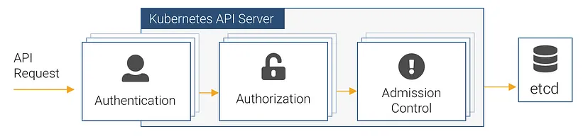
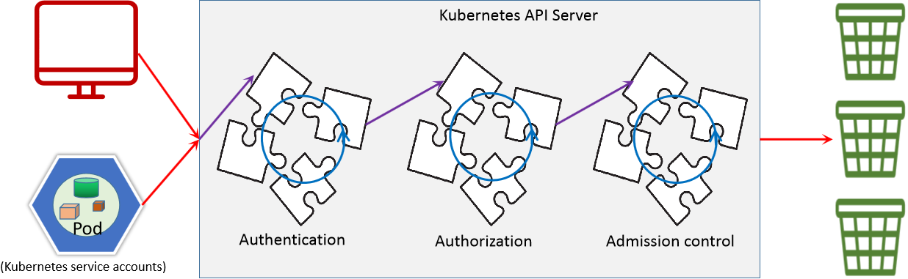
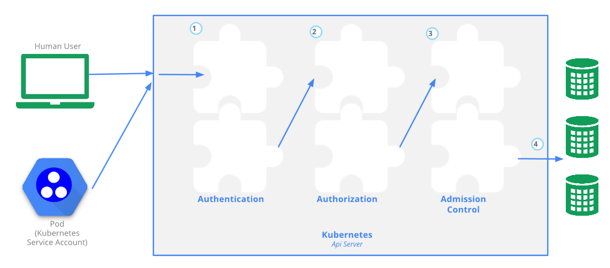
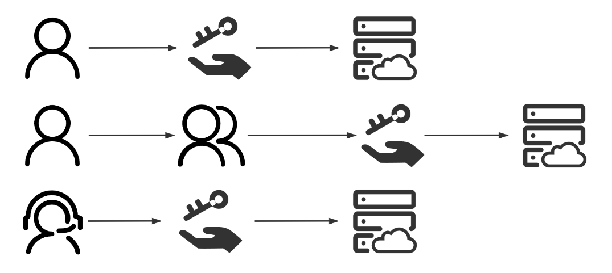
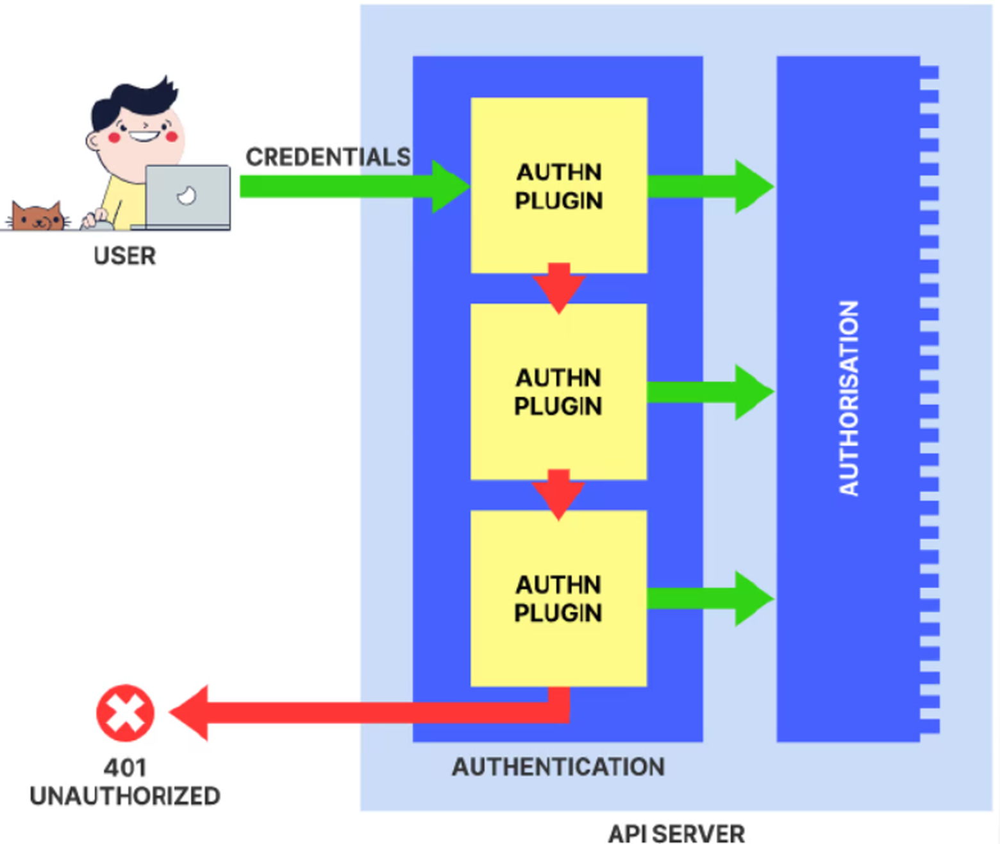
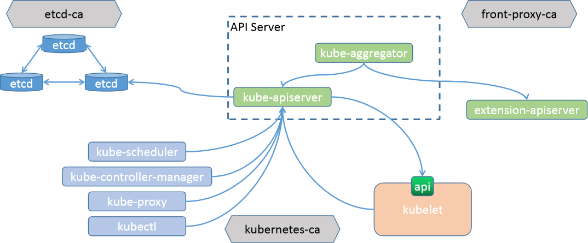
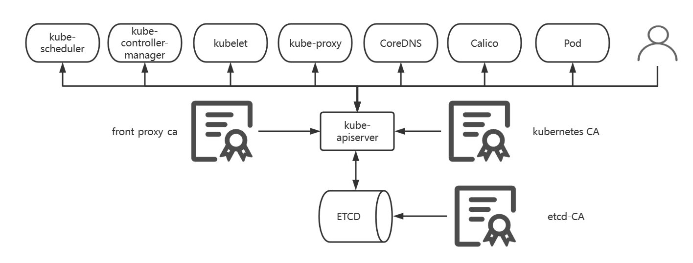
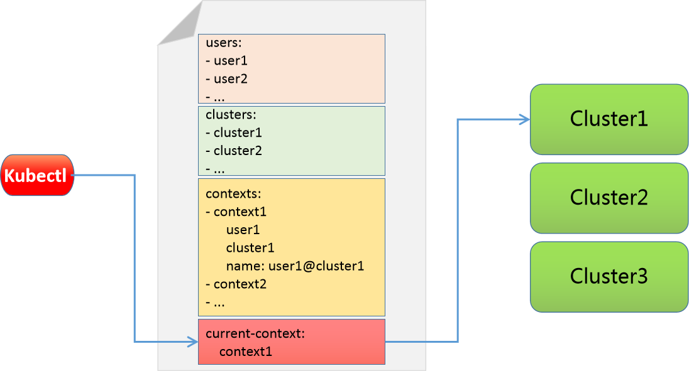

[← 返回 Kubernetes 目录]({{ '/subjects/Kubernetes/' | relative_url }})



# 30 安全体系与身份认证

用户访问 WordPress 等业务服务，与用户调用 Kubernetes API 管理 Pod，是两条不同的安全链路。前者由应用、入口代理及其认证机制负责；后者进入 API Server，依次经过**身份认证、授权和准入控制**。因此，给 Kubernetes 用户配置证书并不会自动为业务网站建立登录体系。



## 30.1 API 请求的三道检查

1. **认证（Authentication）**确定请求者身份，来源可以是客户端证书、服务账户令牌或外部身份提供者等。未通过认证的请求可能被拒绝，也可能在允许匿名认证的集群中成为 `system:anonymous`；不能笼统断言“任何失败都继续尝试”或“认证只在 HTTPS 时存在”。
2. **授权（Authorization）**判断此身份是否有权执行某个动词和资源组合。RBAC 是常见授权器，具体规则见第 31 章。身份正确但权限不足时通常返回 `403 Forbidden`。
3. **准入（Admission）**在已授权的创建、修改等写请求上执行默认填充或校验，如 Pod 安全标准、配额与 Webhook；见第 32 章。

API Server 应通过 HTTPS 暴露，客户端必须校验其 CA 与主机名。不要为图省事长期使用 `--insecure-skip-tls-verify`。kubelet 的 10250 等接口也需单独配置认证授权和网络隔离，不能因 API Server 配置了 RBAC 就默认安全。





## 30.2 普通用户、组与服务账户

Kubernetes API 中有 `ServiceAccount` 对象，但**没有普通 User Account 对象**。人类用户通常由客户端证书或外部 OIDC 等系统认证；从客户端证书读取的 `CN` 是用户名，`O` 可作为组名。`system:authenticated` 表示认证成功的身份；`system:serviceaccounts` 和 `system:serviceaccounts:<namespace>` 可用于匹配服务账户组。名称空间中的默认服务账户是**该名称空间的** `default`，不是所有 Pod 共用 `default` 名称空间中的同一个账户。



ServiceAccount 身份格式为 `system:serviceaccount:<namespace>:<name>`。认证只证明“你是谁”，不会自动授予管理权限；应以最小权限 RoleBinding/ClusterRoleBinding 显式授权。

## 30.3 X.509 客户端证书：创建一个演示用户

下面以已有 kubeadm 集群的管理员身份提交 CSR。先准备**客户端**私钥和证书签名请求，证书中的 `CN=reader` 与 `O=readers` 分别代表用户名和组。集群是否允许此签名器、审批流程和证书有效期取决于控制平面配置；签发前需确认申请者身份，不应对未知 CSR 执行批量审批。

```bash
openssl req -new -newkey rsa:3072 -nodes \
  -keyout reader.key -out reader.csr -subj '/CN=reader/O=readers'
base64 -w0 reader.csr > reader.csr.base64
```

将 `reader.csr.base64` 的内容填入 `request`，保存为 `reader-csr.yaml`：

```yaml
apiVersion: certificates.k8s.io/v1
kind: CertificateSigningRequest
metadata:
  name: reader-client
spec:
  request: <CSR 的 Base64 内容>
  signerName: kubernetes.io/kube-apiserver-client
  usages: [client auth]
  expirationSeconds: 86400
```

```bash
kubectl apply -f reader-csr.yaml
kubectl get csr reader-client -o wide
kubectl certificate approve reader-client
kubectl get csr reader-client -o jsonpath='{.status.certificate}' | base64 -d > reader.crt
openssl x509 -in reader.crt -noout -subject -dates
```

证书签发只完成**认证**。用该身份访问资源前，还需按第 31 章创建相应 Role 和 RoleBinding。私钥 `reader.key` 要限权保存；证书过期需要重新签发。



## 30.4 kubeconfig：把集群、凭据与上下文对应起来

kubeconfig 的 `clusters` 保存 API Server 与 CA，`users` 保存客户端凭据，`contexts` 把集群、用户和默认名称空间组合起来，`current-context` 决定默认使用哪个组合。用户项名称只是本地别名，不会改变证书中的真实身份。下例使用刚签发的证书创建独立配置；`API_SERVER` 与 `cluster-ca.crt` 须来自受信任的集群管理员，不能盲信未知服务器返回的证书。

```bash
API_SERVER='https://api.example.test:6443'
kubectl config set-cluster demo --server="$API_SERVER" \
  --certificate-authority=cluster-ca.crt --embed-certs=true \
  --kubeconfig=reader.kubeconfig
kubectl config set-credentials reader \
  --client-certificate=reader.crt --client-key=reader.key \
  --embed-certs=true --kubeconfig=reader.kubeconfig
kubectl config set-context reader@demo --cluster=demo --user=reader \
  --namespace=default --kubeconfig=reader.kubeconfig
kubectl config use-context reader@demo --kubeconfig=reader.kubeconfig
kubectl --kubeconfig=reader.kubeconfig config view --minify
kubectl --kubeconfig=reader.kubeconfig auth can-i list pods -n default
```

`kubectl --kubeconfig=...` 仅对该次命令生效；`KUBECONFIG` 环境变量可指定一个或多个配置文件。合并文件时同名 cluster、user、context 的先后顺序可能影响结果，先备份再检查 `kubectl config get-contexts`，不要把管理员私钥混入给普通用户分发的配置中。





### 令牌认证的版本差异

老集群可能通过 API Server 静态令牌文件认证普通用户，但静态文件没有便捷的轮换和撤销机制，还要求维护控制平面配置，不宜作为新集群的人类用户管理方案。现代环境优先选用受管理的身份提供者（如 OIDC）或按有效期签发客户端证书。`ServiceAccount` 令牌专供工作负载身份，不应当成长期共享的管理员密码。

## 30.5 ServiceAccount 与短期令牌

为需要访问 Kubernetes API 的工作负载创建专用服务账户，不使用默认账户承载多个应用的权限。当前 Kubernetes 常通过 TokenRequest API 为 Pod 投射带受众和有效期的令牌；旧文档中“每个 ServiceAccount 必有长期 Secret 令牌”的说法不适用于较新的版本。

```bash
kubectl -n default create serviceaccount report-reader
kubectl -n default create token report-reader --duration=10m
kubectl -n default auth can-i list pods \
  --as=system:serviceaccount:default:report-reader
```

第二条命令产生临时令牌，只用于经审批的测试，不要复制进文章、日志或 Git。若 Pod 不需要访问 API，可在 Pod 模板中设置 `automountServiceAccountToken: false`；若需要，则指定 `serviceAccountName: report-reader` 并通过 RBAC 授予必要的最小权限。

```yaml
apiVersion: v1
kind: Pod
metadata:
  name: report-app
spec:
  serviceAccountName: report-reader
  containers:
    - name: app
      image: nginx:1.27
```

在服务账户令牌的测试中，`401 Unauthorized` 通常提示认证凭据有问题，`403 Forbidden` 则表示身份已识别但授权不足。排错时检查目标名称空间、令牌受众/过期时间、CA 信任与 RoleBinding，而不是关闭 TLS 校验。





<nav class="article-end" aria-label="章节导航">
  <a href="{{ '/subjects/Kubernetes/29-helm-charts.html' | relative_url }}">← 上一章：自定义 Helm Chart</a>
  <a href="{{ '/subjects/Kubernetes/' | relative_url }}">返回 Kubernetes 目录</a>
  <a href="{{ '/subjects/Kubernetes/31-security-rbac.html' | relative_url }}">下一章：授权机制与 RBAC →</a>
</nav>
