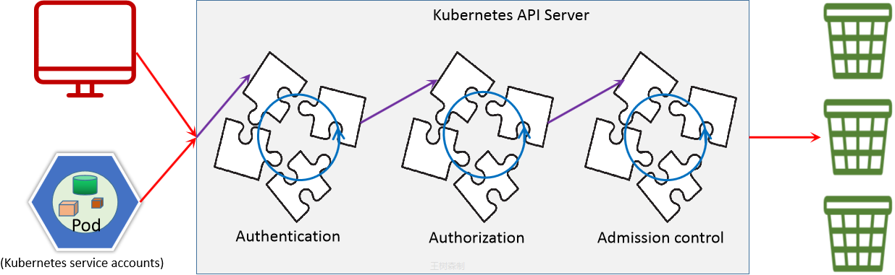
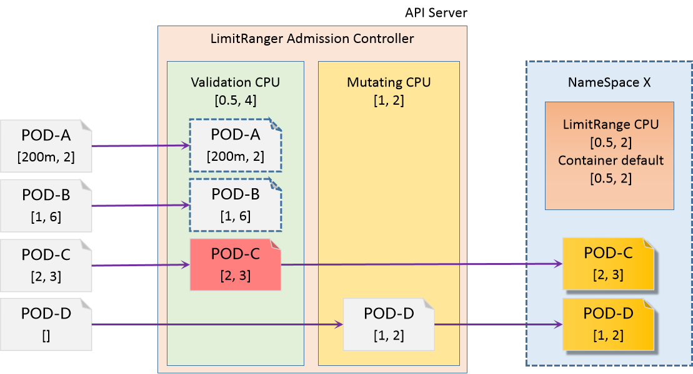

[← 返回 Kubernetes 目录]({{ '/subjects/Kubernetes/' | relative_url }})



# 32 准入控制

# 4 准入机制

## 4.1 准入机制说明

### 4.1.1 准入机制介绍

```text
https://kubernetes.io/zh-cn/docs/reference/access-authn-authz/admission-
controllers/
```

准入控制(Admission Control)，实际上是一个准入控制器(Admission Controller)插件列表，发送到APIServer的请求都需要经过这个列表中的每个准入控制器插件的检查，如果某一个控制器插件准入失败，就准入失败。只有所有准处成功才能成或,即与关系。它主要涉及到pod和容器对特定用户和特定权限之间的关联关系。kubernetes支持的准入控制器有数十种，分别应用于不同的场景功能。一般情况下，kubernetes的不同版本的默认准入控制器相差不大。但是其他的功能场景的准入控制器相差还是比较大的，尤其是最近些年版本中所支持的准入控制器。

常见控制器

**控制器解析**

- **LimitRanger**：为未设置资源限制的 Pod 赋予默认的资源配置属性，主要作用于单个 Pod。
- **ResourceQuota**：为未设置资源限额的 Pod 赋予默认限额，主要作用于命名空间范围。
- **PSP（PodSecurityPolicy）**：在集群层面限制 Pod 内部使用的某些用户特权级别资源；该功能已被弃用。



准入机制指的是经过了用户认证、角色授权之后，当进行一些写操作的时候，需要遵循的一些限制的要求,比如资源限制等。准入机制由一些的 "准入控制器" 组成，这些准入控制器编译进 kube-apiserver 二进制文件，由集群管理员进行配置。

这些控制器中，最主要的就是：MutatingAdmissionWebhook(变更) 和ValidatingAdmissionWebhook(验证)，变更（mutating）控制器可以修改被其接受的对象；验证（validating）控制器则不行。准入控制过程分为两个阶段，运行变更准入控制器和运行验证准入控制器。 实际上，某些控制器既是变更准入控制器又是验证准入控制器。如果任何一个阶段的任何控制器拒绝了该请求，则整个请求将立即被拒绝，并向终端用户返回一个错误。

最后，除了对对象进行变更外，准入控制器还可以有其它作用：将相关资源作为请求处理的一部分进行变更。 增加使用配额就是一个典型的示例，说明了这样做的必要性。 此类用法都需要相应的回收或回调过程，因为任一准入控制器都无法确定某个请求能否通过所有其它准入控制器。

### 4.1.2 准入控制器

**准入控制功能启用**

```text
#准入控制器需要在kube-apiserver中进行配置，我们的kubeadm的kube-apiserver的配置文件中就通过
属性开启了准入控制器：
```

```text
[root@master1 ~]#grep -ni 'admission' /etc/kubernetes/manifests/kube-
apiserver.yaml
20:    - --enable-admission-plugins=NodeRestriction
```

```text
#根据上面的内容显示，开启用enbable，那么关闭控制器也比较方便：
--disable-admission-plugins=控制器列表
```

```text
#查看默认开启的控制器
[root@master1 ~]#kubectl -n kube-system exec -it kube-apiserver-master1.wang.org
-- kube-apiserver -h | grep 'enable-admission-plugins strings'
```

```text
--enable-admission-plugins strings       admission plugins that should be
enabled in addition to default enabled ones (NamespaceLifecycle, LimitRanger,
ServiceAccount, TaintNodesByCondition, PodSecurity, Priority,
DefaultTolerationSeconds, DefaultStorageClass, StorageObjectInUseProtection,
PersistentVolumeClaimResize, RuntimeClass, CertificateApproval,
CertificateSigning, CertificateSubjectRestriction, DefaultIngressClass,
MutatingAdmissionWebhook, ValidatingAdmissionWebhook, ResourceQuota). Comma-
delimited list of admission plugins: AlwaysAdmit, AlwaysDeny, AlwaysPullImages,
CertificateApproval, CertificateSigning, CertificateSubjectRestriction,
DefaultIngressClass, DefaultStorageClass, DefaultTolerationSeconds,
DenyServiceExternalIPs, EventRateLimit, ExtendedResourceToleration,
ImagePolicyWebhook, LimitPodHardAntiAffinityTopology, LimitRanger,
MutatingAdmissionWebhook, NamespaceAutoProvision, NamespaceExists,
NamespaceLifecycle, NodeRestriction, OwnerReferencesPermissionEnforcement,
PersistentVolumeClaimResize, PersistentVolumeLabel, PodNodeSelector, PodSecurity,
PodSecurityPolicy, PodTolerationRestriction, Priority, ResourceQuota,
RuntimeClass, SecurityContextDeny, ServiceAccount, StorageObjectInUseProtection,
TaintNodesByCondition, ValidatingAdmissionWebhook. The order of plugins in this
flag does not matter.
#结果显示：kubernetes-v1.23版中默认启用了 18个 准入控制器。而可以启用的准入控制器有 35 个。
```

```text
#kubernetes-v1.30.0版有54种准备入控制器
[root@master1 ~]#kubectl version
Client Version: v1.30.0
Kustomize Version: v5.0.4-0.20230601165947-6ce0bf390ce3
Server Version: v1.30.0
```

```text
[root@master1 ~]#kubectl -n kube-system exec -it kube-apiserver-master1.wang.org
-- kube-apiserver -h | grep 'enable-admission-plugins strings'|tr "," "\n"
--enable-admission-plugins strings       admission plugins that should be
enabled in addition to default enabled ones (NamespaceLifecycle
LimitRanger
ServiceAccount
TaintNodesByCondition
PodSecurity
Priority
DefaultTolerationSeconds
DefaultStorageClass
StorageObjectInUseProtection
PersistentVolumeClaimResize
RuntimeClass
CertificateApproval
CertificateSigning
ClusterTrustBundleAttest
CertificateSubjectRestriction
DefaultIngressClass
MutatingAdmissionWebhook
ValidatingAdmissionPolicy
ValidatingAdmissionWebhook
ResourceQuota). Comma-delimited list of admission plugins: AlwaysAdmit
AlwaysDeny
AlwaysPullImages
CertificateApproval
CertificateSigning
CertificateSubjectRestriction
ClusterTrustBundleAttest
DefaultIngressClass
DefaultStorageClass
```

```text
DefaultTolerationSeconds
DenyServiceExternalIPs
EventRateLimit
ExtendedResourceToleration
ImagePolicyWebhook
LimitPodHardAntiAffinityTopology
LimitRanger
MutatingAdmissionWebhook
NamespaceAutoProvision
NamespaceExists
NamespaceLifecycle
NodeRestriction
OwnerReferencesPermissionEnforcement
PersistentVolumeClaimResize
PersistentVolumeLabel
PodNodeSelector
PodSecurity
PodTolerationRestriction
Priority
ResourceQuota
RuntimeClass
ServiceAccount
StorageObjectInUseProtection
TaintNodesByCondition
ValidatingAdmissionPolicy
ValidatingAdmissionWebhook. The order of plugins in this flag does not matter.
```

```text
[root@master1 ~]#kubectl -n kube-system exec -it kube-apiserver-master1.wang.org
-- kube-apiserver -h | grep 'enable-admission-plugins strings'|tr "," "\n"  |wc -
l
54
```

这些控制器有很多，与pod资源控制相关的准入控制器主要有以下几个。

**控制器解析**

- **LimitRanger**：为 Pod 设置默认计算资源需求与限制、存储资源需求与限制；可分别在容器和 Pod 级别施加约束。
- **ResourceQuota**：按资源类型限制数量，以及计算资源和存储资源的总量。
- **PodSecurityPolicy**：在集群级别限制 Pod 可使用的 `securityContext` 权限。由于 RBAC 的加强，该功能在 Kubernetes v1.21 被弃用，并于 v1.25 删除。

limitrange示意图



**psp资源属性**

```text
apiVersion: policy/v1beta1                  # PSP资源所属的API群组及版本
kind: PodSecurityPolicy                     # 资源类型标识
metadata:
name <string>                             # 资源名称
spec:
allowPrivilegeEscalation  <boolean>       # 是否允许权限升级
allowedCSIDrivers <[]Object>              # 内联CSI驱动程序列表，必须在Pod规范中显式
定义
allowedCapabilities <[]string>            # 允许使用的内核能力列表，“*”表示all
allowedFlexVolumes <[]Object>             # 允许使用的Flexvolume列表，空值表示“all
allowedHostPaths <[]Object>               # 允许使用的主机路径列表，空值表示all
allowedProcMountTypes <[]string>          # 允许使用的ProcMountType列表，空值表示默
认
allowedUnsafeSysctls <[]string>           # 允许使用的非安全sysctl参数，空值表示不允
许
defaultAddCapabilities  <[]string>        # 默认即添加到Pod对象的内核能力，可被drop
defaultAllowPrivilegeEscalation <boolean> # 是否默认允许内核权限升级
forbiddenSysctls  <[]string>              # 禁止使用的sysctl参数，空表示不禁用
fsGroup <Object>                          # 允许在SecurityContext中使用的
fsgroup，必选字段
rule <string>                           #允许使用的FSGroup的规则，支持RunAsAny和
MustRunAs
ranges <[]Object>                       # 允许使用的组ID范围，需要与MustRunAs规则
一同使用
max  <integer>                        # 最大组ID号
min  <integer>                        # 最小组ID号
hostIPC <boolean>                         # 是否允许Pod使用hostIPC
hostNetwork <boolean>                     # 是否允许Pod使用hostNetwork
hostPID <boolean>                         # 是否允许Pod使用hostPID
hostPorts <[]Object>                      # 允许Pod使用的主机端口暴露其服务的范围
max  <integer>                          # 最大端口号，必选字段
min  <integer>                          # 最小端口号，必选字段
privileged  <boolean>                     # 是否允许运行特权Pod
readOnlyRootFilesystem  <boolean>         # 是否设定容器的根文件系统为“只读”
requiredDropCapabilities <[]string>       # 必须要禁用的内核能力列表
runAsGroup  <Object>                      # 允许Pod在runAsGroup中使用值列表，未定义
表示不限制
```

```text
runAsUser <Object>                        # 允许Pod在runAsUser中使用的值列表，必选
字段
rule <string>                           # 支持RunAsAny、MustRunAs和
MustRunAsNonRoot
ranges <[]Object>                       # 允许使用的组ID范围，需要跟“MustRunAs”规
则一同使用
max  <integer>                        # 最大组ID号
min  <integer>                        # 最小组ID号
runtimeClass <Object>                     # 允许Pod使用的运行类，未定义表示不限制
allowedRuntimeClassNames <[]string>     # 可使用的runtimeClass列表，“*”表示all
defaultRuntimeClassName <string>        # 默认使用的runtimeClass
seLinux <Object>                          # 允许Pod使用的selinux标签，必选字段
rule <string>           # MustRunAs表示使用seLinuxOptions定义的值；RunAsAny表示可
使用任意值
seLinuxOptions  <Object>                # 自定义seLinux选项对象，与MustRunAs协作
生效
supplementalGroups  <Object>              # 允许Pod在SecurityContext中使用附加组，
必选字段
volumes <[]string>                        # 允许Pod使用的存储卷插件列表，空表示禁用，
*表示全部
```

```text
#注意：由于PSP的准入控制非常严格，而且默认情况下，不允许任何未被k8s集群所承认的资源正常使用，所
以，k8s集群默认情况下，没有正常启用。而且psp资源也不会被生效,如果需要使用psp资源的话，需要自己
来进行相关功能的启用。
```

## 4.2 实战案例

### 4.2.1 资源策略

默认情况下， Kubernetes 集群上的容器运行使用的计算资源没有限制。使用资源配额，集群管理员可以以名字空间为单位，限制其资源的使用与创建。在命名空间中，一个 Pod 或 Container 最多能够使用命名空间的资源配额所定义的 CPU 和内存用量。有人担心，一个 Pod 或 Container 会垄断所有可用的资源。LimitRange 是在命名空间内限制资源分配（给多个 Pod 或 Container）的策略对象。

一个 LimitRange（限制范围） 对象提供的限制能够做到：

在一个命名空间中实施对每个 Pod 或 Container 最小和最大的资源使用量的限制。在一个命名空间中实施对每个 PersistentVolumeClaim 能申请的最小和最大的存储空间大小的限制。在一个命名空间中实施对一种资源的申请值和限制值的比值的控制。设置一个命名空间中对计算资源的默认申请/限制值，并且自动的在运行时注入到多个 Container中。

Kubernetes 支持在名称空间级别对资源进行限制。

为命名空间配置默认的内存请求和限制。

为命名空间定义默认的内存资源限制，这样在该命名空间中每个新建的 Pod 都会被配置上内存资源限制。

为命名空间配置默认的 CPU 请求和限制。

为命名空间定义默认的 CPU 资源限制，在该命名空间中每个新建的 Pod 都会被配置上 CPU 资源限制。

**配置命名空间的最小和最大内存约束**

为命名空间定义一个有效的内存资源限制范围，在该命名空间中每个新创建 Pod 的内存资源是在设置的范围内。

**为命名空间配置 CPU 最小和最大约束**

为命名空间定义一个有效的 CPU 资源限制范围，使得在该命名空间中所有新建 Pod 的 CPU 资源是在你所设置的范围内。

为命名空间配置内存和 CPU 配额。

为命名空间定义总的 CPU 和内存资源限制。

**配置命名空间下 Pod 配额**

```text
https://kubernetes.io/zh-cn/docs/concepts/policy/limit-range/
https://kubernetes.io/zh-cn/docs/tasks/administer-cluster/manage-resources/
https://kubernetes.io/zh-cn/docs/tasks/administer-cluster/manage-resources/cpu-
default-namespace/
https://kubernetes.io/zh-cn/docs/tasks/administer-cluster/manage-resources/cpu-
constraint-namespace/
https://kubernetes.io/zh-cn/docs/tasks/administer-cluster/manage-
resources/memory-default-namespace/
https://kubernetes.io/zh-cn/docs/tasks/administer-cluster/manage-
resources/memory-constraint-namespace/
https://kubernetes.io/zh/docs/tasks/configure-pod-container/assign-cpu-resource/
https://kubernetes.io/zh/docs/tasks/configure-pod-container/assign-memory-
resource/
```

能够使用限制范围创建的策略示例有：

在一个有两个节点，8 GiB 内存与16个核的集群中，限制一个命名空间的 Pod 申请 100m 单位，最大 500m 单位的 CPU，以及申请 200Mi，最大 600Mi 的内存。为 spec 中没有 cpu 和内存需求值的 Container 定义默认 CPU 限制值与需求值 150m，内存默认需求值 300Mi。Kubernetes对资源的限制实际上是通过cgroup来控制的，cgroup是容器的一组用来控制内核如何运行进程的相关属性集合。针对内存、CPU和各种设备都有对应的cgroup。

默认情况下，Pod运行没有CPU和内存的限额。这意味着系统中的任何Pod将能够像执行Pod所在节点机器一样，可以消耗足够多的CPU和内存。一般会针对某些应用的Pod资源进行资源限制，这个资源限制是通过resources的requests【要分配的资源】和limits【最大使用资源】来实现的。

备注：CPU单位换算：100m CPU，100 milliCPU 和 0.1 CPU 都相同；精度不能超过 1m。1000m CPU= 1 CPU。

CPU 单位

CPU 资源以 CPU 单位度量。Kubernetes 中的一个 CPU 等同于：

1 个 AWS vCPU 1 个 GCP核心1 个 Azure vCore裸机上具有超线程能力的英特尔处理器上的 1 个超线程

小数值是可以使用的。一个请求 0.5 CPU 的容器保证会获得请求 1 个 CPU 的容器的 CPU 的一半。 你可以使用后缀 m 表示毫。例如 100m CPU、100 milliCPU 和 0.1 CPU 都相同。 精度不能超过 1m。CPU 请求只能使用绝对数量，而不是相对数量。0.1 在单核、双核或 48 核计算机上的 CPU 数量值是一样的。

管理内存、CPU 和 API 资源

#### 4.2.1.1 LimitRanger 案例

```text
#定义清单
[root@master1 ~]#cat security-limitrange-test.yaml
apiVersion: v1
kind: LimitRange
metadata:
name: storagelimits
spec:
limits:
- type: PersistentVolumeClaim
max:
storage: "10Gi"
min:
storage: "1Gi"
---
apiVersion: v1
kind: LimitRange
metadata:
name: core-resource-limits
spec:
limits:
- type: Pod
max:
cpu: "4"         #最大不能高于此值
memory: "4Gi"    #最大不能高于此值
min:
cpu: "500m"      #最小不能低于此值
memory: "16Mi"   #最小不能低于此值
- type: Container
max:
cpu: "4"
memory: "1Gi"
min:
cpu: "100m"
memory: "4Mi"
default:          #默认的limit值，如果没有定义限制，使用此默认值
cpu: "2"
memory: "512Mi"
defaultRequest:   #默认的request值
cpu: "500m"
memory: "64Mi"
maxLimitRequestRatio:   #用于设定上阈值Limit和下阈值requset之间的最大比例。
cpu: "4"
- type: PersistentVolumeClaim
max:
storage: "10Gi"
min:
storage: "1Gi"
default:
storage: "5Gi"
defaultRequest:
```

```text
storage: "1Gi"
maxLimitRequestRatio:
storage: "5"
#属性解析：maxLimitRequestRatio 用来指定容器资源限制（Limit）与资源请求（Request）之间的最
大允许比例。确保了容器的资源限制不会相对于资源请求设置得过高，从而避免资源分配上的不合理情况。
#如果 CPU 的 maxLimitRequestRatio 设置为 4：
#当一个容器请求了 500m（0.5 个 CPU），那么它的 CPU 限制最多只能设置为 4 * 500m = 2000m（2
个 CPU）。
#这个比例的目的是为了防止容器请求的资源非常低但设置了非常高的限制，这可能导致集群资源的低效利用。
```

```text
#应用资源定义文件
[root@master1 yaml]#kubectl apply -f security-limitrange-test.yaml
```

```text
#确认效果
[root@master1 ~]#kubectl get limitranges
NAME                   CREATED AT
core-resource-limits   2021-04-03T03:31:43Z
storagelimits          2021-04-03T03:31:43Z
```

```text
[root@master1 ~]#kubectl describe limitranges core-resource-limits
Name:                  core-resource-limits
Namespace:             default
Type                   Resource  Min   Max   Default Request  Default Limit  Max
Limit/Request Ratio
----                   --------  ---   ---   ---------------  -------------  ---
--------------------
Pod                    cpu       500m  4     -                -              -
Pod                    memory    16Mi  4Gi   -                -              -
Container              cpu       100m  4     500m             2              4
Container              memory    4Mi   1Gi   64Mi             512Mi          -
PersistentVolumeClaim  storage   1Gi   10Gi  1Gi              5Gi            5
```

```text
[root@master1 ~]#kubectl describe limitranges storagelimits
Name:                  storagelimits
Namespace:             default
Type                   Resource  Min  Max   Default Request  Default Limit  Max
Limit/Request Ratio
----                   --------  ---  ---   ---------------  -------------  ----
-------------------
PersistentVolumeClaim  storage   1Gi  10Gi  -                -              -
```

```text
#创建pod测试限制
[root@master1 ~]#kubectl run pod --image=registry.cn-
beijing.aliyuncs.com/wangxiaochun/pod-test:v0.1
```

```text
#验证限制生效
[root@master1 ~]#kubectl describe pod pod
.....
Limits:
cpu:     2           #和上面default限制配置相同
memory:  512Mi
Requests:
cpu:        500m
memory:     64Mi
......
```

```text
#对指定pod的资源限制
[root@master1 ~]#cat security-limitrange-pod-test-1.yaml
```

```text
apiVersion: v1
kind: Pod
metadata:
name: pod-test-1
spec:
containers:
- name: pod-test-1
image: registry.cn-beijing.aliyuncs.com/wangxiaochun/pod-test:v0.1
resources:
requests:
memory: 128Mi
cpu: 1
limits:
memory: 1Gi
cpu: 2
```

```text
[root@master1 ~]#kubectl  apply -f security-limitrange-pod-test-1.yaml
```

```text
#确认效果
[root@master1 ~]#kubectl get pod
NAME       READY   STATUS    RESTARTS   AGE
pod        1/1     Running   0          47m
pod-test-1   1/1     Running   0          42m
```

```text
#创建新pod
[root@master1 ~]#cat security-limitrange-pod-test-2.yaml
apiVersion: v1
kind: Pod
metadata:
name: pod-test-2
spec:
containers:
- name: pod-test-2
image: registry.cn-beijing.aliyuncs.com/wangxiaochun/pod-test:v0.1
resources:
requests:
memory: 128Mi
cpu: 200m        #指定小于min的cpu
limits:
memory: 1Gi
cpu: 2
```

```text
#因资源限制的原因创建失败
[root@master1 ~]#kubectl apply  -f  security-limitrange-pod-test-2.yaml
Error from server (Forbidden): error when creating "security-limitrange-pod-
test-2.yaml": pods "pod-test-2" is forbidden: [minimum cpu usage per Pod is
500m, but request is 200m, cpu max limit to request ratio per Container is 4,
but provided ratio is 10.000000]
#显示：CPU资源的200m低于min的500m以及cpu资源request200m和limit的2之间的比率达到10，超过设
置的4，导致Pod创建失败
```

```text
#创建pod
[root@master1 ~]#cat security-limitrange-pod-test-3.yaml
apiVersion: v1
kind: Pod
metadata:
name: pod-test-3
spec:
```

```text
containers:
- name: pod-test-3
image: registry.cn-beijing.aliyuncs.com/wangxiaochun/pod-test:v0.1
resources:
requests:
memory: 128Mi
cpu: 3          #指定超过worker节点的cpu数
limits:
memory: 1Gi
cpu: 3          #指定超过worker节点的cpu数
[root@master1 ~]#kubectl apply  -f  security-limitrange-pod-test-3.yaml
```

```text
#查看状态
[root@master1 ~]#kubectl get pod  pod-test-3
NAME         READY   STATUS    RESTARTS   AGE
pod-test-3   0/1     Pending   0          9s
```

```text
[root@master1 ~]#kubectl describe  pod  pod-test-3
Name:         pod-test-3
.....
Status:       Pending
IP:
IPs:          <none>
Containers:
pod-test:
Image:      wangxiaochun/pod-test:v0.1
Port:       <none>
Host Port:  <none>
Limits:
cpu:     3
memory:  1Gi
Requests:
cpu:        3
memory:     128Mi
......
Events:
Type     Reason            Age   From               Message
----     ------            ----  ----               -------
Warning  FailedScheduling  15s   default-scheduler  0/6 nodes are available: 3
Insufficient cpu, 3 node(s) had taint {node-role.kubernetes.io/master: }, that
the pod didn't tolerate.
```

#### 4.2.1.2 ResourceQuota 案例

范例: 名称空间的资源限制

```text
#资源定义文件
[root@master1 ~]#cat security-resourcequota-test.yaml
apiVersion: v1
kind: ResourceQuota
metadata:
name: resourcequota-test
namespace: default
spec:
hard:
pods: "5"
count/services: "5"
```

```text
count/configmaps: "5"
count/secrets: "5"
count/cronjobs.batch: "2"
requests.cpu: "2"
requests.memory: "4Gi"
requests.nvidia.com/gpu: 4
limits.cpu: "4"
limits.memory: "8Gi"
count/deployments.apps: "2"
count/statefulsets.apps: "2"
persistentvolumeclaims: "6"
requests.storage: "20Gi"
```

```text
#应用资源文件
[root@master1 ~]#kubectl apply -f security-resourcequota-test.yaml
```

```text
#确认效果
[root@master1 ~]#kubectl get resourcequotas
NAME                 AGE   REQUEST        LIMIT
resourcequota-test   64s   count/configmaps: 1/5, count/cronjobs.batch: 0/2,
count/deployments.apps: 2/2, count/secrets: 1/5, count/services: 2/5,
count/statefulsets.apps: 0/2, persistentvolumeclaims: 1/6, pods: 5/5,
requests.cpu: 200m/2, requests.memory: 128Mi/4Gi, requests.nvidia.com/gpu: 0/4,
requests.storage: 10Gi/20Gi   limits.cpu: 500m/4, limits.memory: 256Mi/8Gi
```

```text
[root@master1 ~]#kubectl describe  resourcequotas resourcequota-test
Name:                    resourcequota-test
Namespace:               default
Resource                 Used    Hard
--------                 ----    ----
count/configmaps         1       5
count/cronjobs.batch     0       2
count/deployments.apps   0       2
count/secrets            2       5
count/services           1       5
count/statefulsets.apps  0       2
limits.cpu               7       4
limits.memory            2560Mi  8Gi
persistentvolumeclaims   0       6
pods                     3       5
requests.cpu             4500m   2
requests.memory          320Mi   4Gi
requests.nvidia.com/gpu  0       4
requests.storage         0       20Gi
```

```text
#尝试创建多个pod,确认一下，pod数量多于5个的时候，看看是否会限制pod的创建
[root@master1 ~]#kubectl run pod --image=registry.cn-
beijing.aliyuncs.com/wangxiaochun/pod-test:v0.1
Error from server (Forbidden): pods "pod" is forbidden: exceeded quota:
resourcequota-test, requested: limits.cpu=2,requests.cpu=500m, used:
limits.cpu=7,requests.cpu=4500m, limited: limits.cpu=4,requests.cpu=2
```

### 4.2.2 安全策略 ( Kubernetes v1.21 版本后被弃用 )

#### 4.2.2.1 podsecuritpolicy 启用

```text
#启用psp功能
[root@master1 ~]#kubectl -n kube-system exec -it kube-apiserver-master1.wang.org
-- kube-apiserver --help | grep 'enable-admission'
```

```text
--admission-control strings              Admission is divided into two
phases. In the first phase, only mutating admission plugins run. In the second
phase, only validating admission plugins run. The names in the below list may
represent a validating plugin, a mutating plugin, or both. The order of plugins
in which they are passed to this flag does not matter. Comma-delimited list of:
AlwaysAdmit, AlwaysDeny, AlwaysPullImages, CertificateApproval,
CertificateSigning, CertificateSubjectRestriction, DefaultIngressClass,
DefaultStorageClass, DefaultTolerationSeconds, DenyServiceExternalIPs,
EventRateLimit, ExtendedResourceToleration, ImagePolicyWebhook,
LimitPodHardAntiAffinityTopology, LimitRanger, MutatingAdmissionWebhook,
NamespaceAutoProvision, NamespaceExists, NamespaceLifecycle, NodeRestriction,
OwnerReferencesPermissionEnforcement, PersistentVolumeClaimResize,
PersistentVolumeLabel, PodNodeSelector, PodSecurity, PodSecurityPolicy,
PodTolerationRestriction, Priority, ResourceQuota, RuntimeClass,
SecurityContextDeny, ServiceAccount, StorageObjectInUseProtection,
TaintNodesByCondition, ValidatingAdmissionWebhook. (DEPRECATED: Use --enable-
admission-plugins or --disable-admission-plugins instead. Will be removed in a
future version.)
--enable-admission-plugins strings       admission plugins that should be
enabled in addition to default enabled ones (NamespaceLifecycle, LimitRanger,
ServiceAccount, TaintNodesByCondition, PodSecurity, Priority,
DefaultTolerationSeconds, DefaultStorageClass, StorageObjectInUseProtection,
PersistentVolumeClaimResize, RuntimeClass, CertificateApproval,
CertificateSigning, CertificateSubjectRestriction, DefaultIngressClass,
MutatingAdmissionWebhook, ValidatingAdmissionWebhook, ResourceQuota). Comma-
delimited list of admission plugins: AlwaysAdmit, AlwaysDeny, AlwaysPullImages,
CertificateApproval, CertificateSigning, CertificateSubjectRestriction,
DefaultIngressClass, DefaultStorageClass, DefaultTolerationSeconds,
DenyServiceExternalIPs, EventRateLimit, ExtendedResourceToleration,
ImagePolicyWebhook, LimitPodHardAntiAffinityTopology, LimitRanger,
MutatingAdmissionWebhook, NamespaceAutoProvision, NamespaceExists,
NamespaceLifecycle, NodeRestriction, OwnerReferencesPermissionEnforcement,
PersistentVolumeClaimResize, PersistentVolumeLabel, PodNodeSelector, PodSecurity,
PodSecurityPolicy, PodTolerationRestriction, Priority, ResourceQuota,
RuntimeClass, SecurityContextDeny, ServiceAccount, StorageObjectInUseProtection,
TaintNodesByCondition, ValidatingAdmissionWebhook. The order of plugins in this
flag does not matter.
```

```text
#注意：由于默认psp是拒绝所有pod的，所以我们在启用psp的时候，需要额外做一些措施,即提前做好psp相
关的策略，然后再开启PSP功能。
```

Policy本身并不会产生实际作用，需要将其与用户或者serviceaccount绑定才可以完成授权。所以PSP的基本的操作步骤是：

定义psp相关策略绑定psp资源的角色集群启用PSP功能

#### 4.2.2.2 定义psp相关策略

```text
#定制资源配置文件
[root@master1 ~]#cat security-podsecuritypolicy-base.yaml
apiVersion: policy/v1beta1
kind: PodSecurityPolicy
metadata:
name: privileged
annotations:
seccomp.security.alpha.kubernetes.io/allowedProfileNames: '*'
spec:
privileged: true
allowPrivilegeEscalation: true
allowedCapabilities:
- '*'
allowedUnsafeSysctls:
- '*'
volumes:
- '*'
hostNetwork: true
hostPorts:
- min: 0
max: 65535
hostIPC: true
hostPID: true
runAsUser:
rule: 'RunAsAny'
runAsGroup:
rule: 'RunAsAny'
seLinux:
rule: 'RunAsAny'
supplementalGroups:
rule: 'RunAsAny'
fsGroup:
rule: 'RunAsAny'
```

```text
---
apiVersion: policy/v1beta1
kind: PodSecurityPolicy
metadata:
name: restricted
annotations:
seccomp.security.alpha.kubernetes.io/allowedProfileNames: 'docker/default'
apparmor.security.beta.kubernetes.io/allowedProfileNames: 'runtime/default'
seccomp.security.alpha.kubernetes.io/defaultProfileName:  'docker/default'
apparmor.security.beta.kubernetes.io/defaultProfileName:  'runtime/default'
spec:
privileged: false
allowPrivilegeEscalation: false
allowedUnsafeSysctls: []
requiredDropCapabilities:
- ALL
# Allow core volume types.
volumes:
- 'configMap'
- 'emptyDir'
- 'projected'
```

```text
- 'secret'
- 'downwardAPI'
- 'persistentVolumeClaim'
hostNetwork: false
hostIPC: false
hostPID: false
runAsUser:
rule: 'MustRunAsNonRoot'
seLinux:
rule: 'RunAsAny'
supplementalGroups:
rule: 'MustRunAs'
ranges:
# Forbid adding the root group.
- min: 1
max: 65535
fsGroup:
rule: 'MustRunAs'
ranges:
# Forbid adding the root group.
- min: 1
max: 65535
readOnlyRootFilesystem: false
```

```text
#应用资源定义文件
[root@master1 ~]#kubectl apply  -f  security-podsecuritypolicy-base.yaml
```

```text
#确认效果
[root@master1 ~]#kubectl get podsecuritypolicies.policy
```

#### 4.2.2.3 绑定psp资源的角色

```text
#定义资源配置文件
[root@master1 ~]#cat security-podsecuritypolicy-binding.yaml
kind: ClusterRole
apiVersion: rbac.authorization.k8s.io/v1
metadata:
name: psp-restricted
rules:
- apiGroups: ['policy']
resources: ['podsecuritypolicies']
verbs:     ['use']
resourceNames:
- restricted
---
kind: ClusterRole
apiVersion: rbac.authorization.k8s.io/v1
metadata:
name: psp-privileged
rules:
- apiGroups: ['policy']
resources: ['podsecuritypolicies']
verbs:     ['use']
resourceNames:
- privileged
---
apiVersion: rbac.authorization.k8s.io/v1
```

```text
kind: ClusterRoleBinding
metadata:
name: privileged-psp-user
roleRef:
apiGroup: rbac.authorization.k8s.io
kind: ClusterRole
name: psp-privileged
subjects:
- apiGroup: rbac.authorization.k8s.io
kind: Group
name: system:masters
- apiGroup: rbac.authorization.k8s.io
kind: Group
name: system:node
- apiGroup: rbac.authorization.k8s.io
kind: Group
name: system:serviceaccounts:kube-system
---
kind: ClusterRoleBinding
apiVersion: rbac.authorization.k8s.io/v1
metadata:
name: restricted-psp-user
roleRef:
kind: ClusterRole
name: psp-restricted
apiGroup: rbac.authorization.k8s.io
subjects:
- kind: Group
apiGroup: rbac.authorization.k8s.io
name: system:authenticated
```

```text
#应用资源定义文件
[root@master1 ~]#kubectl apply  -f  security-podsecuritypolicy-binding.yaml
```

```text
#确认效果
[root@master1 ~]#kubectl get clusterrole | grep psp
psp-privileged                          2021-10-07T06:10:41Z
psp-restricted                          2021-10-07T06:10:41Z
```

```text
[root@master1 ~]#kubectl get clusterrolebindings | grep psp
privileged-psp-user             ClusterRole/psp-privileged       56s
restricted-psp-user             ClusterRole/psp-restricted       56s
```

#### 4.2.2.4 集群启用PSP功能

```text
#配置apiserver增加admission plugin PodSecurityPolicy即可。
#编辑kube-apiserver.yaml 文件，添加如下配置
[root@master1 ~]#vim /etc/kubernetes/manifests/kube-apiserver.yaml
--enable-admission-plugins=NodeRestriction,PodSecurityPolicy
```

```text
#由于kubeadm集群中，api-server是以静态pod的方式来进行管控的，所以我们不用重启，稍等一会，集群
环境自然就开启了PSP功能
```

#### 4.2.2.5 测试效果

```text
#设置资源配置文件
[root@master1 ~]#cat security-pod-test.yaml
apiVersion: v1
kind: Pod
metadata:
name: nginx
spec:
containers:
- image: nginx
name: registry.cn-beijing.aliyuncs.com/wangxiaochun/nginx:1.20.0
```

```text
[root@master1 ~]#kubectl apply  -f  security-pod-test.yaml
```



<nav class="article-end" aria-label="章节导航">
  <a href="{{ '/subjects/Kubernetes/31-security-rbac.html' | relative_url }}">← 上一章：授权机制与 RBAC</a>
  <a href="{{ '/subjects/Kubernetes/' | relative_url }}">返回 Kubernetes 目录</a>
  <a href="{{ '/subjects/Kubernetes/33-cluster-nodes.html' | relative_url }}">下一章：节点增删与 Token 管理 →</a>
</nav>
